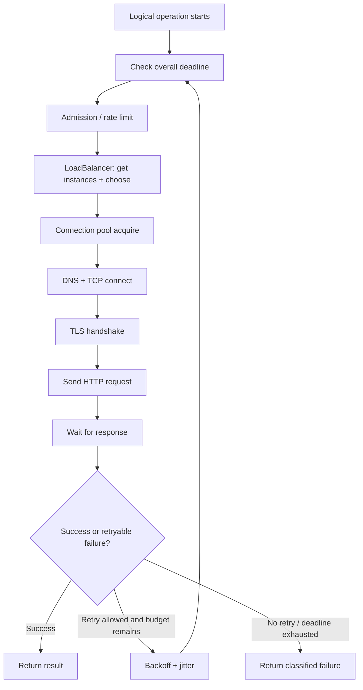

# Thiết kế chính sách timeout, retry và cô lập nhất quán

## Mục tiêu

Một request từ `order-service` gọi `inventory-service` có thể đi qua discovery, Spring Cloud LoadBalancer, connection pool, TCP/TLS, proxy và backend. Khi backend chậm hoặc một instance lỗi, hệ thống phải quyết định **chờ bao lâu, thử lại bao nhiêu lần, thử ở instance nào và giới hạn tài nguyên đang bị giữ ra sao**.

Nếu mỗi tầng tự đặt timeout/retry độc lập, tổng thời gian có thể vượt SLA và số request thực tế tới backend tăng nhiều lần. Một retry ở Feign, một retry ở LoadBalancer, một retry ở Gateway và một retry ở service mesh có thể nhân lên thành nhiều physical attempts. Trong lúc đó, thread, connection và queue tiếp tục bị giữ, làm sự cố lan sang các dependency khác.

Bài học này hướng dẫn thiết kế **một chính sách nhất quán theo deadline và dependency**. Sau bài học, bạn có thể:

- Phân biệt timeout của pool acquire, DNS/connect, TLS, response và deadline toàn operation.
- Phân bổ timeout budget cho nhiều lần thử và backoff.
- Chọn lỗi được retry, operation an toàn và giới hạn attempts.
- Quyết định retry trên cùng instance hay instance kế tiếp của LoadBalancer.
- Phối hợp timeout, retry, circuit breaker, bulkhead, rate limiter và bounded queue.
- Đặt chính sách riêng cho `inventory-service`, `payment-service` và các dependency khác.
- Cấu hình ví dụ cho RestClient, WebClient và OpenFeign theo đúng transport.
- Kiểm tra retry amplification, idempotency, metrics và rollback chính sách.

> Phạm vi: Spring Cloud LoadBalancer giải quyết việc chọn `ServiceInstance`; HTTP client quyết định phần lớn timeout transport; resilience library điều khiển retry/circuit breaker/bulkhead; ứng dụng sở hữu deadline và semantics nghiệp vụ. Không có một property duy nhất điều khiển toàn bộ các lớp này.

## 1. Bắt đầu từ deadline của operation

**Deadline** là thời điểm muộn nhất mà caller còn chấp nhận kết quả của một operation. Đây là ngân sách tổng bao trùm mọi giai đoạn: chờ admission, chọn instance, chờ connection, kết nối, TLS, gửi request, nhận response, retry và xử lý kết quả.

Ví dụ API đặt hàng có deadline nội bộ 1.000 ms cho lời gọi inventory:

```text
Deadline tổng: 1.000 ms

Admission / chọn instance       50 ms
Attempt 1                       300 ms
Backoff                         100 ms
Attempt 2                       300 ms
Xử lý response / dự phòng       100 ms
--------------------------------------
Tổng                            850 ms
Còn lại                         150 ms
```

Đây là phép chia ngân sách minh họa, không phải cấu hình mặc định. Khi attempt đầu dùng hết 800 ms, không còn đủ budget cho attempt tiếp theo; caller nên dừng và trả kết quả phù hợp thay vì bắt đầu một request chắc chắn hết hạn.

### 1.1. Timeout không đồng nghĩa deadline

| Giới hạn | Nó kiểm soát điều gì? | Có thể bao phủ những gì? |
|---|---|---|
| Pool acquire timeout | Chờ connection/stream khả dụng | Chỉ thời gian lấy tài nguyên từ pool |
| DNS timeout | Chờ phân giải hostname | Chỉ bước DNS nếu transport tách riêng |
| Connect timeout | Thiết lập TCP connection | Không bao gồm toàn bộ response |
| TLS handshake timeout | Thương lượng TLS/certificate | Không bao gồm xử lý nghiệp vụ |
| Response/read timeout | Chờ response hoặc dữ liệu tiếp theo | Phụ thuộc semantics transport |
| LoadBalancer selection | Chờ supplier trả danh sách/chọn instance | Có thể cần giới hạn riêng nếu supplier bất đồng bộ/chậm |
| Per-attempt timeout | Giới hạn một lần HTTP attempt | Không bao gồm tất cả retries nếu retry wrapper nằm ngoài |
| Overall deadline | Thời điểm kết thúc operation | Bao gồm mọi attempts, backoff và phần chờ nếu được truyền đúng |

**Không cộng các timeout như thể chúng luôn chạy tuần tự.** Ví dụ connect timeout và response timeout có thể được quản lý bởi transport khác nhau; một client có thể bắt đầu timer từ lúc request được subscribe, client khác chỉ bắt đầu sau khi acquire connection.

### 1.2. Chọn deadline từ SLO và latency thực tế

Đừng chọn 30 giây chỉ vì đó là default của một thư viện. Hãy xuất phát từ:

- SLO/timeout của API phía trên.
- p50, p95, p99 latency của dependency theo endpoint.
- Thời gian còn lại sau khi API xử lý auth, DB và các dependency khác.
- Mức độ quan trọng của request và khả năng fallback.
- Chi phí giữ thread, connection, heap và queue khi downstream chậm.

Ví dụ:

| Operation | Deadline minh họa | Lý do |
|---|---:|---|
| Đọc tồn kho cho trang sản phẩm | 700 ms | Có thể trả cache hoặc dữ liệu cũ có kiểm soát |
| Kiểm tra giá trước checkout | 500 ms | Cần phản hồi nhanh để giữ UX |
| Ghi nhận thanh toán | Theo hợp đồng giao dịch, ví dụ 2 s | Cần idempotency và trạng thái xử lý rõ |
| Gửi email bất đồng bộ | Không nằm trong request deadline | Dùng queue/job deadline riêng |

Các con số chỉ để minh họa cách phân loại. Deadline production phải đo từ SLO và workload thật.

## 2. Phân rã ngân sách timeout theo từng tầng

Một HTTP call load-balanced có thể đi qua:



Mỗi tầng cần một giới hạn, nhưng **deadline tổng là nguồn sự thật cuối cùng**. Nếu còn 100 ms deadline mà connect timeout được đặt 2 giây, caller không nên chờ hết 2 giây.

### 2.1. Pool acquire

Khi pool hết connection hoặc stream, request có thể chờ trước khi kết nối. Đây không phải connect timeout. Nếu pending queue dài, request có thể hết deadline ngay trong lúc chưa gửi byte nào.

Thiết kế:

- Giới hạn số connection/stream.
- Giới hạn số request pending.
- Đặt acquire timeout nhỏ hơn phần budget còn lại.
- Từ chối sớm khi pool đã bão hòa thay vì queue không giới hạn.
- Quan sát active, idle, pending và thời gian acquire.

### 2.2. Connect và TLS

Connect timeout cần đủ cho network nội bộ và thời gian thiết lập kết nối, nhưng không nên lớn hơn deadline của operation. TLS handshake còn phụ thuộc certificate chain, SNI, mTLS và ALPN; một lỗi certificate thường không thể sửa bằng retry liên tục.

Retry connect failure chỉ nên bật khi có lý do tin rằng lỗi tạm thời, ví dụ một instance vừa bị rút khỏi discovery hoặc network reset ngắn. Không retry lỗi cấu hình TLS/hostname lặp đi lặp lại.

### 2.3. Response timeout

Response timeout giới hạn thời gian chờ response/dữ liệu theo semantics của HTTP client. Cần phân biệt:

- **Response timeout** cho một response.
- **Read timeout** của socket/transport.
- **Timeout giữa các lần đọc** (idle/read inactivity timeout) nếu transport hỗ trợ.
- **Deadline toàn request** bao gồm cả thời gian trước khi gửi và backoff.

Một response streaming có thể truyền dữ liệu lâu hơn tổng thời gian response của một request thông thường. Với streaming, cần deadline/idle policy phù hợp thay vì áp một con số ngắn cho mọi use case.

## 3. Quy tắc retry: chỉ thử lại khi có thể phục hồi an toàn

Retry không làm lỗi biến mất. Nó tạo **một lần thực thi mới** với hy vọng lỗi trước đó là tạm thời. Mỗi lần thử lại tiêu thụ tài nguyên và có thể lặp side effect.

### 3.1. Phân loại lỗi

| Lỗi | Chính sách thường phù hợp | Lý do |
|---|---|---|
| Connection reset trước khi request được xử lý | Có thể retry giới hạn | Có thể là lỗi mạng/instance tạm thời |
| Connect timeout | Có thể thử instance khác nếu budget còn | Chưa thiết lập kết nối tới backend |
| HTTP 502/503/504 | Có thể retry với operation an toàn | Gateway/backend tạm thời không phục vụ |
| HTTP 429 | Tôn trọng `Retry-After`/quota; thường chờ hoặc từ chối | Retry ngay có thể làm tăng overload |
| HTTP 400/422 | Không retry | Request không hợp lệ |
| HTTP 401/403 | Không retry mù quáng | Cần sửa authentication/authorization |
| HTTP 404 | Thường không retry | Tài nguyên không tồn tại hoặc path/contract sai |
| HTTP 409 | Theo semantics nghiệp vụ | Có thể là conflict cần xử lý, không phải lỗi tạm thời |
| TLS certificate/hostname failure | Không retry liên tục | Lỗi trust/configuration |
| JSON decode/schema mismatch | Không retry mù quáng | Backend contract không tương thích |
| Application exception không xác định | Mặc định không retry | Không biết có an toàn hay không |

HTTP 500 không tự động có nghĩa là tạm thời. Một số lỗi 500 do bug/validation nội bộ; chỉ retry khi có phân loại rõ theo API contract.

### 3.2. Idempotency là điều kiện quan trọng

Một operation idempotent khi lặp lại cùng yêu cầu không làm thay đổi kết quả cuối ngoài lần đầu. GET thường được thiết kế safe; PUT/DELETE có semantics idempotent theo HTTP, nhưng implementation nghiệp vụ vẫn cần đúng contract. POST thường không idempotent nếu tạo side effect.

Ví dụ:

```http
POST /api/payments
Idempotency-Key: pay-order-42
Content-Type: application/json

{"orderId":"order-42","amount":125000}
```

Nếu caller timeout sau khi backend đã ghi thanh toán, retry POST có thể tạo khoản thanh toán thứ hai. Với idempotency key, backend lưu kết quả theo key và trả lại cùng kết quả cho lần lặp hợp lệ.

**Correlation ID không tự động là idempotency key.** Một correlation ID có thể bao trùm nhiều operation; idempotency key phải có semantics, phạm vi lưu và thời hạn riêng.

### 3.3. Không thể suy ra request chưa được xử lý chỉ từ timeout

Nếu kết nối bị reset sau khi backend nhận body, caller có thể không biết backend đã commit hay chưa. Đây là trạng thái **outcome không xác định**. Với write operation:

- Dùng idempotency/deduplication.
- Truy vấn trạng thái theo business operation ID nếu API hỗ trợ.
- Không retry POST tự động nếu backend không đảm bảo idempotency.
- Thiết kế response/status để caller phân biệt rejected, accepted, completed và unknown outcome.

## 4. Giới hạn số attempts và retry amplification

Nếu một logical request có tối đa 3 attempts ở mỗi tầng và có 3 tầng retry độc lập, số request vật lý trong trường hợp xấu có thể nhân lên:

```text
Gateway:        3 attempts
Service caller: 3 attempts
HTTP wrapper:   3 attempts

Worst-case attempts = 3 × 3 × 3 = 27
```

Đây là minh họa khi mỗi tầng thực sự retry lồng nhau. Hệ thống thực tế có thể ít hơn, nhưng nguyên tắc vẫn đúng: **retry ở nhiều tầng làm số attempts khó dự đoán**.

### 4.1. Một tầng sở hữu retry chính

Thiết kế khuyến nghị:

- Chọn một tầng sở hữu retry chính cho mỗi dependency call.
- Các tầng còn lại không tự retry hoặc chỉ retry lỗi rất hẹp theo hợp đồng.
- Có một giới hạn attempts tổng cho logical operation.
- Mỗi attempt phải nằm trong deadline tổng.
- Log/metric riêng logical call và physical attempt.

Không nhất thiết mọi retry phải nằm ở cùng một thư viện; nhưng phải có **một ngân sách tổng** và biết rõ tầng nào có thể tạo thêm HTTP request.

### 4.2. Cấu hình Spring Cloud LoadBalancer retry

Ví dụ cấu hình minh họa:

```yaml
spring:
  cloud:
    loadbalancer:
      retry:
        enabled: true
        max-retries-on-same-service-instance: 0
        max-retries-on-next-service-instance: 1
        retry-on-all-operations: false
        retryable-status-codes:
          - 502
          - 503
          - 504
```

Ý nghĩa:

- `enabled` bật retry integration của LoadBalancer khi HTTP client được tích hợp phù hợp.
- `max-retries-on-same-service-instance: 0` không thử lại cùng instance ở tầng này.
- `max-retries-on-next-service-instance: 1` cho phép tối đa một lần chọn instance kế tiếp theo policy.
- `retry-on-all-operations: false` tránh mặc định retry mọi method; hành vi cụ thể còn phụ thuộc client integration và version.
- `retryable-status-codes` liệt kê status được phép thử lại.

**Đây không phải tổng số attempts của toàn hệ thống.** HTTP client, Feign, Gateway hoặc resilience wrapper vẫn có thể tạo thêm attempts. Xác minh đúng property và defaults trong Configuration Properties Reference của Spring Cloud Release Train đang dùng.

### 4.3. Same instance hay next instance?

| Lựa chọn | Có ích khi | Rủi ro |
|---|---|---|
| Retry same instance | Lỗi ngắn hạn như một request bị reset nhưng instance còn khỏe | Nếu instance thực sự unhealthy, tiếp tục dồn tải vào nó |
| Retry next instance | Instance hiện tại bị lỗi/đang rollout, còn bản sao khác khỏe | Tăng tải lên các bản sao còn lại; có thể lặp lại nếu discovery stale |
| Không retry | Lỗi không tạm thời, operation không idempotent, deadline ngắn | Người dùng thấy lỗi ngay cả khi có lỗi mạng transient |

Retry next instance chỉ có ý nghĩa khi danh sách có instance khác. Nếu chỉ có một instance, hoặc filter đã loại hết các instance còn lại, không thể kỳ vọng LoadBalancer tạo ra một bản sao mới.

### 4.4. Retryable exceptions và response body

Với exception, phân loại theo root cause:

- Connection refused/reset: có thể là transient, tùy trạng thái discovery.
- Connect timeout: có thể thử instance khác nếu deadline còn.
- SSL handshake/certificate exception: thường không retry.
- Serialization/decoder exception: không retry.
- Caller cancellation/deadline exceeded: không retry thêm.

Không chỉ nhìn class exception ngoài cùng; HTTP client có thể wrap exception qua nhiều lớp. Đừng cấu hình retry mọi `IOException` nếu trong nhóm đó có lỗi vĩnh viễn như TLS/certificate hoặc lỗi đọc body không thể replay.

## 5. Backoff, jitter và Retry-After

Retry ngay lập tức có thể khiến tất cả caller cùng gửi lại đúng lúc backend đang phục hồi, tạo **retry storm**.

Một chiến lược exponential backoff minh họa:

```text
base delay = 100 ms
attempt 2: 100 ms + jitter
attempt 3: 200 ms + jitter
attempt 4: 400 ms + jitter
maximum delay: 500 ms
```

Jitter giúp các client không đồng bộ retry tại cùng một thời điểm. Giới hạn delay tối đa và tổng attempts theo deadline; không để backoff vượt thời gian caller còn chấp nhận kết quả.

### 5.1. Tôn trọng Retry-After

Khi server trả 429 hoặc 503 cùng `Retry-After`, client cần xem đây là gợi ý thời gian thử lại. Giá trị có thể là số giây hoặc HTTP-date theo HTTP semantics. Nếu thời điểm đó vượt deadline của caller, hãy trả lỗi thay vì đợi vô ích.

Không tự động retry 429 ngay lập tức; làm vậy có thể vi phạm quota và làm backend quá tải hơn.

### 5.2. WebClient retry với Reactor

Ví dụ retry hẹp cho một GET, chỉ khi gặp một số lỗi tạm thời đã xác định:

```java
import java.time.Duration;
import org.springframework.web.reactive.function.client.WebClientResponseException;
import reactor.core.publisher.Mono;
import reactor.util.retry.Retry;

Mono<ItemResponse> findItem(String sku) {
    return webClient.get()
            .uri("http://inventory-service/api/items/{sku}", sku)
            .retrieve()
            .bodyToMono(ItemResponse.class)
            .retryWhen(Retry.backoff(1, Duration.ofMillis(100))
                    .maxBackoff(Duration.ofMillis(200))
                    .jitter(0.5)
                    .filter(error ->
                            error instanceof WebClientResponseException response
                                    && (response.getStatusCode().value() == 502
                                    || response.getStatusCode().value() == 503
                                    || response.getStatusCode().value() == 504)));
}
```

Ví dụ này chỉ minh họa **một lần retry** cho status 502/503/504. Nó chưa xử lý Retry-After, connect exception, deadline tổng hoặc idempotency cho write operations. Nếu muốn retry connection failure, bổ sung predicate theo exception cụ thể và loại trừ TLS/certificate, cancellation, decode error.

`Retry.backoff(1, ...)` có nghĩa một lần retry sau lần đầu (tối đa hai subscriptions), không phải một attempt tổng. Hãy tính đúng con số này khi phối hợp với LoadBalancer retry.

### 5.3. Deadline cho reactive pipeline

```java
Mono<ItemResponse> findWithinDeadline(String sku) {
    return findItem(sku)
            .timeout(Duration.ofMillis(700));
}
```

`timeout` ở ví dụ này giới hạn publisher tổng ở 700 ms, bao gồm thời gian retry/backoff bên trong `findItem`. Nó không thay thế connect/acquire/response timeouts của HTTP transport; nên cấu hình cả hai để resource được giải phóng đúng cách.

Nếu upstream đã cancel, pipeline nên dừng các attempts còn lại. Đừng chuyển cancellation thành retry.

## 6. Cô lập: bulkhead, rate limit và bounded queue

Timeout và retry không đủ nếu một dependency chậm giữ hết tài nguyên của caller. Cần **cô lập** để lỗi ở inventory không làm payment hoặc catalog ngừng hoạt động.

| Cơ chế | Giới hạn | Đơn vị |
|---|---|---|
| Rate limiter | Tốc độ bắt đầu operation | Request/giây hoặc token/chu kỳ |
| Semaphore bulkhead | Số operation đồng thời | In-flight calls |
| Thread-pool bulkhead | Worker và queue riêng | Thread + số tác vụ chờ |
| Connection pool | Số connection/stream | Socket/HTTP stream |
| Bounded queue | Số công việc được phép chờ | Queue entries |
| Circuit breaker | Cho phép/không cho phép call theo trạng thái lỗi | Closed/Open/Half-open |

### 6.1. Bulkhead theo dependency

Ví dụ:

```text
order-service
  inventory bulkhead: max 20 concurrent calls
  payment bulkhead:   max  5 concurrent calls
  catalog bulkhead:   max 30 concurrent calls
```

Đây là các giới hạn minh họa. Nếu payment chậm, nó chỉ giữ tối đa số slot đã cấp cho payment; các request inventory vẫn còn pool/slot riêng.

Với Resilience4j:

```yaml
resilience4j:
  bulkhead:
    instances:
      inventory:
        maxConcurrentCalls: 20
        maxWaitDuration: 0
      payment:
        maxConcurrentCalls: 5
        maxWaitDuration: 0
  ratelimiter:
    instances:
      inventory:
        limitForPeriod: 40
        limitRefreshPeriod: 1s
        timeoutDuration: 0
```

Đây là cấu hình theo instance name của Resilience4j, **không phải service ID tự động**. Code cần bọc đúng dependency call bằng bean `inventory` hoặc `payment` tương ứng.

### 6.2. Decorator order thay đổi semantics

Giả sử một logical operation có retry và bulkhead:

- **Bulkhead ngoài Retry:** giữ một permit trong cả chuỗi retry và backoff. Số logical operations được giới hạn; permit có thể bị giữ trong lúc chờ backoff.
- **Bulkhead trong Retry:** mỗi attempt lấy permit riêng rồi nhả permit trước khi backoff; nhiều logical operations có thể cùng tồn tại trong các khoảng chờ retry.

Tương tự, circuit breaker đặt ngoài retry thường quan sát kết quả cuối của logical call; đặt trong retry có thể quan sát từng attempt. Không có thứ tự đúng cho mọi hệ thống — hãy quyết định dựa trên ý nghĩa metrics và mục tiêu bảo vệ.

Một ví dụ khái niệm:

```text
Deadline tổng
  └── Rate limit
      └── Circuit breaker (logical operation)
          └── Retry
              └── Bulkhead (per attempt)
                  └── HTTP call + per-attempt timeout
```

Hoặc nếu muốn bulkhead giới hạn toàn logical operation:

```text
Deadline tổng
  └── Bulkhead (logical operation)
      └── Retry
          └── HTTP call + per-attempt timeout
```

Hai sơ đồ là lựa chọn thiết kế, không phải cấu hình mặc định Spring. Ghi rõ decorator order trong code và test khi hết permit/OPEN breaker.

### 6.3. Queue phải hữu hạn

Một queue lớn không tăng throughput; nó chỉ trì hoãn thời điểm từ chối. Nếu service xử lý 20 request/giây nhưng nhận 60 request/giây, backlog tăng khoảng 40 request/giây trong mô hình đơn giản.

Chính sách:

- Queue nhỏ cho burst ngắn nếu request còn deadline.
- Không queue khi request đã hết giá trị hoặc yêu cầu fail-fast.
- Đặt queue capacity và max wait rõ ràng.
- Hủy công việc nếu upstream đã cancel và backend chưa bắt đầu side effect.
- Với tác vụ có thể xử lý sau, dùng durable message queue và idempotency thay vì giữ HTTP request mở.

## 7. Circuit breaker: ngừng gọi khi dependency đang hỏng

Circuit breaker bổ sung cho retry:

- **CLOSED:** cho phép call và ghi nhận kết quả.
- **OPEN:** fail fast trong thời gian chờ, tránh tiếp tục dồn tải.
- **HALF_OPEN:** cho một số probe calls để xác định dependency đã phục hồi chưa.

Retry giúp vượt qua lỗi transient; breaker giúp ngừng thử khi lỗi kéo dài. Nếu retry quá nhiều trước khi breaker mở, caller vẫn có thể khuếch đại tải.

### 7.1. Không dùng breaker thay timeout

Circuit breaker chỉ có thể đánh giá call khi operation kết thúc hoặc có timeout/slow-call policy. Nếu HTTP call treo vô hạn, breaker có thể không nhận kết quả để chuyển trạng thái như mong muốn.

Luôn có timeout per attempt và deadline tổng. Cũng cần xác định exception nào được tính là failure: lỗi 4xx nghiệp vụ thường không nên được tính giống 503/connection timeout.

### 7.2. Half-open probe phải có concurrency nhỏ

Khi breaker chuyển HALF_OPEN, không nên đồng loạt cho hàng trăm request thử lại. Giới hạn số probe và kết hợp rate limit/bulkhead để tránh recovery storm.

Nếu có nhiều instance caller, breaker local trên từng JVM có thể cùng chuyển HALF_OPEN gần như đồng thời. Với backend nhạy tải, cần headroom hoặc cơ chế admission control tập trung ở ingress/backend.

## 8. Thiết kế chính sách theo từng service ID

Không phải mọi dependency có cùng SLA hoặc cùng semantics. Một policy có thể dùng chung nguyên tắc, nhưng **giá trị timeout/retry/isolation phải theo từng operation**.

| Dependency | Timeout minh họa | Retry | Isolation | Fallback |
|---|---:|---|---|---|
| inventory read | 700 ms | 1 lần, 502/503/504/connect transient | Bulkhead 20 | Cache nếu chấp nhận stale |
| payment write | 2 s | Không retry nếu chưa có idempotency | Bulkhead 5 | Trả trạng thái pending/unknown rõ ràng |
| catalog read | 400 ms | 1 lần khi instance lỗi | Bulkhead 30 | Dữ liệu cache |
| recommendation | 250 ms | Thường không retry trong request đồng bộ | Bulkhead riêng | Bỏ qua module gợi ý |

Các giá trị là ví dụ để minh họa cách suy nghĩ. Không copy vào production khi chưa đo latency và capacity.

### 8.1. LoadBalancer per-client properties

Spring Cloud LoadBalancer hỗ trợ nhiều thuộc tính theo service ID qua prefix `spring.cloud.loadbalancer.clients.<serviceId>`; một số cấu hình có map theo service ID trực tiếp để giữ tương thích. Ví dụ retry:

```yaml
spring:
  cloud:
    loadbalancer:
      retry:
        enabled: true
        max-retries-on-same-service-instance: 0
        max-retries-on-next-service-instance: 1
        retry-on-all-operations: false
      clients:
        inventory-service:
          retry:
            max-retries-on-next-service-instance: 1
        payment-service:
          retry:
            max-retries-on-next-service-instance: 0
```

Đây là ví dụ minh họa cho thuộc tính retry theo service client ở release hỗ trợ. **Không giả định mọi cờ global đều có thể được bật lại ở per-client**; có những cờ là global gate hoặc có quy tắc override riêng. Kiểm tra Configuration Properties Reference của đúng Release Train.

Timeout của HTTP transport thường không nằm trong cùng namespace LoadBalancer:

- RestClient/RestTemplate: request factory/HTTP transport.
- WebClient: Reactor Netty hoặc connector được chọn.
- OpenFeign: `spring.cloud.openfeign.client.config.<client>.connectTimeout` và `readTimeout`.

Do đó một YAML per-service LoadBalancer không tự cấu hình mọi timeout của RestClient/WebClient/Feign.

### 8.2. Feign timeout theo named client

Ví dụ:

```yaml
spring:
  cloud:
    openfeign:
      client:
        config:
          inventoryReadClient:
            connectTimeout: 300
            readTimeout: 700
            loggerLevel: basic
          paymentClient:
            connectTimeout: 500
            readTimeout: 1800
            loggerLevel: basic
```

Key cấu hình cần khớp identity của Feign client trong ứng dụng. `connectTimeout`/`readTimeout` là millisecond trong cấu hình OpenFeign; đây vẫn không phải deadline tổng bao gồm retry/backoff và xử lý nghiệp vụ.

Spring Cloud OpenFeign mặc định có chính sách retry riêng khác với Feign core thuần; theo tài liệu, `Retryer.NEVER_RETRY` được dùng mặc định trong integration. Nếu thay retryer, phải tính cùng retry của LoadBalancer và transport. Không bật retry hai nơi mà không đếm tổng attempts.

## 9. Cấu hình timeout theo HTTP client

### 9.1. WebClient với Reactor Netty

Ví dụ cấu hình connect và response timeout:

```java
import java.time.Duration;
import io.netty.channel.ChannelOption;
import org.springframework.cloud.client.loadbalancer.LoadBalanced;
import org.springframework.context.annotation.Bean;
import org.springframework.http.client.reactive.ReactorClientHttpConnector;
import org.springframework.web.reactive.function.client.WebClient;
import reactor.netty.http.client.HttpClient;

@Bean
@LoadBalanced
WebClient.Builder inventoryWebClientBuilder() {
    HttpClient httpClient = HttpClient.create()
            .option(ChannelOption.CONNECT_TIMEOUT_MILLIS, 200)
            .responseTimeout(Duration.ofMillis(500));

    return WebClient.builder()
            .clientConnector(new ReactorClientHttpConnector(httpClient));
}
```

`CONNECT_TIMEOUT_MILLIS` giới hạn thời gian kết nối TCP ở transport này; `responseTimeout` giới hạn response theo semantics Reactor Netty. Nếu có TLS, proxy hoặc pool acquire, vẫn cần xem các giới hạn riêng và deadline tổng. Hãy giữ các Boot WebClient customizers cần thiết khi tạo builder thủ công.

### 9.2. Connection pool và pending acquire

Nếu dùng Reactor Netty ConnectionProvider:

```java
import java.time.Duration;
import reactor.netty.resources.ConnectionProvider;

ConnectionProvider provider = ConnectionProvider.builder("inventory-pool")
        .maxConnections(20)
        .pendingAcquireMaxCount(40)
        .pendingAcquireTimeout(Duration.ofMillis(100))
        .maxIdleTime(Duration.ofSeconds(30))
        .build();
```

Các giá trị này chỉ minh họa. Pool sizing cần theo số service instances, request concurrency, HTTP version, stream limit và tài nguyên backend. Không lấy `maxConnections=20` làm concurrency limit chung nếu HTTP/2 multiplex nhiều stream trên một connection.

### 9.3. RestClient/RestTemplate

RestClient và RestTemplate là API blocking; timeout do request factory/transport quản lý. Với JDK/Apache HttpComponents/Jetty, tên property và cách cấu hình khác nhau. Hãy xác minh:

- Connect timeout.
- Response/read timeout.
- Pool lease/acquire timeout nếu dùng pool.
- TLS handshake timeout nếu transport hỗ trợ riêng.
- Redirect và retry policy của transport.

Không giả định một property `spring.cloud.loadbalancer.*.timeout` có thể điều khiển tất cả các HTTP clients.

## 10. Cấu hình OpenFeign và retry có chủ đích

Feign client:

```java
@FeignClient(
        name = "inventory-service",
        contextId = "inventoryReadClient")
interface InventoryClient {

    @GetMapping("/api/items/{sku}")
    ItemResponse find(@PathVariable("sku") String sku);
}
```

Timeout theo named client:

```yaml
spring:
  cloud:
    openfeign:
      client:
        config:
          inventoryReadClient:
            connectTimeout: 300
            readTimeout: 700
```

Khi muốn retry, tạo `Retryer` riêng theo contract và kiểm tra interaction với LoadBalancer. Không viết một Retryer generic retry mọi exception/status. Một policy an toàn phải biết method, idempotency, deadline và status/exception.

Đối với write API, nếu dùng retryer, cần idempotency key và backend deduplication. Nếu không, cấu hình không retry và trả lỗi/unknown outcome cho caller xử lý.

## 11. Chọn thứ tự phối hợp các cơ chế

Không có một thứ tự decorator áp dụng cho mọi hệ thống. Hãy xác định **đơn vị mà mỗi cơ chế bảo vệ**:

| Cơ chế | Bao quanh logical operation hay từng attempt? | Câu hỏi thiết kế |
|---|---|---|
| Overall deadline | Logical operation | Khi nào caller phải dừng hoàn toàn? |
| Rate limiter | Thường logical call hoặc mỗi attempt tùy quota | Quota tính số business calls hay số HTTP requests thật? |
| Circuit breaker | Logical call hoặc per attempt | Failure rate phản ánh outcome cuối hay từng backend attempt? |
| Retry | Logical operation | Có còn budget và operation có an toàn? |
| Bulkhead | Logical call hoặc per attempt | Giữ permit cả backoff hay nhả giữa attempts? |
| Per-attempt timeout | Mỗi HTTP attempt | Một lần thử được phép mất bao lâu? |
| Connection pool | Mỗi transport/route | Có connection/stream để gửi không? |

### 11.1. Một mẫu policy dễ kiểm soát

Với GET inventory:

1. Kiểm tra deadline còn tối thiểu một attempt.
2. Rate limiter cấp permission cho logical call.
3. Circuit breaker kiểm tra trạng thái dependency.
4. Retry wrapper tối đa một lần.
5. Mỗi attempt lấy bulkhead permit, gọi LoadBalancer và HTTP client với timeout nhỏ hơn deadline còn lại.
6. Nếu lỗi transient và còn budget, backoff+jitter rồi thử instance kế tiếp.
7. Nếu hết budget hoặc lỗi không retryable, trả lỗi đã phân loại.

Với POST payment:

1. Deadline tổng theo hợp đồng thanh toán.
2. Bulkhead nhỏ để bảo vệ payment.
3. Per-attempt timeout.
4. Chỉ retry khi có idempotency key được backend hỗ trợ và policy cho phép.
5. Nếu outcome không xác định, trả trạng thái để caller truy vấn; không tạo thanh toán mới bằng request khác.

### 11.2. Đừng để backoff giữ tài nguyên không cần thiết

Nếu bulkhead bọc toàn logical operation, slot được giữ cả lúc backoff. Điều này có thể bảo vệ số logical operations nhưng làm giảm throughput trong lúc nhiều request đang chờ retry. Nếu bulkhead bọc từng attempt, slot được nhả trong backoff nhưng nhiều logical operations có thể tích tụ cùng lúc.

Chọn theo tài nguyên cần bảo vệ:

- Thread/connection đang chạy: giới hạn per attempt.
- Số workflow nghiệp vụ đồng thời: giới hạn logical operation.
- Tổng tốc độ gửi request tới backend: rate limit per attempt hoặc ở gateway/backend.

Ghi rõ lựa chọn và test khi backend chậm kéo dài.

## 12. Thực hành: một deadline, hai attempts, một dependency

Mục tiêu: caller đọc inventory với deadline tổng 700 ms, tối đa một retry sang instance kế tiếp khi gặp 503. Bài thực hành dùng GET nên không có side effect ghi dữ liệu.

### Bước 1. Tạo hai instance backend

Hai instance `inventory-service` trả cùng contract:

```java
import java.util.Map;
import java.util.concurrent.atomic.AtomicInteger;
import org.springframework.beans.factory.annotation.Value;
import org.springframework.web.bind.annotation.GetMapping;
import org.springframework.web.bind.annotation.RestController;

@RestController
class InventoryDemoController {

    private final String instanceId;
    private final AtomicInteger calls = new AtomicInteger();

    InventoryDemoController(
            @Value("${demo.instance-id:inventory-unknown}")
            String instanceId) {
        this.instanceId = instanceId;
    }

    @GetMapping("/api/items/SKU-42")
    Map<String, Object> getItem() {
        int call = calls.incrementAndGet();
        if ("inventory-a".equals(instanceId) && call == 1) {
            throw new InventoryTemporarilyUnavailableException();
        }
        return Map.of(
                "sku", "SKU-42",
                "available", 12,
                "instanceId", instanceId
        );
    }
}
```

`InventoryTemporarilyUnavailableException` được xử lý thành HTTP 503 bởi controller advice của demo. Backend A cố ý trả 503 ở lần đầu; backend B trả 200. Trong production, chỉ dùng tình huống retry khi contract xác nhận 503 có thể tạm thời.

Chạy:

```text
Backend A: --server.port=8081 --demo.instance-id=inventory-a
Backend B: --server.port=8082 --demo.instance-id=inventory-b
```

### Bước 2. Đăng ký danh sách instance xác định

```yaml
spring:
  cloud:
    discovery:
      client:
        simple:
          instances:
            inventory-service:
              - uri: http://localhost:8081
              - uri: http://localhost:8082
```

Dùng cùng thứ tự fixture trong test; trong bài thực hành cần bảo đảm LoadBalancer policy và trạng thái seed cho phép chọn A rồi B. Nếu dùng supplier mặc định với seed ngẫu nhiên, không giả định thứ tự này sẽ luôn đúng.

### Bước 3. Cấu hình LoadBalancer retry

```yaml
spring:
  cloud:
    loadbalancer:
      retry:
        enabled: true
        max-retries-on-same-service-instance: 0
        max-retries-on-next-service-instance: 1
        retry-on-all-operations: false
        retryable-status-codes: [503]
```

Đảm bảo HTTP client đang dùng được tích hợp LoadBalancer retry. Một cấu hình property không tự thêm retry vào client không hỗ trợ integration tương ứng.

### Bước 4. Đặt deadline tổng cho WebClient

```java
Mono<ItemResponse> readInventory(String sku) {
    return inventoryWebClient.get()
            .uri("http://inventory-service/api/items/{sku}", sku)
            .retrieve()
            .bodyToMono(ItemResponse.class)
            .timeout(Duration.ofMillis(700));
}
```

Deadline 700 ms bao phủ pipeline publisher này. Kết hợp với connect/response/pool timeouts thấp hơn và retry policy đã cấu hình. Không thêm một `retryWhen` khác vào method nếu LoadBalancer đã sở hữu retry cho cùng lỗi.

### Bước 5. Gửi request và quan sát

Kỳ vọng khi điều kiện thứ tự đã cố định:

```text
Logical request #1
  Attempt 1 -> inventory-a -> HTTP 503
  Attempt 2 -> inventory-b -> HTTP 200
  Overall result -> HTTP 200
```

Đếm:

- Một logical request ở caller.
- Hai physical attempts tới backend.
- Một 503 từ A, một 200 từ B.
- Tổng thời gian nhỏ hơn deadline 700 ms.

Nếu A hoặc B không đúng thứ tự, kiểm tra supplier/seed và selection policy; đừng tăng retry để che lỗi test.

### Bước 6. Thử các tình huống thất bại

| Thử nghiệm | Kết quả cần xác minh |
|---|---|
| Cả A và B trả 503 | Chỉ tối đa hai attempts theo policy, caller nhận lỗi cuối |
| B tắt nhưng vẫn trong discovery | Attempt tới B có thể connect fail; tổng attempts không vượt budget |
| Discovery không còn instance | Không có HTTP server response; caller nhận lỗi chọn instance |
| A trả 404 | Không retry theo policy chỉ cho 503 |
| Backend chậm 900 ms | Deadline 700 ms kết thúc operation |
| Thêm một retry wrapper ở WebClient | Metrics cho thấy attempts tăng; bài test phải phát hiện amplification |
| Dùng POST không idempotency | Retry phải bị tắt theo policy |
| Có idempotency key và backend dedup | Retry cùng key không tạo side effect thứ hai |

### Bước 7. Kiểm tra isolation

Tạo thêm `payment-service` và cấu hình bulkhead/timeout riêng. Khi làm payment chậm, quan sát request inventory vẫn hoàn thành trong giới hạn riêng của nó. Nếu cả hai dùng chung executor/queue không giới hạn hoặc cùng một bulkhead toàn cục, isolation có thể không đạt như thiết kế.

## 13. Metrics và log cần có

Để xác nhận policy đang hoạt động, quan sát:

| Metric/log | Câu hỏi |
|---|---|
| Logical request count | Có bao nhiêu business calls? |
| Physical attempt count | Mỗi logical call tạo bao nhiêu HTTP attempts? |
| Retry count theo nguyên nhân | Lỗi nào kích hoạt retry? |
| Attempted service instance | Lần thử đi tới instance nào? |
| Deadline exceeded | Caller hết budget ở bước nào? |
| Pool pending/acquire time | Có chờ connection/stream không? |
| Bulkhead rejected/active | Có cạn permit không? |
| Rate limiter rejected | Có vượt quota không? |
| Circuit breaker state | OPEN/HALF_OPEN/CLOSED? |
| HTTP status và exception class | Lỗi ở tầng HTTP hay transport? |
| p95/p99 latency theo dependency | Timeout budget có phù hợp không? |

Metric labels nên có service ID, operation template, status class, retry reason và variant đã chuẩn hóa. Không gắn trace ID, order ID, token hoặc raw URL động vào metric labels vì cardinality và rủi ro dữ liệu.

Trong log/trace có thể ghi instance ID và attempt index nếu policy cho phép; luôn redact token/cookie và dữ liệu nhạy cảm.

## 14. Runbook khi latency hoặc retry tăng đột biến

1. Xem p95/p99 và error rate theo service ID, endpoint và instance.
2. So sánh logical request count với physical attempts.
3. Xác định retry đến từ LoadBalancer, Feign, WebClient, Gateway hay service mesh.
4. Kiểm tra deadline tổng và timeout từng phase.
5. Xem pending connection/stream, bulkhead occupancy và queue depth.
6. Kiểm tra circuit breaker có mở đúng khi downstream lỗi kéo dài không.
7. Xác định lỗi có retryable thật không; loại 4xx/TLS/config errors khỏi retry.
8. Kiểm tra retry cùng instance hay next instance, discovery cache có stale không.
9. Nếu overload, giảm retry/admission rate, mở breaker hoặc load-shed theo policy.
10. Sau khi backend phục hồi, cho HALF_OPEN probe có giới hạn và tăng traffic dần.

### 14.1. Dấu hiệu retry storm

- Physical attempts tăng nhanh hơn logical requests.
- Backend nhận traffic cao hơn nhiều dù caller traffic không tăng.
- Latency tăng đồng thời với retry count.
- Nhiều instance cùng nhận 502/503/504.
- Connection pool pending và CPU tăng.
- Circuit breaker mở sau khi đã có một đợt retry lớn.

Biện pháp tức thời: tắt tầng retry trùng lặp, giảm attempts, thêm backoff/jitter, giới hạn concurrency/rate và kiểm tra khả năng phục hồi của backend. Đừng tăng timeout vô hạn để làm lỗi biến mất khỏi dashboard.

## 15. Lỗi thiết kế thường gặp

| Lỗi | Hậu quả | Sửa thế nào |
|---|---|---|
| Mỗi tầng đặt timeout 5 giây độc lập | Tổng request có thể lâu hơn SLA | Dùng deadline tổng và chia budget |
| Retry 3 lần ở nhiều tầng | Retry amplification | Một tầng sở hữu retry chính, đếm attempts tổng |
| Retry mọi IOException | Lặp cả lỗi TLS/config không phục hồi | Phân loại root cause và allowlist |
| Retry POST không idempotency | Tạo side effect trùng | Idempotency key/backend dedup hoặc không retry |
| Retry 429 ngay | Làm quota/overload tệ hơn | Tôn trọng Retry-After, deadline và rate policy |
| Retry cùng instance khi instance đã unhealthy | Tiếp tục dồn tải vào bản sao lỗi | Chọn next instance nếu còn bản sao khỏe |
| Retry next instance không giới hạn | Tăng tải trên các replica còn lại | Giới hạn attempts và deadline |
| Không timeout pool acquire | Request xếp hàng quá lâu | Pending count và acquire timeout |
| Queue không giới hạn | Heap/latency tăng, timeout dây chuyền | Bounded queue hoặc fail fast |
| Bulkhead chung cho mọi dependency | Một service chậm làm cạn tài nguyên tất cả | Bulkhead riêng theo dependency/operation |
| Circuit breaker không có timeout | Call treo lâu trước khi breaker thấy kết quả | Timeout per attempt + slow-call policy |
| Đặt breaker/retry sai thứ tự | Metrics failure/permit có semantics bất ngờ | Ghi rõ logical vs per-attempt behavior |
| Dùng timeout transport như deadline tổng | Backoff/retry vượt SLA | Deadline bao toàn operation |
| Chỉ đo HTTP status cuối | Không thấy các attempts thất bại trước đó | Đo cả logical outcome và physical attempts |

## 16. Checklist thiết kế production

- [ ] Có deadline tổng cho mỗi operation và dependency.
- [ ] Deadline được truyền/kiểm tra xuyên qua các tầng cần thiết.
- [ ] Có connect, pool-acquire, TLS và response timeout phù hợp transport.
- [ ] Per-attempt timeout nhỏ hơn phần deadline còn lại.
- [ ] Retry chỉ cho lỗi transient được phân loại.
- [ ] Retry chỉ cho operation an toàn hoặc có idempotency/deduplication.
- [ ] Có max attempts tổng, không chỉ max retry ở một thư viện.
- [ ] Backoff có jitter, maximum delay và xử lý Retry-After.
- [ ] Đã quyết định retry same instance hay next instance theo loại lỗi.
- [ ] Không retry 401/403/404/TLS/config lỗi một cách mặc định.
- [ ] Một tầng sở hữu retry chính; tầng khác không nhân attempts ngoài dự kiến.
- [ ] Có bulkhead riêng theo dependency và giới hạn concurrency.
- [ ] Rate limit đúng đơn vị quota (logical call hay physical attempt).
- [ ] Queue hữu hạn, acquire wait hữu hạn và có load shedding.
- [ ] Circuit breaker có failure/slow-call threshold và HALF_OPEN probe limit.
- [ ] Đã chọn decorator order theo logical operation/per-attempt semantics.
- [ ] RestClient/WebClient/OpenFeign có timeout đúng HTTP transport.
- [ ] LoadBalancer per-service config không bị nhầm với timeout HTTP client.
- [ ] Metrics đếm logical requests, physical attempts, retries, timeouts và rejects.
- [ ] Có test cho no-instance, 503, 429, TLS error, timeout, POST unknown outcome và retry storm.
- [ ] Có runbook giảm retry/load khi downstream quá tải.

## Kết luận

**Timeout, retry và isolation phải cùng tuân theo một deadline tổng và một ngân sách attempts.** Timeout từng phase bảo vệ tài nguyên transport; deadline tổng bảo vệ SLA của caller. Retry chỉ có ích khi lỗi tạm thời, operation an toàn và còn đủ budget. LoadBalancer có thể thử instance kế tiếp, nhưng không thể tự sửa contract, idempotency hoặc retry amplification do nhiều tầng.

Bulkhead, rate limiter, bounded queue và circuit breaker giới hạn mức độ một dependency có thể làm ảnh hưởng phần còn lại của ứng dụng. Hãy thiết kế riêng theo service ID/operation, chọn rõ decorator order, đo logical calls lẫn physical attempts và kiểm thử cả tình huống backend chậm kéo dài. Khi các lớp cùng tuân thủ một chính sách, hệ thống có thể phục hồi từ lỗi transient mà không biến một sự cố nhỏ thành retry storm hoặc outage dây chuyền.

## Tài liệu tham khảo

- [Spring Cloud Commons — Spring Cloud LoadBalancer retry and configuration](https://docs.spring.io/spring-cloud-commons/reference/spring-cloud-commons/loadbalancer.html)
- [Spring Cloud Commons — Configuration Properties Reference](https://docs.spring.io/spring-cloud-commons/reference/configprops.html)
- [Spring Cloud OpenFeign — Timeout, Retryer and client configuration](https://docs.spring.io/spring-cloud-openfeign/reference/spring-cloud-openfeign.html)
- [Resilience4j — Retry](https://resilience4j.readme.io/docs/retry)
- [Resilience4j — CircuitBreaker](https://resilience4j.readme.io/docs/circuitbreaker)
- [Resilience4j — Bulkhead](https://resilience4j.readme.io/docs/bulkhead)
- [Resilience4j — RateLimiter](https://resilience4j.readme.io/docs/ratelimiter)
- [Reactor Netty — HTTP Client timeouts and connection pool](https://projectreactor.io/docs/netty/release/reference/http-client.html)
- [Spring Framework — WebClient and reactive HTTP clients](https://docs.spring.io/spring-framework/reference/web/webflux-webclient.html)
- [RFC 9110 — HTTP Semantics, idempotency and Retry-After](https://www.rfc-editor.org/rfc/rfc9110.html)
