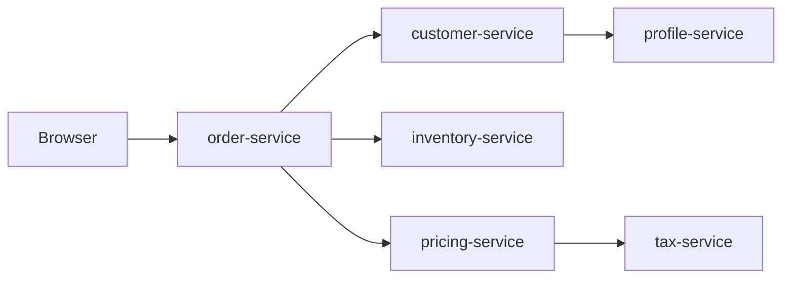
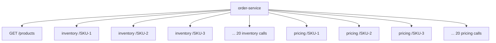
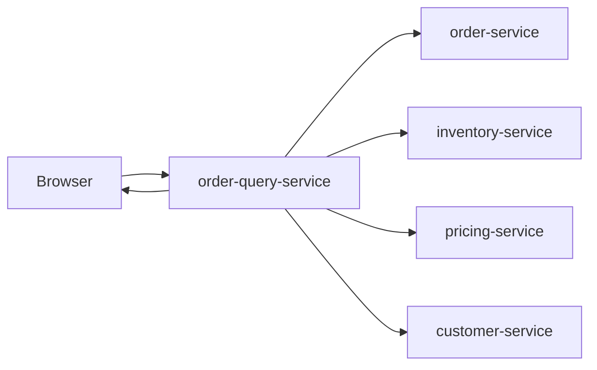
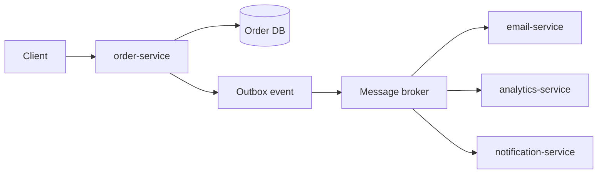
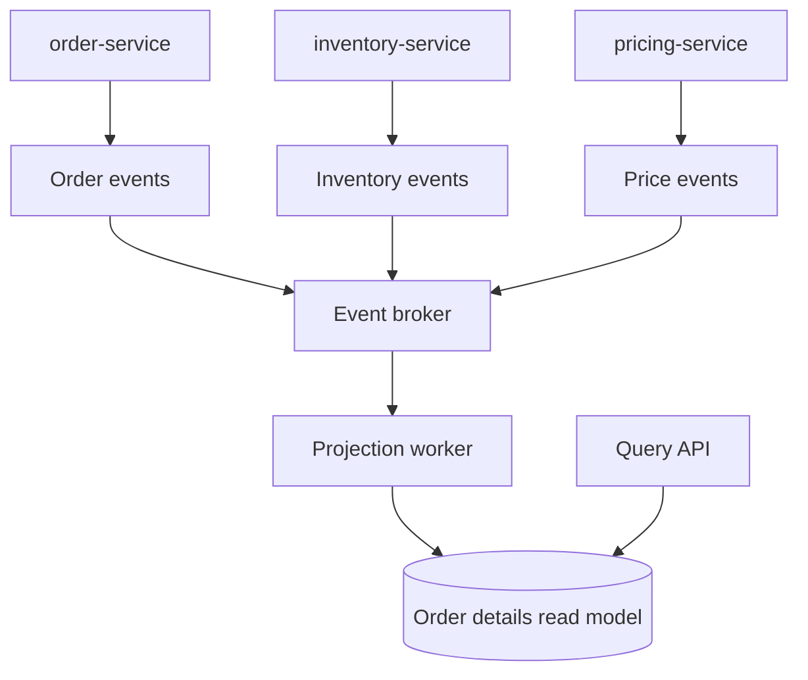

# Nhận diện chuỗi gọi quá dài và giao tiếp quá nhiều

## 1. Khi một request phải đi qua quá nhiều service

Trong chương **Lựa chọn thiết kế** của module **SPRING_CLOUD_SERVICE_COMMUNICATION_LOAD_BALANCING**, ta cần nhận biết lúc nào một nghiệp vụ phải đi qua quá nhiều service hoặc phát sinh quá nhiều HTTP calls. Spring Cloud LoadBalancer giúp caller chọn **ServiceInstance** cho từng service ID, nhưng nó không làm giảm số lần gọi, số tầng phụ thuộc hay lượng dữ liệu trao đổi.

Ví dụ người dùng mở trang chi tiết đơn hàng. **order-service** gọi **customer-service** để lấy hồ sơ, **catalog-service** để lấy tên sản phẩm, **pricing-service** để lấy giá và **inventory-service** để lấy tồn kho. Nếu các lời gọi được xếp nối tiếp, người dùng phải chờ cả chuỗi. Nếu một service gọi tiếp ba service khác cho từng item, một request có thể tạo hàng chục HTTP exchanges.

Hai dấu hiệu thường bị gộp chung:

- **Chuỗi gọi quá dài (long call chain):** một request đi qua nhiều service theo đường phụ thuộc tuần tự hoặc critical path dài. Mỗi hop thêm latency, failure boundary, timeout và độ phức tạp truy vết.
- **Giao tiếp quá nhiều (chatty communication):** một nghiệp vụ tạo nhiều calls nhỏ, lặp lại hoặc trao đổi dữ liệu vụn. Ví dụ N+1 calls, gọi cùng service nhiều lần cho từng item, polling quá thường xuyên hoặc lấy từng field qua API riêng.

Hai vấn đề có thể xuất hiện đồng thời, nhưng cần đo riêng. Một request có thể chỉ đi qua ba service nhưng tạo 200 calls (fan-out lớn). Một request khác chỉ tạo ba HTTP calls nhưng đi qua sáu tầng tuần tự. Cách sửa phụ thuộc nguyên nhân.

### Mục tiêu học tập

Sau bài này, bạn có thể:

1. Vẽ call graph của một nghiệp vụ và tìm critical path.
2. Phân biệt call-chain depth, fan-out, outbound calls và call amplification.
3. Nhận diện N+1, repeated calls, payload vụn và polling quá mức.
4. Dùng distributed tracing xác định service nào gọi service nào, bao lâu và bao nhiêu lần.
5. Phân biệt latency do network, queue, xử lý nghiệp vụ, discovery, LoadBalancer và retry.
6. Chọn aggregation, batch API, parallelism, caching, asynchronous messaging hoặc read model phù hợp.
7. Đánh giá trade-off về consistency, partial failure, payload size, coupling và vận hành.
8. Hiểu vai trò và giới hạn của Spring Cloud LoadBalancer khi tối ưu giao tiếp.
9. Thiết kế thử nghiệm trước/sau, xác minh số calls giảm mà không làm sai business result.

## 2. Hai dạng vấn đề trong call graph

Giả sử một request GET /orders/123/details có đường gọi:



Đây là **call graph**, không đơn thuần là danh sách dependency trong build file.

### 2.1. Chuỗi gọi sâu

Một đường gọi sâu thường có dạng:

```text
API Gateway
  -> order-service
      -> customer-service
          -> profile-service
              -> identity-service
```

Nếu các hop nằm tuần tự trên critical path, latency end-to-end có thể xấp xỉ tổng thời gian từng hop cộng overhead:

```text
T_total ≈ T_gateway + T_order + T_customer
          + T_profile + T_identity + T_network/queue
```

Đây là mô hình ước lượng để hiểu đường phụ thuộc. Trong thực tế, trace span có thể lồng nhau, có queue, connection pool, retry và đoạn xử lý song song; không cộng các span chồng thời gian hai lần.

Chuỗi sâu còn tạo failure coupling: nếu một dependency bắt buộc lỗi, caller có thể không hoàn thành nghiệp vụ. Timeout ở từng hop không tự tạo deadline tổng; nếu mỗi tầng đợi lâu rồi retry, tổng thời gian có thể vượt SLO của API ngoài cùng.

### 2.2. Giao tiếp quá nhiều và fan-out

Ví dụ order-service nhận danh sách 20 sản phẩm, rồi gọi inventory và pricing cho từng sản phẩm:



Một lần lấy danh sách cộng 20 inventory calls và 20 pricing calls tạo **41 outbound HTTP calls** cho một logical request (chưa tính retry, auth/introspection hoặc calls ẩn khác). Đây là fan-out lớn và thường là dấu hiệu N+1/chatty.

Fan-out không nhất thiết làm latency bằng tổng thời gian mọi calls nếu chúng chạy song song. Nhưng nó làm tăng:

- Số connection/streams và lượng request downstream phải xử lý.
- Khả năng một nhánh chậm hoặc lỗi khiến response bị chậm/thất bại.
- Queueing, contention, CPU, memory và chi phí network.
- Số spans/logs/metrics và độ phức tạp điều tra.
- Retry amplification khi nhiều nhánh cùng retry.

### 2.3. Phân biệt các chỉ số

| Chỉ số | Ý nghĩa | Câu hỏi |
|---|---|---|
| Call-chain depth | Số hop service trên đường phụ thuộc dài nhất | Request phải qua bao nhiêu tầng? |
| Fan-out | Số nhánh/calls phát ra từ một bước | Một request tách ra bao nhiêu việc? |
| Outbound calls per operation | Số logical downstream calls cho một nghiệp vụ | Một dashboard tạo bao nhiêu lời gọi? |
| HTTP attempts | Số exchanges thực sự gửi, bao gồm retry | Downstream thực nhận bao nhiêu request? |
| Call amplification factor | HTTP attempts chia cho inbound business requests | Một request người dùng tạo bao nhiêu tải downstream? |
| Payload bytes | Tổng request/response bytes | Ta có trao đổi quá nhiều dữ liệu? |
| Critical-path latency | Thời gian nhánh quyết định response cuối | Nhánh nào giữ người dùng chờ? |
| Dependency error contribution | Lỗi theo dependency/hop | Service nào làm giảm success rate? |

Đừng dùng riêng số service trong kiến trúc diagram để kết luận hệ thống chatty. Cần đo calls trên một **logical business operation**.

## 3. Vì sao nhiều hop làm latency và lỗi tăng lên?

### 3.1. Latency tuần tự và song song

Với các calls độc lập chạy tuần tự:

```text
A -> B -> C -> D
T_total ≈ T_A + T_B + T_C + T_D + overhead
```

Nếu B/C/D độc lập và được gọi song song:

```text
       -> B -
A -----> C  -----> aggregate
       -> D -
```

Thời gian đợi các nhánh thường gần thời gian nhánh chậm nhất cộng thời gian điều phối:

```text
T_total ≈ T_A + max(T_B, T_C, T_D) + T_aggregate
```

Parallelism có thể giảm latency nhưng **không giảm số calls**. Nó còn làm peak concurrency và tải tức thời tăng. Nếu một nhánh bắt buộc và chậm, nhánh đó vẫn quyết định response.

Không lấy p95 của từng service rồi cộng để gọi đó là p95 end-to-end. Percentile không cộng tuyến tính; cần đo trace end-to-end trên cùng các requests.

### 3.2. Tail latency và fan-out

Giả sử mỗi nhánh độc lập có xác suất hoàn tất trong deadline là 99%. Nếu response cần **tất cả 10 nhánh** thành công, xác suất cả 10 cùng đạt deadline là:

```text
P(all 10 succeed) = 0.99^10 ≈ 90.4%
```

Đây là ví dụ toán học giả định độc lập, cùng xác suất và tất cả nhánh đều bắt buộc. Trong thực tế lỗi có thể tương quan, retry và fallback thay đổi xác suất. Nó minh họa vì sao fan-out nhiều nhánh bắt buộc làm tăng nguy cơ một nhánh kéo hỏng response.

### 3.3. Failure boundary nhân lên

Mỗi hop thêm một ranh giới có thể gặp:

- Connect failure, TLS/authentication failure hoặc DNS/discovery issue.
- Read/response timeout, pool exhaustion hoặc queue saturation.
- HTTP 4xx/5xx, lỗi schema/deserialization hoặc version incompatibility.
- Retry, duplicate side effect, circuit breaker open hoặc fallback.
- Trace context propagation lỗi hoặc log không có correlation.

Một chain sâu khiến lỗi cuối cùng khó truy ngược nếu service chỉ log “downstream failed” mà không ghi dependency, status, attempt và trace ID.

## 4. N+1 và các mẫu chatty thường gặp

### 4.1. N+1 ở tầng service

Ví dụ API trả 20 order items, sau đó gọi customer service một lần cho mỗi item:

```java
List<OrderItem> items = orderClient.getItems(orderId);

List<Customer> customers = items.stream()
        .map(item -> customerClient.getCustomer(item.customerId()))
        .toList();
```

Nếu 20 items có cùng một customer, code vẫn phát 20 HTTP calls. Nếu 20 customer khác nhau, cũng phát 20 calls nhưng ít nhất có thể cần 20 kết quả. Đây là một tình huống N+1 điển hình.

### 4.2. Gọi lặp cùng dữ liệu

Một service có thể gọi GET /customers/42 trong nhiều method của cùng request vì mỗi method tự lấy dữ liệu. Nếu dữ liệu không thay đổi trong phạm vi operation, hãy cân nhắc:

- Truyền context/data đã có giữa các tầng trong cùng process.
- Dùng một request-scoped orchestration object, tránh gọi lại downstream vô ích.
- Gộp API thành một query phù hợp.
- Cache khi consistency và freshness cho phép.

Không tạo cache chỉ để che một thiết kế sai. Cache cần TTL/invalidation, giới hạn memory, bảo vệ stampede và semantics khi stale.

### 4.3. API vụn và polling

Một dashboard gọi 12 endpoint để lấy 12 field có thể gây nhiều round trips hơn một API view tổng hợp. Polling mỗi 100ms cho dữ liệu không cần realtime cũng tạo tải liên tục.

Đặt câu hỏi: client thực sự cần cập nhật thường xuyên đến mức nào? Có thể dùng batch query, conditional GET/ETag, server-sent events, WebSocket hoặc event-driven update nếu yêu cầu sản phẩm phù hợp.

### 4.4. Không phải mọi nhiều calls đều xấu

Nhiều calls có thể là chủ ý hợp lý khi:

- Các domain sở hữu dữ liệu độc lập và không nên bị ghép vào một service lớn.
- Mỗi call có quyền truy cập/bảo mật riêng.
- Calls chỉ xảy ra hiếm và không nằm trên latency-critical path.
- Batch endpoint làm payload quá lớn, khó retry hoặc tạo hotspot.
- Một số nhánh là optional và có thể chạy bất đồng bộ.

Mục tiêu là giảm **chi phí giao tiếp không cần thiết**, không ép mọi service vào một endpoint khổng lồ.

## 5. Đo bằng distributed tracing thay vì đoán

### 5.1. Đọc trace theo cây span

Một trace cho request order details có thể trông như sau:

```text
traceId=abc123
  SERVER  order-service GET /orders/{id}              420 ms
    CLIENT inventory-service GET /stock/SKU-1          85 ms
      SERVER inventory-service GET /stock/{sku}        78 ms
    CLIENT pricing-service GET /price/SKU-1           110 ms
      SERVER pricing-service GET /price/{sku}         103 ms
    CLIENT customer-service GET /customers/42         190 ms
      SERVER customer-service GET /customers/{id}     184 ms
```

Đây là dữ liệu minh họa. Cần kiểm tra:

- Span nào là server span của inbound request?
- Có bao nhiêu client spans cho từng downstream?
- Có spans lặp cùng URL/route hoặc cùng resource pattern không?
- Calls lồng nhau (serial) hay bắt đầu gần cùng lúc (parallel)?
- Span nào nằm trên critical path và chiếm phần lớn latency?
- Có retry spans, exception events, HTTP status hoặc timeout không?
- Trace có bị đứt do thiếu instrumentation/context propagation không?

Trong OpenTelemetry/Micrometer Tracing, tên span và attribute chính xác phụ thuộc instrumentation/version. Dùng semantic conventions đang áp dụng của stack; đừng viết dashboard dựa vào một tag không được exporter cung cấp.

### 5.2. Tracing cần có context propagation

Một distributed trace chỉ hữu ích khi trace context đi qua HTTP boundaries. Kiểm tra W3C Trace Context header traceparent hoặc cơ chế propagation đã cấu hình; mỗi service phải tạo span đúng vai trò và truyền context sang downstream.

Nếu chỉ log một traceId tự tạo trong order-service nhưng không propagate qua HTTP, bạn không có distributed trace hoàn chỉnh. Dùng instrumentation của Spring Boot/Micrometer/OTel và builder HTTP đã được customize. Với WebClient, cần giữ Reactor context; với async/thread boundary, xác minh context propagation tương ứng.

### 5.3. Đừng biến trace attributes thành metric labels

Trace/log có thể chứa request ID và route parameters đã được sanitize để điều tra. Metric labels nên có cardinality giới hạn: service name, route template, method, status class hoặc outcome. Tránh gắn raw order ID, customer ID, SKU hoặc trace ID làm label.

### 5.4. Đo call graph theo logical operation

Một metric hữu ích do ứng dụng tự instrument:

```text
outbound_logical_calls_total
outbound_http_attempts_total
inbound_business_operations_total

call_amplification =
    outbound_http_attempts_total
    / inbound_business_operations_total
```

Tính ratio trên cùng khoảng thời gian và cùng phạm vi service/operation. Nếu có async events, định nghĩa rõ “outbound call” có bao gồm message publish/consume hay không. Tách HTTP attempts khỏi logical calls để nhìn ra retry amplification.

## 6. Đo fan-out, depth và latency có ý nghĩa

| Câu hỏi | Cách đo | Cảnh báo |
|---|---|---|
| Một request qua bao nhiêu service? | Đếm unique service names trong trace | Unique count không cho biết thứ tự |
| Đường tuần tự dài nhất? | Tìm critical path trong span tree/DAG | Span overlap làm tổng duration dễ bị cộng trùng |
| Một service phát bao nhiêu calls? | Đếm outbound client spans theo parent operation | Retry có thể tạo nhiều spans |
| Có N+1 không? | Group route + parent trace + repeated key pattern | Không log ID nhạy cảm để group |
| Downstream nào chậm? | Latency distribution theo dependency/route | So sánh cùng traffic class |
| Lỗi do network hay app? | Exception, HTTP status, server logs, transport metrics | 503 và connect failure khác nhau |
| Có queue/pool saturation? | Pending acquire, connection pool, executor/queue metrics | Không chỉ nhìn server CPU |
| Payload có quá lớn? | Request/response bytes, serialization time | Đo cả compression và wire bytes |

### 6.1. Đặt ngân sách latency theo SLO

Giả sử endpoint order details có SLO p95 là 500ms. Team có thể phân bổ budget nội bộ cho gateway, order processing và downstream calls, nhưng budget cần dựa trên trace thực tế, không chia đều tùy tiện.

Ví dụ budget **minh họa**:

| Giai đoạn | Budget mục tiêu |
|---|---:|
| Gateway/auth | 40ms |
| order-service local work | 80ms |
| Inventory branch | 100ms |
| Pricing branch | 120ms |
| Customer branch | 100ms |
| Aggregate/serialization/margin | 60ms |
| Tổng budget minh họa | 500ms |

Các nhánh chạy song song thì không cộng đơn giản tất cả branch budgets để tính wall-clock. Đặt timeout cho từng dependency và end-to-end deadline phù hợp, có dự phòng cho queue/GC/network. SLO p95 cũng không có nghĩa mỗi request được phép timeout chính xác ở p95.

### 6.2. Phân biệt latency do LoadBalancer với latency downstream

Spring Cloud LoadBalancer có thể thêm bước lấy supplier snapshot và chọn instance. Khi cache/discovery được cấu hình hợp lý, bước chọn thường nhỏ so với HTTP response time, nhưng phải đo chứ không mặc định. Nếu trace cho thấy client span kéo dài, phân biệt:

- Chờ supplier/discovery hoặc cache refresh.
- Connection pool acquire.
- DNS/TCP/TLS setup.
- Server queue và xử lý.
- Response body transfer/deserialization.
- Retry/backoff.

Một lựa chọn Pod nhanh không cứu được thiết kế tạo 100 calls; call graph hợp lý vẫn có thể chậm do một instance cụ thể quá tải.

## 7. Spring Cloud LoadBalancer giúp gì và không giúp gì?

Spring Cloud LoadBalancer chọn ServiceInstance theo service ID từ supplier. Nó có thể giúp:

- Phân phối các calls **đã có** đến các instances.
- Chọn instance theo Round Robin/Random/custom policy.
- Kết hợp discovery, caching, zone/hint và health suppliers.
- Hỗ trợ retry integration trong những client/version phù hợp.
- Cung cấp lifecycle observation/metrics khi instrumentation được bật.

Nó **không tự**:

- Gộp 20 GET thành một batch request.
- Thu gọn chain order → pricing → tax → currency.
- Biết hai HTTP calls cùng lấy một resource và tự deduplicate.
- Tạo aggregation endpoint hoặc materialized view.
- Bảo đảm tất cả instances đều khỏe chỉ vì discovery trả chúng.
- Tự đặt connect/read/end-to-end timeout cho mọi HTTP client.
- Là circuit breaker hoặc thay thế API contract.

Nếu caller chatty phát 100 requests, LoadBalancer có thể phân phối 100 requests đó đến nhiều Pods; downstream vẫn phải xử lý 100 requests. Đôi khi nó làm sự cố khó nhìn hơn vì tải được chia ra, nhưng tổng số calls và chi phí không biến mất.

### 7.1. Đừng sửa kiến trúc bằng cách tăng replicas trước khi đo

Scale replicas có thể giảm queue/CPU per instance trong ngắn hạn, nhưng không giải quyết N+1. Nếu số calls tăng theo số item, tải downstream vẫn tăng theo kích thước batch. Trước khi tăng replicas, đo calls trên business operation, attempts, CPU/queue, cache hit, latency theo route/instance và payload bytes.

Scale vẫn là lựa chọn hợp lệ khi tải là workload cần xử lý thật; chỉ đừng dùng nó để che một round-trip pattern không cần thiết.

## 8. Lựa chọn 1 — Aggregation tại đúng ranh giới

Aggregation gom nhiều dữ liệu cần cho một use case thành một response ở ranh giới phù hợp, ví dụ order-query-service hoặc API composition/BFF.



Thay vì UI gọi bốn service trực tiếp, query service cung cấp một endpoint view. Nhưng aggregation chỉ giảm round trips **ở caller phía ngoài**; nếu bên trong vẫn gọi từng item một, tổng downstream calls chưa giảm.

### 8.1. Chọn nơi aggregation

- **API composition/BFF:** phù hợp khi response phục vụ một màn hình/use case, dữ liệu thuộc nhiều domain.
- **Domain service/orchestrator:** phù hợp khi nghiệp vụ thực sự có một owner điều phối quy trình.
- **Read model/materialized view:** phù hợp khi query phức tạp, read-heavy và chấp nhận cập nhật bất đồng bộ.
- **Database join trong cùng bounded context:** thường tốt hơn gọi nhiều service chỉ để ghép dữ liệu mà một domain sở hữu; không biến thành truy cập DB chéo service.

Không tạo một “god aggregation service” chứa mọi business rule và biết schema nội bộ của tất cả domain. Nó sẽ trở thành coupling hub, dễ vỡ khi domain thay đổi.

### 8.2. Quy tắc aggregation

1. Chỉ lấy field cần cho use case.
2. Gọi các nhánh độc lập song song có giới hạn.
3. Đặt timeout/deadline theo mức quan trọng của từng nhánh.
4. Xác định nhánh nào bắt buộc và nhánh nào có thể degraded.
5. Giữ provenance/version nếu dữ liệu có thể lệch thời điểm.
6. Không chuyển lỗi dependency thành giá trị hợp lệ giả.
7. Cache view nếu freshness/consistency cho phép.
8. Đo số downstream calls trước và sau aggregation.

## 9. Lựa chọn 2 — Batch API thay cho N+1

Nếu caller cần dữ liệu cho nhiều IDs, endpoint nhận danh sách IDs thường giảm round trips.

### 9.1. Trước: một request cho mỗi SKU

```java
List<InventoryItem> result = skus.stream()
        .map(sku -> inventoryClient.get()
                .uri("/api/inventory/{sku}", sku)
                .retrieve()
                .body(InventoryItem.class))
        .toList();
```

Với 20 SKU, caller tạo 20 HTTP calls. Đây còn là code blocking tuần tự; latency có thể gần tổng latency của 20 calls.

### 9.2. Sau: một batch request

API contract:

```http
POST /api/inventory/batch
Content-Type: application/json

{
  "skus": ["SKU-1", "SKU-2", "SKU-3"]
}
```

Client:

```java
record InventoryBatchRequest(List<String> skus) {}

record InventoryBatchResponse(List<InventoryItem> items) {}

InventoryBatchResponse result = inventoryClient.post()
        .uri("/api/inventory/batch")
        .body(new InventoryBatchRequest(skus))
        .retrieve()
        .body(InventoryBatchResponse.class);
```

Với 20 SKU, có thể chỉ cần **một HTTP call**. Service inventory vẫn có thể truy vấn DB theo batch hoặc chunk; API batch không tự đảm bảo backend chỉ chạy một SQL statement.

### 9.3. Thiết kế batch contract an toàn

| Vấn đề | Quyết định cần ghi rõ |
|---|---|
| Max batch size | Giới hạn IDs/payload, ví dụ 100 hoặc theo benchmark |
| Duplicate IDs | Trả một item hay giữ duplicates? |
| Missing IDs | Trả danh sách missing, null, hoặc status riêng? |
| Partial failure | Một item lỗi có làm hỏng cả batch? |
| Ordering | Response có giữ thứ tự request không? |
| Authorization | Kiểm tra quyền cho từng resource hoặc cả batch |
| Rate limiting | Tính theo batch hay theo số item? |
| Timeout | Có giới hạn xử lý batch và tổng payload không? |
| Retry | Retry cả batch có thể lặp nhiều work; cần idempotency nếu có side effect |

Không tạo batch endpoint vô hạn kích thước. Một request 10.000 IDs có thể gây memory/DB pressure lớn hơn nhiều calls nhỏ có kiểm soát.

## 10. Lựa chọn 3 — Parallelize các nhánh độc lập

Nếu ba calls thực sự độc lập và caller cần cả ba kết quả, chạy song song có thể giảm critical-path latency. Ví dụ WebClient:

```java
Mono<OrderDetails> loadDetails(String orderId) {
    Mono<Order> order = orderClient.get()
            .uri("/orders/{id}", orderId)
            .retrieve()
            .bodyToMono(Order.class)
            .timeout(Duration.ofMillis(250));

    Mono<Customer> customer = customerClient.get()
            .uri("/customers/{id}", "customer-42")
            .retrieve()
            .bodyToMono(Customer.class)
            .timeout(Duration.ofMillis(150));

    Mono<Pricing> pricing = pricingClient.get()
            .uri("/prices/{orderId}", orderId)
            .retrieve()
            .bodyToMono(Pricing.class)
            .timeout(Duration.ofMillis(180));

    return Mono.zip(order, customer, pricing)
            .map(tuple -> new OrderDetails(
                    tuple.getT1(), tuple.getT2(), tuple.getT3()))
            .timeout(Duration.ofMillis(400));
}
```

Đây là ví dụ minh họa; code thực cần lấy customer ID từ order nếu có dependency, không hardcode ID. Mono.zip đợi tất cả publishers phát giá trị; một nhánh lỗi có thể làm cả zip lỗi. Nếu một nhánh optional, định nghĩa fallback rõ cho nhánh đó thay vì nuốt mọi lỗi.

### 10.1. Giới hạn concurrency

Không biến N+1 tuần tự thành N+1 concurrent calls không giới hạn. Điều đó có thể giảm latency một request nhưng tạo spike tải và queue downstream.

Với danh sách cần xử lý song song, dùng concurrency bound:

```java
Flux<InventoryItem> fetchItems(List<String> skus) {
    return Flux.fromIterable(skus)
            .flatMap(this::fetchOne, 8);
}
```

Giá trị 8 là ví dụ; chọn theo capacity, pool, rate limit và latency budget. Nếu batch API tồn tại và hợp đồng phù hợp, benchmark batch với bounded concurrency thay vì mặc định gọi từng ID.

### 10.2. Khi không nên parallelize?

- Calls phụ thuộc dữ liệu từ call trước.
- Downstream đã gần bão hòa.
- API cần transaction/ordering.
- Một nhánh optional có thể được tải sau.
- Tổng payload/connection concurrency vượt giới hạn.
- Parallel failure làm response thất bại toàn bộ nhưng nghiệp vụ có thể degraded hợp lệ.

Parallelism là kỹ thuật giảm thời gian chờ, **không phải** kỹ thuật giảm call count.

## 11. Lựa chọn 4 — Cache dữ liệu đọc có kiểm soát

Cache có thể giảm calls lặp khi cùng dữ liệu được đọc nhiều lần và freshness cho phép.

| Loại cache | Phạm vi | Phù hợp |
|---|---|---|
| Request-local memoization | Một logical request | Nhiều bước trong cùng request cần cùng resource |
| In-process cache | Một service instance | Dữ liệu đọc nhiều, chấp nhận TTL |
| Distributed cache | Nhiều replicas | Dữ liệu dùng chung, muốn giảm calls giữa instances |
| Materialized read model | Một query/use case | View tổng hợp cập nhật theo event |

### 11.1. Cache cần có semantics

- TTL và invalidation policy.
- Cách xử lý cache miss đồng thời (request coalescing/single-flight).
- Giới hạn kích thước và eviction.
- Stale-while-revalidate nếu use case cho phép.
- Phân biệt cache miss với downstream failure.
- Không cache 401/403 hoặc dữ liệu nhạy cảm sai key.
- Không dùng cache để né authorization.
- Quan sát hit/miss/stale/error và tác động freshness.

Request-local memoization thường an toàn hơn distributed cache cho việc tránh gọi trùng trong cùng operation, vì không phải xử lý invalidation xuyên replicas. Tuy nhiên, chỉ memoize khi calls tương đương về tenant, auth, locale, version và parameters.

## 12. Lựa chọn 5 — Chuyển công việc không cần đồng bộ sang event/message

Không phải mọi bước đều cần hoàn thành trước khi trả response. Ví dụ sau khi đơn hàng được tạo, việc gửi email, cập nhật analytics hoặc tạo báo cáo có thể chạy bất đồng bộ.



Request đồng bộ chỉ chờ các bước cần cho business commit/response. Side effects có thể được publish qua transactional outbox để tránh trạng thái DB commit nhưng event bị mất.

### 12.1. Trade-off của async

- Người dùng có thể nhận 202 Accepted hoặc kết quả chưa hoàn chỉnh.
- Cần event schema/versioning và ownership rõ.
- Consumer phải idempotent vì message có thể được giao lại.
- Có eventual consistency và cách hiển thị trạng thái pending.
- Cần retry/DLQ/observability cho message flow.
- Không chuyển một quyết định đồng bộ bắt buộc sang async chỉ để giảm latency dashboard.

Event-driven không làm mọi call biến mất; nó đổi **thời điểm** và **cơ chế** giao tiếp, phù hợp khi nghiệp vụ chấp nhận eventual consistency.

## 13. Lựa chọn 6 — Read model/CQRS cho query tổng hợp

Nếu một màn hình thường xuyên cần dữ liệu từ nhiều domain và query composition quá tốn kém, có thể xây read model chuyên dụng:



Read API đọc từ projection thay vì đồng bộ gọi nhiều services mỗi lần. Lợi ích là query nhanh, giảm fan-out lúc đọc. Chi phí là:

- Projection cập nhật bất đồng bộ và có thể stale.
- Cần xử lý event ordering, duplicate và replay.
- Schema read model có lifecycle/version riêng.
- Cần đối soát/rebuild khi projection lỗi.
- Không dùng read model để quyết định write quan trọng nếu chưa có consistency contract.

CQRS phù hợp khi read/write patterns khác nhau rõ rệt và lợi ích vượt chi phí vận hành.

## 14. Thiết kế timeout, retry và bulkhead theo call graph

Khi chain sâu hoặc fan-out lớn, timeout/retry phải được thiết kế theo **logical request**, không chỉ một HTTP call.

### 14.1. Timeout budget phân tầng

Giả sử API ngoài có deadline 500ms. Nếu order-service dùng tối đa 450ms cho downstream, phần còn lại không đủ cho serialization, queue, auth và network trả về. Phân bổ budget cần tính overhead và thời gian còn lại.

Mỗi lần bắt đầu downstream call, nên sử dụng **remaining deadline** nếu hệ thống truyền deadline theo contract. Không cấp lại full 500ms cho mỗi hop, nếu không chain bốn hops có thể chờ vài giây.

### 14.2. Retry amplification

Giả sử mỗi logical request tạo 10 downstream calls và mỗi call có thể retry một lần. Worst case HTTP attempts có thể tăng từ 10 lên 20. Nếu gateway cũng retry toàn bộ logical request một lần, tổng downstream attempts có thể tăng tiếp, tùy semantics retry lồng nhau.

Định nghĩa:

```text
call_amplification_factor =
    total_downstream_http_attempts
    / total_inbound_business_requests
```

Nếu ratio tăng từ 8 lên 18 sau khi bật retry, hệ thống có thể thành công nhiều hơn nhưng downstream chịu gần gấp đôi tải. Đo success rate song song với attempts/request, p95/p99 và saturation.

### 14.3. Bulkhead và concurrency limit

- Giới hạn số calls đồng thời tới một downstream.
- Tách connection pools hoặc concurrency budgets cho dependency quan trọng.
- Đặt queue có giới hạn; queue không giới hạn chỉ trì hoãn lỗi và tăng memory.
- Khi quá tải, fail fast/degrade có kiểm soát thay vì giữ request vô thời hạn.
- Retry không được bỏ qua bulkhead và tạo tải vượt capacity.

Circuit breaker/bulkhead là cơ chế bảo vệ dependency; chúng không sửa call graph chatty. Nếu có 50 calls cần thiết, circuit breaker vẫn thấy 50 calls khi trạng thái closed.

## 15. Thiết kế với Spring Cloud LoadBalancer

### 15.1. Giữ rõ service ID và client

Khi đã quyết định call graph hợp lý, Spring Cloud LoadBalancer giúp resolve từng service ID:

```java
@Bean
@LoadBalanced
RestClient.Builder loadBalancedRestClientBuilder(
        RestClientBuilderConfigurer configurer) {
    return configurer.configure(RestClient.builder());
}
```

Caller có thể dùng batch endpoint:

```java
InventoryBatchResponse response = inventoryRestClient.post()
        .uri("http://inventory-service/api/inventory/batch")
        .body(new InventoryBatchRequest(skus))
        .retrieve()
        .body(InventoryBatchResponse.class);
```

Ví dụ chỉ minh họa ý tưởng; thực tế nên build RestClient bean một lần, không build builder cho từng request. LoadBalancer chọn một instance cho **batch HTTP request**; nó không chọn một instance cho mỗi SKU trong body.

### 15.2. Batch có thay đổi distribution không?

Trước: 20 requests tới inventory, mỗi request có thể được chọn instance riêng. Sau: một batch request tới một instance được chọn. Điều này giảm HTTP calls, nhưng tạo hotspot nếu batch lớn dồn vào một Pod. Cần giới hạn batch size, đo CPU/DB query và cân nhắc chia batch có kiểm soát nếu capacity yêu cầu.

Không giả định một request lớn luôn nhanh hơn 20 requests nhỏ; benchmark payload, DB, serialization và concurrency thực tế.

### 15.3. Per-service policy không thay thế API design

Zone preference, hint hoặc weighted supplier quyết định **instance nào** nhận call. Chúng không làm biến mất calls. Nếu caller gọi 100 lần, LoadBalancer có thể chia 100 lần đó qua nhiều instances; downstream vẫn xử lý 100 lần.

Đặt supplier policy theo yêu cầu locality/health/canary, còn giảm giao tiếp bằng batch/aggregation/cache/read model.

## 16. Chọn giải pháp theo dấu hiệu

| Dấu hiệu quan sát | Hướng xử lý nên thử trước | Trade-off cần kiểm tra |
|---|---|---|
| Chain sâu, các hops tuần tự | Gộp orchestration đúng domain; song song nhánh độc lập | Coupling, critical path, partial failure |
| N+1 theo danh sách IDs | Batch API hoặc bulk query trong domain | Payload, max batch, partial results |
| Cùng resource bị gọi lặp trong request | Request-local memoization | Auth/context phải giống nhau |
| Nhiều clients gọi cùng read data | Cache có TTL/invalidation | Staleness, stampede, memory |
| Dashboard phải join nhiều domain mỗi lần | BFF/aggregation hoặc read model | Ownership, eventual consistency |
| Side effect không cần trước response | Async event + outbox | Eventual consistency, idempotency |
| Calls độc lập nhưng tuần tự | Bounded parallelism | Concurrency spike, deadline |
| Một dependency thường quá tải | Bulkhead, rate limit, circuit breaker | Degraded response và capacity |
| Retry tạo nhiều attempts | Một retry owner, bounded attempts/deadline | Giảm khả năng phục hồi tức thời |
| Một Pod chậm trong tập instance | Health/metrics/policy phù hợp, timeout | Detection delay và false positives |

Không có giải pháp duy nhất cho mọi service. Chọn dựa trên latency-critical path, dữ liệu thuộc domain nào, consistency, tải và khả năng vận hành.

## 17. Bài thực hành: đo và giảm N+1

### 17.1. Kịch bản ban đầu

Một API GET /dashboard trả 20 product cards. catalog-service lấy danh sách sản phẩm; với mỗi SKU, dashboard-service gọi inventory và pricing riêng.

Số logical calls trước tối ưu:

```text
1 catalog list request
20 inventory item requests
20 pricing item requests
--------------------------------
41 downstream HTTP calls / dashboard request
```

Nếu mỗi call có retry, HTTP attempts thực tế có thể cao hơn 41.

### 17.2. Thu thập baseline

1. Tạo test data có 20 SKUs.
2. Gửi 100 requests tới /dashboard trong concurrency được kiểm soát.
3. Thu distributed traces có sampling đủ để phân tích; không dựa vào một trace đơn.
4. Đếm client spans theo downstream route.
5. Ghi calls/request, attempts/request, payload bytes, p50/p95/p99, error rate và server CPU.
6. Xác nhận có repeated per-SKU calls và nhánh nào nằm trên critical path.

Bảng baseline để điền:

| Chỉ số | Baseline |
|---|---:|
| Inbound dashboard operations | ... |
| Catalog calls | ... |
| Inventory calls | ... |
| Pricing calls | ... |
| Total logical outbound calls | ... |
| Total HTTP attempts | ... |
| Calls/operation | ... |
| p95 end-to-end | ... ms |
| p95 inventory | ... ms |
| p95 pricing | ... ms |
| Error rate | ... % |

### 17.3. Thêm batch endpoints

Tạo hai endpoints:

```http
POST /api/inventory/batch
{"skus":["SKU-1","SKU-2","SKU-3"]}

POST /api/pricing/batch
{"skus":["SKU-1","SKU-2","SKU-3"]}
```

Sau khi có batch APIs, một dashboard request lý tưởng trong ví dụ sẽ có:

```text
1 catalog list request
1 inventory batch request
1 pricing batch request
--------------------------------
3 downstream HTTP calls / dashboard request
```

Đây là **số calls kỳ vọng theo thiết kế** nếu không có retry và không phát sinh call khác; chưa chứng minh endpoint batch có hiệu năng tốt. Cần benchmark, xác minh response đủ 20 IDs và xử lý partial/missing records đúng contract.

### 17.4. Chạy lại và so sánh

| Chỉ số | Trước | Sau | Thay đổi |
|---|---:|---:|---:|
| Logical outbound calls/operation | 41 | 3 | -92,7% |
| HTTP attempts/operation | ... | ... | ... |
| p95 end-to-end | ... | ... | ... |
| p95 inventory | ... | ... | ... |
| p95 pricing | ... | ... | ... |
| Error rate | ... | ... | ... |
| Payload bytes | ... | ... | ... |
| Downstream CPU | ... | ... | ... |

Con số 41 → 3 là kết quả **đếm theo topology ví dụ**, không phải benchmark thực tế. p95, CPU và bytes phải được đo. Batch payload có thể lớn hơn mỗi request riêng, nhưng thường giảm overhead headers/connection/scheduling.

### 17.5. Kiểm thử correctness và resilience

- Mọi SKU request hợp lệ phải có kết quả tương ứng.
- Duplicate SKU được xử lý theo contract.
- SKU không tồn tại được biểu diễn rõ.
- Batch size vượt giới hạn bị từ chối có kiểm soát.
- Một item lỗi không làm mất các item khác nếu API cam kết partial results.
- Timeout batch không làm caller retry vô hạn.
- Một retry có giới hạn không nhân attempts qua nhiều tầng.
- Khi một inventory Pod lỗi, LoadBalancer có thể chọn instance khác theo policy/supplier, nhưng batch vẫn là một HTTP exchange tới một instance.
- Trace cho thấy calls giảm; không chỉ dashboard response cuối cùng vẫn 200.

## 18. Bài thực hành: phát hiện chain dài

Dùng một nghiệp vụ GET /orders/{id}/summary có call path:

```text
order-service
  -> customer-service
      -> profile-service
  -> pricing-service
      -> tax-service
  -> inventory-service
```

### Bước 1 — Vẽ trace graph

Thu một trace end-to-end. Ghi từng client/server span, parent-child, start/end time, status và instance ID nếu được instrument.

### Bước 2 — Tìm critical path

Xác định nhánh nào bắt đầu sau nhánh nào. Nếu pricing gọi tax tuần tự, đây là dependency path. Nếu customer/profile và inventory chạy song song, không cộng toàn bộ duration của chúng như một chuỗi.

### Bước 3 — Tách dữ liệu bắt buộc và optional

Ví dụ order summary có thể cần order + price + inventory để xác định trạng thái đặt hàng, nhưng ảnh đại diện customer có thể optional. Định nghĩa degraded response rõ thay vì để một nhánh phụ làm fail toàn API.

### Bước 4 — Đề xuất thay đổi

Chọn một hoặc nhiều cách:

- Bounded parallelism cho các nhánh độc lập.
- Batch API cho các items.
- Query aggregation/read model cho dữ liệu hiển thị.
- Cache customer profile nếu freshness cho phép.
- Event-driven update cho analytics/notification.
- Giảm service boundary không hợp lý nếu các service thực chất thuộc cùng bounded context.

### Bước 5 — Đo lại

So sánh critical-path latency, calls/operation, attempts/operation, error rate và trace shape. Không chỉ báo “đã dùng async” hay “đã thêm replicas”.

## 19. Tiêu chí quyết định và checklist review

Trước khi merge thay đổi giao tiếp:

- [ ] Có trace của một logical business operation trước tối ưu.
- [ ] Đã phân biệt call-chain depth và fan-out.
- [ ] Biết số logical downstream calls và HTTP attempts trên mỗi operation.
- [ ] Đã xác định N+1/repeated calls/polling nếu có.
- [ ] Đã tìm critical path bằng span timing, không cộng trùng spans song song.
- [ ] Các calls độc lập chỉ được parallelize với concurrency limit.
- [ ] Batch API có max size, missing/duplicate/partial-result contract.
- [ ] Aggregation nằm ở boundary có ownership rõ.
- [ ] Cache có TTL, invalidation và stale-data semantics.
- [ ] Async workflow có outbox/idempotency/retry/DLQ khi cần.
- [ ] Read model có consistency và rebuild strategy.
- [ ] Timeout và deadline tổng được phân bổ theo SLO.
- [ ] Chỉ có retry owner rõ ràng; attempts có giới hạn.
- [ ] LoadBalancer policy được dùng cho chọn instance, không kỳ vọng nó giảm call count.
- [ ] Metrics không gắn raw IDs/trace IDs làm labels.
- [ ] Có benchmark/load test với payload và concurrency gần thực tế.
- [ ] Đã đo correctness, latency, calls, attempts, bytes và resource cost trước/sau.
- [ ] Có fallback/partial response contract khi dependency optional lỗi.

## 20. Bài tập vận dụng

### Bài 1 — Chain depth hay fan-out?

Một request đi qua 6 service tuần tự nhưng mỗi service chỉ gọi một lần. Request khác đi qua 3 service nhưng service thứ hai gọi 50 item endpoints. Phân tích hai loại vấn đề và metric cần đo.

### Bài 2 — Tính số calls

Một trang có 15 sản phẩm; mỗi sản phẩm gọi inventory và pricing. Có thêm một catalog list call. Tính logical outbound calls. Sau đó thêm một retry cho mỗi HTTP call và tính worst-case attempts theo giả định mỗi call retry tối đa một lần.

### Bài 3 — Parallelism có giảm calls không?

Chuyển 20 calls tuần tự thành flatMap với concurrency 8. Đánh giá latency, peak concurrency và số calls. Giải thích vì sao đây chưa phải giải pháp N+1 hoàn chỉnh.

### Bài 4 — Batch contract

Thiết kế POST /inventory/batch có max 100 SKUs. Quy định missing IDs, duplicate IDs, ordering, authorization và partial errors. Giải thích khi nào batch nên chia chunk.

### Bài 5 — Retry amplification

Một API gateway retry toàn request một lần; order-service retry downstream hai lần; LoadBalancer retry next instance một lần. Vẽ số tầng retry và tìm cách giảm worst-case attempts bằng cách chọn owner/propagation deadline.

### Bài 6 — Partial response

Customer avatar optional nhưng pricing bắt buộc. Thiết kế response khi avatar service timeout, giữ pricing failure semantics và metrics degraded response.

### Bài 7 — Read model hay aggregation?

So sánh API composition đồng bộ và CQRS read model cho dashboard có 100.000 lượt đọc/ngày nhưng dữ liệu giá/tồn kho thay đổi liên tục. Đánh giá freshness, throughput, operational cost và consistency.

### Bài 8 — LoadBalancer không phải aggregator

Một caller dùng Round Robin cho 100 HTTP requests. Chứng minh bằng server logs rằng số requests vẫn là 100 dù chúng được phân phối qua nhiều instances. Đề xuất batch để giảm số calls.

### Bài 9 — Cache có an toàn không?

Customer profile được cache 60 giây. Phân tích field nào có thể stale, cache key phải bao gồm tenant/locale/authorization dimension nào và khi nào không được cache.

### Bài 10 — Báo cáo trước/sau

Viết báo cáo đo lường với call graph, critical path, calls/operation, attempts/operation, p95/p99, payload bytes, downstream CPU, error rate và trade-offs của thay đổi.

## Nguồn tham khảo

- [Spring Cloud Commons — Spring Cloud LoadBalancer](https://docs.spring.io/spring-cloud-commons/reference/spring-cloud-commons/loadbalancer.html): service instance selection, supplier, retry, health và observation.
- [Spring Boot — Tracing](https://docs.spring.io/spring-boot/reference/actuator/tracing.html): Micrometer Tracing, propagation và distributed traces.
- [OpenTelemetry — Context Propagation](https://opentelemetry.io/docs/concepts/context-propagation/): trace context giữa process/service.
- [OpenTelemetry — Semantic Conventions](https://opentelemetry.io/docs/specs/semconv/): span attributes và HTTP conventions.
- [OpenTelemetry — Metrics](https://opentelemetry.io/docs/concepts/signals/metrics/): metrics, aggregation và cardinality.
- [Project Reactor — Reactor Core Reference](https://projectreactor.io/docs/core/release/reference/): Mono.zip, flatMap, concurrency và timeout operators.
- [Spring Framework — WebClient](https://docs.spring.io/spring-framework/reference/web/webflux-webclient.html): reactive HTTP client và error handling.
- [Spring Framework — REST Clients](https://docs.spring.io/spring-framework/reference/integration/rest-clients.html): RestClient và HTTP integration.
- [Transactional Outbox pattern](https://microservices.io/patterns/data/transactional-outbox.html): bảo đảm publish event sau database commit.
- [CQRS pattern](https://microservices.io/patterns/data/cqrs.html): tách read model và write model.

**Kết luận:** call chain quá dài là vấn đề về **độ sâu phụ thuộc và critical path**; giao tiếp quá nhiều là vấn đề về **số calls, fan-out và lượng dữ liệu trao đổi**. Hãy dùng trace để tìm đường chậm và calls lặp, sau đó chọn batch, aggregation, bounded parallelism, cache, async hoặc read model theo consistency và ownership. Spring Cloud LoadBalancer giúp chọn instance cho những calls cần thiết; nó không thay thế việc thiết kế lại call graph.
