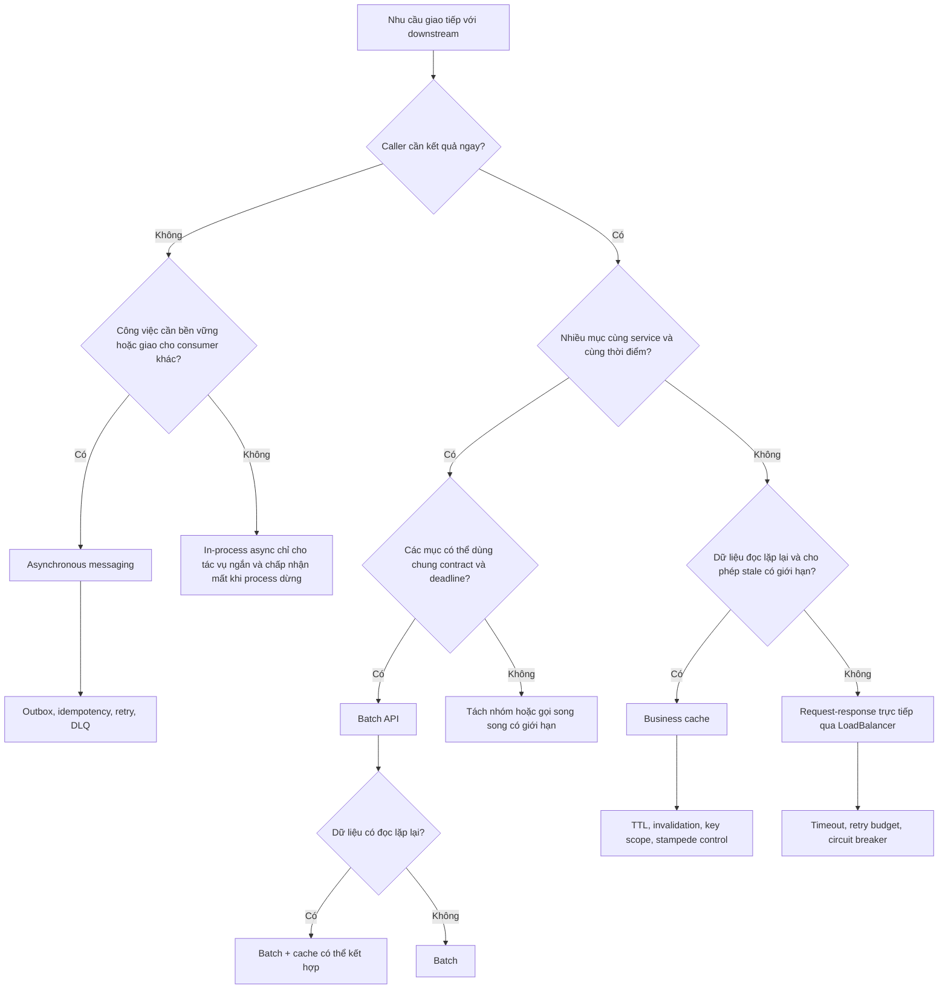
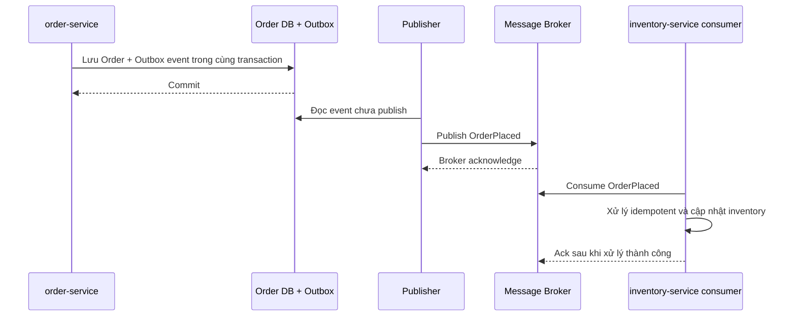
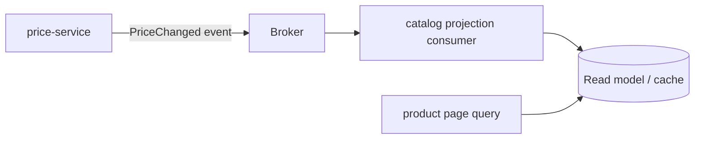

# Khi nên dùng xử lý theo lô, cache nghiệp vụ hoặc giao tiếp bất đồng bộ

Một service thường phải lấy dữ liệu từ nhiều bản sao hoặc nhiều dịch vụ khác nhau. Ví dụ, khi hiển thị giỏ hàng, `order-service` cần giá sản phẩm, tồn kho và thông tin vận chuyển. Cách đơn giản là gọi từng API đồng bộ qua Spring Cloud LoadBalancer. Nhưng khi số sản phẩm tăng, mỗi request lại phát sinh nhiều lượt gọi mạng; latency, tải downstream và nguy cơ một dependency chậm làm hỏng toàn bộ trang cùng tăng.

Có ba hướng thiết kế thường được cân nhắc:

- **Xử lý theo lô (batching):** gom nhiều mục cần xử lý thành một request hoặc một đơn vị công việc.
- **Cache nghiệp vụ (business cache):** lưu kết quả nghiệp vụ đã đọc để giảm số lần truy vấn nguồn dữ liệu.
- **Giao tiếp bất đồng bộ (asynchronous messaging):** gửi command/event để bên nhận xử lý độc lập, không bắt caller chờ toàn bộ công việc hoàn tất.

Ba hướng này giải quyết các vấn đề khác nhau. Batch giảm số lượt gọi cho một nhóm thao tác; cache tránh lặp lại những lần đọc tương tự; asynchronous messaging tách thời điểm gửi và xử lý. Chúng có thể kết hợp, nhưng mỗi hướng tạo ra trade-off riêng về tính nhất quán, độ trễ, xử lý lỗi và vận hành.

Trong module `SPRING_CLOUD_SERVICE_COMMUNICATION_LOAD_BALANCING`, các lựa chọn trên cần được đặt cạnh client-side load balancing: **Spring Cloud LoadBalancer vẫn chọn `ServiceInstance` cho mỗi lần gọi HTTP đồng bộ**, còn batching/cache/asynchronous messaging quyết định liệu hệ thống có cần tạo lần gọi đó, tạo bao nhiêu lần hoặc có cần chờ response hay không.

## 1. Bắt đầu từ vấn đề cần giải quyết

Giả sử `order-service` hiển thị một đơn hàng có 20 sản phẩm. Với thiết kế gọi tuần tự:

```text
order-service
  ├── GET product-service/products/1
  ├── GET product-service/products/2
  ├── ...
  └── GET product-service/products/20
```

Mỗi request HTTP có chi phí cố định: DNS/connection pool, TLS khi cần, header, serialization, scheduling, tracing và xử lý tại server. Dù connection đã được tái sử dụng, 20 request vẫn tạo nhiều lần dispatch và nhiều lần đi qua middleware.

Với LoadBalancer, mỗi lần gọi service ID có thể cần một lần chọn instance. Nếu có 20 lần gọi độc lập, client có thể thực hiện 20 lượt chọn và 20 HTTP exchanges. Nếu dùng API batch, một request chứa 20 ID thường chỉ cần một lượt chọn instance và một HTTP exchange; provider xử lý 20 mục bên trong.

Cache thay đổi tình huống khác: nếu dữ liệu sản phẩm đã có trong cache và còn hợp lệ, client/service có thể không cần gọi `product-service` ở lần đọc đó. Messaging thay đổi thời điểm hoàn tất: caller gửi một command/event và nhận xác nhận đã tiếp nhận, còn consumer xử lý sau.

### 1.1. Ba câu hỏi để chọn đúng hướng

| Câu hỏi | Nếu câu trả lời là “có” | Hướng đáng cân nhắc |
|---|---|---|
| Nhiều thao tác nhỏ cùng nhắm tới một service và cần kết quả ngay? | Có thể gom chúng thành một request | Batch |
| Cùng một dữ liệu được đọc lặp lại, thay đổi tương đối ít và chấp nhận độ cũ có giới hạn? | Có thể tái sử dụng kết quả trước | Business cache |
| Caller không cần kết quả ngay, công việc có thể kéo dài hoặc cần xử lý độc lập/bền vững? | Có thể tách thời điểm gửi khỏi thời điểm hoàn tất | Asynchronous messaging |

Nếu cần đọc dữ liệu mới nhất theo từng giao dịch, cache có thể không phù hợp. Nếu các mục cần xử lý có quyền truy cập, deadline hoặc lỗi độc lập, batch quá lớn có thể gây khó khăn. Nếu caller phải biết kết quả ngay để quyết định bước tiếp theo, event fire-and-forget không thay thế được request-response.

## 2. So sánh batch, cache và asynchronous messaging

| Tiêu chí | Batch | Business cache | Asynchronous messaging |
|---|---|---|---|
| Mục tiêu chính | Giảm số request cho nhiều mục | Giảm số lần đọc lặp lại | Tách producer và consumer |
| Kết quả | Thường trả về trong cùng request | Trả dữ liệu đã lưu hoặc đọc nguồn | Thường xử lý sau khi message được tiếp nhận |
| Độ trễ caller | Chờ cả batch | Thường thấp khi cache hit | Thấp ở bước gửi/ack; không chờ nghiệp vụ hoàn tất |
| Tính nhất quán | Theo thời điểm provider xử lý batch | Có thể stale theo TTL/invalidation | Thường eventual consistency |
| Khả năng chịu lỗi | Một batch có thể có kết quả từng phần | Có thể phục vụ stale data khi nguồn lỗi nếu policy cho phép | Broker giữ message và consumer có thể xử lý lại |
| Chi phí vận hành | API contract, batch size, partial failure | Memory/distributed cache, eviction, invalidation | Broker, schema, consumer, retry, DLQ, outbox |
| Phù hợp | Nhiều mục nhỏ cần kết quả ngay | Read-heavy, dữ liệu ít đổi | Job dài, event, fan-out, workflow |
| Rủi ro chính | Payload lớn, một lỗi ảnh hưởng nhiều mục | Stale data, cache stampede, cache pollution | Duplicate delivery, ordering, eventual consistency |

Không có hướng nào luôn tốt hơn. Quyết định nên dựa trên **tính chất dữ liệu và nghiệp vụ**, không chỉ dựa trên số lượng request hoặc mong muốn giảm latency.

## 3. Cây quyết định thiết kế



Cây quyết định là điểm bắt đầu. Một use case có thể cần cả ba: API batch để đọc 100 giá sản phẩm, cache các bảng giá ít đổi, và phát event bất đồng bộ khi đơn hàng đã được xác nhận.

## 4. Khi nào nên dùng xử lý theo lô?

Batch phù hợp khi một caller cần nhiều kết quả cùng loại, cùng service hoặc cùng ranh giới nghiệp vụ trong một khoảng thời gian ngắn.

Ví dụ:

- Lấy giá của 30 SKU để tính tổng giỏ hàng.
- Kiểm tra trạng thái của nhiều shipment cùng lúc.
- Gửi nhiều lệnh cập nhật độc lập trong một lần đồng bộ với provider.
- Đọc nhiều profile theo ID khi dựng một màn hình tổng hợp.
- Ghi nhiều bản ghi có cùng quy tắc validate và cùng transaction boundary.

### 4.1. Dấu hiệu batch có lợi

- Nhiều request nhỏ đang gọi cùng service ID.
- Payload của từng mục nhỏ, nhưng overhead HTTP chiếm tỷ lệ đáng kể.
- Các mục có cùng authentication/tenant scope và có thể dùng chung một contract.
- Provider có khả năng xử lý nhóm dữ liệu hiệu quả hơn, ví dụ một câu SQL `IN (...)` hoặc một lần gọi hệ thống bên dưới.
- Caller có thể chấp nhận một deadline chung và xử lý kết quả từng mục.

Batch không tự làm provider nhanh hơn. Nếu provider vẫn chạy một query hoặc một remote call cho từng item bên trong, chỉ có số HTTP exchanges giảm; bottleneck có thể vẫn còn ở downstream.

### 4.2. Thiết kế API batch có kết quả từng mục

Một contract đọc giá có thể nhận danh sách SKU và trả kết quả theo từng SKU:

```json
{
  "items": [
    {"sku": "SKU-001"},
    {"sku": "SKU-002"},
    {"sku": "SKU-003"}
  ]
}
```

Response:

```json
{
  "results": [
    {
      "sku": "SKU-001",
      "status": "FOUND",
      "price": 125000
    },
    {
      "sku": "SKU-002",
      "status": "NOT_FOUND"
    },
    {
      "sku": "SKU-003",
      "status": "FOUND",
      "price": 99000
    }
  ]
}
```

Contract này thể hiện `SKU-002` không tồn tại mà không làm mất kết quả của hai mục còn lại. Có thể dùng HTTP 200 cho batch đã được xử lý thành công ở cấp request, còn lỗi từng mục nằm trong `results`. Nếu toàn bộ request sai cấu trúc hoặc caller không có quyền truy cập, trả lỗi ở cấp request.

Phải quy định rõ:

- Kết quả có giữ thứ tự input hay caller phải ghép bằng key?
- ID trùng lặp được giữ, loại bỏ hay trả lỗi?
- Mục không tồn tại là `NOT_FOUND`, `SKIPPED` hay lỗi?
- Nếu một mục bị timeout, các mục khác có tiếp tục không?
- Một batch có transaction atomic hay kết quả từng phần?
- Batch có giới hạn số item và tổng payload không?

### 4.3. Ví dụ controller nhận batch

```java
import java.math.BigDecimal;
import java.util.List;
import java.util.Map;

import org.springframework.web.bind.annotation.PostMapping;
import org.springframework.web.bind.annotation.RequestBody;
import org.springframework.web.bind.annotation.RequestMapping;
import org.springframework.web.bind.annotation.RestController;

record PriceBatchRequest(List<String> skus) {
}

record PriceResult(
        String sku,
        String status,
        BigDecimal price) {
}

record PriceBatchResponse(List<PriceResult> results) {
}

@RestController
@RequestMapping("/api/v1/prices")
class PriceBatchController {

    private final PriceService priceService;

    PriceBatchController(PriceService priceService) {
        this.priceService = priceService;
    }

    @PostMapping("/batch")
    PriceBatchResponse findBatch(@RequestBody PriceBatchRequest request) {
        List<String> skus = request.skus();

        if (skus == null || skus.isEmpty() || skus.size() > 100) {
            throw new IllegalArgumentException(
                    "Batch must contain between 1 and 100 SKUs");
        }

        Map<String, BigDecimal> prices =
                priceService.findPrices(skus);

        List<PriceResult> results = skus.stream()
                .map(sku -> {
                    BigDecimal price = prices.get(sku);
                    return price == null
                            ? new PriceResult(sku, "NOT_FOUND", null)
                            : new PriceResult(sku, "FOUND", price);
                })
                .toList();

        return new PriceBatchResponse(results);
    }
}
```

Ví dụ giả định `PriceService.findPrices` có thể đọc nhiều SKU hiệu quả và trả map theo SKU. Trong production, cần validate `null`, giới hạn payload, quyền truy cập theo tenant và xử lý SKU trùng theo contract. Không để một batch tùy ý có hàng chục nghìn phần tử làm cạn heap hoặc giữ connection/transaction quá lâu.

### 4.4. Client gọi batch qua service ID

Một batch request vẫn dùng Spring Cloud LoadBalancer bình thường:

```java
import java.util.List;

import org.springframework.beans.factory.annotation.Qualifier;
import org.springframework.stereotype.Service;
import org.springframework.web.client.RestClient;

@Service
class PriceGateway {

    private final RestClient client;

    PriceGateway(
            @Qualifier("loadBalancedRestClientBuilder")
            RestClient.Builder builder) {
        this.client = builder
                .baseUrl("http://price-service")
                .build();
    }

    PriceBatchResponse findPrices(List<String> skus) {
        return client.post()
                .uri("/api/v1/prices/batch")
                .body(new PriceBatchRequest(skus))
                .retrieve()
                .body(PriceBatchResponse.class);
    }
}
```

`loadBalancedRestClientBuilder` phải là bean được đánh dấu `@LoadBalanced` và dự án phải có starter/integration tương ứng. LoadBalancer chọn **một `ServiceInstance` cho request batch đó**. Nó không tự chia 100 SKU ra 10 instance; nếu muốn phân phối nội bộ, provider hoặc một tầng batch coordinator phải thiết kế điều đó rõ ràng.

### 4.5. Chunking và giới hạn batch

Không gom vô hạn. Chia nhóm theo giới hạn của provider:

| Giới hạn | Vì sao quan trọng |
|---|---|
| Số item tối đa | Giới hạn CPU, SQL parameter, thời gian xử lý |
| Kích thước request/response | Tránh payload lớn, GC pressure và proxy body limit |
| Deadline tổng | Tránh batch giữ request quá lâu |
| Số batch chạy đồng thời | Tránh biến batch thành một đợt fan-out gây quá tải |
| Kích thước transaction | Tránh lock lâu và rollback phạm vi quá rộng |
| Rate limit | Một batch không được dùng để né giới hạn traffic theo tenant |

Ví dụ caller có 450 SKU và provider giới hạn 100 item mỗi request thì cần ít nhất 5 batch. Có thể gửi tuần tự hoặc chạy song song có giới hạn; không dùng `parallelStream()` mặc định để tạo hàng trăm request cùng lúc.

### 4.6. Partial failure và retry batch

Batch có thể chứa các mục có kết quả khác nhau. Nếu toàn bộ HTTP request timeout, caller không biết provider đã xử lý được bao nhiêu mục. Khi retry:

- Nếu thao tác chỉ đọc, thường an toàn hơn nhưng kết quả có thể đổi giữa hai lần đọc.
- Nếu thao tác ghi, cần idempotency key cho **batch** hoặc idempotency key theo **từng item**.
- Nếu provider trả kết quả từng phần, chỉ retry những mục được xác định retryable; không gửi lại toàn batch một cách mù quáng.
- Nếu batch atomic, phải biết transaction đã rollback hay response bị mất sau commit.


## 5. Khi nên dùng cache nghiệp vụ?

Business cache phù hợp khi cùng một dữ liệu được đọc nhiều lần, nguồn dữ liệu có chi phí đáng kể và nghiệp vụ chấp nhận một **mức độ cũ được xác định rõ**. Ví dụ:

- Danh mục sản phẩm, tên hiển thị, ảnh đại diện.
- Cấu hình giao hàng theo khu vực.
- Bảng tỷ giá hoặc bảng giá có thời điểm hiệu lực.
- Quyền/feature configuration có TTL ngắn và quy tắc invalidation rõ.
- Kết quả tính toán tốn CPU, có thể tái sử dụng theo cùng input và cùng phiên bản dữ liệu.

Cache không phù hợp nếu mọi lần đọc đều phải thấy trạng thái mới nhất theo transaction, ví dụ số dư khả dụng dùng để quyết định có cho phép chuyển tiền hay không. Cache có thể được dùng làm dữ liệu hiển thị tham khảo, nhưng không nên trở thành nguồn quyết định cuối cùng cho một invariant tài chính.

### 5.1. Chọn cache theo phạm vi

| Loại cache | Phạm vi | Khi phù hợp | Trade-off |
|---|---|---|---|
| Request-scoped | Trong một request | Tránh gọi cùng dữ liệu hai lần trong một flow | Không tái sử dụng giữa requests |
| Local in-memory | Một JVM | Dữ liệu đọc nhiều, chấp nhận mỗi instance có snapshot riêng | Cache mỗi replica có thể lệch nhau |
| Distributed cache | Nhiều service/replica cùng đọc | Cần chia sẻ kết quả và giảm tải nguồn | Thêm network hop, vận hành và failure mode |
| CDN/edge cache | Nội dung HTTP phù hợp | Nội dung public, ít thay đổi | Không phù hợp dữ liệu cá nhân hoặc phụ thuộc quyền truy cập |
| Database/materialized view | Gần nguồn dữ liệu | Truy vấn tổng hợp nặng, cần cập nhật có kiểm soát | Tăng độ phức tạp ghi/cập nhật |

Chọn cache ở tầng gần nơi dùng dữ liệu nhất nếu cần kiểm soát key và freshness. Cache ở client/service không nên trở thành cách che một API downstream có contract hoặc hiệu năng không phù hợp.

### 5.2. Cache nghiệp vụ khác cache danh sách ServiceInstance

Đây là hai cache có mục đích khác nhau:

| Đặc điểm | Business cache | Spring Cloud LoadBalancer cache |
|---|---|---|
| Lưu gì? | Giá, sản phẩm, cấu hình, kết quả nghiệp vụ | Danh sách `ServiceInstance` |
| Key | Tenant, SKU, locale, version, query | Service ID và ngữ cảnh supplier tương ứng |
| Giá trị | Dữ liệu mà business trả về | Host/port/metadata của bản sao |
| Mục tiêu | Tránh đọc/tính dữ liệu lặp lại | Giảm truy vấn discovery và tái sử dụng instance list |
| Invalidation | Domain event, TTL, write-through/evict | Discovery refresh, supplier chain, TTL |

Tắt `spring.cloud.loadbalancer.cache.enabled` không xóa business cache. Ngược lại, thêm Caffeine cho `ProductService` không giúp LoadBalancer phát hiện bản sao mới nhanh hơn. **Đừng dùng từ “cache” chung chung khi phân tích sự cố**; hãy nói rõ cache nào, key nào, TTL nào và ai làm mới nó.

### 5.3. Cache-aside với Spring Cache

Ví dụ cache kết quả đọc sản phẩm bằng Caffeine:

```java
import java.time.Duration;

import com.github.benmanes.caffeine.cache.Caffeine;
import org.springframework.cache.CacheManager;
import org.springframework.cache.annotation.EnableCaching;
import org.springframework.cache.caffeine.CaffeineCacheManager;
import org.springframework.context.annotation.Bean;
import org.springframework.context.annotation.Configuration;

@Configuration
@EnableCaching
class BusinessCacheConfiguration {

    @Bean
    CacheManager cacheManager() {
        CaffeineCacheManager manager =
                new CaffeineCacheManager("product-summary");
        manager.setCaffeine(Caffeine.newBuilder()
                .maximumSize(20_000)
                .expireAfterWrite(Duration.ofMinutes(2))
                .recordStats());
        return manager;
    }
}
```

Service đọc dữ liệu:

```java
import org.springframework.cache.annotation.Cacheable;
import org.springframework.stereotype.Service;

@Service
class ProductQueryService {

    private final ProductRepository repository;

    ProductQueryService(ProductRepository repository) {
        this.repository = repository;
    }

    @Cacheable(
            cacheNames = "product-summary",
            key = "#tenantId + ':' + #productId")
    ProductSummary getSummary(String tenantId, String productId) {
        return repository.findSummary(tenantId, productId)
                .orElseThrow(ProductNotFoundException::new);
    }
}
```

Ví dụ này giả định method được gọi qua Spring proxy và `ProductRepository` đọc được dữ liệu theo tenant. Nếu gọi self-invocation trong cùng bean, annotation caching có thể không được áp dụng theo cơ chế proxy mặc định. Cũng cần kiểm tra parameter names hoặc dùng `#p0`, `#p1` khi build không giữ tên tham số.

### 5.4. Key phải phản ánh ngữ cảnh nghiệp vụ

Key `productId` đơn lẻ có thể không đủ. Nếu cùng SKU có giá khác theo tenant, quốc gia, loại khách hàng hoặc currency, cache key phải bao gồm những chiều ảnh hưởng kết quả:

```text
product-summary:{tenantId}:{productId}:{locale}:{catalogVersion}
price:{tenantId}:{customerTier}:{currency}:{sku}
shipping-option:{originZone}:{destinationZone}:{serviceLevel}
```

Không đưa token hoặc thông tin xác thực thô vào key. Nếu kết quả phụ thuộc quyền truy cập, cần thiết kế key và authorization sao cho dữ liệu của user/tenant này không được trả cho user/tenant khác. Cache hit **không được bỏ qua authorization**.

### 5.5. Invalidation khi dữ liệu thay đổi

TTL giới hạn thời gian dữ liệu cũ tồn tại, nhưng không đảm bảo dữ liệu được cập nhật ngay. Có một số chiến lược:

| Chiến lược | Cách hoạt động | Khi phù hợp |
|---|---|---|
| TTL/expire-after-write | Tự hết hạn sau một khoảng thời gian | Dữ liệu thay đổi ít, chấp nhận stale window |
| Explicit eviction | Khi cập nhật thành công, xóa key liên quan | Có một write path được kiểm soát |
| Write-through | Cập nhật nguồn và cache theo một quy trình | Cần cache được làm mới ngay, chấp nhận thêm coupling |
| Event-driven invalidation | Domain event thông báo cache cần xóa/làm mới | Nhiều consumer/cache instance |
| Versioned key | Tạo key mới theo catalog/config version | Cần chuyển version rõ, tránh xóa hàng loạt |

Ví dụ evict khi cập nhật sản phẩm:

```java
import org.springframework.cache.annotation.CacheEvict;
import org.springframework.stereotype.Service;
import org.springframework.transaction.annotation.Transactional;

@Service
class ProductCommandService {

    private final ProductRepository repository;

    ProductCommandService(ProductRepository repository) {
        this.repository = repository;
    }

    @Transactional
    @CacheEvict(
            cacheNames = "product-summary",
            key = "#tenantId + ':' + #productId")
    void rename(String tenantId, String productId, String newName) {
        repository.rename(tenantId, productId, newName);
    }
}
```

Đây là ví dụ đơn giản cho cache trong cùng ứng dụng. Với distributed cache hoặc nhiều service cùng giữ cache, cần phát tín hiệu invalidation bền vững sau khi transaction commit. Nếu xóa cache trước khi transaction rollback, hoặc publish event trước khi dữ liệu commit, consumer có thể đọc trạng thái cũ và ghi lại cache sai.

### 5.6. Cache stampede, cold start và stale fallback

Khi một key phổ biến hết hạn, hàng nghìn request có thể cùng miss và gọi source cùng lúc (**cache stampede**). Các biện pháp thường dùng:

- Single-flight/request coalescing: chỉ một loader lấy dữ liệu, các caller khác chờ kết quả.
- TTL jitter: làm lệch thời điểm hết hạn để tránh nhiều key cùng hết hạn một lúc.
- Refresh-ahead: làm mới key nóng trước khi hết hạn.
- Stale-while-revalidate: trả dữ liệu cũ trong giới hạn cho phép và cập nhật nền.
- Giới hạn concurrency tới source; không để cache miss tạo một đợt fan-out.

Stale fallback phải là **quyết định nghiệp vụ**, không phải hành vi mặc định cho mọi dữ liệu. Danh mục hiển thị có thể chấp nhận dữ liệu cũ vài phút; quyền truy cập, số dư, tồn kho để xác nhận đơn hoặc trạng thái thanh toán có thể không.

### 5.7. Cache và LoadBalancer cùng xuất hiện trong một request

Khi cache hit, service có thể không gọi downstream, vì vậy LoadBalancer không cần chọn instance cho lần đọc đó. Khi cache miss, service gọi URL logic theo service ID; LoadBalancer mới chọn một `ServiceInstance`. Điều này làm giảm traffic downstream, nhưng cũng có thể khiến một số instance nhận ít request hơn hoặc làm dữ liệu cache giữa các replica không đồng nhất.

Nếu cache local ở mỗi replica, A có thể có dữ liệu mới còn B vẫn stale. Nếu dùng distributed cache, cần đánh giá latency/cache outage và key namespace. Không kết luận load balancing mất cân bằng chỉ từ số HTTP request tới provider khi một số request đã được cache phục vụ.

## 6. Khi nào nên dùng giao tiếp bất đồng bộ?

Asynchronous messaging phù hợp khi caller **không cần kết quả nghiệp vụ hoàn tất trong cùng request-response**, hoặc công việc cần được tiếp nhận bền vững và xử lý độc lập. Ví dụ:

- Phát `OrderPlaced` để inventory, notification và analytics cùng phản ứng.
- Gửi command tạo báo cáo lớn, xử lý video hoặc import dữ liệu.
- Đồng bộ dữ liệu giữa hệ thống với thời gian xử lý thay đổi.
- Fan-out một sự kiện tới nhiều bounded context.
- Xử lý retry khi downstream/bên nhận tạm thời không sẵn sàng.

### 6.1. Phân biệt async trong process với messaging

| Cách làm | Điều gì xảy ra? | Có bền vững khi process crash? |
|---|---|---|
| `@Async`/executor | Chạy method trên thread/executor khác trong cùng ứng dụng | Không tự động; task trong memory có thể mất |
| `CompletableFuture` | Biểu diễn kết quả hoàn tất sau này trong cùng process hoặc từ API khác | Không tự động |
| `WebClient` reactive | Không block thread khi chờ HTTP; vẫn là request-response với downstream | Không; caller vẫn phụ thuộc downstream cho kết quả |
| Message broker | Producer gửi message, broker lưu theo durability/ack policy, consumer xử lý sau | Có thể, nếu cấu hình durability/ack/replication đúng |

**Reactive không đồng nghĩa với asynchronous messaging.** `WebClient` có thể dùng event loop hiệu quả nhưng request vẫn phụ thuộc vào response của service đích. `@Async` chỉ chuyển công việc sang executor; nếu cần đảm bảo task không mất khi process restart, cần durable queue/outbox hoặc cơ chế job persistence.

### 6.2. Command và event có ý nghĩa khác nhau

- **Command:** yêu cầu một bên thực hiện hành động, ví dụ `ReserveInventory`. Thường có một nhóm consumer chịu trách nhiệm xử lý.
- **Event:** thông báo một sự kiện đã xảy ra, ví dụ `OrderPlaced`. Có thể có nhiều consumer độc lập phản ứng.

Không phát event `OrderPaid` trước khi thanh toán thật sự được xác nhận. Không đặt tên một message là event đã hoàn tất nếu nó chỉ là yêu cầu cần xử lý. Tên message phải phản ánh trạng thái nghiệp vụ đúng.

### 6.3. Luồng asynchronous cơ bản



Caller có thể trả `202 Accepted` hoặc một response chứa `orderId`/`operationId` sau khi đã lưu yêu cầu và outbox. Điều đó có nghĩa **đã tiếp nhận để xử lý**, không có nghĩa inventory đã reserve thành công.

### 6.4. Transactional Outbox tránh dual-write

Một lỗi phổ biến:

1. Ghi order vào database thành công.
2. Gửi event tới broker thất bại.
3. Order tồn tại nhưng consumer không bao giờ nhận được event.

Hoặc chiều ngược lại: publish event thành công nhưng transaction database rollback. Outbox giải quyết bằng cách ghi **business state và outbox record trong cùng một database transaction**. Một publisher riêng đọc outbox và gửi message, sau đó đánh dấu đã publish.

Outbox không tự đảm bảo consumer xử lý đúng một lần. Publisher có thể gửi lại nếu broker đã nhận message nhưng publisher chưa kịp ghi trạng thái sent. Vì vậy consumer vẫn phải idempotent.

### 6.5. Ví dụ producer với Spring Kafka

```java
import java.time.Instant;
import java.util.UUID;
import java.util.concurrent.CompletableFuture;

import org.springframework.kafka.core.KafkaTemplate;
import org.springframework.stereotype.Component;

record OrderPlacedEvent(
        UUID eventId,
        String orderId,
        Instant occurredAt) {
}

@Component
class OrderEventPublisher {

    private final KafkaTemplate<String, OrderPlacedEvent> kafkaTemplate;

    OrderEventPublisher(
            KafkaTemplate<String, OrderPlacedEvent> kafkaTemplate) {
        this.kafkaTemplate = kafkaTemplate;
    }

    CompletableFuture<?> publish(OrderPlacedEvent event) {
        return kafkaTemplate.send(
                "order-placed",
                event.orderId(),
                event);
    }
}
```

Ví dụ cho thấy API send trả kết quả bất đồng bộ; nó **chưa phải implementation Outbox**. Trong production, chỉ gọi `KafkaTemplate.send()` sau commit cũng còn khoảng lỗi giữa commit và publish. Muốn bảo đảm không mất sự kiện khi process dừng, ghi outbox trong transaction và có publisher/recovery loop riêng.

### 6.6. Consumer cần idempotency

```java
import org.springframework.kafka.annotation.KafkaListener;
import org.springframework.stereotype.Component;
import org.springframework.transaction.annotation.Transactional;

@Component
class InventoryEventConsumer {

    private final ProcessedEventRepository processedEvents;
    private final InventoryService inventoryService;

    InventoryEventConsumer(
            ProcessedEventRepository processedEvents,
            InventoryService inventoryService) {
        this.processedEvents = processedEvents;
        this.inventoryService = inventoryService;
    }

    @KafkaListener(topics = "order-placed", groupId = "inventory")
    @Transactional
    void onOrderPlaced(OrderPlacedEvent event) {
        if (processedEvents.existsById(event.eventId())) {
            return;
        }

        inventoryService.reserveForOrder(event.orderId());
        processedEvents.save(event.eventId());
    }
}
```

Đoạn code minh họa ý tưởng, cần thêm unique constraint trên `eventId`, transaction semantics phù hợp và ack/offset commit sau khi xử lý. Nếu `reserveForOrder` gọi external service ngoài transaction database, chỉ lưu processed ID trong transaction local chưa đủ bảo đảm atomic; cần idempotency key ở downstream hoặc một workflow/saga có trạng thái.

### 6.7. Delivery semantics: at-most-once, at-least-once và “exactly once”

- **At-most-once:** message có thể mất nhưng không xử lý lặp theo policy.
- **At-least-once:** message không mất trong các điều kiện durability đã thiết kế, nhưng consumer có thể nhận lặp.
- **Exactly-once:** thường chỉ có ý nghĩa trong một phạm vi công nghệ/transaction cụ thể; không tự động bảo đảm một business side effect xuyên nhiều database và service chỉ xảy ra đúng một lần.

Thiết kế thực tế thường dùng at-least-once + idempotent consumer + unique event/operation ID. Không dựa vào việc broker “exactly-once” để bỏ qua deduplication ở ranh giới nghiệp vụ.

### 6.8. Ordering, partition key và consumer concurrency

Nếu các sự kiện của cùng một đơn hàng cần đúng thứ tự, chọn partition/message key theo `orderId` để các sự kiện cùng key được xử lý theo thứ tự trong partition. Tuy nhiên, tăng consumer concurrency hoặc chuyển broker/topic có thể thay đổi thứ tự giữa các partition. Nếu cần versioning, sequence number hoặc state transition guard, hãy đưa vào event/aggregate contract.

Không dùng một partition duy nhất chỉ để có ordering toàn hệ thống nếu throughput không đáp ứng; thường chỉ cần ordering theo aggregate/business key.

### 6.9. Retry và dead-letter queue

Consumer cần phân loại lỗi:

| Lỗi | Hành vi phù hợp |
|---|---|
| Network/database tạm thời | Retry có giới hạn, backoff/jitter |
| Rate limit từ downstream | Tôn trọng retry-after hoặc backoff |
| Schema/message không hợp lệ | Không retry vô hạn; đưa DLQ/quarantine |
| Business rejection hợp lệ | Ghi nhận kết quả nghiệp vụ, không coi là transient |
| Dependency outage kéo dài | Giới hạn concurrency, pause/backoff, alert |

DLQ không phải nơi để bỏ quên message. Cần quy trình kiểm tra, sửa nguyên nhân, replay có kiểm soát và giữ nguyên event ID để consumer deduplicate.

### 6.10. Broker không thay thế Spring Cloud LoadBalancer

Khi producer gửi message tới Kafka/RabbitMQ, client dùng protocol và cơ chế discovery/partitioning của broker; Spring Cloud LoadBalancer không tự chọn một `ServiceInstance` cho từng consumer. Consumer sau khi nhận message có thể gọi HTTP tới service khác bằng service ID, khi đó LoadBalancer vẫn có vai trò trên **HTTP hop đó**.


## 7. Vai trò của Spring Cloud LoadBalancer trong từng lựa chọn

Spring Cloud LoadBalancer giải quyết câu hỏi **gọi instance nào của một service ID trong lần HTTP call này**. Nó không quyết định dữ liệu nào nên cache, không gom nhiều HTTP calls thành batch và không thay thế broker.

| Lựa chọn | LoadBalancer có tham gia không? | Cách hiểu |
|---|---|---|
| Nhiều GET đơn lẻ qua `http://product-service` | Có, thường một lần chọn cho mỗi HTTP exchange | Nhiều request độc lập có thể phân phối qua nhiều instance |
| Một POST batch tới `http://product-service` | Có, chọn instance cho request batch | Một instance nhận cả batch; không tự chia từng item |
| Business cache hit | Không cần chọn instance nếu không gọi downstream | Dữ liệu được trả từ cache |
| Business cache miss | Có nếu loader gọi service ID qua HTTP client đã tích hợp | Cache chỉ giảm một số lần gọi, không thay discovery |
| Publish Kafka/RabbitMQ message | Không dùng Spring Cloud LoadBalancer cho việc chọn consumer | Broker quản lý partition, routing và consumer group |
| Consumer gọi HTTP tới service ID | Có trên HTTP hop đó | Consumer là một client service bình thường |
| `WebClient` reactive request-response | Có nếu builder/filter được tích hợp | Reactive I/O không biến request thành message bền vững |

### 7.1. Batch có thể giảm số lượt chọn instance

Nếu có 50 lời gọi GET riêng, LoadBalancer có thể chọn instance 50 lần. Với một API batch, chỉ có một HTTP exchange và một lượt chọn instance cho batch. Điều này giảm số lần đi qua HTTP stack, nhưng cũng làm **một instance nhận toàn bộ tải batch đó**.

Nếu cần chia tải trong batch, có thể:

- Chia thành chunk có kích thước giới hạn, mỗi chunk là một request được LoadBalancer chọn instance độc lập.
- Dùng một batch coordinator hoặc provider có khả năng phân phối nội bộ.
- Dùng asynchronous jobs/partitioning khi batch lớn và không cần response tức thời.

Chunking tạo nhiều HTTP requests trở lại. Đừng chia thành hàng trăm chunk nhỏ đến mức mất lợi ích batching.

### 7.2. Cache làm thay đổi phân phối traffic

Cache local ở mỗi instance của caller có thể khiến tỷ lệ cache hit khác nhau; một caller có cache nóng có thể gần như không gọi downstream. Cache phân tán có thể giảm số request tới tất cả replica của provider. Vì vậy, số request tới từng instance không chỉ phản ánh thuật toán Round Robin; còn phải xem cache hit/miss và caller distribution.

### 7.3. Async consumer vẫn có thể cần client-side load balancing

Consumer nhận message từ broker không cần LoadBalancer để broker giao message. Nhưng nếu xử lý message cần gọi `customer-service` hoặc `inventory-service` qua HTTP, consumer vẫn dùng URL logic và `@LoadBalanced RestClient.Builder`/`WebClient.Builder`/Feign integration như các caller khác.

Khi consumer retry một message, mỗi lần xử lý lại có thể tạo thêm HTTP attempts. Idempotency phải được thiết kế ở **message processing và business operation**, không chỉ ở LoadBalancer.

## 8. Những mô hình kết hợp thường dùng

Batch, cache và async không loại trừ nhau. Một số mẫu kết hợp:

| Mô hình | Luồng | Khi phù hợp |
|---|---|---|
| Batch + cache | Batch query nhiều key; cache từng item hoặc cache kết quả nhóm | Dữ liệu read-heavy và caller cần nhiều mục cùng lúc |
| Cache + event invalidation | Đọc từ cache; domain event làm mới/xóa key | Nhiều replica cần giảm stale window |
| Batch + async job | Caller gửi danh sách lớn thành job; worker xử lý chunk | Import/export hàng nghìn hoặc hàng triệu dòng |
| Async + cache refresh | Consumer nhận event và cập nhật cache/materialized view | Projection phục vụ truy vấn nhanh |
| Async + synchronous validation | Validate các điều kiện cần ngay, phần phụ xử lý sau | Đơn hàng cần xác nhận nhanh nhưng email/analytics không cần đồng bộ |

### 8.1. Batch + cache

Khi caller cần 100 SKU:

1. Đọc cache cho từng SKU.
2. Gom các SKU bị miss.
3. Chia miss thành batch theo giới hạn provider.
4. Gọi `price-service` qua LoadBalancer cho từng batch.
5. Lưu kết quả hợp lệ vào cache theo key và version.
6. Ghép kết quả theo SKU ban đầu.

Không được coi missing key là `NOT_FOUND` nếu cache chỉ chưa có entry. Phân biệt **cache miss** với **dữ liệu nghiệp vụ không tồn tại**. Nếu không, caller có thể trả nhầm 404 dù nguồn có dữ liệu.

### 8.2. Async + cache projection

Một service có thể consume `ProductPriceChanged`, cập nhật projection/cache đọc nhanh và phục vụ query từ đó. Đây là mô hình read model/event-driven projection:



Query nhanh hơn vì không gọi nhiều service đồng bộ. Đổi lại, read model có thể chậm hơn nguồn một khoảng thời gian. UI/API cần thể hiện được thời điểm cập nhật nếu freshness có ý nghĩa.

### 8.3. Synchronous command + asynchronous side effects

Ví dụ đặt hàng:

1. API xác thực caller, kiểm tra request và ghi nhận order.
2. Các điều kiện bắt buộc để xác nhận ngay (ví dụ thanh toán authorization hoặc reserve tồn kho nếu business yêu cầu) được xử lý đồng bộ hoặc qua một workflow có trạng thái.
3. Sau khi trạng thái phù hợp đã commit, phát event `OrderConfirmed`.
4. Email, analytics, search indexing và thông báo được xử lý bất đồng bộ.

Không chuyển một bước **bắt buộc để đảm bảo invariant** sang async rồi trả `200 OK` như thể đã hoàn tất. Nếu chưa hoàn tất, contract phải biểu đạt trạng thái `PENDING`/`ACCEPTED` và cho phép truy vấn trạng thái.

## 9. Chọn theo tính chất nghiệp vụ

Các tiêu chí dưới đây thường quan trọng hơn việc framework nào có API tiện hơn:

### 9.1. Freshness và consistency

| Nhu cầu dữ liệu | Hướng phù hợp |
|---|---|
| Phải đọc trạng thái mới nhất trong một transaction | Đọc nguồn đồng bộ/transactional; tránh cache stale làm quyết định |
| Chấp nhận dữ liệu cũ tối đa 30 giây | Cache TTL/invalidation có thể phù hợp |
| Nhiều dữ liệu thay đổi theo event, query cần nhanh | Async projection + read model, công bố consistency window |
| Nhiều mục cần snapshot nhất quán tại một thời điểm | Batch API có snapshot/version hoặc transaction boundary rõ |
| Nhiều mục có thể đọc ở thời điểm khác nhau | Batch không nhất thiết cần atomic snapshot; contract phải nói rõ |

### 9.2. Latency và throughput

- Batch giảm số lần round-trip nhưng response có thể chậm theo item chậm nhất hoặc xử lý nhóm.
- Cache hit giảm latency rõ rệt, nhưng cache miss/cold start vẫn phải gọi nguồn.
- Async giảm thời gian caller chờ, nhưng **time-to-completion** của nghiệp vụ có thể dài hơn.

Đừng chỉ đo latency API producer của message rồi kết luận workflow nhanh. Cần đo cả thời gian từ lúc nhận command tới lúc trạng thái nghiệp vụ hoàn tất.

### 9.3. Failure isolation

- Batch tạo blast radius trong cùng request; cần per-item status/partial failure nếu các mục độc lập.
- Cache tạo một failure mode mới khi cache cluster lỗi hoặc stale; phải có policy fallback nguồn và giới hạn tải.
- Async cách ly caller khỏi thời gian xử lý consumer, nhưng queue backlog/DLQ có thể tích tụ và trì hoãn nghiệp vụ.

### 9.4. Data volume và fan-out

Nếu caller cần 5.000 mục:

- Một batch khổng lồ có thể vượt body limit hoặc gây transaction dài.
- 5.000 GET riêng tạo fan-out lớn.
- Chunked batch có concurrency giới hạn thường là lựa chọn đồng bộ trung gian.
- Nếu không cần response ngay, một job async có thể chia partition/chunk và báo tiến độ.

### 9.5. Tính độc lập của từng item

Nếu từng item có deadline, authorization, retry và lỗi riêng, batch phải biểu đạt từng kết quả. Nếu một item thất bại cần rollback toàn bộ nhóm, batch transaction atomic có thể phù hợp hơn. Nếu từng item có thể xử lý độc lập và kéo dài, queue/worker có thể đơn giản hóa việc retry từng item.

## 10. Retry, timeout và circuit breaker trong từng mô hình

Retry phải được thiết kế theo **đơn vị công việc**:

| Mô hình | Đơn vị retry | Cần chú ý |
|---|---|---|
| GET từng mục | Một HTTP request | Retry idempotent, có deadline và chọn instance hợp lệ |
| Batch GET | Một batch hoặc từng item | Không retry cả batch nếu chỉ vài item lỗi và provider đã trả kết quả từng phần |
| Batch write | Batch hoặc item có idempotency key | Không lặp side effects khi response bị mất |
| Cache loader | Một lần load key/nhóm key | Giới hạn concurrent misses, không tạo stampede |
| Producer publish | Một event/command có event ID | Có thể publish lặp; outbox và idempotency |
| Consumer process | Một message/business operation | At-least-once, deduplication, retry/DLQ |

### 10.1. Retry batch

Nếu API batch trả:

```json
{
  "results": [
    {"sku": "A", "status": "FOUND"},
    {"sku": "B", "status": "TEMPORARY_FAILURE"},
    {"sku": "C", "status": "NOT_FOUND"}
  ]
}
```

Caller không nên retry toàn batch mặc định. Có thể chỉ retry `B` nếu contract cho phép và lỗi được phân loại transient. `C` là kết quả nghiệp vụ hợp lệ, không phải retryable error. Khi retry subset, giữ correlation và idempotency semantics phù hợp.

### 10.2. Timeout batch

Một request batch có deadline chung. Nếu provider xử lý tuần tự 100 item, item cuối có thể bị ảnh hưởng bởi item đầu chậm. Nếu provider xử lý song song, cần giới hạn concurrency và tránh làm cạn connection/CPU. Caller nên đặt:

- Timeout phù hợp với batch size và service SLO.
- Giới hạn item/payload.
- Giới hạn số batch đồng thời.
- Overall deadline cho toàn bộ thao tác gồm chunking và retry.

Không tăng timeout để che batch quá lớn. Có thể giảm chunk size, tối ưu provider hoặc chuyển tác vụ dài sang async job.

### 10.3. Cache fallback khi downstream lỗi

Một số hệ thống có thể trả stale cached data nếu downstream lỗi. Chính sách cần xác định:

- Stale tối đa bao lâu?
- Endpoint nào được phép dùng stale?
- Có trả metadata `dataAsOf`/`stale=true` không?
- Cache entry có bị xóa khi phát hiện dữ liệu sai hoặc quyền bị thu hồi không?
- Khi cache cluster lỗi, fallback về nguồn có được rate limit để tránh overload không?

Không trả stale dữ liệu nhạy cảm hoặc dữ liệu dùng để quyết định giao dịch chỉ để giữ tỷ lệ 2xx.

### 10.4. Async retry và poison message

Consumer retry liên tục một message không hợp lệ sẽ chặn partition hoặc tạo backlog. Phải phân loại transient/permanent error, giới hạn attempts, backoff, DLQ và quy trình replay. Một message được replay cần giữ nguyên event ID gốc hoặc có replay ID riêng để quan sát nhưng vẫn deduplicate business effect.

## 11. Các anti-pattern cần tránh

| Anti-pattern | Vì sao có vấn đề | Hướng sửa |
|---|---|---|
| Gọi N endpoint cho N item dù provider hỗ trợ batch | Tạo nhiều HTTP round-trips và overhead | Thiết kế batch contract với giới hạn |
| Một batch chứa không giới hạn item | Payload/transaction/latency quá lớn | Chunking và concurrency cap |
| Retry toàn batch khi một item lỗi | Lặp các item đã thành công | Per-item result và retry subset |
| Cache mọi response 200 | Có thể cache dữ liệu cá nhân hoặc kết quả không ổn định | Chọn cacheable domain, key đầy đủ, TTL |
| Cache theo ID nhưng bỏ tenant/locale | Rò dữ liệu hoặc trả sai biến thể | Cache key bao gồm mọi chiều nghiệp vụ |
| Dùng cache làm nguồn chuẩn cho số dư/tồn kho xác nhận | Quyết định dựa trên dữ liệu stale | Đọc/ghi qua nguồn có consistency phù hợp |
| Cache miss đồng loạt gọi nguồn | Cache stampede | Single-flight, TTL jitter, giới hạn concurrency |
| Dùng `@Async` để bảo đảm job không mất | Task trong memory có thể mất khi process restart | Durable broker/outbox/job store |
| Gọi `WebClient` rồi gọi đó là messaging | Vẫn chờ response từ service | Dùng broker nếu cần decoupling/durable delivery |
| Publish event trước khi transaction commit | Consumer có thể thấy event cho dữ liệu chưa tồn tại | Transactional outbox/after-commit pattern có bảo đảm |
| Tin broker exactly-once là business exactly-once | Side effect xuyên service vẫn có thể trùng | Idempotency key và deduplication |
| Retry consumer vô hạn | Poison message chặn xử lý và tăng backlog | Retry có giới hạn, DLQ, replay runbook |
| Dùng async cho bước bắt buộc nhưng trả success ngay | Caller hiểu sai trạng thái nghiệp vụ | `202 Accepted`/`PENDING` và status resource |
| Dùng batch để né rate limit | Một batch lớn có thể che số operation thực | Rate limit theo item/tenant/cost |
| Coi message broker là LoadBalancer cho HTTP | Nhầm partition/consumer group với service instance selection | Dùng đúng protocol và routing model |

## 12. Đo lường trước khi chọn giải pháp

Không nên chuyển sang batch/cache/async chỉ vì “có vẻ nhanh hơn”. Hãy đo baseline:

| Metric | Điều cần biết |
|---|---|
| Logical operations/request | Một request nghiệp vụ cần bao nhiêu mục downstream? |
| HTTP requests per operation | Số exchanges thực tế trước batching/cache |
| Cache hit/miss ratio | Có đủ reuse để cache có lợi không? |
| Downstream p50/p95/p99 | Nút thắt nằm ở network hay xử lý provider? |
| Payload bytes | Batch có làm request/response quá lớn không? |
| Provider DB/query count | Batch có thực sự giảm work ở backend? |
| Queue lag/oldest message age | Async consumer có theo kịp producer không? |
| Processing time per message | Một message chiếm worker bao lâu? |
| Retry/DLQ rate | Lỗi tạm thời hay poison message? |
| Staleness age | Cache/read model cũ bao lâu so với nguồn? |

### 12.1. Ước lượng tác động của batching

Giả sử một trang cần 40 SKU:

- Thiết kế hiện tại: 40 GET requests.
- Batch size 10: 4 POST batch requests.
- Batch size 40: 1 POST request.

Số HTTP requests giảm tương ứng, nhưng chưa thể kết luận latency giảm cùng tỷ lệ. Provider có thể xử lý batch tuần tự, tạo query lớn hoặc trả payload lớn. Hãy benchmark nhiều batch size và quan sát p95/p99, CPU, DB time, memory và lỗi.

### 12.2. Ước lượng tác động của cache

Nếu 10.000 reads/giây và cache hit 90%, số lần gọi nguồn có thể giảm gần 90% trong điều kiện hit rate ổn định. Nhưng khi deploy đồng loạt làm cache cold, nguồn có thể nhận một đợt 10.000 misses/giây. Cần test cold start và eviction, không chỉ benchmark cache nóng.

### 12.3. Ước lượng tác động của async


## 13. Tình huống thực tế và quyết định đề xuất

### 13.1. Màn hình giỏ hàng cần giá và mô tả của 30 SKU

**Yêu cầu:** caller phải hiển thị kết quả ngay, giá có thể thay đổi nhưng cần phản hồi nhanh.

Thiết kế đề xuất:

1. Dùng cache cho mô tả sản phẩm nếu business chấp nhận stale window.
2. Với giá, xác định freshness theo loại khách hàng/catalog version; cache chỉ khi contract cho phép.
3. Gom các SKU cache miss thành batch tới price-service.
4. Giới hạn batch size và concurrency.
5. Gọi batch bằng RestClient/WebClient đã tích hợp LoadBalancer.
6. Trả per-item status nếu một SKU không có giá hoặc tạm lỗi.

Không dùng một cache chung chỉ theo SKU nếu giá phụ thuộc tenant, currency hoặc customer tier. Không dùng một event async để trả giá ngay cho màn hình vì caller đang cần response đồng bộ.

### 13.2. Sau khi xác nhận đơn hàng cần gửi email, cập nhật analytics và tạo search document

**Yêu cầu:** đơn hàng đã được xác nhận; các side effects có thể hoàn tất sau.

Thiết kế đề xuất:

1. Ghi order state và outbox event trong cùng transaction.
2. Publish OrderConfirmed tới broker.
3. Notification, analytics và search index có consumer độc lập.
4. Mỗi consumer có idempotency, retry có giới hạn và DLQ.
5. Theo dõi oldest message age để biết side effects có bị trễ.

Không gọi ba HTTP services tuần tự trước khi trả response nếu business không yêu cầu kết quả của chúng. Nhưng cũng không phát OrderConfirmed nếu trạng thái order mới chỉ là PENDING.

### 13.3. Báo cáo 2 triệu dòng

**Yêu cầu:** xử lý dài, không thể giữ một HTTP request mở trong nhiều phút.

Thiết kế đề xuất:

1. API nhận yêu cầu và tạo reportJobId.
2. Lưu job metadata và outbox message trong transaction.
3. Worker nhận job, đọc dữ liệu theo page/chunk có giới hạn.
4. Lưu tiến độ, checkpoint và lỗi theo chunk.
5. Cho caller truy vấn trạng thái hoặc tải file khi hoàn tất.

Batch vẫn hữu ích bên trong worker để đọc/ghi theo nhóm; async job quản lý vòng đời toàn bộ báo cáo. Không tạo một HTTP batch request khổng lồ chứa 2 triệu IDs.

### 13.4. Kiểm tra tồn kho để xác nhận thanh toán

**Yêu cầu:** quyết định thanh toán phải dựa trên khả năng giữ hàng đúng thời điểm.

Thiết kế đề xuất:

- Dùng command/transaction có tính nguyên tử ở inventory để reserve stock.
- Có idempotency key theo order/operation.
- Chỉ xác nhận bước tiếp theo khi nhận kết quả reserve thành công theo contract.
- Nếu reserve là workflow dài, dùng saga/state machine và trả trạng thái PENDING, không giả vờ hoàn tất.
- Cache có thể phục vụ hiển thị tồn kho gần đúng, nhưng không dùng làm nguồn quyết định reserve cuối cùng.

Không dùng cache hit như một cam kết rằng hàng vẫn còn khi giao dịch ghi thực sự diễn ra.

## 14. Lộ trình đưa một lựa chọn vào production

### Bước 1 — Đo hiện trạng

Ghi số downstream calls trên mỗi logical request, p50/p95/p99, payload size, cache reuse, provider CPU/DB time, timeout và retry. Nếu chưa biết bottleneck, đừng vội thêm cache hoặc broker.

### Bước 2 — Xác định invariant nghiệp vụ

Trả lời:

- Caller cần dữ liệu mới nhất đến mức nào?
- Có thể trả kết quả từng phần không?
- Có operation nào phải atomic?
- Có side effect nào không thể lặp?
- Khi downstream không sẵn sàng, caller được phép làm gì?
- Ai là nguồn dữ liệu chuẩn (system of record)?

### Bước 3 — Chọn thay đổi nhỏ nhất giải quyết đúng vấn đề

- Nhiều request nhỏ cùng lúc: thử batch endpoint.
- Read-heavy và có freshness window: thử business cache.
- Công việc dài hoặc không cần response ngay: thử durable messaging.
- Cả ba: chia trách nhiệm rõ và triển khai theo từng bước.

Không đưa broker vào chỉ để giảm một REST call đơn giản. Không thêm cache cho dữ liệu thay đổi liên tục nếu invalidation khó hơn chi phí đọc nguồn. Không tạo batch endpoint nếu các mục có contract/deadline hoàn toàn khác nhau.

### Bước 4 — Xác định failure semantics trước khi viết code

Ghi rõ:

- Batch: atomic hay partial; item failure; max size; idempotency.
- Cache: TTL; key scope; invalidation; stale fallback; cold start.
- Async: outbox; delivery semantics; idempotency; ordering; retry; DLQ; replay.

Đây là phần quyết định hành vi khi lỗi xảy ra; không nên để mặc định framework vô tình quyết định thay.

### Bước 5 — Tích hợp LoadBalancer ở đúng HTTP hop

Nếu batch/cache loader/consumer cần gọi service nội bộ qua HTTP, dùng service ID và HTTP client đã tích hợp Spring Cloud LoadBalancer. Xác định rõ cache hit có bỏ qua downstream không; mỗi batch là một request hay nhiều chunk; consumer retry có gọi lại HTTP service không.

Không dùng LoadBalancer cho Kafka partition selection hoặc consumer assignment. Broker có cơ chế routing riêng.

### Bước 6 — Test và rollout theo mức rủi ro

1. Unit test contract batch, cache key/invalidation hoặc consumer idempotency.
2. Integration test với provider/broker/cache thật hoặc test container phù hợp.
3. Fault injection: timeout, duplicate message, cache unavailable, partial batch failure.
4. Load test với payload/batch size và concurrency dự kiến.
5. Canary/feature flag nếu thay đổi ảnh hưởng traffic lớn.
6. Theo dõi SLO, freshness, queue lag, attempts và side effects.

### Bước 7 — Có runbook vận hành

Runbook cần nêu cách:

- Giảm batch size hoặc concurrency khi provider quá tải.
- Tắt stale fallback khi dữ liệu không còn an toàn để hiển thị.
- Làm mới/evict cache theo key hoặc namespace.
- Pause consumer khi downstream đang quá tải.
- Kiểm tra và replay DLQ có kiểm soát.
- Đối soát side effects trước khi replay command ghi dữ liệu.

## 15. Bảo mật, tenant isolation và quyền truy cập

Các lựa chọn tối ưu traffic không được làm suy yếu boundary bảo mật:

### 15.1. Batch

- Xác thực caller cho **toàn batch** và kiểm tra quyền trên từng resource nếu quyền khác nhau.
- Không giả định caller có quyền với mọi SKU chỉ vì họ có quyền gọi endpoint.
- Giới hạn batch size theo user/tenant và cost, tránh một request lớn làm cạn tài nguyên.
- Không trả thông tin về item thuộc tenant khác qua per-item NOT_FOUND/error khác nhau nếu điều đó làm lộ sự tồn tại của dữ liệu.

### 15.2. Cache

- Cache key phải bao gồm tenant/scope/locale/version nếu chúng ảnh hưởng dữ liệu.
- Kiểm tra authorization ở mỗi request; cache hit không thay thế authorization.
- Không cache access token, secret hoặc response chứa thông tin cá nhân theo key quá rộng.
- Khi quyền bị thu hồi hoặc dữ liệu bị xóa, có chính sách invalidation và retention phù hợp.
- Distributed cache cần network access control, encryption và credential rotation theo môi trường.

### 15.3. Messaging

- Xác thực producer/consumer bằng danh tính service và quyền trên topic/queue.
- Chỉ publish field cần thiết; tránh phát toàn bộ entity chứa PII/secret.
- Version schema và kiểm soát quyền đọc event theo bounded context.
- DLQ và replay tool cũng phải có authorization/audit.
- Không để message payload trở thành đường vòng vượt qua API authorization của service.

## 16. Quan sát và kiểm thử từng lựa chọn

| Lựa chọn | Metric cần theo dõi | Test lỗi nên có |
|---|---|---|
| Batch | Items/batch, bytes, latency, per-item status, partial failure | Một item lỗi, toàn request timeout, payload vượt limit |
| Business cache | Hit/miss, eviction, load duration, stale age, stampede/concurrent loads | Cache cold, cache unavailable, invalidation race, key isolation |
| Async messaging | Publish rate, consumer lag, processing time, retry, DLQ, oldest message age | Duplicate delivery, consumer crash, broker unavailable, poison message |
| HTTP LoadBalancer hop | Service ID, selected instance, attempts, connect/read errors | Instance unavailable, no instance, retry/failover |

### 16.1. Kiểm tra batch

- Một batch hợp lệ trả đủ item theo contract.
- Một SKU không tồn tại không làm mất các kết quả hợp lệ khác nếu API quy định partial result.
- Vượt max item/payload bị từ chối rõ ràng.
- Request timeout sau khi provider đã xử lý được một phần không tạo duplicate write khi retry.
- Chunking giữ đúng mapping kết quả về input IDs.

### 16.2. Kiểm tra cache

- Hai request cùng key chỉ tạo load nguồn theo chính sách coalescing/cache.
- Hai tenant khác nhau không dùng chung entry sai scope.
- Sau update/evict, dữ liệu mới xuất hiện trong freshness window đã cam kết.
- Cache unavailable không làm nguồn bị overload vì fallback đồng loạt.
- Stale fallback chỉ áp dụng cho dữ liệu/domain được phép.

### 16.3. Kiểm tra async

- Producer chỉ trả trạng thái đã tiếp nhận sau khi durable handoff theo thiết kế.
- Crash giữa database commit và publish không làm mất event nếu dùng outbox.
- Duplicate event không tạo duplicate business effect.
- Consumer lỗi transient retry có giới hạn; lỗi permanent đi DLQ.
- Replay không làm lặp side effect và có audit trail.
- Queue backlog cảnh báo trước khi thời gian hoàn tất vượt SLO.

### 16.4. Kiểm tra LoadBalancer trong các mô hình kết hợp

- Batch client dùng đúng @LoadBalanced builder và service ID.
- Cache miss mới tạo HTTP call; cache hit không tạo call downstream ngoài dự kiến.
- Consumer dùng LoadBalancer khi gọi HTTP service khác, nhưng broker routing vẫn do broker quản lý.
- Retry ở application/LoadBalancer/consumer không nhân attempts ngoài budget.
- Khi một instance lỗi, batch hoặc consumer có hành vi retry/failover đúng contract.

## 17. Checklist lựa chọn

- [ ] Đã đo số downstream calls, latency, payload và bottleneck hiện tại.
- [ ] Đã xác định caller cần kết quả ngay hay chỉ cần xác nhận tiếp nhận.
- [ ] Đã xác định dữ liệu có chấp nhận stale không và stale tối đa bao lâu.
- [ ] Đã xác định các mục có cùng contract, authorization và deadline để gom batch không.
- [ ] Batch có max item/payload, chunking và concurrency limit.
- [ ] Batch contract quy định thứ tự, duplicate IDs, partial result và atomicity.
- [ ] Retry batch chỉ áp dụng cho lỗi được phân loại; write có idempotency.
- [ ] Business cache key bao gồm tenant/locale/version/currency khi cần.
- [ ] Cache có TTL, invalidation, eviction và stampede protection.
- [ ] Cache hit vẫn kiểm tra authorization; stale fallback chỉ dùng cho domain cho phép.
- [ ] Đã phân biệt business cache với LoadBalancer discovery cache.
- [ ] Async dùng broker/outbox nếu cần durable processing; không coi @Async là durable queue.
- [ ] Message có event/operation ID, schema version và partition key phù hợp.
- [ ] Consumer idempotent; retry có giới hạn; có DLQ và replay runbook.
- [ ] Caller nhận trạng thái 202 Accepted/PENDING khi nghiệp vụ chưa hoàn tất.
- [ ] HTTP calls từ batch loader/consumer dùng LoadBalancer đúng service ID.
- [ ] Không nhầm broker partition/consumer group với Spring Cloud LoadBalancer.
- [ ] Đã đo end-to-end completion, cache staleness và queue lag.
- [ ] Có integration/fault tests cho timeout, duplicate, cache miss và partial failure.
- [ ] Có canary/rollback và người chịu trách nhiệm vận hành cache/broker/batch API.

## 18. Tổng kết

**Batch, cache nghiệp vụ và asynchronous messaging giải quyết ba vấn đề khác nhau.** Batch giảm số lượt gọi khi nhiều mục cần được xử lý cùng lúc; cache giảm việc đọc lặp lại khi dữ liệu có thể được tái sử dụng trong một freshness window; messaging tách thời điểm gửi khỏi thời điểm consumer hoàn tất công việc và phù hợp với workflow dài hoặc fan-out.

Hãy chọn batch khi caller cần nhiều kết quả ngay và các mục chia sẻ contract; chọn cache khi dữ liệu read-heavy, có key scope và invalidation đáng tin; chọn async khi caller không cần kết quả tức thời và hệ thống cần durable handoff, retry độc lập hoặc consumer riêng. Có thể kết hợp ba hướng, nhưng phải xác định rõ freshness, partial failure, idempotency, ordering, deadline và observability.

Spring Cloud LoadBalancer vẫn hữu ích cho **các HTTP hop đồng bộ** phát sinh từ batch loader, cache miss hoặc consumer. Nó không chia một batch thành nhiều instance, không lưu dữ liệu nghiệp vụ và không quản lý message broker. Khi đặt đúng trách nhiệm cho từng lớp, hệ thống vừa giảm traffic không cần thiết, vừa giữ được tính đúng đắn của nghiệp vụ và khả năng phục hồi khi một dịch vụ gặp sự cố.

### Tài liệu tham khảo

- [Spring Cloud Commons — Spring Cloud LoadBalancer](https://docs.spring.io/spring-cloud-commons/reference/spring-cloud-commons/loadbalancer.html): service ID, ServiceInstanceListSupplier, caching và tích hợp HTTP client.
- [Spring Framework — Cache Abstraction](https://docs.spring.io/spring-framework/reference/integration/cache.html): Cacheable, CacheEvict, cache abstraction và cấu hình.
- [Spring Boot — Caching](https://docs.spring.io/spring-boot/reference/io/caching.html): cache provider auto-configuration và Caffeine.
- [Spring for Apache Kafka — Reference](https://docs.spring.io/spring-kafka/reference/): KafkaTemplate, listener container, acknowledgement, retry và error handling.
- [Apache Kafka — Design](https://kafka.apache.org/documentation/#design): partition, delivery semantics và consumer model.
- [Transactional Outbox pattern](https://microservices.io/patterns/data/transactional-outbox.html): ghi business state và message intent trong cùng transaction.
- [Idempotent Consumer pattern](https://microservices.io/patterns/communication-style/idempotent-consumer.html): xử lý duplicate message an toàn.
- [Caffeine Cache](https://github.com/ben-manes/caffeine/wiki): eviction, expiration, refresh và cache statistics.

