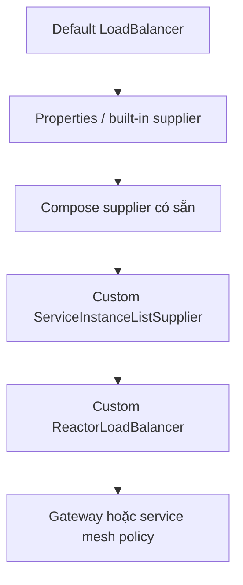
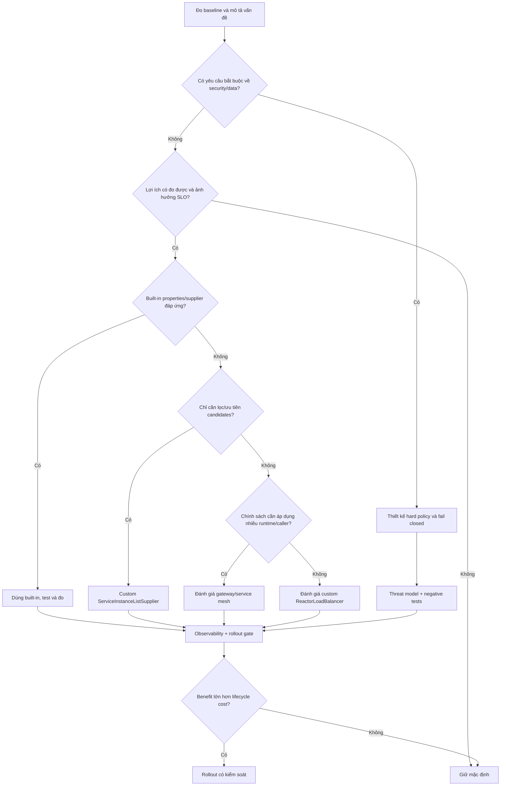

# Đánh giá độ phức tạp vận hành so với lợi ích tùy biến

Spring Cloud LoadBalancer cho phép ứng dụng gọi service ID và chọn một `ServiceInstance` ở phía client. Khi thuật toán mặc định chưa đáp ứng nhu cầu, nhóm phát triển có thể thêm zone preference, hint, sticky routing, trọng số, lọc theo metadata hoặc tự viết supplier/thuật toán. Mỗi tùy biến có thể cải thiện latency, độ sẵn sàng, cách ly tenant hay kiểm soát rollout, nhưng cũng tạo thêm cấu hình, trạng thái, kiểm thử, cảnh báo và trách nhiệm vận hành.

**Một chính sách định tuyến chỉ đáng giữ khi lợi ích của nó được đo và lớn hơn chi phí sở hữu trong suốt vòng đời.** Bài này đưa ra cách đánh giá theo dữ liệu, so sánh các mức tùy biến và chọn đúng nơi thực thi chính sách. Phạm vi thuộc module `SPRING_CLOUD_SERVICE_COMMUNICATION_LOAD_BALANCING`: service ID, discovery, health check, lựa chọn `ServiceInstance`, RestClient, WebClient, OpenFeign, retry/timeout và observability.

## 1. Câu hỏi thiết kế cần trả lời

Giả sử `order-service` gọi `inventory-service` bằng `@LoadBalanced RestClient`. Mặc định, LoadBalancer chọn một instance từ danh sách ứng viên do discovery/supplier cung cấp. Nhóm muốn thêm routing theo zone vì một số lời gọi đến replica cùng vùng có latency thấp hơn. Một đề xuất khác muốn sticky routing theo tenant; một đề xuất nữa muốn weighted canary. Mỗi đề xuất có lợi ích và chi phí khác nhau.

Trước khi viết custom code, cần trả lời:

1. **Vấn đề hiện tại là gì?** Có số liệu về latency, lỗi, chi phí mạng, tải lệch hay yêu cầu isolation không?
2. **Lợi ích mong đợi đo bằng gì?** p95 giảm bao nhiêu, lỗi giảm bao nhiêu, tuân thủ region ra sao, hoặc tiết kiệm tài nguyên thế nào?
3. **Ai sở hữu quyết định?** Caller, Spring Cloud LoadBalancer, gateway, service mesh hay discovery platform?
4. **Chính sách có thể diễn đạt bằng cấu hình hoặc supplier có sẵn không?** Hay thực sự cần thuật toán riêng?
5. **Khi metadata thiếu, discovery stale, health check sai hoặc không có candidate, hệ thống phải làm gì?**
6. **Ai duy trì chính sách khi nâng Spring Boot/Spring Cloud, đổi registry hoặc thay HTTP client?**

Nếu chưa có câu trả lời cho các câu hỏi này, custom routing thường làm tăng số tình huống cần debug mà chưa giải quyết một vấn đề đã được chứng minh.

## 2. Xây baseline trước khi tùy biến

Baseline là hành vi đơn giản đang chạy, dùng làm mốc so sánh. Với một service ID, cần ghi:

| Hạng mục | Dữ liệu baseline |
|---|---|
| Caller và downstream | `order-service` → `inventory-service` |
| HTTP client | `RestClient`, `WebClient` hay OpenFeign; bean nào được đánh dấu `@LoadBalanced`. |
| Discovery | Nguồn danh sách `ServiceInstance`, chu kỳ cập nhật và cache. |
| Selection | Thuật toán hiện tại, thứ tự candidate, hành vi khi danh sách rỗng. |
| Health | Có health supplier/probe không; probe đo liveness hay readiness. |
| Retry/timeout | Retry nằm ở client, LoadBalancer, wrapper hay proxy; deadline tổng. |
| Metadata | Các key thực sự có trên instance, nguồn cấp và độ tin cậy. |
| Quan sát | Logical calls, HTTP attempts, selected instance, status, p95/p99. |
| Vận hành | Số lần incident liên quan, thời gian tìm nguyên nhân và cách rollback. |

Không chỉ đo số request thành công. Một hệ thống có 99,9% success nhưng p99 cao, connection pool thường xuyên cạn hoặc retry amplification lớn vẫn có thể cần thay đổi. Ngược lại, nếu latency/error đã nằm trong SLO và không có yêu cầu locality/isolation mới, custom routing có thể chỉ làm phức tạp thêm.

### Đo đúng đơn vị

Phải tách ba khái niệm:

| Đơn vị | Ví dụ | Có thể tăng bởi |
|---|---|---|
| **Logical request** | Một thao tác lấy tồn kho của order. | Traffic của người dùng. |
| **LoadBalancer selection** | Một lần chọn `inventory-a`. | Retry chọn lại, hoặc nhiều client invocation. |
| **HTTP attempt** | Một lần thực sự gửi HTTP đến replica. | Retry ở client/LB/proxy, request redirect hoặc transport behavior. |

Tỷ lệ request vào một replica không nhất thiết bằng tỷ lệ attempt, và số attempt không nói lên tỷ lệ success. Khi so sánh baseline với policy mới, đo cả ba ở đúng tầng.

## 3. Lợi ích tùy biến phải gắn với kết quả cụ thể

Một custom policy có thể tạo giá trị khi giải quyết được một trong các nhu cầu sau:

| Lợi ích | Ví dụ trong LoadBalancer | Cách chứng minh |
|---|---|---|
| **Giảm latency** | Ưu tiên instance cùng zone khi caller và upstream ở gần nhau. | So p50/p95/p99 cùng operation, zone và tải. |
| **Tăng độ sẵn sàng** | Loại instance không khỏe hoặc tránh vùng đang gặp sự cố. | Tỷ lệ lỗi, thời gian phát hiện, thời gian phục hồi, false positives. |
| **Cách ly dữ liệu** | Chỉ cho tenant/region đến instance được phép xử lý dữ liệu đó. | Kiểm thử negative cases, audit và bằng chứng không có request vượt vùng. |
| **Kiểm soát rollout** | Gán một cohort nhỏ vào canary. | Assignment ratio, selection, attempts và outcomes theo release. |
| **Cân bằng năng lực** | Dùng trọng số khi replica có capacity khác nhau. | CPU, queue depth, latency và throughput theo instance. |
| **Giảm chi phí mạng** | Ưu tiên replica cùng region để giảm egress/cross-zone traffic. | Network cost/egress, latency và tỷ lệ cross-zone. |
| **Giảm tải hệ thống phụ trợ** | Affinity đến replica có cache phù hợp nếu contract cho phép. | Cache hit rate, backend load, tail latency và tính nhất quán. |

Lợi ích cần đủ lớn và lặp lại trong workload đại diện. Một lần benchmark nhỏ hoặc một biểu đồ đẹp trong vài phút chưa đủ chứng minh policy tốt hơn trong mọi zone, giờ cao điểm và tình huống lỗi.

## 4. Các mức tùy biến từ đơn giản đến phức tạp

Không phải mọi nhu cầu đều cần viết `ReactorLoadBalancer` mới. Có thể xem các lựa chọn như một thang tăng dần về chi phí:



Sơ đồ thể hiện **các hướng lựa chọn**, không phải một quy trình bắt buộc phải đi hết. Gateway/mesh là một vị trí thực thi chính sách khác, không phải “mức cao hơn” trong cùng một API.

| Lựa chọn | Khi phù hợp | Chi phí tương đối | Rủi ro chính |
|---|---|---:|---|
| **Mặc định** | Round robin/random hiện tại đáp ứng SLO. | Thấp | Không thể hiện policy đặc thù chưa được cấu hình. |
| **Properties/built-in** | Cache, hint, zone preference, retry/health theo khả năng release đang dùng. | Thấp–vừa | Hiểu sai semantics hoặc thứ tự cấu hình. |
| **Ghép supplier có sẵn** | Cần thêm một bước filter/cache/health nhưng vẫn dùng SPI chuẩn. | Vừa | Sai thứ tự, cache hoặc mất request context. |
| **Custom ServiceInstanceListSupplier** | Cần lọc/ưu tiên candidate dựa trên request/metadata. | Vừa–cao | Metadata không đáng tin, candidate rỗng, context không truyền tới. |
| **Custom ReactorLoadBalancer** | Cần thuật toán lựa chọn riêng mà supplier/filter không diễn đạt được. | Cao | Tự sở hữu thuật toán, state, concurrency, retry và compatibility. |
| **Gateway/service mesh** | Chính sách cần áp dụng tập trung qua nhiều caller hoặc nhiều ngôn ngữ. | Vừa–cao ở hạ tầng | Thêm proxy/control plane, có thể trùng với client-side routing. |

Tên API, properties và supplier builder thay đổi theo Spring Cloud release. Luôn kiểm tra phiên bản BOM đang dùng và hành vi runtime; không copy cấu hình từ một release khác mà không có test.

## 5. Khi nào nên giữ mặc định?

Giữ cấu hình mặc định thường là quyết định đúng nếu:

- Danh sách instance được discovery cung cấp chính xác và đủ mới.
- Các replica có năng lực gần nhau và không có yêu cầu locality bắt buộc.
- Latency/error distribution đã nằm trong SLO.
- Không cần affinity theo tenant/session hay rollout theo release.
- Retry/timeout hiện tại đã có ngân sách và hành vi rõ.
- On-call có thể xác định lỗi từ service ID, selected instance và HTTP outcome mà không cần thêm routing policy.

**Đừng tùy biến chỉ vì có thể.** Mỗi điều kiện routing bổ sung làm tăng số nhánh có thể xảy ra: metadata thiếu, candidate bị lọc hết, health probe không đồng bộ, cache stale, retry chọn lại hoặc fallback không đúng ý.

Ví dụ, nếu có ba replica cùng năng lực và traffic phân phối đều, round robin thường đủ. Viết thuật toán weighted phức tạp mà chưa có số liệu capacity khác nhau sẽ thêm code cần test và bảo trì mà chưa mang lại lợi ích đo được.

## 6. Khi nào cấu hình built-in là đủ?

Ưu tiên properties hoặc supplier có sẵn khi nhu cầu phù hợp với semantics mà Spring Cloud LoadBalancer đã hỗ trợ trong release đang dùng:

- Bật/tắt hoặc điều chỉnh cache danh sách instance.
- Health check theo endpoint/cấu hình phù hợp.
- Zone preference/hint nếu discovery và caller đã cung cấp metadata đúng định dạng.
- Retry behavior được hỗ trợ và đã hiểu rõ việc chọn lại instance.
- Sticky-session hoặc hint-based routing nếu phiên bản và integration hỗ trợ.

Ưu điểm là framework sở hữu phần lớn implementation và nhóm chỉ cần vận hành cấu hình. Tuy nhiên, built-in không có nghĩa “không cần hiểu”. Phải biết:

1. Property áp dụng global hay per-service.
2. Supplier nào được tạo và thứ tự ghép supplier.
3. Candidate list được cache ở đâu, TTL/capacity là bao nhiêu.
4. Health probe chạy theo lịch nào, có ảnh hưởng startup hay không.
5. Khi request context không có, hành vi fallback là gì.
6. Khi nâng Spring Cloud, property/API đó có đổi semantics hay không.

Nếu built-in giải quyết đúng yêu cầu, custom code không tự động tạo ra giá trị tốt hơn.

## 7. Khi nào ghép supplier có sẵn là hợp lý?

Một nhu cầu thường gặp là discovery cung cấp danh sách chung, sau đó caller muốn áp dụng health check và zone preference. Có thể ghép các supplier có sẵn thay vì viết lại discovery/cache/health từ đầu.

Mô hình khái niệm:

```text
Discovery source
    -> shared candidate cache
        -> health filtering
            -> zone/hint preference
                -> LoadBalancer selection algorithm
```

Thứ tự thật phụ thuộc API và builder của Spring Cloud version. Cần xác minh:

- Cache danh sách discovery chung trước khi lọc theo request.
- Không cache một candidate list đã cá nhân hóa theo tenant/zone bằng cache key chỉ chứa service ID.
- Health filtering không được vô tình loại toàn bộ replica chỉ vì probe sai path hoặc timeout quá ngắn.
- Zone preference là ưu tiên mềm hay điều kiện bắt buộc.
- Supplier phía dưới vẫn nhận đúng `Request` nếu chính sách phụ thuộc request context.

Đây là lựa chọn tốt khi muốn tái sử dụng hành vi framework và chỉ thêm một bước policy nhỏ, có test rõ.

## 8. Khi nào cần Custom ServiceInstanceListSupplier?

Custom supplier phù hợp khi cần **thay đổi tập candidate** theo dữ liệu có trong request, ví dụ:

- Chỉ đưa replica của release được gán vào request.
- Ưu tiên cùng zone nhưng cho phép fallback.
- Loại nhóm instance dành cho batch khỏi request interactive.
- Lọc theo capability/version mà service contract yêu cầu.
- Giữ hard region constraint theo policy đã xác thực.

Một supplier nên làm một việc có tên gọi rõ ràng. Ví dụ `ReleaseAwareServiceInstanceListSupplier` lọc theo metadata `release`; nó không nên đồng thời đọc tenant, tính phần trăm canary, gọi database, phát metric, retry và thay đổi header.

Pseudo-flow:

```text
candidatesFlux = delegate.get(request)
decision = verifiedPolicy.from(request)

return candidatesFlux.map(candidates -> {
    eligible = candidates filtered by decision.allows(metadata)
    if eligible is empty:
        return the policy's explicit no-candidate result
    return eligible
})
```

Đây là **pseudocode**, không phải class hoàn chỉnh. `verifiedPolicy` phải được tạo ở trust boundary; không dùng header do người dùng bên ngoài tự khai như bằng chứng tenant/region. Cách xử lý danh sách rỗng phải được định nghĩa rõ: fail closed cho hard constraints; soft preference có thể quay về tập candidate hợp lệ ban đầu nếu điều đó đúng hợp đồng.

### Chi phí phát sinh

- Cần hiểu `RequestDataContext` và cách RestClient/WebClient/OpenFeign truyền request data trong release đang dùng.
- Cần test cả trường hợp có context, thiếu context, sai định dạng và request từ client khác.
- Cần kiểm tra thứ tự supplier, cache key, health và discovery refresh.
- Cần định nghĩa behavior khi metadata bị thiếu hoặc không nhất quán.
- Cần instrument số candidate trước/sau filter và lý do không chọn được instance.
- Cần có người sở hữu code khi framework đổi SPI hoặc ứng dụng thêm một HTTP client mới.

Nếu chỉ có một điều kiện nhỏ mà supplier có sẵn đáp ứng được, custom supplier có thể là chi phí không cần thiết.

## 9. Khi nào cần Custom ReactorLoadBalancer?

Custom `ReactorLoadBalancer` tác động trực tiếp tới bước chọn một `ServiceInstance`. Nó phù hợp khi thuật toán lựa chọn không thể diễn đạt bằng cách lọc/ưu tiên danh sách, ví dụ:

- Weighted algorithm có semantics đặc thù và đã có dữ liệu capacity đáng tin.
- Một thuật toán phân phối cần trạng thái/sequence riêng được quản lý đúng.
- Selection cần kết hợp nhiều tín hiệu được chuẩn hóa mà supplier hiện có không hỗ trợ.
- Cần chính sách chọn có thể kiểm chứng toán học/đo lường và được nhóm platform sở hữu.

Chi phí cao hơn vì nhóm phải sở hữu:

1. Khởi tạo và quản lý state/thread-safety của thuật toán.
2. Hành vi khi candidate list rỗng hoặc chỉ có một instance.
3. Xử lý request context thiếu hoặc không hợp lệ.
4. Retry/reselection semantics và việc tránh lặp cùng instance ngoài ý muốn.
5. Tính nhất quán khi nhiều caller process chạy thuật toán độc lập.
6. Metrics/logging/tracing cho lựa chọn, candidate count và lý do thất bại.
7. Test phân phối, concurrency, failure, cache và upgrade.

**Một thuật toán phức tạp không tạo ra chính sách phân phối toàn cụm nhất quán nếu mỗi caller process giữ state cục bộ riêng.** Nếu cần quota/weight chính xác toàn cluster, local counter trong từng JVM có thể không đủ; cân nhắc một traffic controller tập trung hoặc cơ chế stateless deterministic phù hợp.

Không viết custom algorithm chỉ để thay round robin bằng random nếu không có bằng chứng rằng round robin gây vấn đề.

## 10. Khi nào nên chuyển policy ra gateway hoặc service mesh?

Spring Cloud LoadBalancer chạy trong từng caller application. Điều này có ưu điểm: lựa chọn diễn ra ngay trong client, có thể dùng request context của ứng dụng và không cần proxy hop bổ sung. Nhưng cũng có hệ quả: nhiều caller có thể dùng **các phiên bản policy/config khác nhau** trong cùng một thời điểm.

Gateway hoặc service mesh đáng cân nhắc khi:

- Chính sách cần thống nhất cho nhiều ngôn ngữ/runtime.
- Cần traffic split tập trung giữa nhiều service/client.
- Cần quản lý canary/weighted route tại một điểm có audit/rollout rõ.
- Platform team sở hữu control plane và có quy trình vận hành mesh/gateway.
- Cần observability/network policy nhất quán ngoài phạm vi một ứng dụng Spring.

Giữ policy trong Spring Cloud LoadBalancer khi:

- Chỉ một số caller Spring cần logic lựa chọn riêng.
- Quyết định phụ thuộc dữ liệu nghiệp vụ đã xác minh ở caller.
- Muốn tránh proxy hop và hạ tầng mesh mới.
- Nhóm service có thể sở hữu, test và vận hành custom policy.

Không đặt cùng một traffic split ở gateway, mesh và LoadBalancer mà không xác định thứ tự. Nếu gateway đã gửi 10% vào canary subset rồi caller lại chia 10% trong subset đó, tỷ lệ cuối có thể là 1%; nếu các policy khác nhau, kết quả còn khó đoán hơn.

## 11. So sánh các lựa chọn theo chi phí vòng đời

Đánh giá không dừng ở số dòng code. Hãy tính cả build, deploy, runtime và incident response:

| Chi phí | Mặc định/built-in | Ghép supplier | Custom supplier | Custom algorithm |
|---|---|---|---|---|
| **Code ban đầu** | Thấp | Thấp–vừa | Vừa | Cao |
| **Cấu hình** | Ít | Vừa | Vừa–cao | Cao |
| **Kiểm thử** | Framework + contract tests | Supplier order/cache tests | Request/metadata/fallback matrix | Thêm distribution/concurrency tests |
| **Observability** | Metric chuẩn và logs hiện có | Thêm candidate/filter signals | Thêm decision reason | Thêm selection internals/state |
| **On-call** | Ít nhánh riêng | Debug supplier chain | Debug context/metadata/cache | Debug algorithm/state/concurrency |
| **Nâng cấp framework** | Thường thấp | Vừa | Vừa–cao | Cao |
| **Đào tạo đội ngũ** | Thấp | Vừa | Cao hơn | Cao |
| **Rollback** | Revert config | Tắt supplier wrapper | Đổi config/bean theo service | Cần đường quay về algorithm cũ |

Các mức là đánh giá tương đối, không phải benchmark. Một custom supplier rất nhỏ nhưng phục vụ chính sách data residency có thể đáng chi phí cao; một thuật toán weighted vài trăm dòng mà không có metric capacity có thể không đáng.

## 12. Xác định lợi ích bằng số liệu

Đặt giả thuyết trước khi viết code. Ví dụ:

```text
Giả thuyết:
Ưu tiên replica cùng zone sẽ giảm p95 latency của GET inventory.

Baseline:
Cross-zone calls: 40%
p95: 180 ms
Error rate: 0.15%

Canary policy:
Same-zone preference, soft fallback

Điều kiện chấp nhận:
p95 giảm có ý nghĩa ở cùng traffic mix;
error rate không tăng vượt guardrail;
không làm lệch tải hoặc tăng saturation ở zone còn lại.
```

Các con số trên chỉ là ví dụ minh họa. Khi thực hiện thật:

- Đo cùng operation, payload size, zone, tenant category và khung giờ tải.
- So p50/p95/p99, error rate, throughput và CPU/connection pool.
- Ghi cả selection count và HTTP attempts, không chỉ final success.
- Có đủ mẫu; tránh so p99 từ một nhóm nhỏ với nhóm có hàng triệu request.
- Theo dõi fallback, no-eligible-instance và stale discovery.
- Thử cả lúc zone đích chậm hoặc mất kết nối.

Nếu latency giảm nhưng lỗi tăng, hoặc một zone bị quá tải vì mọi caller đều ưu tiên cùng một cụm, lợi ích tổng thể có thể âm.

## 13. Một scorecard để quyết định có nên tùy biến

Scorecard dưới đây là công cụ thảo luận, không phải công thức chuẩn của Spring. Chấm từng tiêu chí từ 1 đến 5:

| Tiêu chí | 1 điểm | 3 điểm | 5 điểm |
|---|---|---|---|
| **Tác động người dùng** | Khó nhận biết | Ảnh hưởng một luồng quan trọng | Ảnh hưởng lớn tới SLO/nghiệp vụ |
| **Bằng chứng baseline** | Chỉ là cảm nhận | Có số liệu một phần | Có đo lường lặp lại, nguyên nhân rõ |
| **Tần suất vấn đề** | Hiếm | Theo giờ/đợt tải | Liên tục hoặc tăng theo tải |
| **Giá trị tuân thủ/isolation** | Không có | Có ràng buộc một phần | Hard constraint bắt buộc |
| **Độ đơn giản của giải pháp** | Cần state/phụ thuộc nhiều | Một supplier/policy | Cấu hình built-in |
| **Khả năng rollback** | Khó, ảnh hưởng rộng | Có route flag | Có thể tắt riêng, đã test |
| **Khả năng vận hành** | Không có owner | Có owner nhưng thiếu dashboard | Owner, runbook, alerts rõ |

Không cộng tất cả thành một số duy nhất rồi tự động quyết định. Tách:

- **Benefit:** tác động người dùng, bằng chứng, tần suất và giá trị policy.
- **Cost/risk:** độ phức tạp, rollback, vận hành và compatibility.
- **Hard requirements:** bảo mật, data residency hoặc compliance không được “bù điểm” bằng latency thấp.

Một policy có benefit cao nhưng không có owner/on-call/rollback vẫn chưa sẵn sàng triển khai. Nếu lợi ích chỉ là vài mili giây không ảnh hưởng SLO, default có thể là lựa chọn hợp lý hơn.

## 14. Ví dụ quyết định: zone preference cho inventory

Tình huống:

- Caller `order-service` chạy ở `zone-a` và `zone-b`.
- Inventory có replica ở cả hai zone.
- Cross-zone traffic có latency/chi phí cao hơn.
- Tất cả replica có thể phục vụ cùng contract; zone chỉ là preference.

### Lựa chọn A — Giữ mặc định

Ưu điểm: ít cấu hình, dễ hiểu, không phụ thuộc zone metadata. Nhược điểm: request có thể thường xuyên đi cross-zone và không tối ưu locality.

Chọn A nếu cross-zone latency/egress không ảnh hưởng SLO hoặc chi phí.

### Lựa chọn B — Dùng zone preference có sẵn

Ưu điểm: tận dụng framework, ít custom code. Chi phí: cần metadata zone chính xác, hiểu fallback và kiểm thử supplier order/health/cache.

Chọn B nếu built-in supplier của release đang dùng đáp ứng đúng semantics và request context được cung cấp.

### Lựa chọn C — Custom supplier

Ưu điểm: có thể diễn đạt quy tắc riêng, ví dụ preference theo zone kết hợp release. Chi phí: phải sở hữu context propagation, metadata, cache, test và observability.

Chọn C chỉ khi B không thể biểu diễn yêu cầu đã được đo, và có owner lâu dài.

### Quyết định mẫu

Nếu mục tiêu chỉ là giảm cross-zone traffic, thử B trước. Nếu policy cần hard data residency, không coi zone preference là đủ: cần hard filter được kiểm soát bằng identity/policy đã xác minh và fail closed khi không có candidate. Đây là hai yêu cầu khác nhau, dù cùng sử dụng trường `zone`.

## 15. Ví dụ quyết định: weighted/canary routing

Giả sử có tám replica stable và hai replica canary. Round robin trên mười instance có thể đưa khoảng 20% selections vào canary khi danh sách ổn định, không phải 5%. Có thể muốn custom weight để canary chỉ nhận 5%.

Trước khi tự viết weighted algorithm, cân nhắc:

1. Có thể điều khiển traffic split ở gateway/mesh không?
2. Có cần tỷ lệ theo logical request hay tỷ lệ theo instance capacity?
3. Tỷ lệ có phải chính xác toàn cluster hay chỉ kỳ vọng thống kê?
4. Mỗi caller process có cùng cấu hình và thuật toán không?
5. Khi retry, assignment release có được giữ ổn định không?
6. Khi canary không có instance khỏe, có fallback không và có đo riêng không?
7. Có metric phân biệt assigned, selected, HTTP attempts, outcomes không?

Nếu cần sticky cohort, một quyết định stateless dựa trên hash của identity đã xác thực có thể ổn định hơn random per attempt. Nếu cần quota toàn cụm chính xác, local counters trong mỗi JVM không đủ nếu không có phối hợp.

**Không dùng weighted selection để thay thế health check hoặc capacity management.** Một instance có weight cao nhưng đã lỗi vẫn không nên nhận request.

## 16. Rủi ro vận hành ẩn trong custom routing

### 16.1. Metadata không đáng tin hoặc không đồng nhất

Nếu supplier đọc `metadata.get("zone")` hoặc `metadata.get("release")`:

- Registry/deployment phải cấp nhãn từ nguồn đáng tin.
- Thiếu key phải có behavior xác định.
- Không cho user tự khai header rồi biến nó thành hard authorization.
- Kiểm tra metadata khi rollout, restart và scale.
- Không dùng metadata nhạy cảm hoặc toàn bộ metadata làm metric label.

Metadata sai có thể làm lọc nhầm toàn bộ instance. Đây không chỉ là lỗi phân phối; với tenant/region, nó có thể trở thành lỗi cách ly dữ liệu.

### 16.2. Request context không đi tới supplier

RestClient, WebClient và OpenFeign có integration/filter chain khác nhau. Header/attribute được thêm sau khi LoadBalancer chọn instance sẽ không ảnh hưởng quyết định đã xảy ra. Reactor Context cũng không tự đồng nhất với `RequestDataContext`.

Nếu policy phụ thuộc request:

- Test từng HTTP client riêng.
- Xác nhận request context thực sự có ở `ServiceInstanceListSupplier.get(Request)`.
- Kiểm tra thứ tự filter/interceptor.
- Có default rõ khi context thiếu.
- Không dùng ThreadLocal toàn cục để truyền state theo request reactive.

### 16.3. Cache và dữ liệu stale

Cache giúp giảm truy vấn discovery, nhưng custom filtering tạo nguy cơ cache nhầm:

```text
Không an toàn:
cache key = serviceId
value = candidates đã lọc theo tenant/zone/release

An toàn hơn:
cache key = serviceId
value = danh sách discovery chung
request context -> filter candidate sau cache
```

Nếu cache phụ thuộc request, key phải biểu diễn đúng mọi dimension liên quan và có giới hạn cardinality/TTL. Trong nhiều trường hợp, lọc sau cache chung đơn giản và dễ vận hành hơn.

### 16.4. Health check và false positives

Probe quá thường xuyên có thể tạo tải; probe quá chậm có thể giữ instance lỗi lâu; endpoint health trả `UP` không đảm bảo API nghiệp vụ khỏe. Cần:

- Phân biệt liveness, readiness và dependency health.
- Chọn path/timeout/interval phù hợp.
- Theo dõi thời gian phát hiện và thời gian phục hồi.
- Kiểm tra khi toàn bộ instance bị đánh dấu unhealthy.
- Tránh để một probe lỗi ngắn hạn làm loại cả zone ngoài ý muốn.

### 16.5. Retry và fallback che lỗi

Retry có thể làm final success tăng nhưng cũng khuếch đại traffic. Nếu request được gán canary rồi retry sang stable, cần log/metric rằng đã có fallback; nếu không, canary có vẻ khỏe hơn thực tế. Hard tenant/region constraint không được nới lỏng trong retry.

### 16.6. Cấu hình phân tán giữa nhiều caller

Mỗi caller có thể cache danh sách instance và nạp config ở thời điểm khác nhau. Trong rolling deployment, một số caller chạy policy cũ, số khác policy mới. Cần có config version, rollout propagation và metric theo caller/policy version để nhận biết thời gian hội tụ.

## 17. Ma trận kiểm thử tương ứng với độ phức tạp

Mức tùy biến càng cao thì test matrix càng rộng:

| Mức | Kiểm thử tối thiểu |
|---|---|
| Default/built-in | Service ID resolve, nhiều instance, empty list, HTTP status/transport. |
| Ghép supplier | Thứ tự supplier, cache, health, zone/hint và fallback. |
| Custom supplier | Request context có/thiếu/sai, metadata thiếu, hard/soft filter, concurrency, cache isolation. |
| Custom algorithm | Tính đúng thuật toán, distribution, thread safety, candidate rỗng/1 phần tử, deterministic behavior, retry/reselection. |
| Gateway/mesh | Route weights, config propagation, proxy health, interaction với client-side LB và rollback. |

Các tình huống chung cần có:

- Instance khỏe và trả 200.
- Upstream thật trả 503.
- Instance có trong discovery nhưng process đã dừng.
- Không có eligible instance.
- Health probe timeout hoặc false negative.
- Metadata thiếu/sai.
- Request context không được truyền.
- Retry giữ đúng policy và không tạo amplification quá mức.
- Nhiều request đồng thời không lẫn tenant/release/zone context.
- Scale up/down và cache refresh.

Để chứng minh HTTP thật sự đến replica nào, dùng nhiều MockWebServer/WireMock với port động hoặc môi trường discovery test. Unit test gọi trực tiếp thuật toán không thay thế integration test qua `@LoadBalanced` client.

## 18. Observability và runbook phải đi cùng custom code

Mỗi policy cần trả lời được:

1. Caller muốn gọi service ID nào?
2. Request có routing decision gì và nguồn nào đã xác minh?
3. Có bao nhiêu candidates trước/sau filter?
4. Instance nào được chọn, hoặc vì sao không có instance?
5. HTTP attempt kết thúc thế nào?
6. Có retry/fallback không, ai thực hiện và bao nhiêu lần?

Một schema event minh họa:

```json
{
  "event": "loadbalancer_decision",
  "targetService": "inventory-service",
  "policy": "same-zone-preference",
  "policyVersion": "v3",
  "candidateCount": 6,
  "eligibleCount": 2,
  "selectedInstance": "inventory-a2",
  "outcome": "selected",
  "traceId": "4bf92f3577b34da6a3ce929d0e0e4736"
}
```

Giá trị là minh họa. Không log token, raw tenant claim, toàn bộ metadata hoặc PII. Metric labels nên là tập giá trị nhỏ như `targetService`, `policy`, `outcome`, `release`; trace ID/instance ID chi tiết để trong logs/traces có quyền truy cập và retention phù hợp.

### Runbook khi policy không tìm được instance

1. Xác nhận service ID và discovery list.
2. Kiểm tra metadata cần thiết có trên các instance hay không.
3. Kiểm tra health filter và thời điểm cache refresh.
4. Xem request context có đến supplier không.
5. Xác định policy là soft hay hard; không tự mở fallback để làm request thành công.
6. Nếu là hard constraint, giữ fail closed và báo lỗi có phân loại.
7. Nếu là soft preference, fallback chỉ trong tập candidate đã qua điều kiện bắt buộc và phải có metric riêng.
8. Nếu policy mới gây sự cố, tắt riêng custom policy hoặc quay về supplier mặc định theo runbook đã test.

Custom code mà không có log decision reason và rollback switch sẽ khiến on-call phải suy luận từ triệu chứng HTTP cuối, rất khó xác định nguyên nhân.

## 19. Quy trình ra quyết định theo từng bước



### Checklist ra quyết định

- [ ] Vấn đề baseline được mô tả bằng dữ liệu và SLO.
- [ ] Lợi ích dự kiến có metric, workload và ngưỡng chấp nhận.
- [ ] Đã phân biệt preference mềm với constraint bắt buộc.
- [ ] Đã chọn đúng traffic/routing owner.
- [ ] Đã kiểm tra built-in trước khi viết custom code.
- [ ] Đã đánh giá chi phí cache, metadata, health, retry và config propagation.
- [ ] Có owner, người trực, dashboard và runbook.
- [ ] Có test matrix cho normal/failure/concurrency/upgrade.
- [ ] Có kill switch/rollback và đã diễn tập.
- [ ] Có kế hoạch đánh giá lại policy sau nâng Spring Cloud hoặc thay discovery provider.

## 20. Mẫu ADR: có nên tùy biến LoadBalancer?

Dùng mẫu sau để ghi quyết định trong nhóm:

```text
Title:
Context:
  Service ID:
  Caller(s):
  Discovery provider:
  Current LoadBalancer behavior:
  Baseline SLO and measurements:

Problem:
  User/business impact:
  Frequency:
  Evidence:

Options:
  A. Keep default
  B. Built-in properties/supplier
  C. Compose existing suppliers
  D. Custom ServiceInstanceListSupplier
  E. Custom ReactorLoadBalancer
  F. Gateway/service mesh

Decision:
  Chosen option:
  Traffic/policy owner:
  Soft preference or hard constraint:
  Behavior when context/metadata is missing:
  Behavior when no instance is eligible:

Expected benefit:
  Metric:
  Baseline:
  Target:
  Minimum sample/window:

Operational cost:
  Code/config owner:
  Tests:
  Dashboard/alerts:
  Upgrade compatibility:
  On-call runbook:
  Rollback switch:

Risks and mitigations:
  Cache/metadata/security/retry/health:

Review date:
```

Không cần chọn custom policy chỉ để ADR trông đầy đủ. Quyết định `Keep default` với bằng chứng rõ cũng là một kết quả kỹ thuật tốt.

## 21. Ví dụ kết luận cho ba bài toán

| Bài toán | Quyết định ban đầu hợp lý | Khi nào nâng mức tùy biến |
|---|---|---|
| Ba replica cùng năng lực, cùng zone, SLO đạt | Giữ thuật toán mặc định. | Khi đo được tải lệch hoặc latency khác biệt có ý nghĩa. |
| Cross-zone latency/egress cao | Thử built-in zone preference và đo. | Khi cần policy nhiều điều kiện mà supplier có sẵn không diễn đạt được. |
| Tenant bắt buộc ở region riêng | Hard filter dựa trên identity/policy đã xác minh; fail closed. | Nếu policy phải áp dụng nhiều runtime, cân nhắc enforcement tập trung ở platform/mesh/gateway. |
| Canary 5% cho nhiều caller | Chọn một traffic assignment owner và giữ release decision ổn định. | Dùng custom supplier nếu client-side routing là nơi phù hợp và cần filter theo request. |
| Replica có capacity rất khác nhau | Đo saturation trước, thử cấu hình/weighted supplier có sẵn. | Custom algorithm chỉ khi semantics weight cần thiết và có telemetry/test đầy đủ. |

## 22. Kết luận

Độ phức tạp của một custom LoadBalancer không nằm riêng ở thuật toán chọn instance. Nó nằm trong **toàn bộ hợp đồng vận hành**: nguồn metadata, request context, discovery/cache, health, retry, telemetry, test, nâng cấp framework và khả năng rollback. Lợi ích cũng không thể chỉ mô tả là “routing linh hoạt hơn”; phải gắn với latency, availability, isolation, rollout hoặc chi phí đã đo.

Hãy giữ mặc định khi nó đáp ứng SLO; ưu tiên properties và supplier có sẵn khi chúng diễn đạt đúng yêu cầu; chỉ viết custom supplier/algorithm khi có bằng chứng rằng lựa chọn đơn giản hơn không đủ. Nếu policy cần thống nhất trên nhiều runtime hoặc caller, đánh giá gateway/service mesh và chỉ định một traffic owner. Với mọi lựa chọn, định nghĩa rõ hành vi khi context/metadata thiếu, candidate rỗng, health sai và retry xảy ra.

**Một policy tốt là policy có lợi ích đo được, chi phí sở hữu chấp nhận được, hành vi lỗi dự đoán được và có người vận hành được.** Nếu không thể giải thích vì sao request được chọn vào replica nào, khi nào fallback xảy ra và cách tắt policy khi có sự cố, custom routing chưa sẵn sàng cho production.
