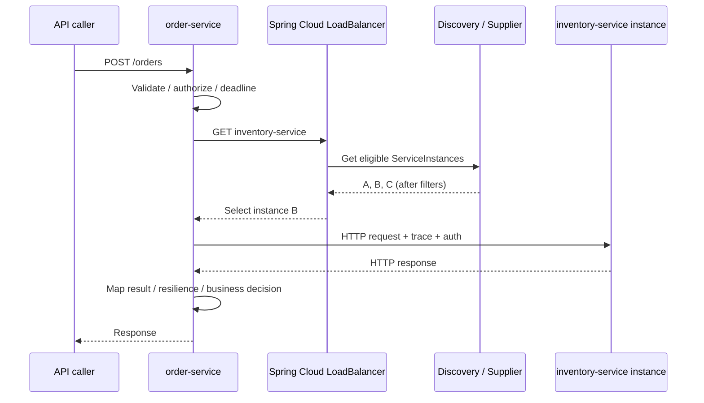
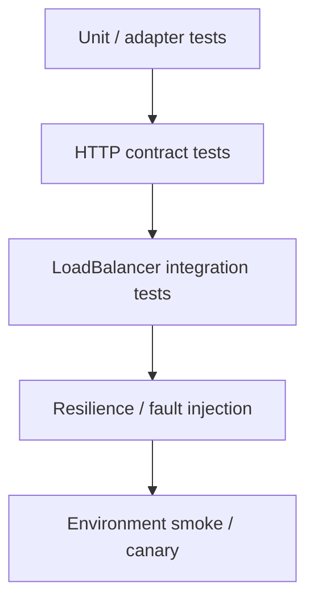

# Checklist thiết kế, kiểm thử và vận hành lời gọi dịch vụ

Một lời gọi từ `order-service` tới `inventory-service` có thể chỉ là một dòng HTTP client trong code, nhưng để vận hành ổn định, nhiều quyết định phải cùng đúng: service ID có nhất quán không, discovery trả về những bản sao nào, LoadBalancer chọn đích ra sao, HTTP client dùng connection pool nào, timeout có nằm trong deadline nghiệp vụ không, retry có an toàn không, token có đúng audience không, và đội vận hành có đủ tín hiệu để tìm lỗi không.

Spring Cloud LoadBalancer xử lý **lựa chọn `ServiceInstance` ở phía caller**. Nó là một thành phần trong đường đi, không thay thế hợp đồng HTTP, bảo mật, quản lý kết nối, resilience, observability hay năng lực xử lý của backend. Vì vậy, thiết kế một lời gọi dịch vụ phải được xem như một quyết định end-to-end.

Bài thuộc chương **Lựa chọn thiết kế** của module Spring Cloud LoadBalancer. Nội dung này cung cấp một checklist dùng trong design review, implementation review, kiểm thử trước triển khai và vận hành production; kèm ví dụ cho `RestClient`, `WebClient`, `OpenFeign`, mẫu cấu hình, tiêu chí nghiệm thu và ADR để nhóm có thể ghi lại quyết định.

## 1. Bắt đầu từ mục tiêu nghiệp vụ và SLO

Trước khi chọn thuật toán hoặc HTTP client, hãy trả lời **lời gọi này cần bảo đảm điều gì cho người dùng và hệ thống**.

Ví dụ, `order-service` cần đọc tồn kho để hiển thị số lượng còn lại. Một lỗi tạm thời có thể chấp nhận dữ liệu cache vài giây. Nhưng khi xác nhận đặt hàng, tồn kho phải được kiểm tra theo quy tắc nghiệp vụ mới nhất; trả dữ liệu cũ có thể gây oversell. Cùng một downstream, hai use cases có thể cần timeout, fallback và retry khác nhau.

| Câu hỏi thiết kế | Thông tin cần chốt | Ví dụ |
|---|---|---|
| Mục đích của lời gọi? | Read, write, command, query, workflow hay streaming. | GET đọc tồn kho; POST giữ chỗ. |
| Độ quan trọng? | Critical path, optional enrichment hay background task. | Kiểm tra tồn kho là critical path của checkout. |
| SLO latency? | p50/p95/p99 và deadline tổng. | p95 dưới 300 ms cho thao tác đọc. |
| Availability/error budget? | Tỷ lệ lỗi cho phép, fallback nào an toàn. | Cho phép cache read khi inventory tạm lỗi. |
| Tính đúng dữ liệu? | Consistency, freshness, duplicate effects. | Không dùng tồn kho cache để quyết định ghi. |
| Lưu lượng? | RPS trung bình/đỉnh, concurrency, burst, payload. | 200 RPS bình thường, burst 800 RPS trong 10 giây. |
| Failure mode? | No instance, slow instance, 4xx/5xx, network, auth, overload. | Instance chết khi đang scale down. |
| Ai sở hữu API? | Team/provider, contract version, escalation. | Inventory team quản lý OpenAPI contract. |

### Phân loại operation trước khi đặt retry/fallback

| Operation | Idempotent? | Retry mặc định có an toàn? | Fallback thường phù hợp |
|---|---|---|---|
| GET product detail | Thường có. | Có thể, nếu lỗi transient và còn deadline. | Cache ngắn hạn nếu nghiệp vụ cho phép. |
| GET inventory availability | Thường có về HTTP semantics, nhưng dữ liệu thay đổi nhanh. | Có thể giới hạn một vài lần. | Có thể báo “không xác định” thay vì khẳng định còn hàng. |
| PUT thay thế trạng thái theo resource ID | Có thể idempotent theo contract. | Có điều kiện; cần xử lý concurrency/version. | Thường không giả lập thành công. |
| POST tạo payment/charge | Thường không idempotent nếu thiếu contract. | Không retry mù quáng. | Fail closed hoặc truy vấn trạng thái operation. |
| POST với idempotency key và dedup server | Có thể retry an toàn theo contract. | Có giới hạn và cùng key. | Trả trạng thái đã biết/đang xử lý. |
| Event publish | Phụ thuộc delivery semantics. | Có thể at-least-once; consumer phải deduplicate. | Outbox/retry queue theo thiết kế. |

**Không dùng tên HTTP method làm bằng chứng duy nhất cho idempotency.** Một GET có thể có side effect do API thiết kế sai; một POST có thể idempotent nếu có operation key và deduplication đúng.

## 2. Vẽ đường đi của một logical operation

Mọi design review nên vẽ request flow đủ để nhận diện các lớp timeout, retry và identity:



Đây là sơ đồ logical. Trong thực tế, HTTP client filter/interceptor có thể gọi LoadBalancer trong lúc tạo request, còn retry có thể lặp lại đoạn chọn instance; không phải một lần gọi luôn tương ứng đúng một lần selection.

### Ghi rõ các ranh giới

- **Logical operation:** thao tác nghiệp vụ mà caller muốn hoàn tất.
- **HTTP attempt:** một lần gửi request tới downstream; retry có thể tạo nhiều attempts.
- **ServiceInstance selection:** lần LoadBalancer chọn một endpoint từ danh sách eligible.
- **Connection acquisition:** lấy/reuse socket từ HTTP pool sau khi có remote endpoint.
- **Backend execution:** request đã tới handler/service đích.
- **Final outcome:** kết quả cuối mà business caller nhận được sau mapping/fallback.

Các số đếm này không đồng nhất. Ví dụ một logical operation có hai attempts, lần đầu chọn instance A nhưng connection refused; lần sau chọn instance B và thành công. Nếu chỉ đếm response thành công, ta không biết lần đầu đã xảy ra.

## 3. Checklist service ID và discovery

Service ID là tên logic mà caller dùng để tìm danh sách instances. Nó phải ổn định và nhất quán giữa client declaration, discovery provider, cấu hình per-service và telemetry.

| Hạng mục | Câu hỏi review | Tiêu chí chấp nhận |
|---|---|---|
| Naming | Service ID có thống nhất chữ thường, dấu gạch và naming convention không? | Một tên canonical, không phụ thuộc hostname từng pod. |
| Ownership | Team/provider nào sở hữu service ID và API contract? | Có owner, escalation path và versioning. |
| Discovery source | Eureka, Consul, Kubernetes, SimpleDiscoveryClient hay custom supplier? | Nêu rõ nguồn authoritative và refresh behavior. |
| Registration | Instance đăng ký khi nào, deregister khi nào? | Readiness/registration/draining được định nghĩa. |
| Address | Instance URI có scheme, host, port và path đúng? | Caller có thể kết nối tới endpoint đã quảng bá. |
| Metadata | Zone, version, weight, tenant hoặc protocol metadata có hợp đồng? | Key/value được kiểm tra và có fallback. |
| Empty list | Khi không có eligible instance, caller xử lý ra sao? | Domain error/503/fallback có chủ đích. |
| Multi-caller | Mỗi caller replica có cùng discovery view không? | Có metric/log để phát hiện view lệch. |
| Stale instance | Instance đã rút có còn được chọn trong khoảng propagation/cache không? | Có graceful drain, TTL/refresh và timeout phù hợp. |

### Checklist readiness và draining

Một instance chỉ nên được chọn khi nó thực sự sẵn sàng nhận traffic. Thiết kế cần phân biệt:

- **Liveness:** process còn sống; restart khi không còn khả năng phục hồi.
- **Readiness:** instance có thể nhận traffic nghiệp vụ.
- **Startup:** ứng dụng đã hoàn tất khởi tạo dependencies và warm-up cần thiết.
- **Deregistration/draining:** ngừng nhận request mới, chờ in-flight requests trong giới hạn, sau đó đóng process.

Không dùng liveness thay readiness nếu instance có thể sống nhưng chưa kết nối được database/config. Không làm readiness phụ thuộc quá nhiều downstream tùy chọn nếu điều đó khiến toàn cụm đồng loạt bị loại khi một dependency phụ gặp lỗi.

### Discovery và LoadBalancer cache

Cache danh sách instances giúp giảm chi phí truy vấn discovery nhưng làm caller có thể thấy topology trễ hơn registry. Khi chọn TTL/refresh, cân bằng:

1. Tốc độ cần phát hiện instance mới hoặc instance chết.
2. Khả năng chịu tải của registry/discovery provider.
3. Số caller replicas và số service IDs.
4. Hậu quả của stale endpoints trong thời gian cache còn hiệu lực.
5. Cách xử lý khi cache refresh thất bại.

Không đặt TTL quá ngắn chỉ để chữa lỗi routing chưa xác định. Phân biệt cache của LoadBalancer, discovery client, DNS và HTTP connection pool; chúng giải quyết các vấn đề khác nhau.

## 4. Checklist chọn ServiceInstance và routing policy

Thuật toán cần được chọn dựa trên topology, capacity và semantics của workload.

| Chính sách | Phù hợp khi | Rủi ro/giới hạn |
|---|---|---|
| Round robin | Instances tương đối đồng nhất, request cost tương tự, muốn phân phối đơn giản. | Không cân bằng active work hoặc latency; state/counter có thể riêng theo caller context. |
| Random | Cần lựa chọn đơn giản, nhiều requests, không yêu cầu thứ tự. | Mẫu nhỏ có thể lệch; không bảo đảm tỷ lệ chính xác. |
| Weighted | Instances khác năng lực hoặc muốn canary/gradual rollout. | Weight cần cập nhật theo capacity và quan sát; weight sai gây overload. |
| Zone-aware/locality | Giảm cross-zone latency/cost và có topology rõ. | Có thể dồn tải vào zone nhỏ; cần fallback khi local zone quá tải. |
| Hint/metadata-based | Chọn version, tenant, protocol hoặc capability cụ thể. | Filter quá chặt làm eligible list chỉ còn một hoặc rỗng. |
| Sticky/affinity | Stateful session hoặc partition ownership bắt buộc. | Hot keys, skew, failover phức tạp; không phù hợp nếu state đã externalized mà không cần affinity. |
| Least outstanding/custom | Có dữ liệu tải đáng tin cậy và thuật toán được kiểm thử. | Metrics trễ/noisy, state concurrency và chi phí selection phức tạp. |

### Các câu hỏi bắt buộc

- Danh sách **sau mọi supplier/filter** còn bao nhiêu instances?
- Mỗi caller process có state thuật toán riêng hay chia sẻ?
- Requests có cùng session/tenant/hash key không?
- Instance có khác capacity, zone hoặc version không?
- Có proxy/mesh/ingress thực hiện thêm một tầng load balancing?
- Khi instance bị loại, requests đang in-flight được xử lý thế nào?
- Nếu selection thất bại, caller có fallback sang service khác không? Điều đó có an toàn nghiệp vụ không?

**Không yêu cầu mọi instance có request count bằng nhau** khi workload khác nhau, affinity có chủ đích hoặc backend latency/capacity không đồng nhất. Điều cần đánh giá là SLO, utilization, queueing và policy contract.

## 5. Checklist chọn RestClient, WebClient hay OpenFeign

Chọn client theo **mô hình thực thi và nhu cầu của ứng dụng**, không theo số lượng annotation hoặc cảm giác thư viện nào mới hơn.

| Tiêu chí | RestClient | WebClient | OpenFeign |
|---|---|---|---|
| Mô hình | Blocking, API fluent. | Reactive/non-blocking, API fluent. | Declarative proxy, thường blocking. |
| Return type điển hình | DTO/ResponseEntity trực tiếp. | Mono/Flux hoặc reactive types. | DTO/ResponseEntity trực tiếp. |
| Ứng dụng phù hợp | Spring MVC, service blocking, worker đồng bộ. | WebFlux, streaming, fan-out/reactive composition. | Codebase dùng declarative interfaces và Feign ecosystem. |
| LoadBalancer | `@LoadBalanced RestClient.Builder` khi tích hợp phù hợp. | `@LoadBalanced WebClient.Builder` khi tích hợp phù hợp. | Spring Cloud OpenFeign LoadBalancer integration. |
| Customization | Request factory, interceptors, message converters. | Connector, filters, codecs, Reactor operators. | Feign configuration, encoder/decoder, interceptors, capabilities. |

### Quy tắc chọn nhanh

- Dùng **RestClient** khi call đồng bộ trong Spring MVC hoặc background worker và không cần reactive composition.
- Dùng **WebClient** khi ứng dụng đã reactive, cần non-blocking I/O, streaming hoặc kết hợp nhiều publisher.
- Dùng **OpenFeign** khi hệ thống hiện tại đã có cấu hình, observability, retry/fallback và đội ngũ hiểu rõ Feign; giữ nó nếu đáp ứng support policy và SLO.
- Với client declarative mới, cân nhắc **Spring HTTP Service Interface** (`@HttpExchange`) trên RestClient/WebClient nếu muốn tách contract khỏi transport; kiểm tra version và cách wiring LoadBalancer.

Không đưa `WebClient.block()` vào event-loop để dùng nó như RestClient. Không chuyển toàn bộ ứng dụng MVC sang reactive chỉ vì một downstream client có thể trả `Mono`.

### Ví dụ cấu hình LoadBalanced builder

RestClient:

```java
@Configuration(proxyBeanMethods = false)
class InventoryClientConfiguration {

    @Bean
    @LoadBalanced
    RestClient.Builder inventoryRestClientBuilder() {
        return RestClient.builder();
    }
}

@Bean
InventoryGateway inventoryGateway(
        @LoadBalanced RestClient.Builder builder) {
    RestClient client = builder.clone()
            .baseUrl("http://inventory-service")
            .build();
    return new InventoryGateway(client);
}
```

WebClient:

```java
@Configuration(proxyBeanMethods = false)
class InventoryReactiveClientConfiguration {

    @Bean
    @LoadBalanced
    WebClient.Builder inventoryWebClientBuilder() {
        return WebClient.builder();
    }
}

@Bean
InventoryReactiveGateway inventoryReactiveGateway(
        @LoadBalanced WebClient.Builder builder) {
    WebClient client = builder.clone()
            .baseUrl("http://inventory-service")
            .build();
    return new InventoryReactiveGateway(client);
}
```

Đây là các mảnh cấu hình minh họa; project thật cần imports, gateway class, dependency và version tương thích. Dùng `builder.clone()` để tạo client riêng nếu nhiều downstream có timeout, auth hoặc pool khác nhau. **Không** tạo URL cố định tới pod nếu mục tiêu là client-side LoadBalancer.

### Ví dụ OpenFeign

```java
@FeignClient(name = "inventory-service")
public interface InventoryClient {
    @GetMapping("/api/products/{id}")
    ProductView find(@PathVariable("id") String id);
}
```

OpenFeign cần dependency starter và kích hoạt scanning tương ứng. Khi có URL cố định trong annotation hoặc client properties, có thể bypass LoadBalancer; kiểm tra effective target/delegate trong runtime.

## 6. Checklist HTTP contract và domain semantics

HTTP contract phải được chốt trước khi chọn timeout/retry:

| Thành phần contract | Cần định nghĩa | Ví dụ |
|---|---|---|
| Method/path | Method, path, versioning và path variable. | `GET /api/products/{id}`. |
| Query/header | Required/optional, encoding, trace/correlation. | `X-Correlation-Id`, `Accept`. |
| Request body | Schema, validation, content type, size. | JSON reservation request. |
| Success | Status và response schema. | `200 ProductView`, `201 Reservation`. |
| Client errors | Ý nghĩa của 400/401/403/404/409/422. | 404 là product không tồn tại. |
| Transient errors | 429/502/503/504 và retry semantics. | 503 có thể thử lại một lần cho GET. |
| Error body | Stable error code, message policy, correlation ID. | `INVENTORY_UNAVAILABLE`. |
| Idempotency | Key, deduplication, retention, duplicate response. | `Idempotency-Key` cho reserve command. |
| Compatibility | Additive fields, enum evolution, deprecation. | Thêm optional field không phá client cũ. |

### Chuẩn hóa lỗi ở gateway nghiệp vụ

HTTP clients biểu diễn lỗi khác nhau: RestClient/RestTemplate có exception trong họ `RestClientResponseException`, WebClient có `WebClientResponseException` hoặc request exception, Feign dùng `FeignException` và `ErrorDecoder` tùy chỉnh. Đừng để business service phụ thuộc trực tiếp vào những loại exception này.

Ví dụ domain result:

```java
public sealed interface InventoryResult {
    record Available(ProductView product) implements InventoryResult {}
    record Missing(String productId) implements InventoryResult {}
    record Unavailable(String reason) implements InventoryResult {}
}
```

Gateway chuyển đổi status/error theo contract; `404` có thể thành `Missing`, `503` hoặc connect timeout thành `Unavailable`. Tuy nhiên, lỗi `401`/`403` cần giữ semantics bảo mật; không ánh xạ thành “không có sản phẩm” hoặc fallback quyền cao hơn.

### Không trộn lỗi HTTP với lỗi không có HTTP response

- **HTTP 503:** backend/proxy đã trả status.
- **Connection refused:** không thiết lập được TCP vì remote từ chối kết nối.
- **Connect timeout:** không thiết lập TCP đúng hạn.
- **Read/response timeout:** request có thể đã tới backend, nhưng caller không nhận được response theo thời hạn.
- **No ServiceInstance:** LoadBalancer không có endpoint eligible để gửi request.
- **Pool acquire timeout:** caller chưa lấy được connection từ pool.

Các lỗi có thể được wrap thành exception khác theo HTTP engine; ghi cause chain và phân loại tại gateway.

## 7. Checklist timeout và ngân sách deadline

Không dùng một con số timeout duy nhất cho mọi pha. Một logical operation có thể chờ:

```text
Inbound processing
  + token acquisition (nếu có)
  + discovery / instance selection
  + pool acquisition
  + TCP connect / TLS handshake (nếu cần socket mới)
  + request write
  + response wait / body read
  + decode / mapping
  + retry backoff + các attempts tiếp theo
```

### Bốn timeout thường phải tách

| Timeout | Giới hạn gì? | Câu hỏi cần trả lời |
|---|---|---|
| Pool acquisition | Chờ connection khả dụng. | Pool đầy thì caller chờ bao lâu trước khi fail? |
| Connect | Thiết lập TCP/TLS theo semantics HTTP engine. | Endpoint unreachable hoặc handshake chậm thì dừng khi nào? |
| Response/read | Chờ response/bytes theo transport. | Backend chậm hoặc stream im lặng thì xử lý thế nào? |
| Overall deadline | Tổng thời gian operation ở boundary đã chọn. | Còn bao nhiêu thời gian cho retry và business processing? |

Một ví dụ ngân sách (chỉ minh họa):

```text
API deadline từ caller:           1500 ms
Token acquisition dự trù:          100 ms
Downstream inventory budget:     1000 ms
  pool acquire tối đa:             100 ms
  connect tối đa:                 150 ms
  response budget:                650 ms
Retry/backoff budget:             100 ms (nếu policy cho phép)
Mapping/response overhead:        100 ms
```

Không cộng cứng mọi timeout để ra deadline nếu các pha có thể không xảy ra (ví dụ reuse connection không cần connect). Thay vào đó, thiết kế **budget tổng** và bảo đảm từng pha có giới hạn nhỏ hơn phần ngân sách còn lại.

### Checklist

- [ ] Overall deadline có xuất phát từ caller/API contract không?
- [ ] Deadline được truyền/giảm dần qua các hop, không reset thành timeout đầy đủ ở mỗi service?
- [ ] Pool acquisition timeout được cấu hình riêng?
- [ ] Connect/TLS timeout phù hợp network topology?
- [ ] Read/response timeout phù hợp service time và streaming semantics?
- [ ] Token acquisition có nằm trong budget không?
- [ ] Retry/backoff có thể hoàn tất trong deadline không?
- [ ] Khi caller cancel/timeout, downstream side effect được xử lý thế nào?
- [ ] Timeout được phân loại thành metric/log khác nhau?

**Không đặt timeout vô hạn** để tránh lỗi hiển thị; request treo có thể chiếm thread, connection, pending queue và ngân sách của mọi caller phía trên.

## 8. Checklist retry và idempotency

Retry giúp vượt qua một số lỗi transient, nhưng cũng nhân số HTTP attempts và có thể làm hệ thống đang quá tải tệ hơn.

### Xác định rõ tầng retry

Retry có thể nằm ở:

1. HTTP transport (một số lỗi connection/reuse).
2. Spring Cloud LoadBalancer (retry same/next instance theo policy).
3. Reactor `retryWhen` hoặc Spring Retry.
4. Resilience library hoặc business gateway.
5. API gateway/service mesh phía trước.

Nếu nhiều tầng cùng retry, số attempts có thể nhân lên. Ví dụ 2 attempts ở mỗi một trong ba tầng có thể tạo tối đa nhiều lần gọi hơn mong đợi. Ghi **attempt budget toàn logical operation**, không chỉ cấu hình từng thư viện.

### Ma trận retry tham khảo

| Kết quả | Retry? | Điều kiện |
|---|---|---|
| 400/validation error | Không | Input cần được sửa. |
| 401 invalid token | Không lặp vô hạn | Chỉ re-authorize có giới hạn khi nguyên nhân xác định. |
| 403 insufficient permission | Không | Cùng credential không tự có thêm quyền. |
| 404 resource missing | Thường không | Trừ contract eventual consistency có chủ đích. |
| 409 conflict | Theo nghiệp vụ | Có thể cần đọc lại state/resolve conflict. |
| 429 | Có điều kiện | Tôn trọng `Retry-After`, quota và deadline. |
| 502/503/504 | Có điều kiện | Request idempotent, bounded attempts, backoff/jitter. |
| Connect reset/refused | Có điều kiện | Có instance khác khỏe, còn deadline và operation an toàn. |
| TLS certificate/hostname error | Không | Sửa trust/certificate/hostname. |
| No ServiceInstance | Không retry nóng vô hạn | Discovery/health cần phục hồi hoặc fallback an toàn. |
| Pool acquire rejection | Thường không retry ngay | Tăng retry có thể làm queue/overload nặng hơn. |

### Checklist retry

- [ ] Operation có idempotent theo contract không?
- [ ] Nếu ghi dữ liệu, idempotency key/deduplication đã có chưa?
- [ ] Retryable errors được allowlist rõ?
- [ ] Max attempts tính cả lần đầu hay số lần retry bổ sung?
- [ ] Có exponential backoff và jitter phù hợp?
- [ ] Tôn trọng `Retry-After` khi cần?
- [ ] Retry có thể chuyển sang next instance theo policy nào?
- [ ] Không retry 401/403/validation/TLS như transient errors?
- [ ] Overall deadline bao trùm mọi attempts/backoff?
- [ ] Có metric attempts per logical operation và retry success rate?

**Không retry vô hạn và không dùng retry để che lỗi discovery hoặc health check.** Khi tất cả instances đều quá tải, retry chỉ tạo thêm traffic.

## 9. Checklist circuit breaker, bulkhead và rate limit

Các cơ chế resilience giải quyết các loại áp lực khác nhau:

| Cơ chế | Bảo vệ điều gì? | Không giải quyết được gì? |
|---|---|---|
| Timeout/deadline | Giới hạn thời gian chờ. | Không tự giảm concurrency hoặc rollback side effect. |
| Retry | Khôi phục một số lỗi transient. | Không làm backend khỏe hơn; có thể khuếch đại tải. |
| Circuit breaker | Tạm ngừng gọi dependency khi lỗi vượt ngưỡng. | Không giới hạn số requests đồng thời khi CLOSED nếu không có bulkhead. |
| Bulkhead | Giới hạn concurrency/queue theo dependency hoặc operation. | Không thay thế discovery/health hoặc circuit breaker. |
| Rate limiter | Giới hạn tốc độ request theo quota. | Không bảo đảm latency nếu backend đã nghẽn bởi nguồn khác. |
| Fallback | Cung cấp hành vi thay thế đã định nghĩa. | Không được giả mạo thành công hoặc dữ liệu đúng khi không có bằng chứng. |

### Thứ tự resilience phải được thiết kế

Một cấu trúc thường gặp là:

```text
Business operation
  -> Overall deadline
    -> Circuit breaker
      -> Bulkhead / concurrency limit
        -> Bounded retry + backoff
          -> LoadBalancer selection
            -> HTTP pool/connect/response
```

Đây là **một cách sắp xếp tham khảo**, không phải thứ tự duy nhất đúng. Đặt retry trong hay ngoài circuit breaker làm thay đổi breaker đếm từng attempt hay logical operation. Đặt bulkhead ở trước hay sau retry ảnh hưởng việc giữ slot trong lúc backoff. Phải chọn theo mục tiêu bảo vệ, test thực tế và ghi rõ trong ADR.

### Checklist circuit breaker

- [ ] Circuit breaker có scope theo downstream/service ID hoặc operation phù hợp?
- [ ] Error predicate loại lỗi caller (400/validation/401/403) khỏi thống kê failure nếu đúng nghiệp vụ?
- [ ] Timeout và connection failures có được phân loại nhất quán?
- [ ] Sliding window, minimum calls, failure/slow-call thresholds có đủ mẫu?
- [ ] Open state có thời gian chờ và half-open probes giới hạn?
- [ ] Fallback có dữ liệu freshness và semantics rõ?
- [ ] Metric breaker state và rejected calls có alert?

### Checklist bulkhead và rate limit

- [ ] Concurrency limit phù hợp capacity downstream và HTTP pool?
- [ ] Mỗi service ID quan trọng có giới hạn riêng hay đang dùng chung?
- [ ] Queue có giới hạn và timeout không?
- [ ] Tác vụ background có bị starvation bởi traffic interactive?
- [ ] Rate limit có phân biệt tenant/API key/user và quota hợp đồng?
- [ ] Khi bị từ chối, status/error mapping có rõ (ví dụ 429/503 theo contract)?

**Không tạo hàng đợi vô hạn** trước một dependency chậm. Queue dài có thể giữ nhiều request hơn nhưng đẩy latency vượt deadline và làm memory tăng.

## 10. Checklist connection pool và concurrency

Pool là tài nguyên của **HTTP transport**. Nó có thể được tổ chức theo remote endpoint/route, không nhất thiết theo service ID logic. Khi LoadBalancer chọn nhiều instance trực tiếp, một service ID có thể tương ứng nhiều remote pools; khi đi qua proxy, transport có thể chỉ thấy một remote proxy.

### Các thông số cần ghi

| Thông số | Ý nghĩa | Câu hỏi thiết kế |
|---|---|---|
| Max connections | Giới hạn connections theo pool/route hoặc toàn client tùy engine. | Có đủ concurrency cho RPS/latency và backend capacity không? |
| Max per route | Giới hạn connection tới một remote route (transport hỗ trợ). | Một instance có bị giới hạn quá thấp? |
| Pending acquire max | Số requests chờ lấy connection tối đa. | Queue có giới hạn và có đủ headroom không? |
| Acquire timeout | Thời gian chờ connection. | Pool saturation fail fast hay chờ? |
| Max idle/lifetime | Quản lý socket nhàn rỗi và tuổi connection. | Có phù hợp server keep-alive/NAT/load balancer idle timeout? |
| Connect timeout | Thời gian mở TCP/TLS connection. | Có phân biệt với acquire timeout? |
| Response/read timeout | Chờ dữ liệu response. | Có phù hợp backend latency và streaming? |
| HTTP/2 stream limits | Số streams trên connection theo peer/settings. | Có multiplexing làm thay đổi quan hệ socket/request không? |

### Ước lượng concurrency bằng Little's Law

Trong trạng thái tương đối ổn định:

```text
L ≈ λ × W

L: số operations in-flight trung bình
λ: throughput trung bình (operations/second)
W: thời gian trung bình trong hệ thống (seconds)
```

Ví dụ `λ = 120 requests/s` và `W = 0,25 s` thì trung bình có khoảng `L = 30` operations in-flight trong **phạm vi đo đó**. Đây là ước lượng trung bình, không phải công thức để chọn max connections theo p99; còn phải tính burst, nhiều remote pools, HTTP/2 streams, backend concurrency và headroom.

### Checklist capacity

- [ ] Ước lượng RPS trung bình, peak, burst và request service time.
- [ ] Tách pool max total với max per route/per remote theo HTTP engine.
- [ ] Đối chiếu số caller replicas: mỗi pod có pool riêng, nên tổng connections có thể nhân lên.
- [ ] Capacity downstream/database có đủ khi tất cả caller pools cùng đạt max?
- [ ] Pending queue có giới hạn; acquire timeout nhỏ hơn overall deadline?
- [ ] Idle timeout/lifetime phù hợp keep-alive của server/proxy?
- [ ] HTTP/2 có được bật và stream concurrency được quan sát?
- [ ] Có metrics active/idle/pending/connection errors và server in-flight?
- [ ] Pool saturation có được load test trước production?

**Không tăng max connections chỉ để pending gauge về 0.** Nếu backend/database đã bão hòa, tăng pool có thể chuyển hàng chờ xuống server và làm p99/error rate tệ hơn.

## 11. Checklist security: TLS, mTLS và OAuth2

Lời gọi service-to-service phải xác định **caller là ai, đang gọi API nào và có quyền gì**. Service ID chỉ định vị endpoint, không chứng minh danh tính hoặc quyền.

| Hạng mục | Câu hỏi review | Tiêu chí chấp nhận |
|---|---|---|
| TLS | Có mã hóa trên network path không? | Certificate chain và hostname/SAN được xác minh. |
| mTLS | Có yêu cầu mutual authentication không? | Trust/key rotation và identity mapping rõ. |
| OAuth2 client credentials | Service gọi service với identity nào? | Client registration, scope và audience đúng resource server. |
| Token relay | Có chuyển user token không? | Token đã được xác thực, audience downstream phù hợp, context đúng request. |
| Authorization | API kiểm tra quyền gì? | Resource Server kiểm tra issuer/audience/expiry/scope/permission. |
| Secret management | Client secret/private key lưu ở đâu? | Secret manager, rotation và least privilege. |
| Redirect/proxy | Có thể chuyển bearer token sang host khác? | Credential forwarding được giới hạn theo trusted destination. |
| Logging | Header/body nhạy cảm có bị log? | Authorization, cookie, secret và PII được redact. |
| Health probe | Probe endpoint có auth/TLS riêng? | Probe có credential tối thiểu hoặc management network được kiểm soát. |

### Hai mô hình token phổ biến

**Client credentials:** caller lấy access token đại diện cho service identity. Dùng khi downstream cần quyền của service, không phải user đang đăng nhập.

**Token relay/delegation:** caller chuyển token của user đã được xác thực hoặc thực hiện token exchange. Chỉ relay khi downstream chấp nhận đúng audience/scope; nếu audience khác, dùng token exchange/delegation theo Authorization Server.

Không dùng client credentials để vượt qua quyền user, không chuyển ID token thay access token API, và không cache raw user token trong singleton mutable client. Với WebFlux, security context thường nằm trong Reactor Context; không sao chép interceptor đọc thread-local servlet sang reactive filter.

### Health endpoint không phải API nghiệp vụ

Health probe có thể chạy từ một HTTP client khác với client nghiệp vụ, nên không mặc định nó có OAuth2 bearer token. Nếu readiness endpoint yêu cầu auth, cấu hình probe credential/trust/network riêng và quyền tối thiểu. Không làm probe thất bại giả khiến LoadBalancer loại toàn bộ instances, cũng không mở public actuator endpoints nhạy cảm.

## 12. Checklist observability và correlation

Khi một lời gọi thất bại, người vận hành phải trả lời được:

1. Logical operation nào thất bại?
2. Service ID nào được gọi?
3. Supplier cung cấp bao nhiêu eligible instances?
4. LoadBalancer chọn instance nào ở từng attempt?
5. HTTP transport kết nối tới remote nào?
6. Backend có nhận request không, trả status gì và mất bao lâu?
7. Có retry, timeout, circuit breaker hoặc fallback không?

### Ba ID nên liên kết

| ID | Phạm vi | Mục đích |
|---|---|---|
| Trace/correlation ID | Một logical operation xuyên services. | Tìm toàn bộ trace/log liên quan. |
| Attempt ID/index | Mỗi HTTP attempt trong logical operation. | Phân biệt retry và lỗi từng lần. |
| Instance ID/remote endpoint | Đích được chọn/đã kết nối. | Đối chiếu selection với backend inbound. |

Ví dụ log cấu trúc (minh họa):

```text
traceId=ord-7182
operation=inventory-read
serviceId=inventory-service
eligibleCount=3
selectedInstance=inventory-2
attempt=1
httpStatus=200
durationMs=143
```

Không phải mọi field đều tự có trong Spring Cloud LoadBalancer; cần instrumentation/observation hoặc log có kiểm soát ở đúng boundary.

### Metrics tối thiểu

| Metric | Ý nghĩa | Dùng để phát hiện |
|---|---|---|
| Logical operation rate | Số thao tác nghiệp vụ. | Lưu lượng đầu vào và throughput cuối. |
| HTTP attempts per operation | Số HTTP calls trung bình/mỗi operation. | Retry amplification. |
| Client latency p50/p95/p99 | Thời gian phía caller. | Tail latency. |
| HTTP status/error class | Kết quả HTTP và lỗi transport. | 4xx/5xx/connect/timeout. |
| Selected instance distribution | Lượt chọn theo instance. | Skew/routing anomalies. |
| Eligible instance count | Kích thước candidates sau filter. | Discovery/health/zone issues. |
| Pool active/idle/pending | Trạng thái transport pool. | Pool saturation. |
| Backend inbound/latency | Request thực nhận và xử lý. | So selection với outcome, phát hiện backend chậm. |
| Circuit breaker/bulkhead state | Trạng thái resilience. | Rejections/fallback. |

### Cardinality và dữ liệu nhạy cảm

- Không dùng raw user ID, session ID, token, product ID hoặc URL query làm metric label.
- Instance ID/pod ID có thể tạo cardinality cao khi autoscaling; cân nhắc label theo service/zone/role và giữ chi tiết ở trace/log có sampling.
- Không log Authorization, Cookie, client secret, private key hoặc body chứa PII.
- Trace sampling phải đủ để quan sát failures hiếm và retries; không chỉ sample thành công.
- Alert theo SLO và symptom, tránh alert chỉ vì một instance nhận nhiều requests hơn khi có sticky/weighted policy hợp lệ.

## 13. Checklist cấu hình per-service và quản lý môi trường

Không phải mọi downstream đều có cùng latency, auth, pool hoặc retry semantics. Cấu hình theo service ID giúp tách policy, nhưng cần tránh tạo một tập property khó hiểu và không có owner.

### Những gì thường cần tách theo downstream

- Connect/read/response timeout và overall deadline theo operation.
- Retryable status, max attempts, backoff và retry-on-next-instance.
- Connection pool/concurrency limit và pending acquire budget.
- Circuit breaker, bulkhead và rate limit.
- OAuth2 client registration/audience/scope hoặc mTLS identity.
- Zone/hint/metadata routing và health-check policy.
- Logging/metrics/trace attributes và alert thresholds.

Ví dụ YAML minh họa:

```yaml
spring:
  cloud:
    loadbalancer:
      retry:
        enabled: false
      clients:
        inventory-service:
          # Các properties cụ thể cần đối chiếu version của Spring Cloud.
          retry:
            max-retries-on-same-service-instance: 0
            max-retries-on-next-service-instance: 1

app:
  downstream:
    inventory:
      connect-timeout: 300ms
      response-timeout: 700ms
      overall-deadline: 1s
      max-in-flight: 40
    payment:
      connect-timeout: 500ms
      response-timeout: 2s
      overall-deadline: 2500ms
      max-in-flight: 12
```

**Không copy block này như cấu hình production hoàn chỉnh.** Property namespace và retry knobs thay đổi theo Spring Cloud release train, HTTP client và integration. Các giá trị `app.downstream.*` là property do ứng dụng tự định nghĩa; chúng chỉ có hiệu lực khi code bind và áp dụng. Luôn kiểm tra configuration metadata/version-specific docs và đo effective configuration trong runtime.

### Quy tắc quản lý cấu hình

1. Một service ID có tên canonical, một owner và một nơi định nghĩa defaults.
2. Defaults an toàn; production override có review, audit và rollback.
3. Secret/tokens nằm trong secret manager, không commit vào YAML.
4. Không tạo profile riêng cho từng instance nếu có thể biểu diễn bằng discovery metadata.
5. Tránh nhiều nguồn property cùng ghi đè khiến không biết giá trị cuối.
6. Có startup validation cho giá trị vô lý (timeout âm, max connections bằng 0, deadline nhỏ hơn backoff).
7. Khi đổi config, ghi phiên bản/config hash để đối chiếu với metrics.

### Checklist review config

- [ ] Mỗi downstream có owner và defaults?
- [ ] Property do Spring quản lý hay do ứng dụng tự định nghĩa được ghi rõ?
- [ ] Giá trị cuối trong runtime được xác minh?
- [ ] Timeout/retry/pool có quan hệ với deadline?
- [ ] Không có URL cố định vô tình bypass service ID?
- [ ] Secrets không nằm trong repository/logs?
- [ ] Config changes có rollout, canary và rollback?

## 14. Checklist kiểm thử theo nhiều lớp

Không một loại test nào đủ chứng minh lời gọi dịch vụ đúng từ contract tới production. Nên xây test pyramid:



### Unit/adapter tests

Kiểm tra mapping input, path/query/header, DTO, error translator và business fallback. Có thể mock HTTP exchange hoặc gateway dependency, nhưng test này không chứng minh TCP, discovery hay thuật toán LoadBalancer.

### HTTP contract tests

Dùng MockWebServer/WireMock hoặc contract fixture để kiểm tra:

- HTTP method/path/query/body/headers.
- Success/error status và schema.
- Encoding, media type, pagination, null/enum/date behavior.
- Error mapping thành domain result.
- Authorization header được gắn đúng (dùng token giả, không log token).

### LoadBalancer integration tests

Dùng hai hoặc nhiều HTTP servers trên port động và `SimpleDiscoveryClient`/supplier test:

- Service ID được resolve tới đúng URIs.
- Nhiều instances có thể nhận request khi policy cho phép.
- No-instance và one-instance-down được phân biệt.
- Health/zone/hint/cache filters tạo eligible list đúng policy.
- URL cố định không vô tình bypass LoadBalancer.
- Selected instance được đối chiếu với inbound backend.

Không dùng `MockRestServiceServer` hoặc mock Feign interface làm bằng chứng LoadBalancer đã chọn `ServiceInstance`; chúng thường chỉ kiểm tra request mapping/Java call ở một tầng khác.

### Resilience/fault-injection tests

Tạo có kiểm soát:

- 503/429/Retry-After.
- Backend chậm, response timeout và overall deadline.
- Connection refused, disconnect, connect timeout qua fault proxy.
- Pool pending queue full/acquire timeout.
- Instance rút khỏi discovery, health probe fail.
- Token expired/invalid audience/insufficient scope.
- Retry attempts, circuit breaker open/half-open, bulkhead rejection.

Mỗi fault test nên thay đổi **một biến chính**, có deadline hữu hạn và assert số attempts thật, status/cause, backend inbound và resource cleanup.

### Smoke tests/canary

Kiểm tra network, DNS/registry, TLS/mTLS, OAuth2, proxy/mesh, service IDs và observability trong môi trường gần production. Không gọi dependency production thật từ unit tests nếu có thể tạo contract fixture; giữ smoke tests có scope, credentials và data an toàn.

## 15. Checklist load test và capacity validation

Một service call không thể được xem là sẵn sàng production chỉ vì test đơn lẻ trả 200.

### Thiết kế workload

| Thành phần | Cần ghi |
|---|---|
| Traffic model | Constant VUs/closed-loop hay constant arrival rate/open-loop. |
| Load shape | Warm-up, steady state, burst, ramp-down, soak. |
| Payload | Request/response sizes, compression, streaming. |
| Topology | Caller replicas, backend replicas, zones, proxy/mesh. |
| Failure injection | Một instance down/slow/503, registry stale, network fault. |
| Protocol | HTTP/1.1 hay HTTP/2, TLS/mTLS, keep-alive. |
| Retry | Attempts per logical operation và retryable errors. |
| Metrics | p50/p95/p99, RPS, errors, pool, CPU/GC, backend in-flight. |

### Checklist capacity

- [ ] Load generator đủ CPU/network và không có dropped iterations ngoài dự kiến?
- [ ] Đã warm-up JVM, DNS, connection pool và caches?
- [ ] Đã đo baseline khi mọi instances khỏe?
- [ ] Đã thử một instance chậm hoặc bị rút?
- [ ] Đã đo khi discovery list thay đổi?
- [ ] Đã xác định bottleneck ở caller pool, network, proxy hay backend?
- [ ] Đã kiểm tra database/external dependencies phía backend?
- [ ] Đã test retry storm và recovery sau overload?
- [ ] Có headroom cho scale-up và traffic burst?
- [ ] p99/error rate vẫn đạt SLO khi một instance mất?

### Đừng tối ưu chỉ theo RPS

Nếu cấu hình A có raw RPS cao hơn nhưng tỷ lệ lỗi/timeout tăng, trong khi cấu hình B có throughput thành công thấp hơn một chút nhưng p99 và success rate đạt SLO, không mặc định A tốt hơn. So **successful logical operations/s**, error rate, p95/p99 và chi phí tài nguyên cùng nhau.

## 16. Checklist vận hành và alert

Thiết kế cần bao gồm cả những gì xảy ra sau khi deploy:

| Symptom/alert | Metric/evidence | Hành động đầu tiên |
|---|---|---|
| No eligible instances | Eligible count = 0, discovery/health errors. | Kiểm tra registry, readiness, supplier filters, service ID. |
| Traffic skew bất thường | Selected distribution và inbound requests theo instance. | So candidates, sticky/zone/hint, proxy và successful-only bias. |
| p95/p99 tăng | Client/server latency, pool pending, backend in-flight. | Xác định pha queue/connect/response/backend. |
| Retry amplification | Attempts/logical operation, retry success rate. | Xem retry layers, error classifier, backoff và deadline. |
| Pool saturation | Active/pending/acquire timeout. | Kiểm tra per-remote pools, backend capacity và concurrency. |
| 401/403 tăng | Auth error class, token endpoint metrics, resource-server logs. | Kiểm tra issuer/audience/scope/registration, không nâng quyền mù quáng. |
| Circuit breaker OPEN | Failure/slow-call rates, rejected calls. | Kiểm tra dependency và error classification; fallback policy. |
| Instance stale | Registry vs supplier list, refresh age. | Kiểm tra propagation/cache/health and graceful drain. |
| HTTP client metrics biến mất | Observation registry/meters/trace spans. | Kiểm tra builder customizers, connector và instrumentation. |

### Runbook tối thiểu cho no-instance

1. Xác nhận service ID và caller deployment.
2. Kiểm tra registry có instances Ready không.
3. So discovery result với supplier cuối sau filters/cache.
4. Kiểm tra health probe path/status/TLS/credential.
5. Kiểm tra cache age và thời điểm scale/register/deregister.
6. Xem có URL override hoặc custom child context không.
7. Nếu có workaround, ghi rõ thời hạn và rollback; không tắt toàn bộ security/health checks.

### Runbook tối thiểu cho latency cao

1. So logical operation duration với HTTP attempt duration.
2. Kiểm tra pending pool acquire trước khi chỉnh response timeout.
3. Xem connect/TLS/response timeout và remote destination.
4. Đối chiếu backend p95/p99, DB pool, CPU/GC và in-flight requests.
5. Đếm retry attempts và backoff trong deadline.
6. Thử lại trong canary với một thay đổi duy nhất.

## 17. Rollout, canary và rollback

Một thay đổi về client, selection algorithm, pool, retry hoặc timeout có thể ảnh hưởng toàn bộ traffic. Nên triển khai theo mức độ rủi ro:

1. **Local/unit/contract tests:** xác minh semantics trước.
2. **Integration environment:** nhiều instances, discovery/health/cache, network/TLS.
3. **Load/fault tests:** tải bình thường, peak, one-instance-down và overload.
4. **Canary:** một caller replica hoặc phần nhỏ traffic, theo dõi SLO và distribution.
5. **Progressive rollout:** mở rộng khi metric ổn định qua khoảng thời gian đủ dài.
6. **Rollback:** khôi phục config/client/policy trước đó nếu error budget hoặc latency vượt ngưỡng.

### Tiêu chí canary

- Error rate không tăng vượt ngưỡng đã đặt.
- p95/p99 không vượt SLO.
- Selected-instance distribution phù hợp policy.
- Retry attempts/logical operation không tăng bất thường.
- Pool active/pending và backend utilization còn headroom.
- OAuth2/TLS errors không tăng.
- Dashboard/traces/alerts vẫn có dữ liệu.
- Không phát sinh duplicate writes hoặc sai business outcomes.

**Không triển khai đồng thời** đổi client library, đổi thuật toán, tăng pool và sửa retry trong một release nếu không thể cô lập tác động. Tách thay đổi để rollback chính xác.

## 18. Checklist thiết kế theo từng loại use case

Một bộ defaults chung không phù hợp cho mọi operation. Bảng dưới là điểm bắt đầu để nhóm đặt câu hỏi:

| Use case | Client thường phù hợp | Timeout/deadline | Retry/fallback | Lưu ý LoadBalancer |
|---|---|---|---|---|
| Read detail trong MVC | RestClient hoặc Feign hiện có. | Deadline ngắn theo API caller. | Retry GET giới hạn; cache nếu chấp nhận stale. | Nhiều instances, health/readiness đúng. |
| Reactive fan-out tới nhiều services | WebClient. | Deadline tổng chia budget cho từng nhánh. | Retry riêng từng nhánh, cancel nhánh thừa. | Giới hạn concurrency; tránh fan-out nhân tải. |
| Payment/charge | Client đồng bộ hoặc reactive theo app. | Deadline theo payment workflow. | Không retry mù; idempotency key và status query. | Không fallback thành payment success. |
| Background batch | RestClient/Feign hoặc WebClient. | Deadline theo job/record, có thể dài hơn interactive. | Queue/retry có backoff và DLQ nếu phù hợp. | Bulkhead tránh batch chiếm hết pool interactive. |
| Event consumer gọi downstream | Client theo stack consumer. | Deadline nhỏ hơn processing lease/visibility timeout. | At-least-once cần deduplication. | Retry không làm consumer lag tăng vô hạn. |
| Streaming/SSE | WebClient hoặc client streaming phù hợp. | Connect timeout riêng; inactivity/overall policy theo contract. | Không retry stream mù nếu có thể mất events; resume cursor. | Connection lifetime/HTTP2/idle proxy timeout quan trọng. |
| Multi-tenant/sharded data | Client bất kỳ + routing policy. | Theo operation. | Theo consistency/partition semantics. | Metadata/tenant routing phải xác thực, tránh hot keys. |

### Ví dụ: inventory read và reservation write

**Inventory read** có thể dùng RestClient/Feign trong MVC, timeout ngắn và một retry bounded khi gặp lỗi transient. Nếu API hiển thị cho phép stale, cache có TTL và gắn metadata freshness.

**Reservation write** cần contract idempotency, deduplication, status query và không fallback thành thành công giả. Nếu timeout xảy ra sau khi backend commit nhưng trước khi caller nhận response, caller phải tra cứu trạng thái theo operation key thay vì gửi một POST mới không kiểm soát.

### Ví dụ: fan-out reactive

Nếu một request gọi 10 services song song, concurrency tiềm năng có thể nhân lên nhanh. Cần:

- giới hạn số nhánh đồng thời;
- deadline tổng và ngân sách riêng cho mỗi nhánh;
- hủy các nhánh không còn cần sau khi có kết quả đủ;
- tránh retry tất cả nhánh cùng lúc;
- phân biệt critical branches với optional enrichment;
- ghi trace cho từng downstream.

WebClient non-blocking giúp sử dụng thread hiệu quả hơn nhưng **không tạo capacity vô hạn** ở backend hoặc connection pool.

## 19. Checklist thiết kế per-service policy

Một downstream có thể cần policy riêng, nhưng policy phải dễ hiểu và có thể kiểm soát:

| Thuộc tính | Ví dụ giá trị/ý nghĩa | Owner |
|---|---|---|
| Service ID | `inventory-service` | Platform/service registry owner |
| API contract | `/api/products/{id}`, error codes | Inventory team |
| HTTP client | RestClient/Feign/WebClient | Caller team |
| Discovery source | Kubernetes pod endpoints/Eureka | Platform team |
| Selection policy | Round robin hoặc zone preference | Platform + service owners |
| Timeout budget | 1s overall, pha connect/read riêng | Caller team |
| Retry policy | GET retry tối đa một lần cho 503 | Caller + provider |
| Pool/bulkhead | Max in-flight 40 per caller | Caller/platform |
| Auth | client registration, audience, scope | Security + service owners |
| Health/readiness | Path, port, auth, threshold | Provider/platform |
| Telemetry | Metrics, trace fields, alert SLO | Caller/platform |

### Tránh policy drift

Nếu 15 services tự đặt retry/timeouts khác nhau mà không có convention, platform team khó dự đoán tổng tải. Hãy định nghĩa:

1. **Baseline defaults** an toàn theo loại operation.
2. **Exception policy** chỉ khi có lý do và owner phê duyệt.
3. **Config schema/validation** để phát hiện giá trị không hợp lệ.
4. **Dashboard/alert convention** thống nhất.
5. **Review cadence** để loại bỏ override đã hết lý do.

Không ép mọi downstream có cùng timeout chỉ để YAML đồng nhất; thống nhất cách khai báo và review quan trọng hơn cùng một con số.

## 20. Mẫu design review checklist

Có thể dùng checklist sau trong pull request hoặc architecture review. Mỗi mục nên được đánh dấu **Pass / N/A / Needs decision** và kèm bằng chứng.

### A. Contract và ownership

- [ ] Service ID, API owner và endpoint contract đã rõ.
- [ ] Operation được phân loại read/write/idempotent/streaming.
- [ ] Status/error schema, versioning và compatibility đã định nghĩa.
- [ ] Caller biết behavior khi resource không tồn tại hoặc downstream unavailable.

### B. Discovery và routing

- [ ] Discovery provider và lifecycle register/readiness/deregister đã rõ.
- [ ] Supplier/filter/cache chain đã được kiểm tra.
- [ ] Selection algorithm phù hợp capacity/topology.
- [ ] Zone/hint/sticky/tenant routing có lý do và fallback.
- [ ] No-instance và stale instance behavior đã test.
- [ ] URL không vô tình bypass LoadBalancer.

### C. Client và transport

- [ ] RestClient/WebClient/OpenFeign được chọn theo blocking/reactive needs.
- [ ] HTTP engine/connector thực tế đã xác định.
- [ ] Pool/per-route/concurrency limits phù hợp.
- [ ] HTTP/1.1 vs HTTP/2 và proxy/mesh topology đã rõ.
- [ ] Builder/customizers/SSL/codecs/observation không bị mất.

### D. Timeout và resilience

- [ ] Pool acquisition, connect, response và overall deadline có giới hạn.
- [ ] Retry layers được kiểm kê, max attempts rõ.
- [ ] Idempotency/deduplication được bảo đảm cho writes có retry.
- [ ] Circuit breaker predicate/threshold/fallback có semantics rõ.
- [ ] Bulkhead/rate limit/queue được giới hạn.
- [ ] Retry không vượt deadline và không tạo storm.

### E. Security

- [ ] TLS/mTLS, hostname validation và certificate rotation.
- [ ] OAuth2 client registration, issuer, audience, scope, token lifecycle.
- [ ] Token relay đúng user context và downstream trust boundary.
- [ ] Health probe có credential/network policy phù hợp.
- [ ] Logs/traces không chứa token, secret, cookie hoặc PII.

### F. Test và vận hành

- [ ] Unit + HTTP contract + LoadBalancer integration tests.
- [ ] Fault injection no-instance, slow, 503, connection failure, auth failure.
- [ ] Load test nhiều instances, peak/burst và one-instance-down.
- [ ] Metrics/traces cho logical operation, attempts, selected instance, backend.
- [ ] Alerts/runbook/owner/escalation đã có.
- [ ] Canary, rollback và success criteria đã ghi.

**Review không nên chỉ đánh dấu checkbox.** Mỗi mục quan trọng phải có bằng chứng như test report, config excerpt, dashboard, ADR hoặc link contract; mục N/A cần ghi lý do.

## 21. Mẫu Architecture Decision Record (ADR)

ADR giúp đội khác hiểu vì sao chọn policy và khi nào cần xem xét lại. Một mẫu ngắn:

```markdown
# ADR-0XX: Gọi inventory-service qua Spring Cloud LoadBalancer

## Status
Proposed | Accepted | Superseded

## Context
- Operation: GET inventory availability
- Caller: order-service (Spring MVC)
- Downstream: inventory-service, 3 instances across 2 zones
- SLO: p95 < 300 ms, overall deadline 800 ms
- Traffic: peak 250 RPS per caller replica

## Decision
- HTTP client: RestClient
- Resolution: service ID inventory-service
- Selection: round robin with zone preference fallback
- Timeout: pool/connect/response budgets within 800 ms deadline
- Retry: one bounded retry for selected transient errors on GET
- Security: OAuth2 client credentials, audience inventory-api
- Observability: traceId, attempt, selectedInstance, backend status

## Alternatives
- OpenFeign
- WebClient
- Direct Kubernetes Service URL
- Custom weighted selector

## Consequences
- Positive: client-side instance selection and explicit budgets
- Negative: caller owns discovery/LB configuration and pool tuning
- Risks: stale registry, per-caller state, retry amplification

## Validation
- Contract tests
- Multi-instance integration tests
- One-instance-down load test
- Canary SLO comparison

## Revisit when
- Traffic doubles
- Service moves zones
- API becomes streaming/reactive
- Spring Boot/Cloud major upgrade
```

Đây là ví dụ giả định. Thay SLO, traffic, auth và topology bằng dữ liệu thực của dự án. Không đưa secrets hoặc địa chỉ nội bộ nhạy cảm vào ADR nếu tài liệu được chia sẻ rộng.

## 22. Bảng quyết định khi có sự cố

Khi một chỉ số xấu đi, đừng đổi nhiều tham số cùng lúc:

| Triệu chứng | Kiểm tra đầu tiên | Không nên làm ngay |
|---|---|---|
| No ServiceInstance | Discovery, readiness, supplier/filter, service ID. | Tăng retry. |
| Một instance nhận gần hết requests | Eligible list, selection, affinity, proxy, metric semantics. | Đổi round robin thành random. |
| p99 tăng, pool pending cao | Pool per remote, concurrency, backend capacity. | Chỉ tăng response timeout. |
| p99 tăng, pool pending thấp, backend chậm | Backend handler/DB/CPU/network. | Tăng max connections mù quáng. |
| 401/403 tăng | Token issuer/audience/scope, registration, resource-server logs. | Tắt authentication. |
| Retry attempts tăng đột biến | Error classifier, nhiều tầng retry, backoff/deadline. | Tăng max retries. |
| Circuit breaker OPEN | Failure source, threshold, slow calls, dependency health. | Ép breaker CLOSED liên tục. |
| Metrics client biến mất | Builder/connector/ObservationRegistry/registry. | Coi không có traffic. |
| Sau deploy URL không resolve | Builder có LoadBalancer, service ID, effective URL. | Gắn IP pod cố định. |

### Quy tắc thay đổi một biến

1. Ghi baseline và symptom.
2. Đưa ra một giả thuyết có thể bác bỏ.
3. Chọn một thay đổi tối thiểu trong lab/canary.
4. Đo lại cùng workload và cửa sổ thời gian.
5. So success rate, p95/p99, attempts, pool, backend utilization.
6. Rollback nếu kết quả xấu hoặc không chứng minh giả thuyết.

## 23. Các anti-pattern cần tránh

**URL pod/IP hard-code:** bỏ qua discovery và khiến scale/restart khó quản lý.

**Timeout vô hạn:** giữ tài nguyên và làm request treo lan ngược lên caller.

**Retry mọi lỗi:** retry 4xx/auth/TLS/pool rejection hoặc POST không idempotent có thể gây side effects và retry storm.

**Pool vô hạn:** chuyển áp lực từ caller sang backend/database.

**Circuit breaker dùng chung cho mọi downstream:** một service lỗi có thể chặn cả các dependency khỏe.

**Fallback giả thành công:** trả dữ liệu không đúng nghiệp vụ để dashboard xanh.

**Health probe dùng endpoint nghiệp vụ nhạy cảm:** probe thất bại do auth hoặc dependency tùy chọn, loại nhầm toàn bộ instances.

**Log toàn bộ Authorization/Cookie:** làm lộ credential.

**Chỉ đo response thành công:** bỏ qua attempts thất bại, timeout và selection bias.

**Dựa vào round-robin order trong log completion:** concurrency và latency khác nhau làm thứ tự hoàn tất bị đảo.

**Dùng một builder chung cho mọi downstream mà không tách policy:** timeout/auth/pool dễ bị trộn hoặc bị customizer ghi đè.

**Nâng major version không có compatibility matrix:** API, property, HTTP engine và behavior có thể thay đổi đồng thời.

## 24. Checklist triển khai cuối cùng

Trước khi merge/deploy, người thực hiện nên có:

- [ ] ADR/decision note cho client, service ID, selection policy và resilience.
- [ ] HTTP contract được version hóa và có provider/consumer ownership.
- [ ] Cấu hình discovery, health, cache, zone/hint/sticky đã review.
- [ ] HTTP client và transport engine được xác định; dependency/BOM tương thích.
- [ ] Pool/concurrency/timeouts được cấu hình và có ngân sách deadline.
- [ ] Retry/idempotency/circuit breaker/bulkhead/rate limit có policy rõ.
- [ ] OAuth2/TLS/mTLS/secret management được kiểm thử.
- [ ] Unit, contract, multi-instance và fault-injection tests đạt.
- [ ] Load test chứng minh SLO ở peak và một-instance-down.
- [ ] Metrics/traces/logs/alerts có correlation và không lộ dữ liệu nhạy cảm.
- [ ] Runbook no-instance/latency/auth/retry/pool đã cập nhật.
- [ ] Canary, rollout threshold và rollback owner đã rõ.
- [ ] Không có URL hard-code, secret, debug logs hoặc property cũ không dùng.
- [ ] Config owner và người chịu trách nhiệm review sau triển khai được chỉ định.

## 25. Tổng kết

Thiết kế lời gọi dịch vụ với Spring Cloud LoadBalancer là việc kết hợp **service discovery và lựa chọn instance** với contract HTTP, HTTP client/transport, timeout, retry, connection pool, resilience, security và observability. Không có một thuật toán hoặc một bộ timeout phù hợp cho mọi downstream; quyết định phải bắt đầu từ semantics nghiệp vụ, SLO và capacity.

Một thiết kế tốt cho phép nhóm trả lời rõ: caller gọi service ID nào, supplier cung cấp những instance nào, policy chọn đích ra sao, request có thể retry bao nhiêu lần, deadline là bao nhiêu, token có quyền gì, pool giới hạn thế nào và khi có lỗi thì dashboard/runbook chỉ ra nguyên nhân ở đâu.

**Cách dùng checklist hiệu quả:** áp dụng ở ba thời điểm — design review trước khi code, test/rollout trước khi phát hành và incident review sau khi vận hành. Gắn mỗi quyết định quan trọng với bằng chứng có thể đo hoặc kiểm thử, ghi lại ngoại lệ trong ADR và xem xét lại khi traffic, topology, API contract hoặc framework version thay đổi.
