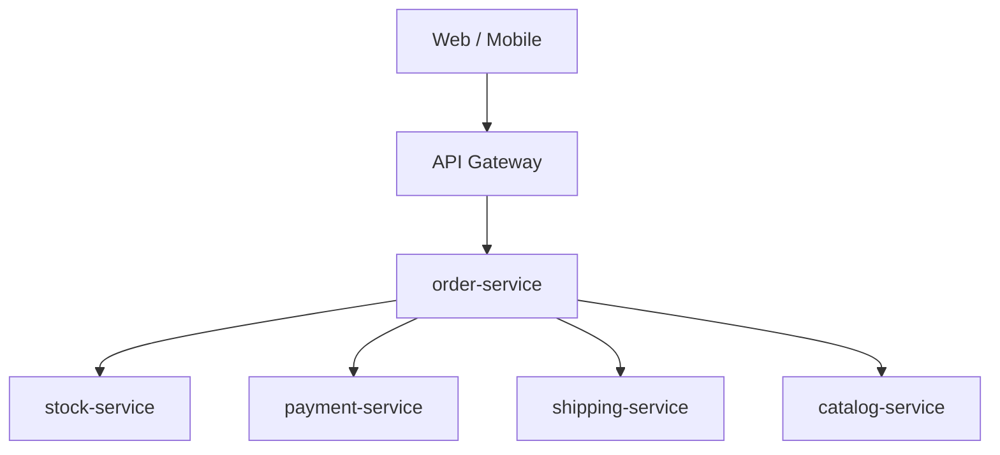

# Bài tập thiết kế hệ thống kèm tiêu chí đánh giá lựa chọn

## 1. Mục tiêu workshop

Khi thiết kế giao tiếp giữa các microservice, câu hỏi không chỉ là “dùng Round Robin hay Random?”. Trước tiên cần xác định **tầng nào sở hữu việc chọn backend**, caller nhìn thấy danh sách instance nào, yêu cầu về độ sẵn sàng và độ trễ ra sao, và đội vận hành có đủ khả năng quan sát, kiểm soát chính sách đó hay không.

Bài thuộc chương **Lựa chọn thiết kế** của module `SPRING_CLOUD_SERVICE_COMMUNICATION_LOAD_BALANCER`. Module giúp bạn hiểu cơ chế cân bằng tải phía client của Spring Cloud LoadBalancer: chọn `ServiceInstance` theo service ID, discovery, health check và chính sách định tuyến; thực hành tích hợp `RestClient`, `WebClient`, OpenFeign, cấu hình retry/timeout và quan sát lỗi để giao tiếp giữa dịch vụ ổn định.

Sau workshop, bạn có thể:

1. Phân tích yêu cầu chức năng và phi chức năng trước khi chọn giải pháp cân bằng tải.
2. So sánh Kubernetes Service, Spring Cloud LoadBalancer, gateway và service mesh theo đúng phạm vi.
3. Chọn HTTP client và chính sách supplier/LoadBalancer phù hợp với caller.
4. Thiết kế health, timeout, retry, sticky/zone routing và observability có kiểm soát.
5. Dùng ma trận chấm điểm, điều kiện loại và ADR để giải thích lựa chọn.
6. Đề xuất rollout, kiểm thử và rollback cho một quyết định kiến trúc.

**Cách học:** Đọc bối cảnh chung, làm từng case theo nhóm, chấm các phương án bằng cùng một bộ tiêu chí, sau đó so sánh với lời giải tham khảo. Không có một đáp án duy nhất cho mọi tổ chức; một lựa chọn tốt phải nêu rõ giả định, trade-off và cách kiểm chứng.

## 2. Bối cảnh hệ thống xuyên suốt

Bạn đang thiết kế nền tảng thương mại điện tử cho một cửa hàng trực tuyến. Các dịch vụ chính:

| Service | Trách nhiệm | Kiểu gọi phổ biến |
| --- | --- | --- |
| `api-gateway` | Nhận request public, xác thực, rate limit và route | North–south |
| `order-service` | Tạo đơn, điều phối quy trình đặt hàng | Gọi stock/payment/shipping |
| `stock-service` | Đọc và giữ tồn kho | GET và lệnh reserve |
| `payment-service` | Thanh toán, hoàn tiền | POST có tác dụng phụ |
| `shipping-service` | Tính phí và tạo vận đơn | GET/POST |
| `catalog-service` | Đọc thông tin sản phẩm | GET, traffic cao |

Môi trường hiện có:

- Các ứng dụng Java dùng Spring Boot và Spring Cloud.
- Một số workload chạy trên Kubernetes; một số service tích hợp với hệ thống ngoài cluster.
- Có thể dùng discovery theo service ID, Kubernetes Service DNS hoặc service mesh tùy môi trường.
- Có nhiều replica cho service quan trọng; instance có thể scale, restart hoặc chuyển zone.
- Các caller cần timeout, retry có giới hạn và metrics/tracing.

### 2.1. Sơ đồ nghiệp vụ



### 2.2. Yêu cầu phi chức năng ban đầu

Các con số là **giả định cho bài tập**, không phải mặc định Spring Cloud:

| Thuộc tính | Yêu cầu giả định |
| --- | --- |
| Availability của đặt hàng | 99,9% theo tháng |
| Deadline API tạo đơn | 2 giây ở p95, 4 giây ở p99 |
| Stock lookup | p95 dưới 150 ms trong cùng region |
| Payment | Không được tạo giao dịch trùng khi timeout/retry |
| Scale | Từ 2 đến 20 replicas cho service có traffic cao |
| Failure | Có thể mất một replica hoặc một zone |
| Routing | Một số workload cần ưu tiên cùng zone; không yêu cầu mọi request đều sticky |
| Operations | Nhóm vận hành nhỏ, cần cấu hình dễ giải thích và rollback |
| Observability | Theo dõi logical call, HTTP status, latency, retry, instance và no-instance |

Trước khi chọn giải pháp, hãy xác nhận các giả định này với product/SRE. Ví dụ “99,9% availability” phải xác định đo ở API nào, cửa sổ nào và tính những lỗi nào; “p95 dưới 150 ms” cần làm rõ thời gian đo từ caller hay toàn tuyến.

## 3. Bộ câu hỏi cần trả lời trước khi chọn công nghệ

Một bản thiết kế nên bắt đầu bằng những câu hỏi sau:

| Nhóm câu hỏi | Cần làm rõ | Hệ quả thiết kế |
| --- | --- | --- |
| Topology | Cùng Kubernetes cluster, nhiều cluster, VM hay hybrid? | Chọn discovery và network boundary |
| Địa chỉ đích | Caller thấy VIP, DNS record hay từng Pod/instance? | Xác định ai thật sự chọn backend |
| Service identity | Service ID có ổn định và duy nhất không? | Cấu hình child context và registry |
| Routing | Round Robin, Random, zone, hint, weight hay sticky? | Chọn supplier/algorithm |
| Health | Readiness từ platform hay health probe từ caller? | Tránh hai nguồn trạng thái mâu thuẫn |
| Failure | Khi không có instance, fail open hay fail closed? | Quyết định EmptyResponse, fallback và alert |
| Deadline | Tổng request có bao nhiêu thời gian? | Phân bổ timeout và retry budget |
| Idempotency | Request có tác dụng phụ không? | Có được retry không và cần key nào? |
| Security | TLS ở đâu, mTLS có cần không? | Chọn endpoint và trust boundary |
| Operations | Ai sở hữu policy và trực sự cố? | Giới hạn số tầng điều phối |
| Compatibility | Boot/Cloud train, client và discovery version nào? | Tránh tổ hợp dependency không tương thích |

**Câu hỏi quan trọng nhất:** Khi `order-service` gọi `stock-service`, danh sách ứng viên mà caller sử dụng đến từ đâu, và tầng nào chọn **Pod cuối cùng**? Nếu không trả lời được, chưa đủ dữ liệu để quyết định giữa Kubernetes Service và Spring Cloud LoadBalancer.

## 4. Các phương án kiến trúc cần so sánh

### Phương án A — Kubernetes Service DNS/ClusterIP

Caller gọi địa chỉ Service ổn định, ví dụ `http://stock-service.default.svc.cluster.local:8080`. Kubernetes Service và dataplane của cluster chuyển kết nối tới endpoint phù hợp. Ứng dụng có thể dùng HTTP client không gắn `@LoadBalanced`.

**Phù hợp khi:**

- Caller và provider cùng cluster hoặc có network routing phù hợp.
- Cần discovery/service networking tiêu chuẩn của Kubernetes.
- Không cần caller tự chọn Pod theo metadata hoặc request context.
- Nhóm vận hành muốn giảm số cơ chế discovery và cache trong ứng dụng.

**Giới hạn cần kiểm tra:**

- Caller không có danh sách Pod để áp dụng policy zone/hint/weight riêng.
- Phân phối có thể xảy ra ở tầng kết nối/dataplane; không nên giả định mỗi HTTP request được Round Robin độc lập.
- Nếu cần traffic splitting L7, có thể cần gateway hoặc service mesh.

### Phương án B — Spring Cloud LoadBalancer với discovery instance-aware

Caller gọi service ID như `http://stock-service/...` bằng `@LoadBalanced RestClient`, `WebClient` hoặc OpenFeign. `ServiceInstanceListSupplier` lấy danh sách instance từ discovery; `ReactorServiceInstanceLoadBalancer` chọn một instance.

**Phù hợp khi:**

- Caller cần chọn instance cụ thể theo metadata, zone, hint, sticky session hoặc thuật toán riêng.
- Discovery provider có thể cấp host/port của từng instance.
- Có nhiều môi trường hoặc hệ thống ngoài Kubernetes cần cùng mô hình service ID.
- Nhóm phát triển muốn kiểm soát chính sách ở phía caller.

**Chi phí và giới hạn:**

- Phải vận hành discovery, cache, health/refresh và cấu hình supplier.
- Cần theo dõi tính nhất quán giữa registry và trạng thái mạng thật.
- Có thể chọn Pod trực tiếp trong khi mesh/Kubernetes cũng đang áp dụng routing khác.
- Cấu hình per-service child context cần được kiểm thử để không rò bean sang service ID khác.

### Phương án C — Service mesh sở hữu routing east–west

Ứng dụng gọi service hostname; data plane của mesh áp dụng routing, mTLS, telemetry, traffic split, timeout/retry hoặc outlier detection theo cấu hình. Tùy kiến trúc, data plane có thể dùng sidecar hoặc mô hình ambient/waypoint.

**Phù hợp khi:**

- Cần policy thống nhất xuyên nhiều ngôn ngữ và runtime.
- Cần mTLS, workload identity, traffic splitting hoặc quan sát ở tầng proxy.
- Đội platform có năng lực vận hành control plane/data plane.

**Chi phí và giới hạn:**

- Thêm thành phần vận hành, cấu hình và đường debug.
- Cần xác định traffic nào thực sự đi qua proxy.
- Không phải mọi mode mesh đều có cùng khả năng L7.
- Retry ở mesh có thể chồng với retry ở client/gateway.

### Phương án D — Kết hợp gateway ở edge với một lựa chọn east–west rõ ràng

Gateway/Ingress nhận traffic public và route tới `order-service`. Bên trong, mỗi caller dùng **một cơ chế được chỉ định** cho downstream: Kubernetes Service, Spring Cloud LoadBalancer hoặc mesh.

Đây thường là kiến trúc thực tế: gateway giải quyết north–south; lựa chọn east–west được quyết định độc lập. Gateway không tự thay thế LoadBalancer trong `order-service`.

### 4.1. Bảng so sánh tổng quát

| Tiêu chí | A: Kubernetes Service | B: Spring Cloud LB | C: Service mesh | D: Gateway + east–west choice |
| --- | --- | --- | --- | --- |
| Phạm vi | Nội bộ cluster | Phía caller | Workload-to-workload | Edge và nội bộ |
| Chọn Pod | Kubernetes dataplane | Caller nếu discovery trả Pod | Mesh dataplane | Tùy lựa chọn nội bộ |
| Policy theo request | Hạn chế ở Service cơ bản | Supplier/request context | Có thể có L7 policy | Có thể, ở tầng được chọn |
| Zone/metadata | Platform topology/policy | Có thể tùy biến theo metadata | Tùy mesh/config | Tùy east–west choice |
| mTLS | Không tự cung cấp ở Service | Không tự cung cấp | Tính năng mesh phổ biến | Gateway/mesh tùy cấu hình |
| Retry/timeout | Không phải tính năng đầy đủ của Service | Caller có thể cấu hình | Proxy policy | Phải quy định một chủ sở hữu |
| Vận hành | Thường đơn giản nhất trong K8s | Thêm discovery/config trong app | Cần platform team | Nhiều lớp, cần ranh giới rõ |
| Multi-platform | Phụ thuộc network | Tốt nếu discovery thống nhất | Phụ thuộc mesh topology | Phụ thuộc từng chặng |

Không có cột nào luôn thắng. Bảng chỉ giúp xác định trade-off; chấm điểm cần dựa trên yêu cầu và năng lực thực tế.

## 5. Chọn HTTP client: RestClient, WebClient hay OpenFeign?

Load balancing và API lập trình HTTP client là hai quyết định liên quan nhưng khác nhau. Cả ba có thể tích hợp Spring Cloud LoadBalancer nếu cấu hình đúng.

| Client | Mô hình | Nên cân nhắc khi | Điểm cần đánh giá |
| --- | --- | --- | --- |
| `RestClient` | Blocking, API fluent | Service Spring MVC hoặc luồng xử lý đồng bộ | Thread-per-request, timeout của transport, connection pool |
| `WebClient` | Reactive, non-blocking | Luồng reactive hoặc cần streaming/backpressure | Không block event loop; context/request data phải truyền đúng |
| OpenFeign | Declarative interface | API service-to-service ổn định, muốn interface rõ ràng | ErrorDecoder, Retryer, contract, timeout và observability |

Ví dụ `RestClient` dùng service ID:

```java
@Configuration(proxyBeanMethods = false)
class HttpClientConfig {
    @Bean
    @LoadBalanced
    RestClient.Builder loadBalancedRestClientBuilder() {
        return RestClient.builder();
    }
}

@Service
class StockClient {
    private final RestClient client;

    StockClient(@LoadBalanced RestClient.Builder builder) {
        this.client = builder.build();
    }

    String find(String sku) {
        return client.get()
                .uri("http://stock-service/stocks/{sku}", sku)
                .retrieve()
                .body(String.class);
    }
}
```

Ví dụ OpenFeign:

```java
@FeignClient(name = "stock-service")
interface StockFeignClient {
    @GetMapping("/stocks/{sku}")
    StockResponse find(@PathVariable("sku") String sku);
}
```

Khi đặt URL cố định cho Feign, ví dụ `@FeignClient(name="stock-service", url="https://stock.internal")`, request thường đi trực tiếp tới URL đó và bỏ qua bước discovery/LoadBalancer theo service ID. Hãy chọn rõ một mô hình và test đúng đường đi.

**Không chọn WebClient chỉ vì nghe nói nó nhanh hơn.** Nếu ứng dụng blocking và workload phù hợp, RestClient có thể đơn giản hơn. Nếu hệ thống đã reactive end-to-end, WebClient giúp tránh chuyển qua lại blocking. OpenFeign có lợi thế khai báo contract, nhưng vẫn cần thiết kế resilience và observability.

## 6. Ma trận chấm điểm lựa chọn

Dùng ma trận này cho mọi case. Nhóm có thể thay trọng số nếu giải thích lý do trước khi chấm.

| Tiêu chí | Trọng số | Điểm 1 | Điểm 3 | Điểm 5 |
| --- | ---: | --- | --- | --- |
| Fit yêu cầu chức năng/routing | 20 | Thiếu yêu cầu cốt lõi | Đáp ứng phần lớn | Đáp ứng đầy đủ và có fallback |
| Availability/failover | 15 | Không có xử lý lỗi rõ | Có failover nhưng phụ thuộc nhiều điều kiện | Hành vi khi mất instance/zone được xác định và test |
| Latency/traffic locality | 10 | Không đáp ứng SLO | Đạt trong điều kiện thường | Có locality/connection strategy phù hợp và đo được |
| Resilience/deadline | 15 | Retry/timeout không rõ | Có giới hạn nhưng chưa xuyên tầng | Deadline, retry, idempotency và circuit policy nhất quán |
| Operational complexity | 10 | Quá nhiều cơ chế/owner mơ hồ | Vận hành được với runbook | Ít cơ chế, ownership và rollback rõ |
| Observability | 10 | Không biết instance/lỗi ở đâu | Có metrics cơ bản | Tách logical call, attempts, instance, trace và no-instance |
| Security | 10 | Trust boundary không rõ | TLS/identity cơ bản | TLS/mTLS, identity và secret lifecycle rõ |
| Compatibility/upgrade | 10 | Version/API không xác nhận | Có BOM/test cơ bản | Matrix, staged rollout và rollback đã xác minh |
| **Tổng** | **100** | | | |

Chấm mỗi phương án từ 1 đến 5. Điểm quy đổi:

\[
\text{Điểm quy đổi} = \sum_i \left(\frac{\text{điểm}_i}{5}\times\text{trọng số}_i\right)
\]

Ví dụ, phương án đạt điểm 4 ở tiêu chí trọng số 20 đóng góp `4/5 × 20 = 16` điểm. Điểm tổng tối đa là 100.

### 6.1. Điều kiện loại trước khi tính điểm

Một phương án có điểm cao vẫn phải bị loại nếu vi phạm điều kiện bắt buộc:

- Không đáp ứng compatibility matrix của Java/Spring Boot/Spring Cloud.
- Không có nguồn instance đáng tin cậy hoặc không xác định được đích thực tế.
- Retry có thể nhân đôi thao tác ghi mà không có idempotency.
- Không có cách phát hiện hoặc xử lý trường hợp không còn instance.
- Không đáp ứng yêu cầu bảo mật/mTLS bắt buộc.
- Không thể quan sát lỗi đủ để vận hành hoặc rollback.
- Có hai tầng cùng sở hữu traffic splitting/retry nhưng không có mô hình phối hợp.

Ghi rõ **hard constraint** riêng với tiêu chí có thể đánh đổi. Ví dụ: chi phí vận hành có thể chấp nhận tăng để có mTLS xuyên workload, nhưng yêu cầu không tạo thanh toán trùng không được đánh đổi.

## 7. Case study 1 — Chọn Kubernetes Service hay Spring Cloud LoadBalancer?

### Bối cảnh

`order-service` và `stock-service` đều chạy trong một Kubernetes cluster, cùng namespace. `stock-service` có 6 replicas. Caller chỉ cần đọc tồn kho; không cần chọn theo metadata Pod, không có multi-cluster, không cần sticky session. Readiness probe và EndpointSlice được vận hành bởi platform team.

Yêu cầu:

- p95 dưới 150 ms trong cluster.
- Khi một Pod mất readiness, request mới dần chuyển sang Pod còn khỏe.
- Nhóm vận hành nhỏ, muốn giảm cấu hình trong từng ứng dụng.
- Cần metrics HTTP và tracing ở caller.

### Bài tập

1. So sánh phương án A (ClusterIP) với B (Spring Cloud LoadBalancer).
2. Vẽ đường đi request và chỉ ra nơi chọn Pod.
3. Xác định `order-service` có cần `@LoadBalanced` không.
4. Nêu test chứng minh readiness/EndpointSlice ảnh hưởng tới traffic.
5. Liệt kê điều kiện khiến bạn đổi quyết định trong tương lai.

### Lời giải tham khảo

Phương án A thường là điểm khởi đầu hợp lý: `order-service` gọi Kubernetes Service DNS bằng HTTP client thông thường. Kubernetes Service cung cấp địa chỉ ổn định và dataplane chọn endpoint. Không có yêu cầu chọn Pod theo metadata, nên thêm discovery/cache/LoadBalancer riêng vào mọi caller có thể tăng vận hành mà chưa đem lại lợi ích tương xứng.

Không cần gắn `@LoadBalanced` cho HTTP client gọi ClusterIP. Có thể thêm gateway/mesh nếu có yêu cầu policy tương ứng, nhưng không phải vì muốn Kubernetes Service hoạt động.

Kiểm thử:

- Xác nhận DNS/Service và EndpointSlice có 6 endpoint ready.
- Gửi request qua Service DNS, endpoint trả `instanceId`.
- Đưa một Pod về NotReady trong staging; đo thời gian request mới ngừng tới Pod đó.
- Kiểm tra HTTP status, p95, connection errors và traces.
- Xác minh caller không giữ kết nối tới Pod đã drain lâu hơn chính sách cho phép.

**Khi đổi quyết định:** Nếu `order-service` cần ưu tiên zone theo metadata từng Pod, cần discovery trực tiếp từng instance, hoặc phải chạy cùng một policy trên Kubernetes và VM, Spring Cloud LoadBalancer có thể đáng giá hơn. Khi đó phải xác minh discovery trả Pod endpoint chứ không chỉ trả ClusterIP.

### Rubric case 1

| Hạng mục | Điểm tối đa |
| --- | ---: |
| Xác định đúng north–south/east–west và nơi chọn Pod | 4 |
| Giải thích vì sao ClusterIP đáp ứng yêu cầu hiện tại | 4 |
| Nêu đúng giới hạn của Service networking | 3 |
| Đề xuất test readiness/failover đo được | 5 |
| Nêu điều kiện thay đổi kiến trúc | 4 |
| **Tổng** | **20** |

## 8. Case study 2 — Zone preference, health và failover

### Bối cảnh

`catalog-service` chạy ở hai zone:

| Instance | Zone | Trạng thái ban đầu |
| --- | --- | --- |
| `catalog-a1` | zone-a | Healthy |
| `catalog-a2` | zone-a | Healthy |
| `catalog-b1` | zone-b | Healthy |
| `catalog-b2` | zone-b | Healthy |

`order-service` chạy ở zone-a và cần giảm cross-zone latency. Tuy nhiên, khi toàn bộ instance zone-a lỗi, request vẫn phải phục vụ từ zone-b. Discovery trả trực tiếp các instance và metadata `zone`.

### Bài tập

1. Chọn supplier chain và thuật toán.
2. Giải thích sự khác nhau giữa zone preference và hard zone isolation.
3. Xác định điều xảy ra khi A1 lỗi, rồi khi cả zone-a lỗi.
4. Thiết kế cache/health refresh và timeout.
5. Đề xuất metrics chứng minh locality và failover.

### Lời giải tham khảo

Một thiết kế khả thi:

```text
DiscoveryClient
  -> HealthCheckServiceInstanceListSupplier
  -> ZonePreferenceServiceInstanceListSupplier
  -> RoundRobinLoadBalancer
```

Health check đặt gần nguồn instance; zone preference lọc danh sách đã được health supplier xử lý. Round Robin phân phối trong tập ưu tiên. Cần xác nhận supplier chain và API builder đúng với phiên bản Spring Cloud đang dùng.

Với zone preference, khi có instance cùng zone, supplier ưu tiên chúng. Nếu không có instance phù hợp, một số implementation preference có thể fallback về toàn bộ danh sách đầu vào. **Preference không phải hard isolation.** Nếu yêu cầu cấm cross-zone tuyệt đối, cần filter nghiêm ngặt và định nghĩa no-instance khi zone hiện tại không có đích.

Kịch bản:

- A1 unhealthy nhưng A2 healthy: request zone-a chỉ còn A2 trong tập ưu tiên.
- Cả A1/A2 unhealthy: danh sách khỏe chỉ còn B1/B2; zone preference phải có chính sách fallback được xác nhận theo implementation.
- B1/B2 cũng unhealthy: xử lý no-instance theo policy fail-open/fail-closed đã chọn.
- A1 hồi phục: chờ health/discovery cập nhật; request mới có thể quay lại tập zone-a.

Không thêm hai lớp cache mà chưa đánh giá. Health supplier có thể quản lý replay/cache kết quả riêng; cache stale có thể giữ instance vừa bị loại. Thời gian failover phải đo từ lúc health/discovery nhận ra lỗi tới khi request mới không còn chọn instance đó.

Metrics:

- Request count theo zone/instance ở backend.
- Logical-call latency theo caller zone và target zone.
- Health probe failures và số instance khả dụng.
- No-instance/discard, HTTP errors và connection timeout.
- Cross-zone traffic ratio và chi phí network nếu có.

### Rubric case 2

| Hạng mục | Điểm tối đa |
| --- | ---: |
| Supplier chain và thứ tự filter hợp lý | 4 |
| Phân biệt preference và isolation | 4 |
| Hành vi khi một instance/zone mất | 4 |
| Cache/health/refresh có kiểm chứng | 4 |
| Metrics và SLO locality/failover | 4 |
| **Tổng** | **20** |

## 9. Case study 3 — Payment, retry và idempotency

### Bối cảnh

`order-service` gọi `payment-service` để tạo giao dịch. Request thường hoàn tất trong 500 ms, nhưng đôi khi upstream timeout ở 1 giây trong khi payment provider đã nhận và xử lý lệnh. Gateway, caller và mesh đều có khả năng cấu hình retry.

Yêu cầu:

- Không được tạo thanh toán trùng.
- API tạo đơn có deadline 4 giây.
- Có thể gặp HTTP 503, connection reset, read timeout hoặc no-instance.
- Hệ thống cần biết lỗi do chọn instance, do HTTP transport hay do payment provider.

### Bài tập

1. Có nên bật retry cho POST tạo payment không?
2. Tầng nào chịu trách nhiệm retry và bao nhiêu attempts?
3. Thiết kế idempotency key và cách xử lý trạng thái kết quả không xác định.
4. Phân bổ timeout theo deadline tổng.
5. Nêu metrics/traces và kịch bản fault test.

### Lời giải tham khảo

Không retry POST tạo payment một cách mù quáng. Client timeout không chứng minh server chưa thực hiện giao dịch. Một lần gọi lại có thể tạo giao dịch thứ hai nếu provider không hỗ trợ idempotency.

Thiết kế:

1. `order-service` tạo một `Idempotency-Key` ổn định cho một ý định thanh toán và gửi cùng key ở mọi lần thử.
2. `payment-service` lưu trạng thái key một cách nguyên tử, trả lại kết quả cũ khi cùng key được gửi lại.
3. Chỉ định một tầng chịu retry cho request payment; các tầng khác không retry độc lập hoặc phải có policy được tính chung.
4. Giới hạn attempts, backoff và deadline. Ví dụ deadline 4 giây phải trừ thời gian xử lý nội bộ, connect/read, backoff và các hop trước đó; không đơn giản đặt read timeout 4 giây cho từng attempt.
5. Với timeout không rõ kết quả, caller tra cứu trạng thái bằng idempotency key hoặc payment reference trước khi tạo lệnh mới.

No-instance và lỗi kết nối trước khi request tới server có thể khác với read timeout sau khi server đã nhận request. Tracing nên ghi attempt, instance, status/error class và correlation ID; không đưa token hoặc idempotency key nhạy cảm vào metric labels.

### Rubric case 3

| Hạng mục | Điểm tối đa |
| --- | ---: |
| Nhận diện nguy cơ retry thao tác ghi | 4 |
| Idempotency và xử lý trạng thái không xác định | 5 |
| Retry owner và giới hạn attempts | 4 |
| Deadline/timeout phân bổ hợp lý | 4 |
| Observability/fault test | 3 |
| **Tổng** | **20** |

## 10. Case study 4 — Chọn client và mức độ tùy biến

### Bối cảnh

Nhóm có ba caller:

- `catalog-query-service`: WebFlux reactive, đọc catalog với traffic cao.
- `admin-service`: Spring MVC, gọi đồng bộ vài endpoint quản trị.
- `order-service`: có nhiều API downstream, interface contract ổn định và muốn giảm boilerplate.

Yêu cầu:

- Tất cả phải gọi theo service ID.
- Một số service có zone preference, các service khác dùng Round Robin mặc định.
- Không được để cấu hình riêng của một client ảnh hưởng client khác.
- Cần timeout/metrics rõ ràng.

### Bài tập

1. Chọn WebClient, RestClient hay OpenFeign cho từng caller.
2. Chỉ ra nơi khai báo `@LoadBalanced` và `@FeignClient`.
3. Thiết kế child context theo service ID.
4. Nêu cách test bean isolation và instance list.
5. Xác định trường hợp cần custom `ReactorServiceInstanceLoadBalancer`.

### Lời giải tham khảo

| Caller | Lựa chọn có thể phù hợp | Lý do |
| --- | --- | --- |
| `catalog-query-service` | WebClient | Caller reactive, cần non-blocking và streaming/backpressure nếu phù hợp |
| `admin-service` | RestClient | Luồng Spring MVC đồng bộ, API fluent đơn giản |
| `order-service` | OpenFeign | Nhiều downstream contract rõ ràng, interface declarative |

Đây là lựa chọn theo mô hình ứng dụng hiện tại, không phải benchmark tốc độ tuyệt đối. Tất cả client phải được cấu hình tích hợp LoadBalancer đúng cách nếu gọi service ID. Một Feign client có URL cố định có thể bỏ qua discovery.

Đăng ký zone policy riêng cho service cần nó bằng `@LoadBalancerClient(name="catalog-service", configuration=...)`. Đặt child config ngoài component scan parent hoặc bảo đảm nó không trở thành bean toàn cục. Viết test dùng `LoadBalancerClientFactory` để xác nhận:

- `catalog-service` dùng supplier/policy zone.
- `payment-service` và `shipping-service` vẫn dùng cấu hình riêng hoặc default.
- `ServiceInstance.getServiceId()` khớp service ID.
- Parent context không chứa marker bean chỉ dành cho child.

Chỉ viết custom `ReactorServiceInstanceLoadBalancer` khi thuật toán có yêu cầu không được đáp ứng bằng Round Robin/Random hoặc supplier có sẵn. Nếu chỉ cần lọc zone, hint hoặc health, ưu tiên composition của supplier trước khi tự viết thuật toán.

### Rubric case 4

| Hạng mục | Điểm tối đa |
| --- | ---: |
| Chọn client theo execution model | 4 |
| Cấu hình service ID và tích hợp LB chính xác | 4 |
| Child context và bean isolation | 5 |
| Chọn đúng mức độ tùy biến | 4 |
| Test/metrics/timeout | 3 |
| **Tổng** | **20** |

## 11. Bài capstone — Thiết kế hoàn chỉnh cho hệ thống thương mại điện tử

Ghép bốn case thành một bản thiết kế. Nhóm có 60–90 phút để chuẩn bị và 10 phút trình bày.

### Đầu ra bắt buộc

1. **Sơ đồ kiến trúc:** north–south và east–west, gateway/Ingress/Service/mesh và điểm chọn backend.
2. **Decision matrix:** chấm A/B/C/D bằng trọng số ở mục 6; ghi giả định và hard constraints.
3. **Bảng service ID:** caller, target service, HTTP client, discovery source, supplier chain, algorithm.
4. **Resilience budget:** timeout từng hop, deadline tổng, retry owner, attempts, idempotency.
5. **Failure matrix:** mất một instance, mất một zone, discovery lỗi, cache stale, no-instance, HTTP 503, timeout.
6. **Observability plan:** logical outcome, attempts, latency percentiles, instance/zone, health, no-instance và traces.
7. **Rollout plan:** staging, canary, traffic ramp, trigger rollback và cách quay lại.
8. **ADR:** quyết định, bối cảnh, phương án đã cân nhắc, hệ quả và điều kiện xem xét lại.

### Bảng thiết kế service ID mẫu

| Caller | Target | Client | Discovery/endpoint source | Policy | Retry owner |
| --- | --- | --- | --- | --- | --- |
| `order-service` | `stock-service` | RestClient | Pod-aware discovery | Zone preference + health | Caller hoặc LB, chọn một |
| `order-service` | `payment-service` | OpenFeign | Service discovery | Round Robin/default | Payment client policy có idempotency |
| `catalog-query-service` | `catalog-service` | WebClient | Kubernetes Service DNS | Kubernetes/mesh | Không retry mặc định nếu chưa cần |
| `api-gateway` | `order-service` | Gateway route | Discovery `lb://` | Gateway LoadBalancer | Gateway policy giới hạn |

Bảng là **một phương án minh họa**, không phải cấu hình chuẩn. Nếu chọn mesh làm owner cho traffic routing, cập nhật các hàng để tránh cùng một policy được áp dụng độc lập ở caller và proxy.

## 12. Mẫu Architecture Decision Record (ADR)

Dùng mẫu sau để lưu quyết định đã được nhóm thống nhất:

```markdown
# ADR-NNN: Chọn cơ chế cân bằng tải cho <service-id>

## Trạng thái
Proposed | Accepted | Rejected | Superseded

## Bối cảnh
- Caller:
- Target service ID:
- Deployment topology:
- Discovery source:
- SLO/deadline:
- Routing constraints:

## Quyết định
- Ai sở hữu việc chọn backend:
- HTTP client:
- ServiceInstanceListSupplier chain:
- LoadBalancer algorithm:
- Timeout/retry owner:
- Health/cache policy:
- Observability:

## Phương án đã cân nhắc
1. Kubernetes Service
2. Spring Cloud LoadBalancer
3. Service mesh
4. Kết hợp

## Lý do
- Functional fit:
- Availability:
- Latency/locality:
- Operational cost:
- Security:
- Compatibility:

## Hệ quả và rủi ro
- ...

## Kiểm thử và rollout
- ...

## Điều kiện xem xét lại
- ...
```

ADR tốt phải cho người đọc biết **vì sao** phương án được chọn, điều kiện nào khiến quyết định không còn phù hợp và ai chịu trách nhiệm vận hành. Chỉ ghi “dùng Round Robin vì mặc định” không phải lập luận thiết kế đầy đủ.

## 13. Rubric tổng thể cho capstone

| Tiêu chí | Trọng số | Bằng chứng đạt điểm cao |
| --- | ---: | --- |
| Phân tích yêu cầu/topology | 15 | Xác định north–south/east–west, endpoint source và owner |
| So sánh phương án | 15 | Nêu trade-off thực tế, không thiên vị công nghệ |
| Routing/discovery/supplier | 15 | Service ID, metadata, health, cache và failover rõ |
| Resilience/idempotency | 15 | Deadline tổng, retry owner, thao tác ghi an toàn |
| Client integration | 10 | RestClient/WebClient/Feign phù hợp execution model |
| Observability | 10 | Logical calls/attempts, latency, instance, trace và alert |
| Deployment/rollback | 10 | Canary, ngưỡng dừng, rollback đã kiểm chứng |
| ADR và giao tiếp | 10 | Quyết định rõ, giả định minh bạch, hệ quả đầy đủ |
| **Tổng** | **100** | |

Diễn giải điểm:

| Điểm | Mức đánh giá |
| ---: | --- |
| 90–100 | Thiết kế có thể đưa sang review triển khai; rủi ro và kiểm chứng rõ |
| 75–89 | Hợp lý, còn một số giả định hoặc vận hành cần làm rõ |
| 60–74 | Đáp ứng một phần; thiếu test, observability hoặc failure handling |
| Dưới 60 | Chưa đủ cơ sở để chọn phương án |

**Điều kiện loại:** Dù tổng điểm cao, capstone không đạt nếu có retry POST thanh toán không idempotency, không biết ai chọn backend, không có no-instance/failover policy, hoặc không có đường rollback cho thay đổi rủi ro cao.

## 14. Cách phản biện một quyết định thiết kế

Khi review phương án của nhóm khác, không chỉ hỏi “vì sao không dùng công nghệ X?”. Hãy hỏi bằng tình huống cụ thể:

1. Nếu registry trả instance đã chết thì hệ thống phát hiện và chuyển đích trong bao lâu?
2. Nếu một zone mất hoàn toàn, traffic cross-zone có được phép không? Ai quyết định?
3. Nếu gateway, caller và mesh đều retry, số request tối đa có thể tới downstream là bao nhiêu?
4. Nếu client timeout sau khi payment đã ghi nhận giao dịch, làm sao tránh thanh toán trùng?
5. Nếu service ID có một instance duy nhất là Kubernetes ClusterIP, Spring Cloud LoadBalancer thực sự chọn gì?
6. Nếu cấu hình `@LoadBalancerClient` bị component scan vào parent context, test nào phát hiện?
7. Nếu metric LoadBalancer báo success nhưng HTTP 503 tăng, dashboard nào cho biết điều đó?
8. Nếu nâng cấp Spring Cloud train làm đổi property hoặc default supplier, rollout và rollback ra sao?

Một phản biện tốt đưa ra **failure mode, bằng chứng và tác động**. Một phản biện yếu chỉ dựa trên sở thích framework.

## 15. Bài tập cá nhân và câu hỏi tự đánh giá

1. Thiết kế một service chỉ chạy trên Kubernetes. Khi nào bạn không cần Spring Cloud LoadBalancer trong caller?
2. Thiết kế một hệ thống hybrid Kubernetes + VM. Discovery nào có thể cung cấp một service ID thống nhất?
3. Nếu cần zone preference nhưng bắt buộc không cross-zone, bạn thay supplier preference bằng policy nào? Khi zone rỗng, caller phải làm gì?
4. Khi nào sticky session phù hợp, và dữ liệu session có nên lưu cục bộ trong Pod không?
5. Nếu dùng WebClient reactive, vì sao không được `block()` trên event-loop trong custom filter?
6. Nếu OpenFeign có timeout nhưng mesh cũng retry, bạn xác định retry owner và deadline tổng như thế nào?
7. Làm sao chứng minh thuật toán mới phân phối đúng bằng metrics mà không dùng Pod IP làm label có cardinality quá cao?
8. Khi nào custom `ReactorServiceInstanceLoadBalancer` thực sự cần thiết?
9. Nêu ba điều kiện hard constraint có thể loại một phương án dù điểm weighted cao.
10. Viết một ADR ngắn cho `order-service` gọi `stock-service` trong môi trường triển khai của bạn.

## 16. Tài liệu tham khảo

- [Spring Cloud Commons — Spring Cloud LoadBalancer](https://docs.spring.io/spring-cloud-commons/reference/spring-cloud-commons/loadbalancer.html): supplier, algorithm, zone, sticky session, health, retry và metrics.
- [Spring Cloud OpenFeign](https://docs.spring.io/spring-cloud-openfeign/reference/): declarative client, timeout, Retryer và Micrometer.
- [Spring Cloud Gateway](https://docs.spring.io/spring-cloud-gateway/reference/): route, discovery và `lb://service-id`.
- [Kubernetes Services](https://kubernetes.io/docs/concepts/services-networking/service/): ClusterIP, headless Service và EndpointSlice.
- [Istio traffic management](https://istio.io/latest/docs/concepts/traffic-management/): routing, traffic splitting, retry và timeout.
- [Spring Cloud supported versions](https://spring.io/projects/spring-cloud#overview): compatibility matrix giữa Spring Boot và Spring Cloud release train.

**Kết luận:** Chọn cơ chế cân bằng tải là quyết định về **quyền sở hữu routing, nguồn instance, failure behavior và chi phí vận hành**. Dùng ma trận để so sánh, hard constraints để loại phương án không an toàn, case study để thử các tình huống lỗi và ADR để lưu lý do. Một lựa chọn chỉ thực sự tốt khi nhóm có thể chứng minh nó đáp ứng SLO và vận hành được khi instance, zone hoặc một tầng hạ tầng gặp sự cố.
