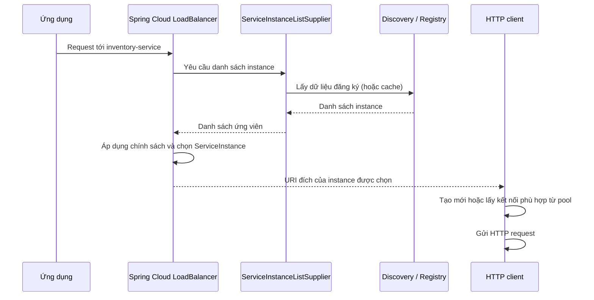

# ServiceInstance và các thông tin dùng để chọn đích

Trong một hệ thống Spring Cloud, một service thường có nhiều bản sao chạy trên các máy hoặc container khác nhau. Ứng dụng gọi service bằng tên logic như `inventory-service`; Spring Cloud LoadBalancer cần biết những bản sao nào có thể nhận request và địa chỉ cụ thể của từng bản sao. `ServiceInstance` là mô hình Spring Cloud dùng để biểu diễn một bản sao như vậy.

Đọc đúng thông tin trong `ServiceInstance` giúp ta phân biệt tên service với địa chỉ instance, hiểu dữ liệu nào được dùng để gửi request, dữ liệu nào chỉ phục vụ chính sách định tuyến và cách kiểm tra vì sao LoadBalancer chọn một đích cụ thể.

## 1. ServiceInstance nằm ở đâu trong luồng cân bằng tải?

Giả sử hệ thống có hai bản sao của `inventory-service`:

| Service ID | Instance ID | Host | Port | Zone |
|---|---|---|---:|---|
| `inventory-service` | `inventory-1` | `10.0.1.10` | 8080 | `zone-a` |
| `inventory-service` | `inventory-2` | `10.0.1.11` | 8080 | `zone-b` |

Ứng dụng chỉ cần gửi request tới URL logic:

```text
http://inventory-service/api/items/42
```

`inventory-service` là service ID. Mỗi dòng trong bảng là một `ServiceInstance` có endpoint riêng. Luồng xử lý tổng quát:

1. HTTP client gửi request chứa service ID.
2. Spring Cloud LoadBalancer lấy danh sách `ServiceInstance` qua `ServiceInstanceListSupplier`.
3. Các supplier hoặc chính sách được cấu hình có thể lọc danh sách, ví dụ loại instance không khỏe hoặc ưu tiên zone gần.
4. LoadBalancer chọn một instance từ danh sách ứng viên.
5. URL logic được chuyển thành URI trỏ tới host và port của instance đã chọn; HTTP client gửi request tới URI đó.



`ServiceInstance` là dữ liệu mô tả một đích có thể gọi. Nó không phải là một TCP connection, không đại diện cho một request và cũng không tự xác nhận rằng ứng dụng ở instance đó đang khỏe tại thời điểm hiện tại.

## 2. Các trường thông tin của ServiceInstance

Trong Spring Cloud Commons, `org.springframework.cloud.client.ServiceInstance` định nghĩa hợp đồng chung để các discovery implementation cung cấp thông tin instance. Những phương thức thường được sử dụng gồm:

| Phương thức | Thông tin trả về | Vai trò |
|---|---|---|
| `getServiceId()` | Tên logic của service | Xác định instance thuộc service nào |
| `getInstanceId()` | Mã định danh instance nếu implementation cung cấp | Phân biệt các bản đăng ký của cùng service; có thể không có giá trị |
| `getHost()` | Host hoặc địa chỉ IP | Thành phần host của endpoint |
| `getPort()` | Cổng dịch vụ | Thành phần port của endpoint |
| `isSecure()` | Endpoint có sử dụng kết nối bảo mật hay không | Cho biết scheme an toàn như HTTPS khi dựng URI |
| `getUri()` | URI của instance | Biểu diễn địa chỉ có scheme, host và port |
| `getMetadata()` | Map các cặp key/value dạng chuỗi | Mang thông tin bổ sung cho bộ lọc hoặc chính sách định tuyến |

`getInstanceId()` phụ thuộc khả năng của discovery implementation; không nên giả định mọi registry đều cung cấp một ID ổn định hoặc duy nhất vĩnh viễn. Nếu cần nhận diện một lần đăng ký, hãy xác định rõ quy ước ID của registry đang dùng.

### 2.1. Service ID và instance ID

Hai loại ID giải quyết hai câu hỏi khác nhau:

- **Service ID:** ứng dụng muốn gọi nhóm dịch vụ logic nào? Ví dụ `inventory-service`.
- **Instance ID:** bản đăng ký hoặc bản sao cụ thể nào đang được mô tả? Ví dụ `inventory-1`.

Một service ID có thể ánh xạ tới nhiều instance ID. Khi một container được thay thế, instance ID có thể đổi dù service ID vẫn giữ nguyên. Vì vậy, URL trong mã ứng dụng thường dùng service ID; host, port và instance ID được lấy ở runtime.

### 2.2. Host, port, secure và URI

Host và port xác định endpoint mạng cụ thể. Host có thể là địa chỉ IP hoặc hostname mà môi trường chạy có thể phân giải. Port là cổng mà instance công bố cho client.

`isSecure()` cho biết endpoint sử dụng kết nối bảo mật. `getUri()` cung cấp URI của instance, thường kết hợp scheme với host và port. Nên dùng URI do `ServiceInstance` hoặc cơ chế tái dựng URI của LoadBalancer cung cấp thay vì tự ghép chuỗi địa chỉ; cách ghép thủ công dễ làm sai scheme, IPv6 hoặc port.

Ví dụ hai instance có cùng service ID nhưng endpoint khác nhau:

```text
inventory-service
  ├── http://10.0.1.10:8080  (inventory-1)
  └── https://inventory-2.internal:8443 (inventory-2)
```

Trong ví dụ, instance thứ hai dùng HTTPS và hostname nội bộ. Client vẫn gọi service bằng tên logic; URI đích được xác định sau khi chọn instance.

### 2.3. Metadata

`getMetadata()` trả về một map key/value dạng chuỗi chứa thông tin bổ sung do registry hoặc quá trình đăng ký instance cung cấp. Một số metadata có thể được dùng để định tuyến:

```json
{
  "serviceId": "inventory-service",
  "instanceId": "inventory-1",
  "host": "10.0.1.10",
  "port": 8080,
  "secure": false,
  "metadata": {
    "zone": "zone-a",
    "region": "ap-southeast-1",
    "version": "v2",
    "traffic": "canary"
  }
}
```

Các key như `zone`, `region`, `version` và `traffic` trong ví dụ là quy ước do hệ thống lựa chọn, không phải tất cả đều là field chuẩn của `ServiceInstance`. Registry khác nhau có cách khai báo và truyền metadata khác nhau. Ứng dụng cần thống nhất tên key, kiểu giá trị và cách cập nhật giữa nơi đăng ký instance với nơi đọc metadata.

Metadata phù hợp với dữ liệu định tuyến nhỏ, tương đối ổn định như zone, phiên bản hoặc nhóm năng lực. Không đưa mật khẩu, token, private key hay dữ liệu cá nhân vào metadata vì thông tin này có thể được lưu trong registry và xuất hiện trong log hoặc công cụ quản trị.

## 3. Discovery tạo ServiceInstance từ đâu?

Spring Cloud LoadBalancer không tự tìm container bằng cách quét mạng. Nó nhận danh sách instance thông qua `ServiceInstanceListSupplier`. Supplier có thể lấy dữ liệu từ discovery client, cấu hình tĩnh hoặc nguồn danh sách khác.

Một số nguồn thường gặp:

| Nguồn | Cách có được thông tin instance | Điểm cần chú ý |
|---|---|---|
| Eureka | Client đăng ký service ID, địa chỉ, port và metadata với Eureka Server | Trạng thái đăng ký và heartbeat ảnh hưởng danh sách instance được trả về |
| Consul | Service đăng ký endpoint và metadata với Consul | Cần hiểu health check và trạng thái passing của service |
| Kubernetes | Service và EndpointSlice cung cấp thông tin endpoint của workload | Địa chỉ và port có thể thay đổi khi Pod được tạo lại |
| SimpleDiscoveryClient | Danh sách instance được khai báo bằng cấu hình ứng dụng | Phù hợp môi trường đơn giản hoặc kiểm thử; dữ liệu thường cần cập nhật thủ công |

Các discovery implementation chuyển dữ liệu của registry thành đối tượng `ServiceInstance`. Không nên giả định tất cả registry có cùng quy tắc về instance ID, metadata, hostname hay trạng thái sức khỏe. Hãy kiểm tra adapter và cấu hình của registry đang sử dụng nếu một field không có giá trị như mong đợi.

Ví dụ, registry có thể trả về một instance với host là địa chỉ Pod hiện tại. Khi Pod được thay thế, registry cập nhật endpoint; service ID vẫn là `inventory-service`, nhưng host hoặc instance ID có thể đổi. Client cần lấy danh sách instance mới theo cơ chế refresh/cache của supplier.

## 4. LoadBalancer sử dụng thông tin nào để chọn đích?

Không phải mọi field đều có cùng vai trò. Có thể chia thông tin thành ba nhóm:

| Nhóm thông tin | Field điển hình | Cách sử dụng |
|---|---|---|
| Nhận diện nhóm đích | `serviceId` | Lấy danh sách instance của đúng service |
| Địa chỉ để kết nối | `host`, `port`, `isSecure`, `uri` | Dựng endpoint sau khi một instance được chọn |
| Ngữ cảnh lựa chọn | `instanceId`, `metadata` | Lọc, ưu tiên, phân nhóm, quan sát hoặc áp dụng chính sách tùy chỉnh |

LoadBalancer cần một danh sách ứng viên trước khi chọn. Trong cấu hình phổ biến, `ServiceInstanceListSupplier` cung cấp danh sách; các supplier được xếp chuỗi có thể bổ sung cache, lọc theo zone hoặc kiểm tra sức khỏe. Sau đó, `ReactorServiceInstanceLoadBalancer` hoặc implementation tương ứng chọn một phần tử.

### 4.1. Chính sách mặc định không tự hiểu mọi metadata

`RoundRobinLoadBalancer` là lựa chọn phổ biến mặc định: các request lần lượt chọn instance tiếp theo trong danh sách ứng viên. Spring Cloud cũng có implementation chọn ngẫu nhiên. Chính sách round-robin hoặc random không tự động biến metadata `weight`, `version` hay `traffic` thành quy tắc định tuyến.

Ví dụ, nếu danh sách có ba instance và không có bước lọc, round-robin phân phối lượt chọn qua các phần tử theo thứ tự của danh sách. Nếu muốn chỉ gửi request tới `version=v2`, ưu tiên `zone-a`, hoặc phân bổ theo trọng số, cần cấu hình supplier hoặc LoadBalancer tùy chỉnh để đọc metadata và áp dụng quy tắc đó.

### 4.2. Lọc hoặc ưu tiên theo metadata

Giả sử ứng dụng chạy trong `zone-a` và muốn ưu tiên instance cùng zone. Đoạn mã sau minh họa cách tạo danh sách ứng viên ưu tiên:

```java
static List<ServiceInstance> preferZone(
        List<ServiceInstance> instances,
        String preferredZone) {

    List<ServiceInstance> preferred = instances.stream()
            .filter(instance -> {
                Map<String, String> metadata = instance.getMetadata();
                return metadata != null
                        && preferredZone.equals(metadata.get("zone"));
            })
            .toList();

    return preferred.isEmpty() ? instances : preferred;
}
```

Hàm trên giữ lại toàn bộ danh sách nếu không có instance ở zone ưu tiên, tránh làm service mất khả năng phục vụ chỉ vì thiếu metadata. Đây là hàm minh họa cho bước lọc; trong ứng dụng thực tế, hãy tích hợp quy tắc vào `ServiceInstanceListSupplier` hoặc LoadBalancer tùy chỉnh để mọi request dùng chung chính sách.

Nếu yêu cầu là chỉ cho phép một phiên bản cụ thể, fallback có thể phải khác: khi không có instance phù hợp, hệ thống nên trả lỗi hoặc từ chối request thay vì âm thầm gửi sang phiên bản khác. Quyết định fallback phụ thuộc yêu cầu tương thích API và dữ liệu.

### 4.3. Health check và metadata là hai cơ chế khác nhau

Metadata mô tả thuộc tính của instance, ví dụ instance thuộc `zone-a` hoặc đang chạy `v2`. Metadata `status=healthy` chỉ là dữ liệu đăng ký; nó có thể cũ nếu registry chưa được cập nhật.

Health check kiểm tra khả năng phục vụ theo một cơ chế riêng. Spring Cloud LoadBalancer có `HealthCheckServiceInstanceListSupplier` để kiểm tra các instance và loại các instance không khỏe khỏi danh sách được cung cấp. Cấu hình cụ thể phụ thuộc loại client, phiên bản Spring Cloud và endpoint health của ứng dụng.

Trong triển khai thực tế:

- Dùng readiness/health endpoint phù hợp để xác định instance có nhận traffic hay không.
- Chọn khoảng kiểm tra và timeout đủ ngắn để loại instance lỗi kịp thời, nhưng tránh tạo tải kiểm tra quá lớn.
- Phân biệt trạng thái đăng ký trong registry với kết quả health check mà client quan sát.
- Khi instance mới khởi động, tránh đưa nó vào danh sách nhận traffic trước khi ứng dụng sẵn sàng.

Health check không thay thế timeout của request. Một instance có thể khỏe tại lần kiểm tra gần nhất nhưng gặp sự cố ngay sau đó; client vẫn cần timeout và xử lý lỗi khi gửi request.

## 5. Ví dụ đọc và sử dụng ServiceInstance

Khi cần quan sát lựa chọn ở mức thấp, ứng dụng có thể dùng `LoadBalancerClient` để yêu cầu chọn một instance theo service ID:

```java
@Service
class InventoryInstanceInspector {

    private final LoadBalancerClient loadBalancerClient;

    InventoryInstanceInspector(LoadBalancerClient loadBalancerClient) {
        this.loadBalancerClient = loadBalancerClient;
    }

    URI chooseTargetUri() {
        String serviceId = "inventory-service";
        ServiceInstance instance = loadBalancerClient.choose(serviceId);

        if (instance == null) {
            throw new IllegalStateException(
                    "No instance available for " + serviceId);
        }

        URI logicalUri = URI.create(
                "http://inventory-service/api/items/42");

        return loadBalancerClient.reconstructURI(instance, logicalUri);
    }
}
```

`choose(serviceId)` trả về instance được chọn hoặc `null` nếu không có instance phù hợp. `reconstructURI` dùng thông tin instance để thay authority của URI logic bằng endpoint thực tế, đồng thời giữ phần path và query của request. Đây là ví dụ để hiểu cơ chế và hỗ trợ chẩn đoán; ứng dụng thông thường nên để HTTP client tích hợp `@LoadBalanced` xử lý việc chọn và tái dựng URI trong mỗi lời gọi.

Ví dụ cấu hình `RestClient` với builder đã tích hợp LoadBalancer:

```java
@Configuration
class InventoryHttpConfiguration {

    @Bean
    @LoadBalanced
    RestClient.Builder loadBalancedRestClientBuilder() {
        return RestClient.builder();
    }
}
```

Sử dụng service ID trong URL:

```java
@Service
class InventoryGateway {
    private final RestClient restClient;

    InventoryGateway(@LoadBalanced RestClient.Builder builder) {
        this.restClient = builder.build();
    }

    Item findItem(long id) {
        return restClient.get()
                .uri("http://inventory-service/api/items/{id}", id)
                .retrieve()
                .body(Item.class);
    }
}
```

Trong trường hợp này, mã nghiệp vụ chỉ biết service ID. Spring Cloud LoadBalancer chọn instance; HTTP client dùng endpoint cụ thể để thực hiện request. Việc quản lý TCP/TLS và connection pool vẫn do HTTP client đảm nhiệm.

## 6. Thiết kế metadata cho chính sách định tuyến

Metadata chỉ hữu ích khi cả bên đăng ký và bên định tuyến thống nhất ý nghĩa. Một quy ước đơn giản có thể như sau:

| Key | Ví dụ giá trị | Chính sách có thể áp dụng |
|---|---|---|
| `zone` | `zone-a` | Ưu tiên instance cùng vùng triển khai |
| `region` | `ap-southeast-1` | Hạn chế request đi qua vùng địa lý khác |
| `version` | `v2` | Chọn phiên bản tương thích với caller |
| `traffic` | `stable`, `canary` | Điều khiển nhóm instance nhận traffic thử nghiệm |
| `capability` | `read`, `write` | Chọn instance có khả năng đáp ứng loại request |
| `weight` | `10` | Đầu vào cho thuật toán weighted routing tùy chỉnh |

Các key trên là ví dụ thiết kế, không phải bộ key bắt buộc hoặc được mọi discovery provider hỗ trợ giống nhau. Nếu dùng `weight`, cần xác định rõ miền giá trị, cách xử lý giá trị thiếu/sai và cách chuẩn hóa trọng số. Round-robin mặc định không đọc `weight` để phân phối theo tỷ lệ.

Một số nguyên tắc giúp metadata dễ vận hành:

1. Dùng tên key nhất quán giữa service đăng ký và service gọi; cân nhắc prefix như `routing.zone` nếu nhiều nhóm cùng mở rộng metadata.
2. Dùng giá trị có tập hợp rõ ràng, chẳng hạn `stable` hoặc `canary`, tránh nhiều cách viết cho cùng một ý nghĩa.
3. Xác định hành vi khi thiếu metadata: bỏ qua tiêu chí, dùng fallback hay từ chối request.
4. Giữ metadata nhỏ và không dùng nó làm kho cấu hình động có tần suất cập nhật cao.
5. Khi thay đổi metadata, bảo đảm registry và cache của supplier cập nhật trong thời gian chấp nhận được.
6. Không coi metadata là bằng chứng xác thực hoặc ranh giới bảo mật; caller vẫn phải xác thực và phân quyền ở tầng ứng dụng.

## 7. Các lỗi thường gặp khi đọc hoặc sử dụng ServiceInstance

| Triệu chứng | Nguyên nhân có thể | Cách kiểm tra |
|---|---|---|
| Không chọn được instance | Registry không có instance, sai service ID hoặc supplier trả danh sách rỗng | Kiểm tra service ID, dữ liệu đăng ký và danh sách supplier trả về |
| URI đích sai host hoặc port | Registry công bố địa chỉ không thể truy cập từ caller, hoặc mapping host/port sai | Kiểm tra `getHost()`, `getPort()`, `getUri()` và đường mạng từ caller |
| Request dùng HTTP trong khi cần HTTPS | Field secure hoặc scheme được đăng ký sai | Kiểm tra `isSecure()`, URI và cấu hình TLS của instance |
| Không lọc được theo zone/version | Metadata thiếu, key khác chữ hoa/thường hoặc supplier chưa áp dụng chính sách | Ghi nhận metadata liên quan và kiểm tra thứ tự supplier |
| Instance đã dừng vẫn được chọn | Registry/cache chưa cập nhật hoặc health check chưa loại instance | Kiểm tra TTL/cache, heartbeat, health endpoint và thời gian refresh |
| Traffic canary không đúng tỷ lệ | Metadata `traffic` hoặc `weight` chỉ được đăng ký nhưng chưa có thuật toán sử dụng | Kiểm tra LoadBalancer tùy chỉnh và thống kê request thực tế theo instance |
| ID instance thay đổi sau mỗi lần triển khai | Instance được tạo lại hoặc registry dùng ID gắn với địa chỉ/container | Kiểm tra quy tắc tạo instance ID; không dùng ID tạm thời làm khóa nghiệp vụ lâu dài |

Khi điều tra, nên ghi log có cấu trúc gồm service ID, instance ID (nếu có), host, port, secure và một số metadata định tuyến đã cho phép. Không nên ghi toàn bộ metadata nếu registry có thể chứa thông tin nội bộ hoặc dữ liệu nhạy cảm.

## 8. Thực hành quan sát lựa chọn instance

Có thể dùng hai instance của `inventory-service` để kiểm tra từng phần của mô hình:

1. Đăng ký hai instance với host/port khác nhau và cùng service ID.
2. Đọc danh sách instance mà discovery client cung cấp; đối chiếu service ID, host, port, secure và metadata.
3. Gửi nhiều request qua HTTP client có `@LoadBalanced`; ghi nhận instance nhận từng request.
4. Thêm metadata `zone` cho từng instance và triển khai bộ lọc ưu tiên zone ở supplier hoặc LoadBalancer tùy chỉnh.
5. Dừng một instance hoặc làm readiness check thất bại; quan sát thời gian instance bị loại khỏi danh sách ứng viên.
6. Cập nhật metadata hoặc thay instance trong registry; theo dõi thời gian cache/supplier phản ánh dữ liệu mới.

Khi phân tích kết quả, tách ba sự kiện: registry có ghi nhận instance hay không, supplier có đưa instance vào danh sách ứng viên hay không, và LoadBalancer có chọn instance đó cho request cụ thể hay không. Ba thời điểm này có thể khác nhau do cache, health check và chính sách lọc.

## 9. Nguyên tắc sử dụng trong hệ thống thực tế

- Dùng service ID làm tên đích trong mã nghiệp vụ; để discovery cung cấp các instance cụ thể.
- Xem `ServiceInstance` là mô tả endpoint tại thời điểm lựa chọn; không giữ một đối tượng instance vô thời hạn làm địa chỉ cố định.
- Dùng host, port, secure và URI để xác định đích kết nối; dùng instance ID để quan sát và đối chiếu khi cần.
- Chỉ dùng metadata khi đã có chính sách đọc và áp dụng nó. Việc đăng ký `zone`, `version` hoặc `weight` tự nó không thay đổi thuật toán mặc định.
- Kết hợp trạng thái registry với health check/readiness phù hợp để giảm khả năng chọn instance không thể phục vụ.
- Xác định fallback khi metadata thiếu hoặc không có ứng viên phù hợp.
- Theo dõi danh sách từ supplier và instance được chọn để chẩn đoán lỗi định tuyến.

Khi phân biệt được service ID, instance ID, endpoint và metadata, ta có thể hiểu chính xác dữ liệu đầu vào của Spring Cloud LoadBalancer, thiết kế chính sách chọn đích phù hợp và xử lý tốt hơn các tình huống thay đổi instance trong quá trình vận hành.
