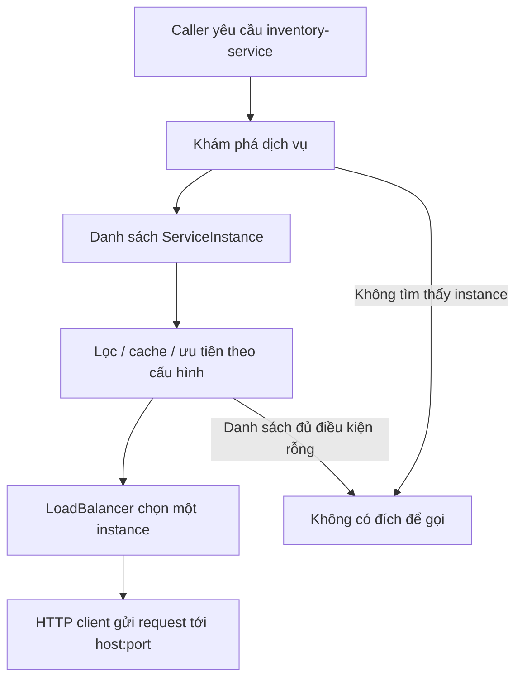
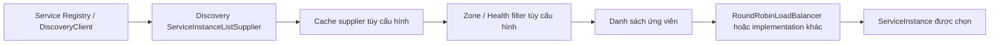

# Ranh giới giữa khám phá dịch vụ và chọn bản sao

Trong một hệ thống microservices, `order-service` có thể cần gọi `inventory-service` đang chạy trên nhiều máy hoặc nhiều container. Để gửi request, phía gọi cần biết những bản sao nào đang được công bố và phải chọn một bản sao cụ thể cho request hiện tại.

Hai việc này liên quan chặt chẽ nhưng có trách nhiệm khác nhau:

- **Khám phá dịch vụ (service discovery)** tìm danh sách các instance được biết đến dưới một service ID.
- **Chọn bản sao (instance selection)** chọn một instance từ danh sách đó để nhận request.

Spring Cloud tách hai trách nhiệm qua các abstraction như `DiscoveryClient`, `ServiceInstanceListSupplier` và `ReactorLoadBalancer`. Hiểu đúng ranh giới này giúp xác định lỗi nằm ở registry, dữ liệu instance, bộ lọc danh sách hay thuật toán lựa chọn.

## 1. Từ service ID đến một instance cụ thể

Giả sử `inventory-service` có ba bản sao:

| Service ID | Instance | Địa chỉ |
| --- | --- | --- |
| `inventory-service` | Instance A | `10.0.1.11:8080` |
| `inventory-service` | Instance B | `10.0.1.12:8080` |
| `inventory-service` | Instance C | `10.0.1.13:8080` |

`order-service` chỉ định dịch vụ cần gọi bằng tên logic:

```text
http://inventory-service/api/stocks/BOOK-001
```

Service ID `inventory-service` cho biết nhóm dịch vụ cần tìm. Nó chưa xác định request sẽ đi tới A, B hay C. Để gửi request, client cần có một `ServiceInstance` chứa địa chỉ thực của một bản sao.

Luồng tổng quát:



Kết quả của discovery là một tập ứng viên. Kết quả của selection là một phần tử cụ thể trong tập ứng viên đó. Nếu chỉ có một instance hợp lệ, bộ chọn vẫn thực hiện lựa chọn, nhưng kết quả chỉ có thể là instance duy nhất ấy.

## 2. Service discovery làm nhiệm vụ gì?

Service discovery cung cấp khả năng tìm instance theo service ID. Trong mô hình dùng registry, các instance thường đăng ký thông tin khi khởi động và cập nhật trạng thái trong suốt thời gian hoạt động. Thông tin đăng ký có thể bao gồm service ID, host, port, trạng thái bảo mật và metadata.

Ví dụ, khi một replica của `inventory-service` khởi động, nó đăng ký địa chỉ `10.0.1.12:8080`. Khi replica dừng đúng quy trình, nó có thể hủy đăng ký. Một số registry còn dùng heartbeat hoặc lease để nhận biết instance không còn cập nhật trạng thái. Cách đăng ký, phát hiện instance chết và thời gian cập nhật phụ thuộc vào công nghệ discovery cũng như cấu hình của hệ thống.

Trong Spring Cloud, `DiscoveryClient` là abstraction để ứng dụng tra cứu dịch vụ. Ví dụ:

```java
import java.util.List;

import org.springframework.cloud.client.ServiceInstance;
import org.springframework.cloud.client.discovery.DiscoveryClient;
import org.springframework.stereotype.Component;

@Component
class InventoryDiscoveryInspector {

    private final DiscoveryClient discoveryClient;

    InventoryDiscoveryInspector(DiscoveryClient discoveryClient) {
        this.discoveryClient = discoveryClient;
    }

    List<ServiceInstance> findInventoryInstances() {
        return discoveryClient.getInstances("inventory-service");
    }
}
```

Đoạn code trên chỉ minh họa thao tác tra cứu để quan sát danh sách. Nó không tự thực hiện thuật toán cân bằng tải. Nếu caller lấy danh sách này rồi tự chọn phần tử bằng code riêng, caller đã tự đảm nhiệm thêm trách nhiệm selection và phải tự giải quyết các vấn đề như phân phối, lọc, cache, concurrency và retry.

Discovery cũng không nhất thiết là một registry từ xa. Spring Cloud có thể lấy instance từ các nguồn khác, ví dụ danh sách cấu hình tĩnh trong một số cách triển khai. Điều quan trọng là có một nguồn cung cấp các `ServiceInstance` cho service ID.

## 3. ServiceInstance biểu diễn một bản sao

`ServiceInstance` là abstraction mô tả một instance cụ thể. Các thông tin thường được sử dụng gồm:

| Thông tin | Ý nghĩa |
| --- | --- |
| `serviceId` | Tên dịch vụ mà instance thuộc về |
| `host` | Host hoặc địa chỉ mạng của instance |
| `port` | Cổng mà instance nhận kết nối |
| `secure` | Cho biết instance sử dụng kết nối bảo mật theo thông tin instance |
| `uri` | URI được tạo từ thông tin kết nối của instance |
| `metadata` | Các thuộc tính bổ sung do nguồn discovery cung cấp |
| `instanceId` | Định danh instance nếu implementation hỗ trợ |

Ví dụ về ba instance có thể được biểu diễn bằng các đối tượng khác nhau nhưng cùng thuộc service ID `inventory-service`:

```text
ServiceInstance A
  serviceId = inventory-service
  host      = 10.0.1.11
  port      = 8080

ServiceInstance B
  serviceId = inventory-service
  host      = 10.0.1.12
  port      = 8080

ServiceInstance C
  serviceId = inventory-service
  host      = 10.0.1.13
  port      = 8080
```

Metadata có thể chứa zone, phiên bản ứng dụng hoặc nhãn do hệ thống tự quy ước. LoadBalancer không tự hiểu mọi metadata tùy ý; muốn dùng metadata để lọc hoặc định tuyến, ứng dụng cần cấu hình supplier hoặc thuật toán lựa chọn tương ứng.

## 4. Spring Cloud LoadBalancer chọn instance như thế nào?

Spring Cloud LoadBalancer thực hiện lựa chọn dựa trên danh sách instance được cung cấp. Có thể hình dung trách nhiệm qua ba thành phần:

1. `ServiceInstanceListSupplier` cung cấp danh sách `ServiceInstance` cho service ID. Supplier có thể lấy danh sách từ discovery client hoặc nguồn khác, đồng thời kết hợp cache và các bộ lọc được cấu hình.
2. `ReactorLoadBalancer` nhận danh sách ứng viên và quyết định instance nào được chọn cho request. Các implementation có thể áp dụng thuật toán khác nhau.
3. HTTP client hoặc LoadBalancer client dùng instance được chọn để tạo địa chỉ đích và gửi request.

Trong các tích hợp Spring Cloud LoadBalancer, lựa chọn thường được thực hiện tự động khi client được cấu hình load-balanced, ví dụ `RestClient.Builder` hoặc `WebClient.Builder` có `@LoadBalanced`, hay OpenFeign dùng service name. Ứng dụng không cần gọi `DiscoveryClient` rồi tự chọn replica trong từng phương thức nghiệp vụ.

### 4.1. Ví dụ chọn instance qua LoadBalancerClient

Spring Cloud Commons cung cấp `LoadBalancerClient` cho kiểu gọi đồng bộ. Ví dụ dưới đây minh họa ranh giới giữa lựa chọn và địa chỉ đích:

```java
import java.net.URI;

import org.springframework.cloud.client.ServiceInstance;
import org.springframework.cloud.client.loadbalancer.LoadBalancerClient;
import org.springframework.stereotype.Component;

@Component
class InventoryInstanceChooser {

    private final LoadBalancerClient loadBalancerClient;

    InventoryInstanceChooser(LoadBalancerClient loadBalancerClient) {
        this.loadBalancerClient = loadBalancerClient;
    }

    URI chooseInventoryUri() {
        ServiceInstance instance =
                loadBalancerClient.choose("inventory-service");

        if (instance == null) {
            throw new IllegalStateException(
                    "No instance available for inventory-service");
        }

        URI logicalUri = URI.create(
                "http://inventory-service/api/stocks/BOOK-001");

        return loadBalancerClient.reconstructURI(instance, logicalUri);
    }
}
```

`choose("inventory-service")` yêu cầu LoadBalancer chọn một instance theo cấu hình. `reconstructURI(...)` tạo URI đích bằng thông tin instance đã chọn. Đây là ví dụ để hiểu API và kiểm tra kết quả lựa chọn; với ứng dụng thực tế đã dùng HTTP client gắn `@LoadBalanced`, hãy để interceptor tích hợp xử lý việc chọn instance và chuyển URI.

### 4.2. Round Robin là thuật toán lựa chọn, không phải discovery

`RoundRobinLoadBalancer` là implementation thường được dùng mặc định trong Spring Cloud LoadBalancer. Với danh sách ổn định gồm A, B và C, các lần chọn liên tiếp từ cùng một bộ chọn có thể tạo chuỗi:

| Lần chọn | Instance |
| --- | --- |
| 1 | A |
| 2 | B |
| 3 | C |
| 4 | A |
| 5 | B |
| 6 | C |

Round Robin chỉ quyết định phần tử tiếp theo trong danh sách nhận được. Nó không đăng ký instance, không hỏi registry xem dịch vụ nào tồn tại và không tự xác minh ứng dụng bên trong instance có xử lý nghiệp vụ khỏe mạnh hay không.

Không nên xem bảng trên là cam kết phân phối toàn hệ thống luôn bằng nhau. Trạng thái lựa chọn có phạm vi theo instance/context của LoadBalancer ở phía caller; nhiều caller có thể có chuỗi lựa chọn riêng. Thời gian xử lý, số request đồng thời và số lượng instance trong từng thời điểm cũng có thể khác nhau.

Spring Cloud LoadBalancer còn cho phép thay đổi implementation hoặc cấu hình theo service. Việc dùng thuật toán ngẫu nhiên hay thuật toán tùy chỉnh vẫn là bài toán selection; nguồn dữ liệu instance vẫn do supplier cung cấp.

## 5. ServiceInstanceListSupplier là ranh giới quan trọng

`ServiceInstanceListSupplier` đứng giữa nguồn instance và thuật toán lựa chọn. Nó cung cấp danh sách ứng viên cho LoadBalancer và có thể tạo thành chuỗi supplier để bổ sung hành vi.

Một số hành vi có thể được cấu hình trong chuỗi supplier:

- **Lấy dữ liệu từ discovery:** supplier sử dụng `DiscoveryClient` hoặc reactive discovery client để lấy danh sách instance.
- **Cache danh sách:** giảm số lần truy vấn nguồn discovery, đổi lại dữ liệu có thể cũ trong một khoảng thời gian.
- **Lọc theo zone:** ưu tiên instance cùng vùng triển khai nếu ứng dụng đã cung cấp zone và cấu hình supplier phù hợp.
- **Health check:** chủ động kiểm tra instance và lọc các instance không đạt điều kiện sức khỏe khi dùng supplier health-check tương ứng.
- **Lọc hoặc sắp xếp tùy biến:** áp dụng metadata, phiên bản hoặc chính sách riêng của hệ thống.

Không phải ứng dụng nào cũng bật tất cả các hành vi trên. Cấu hình thực tế quyết định danh sách cuối cùng mà thuật toán lựa chọn nhìn thấy.

Ví dụ về cách các lớp có thể nối với nhau:



Một điểm dễ nhầm: discovery client có thể trả về ba instance, nhưng supplier sau cache hoặc filter có thể chỉ cung cấp hai instance cho LoadBalancer. Vì vậy, khi điều tra vì sao một replica không được chọn, hãy kiểm tra cả danh sách thô từ discovery và danh sách sau các supplier.

## 6. Health check không đồng nghĩa với service discovery

Discovery cho biết những instance được nguồn discovery công bố. Tùy registry, danh sách đó có thể dựa trên đăng ký, heartbeat, lease hoặc trạng thái do nền tảng cập nhật. Điều này khác với việc chủ động gửi probe tới endpoint sức khỏe của từng instance.

Spring Cloud LoadBalancer có thể được cấu hình với health-check supplier để kiểm tra instance và loại những instance không đáp ứng. Đây là một bước bổ sung trong quá trình tạo danh sách ứng viên, không phải thuộc tính mặc định có thể giả định ở mọi ứng dụng.

Cần phân biệt ba trạng thái:

1. **Được đăng ký:** registry biết instance và có thể trả nó về trong kết quả discovery.
2. **Được supplier chấp nhận:** instance còn trong danh sách sau cache và các bộ lọc đang cấu hình.
3. **Có thể phục vụ request ngay lúc gửi:** kết nối tới instance thực sự thành công và ứng dụng xử lý được request.

Ba trạng thái này không tương đương. Một instance có thể được đăng ký nhưng đã ngừng lắng nghe; health check có thể chưa chạy hoặc chưa kịp phát hiện; một instance vượt qua probe vẫn có thể lỗi ngay sau đó. Health check giúp giảm khả năng chọn replica lỗi nhưng không tạo ra bảo đảm tuyệt đối.

## 7. Cache và độ mới của danh sách instance

Không phải mỗi request đều buộc ứng dụng truy vấn registry từ đầu. Supplier có thể cache danh sách instance để giảm độ trễ và tải lên registry. Một số discovery client cũng có cơ chế cache riêng.

Cache giúp tăng hiệu năng nhưng tạo ra độ trễ cập nhật:

- Instance mới có thể chưa xuất hiện trong danh sách mà caller đang dùng.
- Instance đã dừng có thể còn trong cache một thời gian.
- Instance vừa đổi địa chỉ có thể chưa được mọi caller nhìn thấy cùng lúc.

Thời gian cache nên được lựa chọn theo yêu cầu cập nhật topology, tải registry và mức độ chấp nhận dữ liệu cũ của hệ thống. Giảm TTL quá thấp có thể tăng truy vấn discovery; TTL quá cao có thể kéo dài thời gian caller tiếp tục thấy instance đã lỗi.

Khi một replica vừa được thêm nhưng không nhận request, hãy kiểm tra lần lượt: replica đã đăng ký chưa, discovery client đã thấy chưa, cache supplier đã làm mới chưa, các filter có loại replica đó không và thuật toán selection có đang chọn từ danh sách chứa replica ấy không.

## 8. So sánh trách nhiệm theo từng thành phần

| Thành phần | Câu hỏi nó trả lời | Nó không chịu trách nhiệm chính về |
| --- | --- | --- |
| Service registry | Những instance nào đã đăng ký và trạng thái đăng ký của chúng là gì? | Chọn replica cho từng request của caller |
| `DiscoveryClient` | Làm sao tra cứu instance theo service ID? | Quyết định request kế tiếp đi tới instance nào |
| `ServiceInstanceListSupplier` | Danh sách ứng viên nào được cung cấp cho LoadBalancer? | Gửi HTTP request tới ứng dụng đích |
| `ReactorLoadBalancer` | Chọn instance nào từ danh sách ứng viên? | Đăng ký/hủy đăng ký instance trong registry |
| HTTP client / LoadBalancer client | Gửi request tới URI của instance đã chọn như thế nào? | Quản lý vòng đời của service registry |

Một request có thể thất bại ở bất kỳ ranh giới nào. Không có instance từ discovery là vấn đề nguồn dữ liệu hoặc đăng ký. Có instance trong discovery nhưng supplier trả danh sách rỗng là vấn đề cache/filter/health check. Có instance được chọn nhưng kết nối thất bại là vấn đề địa chỉ, mạng, TLS hoặc trạng thái tiến trình. Có response HTTP rồi thì cần phân tích status và kết quả nghiệp vụ.

## 9. Quy trình kiểm tra khi một replica không được chọn

Giả sử bạn mong đợi A, B và C đều nhận request nhưng quan sát thấy chỉ A và B được gọi. Có thể kiểm tra theo thứ tự:

1. Xác nhận C đã khởi động và đăng ký đúng service ID.
2. Dùng discovery client hoặc công cụ của registry để xác nhận danh sách thô có C.
3. Kiểm tra danh sách mà `ServiceInstanceListSupplier` cung cấp sau cache và filter.
4. Kiểm tra zone, health check và metadata có khiến C bị loại hoặc ít được ưu tiên không.
5. Xác nhận thuật toán LoadBalancer được cấu hình cho service ID và hiểu phạm vi trạng thái lựa chọn của nó.
6. Ghi nhận instance thực tế được chọn ở mỗi request, thay vì suy luận chỉ từ số lượng request trên server.

Khi kiểm tra, nên ghi log service ID, instance ID, host, port, zone/metadata cần thiết, thời điểm và trace ID. Không ghi thông tin nhạy cảm trong metadata hoặc log. Với cache, ghi thêm thời điểm danh sách được làm mới nếu có thể để so sánh với thời điểm replica đăng ký hoặc ngừng hoạt động.

## 10. Ví dụ tổng hợp: discovery tìm ba replica, LoadBalancer chọn một

Giả sử registry trả về:

```text
inventory-service
  - 10.0.1.11:8080 (zone-a)
  - 10.0.1.12:8080 (zone-a)
  - 10.0.2.21:8080 (zone-b)
```

Supplier nhận danh sách này và có thể áp dụng cache hoặc zone preference tùy cấu hình. Nếu danh sách ứng viên cuối cùng vẫn gồm cả ba instance, `RoundRobinLoadBalancer` chọn một instance theo thứ tự vòng tròn của bộ chọn. HTTP client gửi request tới host và port của instance đã chọn.

Nếu cấu hình ưu tiên zone-a và caller đang ở zone-a, supplier có thể cung cấp danh sách ưu tiên gồm hai instance trong zone-a. Khi đó, thuật toán Round Robin chỉ chọn trong danh sách đã được supplier cung cấp. Discovery vẫn tìm thấy cả ba; thay đổi xảy ra ở bước chuẩn bị danh sách ứng viên.

Nếu instance `10.0.1.12:8080` ngừng hoạt động nhưng registry chưa cập nhật, nó có thể vẫn xuất hiện trong danh sách. Cache hoặc health check ảnh hưởng tới thời gian instance đó bị loại khỏi danh sách ứng viên. Đây là lý do cần quan sát từng lớp thay vì chỉ nhìn thuật toán Round Robin.

## 11. Tự kiểm tra kiến thức

1. Service discovery trả về kết quả gì khi được hỏi về `inventory-service`?
2. Vì sao gọi `DiscoveryClient.getInstances(...)` chưa có nghĩa request đã được cân bằng tải?
3. `ServiceInstanceListSupplier` nằm ở đâu trong luồng và có thể bổ sung những hành vi nào?
4. Nếu registry có ba instance nhưng supplier chỉ cung cấp hai, thuật toán Round Robin sẽ lựa chọn từ danh sách nào?
5. Vì sao một instance đã đăng ký và vượt qua health check vẫn có thể thất bại khi request thực sự được gửi?
6. Khi một replica không nhận request, bạn sẽ kiểm tra những lớp nào trước khi kết luận Round Robin bị lỗi?

Hãy nhớ ranh giới trách nhiệm: discovery tìm các instance theo service ID; supplier chuẩn bị danh sách ứng viên; LoadBalancer chọn một instance; HTTP client gửi request tới địa chỉ thực của instance đó. Tách bạch bốn bước này giúp thiết kế và chẩn đoán cân bằng tải phía client rõ ràng hơn.
