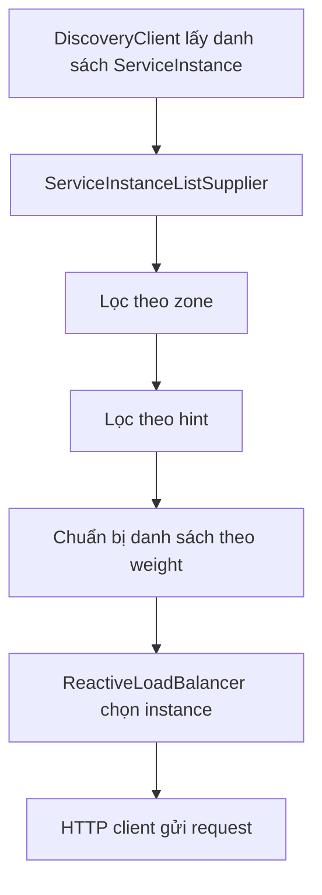

# Metadata của bản sao: vùng, trọng số và gợi ý định tuyến

## Mục tiêu

Khi một service có nhiều bản sao (service instances), mỗi bản sao có thể chạy ở một vùng triển khai khác nhau, có năng lực xử lý khác nhau hoặc phục vụ một nhóm request riêng. Nếu chỉ dùng danh sách địa chỉ, load balancer không có đủ thông tin để ưu tiên instance phù hợp với vị trí và mục đích của request.

Spring Cloud LoadBalancer có thể sử dụng metadata của `ServiceInstance` để lọc hoặc điều chỉnh danh sách ứng viên. Bài học tập trung vào ba thuộc tính thường gặp:

- `zone`: vùng triển khai của instance, dùng để ưu tiên instance gần bên gọi.
- `weight`: trọng số tương đối, dùng để phân phối yêu cầu theo năng lực hoặc tỷ lệ mong muốn.
- `hint`: nhãn gợi ý định tuyến, dùng để ưu tiên một nhóm instance theo loại request.

Sau bài học, bạn có thể xác định metadata được lấy từ đâu, cấu hình supplier tương ứng, kết hợp nhiều bộ lọc và kiểm tra hành vi fallback khi không có instance khớp điều kiện.

## 1. Metadata nằm ở đâu trong mô hình LoadBalancer?

`ServiceInstance` đại diện cho một bản triển khai cụ thể của service. Ngoài service ID, host, port, scheme và trạng thái bảo mật, đối tượng này còn có metadata dạng `Map<String, String>`. Metadata thường được đăng ký cùng instance trong service registry và được discovery client chuyển thành metadata của `ServiceInstance`.

Ví dụ, `inventory-service` có ba bản sao:

| Instance | Địa chỉ | `zone` | `weight` | `hint` |
|---|---|---|---:|---|
| inventory-1 | `10.0.1.11:8080` | `zone-a` | `3` | `stable` |
| inventory-2 | `10.0.1.12:8080` | `zone-a` | `1` | `stable` |
| inventory-3 | `10.0.2.21:8080` | `zone-b` | `1` | `canary` |

Các giá trị này chỉ là ví dụ. Service registry, nền tảng triển khai hoặc cấu hình discovery phải thực sự cung cấp metadata đó; Spring Cloud LoadBalancer không tự suy ra zone, trọng số hay nhãn canary từ IP của máy.

Metadata chỉ có tác dụng khi `ServiceInstanceListSupplier` phù hợp được cấu hình. Ví dụ, thêm `weight: "3"` vào registry nhưng vẫn dùng supplier mặc định không tự động bật weighted load balancing. Tương tự, thuộc tính `zone` không tự kích hoạt lọc theo vùng nếu chưa có zone preference supplier.

Luồng xử lý tổng quát:



Trong một cấu hình thực tế, các supplier có thể được nối thành chuỗi delegate. Mỗi supplier thực hiện một bước trên danh sách do supplier đứng trước cung cấp.

## 2. Khai báo metadata cho service instance

Metadata phụ thuộc discovery implementation. Với Eureka, có thể khai báo metadata của ứng dụng đăng ký bằng `eureka.instance.metadata-map`:

```yaml
eureka:
  instance:
    metadata-map:
      zone: zone-a
      weight: "3"
      hint: stable
```

Một bản sao chạy ở vùng khác hoặc thuộc nhóm canary có thể đăng ký metadata khác:

```yaml
eureka:
  instance:
    metadata-map:
      zone: zone-b
      weight: "1"
      hint: canary
```

`metadata-map` là cấu hình của từng ứng dụng đăng ký vào Eureka. Vì vậy, mỗi nhóm instance cần nhận giá trị phù hợp với môi trường triển khai của nó. Trong Kubernetes hoặc Consul, metadata có thể đến từ cấu hình registration tương ứng; điều quan trọng là discovery client phải đưa các trường cần thiết vào `ServiceInstance.getMetadata()`.

Metadata map lưu giá trị dạng chuỗi. Với `weight`, nên ghi một số nguyên dương dưới dạng chuỗi, ví dụ `"3"`. Với `zone` và `hint`, thống nhất cách viết giữa bên đăng ký và cấu hình phía gọi; không nên để các instance cùng vùng sử dụng những tên zone khác nhau do sai chính tả hoặc khác quy ước.

## 3. Định tuyến ưu tiên theo zone

### 3.1. Zone preference hoạt động thế nào?

Zone-based load balancing ưu tiên các instance cùng vùng với ứng dụng gọi. Mục tiêu là giảm độ trễ, lưu lượng liên vùng và chi phí truyền dữ liệu giữa các availability zone hoặc data center.

`ZonePreferenceServiceInstanceListSupplier` đọc zone của bên gọi và trường `zone` trong metadata của các `ServiceInstance`. Supplier lọc danh sách để giữ các instance thuộc cùng zone. Nếu zone của bên gọi chưa được xác định hoặc không có instance nào ở zone đó, supplier trả lại toàn bộ danh sách nhận được từ delegate. Đây là cơ chế ưu tiên vùng, không phải ràng buộc bắt buộc mọi request phải ở cùng vùng.

Với Eureka, discovery client có tích hợp để lấy zone từ cấu hình metadata của instance phía gọi, ví dụ `eureka.instance.metadata-map.zone`. Với discovery client khác, có thể đặt zone rõ ràng bằng `spring.cloud.loadbalancer.zone`.

Ví dụ, ứng dụng gọi đang ở `zone-a`:

```yaml
spring:
  cloud:
    loadbalancer:
      zone: zone-a
      configurations: zone-preference
```

Các instance `inventory-1` và `inventory-2` ở `zone-a` sẽ được ưu tiên. Instance ở `zone-b` vẫn có thể trở thành ứng viên khi không có instance cùng zone.

`zone-preference` là cấu hình dựng sẵn để sử dụng `ZonePreferenceServiceInstanceListSupplier` cùng caching. Nếu cần cấu hình riêng cho một service ID hoặc kết hợp nhiều chính sách, có thể khai báo supplier bằng `@LoadBalancerClient` như phần 6.

### 3.2. Khi nào nên dùng zone preference?

Zone preference hữu ích khi:

- Các instance của cùng một service được triển khai ở nhiều availability zone.
- Bên gọi và bên được gọi có thể xác định zone của mình một cách nhất quán.
- Chi phí hoặc độ trễ liên vùng đủ lớn để việc ưu tiên cùng vùng đem lại lợi ích.
- Hệ thống vẫn cần khả năng chuyển sang vùng khác khi vùng gần không có instance khả dụng.

Không nên bật zone preference nếu metadata zone không đầy đủ hoặc zone của caller không được xác định. Trong trường hợp đó, supplier có thể trả lại toàn bộ instance và chính sách không tạo ra hiệu quả mong đợi. Cũng cần theo dõi tỷ lệ request liên vùng để xác nhận rằng việc ưu tiên thực sự có tác dụng.

## 4. Phân phối theo weight

### 4.1. Trọng số biểu thị điều gì?

Weight là trọng số tương đối giữa các instance. Nó có thể biểu diễn năng lực phục vụ tương đối, tỷ lệ lưu lượng mong muốn hoặc mức độ tham gia của một instance trong giai đoạn triển khai.

Spring Cloud LoadBalancer cung cấp `WeightedServiceInstanceListSupplier`. Mặc định, supplier đọc và phân tích giá trị tại metadata key `weight`. Nếu instance không có trường này, trọng số mặc định là `1`.

Ví dụ:

| Instance | Weight | Ý nghĩa phân phối |
|---|---:|---|
| inventory-1 | 3 | Được phân phối nhiều hơn |
| inventory-2 | 1 | Nhận tỷ lệ thấp hơn |

Với hai instance trên, tỷ lệ trọng số là 3:1. Qua một lượng request đủ lớn, instance thứ nhất được phân phối nhiều hơn khoảng ba lần instance thứ hai. Đây là tỷ lệ thống kê, không phải cam kết cứ mỗi bốn request thì có chính xác ba request vào instance thứ nhất.

Weight không phải số đo tải CPU hoặc số request đang xử lý. Nếu muốn weight phản ánh năng lực hiện tại, hệ thống cần có quy trình cập nhật metadata hoặc cung cấp `WeightFunction` riêng. Việc đặt weight tĩnh `3` không khiến LoadBalancer tự theo dõi CPU rồi điều chỉnh nó.

### 4.2. Bật weighted load balancing

Có thể bật cấu hình dựng sẵn:

```yaml
spring:
  cloud:
    loadbalancer:
      configurations: weighted
```

Hoặc tự tạo supplier bằng builder:

```java
import org.springframework.cloud.loadbalancer.core.ServiceInstanceListSupplier;
import org.springframework.context.ConfigurableApplicationContext;
import org.springframework.context.annotation.Bean;

class WeightedLoadBalancerConfiguration {

    @Bean
    ServiceInstanceListSupplier weightedServiceInstanceListSupplier(
            ConfigurableApplicationContext context) {
        return ServiceInstanceListSupplier.builder()
                .withDiscoveryClient()
                .withCaching()
                .withWeighted()
                .build(context);
    }
}
```

Trong cấu hình riêng, `withWeighted()` thêm `WeightedServiceInstanceListSupplier` vào chuỗi supplier. Có thể truyền `WeightFunction` để tính weight theo quy tắc của ứng dụng thay vì chỉ đọc metadata mặc định.

Ví dụ minh họa cách cung cấp hàm tính trọng số riêng:

```java
return ServiceInstanceListSupplier.builder()
        .withDiscoveryClient()
        .withCaching()
        .withWeighted(instance -> {
            String value = instance.getMetadata().get("weight");
            return value == null ? 1 : Integer.parseInt(value);
        })
        .build(context);
```

Đây chỉ là ví dụ đọc metadata đơn giản. Trong ứng dụng thực tế, cần kiểm tra dữ liệu đầu vào, xử lý giá trị sai định dạng và xác định cách xử lý weight không hợp lệ trước khi triển khai.

### 4.3. Khi nào nên dùng weight?

Weight phù hợp khi các instance có cấu hình tài nguyên khác nhau, khi triển khai một nhóm instance mới với tỷ lệ lưu lượng nhỏ, hoặc khi cần kiểm soát tỷ lệ phân phối theo năng lực đã đo được.

Nếu mục tiêu là canary release, có thể đặt weight thấp cho nhóm instance mới. Tuy nhiên, weight chỉ điều chỉnh tỷ lệ lựa chọn trong danh sách ứng viên; nó không thay thế kiểm tra tương thích dữ liệu, giám sát lỗi hoặc cơ chế rollback. Khi instance canary có lỗi, cần có health check, metrics và quy trình đưa nó ra khỏi registry hoặc danh sách ứng viên.

## 5. Định tuyến theo hint

### 5.1. Hint là gì?

Hint là một chuỗi gợi ý đi cùng request, ví dụ `stable`, `canary`, `premium` hoặc `internal`. `HintBasedServiceInstanceListSupplier` sử dụng hint để lọc instance có metadata key `hint` trùng với giá trị request.

Mặc định, supplier kiểm tra request header `X-SC-LB-Hint`. Có thể đổi tên header bằng `spring.cloud.loadbalancer.hint-header-name`. Nếu request không có header hint, supplier sử dụng hint cấu hình trong properties. Nếu không có hint nào, danh sách instance được giữ nguyên.

Ví dụ cấu hình hint mặc định và hint riêng cho `inventory-service`:

```yaml
spring:
  cloud:
    loadbalancer:
      hint:
        default: stable
        inventory-service: canary
```

Trong ví dụ này, `inventory-service` dùng `canary` làm hint mặc định riêng; service ID khác dùng hint `stable` nếu không có cấu hình riêng.

### 5.2. Bật hint-based filtering

Có thể tạo supplier với `.withHints()`:

```java
import org.springframework.cloud.loadbalancer.core.ServiceInstanceListSupplier;
import org.springframework.context.ConfigurableApplicationContext;
import org.springframework.context.annotation.Bean;

class HintLoadBalancerConfiguration {

    @Bean
    ServiceInstanceListSupplier hintServiceInstanceListSupplier(
            ConfigurableApplicationContext context) {
        return ServiceInstanceListSupplier.builder()
                .withDiscoveryClient()
                .withCaching()
                .withHints()
                .build(context);
    }
}
```

Khi cần chỉ định hint cho một request, bên gọi có thể gửi header mặc định:

```java
WebClient client = loadBalancedWebClientBuilder.build();

Mono<InventoryResponse> response = client.get()
        .uri("http://inventory-service/api/inventory/42")
        .header("X-SC-LB-Hint", "canary")
        .retrieve()
        .bodyToMono(InventoryResponse.class);
```

Với request này, supplier tìm các instance có metadata `hint: canary`. Header hint là dữ liệu đầu vào cho việc chọn instance; cần đảm bảo HTTP client thực sự được tích hợp Spring Cloud LoadBalancer và supplier có `.withHints()`.

### 5.3. Hành vi fallback của hint

Một điểm cần đặc biệt chú ý: nếu không tìm thấy instance nào có `hint` khớp, `HintBasedServiceInstanceListSupplier` trả lại toàn bộ danh sách instance từ delegate. Nó không trả danh sách rỗng theo mặc định.

Do đó, hint là cơ chế gợi ý hoặc ưu tiên định tuyến. Không được dùng hint làm ranh giới bảo mật, phân vùng dữ liệu tenant hoặc cơ chế đảm bảo request chỉ tới một nhóm instance nhất định. Nếu cần cô lập bắt buộc, phải triển khai chính sách lọc nghiêm ngặt bằng custom supplier hoặc tách service ID và quyền truy cập phù hợp.

Không nên cho phép người dùng bên ngoài tùy ý gửi hint để điều khiển đường đi nội bộ nếu ứng dụng chưa có chính sách kiểm soát. Có thể chỉ chấp nhận một tập giá trị được cho phép, hoặc để gateway/service nội bộ quyết định hint sau khi xác thực request.

## 6. Kết hợp zone, weight và hint

Một service có thể cần nhiều chính sách cùng lúc. Ví dụ, `inventory-service` muốn ưu tiên instance cùng zone, sau đó lọc theo hint và phân phối theo weight trong nhóm còn lại.

Spring Cloud LoadBalancer cho phép tạo chuỗi supplier bằng `ServiceInstanceListSupplier.builder()`. Ví dụ cấu hình riêng cho `inventory-service`:

```java
import org.springframework.cloud.loadbalancer.core.ServiceInstanceListSupplier;
import org.springframework.context.ConfigurableApplicationContext;
import org.springframework.context.annotation.Bean;
import org.springframework.context.annotation.Configuration;
import org.springframework.cloud.loadbalancer.annotation.LoadBalancerClient;

@Configuration
@LoadBalancerClient(
        value = "inventory-service",
        configuration = InventoryServiceLoadBalancerConfiguration.class
)
class InventoryLoadBalancerClientConfiguration {
}

class InventoryServiceLoadBalancerConfiguration {

    @Bean
    ServiceInstanceListSupplier inventoryServiceInstanceListSupplier(
            ConfigurableApplicationContext context) {
        return ServiceInstanceListSupplier.builder()
                .withDiscoveryClient()
                .withCaching()
                .withZonePreference()
                .withHints()
                .withWeighted()
                .build(context);
    }
}
```

Trong ví dụ, supplier lấy instance từ discovery, cache danh sách, áp dụng zone preference và hint, sau đó thêm xử lý weight. Hãy kiểm tra thứ tự delegate và hành vi thực tế của phiên bản Spring Cloud đang dùng khi thay đổi chuỗi supplier. Cấu hình truyền vào `@LoadBalancerClient` nên nằm ngoài phạm vi component scan hoặc không gắn `@Configuration` để tránh bị áp dụng như cấu hình mặc định toàn ứng dụng.

`@LoadBalancerClient` gắn cấu hình với đúng service ID `inventory-service`. Những service ID khác tiếp tục dùng cấu hình load balancer riêng của chúng. Đây là cách giới hạn chính sách định tuyến cho một dịch vụ thay vì thay đổi hành vi của mọi outbound call.

### 6.1. Hiểu thứ tự xử lý

Giả sử caller ở `zone-a`, request có hint `stable`, và registry trả về ba instance trong bảng đầu bài:

1. Discovery trả về cả ba instance.
2. Zone preference giữ `inventory-1` và `inventory-2` ở `zone-a`.
3. Hint filter giữ các instance có `hint: stable`.
4. Weighted supplier sử dụng weight `3` và `1` của hai instance còn lại.
5. `ReactiveLoadBalancer` chọn một instance từ danh sách đã chuẩn bị.

Nếu không có instance ở `zone-a`, zone preference trả lại danh sách ban đầu để tiếp tục lựa chọn. Nếu không có instance khớp hint, hint supplier cũng trả lại danh sách từ delegate. Các fallback này giúp tăng khả năng có instance để gọi, nhưng có nghĩa các thuộc tính zone và hint không phải bộ lọc bắt buộc.

Nếu yêu cầu nghiệp vụ đòi hỏi thứ tự chính sách khác, ví dụ phải lọc phiên bản API trước khi áp dụng weight, hãy xây dựng supplier chain theo đúng thứ tự và viết kiểm thử cho từng trường hợp biên.

## 7. Metadata và chiến lược triển khai

Metadata có thể giúp triển khai nhiều nhóm instance cùng một service ID:

| Mục đích | Metadata gợi ý | Cách sử dụng |
|---|---|---|
| Giảm lưu lượng liên vùng | `zone` | Zone preference supplier |
| Phân phối theo năng lực | `weight` | Weighted supplier |
| Tách nhóm stable/canary | `hint` | Hint-based supplier |
| Phân biệt phiên bản API | `API_VERSION` | Supplier hỗ trợ API version-based routing nếu được cấu hình |
| Phân nhóm instance theo thuộc tính riêng | Metadata tùy chỉnh | Custom `ServiceInstanceListSupplier` |

Không phải mọi metadata đều có cơ chế đọc sẵn. Các key `zone`, `weight` và `hint` có ý nghĩa với supplier tương ứng. Một key tùy chỉnh như `regionGroup`, `tenantClass` hoặc `releaseRing` cần custom supplier hoặc chính sách định tuyến riêng nếu muốn ảnh hưởng đến việc lựa chọn.

Khi dùng metadata để triển khai canary hoặc blue/green:

- Đảm bảo tất cả instance đăng ký đúng nhãn trước khi mở lưu lượng.
- Thay đổi weight theo từng bước nhỏ và quan sát tỷ lệ request thực tế.
- Theo dõi error rate, latency và tài nguyên theo từng nhóm instance.
- Có cách đưa instance lỗi ra khỏi discovery hoặc danh sách ứng viên.
- Kiểm tra cache và thời gian cập nhật metadata khi rollout hoặc rollback.
- Không xem hint như cơ chế cô lập traffic bắt buộc nếu supplier vẫn fallback sang toàn bộ instance.

## 8. Cache và tính nhất quán của metadata

LoadBalancer có thể cache danh sách instance để giảm truy vấn discovery. Khi metadata của instance thay đổi trong registry, client có thể chưa nhìn thấy thay đổi ngay do cache hoặc do chu kỳ cập nhật của discovery provider.

Một số điểm cần kiểm tra:

- **Nguồn metadata**: xác nhận discovery client có trả về đủ các key và giá trị mới nhất.
- **Cache**: đặt TTL phù hợp với tốc độ thay đổi instance và yêu cầu rollout. Không đặt TTL quá dài nếu weight hoặc hint thay đổi thường xuyên.
- **Double caching**: nếu discovery client đã cache danh sách, cân nhắc tắt cache LoadBalancer để tránh hai tầng cache làm dữ liệu cũ lâu hơn dự kiến.
- **Thứ tự supplier**: khi tự cấu hình, đặt `CachingServiceInstanceListSupplier` ngay sau supplier lấy dữ liệu qua mạng và trước các supplier lọc khác.
- **Định dạng metadata**: thống nhất chữ hoa/chữ thường, giá trị mặc định và kiểu dữ liệu giữa các service instance.

Nếu cần thay đổi weight thường xuyên theo tải thực tế, hãy cân nhắc một cơ chế cập nhật có kiểm soát. Việc cập nhật liên tục có thể làm cache mất tác dụng, tạo dao động định tuyến và tăng tải cho service registry.

## 9. Quan sát và kiểm thử định tuyến

Không thể kết luận chính sách hoạt động đúng chỉ bằng việc ứng dụng khởi động thành công. Hãy quan sát instance thực sự nhận request và kiểm tra các tình huống không khớp metadata.

Một cách đơn giản là trả `instanceId`, zone và release label trong response của môi trường demo:

```java
@GetMapping("/debug/instance")
Map<String, String> instanceInfo() {
    return Map.of(
            "instanceId", instanceId,
            "zone", zone,
            "release", releaseLabel
    );
}
```

Các giá trị `instanceId`, `zone` và `releaseLabel` ở đây là thông tin cấu hình riêng của ứng dụng, cần được inject từ cấu hình môi trường. Endpoint này chỉ nên bật trong môi trường kiểm thử hoặc được bảo vệ phù hợp.

Ma trận kiểm thử đề xuất:

| Tình huống | Kết quả cần xác minh |
|---|---|
| Caller ở `zone-a`, có instance cùng zone | Danh sách ứng viên ưu tiên instance `zone-a`. |
| Caller không có zone | Supplier giữ toàn bộ instance. |
| Không có instance cùng zone | Supplier fallback về toàn bộ instance. |
| Weight là `3` và `1` | Qua lượng request đủ lớn, phân phối phản ánh trọng số tương đối. |
| Instance không khai báo weight | Trọng số mặc định là `1`. |
| Request hint là `canary`, có instance khớp | Chỉ nhóm khớp hint được giữ trong danh sách sau hint filter. |
| Request hint không có instance khớp | Supplier fallback về danh sách từ delegate. |
| Metadata thay đổi trong registry | Client nhận thay đổi sau chu kỳ refresh/cache tương ứng. |

Nên dùng unit test cho supplier để xác minh danh sách được lọc, integration test với discovery provider để kiểm tra metadata thực tế, và smoke test để xác nhận request đi đến instance đúng trong môi trường triển khai.

## 10. Lỗi thường gặp

| Hiện tượng | Nguyên nhân có thể có | Cách kiểm tra |
|---|---|---|
| Zone preference không lọc instance | Chưa cấu hình supplier, zone caller chưa được đặt hoặc metadata `zone` không được discovery trả về | Kiểm tra `spring.cloud.loadbalancer.zone` và `ServiceInstance.getMetadata()`. |
| Request vẫn sang zone khác | Không có instance cùng zone nên supplier fallback về danh sách đầy đủ | Kiểm tra số lượng instance theo zone và log danh sách ứng viên. |
| Weight không làm thay đổi phân phối | Chưa bật weighted supplier hoặc metadata key không phải `weight` | Kiểm tra `spring.cloud.loadbalancer.configurations` hoặc `.withWeighted()` và giá trị metadata. |
| Các instance có tỷ lệ không như mong muốn | Mẫu request còn nhỏ, cache cũ hoặc weight không phản ánh năng lực thực | Thu thập số liệu dài hơn và kiểm tra metadata sau discovery/cache. |
| Hint không đưa request đến canary | Chưa bật `.withHints()`, header không đến LoadBalancer hoặc metadata không trùng | Kiểm tra `X-SC-LB-Hint`, `spring.cloud.loadbalancer.hint` và metadata key `hint`. |
| Hint sai vẫn gọi được instance khác | Không có instance khớp nên supplier trả lại danh sách ban đầu | Xem lại yêu cầu fallback; dùng custom supplier nếu cần lọc bắt buộc. |

Khi debug, hãy ghi nhận service ID, hint đã dùng, zone của caller, danh sách instance và metadata quan trọng của instance được chọn. Tránh log toàn bộ header hoặc metadata nếu chúng có thể chứa thông tin nhạy cảm.

## 11. Checklist triển khai

- [ ] Registry cung cấp metadata `zone`, `weight` và `hint` đúng cho từng instance.
- [ ] Caller có zone rõ ràng khi cần zone preference.
- [ ] `ZonePreferenceServiceInstanceListSupplier` được bật nếu muốn ưu tiên vùng.
- [ ] `WeightedServiceInstanceListSupplier` được bật nếu muốn sử dụng weight.
- [ ] `HintBasedServiceInstanceListSupplier` được bật nếu muốn định tuyến theo hint.
- [ ] Đã hiểu và kiểm thử fallback khi zone hoặc hint không có kết quả khớp.
- [ ] Không dùng hint làm cơ chế xác thực hoặc cô lập tenant.
- [ ] Cache và refresh metadata phù hợp với tốc độ rollout.
- [ ] Metrics/logs cho phép quan sát instance thực sự nhận request.
- [ ] Có kiểm thử cho phân phối weight, zone fallback và hint fallback.

## Kết luận

Metadata mở rộng cách Spring Cloud LoadBalancer lựa chọn `ServiceInstance`. `zone` giúp ưu tiên bản sao gần caller, `weight` điều chỉnh tỷ lệ phân phối tương đối, còn `hint` giúp chọn nhóm instance theo đặc điểm request. Mỗi thuộc tính cần supplier tương ứng và metadata phải được discovery client cung cấp chính xác. Cần hiểu rõ hành vi fallback của zone và hint, quản lý cache khi metadata thay đổi và quan sát kết quả thực tế để chính sách định tuyến đáp ứng đúng mục tiêu vận hành.

## Tài liệu tham khảo

- [Spring Cloud LoadBalancer — Weighted Load-Balancing](https://docs.spring.io/spring-cloud-commons/reference/spring-cloud-commons/loadbalancer.html#weighted-load-balancing)
- [Spring Cloud LoadBalancer — Zone-Based Load-Balancing](https://docs.spring.io/spring-cloud-commons/reference/spring-cloud-commons/loadbalancer.html#zone-based-load-balancing)
- [Spring Cloud LoadBalancer — Hints và Hint-Based Load-Balancing](https://docs.spring.io/spring-cloud-commons/reference/spring-cloud-commons/loadbalancer.html#spring-cloud-loadbalancer-hints)
- [Spring Cloud LoadBalancer — ServiceInstanceListSupplier và custom configuration](https://docs.spring.io/spring-cloud-commons/reference/spring-cloud-commons/loadbalancer.html)
