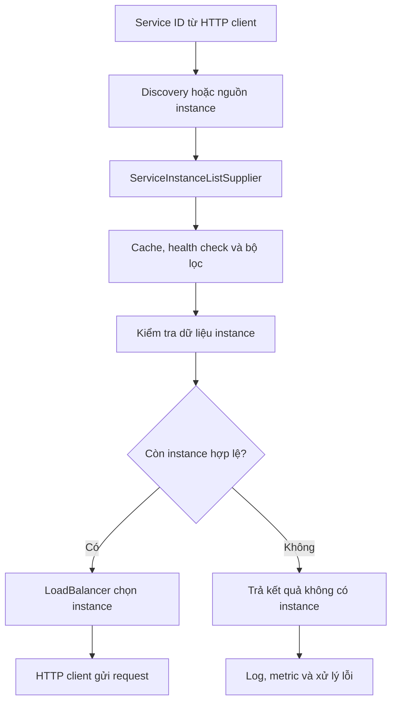

# Xử lý danh sách rỗng và bản sao thiếu thông tin

Spring Cloud LoadBalancer chọn một `ServiceInstance` từ danh sách instance của service ID mà ứng dụng đang gọi. Quyết định chọn chỉ có ý nghĩa khi danh sách đầu vào có ít nhất một instance hợp lệ và mỗi instance có đủ thông tin để tạo đích kết nối. Trong thực tế, danh sách có thể rỗng vì service chưa đăng ký, discovery đang lỗi hoặc bộ lọc đã loại hết ứng viên. Một instance cũng có thể xuất hiện trong registry nhưng thiếu host, port hoặc metadata mà chính sách định tuyến yêu cầu.

Nếu không phân biệt các tình huống này, ứng dụng dễ báo lỗi chung chung, retry vô ích hoặc gửi request đến một địa chỉ không thể kết nối. Bài viết trình bày cách nhận diện danh sách rỗng, kiểm tra dữ liệu `ServiceInstance`, xử lý bản sao trùng và thiết kế phản ứng an toàn khi không còn instance phù hợp.

## 1. Danh sách instance được dùng ở đâu?

Trong Spring Cloud LoadBalancer, `ServiceInstanceListSupplier` cung cấp danh sách `ServiceInstance` cho bộ chọn. Supplier có thể lấy dữ liệu từ discovery provider hoặc từ nguồn cấu hình khác; các supplier được kết hợp có thể cache, lọc theo zone, kiểm tra health hoặc áp dụng điều kiện dựa trên request.

Luồng xử lý khái quát:



Sơ đồ thể hiện các bước về mặt khái niệm. Trong ứng dụng thực tế, kiểm tra dữ liệu có thể nằm trong supplier tùy chỉnh, lớp tích hợp discovery hoặc bước kiểm tra trước khi gọi service. Không phải dự án nào cũng có một bean validator riêng.

Hai thành phần cần được phân biệt:

- **Supplier** cung cấp danh sách ứng viên mà load balancer sẽ xem xét.
- **Load balancer** chọn một instance trong danh sách đó theo chính sách như round robin hoặc random.

Nếu supplier trả về danh sách rỗng, load balancer không có ứng viên để chọn. Nếu supplier trả về instance thiếu thông tin, thuật toán chọn có thể vẫn chọn instance đó nhưng HTTP client không thể tạo kết nối đúng cách.

## 2. Những nguyên nhân khiến danh sách rỗng

Danh sách rỗng không nhất thiết có nghĩa service đích đã ngừng hoạt động. Nó chỉ cho biết tại thời điểm lấy dữ liệu, nguồn cung cấp không đưa ra instance nào cho service ID đang được hỏi.

Các nguyên nhân thường gặp gồm:

| Nguyên nhân | Dấu hiệu cần kiểm tra |
|---|---|
| Service chưa khởi động hoặc chưa đăng ký | Ứng dụng đích chưa sẵn sàng, đăng ký chưa hoàn tất hoặc tiến trình vừa restart. |
| Sai service ID | Tên trong URL hoặc client annotation không khớp tên đã đăng ký. |
| Discovery provider không trả dữ liệu | Kết nối, xác thực, namespace, region hoặc cấu hình discovery có vấn đề. |
| Instance đã bị gỡ khỏi registry | Instance dừng, lease hết hạn hoặc đăng ký đã bị thu hồi. |
| Health check loại hết ứng viên | Endpoint sức khỏe lỗi, timeout hoặc cấu hình probe không phù hợp. |
| Bộ lọc định tuyến quá chặt | Không instance nào khớp zone, version, metadata hoặc điều kiện request. |
| Cache chưa có dữ liệu hoặc dữ liệu đã cũ | Ứng dụng vừa khởi động, cache chưa được nạp hoặc dữ liệu chưa được làm mới. |
| Nguồn instance tĩnh chưa được cấu hình | Không có discovery provider và cũng không có danh sách instance tĩnh phù hợp. |

Khi chẩn đoán, nên đi từ nguồn dữ liệu đến danh sách cuối cùng. Trước tiên xác nhận discovery có instance, sau đó kiểm tra từng bước lọc. Nếu discovery trả về ba instance nhưng supplier cuối cùng trả danh sách rỗng, cần tìm bộ lọc hoặc health check đã loại các instance đó.

### 2.1. Sai service ID và khác biệt môi trường

Service ID là khóa tra cứu trong discovery. Một lỗi nhỏ như dùng `inventory` trong khi registry đăng ký `inventory-service` có thể tạo ra danh sách rỗng dù service vẫn chạy.

Kiểm tra đồng thời:

- Giá trị trong URL của HTTP client.
- Tên khai báo trong `@FeignClient(name = "...")`, nếu dùng OpenFeign.
- Tên service mà discovery provider lưu trữ.
- Namespace, region hoặc môi trường mà discovery client đang truy vấn.
- Quy tắc chuẩn hóa chữ hoa, chữ thường của provider đang sử dụng.

Không tự ý chuyển mọi service ID thành chữ thường nếu discovery provider có quy ước riêng. Hãy dùng cùng một quy tắc chuẩn hóa ở nơi đăng ký và nơi tra cứu.

### 2.2. Bộ lọc có thể loại hết instance

Một danh sách ban đầu có thể không rỗng nhưng trở thành rỗng sau khi áp dụng nhiều điều kiện. Ví dụ, discovery trả về bốn instance; health check loại hai instance, bộ lọc zone chỉ giữ instance ở zone `ap-southeast-1a`, rồi bộ lọc version loại instance còn lại.

Để tìm nguyên nhân, quan sát số lượng phần tử sau mỗi bước:

```text
Discovery trả về                 : 4
Sau health check                 : 2
Sau lọc zone                     : 1
Sau lọc version                  : 0
Kết quả supplier                 : 0
```

Đây là số liệu minh họa. Trong hệ thống thật, có thể ghi nhận số lượng và số phần tử bị loại theo từng lý do. Không nên chỉ log kết quả cuối là “empty list”, vì như vậy không biết dữ liệu đã biến mất ở bước nào.

## 3. Phân biệt danh sách rỗng, không phát dữ liệu và lỗi nguồn

Với luồng reactive của `ServiceInstanceListSupplier`, cần phân biệt ba trạng thái:

| Trạng thái | Ý nghĩa | Cách diễn giải |
|---|---|---|
| Phát ra một danh sách rỗng | Supplier đã trả kết quả nhưng không có ứng viên. | Discovery hoặc các bộ lọc cho kết quả không có instance. |
| Hoàn tất mà không phát danh sách | Không có phần tử nào được phát trong luồng reactive. | Supplier không cung cấp kết quả; cần kiểm tra cách triển khai và tích hợp. |
| Phát lỗi | Quá trình lấy danh sách thất bại. | Lỗi kết nối, timeout, xác thực, lỗi code hoặc lỗi provider. |

Ví dụ, `Flux.just(Collections.emptyList())` biểu diễn một lần phát ra danh sách rỗng, còn `Flux.empty()` hoàn tất mà không phát danh sách. `Flux.error(...)` biểu diễn lỗi. Đây là các tín hiệu reactive khác nhau và không nên gom tất cả thành cùng một trạng thái trong log.

Theo hợp đồng, supplier cần phát ra các danh sách hợp lệ; không trả về `null` thay cho danh sách hoặc luồng. Nếu tự viết supplier, hãy bảo đảm trường hợp không có instance được biểu diễn bằng danh sách rỗng. Nếu nguồn dữ liệu gặp lỗi, giữ lại tín hiệu lỗi để tầng gọi có thể ghi nhận và xử lý đúng nguyên nhân.

Hành vi cuối cùng của HTTP client khi không có kết quả chọn instance có thể khác nhau theo loại client và phiên bản tích hợp. Vì vậy, cần kiểm tra cách ứng dụng hiện tại ánh xạ trạng thái này thành exception hoặc response. Không giả định rằng mọi trường hợp đều tạo ra cùng một exception cụ thể.

## 4. Những trường thông tin cần có trong ServiceInstance

`ServiceInstance` mô tả một instance của service. Các trường thường được dùng khi phân giải đích kết nối gồm:

| Trường | Vai trò | Kiểm tra cơ bản |
|---|---|---|
| `serviceId` | Tên logic của service | Không rỗng và khớp service đang được truy vấn. |
| `host` | Host hoặc địa chỉ máy đích | Không rỗng; có thể phân giải và truy cập từ môi trường gọi. |
| `port` | Cổng kết nối | Nằm trong khoảng cổng TCP hợp lệ mà ứng dụng yêu cầu. |
| `uri` | Địa chỉ kết nối được tạo từ thông tin instance | Có scheme và host hợp lệ. |
| `secure` | Cho biết instance dùng kết nối bảo mật | Phải phù hợp với giao thức và cấu hình TLS của client. |
| `metadata` | Thông tin bổ sung như zone, version, instance ID | Có thể rỗng; chỉ bắt buộc khi chính sách định tuyến cần đến. |

Không phải mọi metadata đều bắt buộc. Ví dụ, nếu ứng dụng chỉ chọn instance bằng round robin, thiếu metadata `zone` có thể không làm instance mất khả năng kết nối. Nhưng nếu chính sách bắt buộc chọn đúng zone, instance thiếu zone không thể được đánh giá theo quy tắc đó.

Tương tự, một host và port hợp lệ về cú pháp chưa chứng minh endpoint có thể truy cập. Kiểm tra cấu trúc dữ liệu và kiểm tra khả năng kết nối là hai việc khác nhau. Kết nối mạng, firewall, TLS và trạng thái ứng dụng cần được quan sát ở các tầng phù hợp.

## 5. Kiểm tra dữ liệu trước khi đưa instance vào danh sách ứng viên

Nên xác định một tập điều kiện tối thiểu cho mọi instance. Với một HTTP service thông thường, các điều kiện cơ bản có thể là:

1. Đối tượng instance không phải `null`.
2. Service ID có giá trị và khớp service đang được yêu cầu.
3. Host không rỗng.
4. Port nằm trong khoảng từ 1 đến 65535.
5. URI tạo ra từ instance có scheme và host hợp lệ.
6. Các metadata bắt buộc bởi chính sách định tuyến hiện tại có giá trị.

Ví dụ kiểm tra cơ bản bằng Java:

```java
import java.net.URI;
import java.util.ArrayList;
import java.util.List;

import org.springframework.cloud.client.ServiceInstance;
import org.springframework.util.StringUtils;

static boolean isUsable(
        ServiceInstance instance,
        String requestedServiceId) {

    if (instance == null) {
        return false;
    }

    if (!StringUtils.hasText(instance.getServiceId())
            || !requestedServiceId.equals(instance.getServiceId())) {
        return false;
    }

    if (!StringUtils.hasText(instance.getHost())) {
        return false;
    }

    int port = instance.getPort();
    if (port < 1 || port > 65535) {
        return false;
    }

    try {
        URI uri = instance.getUri();
        return uri != null
                && uri.isAbsolute()
                && StringUtils.hasText(uri.getScheme())
                && StringUtils.hasText(uri.getHost());
    } catch (RuntimeException ex) {
        return false;
    }
}

static List<ServiceInstance> usableInstances(
        List<ServiceInstance> candidates,
        String requestedServiceId) {

    if (candidates == null) {
        throw new IllegalArgumentException(
                "ServiceInstance list must not be null");
    }

    List<ServiceInstance> result = new ArrayList<>();

    for (ServiceInstance candidate : candidates) {
        if (isUsable(candidate, requestedServiceId)) {
            result.add(candidate);
        }
    }

    return result;
}
```

Đây là hàm kiểm tra minh họa cho HTTP endpoint. Ứng dụng thực tế cần điều chỉnh quy tắc service ID và giao thức theo discovery provider, đồng thời ghi nhận lý do từ chối thay vì chỉ nhận kết quả `true/false`. Nếu provider có stable instance ID hoặc trạng thái sức khỏe riêng, có thể bổ sung kiểm tra tương ứng.

Hàm trên giữ nguyên thứ tự của danh sách đầu vào. Điều này có ích khi chính sách lựa chọn dựa trên thứ tự, chẳng hạn round robin. Không nên sắp xếp lại danh sách một cách tùy tiện trong bước kiểm tra dữ liệu.

### 5.1. Phân loại lý do instance không hợp lệ

Trong triển khai thật, thay vì chỉ trả về boolean, nên phân loại lỗi để hỗ trợ chẩn đoán:

| Mã lý do minh họa | Điều kiện |
|---|---|
| `NULL_INSTANCE` | Phần tử trong danh sách là null. |
| `MISSING_SERVICE_ID` | Service ID rỗng. |
| `SERVICE_ID_MISMATCH` | Service ID không khớp yêu cầu. |
| `MISSING_HOST` | Host rỗng. |
| `INVALID_PORT` | Port nằm ngoài khoảng hợp lệ. |
| `INVALID_URI` | URI không tạo được đích kết nối hợp lệ. |
| `MISSING_REQUIRED_METADATA` | Thiếu metadata mà chính sách định tuyến yêu cầu. |
| `UNHEALTHY_INSTANCE` | Health check xác định instance không đủ điều kiện nhận request. |

Các mã trên là quy ước nội bộ có thể áp dụng, không phải enum cố định của Spring Cloud. Dùng mã ổn định giúp dashboard và cảnh báo dễ tổng hợp hơn so với việc phân tích chuỗi log tự do.

### 5.2. Metadata tùy chọn và metadata bắt buộc

Giả sử ứng dụng ưu tiên instance cùng zone với service gọi. Nếu metadata zone có mặt, bộ lọc có thể ưu tiên zone phù hợp. Nếu metadata zone thiếu, cần có chính sách dự phòng rõ ràng:

- Bỏ qua ưu tiên zone và tiếp tục với các instance hợp lệ khác.
- Loại instance thiếu zone nếu yêu cầu phân vùng là bắt buộc.
- Trả lỗi cấu hình nếu không thể bảo đảm quy tắc định tuyến.

Không nên mặc định mọi metadata thiếu đều làm instance không hợp lệ. Điều kiện kiểm tra phải phản ánh yêu cầu nghiệp vụ. Nếu metadata chỉ phục vụ logging hoặc hiển thị, thiếu nó có thể chỉ là cảnh báo.

## 6. Xử lý instance trùng lặp

Một danh sách có thể chứa cùng một instance nhiều lần do dữ liệu đăng ký bị lặp, nhiều nguồn được hợp nhất hoặc lỗi trong supplier tùy chỉnh.

Ví dụ:

```text
inventory-1  -> 10.0.1.11:8080
inventory-2  -> 10.0.1.12:8080
inventory-1  -> 10.0.1.11:8080
inventory-3  -> 10.0.1.13:8080
```

Nếu danh sách được đưa trực tiếp vào round robin, instance xuất hiện hai lần có thể được chọn với tần suất cao hơn. Với random, phần tử trùng cũng làm thay đổi xác suất lựa chọn. Điều này có thể tạo ra phân phối tải không như mong đợi.

Trước khi loại trùng, cần xác định thế nào là cùng một instance:

- Ưu tiên stable instance ID do discovery provider cấp nếu có.
- Nếu không có ID ổn định, có thể dùng tổ hợp service ID, scheme, host và port làm khóa endpoint.
- Không dùng riêng host làm khóa, vì một máy có thể chạy nhiều instance ở các port khác nhau.
- Nếu metadata ảnh hưởng đến định tuyến hoặc phân biệt hai đăng ký hợp lệ, cần đưa yếu tố đó vào quy tắc nhận diện.
- Không loại các instance khác nhau chỉ vì chúng đang nằm trên cùng một máy.

Chỉ loại trùng khi các phần tử đại diện cho cùng một đích và cùng một vai trò định tuyến. Một số hệ thống có chủ ý dùng trọng số hoặc chính sách riêng để điều chỉnh phân phối; không nên tự ý loại các bản ghi được tạo ra có chủ đích trước khi hiểu mô hình trọng số đó.

Sau khi loại trùng, nên ghi nhận số lượng bản ghi trùng và nguồn dữ liệu liên quan. Việc deduplicate chỉ che ảnh hưởng lên thuật toán lựa chọn; nó không sửa nguyên nhân khiến registry hoặc supplier tạo ra bản ghi lặp.

## 7. Khi tất cả instance đều bị loại

Sau bước xác thực và lọc, có thể xảy ra tình huống:

```text
Danh sách từ discovery       : 3
Bản ghi thiếu host           : 1
Bản ghi sai service ID       : 1
Bản ghi không đạt health     : 1
Danh sách hợp lệ cuối cùng   : 0
```

Lúc này, load balancer không có đích phù hợp để gửi request. Ứng dụng cần xử lý rõ ràng thay vì cố chọn một bản ghi không hợp lệ.

Một cách kiểm tra ở tầng ứng dụng:

```java
List<ServiceInstance> usable =
        usableInstances(candidates, "inventory-service");

if (usable.isEmpty()) {
    throw new IllegalStateException(
            "No usable instance for service inventory-service");
}

// Chuyển danh sách hợp lệ cho bước lựa chọn tiếp theo.
```

Đây là ví dụ về guard ở tầng ứng dụng hoặc trong thành phần xử lý danh sách tùy chỉnh. Không nên sao chép đoạn mã này vào mọi HTTP client để thay thế tích hợp LoadBalancer; hãy đặt việc kiểm tra tại đúng điểm sở hữu danh sách instance.

### 7.1. Fail fast và phản hồi phù hợp

Nếu không có instance hợp lệ, nên dừng lời gọi sớm với thông tin service ID và nguyên nhân. Ở biên HTTP của ứng dụng, tình huống service phụ thuộc tạm thời không sẵn sàng thường được ánh xạ thành `503 Service Unavailable`. Cấu trúc response nên đủ thông tin để client biết có thể thử lại sau, nhưng không để lộ chi tiết nội bộ như host, metadata nhạy cảm hoặc thông tin xác thực.

Không nên chuyển sang một địa chỉ IP mặc định không được quản lý. Cách fallback như vậy có thể bỏ qua discovery, health check và chính sách bảo mật, đồng thời khiến lỗi khó tái hiện.

### 7.2. Retry có giới hạn

Nếu danh sách rỗng do service vừa khởi động và chưa đăng ký, một lần thử lại có trì hoãn có thể hữu ích. Nhưng retry liên tục không tạo ra instance mới nếu registry vẫn không có dữ liệu.

Khi cấu hình retry, cần:

- Giới hạn số lần thử và tổng thời gian chờ.
- Dùng backoff, có thể thêm jitter để tránh nhiều client retry cùng thời điểm.
- Chỉ retry các lỗi được xác định là tạm thời.
- Không retry liên tục lỗi cấu hình như sai service ID hoặc thiếu metadata bắt buộc.
- Xem xét tính idempotent của request trước khi gửi lại thao tác ghi.
- Tránh retry chồng nhiều tầng khiến số request tăng theo cấp số nhân.

Nếu ứng dụng cần chờ service đích sẵn sàng trước khi nhận traffic, nên cân nhắc readiness và cơ chế điều phối triển khai. Không dùng retry của từng request như cách duy nhất để bù cho quy trình khởi động không đồng bộ.

### 7.3. Cache và dữ liệu cũ

Cache danh sách instance giúp giảm truy vấn discovery, nhưng dữ liệu có thể chưa phản ánh thay đổi mới nhất. Nếu instance đã dừng nhưng vẫn còn trong cache, load balancer có thể tiếp tục chọn nó cho đến khi dữ liệu được làm mới.

Khi điều tra danh sách rỗng hoặc instance lỗi, cần xem:

- Cache có đang được bật không.
- TTL hoặc chu kỳ refresh được cấu hình ra sao.
- Cache đang chứa danh sách rỗng hay danh sách cũ.
- Discovery provider có trả dữ liệu mới không.
- Có nhiều lớp cache hoặc nhiều supplier xếp chồng không.

Không nên tự động dùng danh sách cũ vô thời hạn khi lần refresh thất bại. Nếu chấp nhận stale data để tăng khả năng phục vụ, cần có giới hạn tuổi dữ liệu và đánh giá rủi ro chọn instance đã ngừng hoạt động.

## 8. Quan sát và ghi log

Để xác định vì sao load balancer không có ứng viên, nên theo dõi số lượng instance qua từng bước và nguyên nhân bị loại. Một bản ghi log có cấu trúc có thể gồm:

```text
serviceId=inventory-service
discoveredCount=4
validCount=2
duplicateCount=1
rejectedMissingHost=1
rejectedInvalidPort=0
rejectedUnhealthy=0
selectionResult=INSTANCE_AVAILABLE
```

Khi không còn instance:

```text
serviceId=inventory-service
discoveredCount=2
validCount=0
rejectedMissingHost=1
rejectedInvalidPort=0
rejectedUnhealthy=1
selectionResult=NO_INSTANCE
```

Đây là định dạng minh họa. Có thể xây dựng metric riêng theo quy ước quan sát của hệ thống. Các metric nên giúp trả lời:

- Có bao nhiêu instance được discovery trả về?
- Có bao nhiêu instance còn lại sau từng bộ lọc?
- Bao nhiêu instance bị loại theo từng lý do?
- Tần suất danh sách rỗng theo service ID là bao nhiêu?
- Discovery hoặc supplier mất bao lâu để trả kết quả?
- Bao lâu kể từ lần refresh cache gần nhất?
- Instance được chọn có tỷ lệ timeout hoặc lỗi kết nối như thế nào?

Tránh dùng host, URI hoặc instance ID làm nhãn metric có cardinality cao trên mọi hệ thống. Có thể ghi các chi tiết đó trong log có kiểm soát, còn metric tổng hợp theo service và nguyên nhân để dashboard hoạt động ổn định.

Khi ghi log, không nên in toàn bộ metadata nếu metadata có thể chứa token, thông tin nội bộ hoặc dữ liệu nhạy cảm. Chỉ ghi các trường cần thiết cho chẩn đoán.

## 9. Kiểm thử các trường hợp biên

Bộ kiểm thử cho supplier hoặc thành phần lọc instance cần bao phủ cả danh sách bình thường và các trường hợp bất thường.

| Đầu vào | Kết quả mong đợi |
|---|---|
| Danh sách có nhiều instance hợp lệ | Giữ các instance và giữ thứ tự theo quy tắc đã chọn. |
| Danh sách rỗng | Không chọn instance; trả kết quả không có ứng viên rõ ràng. |
| Danh sách chứa phần tử null | Loại phần tử lỗi và ghi nhận lý do, hoặc báo lỗi nếu vi phạm contract nội bộ. |
| Service ID rỗng hoặc không khớp | Loại instance và ghi nhận nguyên nhân. |
| Host rỗng | Loại instance vì không tạo được endpoint. |
| Port ngoài khoảng hợp lệ | Loại instance. |
| URI không hợp lệ | Loại instance và ghi nhận dữ liệu nguồn cần sửa. |
| Thiếu metadata tùy chọn | Giữ instance nếu chính sách không yêu cầu metadata đó. |
| Thiếu metadata bắt buộc | Loại instance hoặc trả lỗi cấu hình theo chính sách. |
| Hai bản ghi cùng instance ID | Chỉ giữ một bản ghi theo quy tắc deduplicate. |
| Hai instance cùng host nhưng khác port | Giữ cả hai nếu chúng là hai endpoint độc lập. |
| Health check loại tất cả | Danh sách cuối rỗng; không gửi request tới instance không khỏe. |
| Supplier phát lỗi | Bảo toàn và quan sát lỗi nguồn; không biến âm thầm thành danh sách hợp lệ. |
| Supplier hoàn tất mà không phát danh sách | Xử lý như trạng thái không có kết quả phát ra, phân biệt với danh sách rỗng. |

Với supplier reactive, có thể dùng Reactor Test để kiểm tra tín hiệu phát ra, hoàn tất và lỗi. Với hàm xác thực thuần, kiểm thử đơn vị từng điều kiện giúp bảo đảm thay đổi quy tắc không làm lọt instance thiếu thông tin. Kiểm thử tích hợp nên xác nhận HTTP client phản ứng đúng khi không có instance và khi discovery provider khôi phục dữ liệu.

## 10. Quy trình chẩn đoán thực tế

Khi nhận lỗi không có instance hoặc request không thể kết nối, có thể xử lý theo trình tự:

1. **Xác nhận service ID:** so sánh tên trong request với tên đăng ký trong discovery.
2. **Kiểm tra discovery:** truy vấn provider và xác nhận có instance đang đăng ký.
3. **Kiểm tra supplier:** xác định danh sách phát ra trước và sau cache, health check và các bộ lọc.
4. **Kiểm tra dữ liệu:** rà soát service ID, host, port, URI và metadata bắt buộc.
5. **Kiểm tra trùng lặp:** xác định bản ghi lặp có làm thay đổi phân phối hay không.
6. **Kiểm tra kết nối:** với instance hợp lệ đã chọn, kiểm tra DNS, network, firewall, TLS và trạng thái ứng dụng.
7. **Kiểm tra phục hồi:** xác nhận cache được cập nhật, instance khỏe mạnh quay lại danh sách và retry dừng khi hệ thống ổn định.

Một số hiện tượng và hướng xử lý:

| Hiện tượng | Hướng điều tra |
|---|---|
| Discovery trả danh sách rỗng | Service chưa đăng ký, sai service ID hoặc provider không trả dữ liệu. |
| Discovery có instance nhưng supplier rỗng | Health check, zone, metadata hoặc bộ lọc đã loại hết. |
| Danh sách có instance nhưng request lỗi ngay | Host, port, URI hoặc scheme không hợp lệ. |
| Một instance nhận nhiều request bất thường | Bản ghi trùng, chính sách trọng số hoặc danh sách ứng viên không đồng đều. |
| Instance lỗi vẫn được chọn | Cache cũ, health check chưa phản ánh trạng thái hoặc endpoint vừa thay đổi. |
| Chỉ một môi trường gặp lỗi | Khác biệt service ID, namespace, discovery endpoint, profile hoặc cấu hình cache. |

## 11. Nguyên tắc thiết kế

Khi xây dựng supplier hoặc bộ lọc tùy chỉnh, nên giữ các nguyên tắc sau:

- Biểu diễn không có instance bằng danh sách rỗng theo đúng contract.
- Giữ riêng trạng thái không có dữ liệu, không phát dữ liệu và lỗi nguồn.
- Kiểm tra dữ liệu kết nối tối thiểu trước khi đưa instance vào danh sách ứng viên.
- Chỉ yêu cầu metadata mà chính sách định tuyến thực sự sử dụng.
- Loại trùng theo định danh instance hoặc endpoint phù hợp, không chỉ theo host.
- Không tự chọn địa chỉ fallback không được quản lý.
- Giới hạn retry và đặt timeout phù hợp với deadline nghiệp vụ.
- Ghi nhận số lượng và lý do instance bị loại để có thể chẩn đoán.
- Kiểm thử cả trường hợp bình thường, danh sách rỗng và dữ liệu thiếu thông tin.

## 12. Kết luận

Danh sách rỗng và `ServiceInstance` thiếu thông tin là hai vấn đề khác nhau. Danh sách rỗng cho biết không có ứng viên ở bước cung cấp dữ liệu; instance thiếu thông tin cho biết có bản ghi nhưng không thể dùng an toàn để tạo đích kết nối. Ngoài ra, bản ghi trùng có thể làm sai lệch xác suất lựa chọn dù mỗi bản ghi riêng lẻ đều hợp lệ.

Khi xử lý, hãy kiểm tra nguồn discovery, từng bước lọc, tính hợp lệ của service ID/host/port/URI và metadata theo chính sách. Nếu không còn instance phù hợp, hãy dừng lời gọi với lỗi rõ ràng, quan sát nguyên nhân và retry có giới hạn khi lỗi thực sự tạm thời. Cách làm này giúp Spring Cloud LoadBalancer chọn đúng các instance có thể phục vụ request và giúp đội vận hành tìm được nguyên nhân khi danh sách ứng viên thay đổi.

