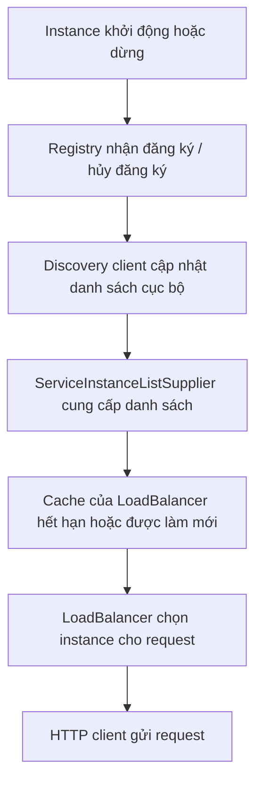

# Độ trễ cập nhật khi bản sao được thêm hoặc bị loại bỏ

Trong một hệ thống Spring Cloud, số lượng bản sao (instance) của một dịch vụ có thể thay đổi khi triển khai phiên bản mới, tự động mở rộng hoặc thu hẹp tài nguyên. Khi một instance mới xuất hiện hoặc một instance cũ dừng hoạt động, mọi thành phần liên quan không nhất thiết nhìn thấy thay đổi đó cùng một thời điểm. Vì vậy, Spring Cloud LoadBalancer có thể tiếp tục gửi request đến tập instance cũ trong một khoảng thời gian.

Độ trễ này là kết quả của nhiều bước: instance khởi động và đăng ký, registry cập nhật trạng thái, discovery client làm mới danh sách cục bộ, rồi `ServiceInstanceListSupplier` và cache của LoadBalancer cung cấp danh sách cho request. Hiểu từng bước giúp giải thích vì sao scale-out chưa tăng lưu lượng ngay lập tức và vì sao scale-in đôi khi vẫn có request đi đến instance đã bị loại bỏ.

## 1. Danh sách instance thay đổi qua nhiều tầng

Ứng dụng gọi dịch vụ thường sử dụng một service ID, ví dụ `catalog-service`. Service ID đại diện cho dịch vụ logic; registry lưu các instance đang đăng ký dưới tên đó. Mỗi instance có thông tin như host, port, instance ID và metadata.

Một request được cân bằng tải dựa trên danh sách instance mà LoadBalancer nhận được tại thời điểm chọn. Với tích hợp discovery phổ biến, dữ liệu đi qua các tầng sau:

1. **Vòng đời instance:** tiến trình mới khởi động, hoàn tất khởi tạo và đạt trạng thái sẵn sàng nhận request. Khi dừng, instance cần được đánh dấu không còn phục vụ hoặc hủy đăng ký.
2. **Registry:** nơi lưu trạng thái đăng ký của các instance. Thay đổi chỉ có hiệu lực khi registry nhận được đăng ký, cập nhật trạng thái hoặc hủy đăng ký.
3. **Discovery client:** thành phần trong ứng dụng gọi dịch vụ truy vấn registry. Một số integration cập nhật qua polling; một số dùng cơ chế watch hoặc thông báo thay đổi. Discovery client có thể giữ một bản sao cục bộ của registry.
4. **ServiceInstanceListSupplier:** cung cấp danh sách `ServiceInstance` cho LoadBalancer. Supplier có thể lấy dữ liệu trực tiếp từ discovery client, lọc theo zone hoặc health check, và có thể được bọc bởi cache.
5. **Spring Cloud LoadBalancer:** chọn một instance từ danh sách supplier trả về rồi chuyển địa chỉ đích cho HTTP client.



Mỗi tầng có lịch cập nhật và chính sách lưu dữ liệu riêng. Vì vậy, không thể suy ra rằng registry đã thay đổi thì request kế tiếp chắc chắn sẽ dùng danh sách mới.

## 2. Những nguồn tạo ra độ trễ

### Đăng ký và hủy đăng ký tại registry

Khi instance mới khởi động, nó có thể cần thời gian để tải cấu hình, kết nối dependency, mở cổng và hoàn tất kiểm tra readiness trước khi đăng ký. Tùy registry và integration, việc đăng ký có thể được gửi ngay hoặc sau một bước khởi tạo khác.

Khi instance dừng đột ngột, registry có thể chưa biết instance đã mất. Một số registry dựa vào heartbeat hoặc lease; trạng thái chỉ chuyển sang không khả dụng sau khi hết thời gian chờ. Nếu instance tắt bình thường và hủy đăng ký thành công, registry có thể cập nhật sớm hơn.

### Làm mới dữ liệu của discovery client

Discovery client có thể duy trì danh sách registry cục bộ để giảm số lần truy vấn và tránh phụ thuộc vào một request mạng cho mỗi lần tìm instance. Nếu integration dùng chu kỳ fetch, một thay đổi xảy ra ngay sau lần fetch có thể phải chờ đến chu kỳ tiếp theo mới xuất hiện trong danh sách cục bộ.

Các integration khác nhau có cách truyền thay đổi khác nhau. Vì thế, cần kiểm tra cấu hình và tài liệu của registry đang dùng, chẳng hạn Eureka, Consul hoặc Kubernetes. Không có một chu kỳ refresh chung áp dụng cho tất cả hệ thống.

### Cache của Spring Cloud LoadBalancer

LoadBalancer lấy danh sách ứng viên qua `ServiceInstanceListSupplier`. Khi bật caching, `CachingServiceInstanceListSupplier` có thể giữ kết quả từ supplier nền trong một khoảng thời gian. Nếu discovery client đã thấy instance mới nhưng cache của LoadBalancer chưa hết hạn, request vẫn có thể nhận danh sách cũ.

Trong các cấu hình Spring Cloud LoadBalancer phổ biến, cache mặc định được bật; TTL thường là 35 giây và capacity mặc định là 256 entry. Giá trị thực tế cần được đối chiếu với phiên bản Spring Cloud và cấu hình cache của ứng dụng. Cache có thể dùng Caffeine nếu thư viện đó có trên classpath; nếu không, Spring Cloud LoadBalancer có implementation cache mặc định.

### Health check và readiness

Nếu ứng dụng cấu hình `HealthCheckServiceInstanceListSupplier`, danh sách ứng viên có thể được lọc dựa trên kết quả kiểm tra sức khỏe. Kết quả chỉ thay đổi sau khi lần kiểm tra tiếp theo chạy và cập nhật danh sách. Một instance vừa lỗi có thể vẫn xuất hiện trong kết quả cũ cho đến khi lần kiểm tra phát hiện lỗi.

Health check của LoadBalancer là một cơ chế bổ sung, không tự thay thế đăng ký dịch vụ hay refresh của discovery client. Nó cũng chỉ kiểm tra endpoint và điều kiện mà ứng dụng đã cấu hình. Nếu một instance mới chưa có trong danh sách discovery, health check không thể tự thêm instance đó vào danh sách.

### Kết nối đang mở của HTTP client

LoadBalancer chọn instance khi phân giải request. Sau đó HTTP client có thể sử dụng connection pool hoặc kết nối keep-alive theo cấu hình của nó. Khi một instance bị loại bỏ, request đang chạy hoặc kết nối đã được mở có thể vẫn tồn tại trong một khoảng thời gian. Do đó, cần xem xét cả vòng đời request và connection pool khi điều tra lỗi sau scale-in.

## 3. Điều gì xảy ra khi thêm instance?

Giả sử `catalog-service` đang có hai instance là `catalog-1` và `catalog-2`. Hệ thống mở rộng thêm `catalog-3`.

Trước khi thay đổi được truyền đến discovery client và cache LoadBalancer, danh sách ứng viên có thể vẫn chỉ gồm hai instance cũ. Request tiếp tục được phân phối giữa `catalog-1` và `catalog-2`. Khi danh sách mới có hiệu lực, `catalog-3` mới bắt đầu nhận request theo chính sách lựa chọn.

| Thời điểm | Registry | Danh sách mà LoadBalancer có thể nhìn thấy |
|---|---|---|
| Ban đầu | `catalog-1`, `catalog-2` | `catalog-1`, `catalog-2` |
| `catalog-3` vừa khởi động | Có thể chưa đăng ký | `catalog-1`, `catalog-2` |
| Registry đã nhận đăng ký | Có 3 instance | Có thể vẫn chỉ có 2 instance do discovery/cache cũ |
| Discovery và cache đã cập nhật | Có 3 instance | `catalog-1`, `catalog-2`, `catalog-3` |

Đây là lý do tăng số replica ở tầng triển khai không đồng nghĩa lưu lượng được phân phối đến replica mới ngay lập tức. Trong thời gian hội tụ, hai instance cũ có thể tiếp tục chịu phần lớn lưu lượng.

## 4. Điều gì xảy ra khi loại bỏ instance?

Giả sử `catalog-2` cần dừng để triển khai phiên bản mới. Registry có thể đã xóa hoặc đánh dấu instance này không khả dụng, trong khi discovery client hay cache của LoadBalancer vẫn giữ địa chỉ cũ.

Nếu LoadBalancer chọn `catalog-2` trong khoảng thời gian đó, HTTP client có thể gặp lỗi kết nối, timeout hoặc lỗi do server đã dừng. Đây là tình huống dùng danh sách instance cũ (stale instance). Nếu request đã được gửi trước khi instance dừng, request cũng có thể thất bại giữa chừng.

Để giảm lỗi khi scale-in, nên phối hợp các bước trong vòng đời dịch vụ:

1. Đánh dấu instance không còn sẵn sàng nhận request mới hoặc bắt đầu quá trình deregistration theo cơ chế của nền tảng.
2. Chờ thay đổi được truyền đến registry và các discovery client liên quan.
3. Cho các request đang xử lý hoàn tất trong giới hạn thời gian drain đã định.
4. Dừng tiến trình sau khi đã ngừng nhận request mới và hoàn tất giai đoạn drain.

Thứ tự và cơ chế cụ thể phụ thuộc nền tảng triển khai. Nếu chỉ dừng tiến trình trước rồi chờ heartbeat hết hạn, các client có thể tiếp tục chọn instance đã chết cho đến khi trạng thái được cập nhật.

## 5. Điều chỉnh cache và thời gian cập nhật

Có thể điều chỉnh TTL cache của Spring Cloud LoadBalancer bằng cấu hình `spring.cloud.loadbalancer.cache.ttl`. Ví dụ YAML sau đặt TTL là 5 giây và capacity là 256 entry:

```yaml
spring:
  cloud:
    loadbalancer:
      cache:
        ttl: 5s
        capacity: 256
```

TTL ngắn hơn giúp cache của LoadBalancer sớm lấy lại danh sách từ supplier nền. Tuy nhiên, nó không buộc registry hoặc discovery client cập nhật dữ liệu sớm hơn. Nếu discovery client vẫn giữ danh sách cũ, cache hết hạn chỉ khiến LoadBalancer đọc lại chính dữ liệu cũ đó.

TTL quá ngắn có thể làm tăng số lần truy vấn supplier, discovery client hoặc registry, tùy kiến trúc cache và integration. TTL quá dài giúp giảm tải truy vấn nhưng kéo dài thời gian dùng danh sách cũ sau khi instance thay đổi. Hãy chọn TTL dựa trên tần suất scale, tải của registry, độ trễ refresh của discovery client và mức lỗi có thể chấp nhận.

Nếu cần điều chỉnh độ trễ end-to-end, phải xem xét đồng thời:

- Chu kỳ fetch, watch hoặc cơ chế đồng bộ registry của discovery client.
- Thời gian heartbeat, lease và hết hạn đăng ký của registry.
- TTL cache của Spring Cloud LoadBalancer.
- Chu kỳ refetch và health check nếu có cấu hình supplier kiểm tra sức khỏe.
- Thời gian drain, timeout và connection pool của HTTP client.

Không nên giảm mọi khoảng thời gian xuống mức thấp nhất một cách máy móc. Cần đo số lần truy vấn, thời gian hội tụ và tỷ lệ lỗi trước khi thay đổi cấu hình trên môi trường thật.

## 6. Ước lượng thời gian hội tụ

Có thể dùng mô hình gần đúng sau để phân tích:

\[
T_{visible} \approx T_{registration} + T_{discovery} + T_{supplier-cache}
\]

Trong đó:

- `T_registration`: thời gian từ khi instance thay đổi trạng thái đến khi registry ghi nhận thay đổi.
- `T_discovery`: thời gian để discovery client có danh sách mới.
- `T_supplier-cache`: thời gian chờ cache của supplier/LoadBalancer hết hạn hoặc được làm mới.

Đây là mô hình phân tích, không phải cam kết SLA. Các bước có thể chồng lấp; health check, heartbeat expiry và thời gian drain có thể bổ sung độ trễ hoặc thay đổi thời điểm instance bị xem là không khả dụng.

Ví dụ, registry nhận instance mới sau 1 giây, discovery client cập nhật sau tối đa 10 giây và cache LoadBalancer có TTL 5 giây. Nếu các bước diễn ra tuần tự theo trường hợp bất lợi, danh sách mới có thể mất khoảng 16 giây mới đến được request. Nếu discovery client chỉ cập nhật sau 30 giây, giảm TTL cache từ 5 giây xuống 1 giây không thể làm danh sách mới xuất hiện trước khi discovery client cập nhật.

Với instance bị mất đột ngột, thời gian phát hiện còn có thể phụ thuộc heartbeat hoặc lease timeout. Đây là lý do nên kiểm tra cấu hình của registry trước khi kết luận cache LoadBalancer là nguyên nhân duy nhất.

## 7. Theo dõi và chẩn đoán độ trễ

Khi một instance mới không nhận request hoặc một instance đã dừng vẫn bị gọi, hãy đối chiếu cùng một service ID qua từng tầng:

1. Xác nhận thời điểm instance đạt readiness, đăng ký hoặc bắt đầu deregistration.
2. Kiểm tra registry đã ghi nhận trạng thái mới chưa; với instance mất đột ngột, kiểm tra heartbeat hoặc lease expiry.
3. Kiểm tra discovery client của ứng dụng gọi dịch vụ đã nhìn thấy danh sách mới chưa.
4. Kiểm tra `ServiceInstanceListSupplier` đang được dùng, các bộ lọc health check và cache có bật hay không.
5. Ghi nhận instance LoadBalancer chọn cho request lỗi, thời điểm request và lỗi kết nối nhận được.
6. Đối chiếu timeout và connection pool của HTTP client nếu request có thể đang dùng kết nối đã mở trước đó.

Bảng sau giúp khoanh vùng nhanh:

| Hiện tượng | Tầng nên kiểm tra trước |
|---|---|
| Instance mới có trong registry nhưng ứng dụng gọi chưa thấy | Discovery client và chu kỳ refresh/watch |
| Discovery client thấy instance mới nhưng request vẫn dùng danh sách cũ | `ServiceInstanceListSupplier` và cache LoadBalancer |
| Instance đã dừng nhưng vẫn xuất hiện trong registry | Deregistration, heartbeat hoặc lease timeout |
| Registry và discovery đã bỏ instance nhưng request vẫn lỗi tới địa chỉ cũ | Cache supplier, request đang chạy và connection pool |
| Instance mới được chọn nhưng request thất bại | Readiness, cổng, mạng và cấu hình HTTP client của instance mới |

Nên ghi log có service ID, instance ID hoặc host/port được chọn, thời điểm và kết quả request. Khi kiểm thử scale-out/scale-in, ghi lại mốc thời gian ở registry, discovery client và request đầu tiên sử dụng danh sách mới. Những mốc này giúp đo thời gian hội tụ thực tế thay vì chỉ suy đoán từ TTL cấu hình.

## 8. Thực hành kiểm tra scale-out và scale-in

Có thể kiểm tra hành vi bằng một dịch vụ có nhiều instance và một client gọi qua service ID:

1. Khởi chạy hai instance của `catalog-service`, xác nhận cả hai xuất hiện trong discovery.
2. Gửi request liên tục và ghi lại instance được chọn.
3. Khởi chạy instance thứ ba, ghi thời điểm registry nhận đăng ký và thời điểm client lần đầu chọn instance mới.
4. Dừng một instance theo quy trình deregistration/drain, rồi theo dõi thời điểm nó biến mất khỏi danh sách và request cuối cùng được gửi đến instance đó.
5. Lặp lại với các TTL cache khác nhau; giữ nguyên cấu hình discovery để quan sát riêng ảnh hưởng của cache LoadBalancer.
6. So sánh thời gian hội tụ, số request thất bại và tải truy vấn discovery/registry.

Kết quả cần quan sát không chỉ là số instance trong registry. Cần xác định danh sách mà chính ứng dụng gọi dịch vụ nhìn thấy và instance mà LoadBalancer thực sự chọn. Hai giá trị này cho biết thay đổi đã truyền đến đúng tầng hay chưa.

## 9. Ghi nhớ

Khi thêm hoặc loại bỏ bản sao, danh sách instance thay đổi theo quá trình hội tụ giữa vòng đời ứng dụng, registry, discovery client, supplier và cache của LoadBalancer. TTL chỉ kiểm soát thời gian lưu cache ở tầng tương ứng; nó không rút ngắn chu kỳ cập nhật của registry hoặc discovery client. Muốn scale-out nhận lưu lượng nhanh và scale-in ít lỗi, cần phối hợp refresh, cache, health check, deregistration, drain và quan sát instance được chọn trong request thực tế.
