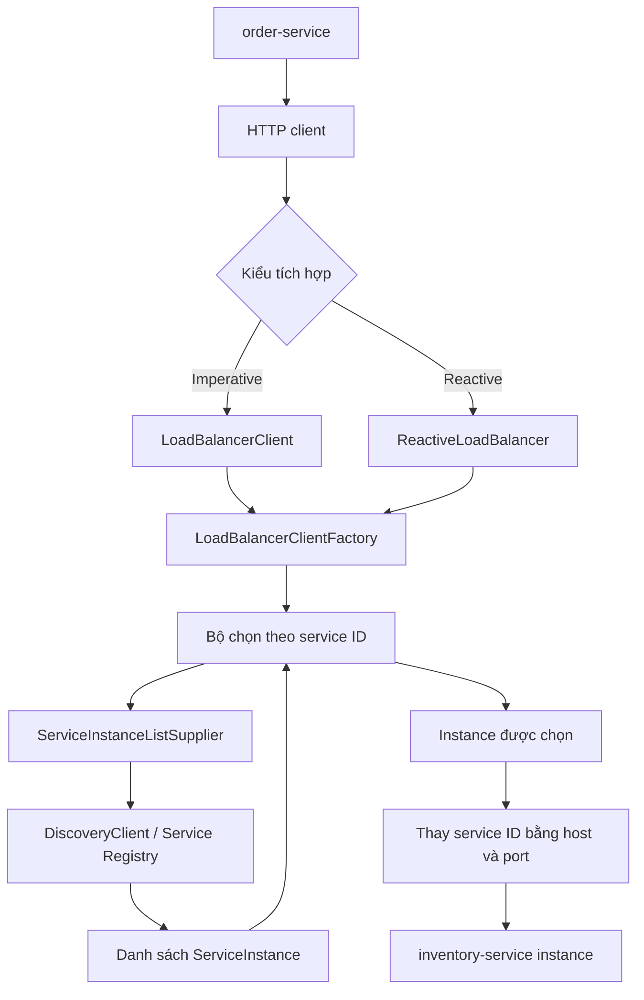

# LoadBalancerClient và ReactiveLoadBalancer: vai trò và khác biệt

Trong Spring Cloud LoadBalancer, `LoadBalancerClient` và `ReactiveLoadBalancer` cùng tham gia vào quá trình chọn một `ServiceInstance` cho request, nhưng chúng phục vụ hai kiểu tích hợp khác nhau. `LoadBalancerClient` cung cấp API imperative để ứng dụng hoặc HTTP client thực hiện thao tác chọn và gửi request theo kiểu đồng bộ. `ReactiveLoadBalancer` là hợp đồng chọn instance theo kiểu reactive, trả kết quả dưới dạng `Mono<Response<T>>` để quá trình lựa chọn có thể tiếp tục bất đồng bộ.

Hiểu đúng ranh giới này giúp bạn chọn đúng integration cho `RestClient`, `RestTemplate`, OpenFeign và `WebClient`, đồng thời tránh chặn event loop khi xử lý reactive. Cả hai đều thuộc kiến trúc cân bằng tải phía client của module `SPRING_CLOUD_SERVICE_COMMUNICATION_LOAD_BALANCING`: ứng dụng gọi dùng service ID, LoadBalancer tìm instance phù hợp, rồi HTTP client gửi request đến địa chỉ thực tế.

## Mục tiêu học tập

Sau bài này, bạn có thể:

- Mô tả trách nhiệm của `LoadBalancerClient`, `BlockingLoadBalancerClient` và `ReactiveLoadBalancer`.
- Giải thích mối quan hệ giữa API imperative và bộ chọn instance reactive bên dưới.
- Đọc luồng request qua `ServiceInstanceListSupplier`, discovery và bộ chọn instance.
- Phân biệt cách tích hợp LoadBalancer với `RestClient`/`RestTemplate`/OpenFeign và `WebClient`.
- Nhận diện trường hợp không có instance, lỗi kết nối và rủi ro khi gọi API blocking trong luồng reactive.
- Chọn API phù hợp và kiểm chứng instance thực tế nhận request.

## Hai abstraction giải quyết hai nhu cầu

| Thành phần | Vai trò chính | Kiểu xử lý | Kết quả tiêu biểu |
|---|---|---|---|
| `LoadBalancerClient` | API phía ứng dụng để chọn instance, thực thi request hoặc dựng lại URI theo instance | Imperative, blocking | `ServiceInstance` hoặc kết quả từ thao tác thực thi |
| `BlockingLoadBalancerClient` | Implementation blocking của `LoadBalancerClient` trong Spring Cloud LoadBalancer | Blocking | Chờ kết quả lựa chọn rồi trả về instance hoặc thực thi request |
| `ReactiveLoadBalancer<T>` | SPI định nghĩa cách chọn một phần tử từ danh sách ứng viên | Reactive | `Mono<Response<T>>` |
| `ReactorServiceInstanceLoadBalancer` | Abstraction chuyên biệt để chọn `ServiceInstance` trong hệ sinh thái Reactor | Reactive | `Mono<Response<ServiceInstance>>` |

`LoadBalancerClient` nằm ở lớp API mà code imperative có thể sử dụng. Nó có các thao tác quen thuộc như `choose`, `execute` và `reconstructURI`. Với Spring Cloud LoadBalancer, implementation phổ biến là `BlockingLoadBalancerClient`.

`ReactiveLoadBalancer<T>` định nghĩa hành vi chọn phần tử. Nó nhận một `Request` và trả về `Mono<Response<T>>`. Với cân bằng tải dịch vụ, kiểu `T` thường là `ServiceInstance`. Implementation có thể là round robin, random hoặc chiến lược tùy chỉnh. `RoundRobinLoadBalancer` và `RandomLoadBalancer` là những ví dụ thường gặp trong hệ sinh thái này.

Điểm quan trọng là `LoadBalancerClient` và `ReactiveLoadBalancer` không nhất thiết là hai bộ cân bằng tải độc lập. Implementation blocking có thể lấy bộ chọn reactive từ factory, gọi `choose`, chờ kết quả rồi cung cấp API đồng bộ cho caller. Nhờ vậy, phần lựa chọn instance và danh sách ứng viên có thể dùng chung cơ chế, trong khi mỗi loại HTTP client vẫn giữ cách xử lý phù hợp với mô hình lập trình của nó.

## Vị trí trong kiến trúc tổng thể

Giả sử `order-service` gọi `inventory-service`. Service ID là `inventory-service`; registry có thể trả về hai instance, ví dụ `10.0.1.21:8081` và `10.0.1.22:8081`.



Luồng khái quát gồm các bước:

1. Ứng dụng tạo request đến URI có host là service ID, chẳng hạn `http://inventory-service/api/inventory/SKU-42`.
2. Integration của HTTP client chuyển request đến thành phần LoadBalancer tương ứng.
3. LoadBalancer tìm cấu hình và bộ chọn gắn với service ID đó.
4. `ServiceInstanceListSupplier` cung cấp danh sách instance. Danh sách có thể được lấy từ discovery, cache hoặc supplier có lọc theo health, zone hay metadata.
5. Bộ chọn áp dụng chính sách, ví dụ round robin, rồi trả về một `ServiceInstance`.
6. Integration dựng URI đích bằng host, port và thông tin bảo mật của instance đã chọn.
7. HTTP client gửi request qua transport đang sử dụng.

Discovery chịu trách nhiệm tìm và cập nhật thông tin instance. Supplier cung cấp danh sách cho lần lựa chọn. Bộ chọn quyết định instance nào được dùng. HTTP client chịu trách nhiệm gửi request. Tách các trách nhiệm này giúp xác định lỗi nằm ở discovery, danh sách ứng viên, chính sách chọn hay kết nối mạng.

## LoadBalancerClient: API imperative

`LoadBalancerClient` là lựa chọn tự nhiên khi code gọi dịch vụ chạy theo kiểu đồng bộ. API của nó cung cấp ba nhóm thao tác:

- `choose(serviceId)` chọn một `ServiceInstance` cho service ID.
- `execute(serviceId, request)` chọn instance và thực thi callback gửi request.
- `reconstructURI(instance, originalUri)` tạo URI đích dựa trên host, port và thuộc tính của instance đã chọn.

Interface cũng hỗ trợ overload nhận request context hoặc instance đã được chọn. Những overload này hữu ích khi integration cần truyền thêm dữ liệu của request, hoặc khi caller muốn thực thi trên instance cụ thể.

### Chọn instance trực tiếp

Ví dụ sau minh họa cách sử dụng API để quan sát instance được chọn. Trong ứng dụng thực tế, nên để integration của HTTP client quản lý việc chọn và gửi request nếu không có lý do đặc biệt để điều khiển thủ công.

```java
@Service
class InventoryInstanceInspector {

    private final LoadBalancerClient loadBalancerClient;

    InventoryInstanceInspector(LoadBalancerClient loadBalancerClient) {
        this.loadBalancerClient = loadBalancerClient;
    }

    String describeSelectedInstance() {
        ServiceInstance instance =
                loadBalancerClient.choose("inventory-service");

        if (instance == null) {
            return "Không có inventory-service instance khả dụng";
        }

        return instance.getHost() + ":" + instance.getPort();
    }
}
```

Kết quả của `choose` phụ thuộc danh sách instance tại thời điểm gọi và chính sách chọn đang áp dụng. Nếu không có instance khả dụng, code phải xử lý trường hợp không nhận được instance thay vì tiếp tục dựng URI với một giá trị rỗng.

### Dựng URI theo instance

Khi cần tạo URI đích thủ công, dùng `reconstructURI` để áp dụng địa chỉ của instance:

```java
ServiceInstance instance = loadBalancerClient.choose("inventory-service");

if (instance == null) {
    throw new IllegalStateException("No inventory-service instance available");
}

URI logicalUri = URI.create(
        "http://inventory-service/api/inventory/SKU-42");

URI physicalUri = loadBalancerClient.reconstructURI(instance, logicalUri);
```

`logicalUri` chứa service ID để LoadBalancer nhận diện dịch vụ. `physicalUri` chứa thông tin mạng của instance đã chọn. Không lưu cố định `physicalUri` cho các request sau, vì instance có thể thay đổi khi discovery cập nhật, health check loại một instance hoặc chính sách định tuyến thay đổi.

### Execute và lifecycle

`execute` cho phép `LoadBalancerClient` điều phối cả việc chọn instance lẫn thao tác gửi request. Đây là nền tảng để các integration blocking thêm thông tin về instance được chọn và kết quả request vào lifecycle. Trong quá trình xử lý, các thành phần lifecycle có thể quan sát thời điểm bắt đầu, kết quả lựa chọn và kết quả hoàn tất, qua đó hỗ trợ metric hoặc instrumentation.

Khi ứng dụng chỉ cần gọi HTTP, hãy ưu tiên integration có sẵn như load-balanced `RestClient` hoặc OpenFeign. Gọi `choose` rồi tự gửi HTTP chỉ phù hợp khi bạn cần kiểm soát đặc biệt hoặc đang xây dựng một adapter riêng; nếu tự làm, bạn phải tự xử lý URI, lỗi không có instance, timeout, retry và quan sát request.

## ReactiveLoadBalancer: SPI chọn instance bất đồng bộ

`ReactiveLoadBalancer<T>` tập trung vào một thao tác: nhận `Request` và trả về `Mono<Response<T>>`.

```java
public interface ReactiveLoadBalancer<T> {
    Mono<Response<T>> choose(Request request);
}
```

Với service discovery, `T` thường là `ServiceInstance`. `Request` có thể mang context bổ sung cho quyết định chọn instance, ví dụ dữ liệu phục vụ hint hoặc thông tin gắn với request. `Response<T>` đóng gói kết quả lựa chọn; caller cần kiểm tra response có instance hay không trước khi sử dụng server được trả về.

### Lấy bộ chọn theo service ID

Trong cấu hình thực tế, factory cung cấp bộ chọn gắn với từng service ID. Ví dụ dưới đây tập trung vào bước lựa chọn để thể hiện kiểu trả về reactive:

```java
@Service
class ReactiveInventoryInstanceInspector {

    private final ReactiveLoadBalancer.Factory<ServiceInstance> factory;

    ReactiveInventoryInstanceInspector(
            ReactiveLoadBalancer.Factory<ServiceInstance> factory) {
        this.factory = factory;
    }

    Mono<String> describeSelectedInstance() {
        ReactiveLoadBalancer<ServiceInstance> loadBalancer =
                factory.getInstance("inventory-service");

        if (loadBalancer == null) {
            return Mono.error(new IllegalStateException(
                    "No LoadBalancer configured for inventory-service"));
        }

        return loadBalancer.choose(new DefaultRequest<>())
                .flatMap(response -> {
                    if (!response.hasServer()) {
                        return Mono.error(new IllegalStateException(
                                "No inventory-service instance available"));
                    }

                    ServiceInstance instance = response.getServer();
                    return Mono.just(
                            instance.getHost() + ":" + instance.getPort());
                });
    }
}
```

Đoạn code minh họa việc lấy bộ chọn cho một service ID và xử lý `Response` trong pipeline reactive. Trong ứng dụng thông thường, không cần tự gọi factory chỉ để gửi HTTP; `WebClient` có filter tích hợp LoadBalancer để thực hiện bước này.

### Vì sao kết quả là Mono?

Lựa chọn instance có thể cần lấy danh sách từ supplier, chờ dữ liệu cache hoặc áp dụng các bước xử lý reactive. `Mono<Response<T>>` cho phép các bước đó tham gia cùng pipeline mà không buộc caller phải chặn thread để đợi kết quả.

`ReactiveLoadBalancer` cũng giúp triển khai chiến lược lựa chọn độc lập với transport HTTP. Bộ chọn chỉ quyết định instance. Việc gửi request, giải mã response và xử lý lỗi HTTP vẫn do `WebClient` hoặc thành phần gọi đảm nhiệm.

## Hai luồng tích hợp điển hình

### RestClient và OpenFeign: đường đi imperative

Với `RestClient`, builder được đánh dấu `@LoadBalanced` để request có host là service ID đi qua integration blocking. OpenFeign cũng có integration blocking để chọn instance trước khi gửi request.

```java
@Configuration
class InventoryClientConfiguration {

    @Bean
    @LoadBalanced
    RestClient.Builder inventoryRestClientBuilder() {
        return RestClient.builder();
    }
}
```

```java
@Service
class InventoryGateway {

    private final RestClient restClient;

    InventoryGateway(@LoadBalanced RestClient.Builder builder) {
        this.restClient = builder.build();
    }

    InventoryDto find(String sku) {
        return restClient.get()
                .uri("http://inventory-service/api/inventory/{sku}", sku)
                .retrieve()
                .body(InventoryDto.class);
    }
}
```

Ở đây, code gọi theo kiểu đồng bộ: phương thức `find` trả về DTO sau khi request hoàn tất. Integration blocking dùng `LoadBalancerClient` để chọn instance và điều chỉnh request trước khi HTTP transport gửi đi.

### WebClient: đường đi reactive

Với `WebClient`, builder được đánh dấu `@LoadBalanced` để cài filter xử lý service ID bằng reactive LoadBalancer:

```java
@Configuration
class ReactiveInventoryClientConfiguration {

    @Bean
    @LoadBalanced
    WebClient.Builder inventoryWebClientBuilder() {
        return WebClient.builder();
    }
}
```

```java
@Service
class ReactiveInventoryGateway {

    private final WebClient webClient;

    ReactiveInventoryGateway(@LoadBalanced WebClient.Builder builder) {
        this.webClient = builder
                .baseUrl("http://inventory-service")
                .build();
    }

    Mono<InventoryDto> find(String sku) {
        return webClient.get()
                .uri("/api/inventory/{sku}", sku)
                .retrieve()
                .bodyToMono(InventoryDto.class);
    }
}
```

Trong pipeline này, filter reactive phân giải service ID, yêu cầu bộ chọn reactive chọn instance, rồi chuyển request đến địa chỉ của instance. Phương thức trả về `Mono<InventoryDto>`, vì vậy caller có thể tiếp tục kết hợp với các thao tác reactive khác.

### Bảng đối chiếu đường đi

| Khía cạnh | RestClient / OpenFeign | WebClient |
|---|---|---|
| Mô hình gọi | Imperative, thường blocking | Reactive, bất đồng bộ |
| Abstraction tích hợp | `LoadBalancerClient` | `ReactiveLoadBalancer` |
| Implementation tiêu biểu | `BlockingLoadBalancerClient` | Reactive LoadBalancer filter và factory |
| Kết quả chọn | Được chờ để có instance trước khi gửi request | `Mono<Response<ServiceInstance>>` trong pipeline |
| Cách trả kết quả ứng dụng | DTO hoặc kết quả đồng bộ | `Mono<T>` / `Flux<T>` |
| Lưu ý chính | Thread gọi có thể bị giữ trong lúc I/O | Tránh chặn event loop bằng thao tác blocking |

`RestTemplate` cũng thuộc nhóm imperative và sử dụng integration blocking. OpenFeign thường được dùng theo kiểu interface đồng bộ; nếu hệ thống có cấu hình đặc biệt hoặc phiên bản thư viện khác, hãy xác minh integration tương ứng trong dependency đang dùng.

## Factory, cấu hình theo service và chiến lược lựa chọn

Spring Cloud LoadBalancer hỗ trợ cấu hình riêng cho từng service ID. `LoadBalancerClientFactory` quản lý các context cấu hình của LoadBalancer theo service. Nhờ đó, `inventory-service` có thể dùng round robin trong khi một dịch vụ khác có thể dùng chính sách hoặc supplier riêng.

Trong mỗi context, các thành phần chính thường gồm:

- `ServiceInstanceListSupplier`: cung cấp danh sách instance cho service ID.
- `ReactorServiceInstanceLoadBalancer`: thực hiện quyết định chọn `ServiceInstance` theo request.
- Cấu hình LoadBalancer theo service: xác định supplier, bộ chọn và các thành phần liên quan.
- Lifecycle và instrumentation: quan sát quá trình chọn cũng như kết quả request nếu integration hỗ trợ.

Ví dụ, supplier có thể lấy danh sách từ `DiscoveryClient`, bọc cache hoặc lọc instance theo zone. Bộ chọn round robin sau đó chọn một phần tử từ danh sách đã nhận. Khi muốn thay đổi hành vi, hãy xác định rõ bạn cần thay danh sách ứng viên hay thay quy tắc lựa chọn; hai thay đổi này nằm ở hai trách nhiệm khác nhau.

Không tạo một cấu hình mặc định dùng chung rồi kỳ vọng nó chỉ tác động đến một dịch vụ. Khi cần tùy biến theo service ID, dùng cơ chế cấu hình LoadBalancer theo service của phiên bản Spring Cloud đang sử dụng và kiểm tra context được gắn đúng tên dịch vụ. Cũng cần chú ý phạm vi component scan để cấu hình riêng không vô tình trở thành cấu hình toàn cục.

## Xử lý trường hợp không có instance và lỗi request

Không có instance khả dụng là một kết quả hợp lệ mà ứng dụng phải dự kiến. Tùy integration và thời điểm lỗi, bạn có thể gặp response không có server, lỗi không tìm thấy instance, lỗi kết nối hoặc lỗi HTTP. Các trường hợp này cần được phân loại riêng:

| Tình huống | Lớp liên quan | Cách kiểm tra |
|---|---|---|
| Registry không có instance | Discovery | Xác minh service ID và trạng thái đăng ký |
| Supplier trả danh sách rỗng | `ServiceInstanceListSupplier` | Kiểm tra cache, filter, health check và thời điểm refresh |
| Bộ chọn không tìm được server | `ReactiveLoadBalancer` / `LoadBalancerClient` | Kiểm tra response hoặc kết quả `choose` trước khi dùng instance |
| Có instance nhưng không kết nối được | HTTP transport / mạng | Kiểm tra host, port, firewall, connect timeout và trạng thái tiến trình |
| Instance trả lỗi HTTP | Dịch vụ đích | Kiểm tra status code, response body và chính sách retry |
| Request quá thời gian | HTTP client / timeout tầng trên | Đối chiếu connect timeout, response timeout và ngân sách request tổng thể |

Với reactive API, xử lý response không có server ngay trong pipeline bằng `switchIfEmpty`, `flatMap` hoặc cách xử lý lỗi phù hợp với kiểu response của phiên bản đang dùng. Với blocking API, kiểm tra kết quả `choose` và xử lý exception phát sinh từ `execute`. Đừng giả định rằng đã có service ID thì chắc chắn có instance.

Retry phải được cấu hình có giới hạn và phù hợp với loại thao tác. Một request đọc tồn kho thường dễ retry hơn thao tác ghi có side effect. Nếu retry thao tác ghi, cần tính đến idempotency key hoặc cơ chế chống xử lý trùng. Đồng thời đặt timeout cho từng lần thử và toàn bộ request để retry không làm thời gian xử lý vượt ngân sách.

## Tránh chặn event loop

Một lỗi thiết kế phổ biến là gọi API blocking từ pipeline `WebClient`, ví dụ:

```java
// Không nên: block() chặn thread đang chạy pipeline reactive.
Mono<InventoryDto> result = reactiveGateway.find("SKU-42");
InventoryDto inventory = result.block();
```

Trong ứng dụng reactive, hãy trả tiếp `Mono` hoặc `Flux`, rồi kết hợp bằng các toán tử reactive. Không gọi `LoadBalancerClient.choose` hay `execute` bên trong một callback đang chạy trên event loop chỉ vì cần lấy instance. Việc block có thể làm giảm khả năng xử lý đồng thời, gây nghẽn thread và làm tăng độ trễ cho các request khác.

Nếu một thành phần cũ chỉ có API blocking, hãy đặt ranh giới chuyển đổi có chủ đích trên scheduler phù hợp và giới hạn tài nguyên blocking. Không dùng cách này để thay thế toàn bộ đường gọi reactive nếu đã có integration `WebClient` hỗ trợ reactive LoadBalancer.

Ngược lại, trong luồng imperative, dùng `RestClient` hoặc OpenFeign là hợp lý khi mô hình ứng dụng vốn đồng bộ. Không cần chuyển toàn bộ ứng dụng sang reactive chỉ để sử dụng Spring Cloud LoadBalancer; hãy chọn abstraction theo mô hình xử lý của ứng dụng và transport.

## Bài thực hành: so sánh hai abstraction

Thực hiện trên topology gồm `order-service` và hai instance `inventory-service`.

1. Đăng ký hai instance tồn kho dưới cùng service ID `inventory-service`. Mỗi instance trả về mã nhận diện riêng.
2. Trong `order-service`, tạo một bean `LoadBalancerClient` và gọi `choose("inventory-service")` nhiều lần. Ghi lại host, port và mã instance.
3. Dùng `RestClient` có `@LoadBalanced` gọi endpoint tồn kho bằng service ID. So sánh log instance với kết quả bước 2.
4. Tạo một `ReactiveLoadBalancer.Factory<ServiceInstance>` và lấy bộ chọn cho `inventory-service`. Gọi `choose` trong pipeline, xử lý cả trường hợp response không có server.
5. Dùng `WebClient` có `@LoadBalanced` gọi cùng endpoint. Giữ kiểu trả về `Mono` và không gọi `block()` trong đường xử lý.
6. Dừng một instance. Theo dõi thay đổi từ discovery, supplier và kết quả chọn của hai đường gọi sau khi dữ liệu được cập nhật.
7. Dừng cả hai instance. Xác minh blocking và reactive path đều xử lý rõ trường hợp không có server.
8. Khởi động lại instance, xác minh request phục hồi và đối chiếu log, metric hoặc trace.

Ghi lại thời điểm dừng instance, thời điểm registry cập nhật, thời điểm supplier ngừng cung cấp instance và kết quả request. Các mốc này có thể khác nhau do cache và chu kỳ health check; chênh lệch không tự động có nghĩa là bộ chọn hoạt động sai.

## Tiêu chí tự đánh giá

| Tiêu chí | Đạt khi |
|---|---|
| Phân biệt abstraction | Giải thích được `LoadBalancerClient` là API imperative và `ReactiveLoadBalancer` là SPI chọn instance reactive |
| Hiểu quan hệ triển khai | Nêu được blocking implementation có thể ủy quyền cho reactive chooser rồi chờ kết quả |
| Hiểu request flow | Truy vết được service ID → supplier → danh sách instance → bộ chọn → URI đích → HTTP transport |
| Tích hợp blocking | `RestClient` hoặc OpenFeign gọi được qua service ID và log được instance nhận request |
| Tích hợp reactive | `WebClient` chọn instance trong pipeline và không chặn event loop |
| Xử lý lỗi | Phân biệt không có instance, lỗi kết nối, lỗi HTTP và timeout |
| Cấu hình theo service | Xác định được nơi thay supplier hoặc chiến lược cho đúng service ID |

## Lỗi thường gặp

- **Dùng nhầm API theo mô hình xử lý:** gọi API blocking trong pipeline reactive làm chặn thread; hãy dùng reactive integration của `WebClient`.
- **Cho rằng `ReactiveLoadBalancer` tự gửi HTTP:** nó chỉ quyết định phần tử được chọn; transport vẫn thuộc HTTP client.
- **Cho rằng `LoadBalancerClient` là registry:** nó điều phối lựa chọn và thực thi request; dữ liệu instance đến từ supplier và discovery.
- **Bỏ qua response rỗng:** luôn kiểm tra trường hợp không có server trước khi truy cập `ServiceInstance`.
- **Lưu URI vật lý lâu dài:** host và port có thể thay đổi theo discovery, health check và cấu hình; hãy phân giải lại cho request mới.
- **Tùy biến sai tầng:** nếu muốn lọc ứng viên, xem supplier; nếu muốn đổi cách chọn, xem implementation của load balancer.
- **Không xác minh integration:** có dependency LoadBalancer chưa đủ; builder hoặc client phải được cấu hình để đi qua integration tương ứng.

## Kết luận

`LoadBalancerClient` cung cấp bề mặt imperative để ứng dụng đồng bộ chọn instance, thực thi request và dựng lại URI. `ReactiveLoadBalancer` cung cấp hợp đồng reactive để chọn instance mà không buộc pipeline phải chờ bằng thao tác blocking. Spring Cloud LoadBalancer kết nối hai abstraction với supplier, discovery và các chiến lược chọn theo service ID. Khi chọn đúng đường tích hợp cho `RestClient`, OpenFeign hoặc `WebClient`, bạn có thể giữ request flow rõ ràng, xử lý lỗi có chủ đích và quan sát được instance thực sự phục vụ request.
