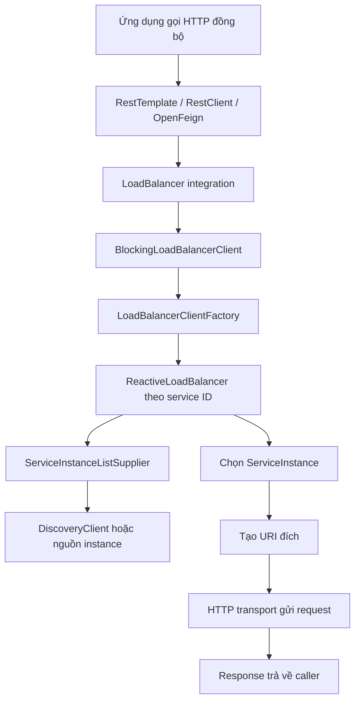
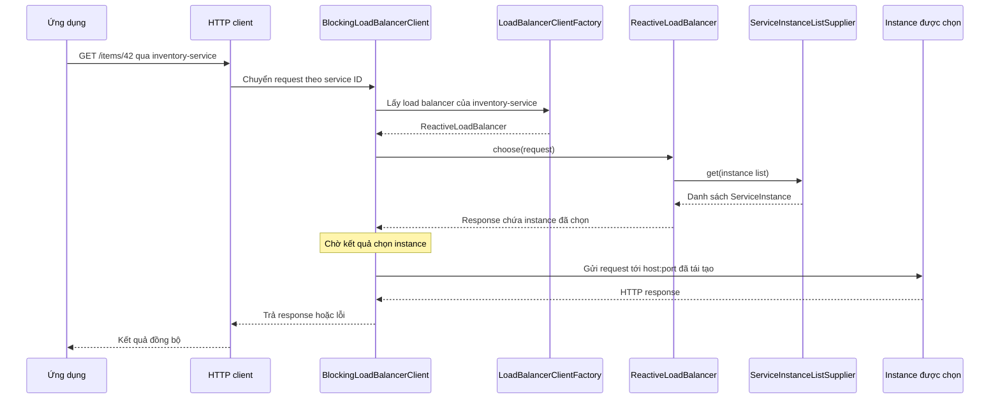

# BlockingLoadBalancerClient trong lời gọi chặn luồng

Trong một lời gọi HTTP đồng bộ, thread gọi hàm sẽ chờ cho tới khi nhận response hoặc gặp lỗi. Spring Cloud LoadBalancer hỗ trợ kiểu gọi này thông qua `BlockingLoadBalancerClient`, một implementation của abstraction `LoadBalancerClient` trong Spring Cloud Commons. Thành phần này tìm một `ServiceInstance` cho service ID, chuyển URL logic thành URL của instance được chọn và thực thi phần request do HTTP client cung cấp.

Điểm cần hiểu là `BlockingLoadBalancerClient` điều phối việc chọn instance và thực thi request trong luồng chặn. Nó không tự mở socket hay thay thế HTTP transport. `RestTemplate`, `RestClient` hoặc client tích hợp như OpenFeign vẫn chịu trách nhiệm gửi HTTP request và đọc response. Nhờ vậy ứng dụng có thể gọi `http://inventory-service` trong code trong khi request thực tế được gửi tới một địa chỉ cụ thể như `http://10.20.1.12:8080`.

## 1. BlockingLoadBalancerClient nằm ở đâu trong kiến trúc?

Trong Spring Cloud LoadBalancer có một số vai trò riêng:

| Thành phần | Trách nhiệm |
|---|---|
| `LoadBalancerClient` | Abstraction cho client chọn instance, thực thi request theo service ID và tái tạo URI cho instance. |
| `BlockingLoadBalancerClient` | Implementation đồng bộ của `LoadBalancerClient`; cung cấp API chặn luồng cho các tích hợp imperative. |
| `ReactiveLoadBalancer` | Abstraction chọn `ServiceInstance` theo request; có thể dùng các chiến lược như round robin. |
| `ServiceInstanceListSupplier` | Cung cấp danh sách instance cho một service ID, có thể kết hợp discovery, cache hoặc health check. |
| `DiscoveryClient` | Lấy thông tin service instance từ một nguồn discovery như registry hoặc cấu hình tĩnh. |
| HTTP client / transport | Gửi request tới host và port thực tế, xử lý kết nối, TLS, timeout và response. |

`BlockingLoadBalancerClient` là cầu nối giữa API đồng bộ và cơ chế chọn instance của Spring Cloud LoadBalancer. Bên dưới, nó sử dụng `LoadBalancerClientFactory` để lấy thành phần load balancing dành cho service ID và gọi `ReactiveLoadBalancer` để chọn instance. Kết quả chọn được chờ đồng bộ trước khi request tiếp tục.



Sơ đồ mô tả các vai trò chính. Cấu hình thực tế có thể bổ sung cache, health check, retry, lifecycle hook và các thành phần quan sát request.

## 2. Luồng xử lý của một lời gọi chặn luồng

Giả sử client gọi URL logic:

```text
http://inventory-service/api/v1/items/42
```

Service ID là `inventory-service`. Discovery cung cấp hai instance:

| Instance | Host | Port |
|---|---|---:|
| `inventory-1` | `10.20.1.11` | 8080 |
| `inventory-2` | `10.20.1.12` | 8080 |

Một lời gọi đồng bộ đi qua các bước khái quát sau:

1. HTTP client nhận URL chứa service ID thay cho hostname có thể phân giải trực tiếp bằng DNS.
2. LoadBalancer integration trích xuất service ID từ host của URL và chuyển request tới `BlockingLoadBalancerClient`.
3. `BlockingLoadBalancerClient` lấy `ReactiveLoadBalancer` phù hợp với service ID từ `LoadBalancerClientFactory`.
4. Load balancer yêu cầu `ServiceInstanceListSupplier` cung cấp danh sách instance. Supplier có thể lấy dữ liệu từ discovery client hoặc nguồn khác.
5. `ReactiveLoadBalancer` áp dụng chiến lược chọn instance. Với cấu hình mặc định thường gặp, `RoundRobinLoadBalancer` chọn luân phiên qua các instance đủ điều kiện.
6. `BlockingLoadBalancerClient` chờ kết quả lựa chọn. Sau khi có `ServiceInstance`, URI logic được tái tạo thành URI chứa host, port và scheme của instance.
7. HTTP transport gửi request tới URI đã tái tạo, chờ response và trả kết quả về caller.
8. Kết quả hoàn tất được chuyển qua các lifecycle hook nếu ứng dụng đã cấu hình `LoadBalancerLifecycle`.



`BlockingLoadBalancerClient` có thể dùng `Mono.block()` để đợi kết quả từ `ReactiveLoadBalancer`. Đây là điểm chuyển từ API reactive của cơ chế chọn instance sang API imperative của caller. Sau khi chọn được instance, HTTP client tiếp tục thực hiện I/O theo mô hình chặn của chính nó.

Trong sequence diagram, mũi tên từ `BlockingLoadBalancerClient` tới instance biểu diễn callback request được thực thi với instance đã chọn. HTTP transport nằm trong callback đó và mới là thành phần thực hiện kết nối mạng.

## 3. Hai thao tác chính: chọn instance và thực thi request

`LoadBalancerClient` cung cấp các thao tác quan trọng:

- `choose(serviceId)` chọn một instance cho service ID.
- `execute(serviceId, request)` chọn instance rồi thực thi callback request với instance đó.
- `reconstructURI(instance, originalUri)` tạo URI đích từ URI logic và thông tin instance.

Trong code ứng dụng, thông thường nên dùng HTTP client đã tích hợp `@LoadBalanced` để framework tự gọi các thao tác này. API trực tiếp hữu ích khi cần hiểu cơ chế hoặc xây dựng một adapter riêng.

Ví dụ minh họa việc chọn instance và dựng URI:

```java
import java.net.URI;

import org.springframework.cloud.client.ServiceInstance;
import org.springframework.cloud.client.loadbalancer.LoadBalancerClient;
import org.springframework.stereotype.Component;
import org.springframework.web.util.UriComponentsBuilder;

@Component
class InstanceInspector {

    private final LoadBalancerClient loadBalancerClient;

    InstanceInspector(LoadBalancerClient loadBalancerClient) {
        this.loadBalancerClient = loadBalancerClient;
    }

    URI chooseTarget(String itemId) {
        ServiceInstance instance =
                loadBalancerClient.choose("inventory-service");

        if (instance == null) {
            throw new IllegalStateException(
                    "No instance available for inventory-service");
        }

        URI logicalUri = UriComponentsBuilder
                .fromUriString("http://inventory-service/api/v1/items/{id}")
                .buildAndExpand(itemId)
                .toUri();

        return loadBalancerClient.reconstructURI(instance, logicalUri);
    }
}
```

Ví dụ này chỉ minh họa kết quả chọn instance và tái tạo URI. Trong ứng dụng thực tế, không nên gọi `choose()` ở một chỗ rồi thực hiện request độc lập ở một thời điểm khác nếu cần bảo đảm request được gắn với đúng instance vừa chọn. Hãy dùng `execute()` hoặc tích hợp HTTP client để lựa chọn và thực thi nằm trong cùng một luồng xử lý.

Khi dùng `execute`, callback nhận `ServiceInstance` đã chọn và thực hiện phần request trên instance đó. `BlockingLoadBalancerClient` điều phối callback và lifecycle; callback hoặc HTTP transport mới thực sự gửi request.

## 4. Tích hợp với RestTemplate

`RestTemplate` là ví dụ imperative quen thuộc. Đánh dấu bean bằng `@LoadBalanced` để Spring Cloud cấu hình interceptor chuyển URL chứa service ID qua LoadBalancer:

```java
import org.springframework.boot.web.client.RestTemplateBuilder;
import org.springframework.cloud.client.loadbalancer.LoadBalanced;
import org.springframework.context.annotation.Bean;
import org.springframework.context.annotation.Configuration;
import org.springframework.web.client.RestTemplate;

@Configuration
class HttpClientConfiguration {

    @Bean
    @LoadBalanced
    RestTemplate inventoryRestTemplate(RestTemplateBuilder builder) {
        return builder.build();
    }
}
```

Sử dụng bean đó trong gateway:

```java
import org.springframework.stereotype.Service;
import org.springframework.web.client.RestTemplate;

@Service
class InventoryGateway {

    private final RestTemplate restTemplate;

    InventoryGateway(RestTemplate inventoryRestTemplate) {
        this.restTemplate = inventoryRestTemplate;
    }

    String getItem(String itemId) {
        return restTemplate.getForObject(
                "http://inventory-service/api/v1/items/{id}",
                String.class,
                itemId);
    }
}
```

Interceptor của LoadBalancer đọc host `inventory-service`, yêu cầu chọn instance, tái tạo URI rồi tiếp tục chuỗi interceptor và request factory của `RestTemplate`. Nếu dùng một `RestTemplate` thường không được đánh dấu `@LoadBalanced`, host này được xử lý như hostname thông thường và có thể gây lỗi phân giải DNS.

Không tạo `RestTemplate` bằng `new RestTemplate()` rồi giả định nó đã có LoadBalancer interceptor. Hãy dùng bean được cấu hình trong Spring context và kiểm tra bean nào thực sự được inject vào gateway.

## 5. Tích hợp với RestClient và OpenFeign

`RestClient` là HTTP client imperative được giới thiệu trong Spring Framework 6.1. Ở các phiên bản Spring Cloud hỗ trợ tích hợp này, có thể đăng ký builder được đánh dấu `@LoadBalanced`:

```java
import org.springframework.cloud.client.loadbalancer.LoadBalanced;
import org.springframework.context.annotation.Bean;
import org.springframework.context.annotation.Configuration;
import org.springframework.web.client.RestClient;

@Configuration
class RestClientConfiguration {

    @Bean
    @LoadBalanced
    RestClient.Builder loadBalancedRestClientBuilder() {
        return RestClient.builder();
    }
}
```

Gateway tạo client từ builder được inject:

```java
import org.springframework.stereotype.Service;
import org.springframework.web.client.RestClient;

@Service
class InventoryRestClient {

    private final RestClient restClient;

    InventoryRestClient(RestClient.Builder loadBalancedRestClientBuilder) {
        this.restClient = loadBalancedRestClientBuilder
                .baseUrl("http://inventory-service")
                .build();
    }

    String getItem(String itemId) {
        return restClient.get()
                .uri("/api/v1/items/{id}", itemId)
                .retrieve()
                .body(String.class);
    }
}
```

Đây vẫn là lời gọi đồng bộ: phương thức `retrieve().body(...)` trả kết quả sau khi response được nhận và chuyển đổi. Chi tiết tích hợp nội bộ có thể thay đổi theo phiên bản Spring Cloud; cần dùng phiên bản Spring Cloud tương thích với Spring Boot và Spring Framework của dự án.

Với OpenFeign, khai báo tên dịch vụ trong `@FeignClient`:

```java
import org.springframework.cloud.openfeign.FeignClient;
import org.springframework.web.bind.annotation.GetMapping;
import org.springframework.web.bind.annotation.PathVariable;

@FeignClient(name = "inventory-service")
interface InventoryFeignClient {

    @GetMapping("/api/v1/items/{id}")
    String getItem(@PathVariable("id") String itemId);
}
```

Khi Spring Cloud OpenFeign được cấu hình cùng Spring Cloud LoadBalancer, Feign dùng blocking load-balancing client để định tuyến lời gọi theo service ID. Ứng dụng cần dependency LoadBalancer tương ứng trên classpath và cấu hình discovery cung cấp instance. Nếu thiếu tích hợp load balancing, chỉ khai báo `name` không đảm bảo có thể tìm được địa chỉ instance.

## 6. BlockingLoadBalancerClient và WebClient reactive

`WebClient` được thiết kế theo mô hình reactive. Tích hợp LoadBalancer điển hình của nó dùng `ReactorLoadBalancerExchangeFilterFunction` hoặc filter function tương ứng, không dùng `BlockingLoadBalancerClient` làm đường xử lý chính.

```java
import org.springframework.cloud.client.loadbalancer.LoadBalanced;
import org.springframework.context.annotation.Bean;
import org.springframework.context.annotation.Configuration;
import org.springframework.web.reactive.function.client.WebClient;

@Configuration
class WebClientConfiguration {

    @Bean
    @LoadBalanced
    WebClient.Builder loadBalancedWebClientBuilder() {
        return WebClient.builder();
    }
}
```

Ví dụ gọi reactive:

```java
Mono<String> response = webClient.get()
        .uri("http://inventory-service/api/v1/items/{id}", itemId)
        .retrieve()
        .bodyToMono(String.class);
```

Đối tượng `Mono` mô tả kết quả sẽ có trong tương lai; lời gọi chưa cần chặn thread để chờ response. Nếu gọi `.block()` ở phía trên, thread của caller sẽ chờ kết quả, nhưng bản thân filter function và cơ chế LoadBalancer của WebClient vẫn thuộc tích hợp reactive. Việc thêm `.block()` không biến WebClient thành một client sử dụng `BlockingLoadBalancerClient`.

| Client | Mô hình gọi | Tích hợp LoadBalancer thường dùng |
|---|---|---|
| `RestTemplate` | Imperative, blocking | `LoadBalancerInterceptor` và `BlockingLoadBalancerClient` |
| `RestClient` | Imperative, blocking | Tích hợp blocking cho `RestClient` trong phiên bản Spring Cloud hỗ trợ |
| OpenFeign | Imperative, blocking | Feign blocking load-balancing client, phối hợp với `LoadBalancerClient` |
| `WebClient` | Reactive, non-blocking | `ReactorLoadBalancerExchangeFilterFunction` |

Phân biệt này quan trọng khi thiết kế ứng dụng. Trong WebFlux, không nên gọi API blocking hoặc dùng `.block()` trên event-loop thread vì có thể làm nghẽn các request khác. Nếu cần gọi một thư viện blocking, hãy chuyển tác vụ sang scheduler phù hợp hoặc dùng client reactive xuyên suốt.

## 7. Điều gì xảy ra khi không có instance hoặc request thất bại?

Việc chọn instance và việc gửi HTTP request là hai giai đoạn khác nhau. Mỗi giai đoạn có kiểu lỗi riêng:

| Dấu hiệu | Giai đoạn | Ý nghĩa và hướng kiểm tra |
|---|---|---|
| Không có instance phù hợp | Discovery / lựa chọn | `ServiceInstanceListSupplier` không cung cấp instance có thể chọn; kiểm tra service ID, đăng ký instance và bộ lọc health. |
| `UnknownHostException` | DNS / kết nối | Host vẫn đang được xử lý như hostname DNS, có thể client chưa đi qua LoadBalancer integration hoặc instance trả về dùng hostname không phân giải được. |
| `Connection refused` | Kết nối TCP | Đã có host và port nhưng không có tiến trình nhận kết nối; kiểm tra trạng thái instance và port. |
| Connect hoặc read timeout | Kết nối / chờ response | Đích chậm, không thể truy cập hoặc không phản hồi trong giới hạn thời gian; kiểm tra network và timeout của HTTP client. |
| HTTP `4xx` hoặc `5xx` | Xử lý HTTP | Một HTTP server, gateway hoặc proxy đã trả response; kiểm tra status, body và log phía server. |

Nếu không có instance, request không thể được gửi tới dịch vụ đích. Tùy phiên bản và tích hợp client, tình huống này được biểu diễn bằng kết quả chọn rỗng hoặc exception ở lớp tích hợp. Không nên phụ thuộc vào một thông điệp exception cụ thể để nhận diện mọi client; hãy log service ID, request URI logic và kết quả chọn instance.

`BlockingLoadBalancerClient` không tự bảo đảm instance còn sống chỉ vì instance có trong danh sách. Nếu cần loại instance không khỏe mạnh, cấu hình supplier có health check hoặc tích hợp discovery có trạng thái health phù hợp. Nếu instance dừng sau khi được chọn, HTTP transport vẫn có thể gặp lỗi kết nối.

## 8. Timeout, retry và vòng đời request

Với lời gọi blocking, thread gọi sẽ chờ trong thời gian lựa chọn instance và thời gian HTTP transport thực hiện request. Cần tách các loại giới hạn thời gian:

- **Timeout kết nối:** giới hạn thời gian mở kết nối tới host và port của instance.
- **Timeout đọc response:** giới hạn thời gian chờ dữ liệu response sau khi kết nối.
- **Timeout tổng thể:** giới hạn tổng thời gian cho một thao tác nếu HTTP client hoặc tầng ứng dụng hỗ trợ.
- **Timeout của tầng gọi:** giới hạn thời gian mà controller, worker hoặc service phía trên chờ gateway hoàn thành.

Các timeout kết nối và đọc thường được cấu hình trên request factory hoặc HTTP client transport được dùng bởi `RestTemplate`/`RestClient`, hoặc qua options tương ứng của OpenFeign. `BlockingLoadBalancerClient` đảm nhiệm lựa chọn và điều phối request; không nên giả định thay đổi timeout của LoadBalancer sẽ tự cấu hình timeout mạng.

Retry là chính sách riêng. Có thể cần thử instance khác khi lỗi kết nối, nhưng retry phải được giới hạn về số lần, tổng thời gian và loại lỗi được phép thử lại. Chỉ retry thao tác có tính idempotent hoặc có cơ chế chống xử lý lặp; một request ghi dữ liệu có thể đã được server xử lý dù client mất response. Kết hợp retry với timeout quá dài có thể giữ thread chờ lâu và khuếch đại tải khi hệ thống đang suy giảm.

Spring Cloud LoadBalancer cung cấp các extension point cho retry và lifecycle. Tùy tích hợp, retry có thể nằm trong interceptor/client, retry-aware load balancer hoặc cấu hình riêng của OpenFeign. Cần kiểm tra cấu hình của client đang dùng để biết retry thực sự diễn ra ở lớp nào và có chọn lại instance hay không.

## 9. Quan sát lời gọi để xác định lỗi

Khi điều tra một request, nên ghi nhận các dữ liệu đủ để nối các bước xử lý với nhau:

- Service ID logic, ví dụ `inventory-service`.
- URI logic và URI instance sau khi tái tạo, có thể che query hoặc dữ liệu nhạy cảm.
- Instance host và port đã chọn.
- Thời gian chọn instance, thời gian kết nối và thời gian nhận response nếu có thể đo riêng.
- Kết quả HTTP hoặc exception, cùng correlation ID / trace ID.
- Số lần retry và instance được chọn ở từng lần thử.

Spring Cloud LoadBalancer có `LoadBalancerLifecycle` để tích hợp hành vi ở các giai đoạn bắt đầu chọn, bắt đầu request và hoàn tất request. Có thể dùng lifecycle hook hoặc instrumentation phù hợp để ghi nhận thông tin mà không rải log thủ công ở mọi gateway. Tránh ghi token, cookie, thông tin xác thực hoặc nội dung request nhạy cảm.

Một quy trình chẩn đoán thực tế:

1. Xác nhận request có đi qua bean HTTP client được đánh dấu `@LoadBalanced` hay không.
2. Kiểm tra service ID có đúng và discovery có trả về instance không.
3. Ghi nhận host, port của instance được chọn.
4. Nếu chưa kết nối được, kiểm tra DNS (khi host là hostname), route mạng, port và TLS.
5. Nếu đã nhận HTTP response, kiểm tra status, response body và log của server hoặc gateway.
6. Đối chiếu timeout, retry và trace để xác định thời gian bị tiêu tốn ở giai đoạn nào.

## 10. Những điểm cần nhớ khi dùng lời gọi blocking

1. `BlockingLoadBalancerClient` triển khai abstraction `LoadBalancerClient` cho các tích hợp imperative.
2. Thành phần này lấy load balancer theo service ID, chờ `ReactiveLoadBalancer` chọn instance rồi điều phối việc thực thi request.
3. Nó không thay thế HTTP transport; `RestTemplate`, `RestClient` hoặc Feign vẫn gửi request và nhận response.
4. `@LoadBalanced` cần được đặt trên đúng bean hoặc builder mà gateway thực sự sử dụng.
5. `WebClient` có đường tích hợp reactive riêng; gọi `.block()` không làm thay đổi loại tích hợp bên dưới.
6. Timeout mạng được cấu hình ở HTTP transport; retry, health check và observability cần được thiết kế phù hợp với từng client.
7. Tránh thực hiện lời gọi blocking trên event-loop thread của ứng dụng reactive.

Khi hiểu vai trò của `BlockingLoadBalancerClient`, ta có thể lần theo một request từ URL chứa service ID đến instance cụ thể, xác định lớp nào chọn instance và lớp nào thực hiện I/O. Đây là cơ sở để cấu hình đúng HTTP client, xử lý timeout và retry có kiểm soát, đồng thời quan sát lỗi trong giao tiếp giữa các dịch vụ.
