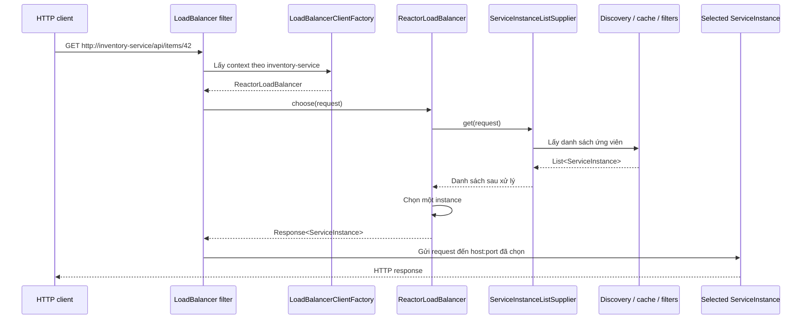
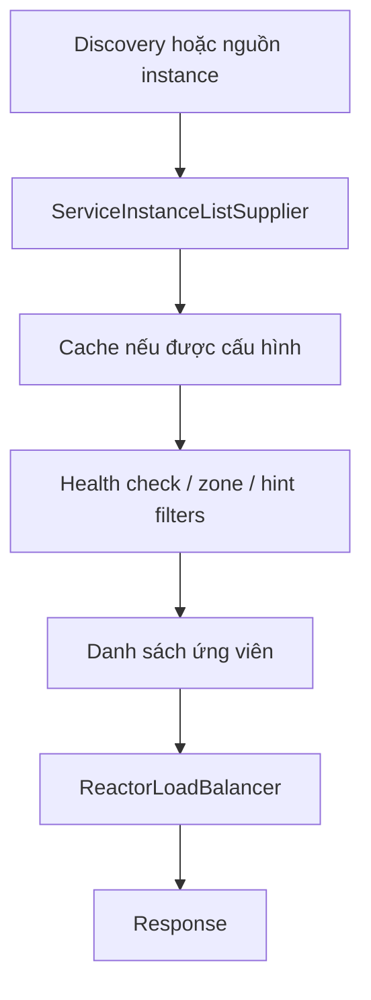

# ReactorLoadBalancer và kết quả chọn ServiceInstance

Trong cân bằng tải phía client, ứng dụng gửi request đến một service ID như `inventory-service`. Trước khi request được gửi qua mạng, Spring Cloud LoadBalancer cần tìm danh sách instance có thể phục vụ service đó và chọn một instance làm đích. Với luồng reactive, hợp đồng thực hiện lựa chọn là `ReactorLoadBalancer`; kết quả lựa chọn được biểu diễn bằng `Response<ServiceInstance>`.

Hiểu rõ hai kiểu dữ liệu này giúp phân biệt ba việc thường bị gộp làm một: lấy danh sách ứng viên, chọn một ứng viên và thực sự kết nối đến instance đã chọn. `ReactorLoadBalancer` đảm nhiệm việc chọn; `ServiceInstanceListSupplier` cung cấp danh sách; HTTP client thực hiện request đến địa chỉ của instance trong kết quả.

## 1. ReactorLoadBalancer nằm ở đâu trong kiến trúc?

Spring Cloud LoadBalancer cung cấp cơ chế chọn instance cho các HTTP client được tích hợp. Mỗi service ID có thể có cấu hình và các bean LoadBalancer riêng trong context do `LoadBalancerClientFactory` quản lý. Context theo service ID chứa thành phần chọn instance cùng các supplier cung cấp danh sách instance.

Các thành phần chính:

| Thành phần | Trách nhiệm |
|---|---|
| `LoadBalancerClientFactory` | Tạo và truy cập context LoadBalancer theo service ID. |
| `ReactorLoadBalancer<ServiceInstance>` | Nhận yêu cầu chọn và trả về kết quả dưới dạng `Mono<Response<ServiceInstance>>`. |
| `ReactorServiceInstanceLoadBalancer` | Hợp đồng chuyên biệt cho việc chọn một `ServiceInstance` trong môi trường reactive. |
| `ServiceInstanceListSupplier` | Cung cấp danh sách `ServiceInstance`; có thể đọc từ discovery hoặc áp dụng cache, health check và bộ lọc. |
| `ServiceInstance` | Mô tả một instance cụ thể, thường gồm service ID, host, port, giao thức bảo mật và metadata. |
| `Response<ServiceInstance>` | Mang instance được chọn hoặc biểu thị rằng không có instance phù hợp. |

`ReactorLoadBalancer` tập trung vào quyết định chọn ứng viên. Nó không tự đăng ký dịch vụ, không tự khởi động instance và cũng không gửi HTTP request. Những trách nhiệm đó thuộc discovery provider, supplier và HTTP client tương ứng.

## 2. Luồng chọn instance

Khi HTTP client nhận URI dùng service ID, ví dụ `http://inventory-service/api/items/42`, integration filter nhận ra host là tên dịch vụ logic. Filter lấy LoadBalancer dành cho `inventory-service`, tạo request context và gọi `choose(...)`. LoadBalancer lấy danh sách ứng viên từ supplier rồi áp dụng thuật toán lựa chọn.



Các bước quan trọng:

1. **Nhận diện service ID.** URI có host là `inventory-service`, chưa phải địa chỉ IP hoặc hostname của một replica cụ thể.
2. **Lấy context đúng service.** `LoadBalancerClientFactory` cung cấp các bean đã cấu hình cho service ID này.
3. **Yêu cầu danh sách ứng viên.** `ServiceInstanceListSupplier` trả về danh sách có thể được lọc hoặc làm mới theo request context.
4. **Chọn một ứng viên.** `ReactorLoadBalancer` áp dụng thuật toán như round robin hoặc random.
5. **Trả kết quả.** Kết quả cho biết instance nào được chọn hoặc không có instance phù hợp.
6. **Gửi request.** Integration của HTTP client thay service ID bằng host, port và giao thức của instance được chọn, rồi thực hiện request.

Việc chọn thành công chỉ có nghĩa là LoadBalancer tìm được một ứng viên từ danh sách hiện có. Kết nối TCP, TLS, timeout và phản hồi HTTP chỉ được xác định khi client thực sự giao tiếp với instance đó.

## 3. ReactorLoadBalancer và tính reactive

`ReactorLoadBalancer<T>` là hợp đồng chọn một đối tượng kiểu `T` bằng Reactor. Với Spring Cloud LoadBalancer, kiểu thường dùng là `ServiceInstance`, do đó lời gọi có dạng:

```java
Mono<Response<ServiceInstance>> result = loadBalancer.choose(request);
```

`Mono` biểu diễn kết quả bất đồng bộ có tối đa một phần tử. Việc chọn có thể cần chờ supplier truy xuất danh sách instance, đọc cache hoặc áp dụng các bước lọc. Vì vậy, caller nhận một publisher và tiếp tục xử lý kết quả bằng các toán tử Reactor.

`ReactorServiceInstanceLoadBalancer` là biến thể chuyên biệt cho `ServiceInstance`. Các thuật toán có sẵn như `RoundRobinLoadBalancer` và `RandomLoadBalancer` triển khai hợp đồng này. Ở tầng HTTP client, filter thường gọi LoadBalancer thay cho việc ứng dụng tự chọn host và port.

Ví dụ dưới đây minh họa cách đọc kết quả khi đã có LoadBalancer dành cho service ID:

```java
Mono<ServiceInstance> chooseInstance(
        ReactorLoadBalancer<ServiceInstance> loadBalancer) {

    return loadBalancer.choose(new DefaultRequest<>())
        .flatMap(response -> {
            if (!response.hasServer()) {
                return Mono.error(new IllegalStateException(
                    "No available instance for inventory-service"));
            }

            return Mono.just(response.getServer());
        });
}
```

Đây là ví dụ về hình dạng API và cách kiểm tra kết quả. Trong ứng dụng thực tế, HTTP client integration thường quản lý việc lấy LoadBalancer theo service ID và chuyển request đến instance được chọn. Không nên tự gọi `block()` trong một luồng reactive chỉ để lấy kết quả lựa chọn; hãy giữ chuỗi xử lý ở dạng `Mono` để tránh chặn event loop.

## 4. ServiceInstanceListSupplier cung cấp danh sách ứng viên

`ServiceInstanceListSupplier` tách việc tìm danh sách instance khỏi thuật toán chọn instance. Supplier có thể cung cấp danh sách từ discovery client hoặc từ nguồn cấu hình, sau đó được bọc bởi các supplier khác để cache hay lọc ứng viên.

Một số supplier thường gặp:

| Supplier / nhóm chức năng | Vai trò |
|---|---|
| `DiscoveryClientServiceInstanceListSupplier` | Lấy instance từ `DiscoveryClient` đã tích hợp với registry. |
| `CachingServiceInstanceListSupplier` | Cache danh sách để giảm số lần truy vấn nguồn discovery. |
| `HealthCheckServiceInstanceListSupplier` | Kiểm tra health endpoint và loại instance không đạt điều kiện theo cấu hình. |
| `ZonePreferenceServiceInstanceListSupplier` | Ưu tiên instance trong zone phù hợp khi metadata và cấu hình zone được cung cấp. |
| `HintBasedServiceInstanceListSupplier` | Lọc hoặc ưu tiên ứng viên dựa trên hint của request và metadata tương ứng. |
| `SameInstancePreferenceServiceInstanceListSupplier` | Có thể ưu tiên lại instance trước đó theo context và cấu hình. |

Không phải mọi ứng dụng đều bật tất cả supplier trên. Danh sách thực tế phụ thuộc cấu hình LoadBalancer, nguồn discovery và phiên bản Spring Cloud đang dùng. Thứ tự decorator cũng quan trọng: ví dụ cache đặt trước hay sau một bộ lọc có thể làm thay đổi danh sách nào được cache và thời điểm danh sách được làm mới.

Luồng khái quát:



Supplier cung cấp các ứng viên, còn thuật toán LoadBalancer quyết định chọn một phần tử trong danh sách đó. Một instance có trong danh sách không nhất thiết đang phục vụ request thành công tại đúng thời điểm gửi; health check và discovery có độ trễ, vì vậy client vẫn cần timeout và xử lý lỗi kết nối.

## 5. Response và ServiceInstance được trả về

Kiểu kết quả quan trọng là `Response<ServiceInstance>`. Caller thường kiểm tra hai phương thức:

- `hasServer()`: cho biết kết quả có chứa instance được chọn hay không.
- `getServer()`: lấy `ServiceInstance` khi kết quả có server.

Hai dạng response phổ biến:

| Response | Ý nghĩa | Cách xử lý |
|---|---|---|
| `DefaultResponse` | Có instance được chọn. | Lấy `ServiceInstance` qua `getServer()` và tiếp tục gửi request. |
| `EmptyResponse` | Không có instance phù hợp trong danh sách được cung cấp. | Ánh xạ thành lỗi không có server hoặc cơ chế fallback đã thiết kế. |

Ví dụ, khi registry chưa có instance nào đăng ký cho `inventory-service`, supplier có thể trả danh sách rỗng. Thuật toán không thể chọn server và trả kết quả rỗng về mặt instance. Caller cần kiểm tra `hasServer()` trước khi dùng `getServer()`.

Một `ServiceInstance` mô tả đích kết nối. Các thông tin thường được sử dụng gồm:

| Thông tin | Ý nghĩa |
|---|---|
| Service ID | Dịch vụ logic mà instance thuộc về. |
| Host | Hostname hoặc địa chỉ IP của instance. |
| Port | Cổng client cần kết nối. |
| Secure | Cho biết URI đích có sử dụng giao thức bảo mật hay không. |
| Metadata | Thông tin bổ sung như zone, version hoặc thuộc tính phục vụ định tuyến. |

Ví dụ danh sách discovery trả về ba instance:

| Service ID | Host | Port | Metadata zone |
|---|---|---:|---|
| `inventory-service` | `10.0.1.21` | 8080 | `zone-a` |
| `inventory-service` | `10.0.1.22` | 8080 | `zone-a` |
| `inventory-service` | `10.0.2.31` | 8080 | `zone-b` |

Nếu thuật toán chọn instance thứ hai, response chứa `ServiceInstance` có host `10.0.1.22` và port `8080`. HTTP client sẽ dùng địa chỉ đó để gửi request. Caller vẫn nên giữ service ID trong log để liên hệ lựa chọn với dịch vụ logic ban đầu.

## 6. Các thuật toán lựa chọn phổ biến

### 6.1. Round robin

`RoundRobinLoadBalancer` luân phiên vị trí chọn trong danh sách ứng viên. Với danh sách ổn định gồm ba instance A, B và C, các lượt chọn liên tiếp có thể lần lượt là A, B, C, A, B, C.

```text
Danh sách: [A, B, C]
Vị trí chọn:  0  1  2  0  1  2
Kết quả:      A  B  C  A  B  C
```

Round robin hữu ích khi các instance có năng lực tương đương và muốn phân phối lượt gọi tương đối đều. Đây là phân phối theo số lượt chọn, không bảo đảm cân bằng tải theo CPU, thời gian xử lý hoặc số request đang chạy. Khi danh sách thay đổi, phép tính vị trí theo kích thước danh sách cũng thay đổi; không nên giả định thứ tự tuyệt đối giữa các request đồng thời.

### 6.2. Random

`RandomLoadBalancer` chọn ngẫu nhiên một phần tử trong danh sách. Với số request lớn, phân phối có thể tiến gần đồng đều; trong một mẫu nhỏ, một instance có thể nhận nhiều request liên tiếp. Random không tự tạo trọng số theo cấu hình CPU hoặc năng lực instance.

### 6.3. Chọn theo tiêu chí riêng

Nếu cần ưu tiên zone, metadata, phiên bản hoặc một nhóm instance cụ thể, nên xem xét lọc danh sách bằng `ServiceInstanceListSupplier` phù hợp trước khi thuật toán chọn. Nếu thuật toán chọn cần quy tắc riêng, có thể cung cấp implementation `ReactorServiceInstanceLoadBalancer`.

Không nên đặt toàn bộ logic discovery, health check và lựa chọn vào một class duy nhất. Tách các trách nhiệm này giúp dễ kiểm thử, dễ quan sát và thay đổi chính sách mà không làm rối luồng request.

## 7. Cấu hình thuật toán theo service ID

Spring Cloud LoadBalancer cho phép khai báo cấu hình riêng cho một service bằng `@LoadBalancerClient`. Ví dụ sau thay thuật toán của `inventory-service` thành random:

```java
@Configuration
@LoadBalancerClient(
    name = "inventory-service",
    configuration = InventoryLoadBalancerConfiguration.class
)
class InventoryClientLoadBalancerRegistration {
}
```

Lớp cấu hình được LoadBalancer sử dụng:

```java
class InventoryLoadBalancerConfiguration {

    @Bean
    ReactorLoadBalancer<ServiceInstance> inventoryLoadBalancer(
            Environment environment,
            LoadBalancerClientFactory factory) {

        String serviceId = environment.getProperty(
            LoadBalancerClientFactory.PROPERTY_NAME);

        return new RandomLoadBalancer(
            factory.getLazyProvider(
                serviceId, ServiceInstanceListSupplier.class),
            serviceId);
    }
}
```

Đây là cách cấu hình theo mẫu API của Spring Cloud LoadBalancer; cần dùng đúng dependency và phiên bản Spring Cloud tương thích với ứng dụng. Giữ `InventoryLoadBalancerConfiguration` ngoài phạm vi component scan chính của ứng dụng để cấu hình chỉ được áp dụng trong context LoadBalancer dự định. Nếu đưa cấu hình này vào component scan toàn cục, các bean có thể ảnh hưởng đến những service khác.

Nếu không khai báo thuật toán riêng, cấu hình mặc định của Spring Cloud LoadBalancer thường dùng round robin. Hãy kiểm tra cấu hình theo service và phiên bản thực tế trước khi kết luận thuật toán nào đang hoạt động.

## 8. Không có instance và các lỗi trong quá trình chọn

Không phải mọi thất bại đều có cùng nguyên nhân. Cần phân biệt ít nhất ba trường hợp:

| Tình huống | Dấu hiệu | Hướng kiểm tra |
|---|---|---|
| Không có ứng viên | Supplier cung cấp danh sách rỗng và response không có server. | Kiểm tra service ID, đăng ký discovery, trạng thái instance và bộ lọc supplier. |
| Không lấy được danh sách | Publisher phát sinh lỗi khi truy cập discovery hoặc supplier. | Kiểm tra lỗi nguồn discovery, timeout, cache và exception trong chuỗi reactive. |
| Đã chọn nhưng kết nối thất bại | Có `ServiceInstance`, nhưng HTTP client gặp connection refused, DNS, TLS hoặc timeout. | Kiểm tra host/port, network, chứng thư, readiness và thời gian phản hồi của instance. |

`EmptyResponse` là kết quả không tìm được instance để chọn; nó không đồng nghĩa với một HTTP response `503` do dịch vụ đích trả về. Tùy integration và phiên bản, lỗi không có server có thể được chuyển thành exception ở tầng client hoặc thành phản hồi lỗi bởi gateway/controller phía trên. Khi chẩn đoán, hãy ghi rõ lỗi xảy ra trước hay sau khi đã có instance được chọn.

Một số nguyên nhân thường gặp:

- Service ID trong URI không khớp tên dịch vụ được đăng ký.
- Instance chưa đăng ký, vừa bị gỡ khỏi registry hoặc discovery đang trả dữ liệu cũ.
- Health check hoặc bộ lọc zone/hint loại toàn bộ ứng viên.
- Cache chưa được làm mới sau khi topology thay đổi.
- Metadata thiếu hoặc không đúng định dạng mà supplier mong đợi.
- Instance đã được chọn nhưng host, port hoặc TLS configuration không thể truy cập từ caller.

Không nên retry vô hạn khi danh sách rỗng hoặc discovery lỗi. Retry cần có giới hạn, backoff và deadline; nếu topology không thay đổi, gửi lại liên tục chỉ làm tăng tải và che khuất nguyên nhân gốc.

## 9. Request context và chính sách định tuyến

Phương thức `choose(request)` nhận một request context để thuật toán hoặc supplier có thể sử dụng thông tin bổ sung. Với một số cấu hình, context có thể chứa hint, dữ liệu request hoặc thông tin phục vụ ưu tiên instance. Supplier hỗ trợ request-aware có thể trả danh sách khác nhau tùy context.

Ví dụ, một request có hint `zone-a` có thể khiến `HintBasedServiceInstanceListSupplier` ưu tiên hoặc lọc các instance mang metadata phù hợp, tùy cấu hình. Sau bước đó, `RoundRobinLoadBalancer` vẫn có thể phân phối các lượt chọn trong danh sách còn lại.

Điều này cho thấy định tuyến có thể gồm hai giai đoạn:

1. **Lọc ứng viên:** quyết định instance nào đủ điều kiện theo zone, hint, health hoặc metadata.
2. **Chọn instance:** áp dụng round robin, random hoặc thuật toán tùy chỉnh lên tập ứng viên còn lại.

Nếu không có instance nào đáp ứng điều kiện, kết quả vẫn có thể là `EmptyResponse`, dù registry có nhiều instance đang đăng ký. Vì vậy, khi debug, hãy quan sát cả danh sách trước và sau lọc nếu cấu hình supplier cho phép.

## 10. Kiểm thử và quan sát kết quả lựa chọn

Kiểm thử nên xác minh hợp đồng của từng lớp thay vì chỉ kiểm tra một HTTP request cuối cùng:

- **Supplier:** xác minh danh sách được trả về, cách cache và bộ lọc health/zone/hint.
- **LoadBalancer:** với danh sách cố định, kiểm tra round robin hoặc random theo đặc tính của thuật toán; không viết assertion phụ thuộc thứ tự trong trường hợp request đồng thời.
- **Response:** xác minh caller kiểm tra `hasServer()` và xử lý trường hợp không có instance.
- **Integration:** gửi request qua service ID và xác minh request đến đúng instance theo discovery/configuration trong test.
- **Failure path:** mô phỏng danh sách rỗng, supplier lỗi và instance không thể kết nối để xác minh ba trường hợp được phân loại riêng.

Khi quan sát ở môi trường chạy thật, nên ghi nhận service ID, instance host/port hoặc instance ID, thuật toán, thời điểm chọn, số ứng viên nếu có và kết quả request. Kết hợp thông tin đó với trace/correlation ID và thời gian phản hồi để biết lỗi xảy ra ở bước discovery, lựa chọn hay truyền tải. Không ghi token, credential hoặc dữ liệu nhạy cảm của request vào log.

## 11. Checklist khi làm việc với ReactorLoadBalancer

- Xác định đúng service ID và context LoadBalancer tương ứng.
- Hiểu `ServiceInstanceListSupplier` đang lấy danh sách từ nguồn nào và có những decorator nào.
- Phân biệt việc lọc danh sách với thuật toán chọn instance.
- Xử lý `Response` bằng `hasServer()` trước khi lấy `getServer()`.
- Giữ xử lý ở dạng reactive; tránh block event loop.
- Phân biệt danh sách rỗng, lỗi supplier và lỗi kết nối sau khi đã chọn instance.
- Chọn round robin, random hoặc thuật toán tùy chỉnh dựa trên yêu cầu thực tế; không mặc định rằng thuật toán tự cân bằng CPU hay số request đang chạy.
- Đặt timeout, retry và logging ở tầng phù hợp, có deadline và giới hạn rõ ràng.

`ReactorLoadBalancer` đưa ra quyết định chọn một `ServiceInstance` từ danh sách do supplier cung cấp và trả quyết định đó qua `Response`. Khi nắm rõ ranh giới này, việc cấu hình discovery, health check, định tuyến và xử lý lỗi trong Spring Cloud LoadBalancer trở nên dễ kiểm soát hơn.
