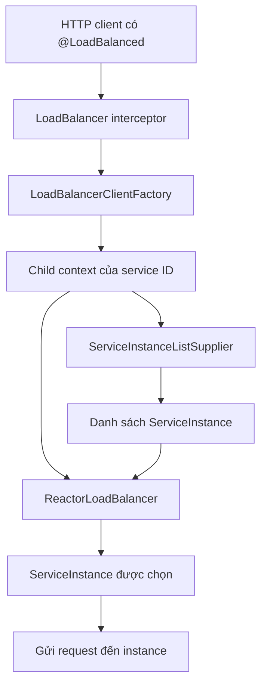
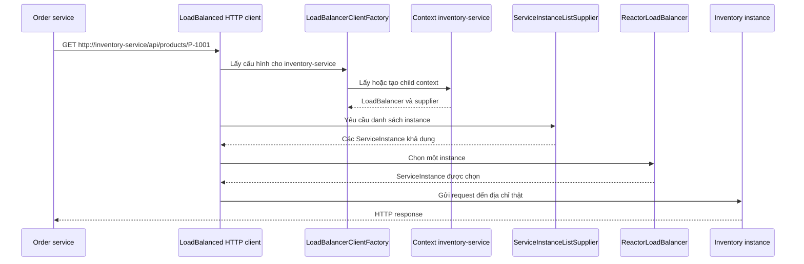

# LoadBalancerClientFactory và ngữ cảnh riêng theo service ID

Trong một hệ thống có nhiều dịch vụ, mỗi dịch vụ đích có thể cần cách cân bằng tải khác nhau. `inventory-service` có thể dùng round robin, `payment-service` có thể ưu tiên instance theo vùng, còn `report-service` có thể cần một nguồn instance hoặc bộ lọc riêng. Nếu tất cả dịch vụ dùng chung một cấu hình duy nhất, việc thay đổi chiến lược cho một dịch vụ dễ ảnh hưởng đến các dịch vụ còn lại.

Spring Cloud LoadBalancer giải quyết bài toán này bằng `LoadBalancerClientFactory`. Factory quản lý một **ngữ cảnh Spring riêng cho từng service ID**. Trong ngữ cảnh đó, framework tìm `ReactorLoadBalancer`, `ServiceInstanceListSupplier` và các thành phần liên quan để phục vụ request đến đúng service ID. Nhờ vậy, ứng dụng có thể dùng chung cơ chế gọi HTTP nhưng cấu hình chính sách chọn instance riêng cho từng dịch vụ.

## 1. Vì sao cần ngữ cảnh riêng theo service ID?

Service ID là tên logic mà client dùng để gọi một dịch vụ, ví dụ:

```text
http://inventory-service/api/products/P-1001
http://payment-service/api/payments/PAY-1001
```

Trong hai URL này, `inventory-service` và `payment-service` không phải hostname của một máy cụ thể. Chúng là định danh để Spring Cloud LoadBalancer tìm danh sách `ServiceInstance` tương ứng rồi chọn một instance cho request.

Các dịch vụ có thể khác nhau về:

- Nguồn discovery và cách lấy danh sách instance.
- Chính sách chọn instance như round robin hoặc random.
- Bộ lọc danh sách instance theo zone, health check, hint hoặc metadata.
- Chính sách retry, lifecycle hook và các thành phần mở rộng liên quan đến request.

Nếu mọi cấu hình đều được đặt trong application context chính, các bean có thể trở thành cấu hình dùng chung. Khi đó, một bean tùy chỉnh cho `inventory-service` có nguy cơ được áp dụng cho cả `payment-service`. Ngữ cảnh riêng giúp gom các bean theo đúng service ID và giới hạn phạm vi tác động của cấu hình.

## 2. Các thành phần chính trong kiến trúc

`LoadBalancerClientFactory` không tự chọn instance. Nó tạo và cung cấp ngữ cảnh chứa những thành phần thực hiện việc chọn instance.

| Thành phần | Trách nhiệm |
|---|---|
| `LoadBalancerClientFactory` | Quản lý các child application context theo service ID và lấy bean từ ngữ cảnh tương ứng. |
| `LoadBalancerClient` / `BlockingLoadBalancerClient` | Cung cấp API gọi cân bằng tải theo kiểu blocking cho các tích hợp cần thiết. |
| `ReactorLoadBalancer<ServiceInstance>` | Thực hiện lựa chọn một `ServiceInstance` từ danh sách có sẵn. Ví dụ triển khai gồm round robin và random. |
| `ServiceInstanceListSupplier` | Cung cấp danh sách instance cho một service ID, có thể kết hợp cache, health check hoặc bộ lọc. |
| `LoadBalancerLifecycle` | Cho phép quan sát các giai đoạn của request và kết quả chọn instance trong những tích hợp hỗ trợ lifecycle. |
| `@LoadBalanced` | Đánh dấu builder/client cần được tích hợp với cơ chế phân giải service ID và chọn instance. |

Có thể hình dung quan hệ giữa các thành phần như sau:



`LoadBalancerClientFactory` đóng vai trò định tuyến đến đúng bộ bean theo service ID. `ServiceInstanceListSupplier` cung cấp ứng viên, còn `ReactorLoadBalancer` chọn một ứng viên. Việc phân tách này cho phép thay đổi nguồn instance hoặc chính sách lựa chọn mà không cần viết lại logic gọi HTTP.

## 3. LoadBalancerClientFactory và NamedContextFactory

`LoadBalancerClientFactory` được xây dựng trên cơ chế `NamedContextFactory` của Spring Cloud. Cơ chế này quản lý nhiều child `ApplicationContext`, mỗi context gắn với một tên. Với LoadBalancer, tên đó chính là service ID của dịch vụ đích.

Khi thành phần tích hợp cần LoadBalancer cho `inventory-service`, factory lấy context có tên `inventory-service`. Nếu context chưa được tạo, factory khởi tạo context đó, gắn parent context của ứng dụng và nạp cấu hình mặc định cùng cấu hình riêng đã đăng ký cho service ID. Những lần gọi sau tiếp tục sử dụng context tương ứng.

Ví dụ minh họa:

```text
ApplicationContext chính
│
├── Bean dùng chung của ứng dụng
│
├── LoadBalancerClientFactory
│   │
│   ├── Context: inventory-service
│   │   ├── ReactorLoadBalancer<ServiceInstance>
│   │   ├── ServiceInstanceListSupplier
│   │   └── Bean mở rộng dành cho inventory-service
│   │
│   ├── Context: payment-service
│   │   ├── ReactorLoadBalancer<ServiceInstance>
│   │   ├── ServiceInstanceListSupplier
│   │   └── Bean mở rộng dành cho payment-service
│   │
│   └── Context: report-service
│       ├── ReactorLoadBalancer<ServiceInstance>
│       └── ServiceInstanceListSupplier
```

Đây là sơ đồ khái niệm. Số lượng bean và kiểu bean thực tế phụ thuộc vào phiên bản Spring Cloud, các starter được cài và cấu hình của ứng dụng.

Child context có quan hệ parent-child với context chính. Bean dùng chung ở parent có thể được tra cứu từ child theo cơ chế phân cấp của Spring; bean được đăng ký riêng trong child có phạm vi của context đó. Do đó, “ngữ cảnh riêng” có nghĩa là cấu hình và bean theo service ID được quản lý trong context riêng, không có nghĩa child context hoàn toàn mất khả năng nhìn thấy bean dùng chung.

Một số API đáng chú ý của factory gồm:

- `getInstance(serviceId, type)`: lấy bean có kiểu yêu cầu từ context mang service ID tương ứng.
- `getLazyProvider(serviceId, type)`: lấy provider trì hoãn cho bean trong context đó; hữu ích khi bean cần được phân giải sau khi context đã sẵn sàng.
- `LoadBalancerClientFactory.PROPERTY_NAME`: tên property nội bộ dùng để xác định service ID trong môi trường của context LoadBalancer.

Không nên tự tạo `LoadBalancerClientFactory` hoặc child context trong code nghiệp vụ. Hãy để auto-configuration và các annotation của Spring Cloud quản lý vòng đời context; chỉ tương tác với factory khi đang viết cấu hình mở rộng có chủ đích.

## 4. Luồng tạo context và chọn instance

Giả sử một order service gọi `inventory-service` qua `RestClient` đã được đánh dấu `@LoadBalanced`. Luồng xử lý ở mức khái niệm:

1. Code ứng dụng gửi request tới URL logic có host là `inventory-service`.
2. Interceptor của client nhận ra request cần phân giải service ID.
3. Tích hợp LoadBalancer yêu cầu factory cung cấp các bean cho `inventory-service`.
4. Factory lấy child context tương ứng; nếu cần, context được khởi tạo từ cấu hình mặc định và cấu hình riêng.
5. `ServiceInstanceListSupplier` cung cấp danh sách instance của `inventory-service`.
6. `ReactorLoadBalancer` áp dụng chiến lược chọn instance và trả về kết quả.
7. Client thay host logic bằng địa chỉ instance được chọn rồi gửi request.



Sơ đồ lược giản các lời gọi nội bộ; thứ tự chi tiết giữa interceptor, supplier và load balancer có thể khác theo loại HTTP client và phiên bản. Điểm quan trọng là mỗi service ID được phân giải bằng bộ bean của context tương ứng.

## 5. Đăng ký cấu hình riêng bằng @LoadBalancerClient

Annotation `@LoadBalancerClient` cho phép gắn một lớp cấu hình với một service ID. Ví dụ, ứng dụng muốn `inventory-service` dùng random load balancing trong khi các dịch vụ khác giữ chiến lược mặc định.

Đăng ký cấu hình ở lớp ứng dụng:

```java
@SpringBootApplication
@LoadBalancerClient(
        name = "inventory-service",
        configuration = InventoryLoadBalancerConfiguration.class)
public class OrderApplication {

    public static void main(String[] args) {
        SpringApplication.run(OrderApplication.class, args);
    }
}
```

Lớp cấu hình riêng cung cấp `ReactorLoadBalancer`:

```java
// Đặt lớp này trong package ngoài phạm vi component scan của OrderApplication.
@Configuration(proxyBeanMethods = false)
public class InventoryLoadBalancerConfiguration {

    @Bean
    ReactorLoadBalancer<ServiceInstance> randomLoadBalancer(
            Environment environment,
            LoadBalancerClientFactory factory) {

        String serviceId = environment.getProperty(
                LoadBalancerClientFactory.PROPERTY_NAME);

        return new RandomLoadBalancer(
                factory.getLazyProvider(
                        serviceId, ServiceInstanceListSupplier.class),
                serviceId);
    }
}
```

`RandomLoadBalancer` chọn ngẫu nhiên từ các instance do supplier cung cấp. Đoạn code trên dùng `serviceId` trong environment của child context để factory lấy đúng `ServiceInstanceListSupplier` cho dịch vụ đang cấu hình.

**Lưu ý về component scan:** `InventoryLoadBalancerConfiguration` phải nằm ngoài phạm vi component scan của application context chính. Nếu lớp cấu hình này bị quét như cấu hình toàn cục, bean trong đó có thể được đăng ký ở parent context và ảnh hưởng đến các service ID khác. Có thể đặt lớp cấu hình trong package riêng nằm ngoài package gốc của ứng dụng, sau đó để `@LoadBalancerClient` nạp nó vào context dành cho `inventory-service`.

Các import thường cần trong ví dụ:

```java
import org.springframework.cloud.client.ServiceInstance;
import org.springframework.cloud.loadbalancer.core.RandomLoadBalancer;
import org.springframework.cloud.loadbalancer.core.ReactorLoadBalancer;
import org.springframework.cloud.loadbalancer.core.ServiceInstanceListSupplier;
import org.springframework.cloud.loadbalancer.support.LoadBalancerClientFactory;
```

Các import Spring như `@Bean`, `@Configuration`, `Environment` và `@LoadBalancerClient` được lấy từ package tương ứng của Spring Framework và Spring Cloud trong phiên bản dự án.

## 6. Dùng cấu hình mặc định cho nhiều service ID

Khi nhiều dịch vụ cần cùng một cấu hình, `@LoadBalancerClients` có thể khai báo cấu hình mặc định dùng cho các LoadBalancer context. Một service ID vẫn có thể có cấu hình riêng thông qua `@LoadBalancerClient`.

Ví dụ:

```java
// OrderApplication nằm trong package com.example.order.
@SpringBootApplication
@LoadBalancerClients(
        defaultConfiguration = com.example.lbconfig.SharedLoadBalancerConfiguration.class)
public class OrderApplication {
    // main method
}
```

```java
// Package com.example.lbconfig nằm ngoài package scan com.example.order.
package com.example.lbconfig;

@Configuration(proxyBeanMethods = false)
public class SharedLoadBalancerConfiguration {
    // Các bean cấu hình LoadBalancer dùng chung.
}
```

Để tùy chỉnh riêng `payment-service`, có thể đăng ký thêm:

Đặt annotation dưới đây trên lớp ứng dụng hoặc lớp cấu hình đăng ký LoadBalancer client:

```java
@LoadBalancerClient(
        name = "payment-service",
        configuration = PaymentLoadBalancerConfiguration.class)
```

Trong đó `PaymentLoadBalancerConfiguration` cung cấp bean dành riêng cho context `payment-service`. Cần tổ chức cấu hình rõ ràng và kiểm tra thứ tự/độ ưu tiên theo phiên bản khi cùng một loại bean được khai báo ở cấu hình mặc định và cấu hình riêng. Không nên khai báo hai bean cùng mục đích trong cùng context rồi trông chờ framework tự đoán bean mong muốn.

## 7. ServiceInstanceListSupplier trong child context

`ServiceInstanceListSupplier` quyết định danh sách instance nào được đưa vào bước chọn. Nguồn ban đầu có thể đến từ `DiscoveryClient`, `ReactiveDiscoveryClient` hoặc danh sách cấu hình tĩnh của `SimpleDiscoveryClient`. Các supplier khác có thể bọc nguồn đó để bổ sung hành vi.

| Nhóm supplier | Vai trò |
|---|---|
| Discovery-based supplier | Lấy instance từ discovery client. |
| Configuration-based supplier | Cung cấp instance từ cấu hình, hữu ích khi phát triển hoặc chạy môi trường nhỏ. |
| Caching supplier | Cache danh sách instance để hạn chế truy vấn discovery lặp lại. |
| Health-check supplier | Kiểm tra tình trạng endpoint theo cấu hình trước khi trả instance. |
| Zone-preference supplier | Ưu tiên instance cùng zone khi metadata và cấu hình hỗ trợ. |
| Hint-based supplier | Lọc hoặc ưu tiên instance theo hint của request và metadata tương ứng. |
| Same-instance / sticky-session supplier | Hỗ trợ ưu tiên instance trước đó hoặc hành vi affinity theo cấu hình. |

Không phải mọi supplier đều tự động được bật trong mọi phiên bản. Một số supplier là tùy chọn hoặc cần cấu hình bổ sung; hãy kiểm tra cấu hình thực tế và thứ tự ghép supplier. Chẳng hạn, cache đặt sai vị trí có thể làm dữ liệu health check cập nhật chậm, còn bộ lọc zone có thể trả danh sách rỗng nếu metadata zone không khớp.

Factory giúp supplier được lấy theo đúng service ID. Vì vậy, `inventory-service` có thể dùng discovery và health check, trong khi `report-service` dùng danh sách instance khác hoặc cách lọc khác mà không làm thay đổi supplier của `payment-service`.

## 8. Tùy chỉnh chính sách chọn instance theo từng dịch vụ

Giả sử kiến trúc có ba dịch vụ:

| Service ID | Nhu cầu | Cấu hình gợi ý |
|---|---|---|
| `inventory-service` | Phân phối request tương đối đều giữa các instance. | `RoundRobinLoadBalancer`. |
| `payment-service` | Chọn ngẫu nhiên trong nhóm instance hợp lệ. | `RandomLoadBalancer`. |
| `report-service` | Ưu tiên instance gần vùng chạy của caller. | Supplier có zone preference kết hợp chiến lược phù hợp. |

Round robin và random là chiến lược lựa chọn, còn zone preference là hành vi lọc/ưu tiên danh sách. Chúng nằm ở những lớp khác nhau của pipeline: supplier quyết định tập ứng viên, load balancer chọn một phần tử trong tập đó.

Một ví dụ đăng ký hai chính sách riêng:

```java
@SpringBootApplication
@LoadBalancerClients({
    @LoadBalancerClient(
        name = "inventory-service",
        configuration = InventoryLoadBalancerConfiguration.class),
    @LoadBalancerClient(
        name = "payment-service",
        configuration = PaymentLoadBalancerConfiguration.class)
})
public class OrderApplication {
}
```

`InventoryLoadBalancerConfiguration` có thể trả về `RoundRobinLoadBalancer`, còn `PaymentLoadBalancerConfiguration` trả về `RandomLoadBalancer`. Mỗi cấu hình được nạp vào child context mang tên tương ứng.

Không nên chọn chiến lược chỉ vì tên gọi nghe có vẻ phù hợp. Round robin không bảo đảm tải CPU bằng nhau nếu request có thời gian xử lý khác nhau; random cũng không bảo đảm phân phối đều trong một cửa sổ ngắn. Hãy dựa vào đặc tính workload, kích thước pool, độ trễ, health check và số liệu vận hành.

## 9. Quan hệ giữa cấu hình Java và property theo client

Spring Cloud LoadBalancer hỗ trợ cấu hình chung và một số property có phạm vi theo client/service ID. Các property theo client thường nằm dưới prefix:

```yaml
spring:
  cloud:
    loadbalancer:
      clients:
        inventory-service:
          # Đặt các thuộc tính được phiên bản đang dùng hỗ trợ tại đây.
```

Đây là vị trí khái quát để thể hiện phạm vi cấu hình. Tên property cụ thể, kiểu dữ liệu và khả năng override thay đổi theo phiên bản; cần tra metadata hoặc reference tương ứng với release train của dự án trước khi thêm giá trị.

Có thể dùng cấu hình Java khi cần thay bean hoặc thuật toán, còn property phù hợp với những tham số đã được framework công bố như timeout health check, zone, retry hoặc cache. Không giả định mọi bean trong child context đều có property tương ứng.

Khi cấu hình cả Java lẫn property, cần kiểm tra rõ phần nào tạo bean và phần nào điều chỉnh bean đó. Nếu Java config đã tự tạo supplier hoặc load balancer, một property dùng để điều khiển bean mặc định có thể không còn tác động như mong đợi.

## 10. Lỗi thường gặp khi làm việc với context riêng

| Dấu hiệu | Nguyên nhân thường gặp | Hướng kiểm tra |
|---|---|---|
| Cấu hình riêng cho một service ảnh hưởng đến mọi service | Lớp cấu hình riêng bị component scan vào parent context. | Di chuyển cấu hình ra ngoài package scan hoặc loại khỏi component scan. |
| Không tìm thấy `ServiceInstanceListSupplier` | Supplier chưa được đăng ký trong context, thiếu discovery/configuration source hoặc cấu hình custom thay thế bean mặc định. | Xem điều kiện auto-configuration và bean trong child context. |
| `serviceId` nhận giá trị `null` | Cấu hình đang được tạo ở sai context hoặc không có property name do factory cung cấp. | Kiểm tra cấu hình được gắn đúng `@LoadBalancerClient` và được nạp trong child context. |
| Hai service dùng cùng một chính sách ngoài dự kiến | Cả hai đang nhận cấu hình mặc định hoặc cấu hình riêng chưa được đăng ký đúng tên. | So sánh tên trong `@LoadBalancerClient` với host logic trong URL. |
| Không có instance sau khi lọc | Supplier chain loại hết instance vì health, zone, hint hoặc metadata không khớp. | Kiểm tra danh sách trước và sau từng supplier. |
| Bean bị trùng hoặc không rõ bean nào được dùng | Cấu hình mặc định và cấu hình riêng đăng ký bean trùng loại/tên. | Kiểm tra điều kiện `@ConditionalOnMissingBean`, qualifier và cấu hình theo phiên bản. |

Tên service ID trong `@LoadBalancerClient(name = "...")` phải khớp với host logic mà client gửi. Nếu cấu hình cho `inventory-service` nhưng URL gọi `inventory`, factory sẽ tìm context mang tên `inventory`; cấu hình riêng có thể không được áp dụng.

## 11. Quan sát và kiểm chứng cấu hình theo service ID

Khi cần xác minh cấu hình riêng, hãy kiểm tra từng service ID độc lập:

1. Ghi nhận host logic mà client thực sự gửi, ví dụ `inventory-service`.
2. Xác minh `@LoadBalancerClient` có dùng đúng tên đó và lớp cấu hình được nạp vào child context.
3. Kiểm tra `ReactorLoadBalancer` và `ServiceInstanceListSupplier` đang được phân giải trong context tương ứng.
4. Xác minh supplier trả về danh sách instance trước khi load balancer chọn.
5. Gửi nhiều request có thể quan sát được, ghi lại instance được chọn và kiểm tra chính sách có đúng với kỳ vọng hay không.
6. Lặp lại với service ID khác để bảo đảm cấu hình của dịch vụ này không rò sang dịch vụ kia.

`LoadBalancerLifecycle` và log ở HTTP client có thể giúp quan sát request, instance được chọn và kết quả xử lý, tùy loại tích hợp. Khi bật log, ưu tiên ghi service ID, instance ID/host, status và correlation ID; tránh ghi token hoặc body nhạy cảm.

Một kiểm chứng đơn giản là cấu hình `inventory-service` dùng round robin và gửi một chuỗi request đến hai instance cục bộ. Nếu cả hai instance đều khỏe và danh sách supplier không bị lọc, các request liên tiếp thường luân phiên giữa các instance theo chiến lược. Kết quả quan sát còn phụ thuộc vào retry, request đồng thời, cache, health check và cách triển khai của phiên bản; không nên coi một vài request là bằng chứng cho mọi điều kiện tải.

## 12. Checklist thiết kế cấu hình LoadBalancer riêng

- [ ] Service ID trong `@LoadBalancerClient` khớp host logic của request.
- [ ] Lớp cấu hình riêng không bị component scan vào application context chính.
- [ ] Cấu hình mặc định và cấu hình riêng có ranh giới rõ ràng.
- [ ] `LoadBalancerClientFactory` quản lý context; `ReactorLoadBalancer` mới thực hiện lựa chọn instance.
- [ ] `ServiceInstanceListSupplier` có nguồn instance hợp lệ và các bộ lọc không loại hết ứng viên.
- [ ] Các bean custom được đăng ký trong đúng child context.
- [ ] Cấu hình Java và property được kiểm tra theo đúng release train.
- [ ] Đã kiểm tra độc lập ít nhất hai service ID để phát hiện cấu hình rò phạm vi.

Khi hiểu vai trò của `LoadBalancerClientFactory`, nhóm phát triển có thể tổ chức cấu hình theo từng dịch vụ một cách có kiểm soát. Mỗi service ID có thể có supplier, thuật toán và hook riêng, trong khi code gọi HTTP vẫn dùng chung cách biểu diễn URL logic và hợp đồng API.
