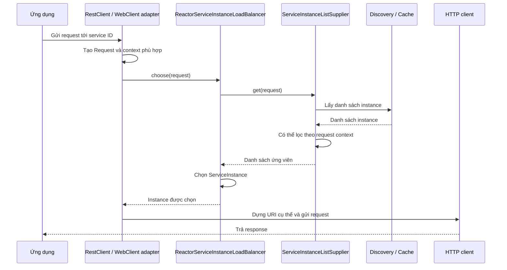

# Request, RequestDataContext và dữ liệu đầu vào khi chọn đích

Spring Cloud LoadBalancer không chỉ cần biết service ID và danh sách các `ServiceInstance`. Trong một số tình huống, quyết định chọn instance còn phụ thuộc vào chính request đang được gửi: HTTP method, URI, header, hint hoặc thông tin định tuyến do ứng dụng bổ sung. Những dữ liệu này được truyền qua một đối tượng `Request<T>` để các thành phần LoadBalancer có thể đọc khi xử lý request.

Hiểu `Request`, `RequestDataContext` và đường đi của request context giúp ta xây dựng chính sách định tuyến theo header, phiên bản API hoặc vùng triển khai, đồng thời tránh nhầm dữ liệu phục vụ lựa chọn đích với dữ liệu HTTP được gửi tới server.

## 1. Vì sao LoadBalancer cần Request context?

Với cách gọi cơ bản, ứng dụng chỉ nêu service ID:

```java
restClient.get()
        .uri("http://inventory-service/api/items/42")
        .retrieve()
        .body(Item.class);
```

Nếu chính sách chỉ là round-robin, LoadBalancer có thể chọn một instance từ danh sách mà không cần biết thêm thông tin nghiệp vụ. Nhưng hệ thống thực tế có thể cần các quy tắc như:

- Request có header `X-Api-Version: v2` chỉ được gửi tới instance hỗ trợ API v2.
- Request đến từ một vùng triển khai ưu tiên instance trong cùng zone để giảm độ trễ.
- Request đọc dữ liệu có thể đi tới nhóm instance read-only; request ghi phải tới nhóm có quyền ghi.
- Một request có hint `canary` được đưa tới nhóm instance thử nghiệm theo chính sách đã định nghĩa.

Để thực hiện những quy tắc đó, thành phần chọn đích cần nhận được ngữ cảnh của request. Spring Cloud LoadBalancer biểu diễn đầu vào này bằng `Request<T>`.

## 2. Request<T> là gì?

`org.springframework.cloud.client.loadbalancer.Request<T>` là một abstraction tổng quát đại diện cho request được đưa vào LoadBalancer. Nó cung cấp context thông qua `getContext()`. Kiểu `T` cho phép context mang loại dữ liệu phù hợp với client hoặc chính sách định tuyến.

Một số kiểu thường gặp:

| Kiểu | Vai trò |
|---|---|
| `Request<T>` | Hợp đồng chung để LoadBalancer nhận request cùng context |
| `DefaultRequest<T>` | Cách triển khai đơn giản, bọc một context có sẵn |
| `RequestData` | Mô tả một số dữ liệu HTTP như headers, method và URL |
| `RequestDataContext` | Context dùng cho request có dữ liệu HTTP; có thể mang thêm hint |
| Context tùy chỉnh | Mang thuộc tính riêng của ứng dụng, ví dụ tenant hoặc nhóm traffic |

`Request<T>` là lớp bao quanh context. Nó không nhất thiết chứa toàn bộ body của HTTP request và cũng không phải chính đối tượng `HttpServletRequest`, `ClientHttpRequest` hay `ClientRequest` của WebFlux.

Service ID và request context là hai đầu vào riêng: service ID xác định nhóm dịch vụ cần tìm; context bổ sung thông tin của lời gọi hiện tại để supplier hoặc LoadBalancer có thể lọc và chọn trong nhóm đó.

Ví dụ một context đơn giản do ứng dụng định nghĩa:

```java
record RoutingContext(String tenant, String region, String apiVersion) {}

RoutingContext context = new RoutingContext(
        "tenant-a",
        "ap-southeast-1",
        "v2");

Request<RoutingContext> request = new DefaultRequest<>(context);
```

Trong ví dụ, `DefaultRequest` giữ context để thành phần LoadBalancer có thể đọc qua `request.getContext()`. Cách tạo và truyền context tùy chỉnh vào luồng gọi phụ thuộc integration hoặc phần mở rộng mà ứng dụng triển khai.

## 3. RequestData và RequestDataContext

### 3.1. RequestData chứa thông tin HTTP nào?

`RequestData` là mô hình dữ liệu request ở tầng HTTP. Những thông tin thường được quan tâm gồm:

| Dữ liệu | Ví dụ | Ứng dụng trong định tuyến |
|---|---|---|
| HTTP method | `GET`, `POST`, `PUT` | Phân biệt request đọc và ghi nếu kiến trúc cho phép |
| URL | `/api/items/42` | Phân loại nhóm API hoặc đường dẫn |
| HTTP headers | `X-Api-Version: v2` | Chọn instance hỗ trợ phiên bản hoặc nhóm traffic phù hợp |

Các thông tin này giúp chính sách chọn đích hiểu request đang được gửi. `RequestData` không phải nơi lưu response và không nên được xem là bản sao đầy đủ của payload nghiệp vụ. Đặc biệt, không nên thiết kế định tuyến phụ thuộc vào việc đọc body lớn hoặc body dạng stream.

### 3.2. RequestDataContext kết hợp dữ liệu HTTP với context

`RequestDataContext` là một context chuyên biệt trong Spring Cloud Commons. Nó mang `RequestData` của lời gọi và có thể cung cấp hint để các supplier hoặc LoadBalancer tùy chỉnh sử dụng.

Khi context là `RequestDataContext`, thành phần xử lý có thể đọc dữ liệu HTTP theo cách tương tự:

```java
if (request.getContext() instanceof RequestDataContext context) {
    RequestData clientRequest = context.getClientRequest();

    if (clientRequest != null) {
        HttpMethod method = clientRequest.getHttpMethod();
        URI url = clientRequest.getUrl();
        HttpHeaders headers = clientRequest.getHeaders();

        // Dùng method, URL hoặc header làm đầu vào cho chính sách chọn đích.
    }

    String hint = context.getHint();
}
```

Đoạn mã minh họa cách đọc context; trong ứng dụng, cần xử lý trường hợp context không phải `RequestDataContext`, request data không có hoặc header không tồn tại. Không nên giả định mọi loại HTTP client hay mọi đường gọi đều cung cấp cùng một context.

`RequestDataContext` có ích khi chính sách định tuyến cần nhìn thấy thông tin HTTP. Nếu chỉ cần một vài thuộc tính riêng như tenant hoặc region do ứng dụng tính trước, một context tùy chỉnh có thể đơn giản và rõ ràng hơn.

Khi đã có `RequestData`, ứng dụng hoặc integration có thể gắn thêm hint vào context trước khi chuyển request cho LoadBalancer:

```java
RequestDataContext context = new RequestDataContext(requestData, "canary");
Request<RequestDataContext> request = new DefaultRequest<>(context);
```

Đoạn mã cho thấy quan hệ giữa `RequestData`, hint và `Request<T>`. Trong luồng `@LoadBalanced` thông thường, integration của HTTP client tạo request context; ứng dụng chỉ cần tự tạo context khi xây dựng một luồng gọi hoặc phần mở rộng tùy chỉnh.

### 3.3. Hint là gì?

Hint là một giá trị định tuyến bổ sung có thể được gắn với request context. Ví dụ, ứng dụng có thể dùng `canary`, `stable` hoặc một nhóm xử lý để biểu thị loại instance mong muốn.

Hint chỉ có tác dụng khi supplier hoặc LoadBalancer được cấu hình đọc và áp dụng nó. Việc gắn hint vào context không tự thay đổi danh sách instance và cũng không làm thuật toán round-robin mặc định hiểu ý nghĩa của hint.

Không nên dùng hint làm cơ chế xác thực hoặc phân quyền. Nếu client có thể tự gửi giá trị hint qua header, server cần kiểm tra quyền của caller và chỉ chấp nhận các giá trị đã được cho phép.

## 4. Request context đi qua kiến trúc LoadBalancer như thế nào?

Luồng tổng quát khi HTTP client tích hợp với Spring Cloud LoadBalancer:



Các thành phần có vai trò riêng:

- **HTTP client adapter** nhận lời gọi từ ứng dụng và chuyển thông tin cần thiết thành request context.
- **`Request<T>`** mang context xuyên suốt lời gọi LoadBalancer.
- **`ServiceInstanceListSupplier`** cung cấp danh sách ứng viên; supplier dạng request-based có thể đọc context để lọc danh sách.
- **LoadBalancer** chọn một instance trong danh sách ứng viên.
- **HTTP client** kết nối tới endpoint của instance được chọn và trao đổi HTTP.

Điểm quan trọng là supplier có thể nhận request. Một supplier chỉ triển khai hoặc sử dụng danh sách tĩnh có thể bỏ qua context; khi cần định tuyến theo request, phải dùng supplier hoặc cấu hình tùy chỉnh có xử lý `get(Request)`.

## 5. Những dữ liệu nào có thể ảnh hưởng đến quyết định chọn đích?

Request context mở rộng thông tin mà chính sách định tuyến có thể sử dụng. Tuy nhiên, dữ liệu chỉ ảnh hưởng đến kết quả khi có thành phần đọc và áp dụng nó.

| Đầu vào | Ví dụ | Quy tắc có thể triển khai |
|---|---|---|
| Service ID | `inventory-service` | Xác định nhóm instance cần tìm |
| HTTP method | `GET`, `POST` | Phân nhóm đọc/ghi nếu instance có năng lực khác nhau |
| URL/path | `/api/reports/**` | Chọn nhóm instance chuyên xử lý báo cáo |
| Header phiên bản | `X-Api-Version: v2` | Chỉ chọn instance hỗ trợ v2 |
| Header vùng | `X-Preferred-Zone: zone-a` | Ưu tiên instance cùng zone |
| Hint | `canary` | Lọc hoặc ưu tiên nhóm instance thử nghiệm |
| Context tùy chỉnh | tenant, region, capability | Áp dụng chính sách riêng của hệ thống |

Không nên đưa tất cả request headers vào logic chọn đích. Chỉ chọn các trường thực sự cần thiết, có quy ước ổn định và có kiểm soát đầu vào.

### 5.1. Chọn instance theo API version

Giả sử registry cung cấp các instance với metadata:

| Instance | Metadata `api-version` |
|---|---|
| `inventory-v1` | `v1` |
| `inventory-v2a` | `v2` |
| `inventory-v2b` | `v2` |

Request có header `X-Api-Version: v2` cần danh sách ứng viên chỉ gồm các instance hỗ trợ v2. Quy trình:

1. Đọc header từ `RequestDataContext`.
2. Kiểm tra giá trị có thuộc tập phiên bản được hệ thống hỗ trợ hay không.
3. Lấy danh sách instance từ delegate supplier.
4. Lọc các instance có metadata `api-version` khớp phiên bản yêu cầu.
5. Nếu không có instance phù hợp, áp dụng fallback đã định nghĩa rõ.

Pseudocode cho bước lọc:

```java
List<ServiceInstance> filterByApiVersion(
        List<ServiceInstance> instances,
        String requestedVersion) {

    if (requestedVersion == null || requestedVersion.isBlank()) {
        return instances;
    }

    return instances.stream()
            .filter(instance -> {
                Map<String, String> metadata = instance.getMetadata();
                return metadata != null
                        && requestedVersion.equals(metadata.get("api-version"));
            })
            .toList();
}
```

Đây là hàm minh họa cho quy tắc lọc. Khi đưa vào `ServiceInstanceListSupplier`, cần bảo đảm metadata có thể null và xử lý trường hợp kết quả rỗng. Nếu không có instance v2, không nên tự gửi request sang v1 trừ khi API và nghiệp vụ cho phép fallback đó.

### 5.2. Chọn instance theo HTTP method

Một hệ thống có thể tách nhóm instance phục vụ truy vấn và nhóm xử lý ghi. Ví dụ metadata `capability=read` hoặc `capability=write` được đăng ký cho mỗi instance.

Quy tắc có thể là:

- `GET`, `HEAD` chỉ xét instance có `capability=read` hoặc `capability=read-write`.
- `POST`, `PUT`, `PATCH`, `DELETE` chỉ xét instance có `capability=write` hoặc `capability=read-write`.
- Method không được nhận diện phải đi theo chính sách mặc định hoặc bị từ chối theo yêu cầu hệ thống.

HTTP method là một gợi ý kỹ thuật, không phải lúc nào cũng phản ánh đầy đủ ngữ nghĩa nghiệp vụ. Một số API có thể dùng `POST` cho truy vấn hoặc có side effect trong request tưởng như chỉ đọc. Hãy xác định năng lực instance theo hợp đồng API thay vì chỉ dựa vào method nếu hệ thống phức tạp.

### 5.3. Chọn instance theo tenant hoặc vùng

Nếu request cần định tuyến theo tenant, region hoặc zone, nên xác định rõ nguồn dữ liệu đáng tin cậy. Tenant ID có thể được lấy từ security context đã xác thực hoặc từ dữ liệu nội bộ của ứng dụng; không nên tin trực tiếp một header do người dùng cuối tùy ý đặt.

Ví dụ, ứng dụng xác định `tenant-a` thuộc `region-a`, sau đó đưa `region-a` vào context tùy chỉnh. Supplier có thể ưu tiên instance cùng region. Nếu vùng đó không có instance, chính sách có thể cho phép fallback sang vùng khác hoặc trả lỗi tùy yêu cầu về độ trễ, dữ liệu và tính sẵn sàng.

## 6. Request context và ServiceInstanceListSupplier

`ServiceInstanceListSupplier` là điểm mở rộng quan trọng khi muốn danh sách ứng viên thay đổi theo request. Supplier cơ bản có thể cung cấp danh sách từ discovery hoặc cache; supplier dạng request-based nhận `Request` để áp dụng bộ lọc theo context.

Luồng xử lý thường có dạng:

```text
Request<T>
   |
   v
ServiceInstanceListSupplier.get(request)
   |
   v
Delegate supplier (discovery / cache)
   |
   v
Filter by hint / header / custom context
   |
   v
Candidate ServiceInstance list
   |
   v
ReactorServiceInstanceLoadBalancer.choose(request)
   |
   v
Selected ServiceInstance
```

Khi triển khai supplier tùy chỉnh, cần giữ các đặc tính sau:

- Gọi delegate với chính request hiện tại để context không bị mất ở chuỗi supplier.
- Trả về danh sách mới đã lọc, không sửa trực tiếp danh sách dùng chung do cache hoặc delegate trả về.
- Xử lý context không đúng kiểu, header thiếu và metadata null một cách tường minh.
- Định nghĩa hành vi khi danh sách sau lọc rỗng.
- Tránh gọi discovery hoặc health endpoint đồng bộ cho từng request nếu đã có supplier/cache chuyên trách.
- Giữ bộ lọc đơn giản, nhanh và có thể quan sát được.

Pseudocode minh họa cách tổ chức bộ lọc:

```java
// Pseudocode: đặt trong một ServiceInstanceListSupplier tùy chỉnh.
Flux<List<ServiceInstance>> get(Request request) {
    return delegate.get(request)
            .map(instances -> {
                String version = readRequestedVersion(request);
                return filterByApiVersion(instances, version);
            });
}
```

Đây là pseudocode mô tả luồng xử lý, không phải một class hoàn chỉnh có thể sao chép trực tiếp. Khi triển khai, kế thừa hoặc bọc supplier theo API của phiên bản Spring Cloud đang sử dụng và bảo đảm cấu hình supplier được áp dụng cho đúng service ID.

## 7. Request context trong các HTTP client của Spring

### 7.1. RestClient

`RestClient` có thể sử dụng builder được đánh dấu `@LoadBalanced`. Tích hợp LoadBalancer sẽ xử lý URL chứa service ID và tạo request context phù hợp với đường gọi đang dùng.

```java
@Configuration
class InventoryClientConfiguration {

    @Bean
    @LoadBalanced
    RestClient.Builder loadBalancedRestClientBuilder() {
        return RestClient.builder();
    }
}
```

Mã nghiệp vụ:

```java
@Service
class InventoryGateway {
    private final RestClient client;

    InventoryGateway(@LoadBalanced RestClient.Builder builder) {
        this.client = builder.build();
    }

    Item findItem(long id, String apiVersion) {
        return client.get()
                .uri("http://inventory-service/api/items/{id}", id)
                .header("X-Api-Version", apiVersion)
                .retrieve()
                .body(Item.class);
    }
}
```

Header được gửi trong HTTP request và có thể được cung cấp trong request data cho thành phần LoadBalancer tùy theo integration. Để header thực sự ảnh hưởng đến lựa chọn instance, cần cấu hình supplier hoặc chính sách đọc header đó; chỉ thêm header không tự bật lọc phiên bản.

### 7.2. WebClient

`WebClient` dùng builder `@LoadBalanced` để gọi service ID:

```java
@Configuration
class InventoryWebClientConfiguration {

    @Bean
    @LoadBalanced
    WebClient.Builder loadBalancedWebClientBuilder() {
        return WebClient.builder();
    }
}
```

Ví dụ gửi request có header phiên bản:

```java
Mono<Item> findItem(WebClient client, long id, String apiVersion) {
    return client.get()
            .uri("http://inventory-service/api/items/{id}", id)
            .header("X-Api-Version", apiVersion)
            .retrieve()
            .bodyToMono(Item.class);
}
```

Với WebFlux, request context được chuyển qua filter/integration của WebClient. Khi viết filter hoặc supplier tùy chỉnh, cần giữ nguyên context trong chuỗi xử lý reactive và tránh block để đọc dữ liệu định tuyến.

### 7.3. OpenFeign

OpenFeign thường dùng tên trong `@FeignClient` làm service ID:

```java
@FeignClient(name = "inventory-service")
interface InventoryClient {

    @GetMapping("/api/items/{id}")
    Item findItem(
            @PathVariable long id,
            @RequestHeader("X-Api-Version") String apiVersion);
}
```

Feign có thể tích hợp Spring Cloud LoadBalancer để chọn instance. Dữ liệu request được chuyển qua integration của Feign; cách context được tạo và những field có sẵn phụ thuộc phiên bản và client đang cấu hình. Nếu chính sách cần dữ liệu tùy chỉnh ngoài những gì integration cung cấp, cần bổ sung cơ chế truyền context phù hợp thay vì giả định mọi thuộc tính của Feign request tự động xuất hiện trong `RequestDataContext`.

## 8. Request context và các callback vòng đời

Spring Cloud LoadBalancer có thể tích hợp `LoadBalancerLifecycle` để quan sát các giai đoạn của request: bắt đầu chọn instance, bắt đầu thực hiện request và hoàn tất request. Các callback nhận request/response hoặc completion context tùy giai đoạn, giúp ứng dụng thu thập thông tin vận hành.

Một số thông tin có thể ghi nhận:

- Service ID và instance được chọn.
- HTTP method hoặc nhóm API.
- Hint hay nhóm định tuyến đã áp dụng.
- Kết quả thành công/thất bại và loại exception.
- Thời gian chọn instance và thời gian thực hiện request nếu integration cung cấp đủ mốc đo.

Không nên đưa tenant ID, token, cookie, query nhạy cảm hoặc toàn bộ headers vào metric label. Những giá trị có độ đa dạng cao làm tăng cardinality, gây tốn tài nguyên hệ thống giám sát và có thể làm lộ dữ liệu. Chỉ ghi các trường đã được cho phép, chuẩn hóa và cần thiết cho chẩn đoán.

## 9. Các lỗi thường gặp khi sử dụng RequestDataContext

| Triệu chứng | Nguyên nhân có thể | Cách kiểm tra |
|---|---|---|
| Supplier không thấy header mong đợi | Integration không đưa header vào context, sai tên header hoặc request được tạo ở tầng khác | Kiểm tra kiểu context, `RequestData`, headers và phiên bản Spring Cloud |
| Header có mặt nhưng instance vẫn được chọn như cũ | Supplier hoặc LoadBalancer chưa đọc header; thuật toán mặc định bỏ qua context | Kiểm tra supplier nhận `get(request)` và logic lọc |
| Request bị lỗi khi context không phải `RequestDataContext` | Code ép kiểu trực tiếp mà không kiểm tra loại context | Dùng `instanceof`, xử lý context null và fallback rõ ràng |
| Không có instance sau khi lọc | Giá trị hint/version không khớp metadata hoặc fallback chưa được định nghĩa | Ghi lại giá trị đã chuẩn hóa và danh sách ứng viên trước/sau lọc |
| Request bị chuyển sai vùng hoặc tenant | Tin header từ caller mà không xác thực hoặc mapping metadata sai | Xác định nguồn tenant/region đáng tin cậy và kiểm tra registry |
| Reactive request bị treo hoặc giảm throughput | Supplier/filter thực hiện thao tác blocking hoặc gọi dịch vụ ngoài trên từng request | Kiểm tra thread, thời gian xử lý filter và dùng cache phù hợp |

Khi chẩn đoán, cần phân biệt request context được tạo ra, context được supplier nhận, danh sách ứng viên sau lọc và instance cuối cùng được chọn. Nếu chỉ quan sát request đến server, sẽ khó xác định lỗi nằm ở bước truyền context hay ở thuật toán chọn đích.

## 10. Nguyên tắc thiết kế request-based routing

- Chỉ đưa vào context những dữ liệu cần thiết cho quyết định chọn đích.
- Dùng `RequestDataContext` khi cần HTTP method, URL, headers hoặc hint; dùng context tùy chỉnh khi dữ liệu thuộc nghiệp vụ của ứng dụng.
- Kiểm tra kiểu context và giá trị null trước khi đọc dữ liệu.
- Chuẩn hóa và xác thực header/hint trước khi dùng chúng để lọc instance.
- Không dùng thông tin do caller tự đặt để thay thế cơ chế xác thực hoặc phân quyền.
- Giữ supplier/filter không blocking và tránh truy vấn registry hoặc health endpoint cho từng request.
- Định nghĩa fallback khi không có instance phù hợp, nhất là với API version, tenant và nhóm traffic.
- Giữ nguyên request khi gọi delegate supplier để context không bị mất trong chuỗi xử lý.
- Ghi nhận service ID, nhóm chính sách và instance đã chọn bằng metric/log có cardinality phù hợp.
- Kiểm thử cả trường hợp context thiếu, sai định dạng, không có ứng viên và registry cập nhật chậm.

Khi hiểu `Request<T>` là lớp mang context và `RequestDataContext` là một dạng context chứa dữ liệu HTTP, ta có thể mở rộng Spring Cloud LoadBalancer để chọn instance theo đặc điểm của từng request. Việc định tuyến chỉ thực sự thay đổi khi supplier hoặc LoadBalancer được cấu hình đọc context và áp dụng quy tắc tương ứng.
