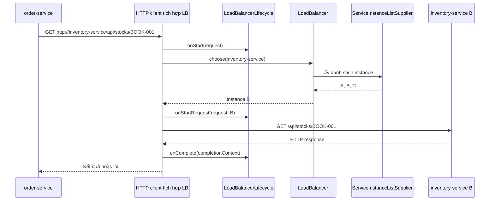

# LoadBalancerLifecycle và các thời điểm của một lời gọi

Khi `order-service` gọi `inventory-service` qua Spring Cloud LoadBalancer, một request không chỉ có hai thời điểm “gửi” và “nhận”. Trước khi request được gửi, phía client phải xác định service ID, lấy danh sách bản sao, chọn `ServiceInstance` và chuyển URI logic thành URI của instance thật. Sau đó client mới thực hiện lời gọi HTTP và nhận kết quả hoặc lỗi.

**`LoadBalancerLifecycle`** là cơ chế callback để quan sát những thời điểm quan trọng trong quá trình đó. Nó hữu ích cho việc ghi log có cấu trúc, đo lường, chẩn đoán lỗi và tích hợp thống kê. Để sử dụng đúng, cần hiểu sự khác nhau giữa **bắt đầu cân bằng tải**, **đã chọn xong instance và sắp gửi request**, và **hoàn tất một lượt xử lý**.

> Phạm vi bài học: kiến trúc và các callback của Spring Cloud LoadBalancer trong giao tiếp HTTP phía client. Tên kiểu dữ liệu và cách tích hợp cụ thể phụ thuộc phiên bản Spring Cloud cùng HTTP client đang sử dụng. Các ví dụ mã dùng `RequestDataContext`, `ResponseData` và `ServiceInstance` để minh họa một kiểu tích hợp HTTP thông dụng.

## 1. Tại sao cần quan sát vòng đời LoadBalancer?

Giả sử client gọi địa chỉ logic:

```text
GET http://inventory-service/api/stocks/BOOK-001
```

Hệ thống có ba instance của `inventory-service`:

| Instance | Địa chỉ | Vai trò trong ví dụ |
| --- | --- | --- |
| A | `10.0.1.11:8080` | Bản sao có thể nhận request |
| B | `10.0.1.12:8080` | Bản sao có thể nhận request |
| C | `10.0.1.13:8080` | Bản sao có thể nhận request |

Khi request thất bại, các câu hỏi quan trọng là:

- Client đã bắt đầu quá trình chọn instance chưa?
- `ServiceInstanceListSupplier` có cung cấp instance nào không?
- LoadBalancer đã chọn A, B hay C?
- Request đã được chuyển tới HTTP client để gửi tới instance đã chọn chưa?
- Có nhận được response, phát sinh exception hay bị hủy trước khi gửi?

Nếu chỉ ghi log của controller tại `inventory-service`, ta không nhìn thấy các lần gọi thất bại trước khi request tới server. Nếu chỉ nhìn mã HTTP, ta cũng không biết instance nào được chọn. Các callback của `LoadBalancerLifecycle` giúp bổ sung thông tin tại phía caller.

## 2. Vị trí của LoadBalancerLifecycle trong luồng request

Trong một lời gọi điển hình, HTTP client đã tích hợp LoadBalancer sẽ làm việc với thuật toán chọn instance và nguồn cung cấp danh sách instance. Các callback quan sát vòng đời xuất hiện quanh những bước đó.



Sơ đồ mô tả **đường đi thành công điển hình** để chỉ ra vị trí tương đối của callback. Các nhánh lỗi, retry, timeout hoặc hủy request có thể làm trình tự khác đi. Cụ thể, nếu không tìm thấy instance thì không có bước gửi HTTP tới instance đích; một số tích hợp có thể bỏ qua callback dành cho bước bắt đầu gửi request. Không nên mặc định cả ba callback luôn xuất hiện đúng một lần cho mọi tình huống.

## 3. Hợp đồng của LoadBalancerLifecycle

`LoadBalancerLifecycle` là một interface nhận các tham số generic biểu diễn ngữ cảnh request, ngữ cảnh response và kiểu server được chọn. Với trường hợp HTTP dùng Spring Cloud, có thể gặp dạng:

```java
LoadBalancerLifecycle<RequestDataContext, ResponseData, ServiceInstance>
```

Ý nghĩa của ba kiểu:

| Kiểu | Vai trò |
| --- | --- |
| `RequestDataContext` | Ngữ cảnh request mà client tích hợp LoadBalancer chuyển cho lifecycle |
| `ResponseData` | Dữ liệu response được dùng tại giai đoạn hoàn tất, nếu có |
| `ServiceInstance` | Kiểu đại diện cho một instance cụ thể đã được lựa chọn |

Ba callback chính:

| Callback | Thời điểm có ý nghĩa | Thông tin đáng chú ý |
| --- | --- | --- |
| `onStart(request)` | Bắt đầu một lượt xử lý LoadBalancer | Request/ngữ cảnh ban đầu; thường chưa biết instance được chọn |
| `onStartRequest(request, lbResponse)` | Sau bước chọn instance và trước khi thực hiện lời gọi tới đích | Kết quả lựa chọn instance; có thể liên kết service ID với instance cụ thể |
| `onComplete(completionContext)` | Khi lượt gọi kết thúc theo cơ chế của client tích hợp | Trạng thái hoàn tất, kết quả LoadBalancer, response hoặc exception nếu được cung cấp |

Interface còn có cơ chế `supports(...)` để xác định implementation lifecycle có phù hợp với những kiểu request, response và server đang được client sử dụng hay không. Điều này quan trọng khi ứng dụng chứa nhiều loại HTTP client hoặc nhiều cách sử dụng LoadBalancer.

**Các callback là điểm quan sát**, không phải API lựa chọn instance. Thuật toán như Round Robin hay Random thực hiện lựa chọn; `ServiceInstanceListSupplier` chuẩn bị danh sách ứng viên; `LoadBalancerLifecycle` nhận thông báo tại các thời điểm trong quá trình xử lý.

## 4. Callback onStart: bắt đầu lượt xử lý LoadBalancer

`onStart(Request<RC> request)` được gọi khi hoạt động LoadBalancer bắt đầu. Tại đây, ứng dụng có thể ghi nhận một lượt gọi mới và trích xuất những thông tin phù hợp từ ngữ cảnh request.

Ví dụ về thông tin hữu ích:

- Service ID được gọi, chẳng hạn `inventory-service`.
- Trace ID hoặc correlation ID để nối các bản ghi liên quan.
- HTTP method hoặc đường dẫn ở dạng đã loại bỏ dữ liệu nhạy cảm, nếu ngữ cảnh chứa thông tin đó.
- Thời điểm bắt đầu để đo tổng thời gian của lượt xử lý.

**Chưa nên ghi “request được gửi tới instance B” ở giai đoạn này.** Việc chọn bản sao chưa hoàn tất, nên chưa có đủ căn cứ xác định instance đích. Nếu discovery trả về danh sách rỗng, quá trình có thể kết thúc mà không có bất kỳ kết nối HTTP nào tới `inventory-service`.

Ví dụ chuỗi log mong muốn:

```text
traceId=ac17... event=loadbalancer.start serviceId=inventory-service
```

Log này chỉ cho biết phía caller bắt đầu xử lý một lời gọi qua LoadBalancer; nó **không chứng minh** rằng một replica đã nhận request.

## 5. Callback onStartRequest: đã chọn instance, chuẩn bị gửi request

`onStartRequest(Request<RC> request, Response<T> lbResponse)` được gọi tại thời điểm client đã có kết quả lựa chọn LoadBalancer và chuẩn bị thực hiện request tới instance đích.

Giá trị `lbResponse` là **response của quá trình lựa chọn LoadBalancer**, không phải HTTP response từ `inventory-service`. Đây là điểm dễ nhầm vì cả hai cùng dùng từ “response”.

Với kết quả lựa chọn thành công, `lbResponse.getServer()` có thể cung cấp `ServiceInstance` được chọn. Thông tin có thể dùng để ghi log hoặc gắn nhãn đo lường:

```text
traceId=ac17... event=loadbalancer.selected
serviceId=inventory-service instanceId=inventory-b host=10.0.1.12 port=8080
```

Trong ví dụ này, LoadBalancer đã chọn instance B. Tuy nhiên, callback xuất hiện **trước lời gọi HTTP thực tế**, nên vẫn chưa thể kết luận kết nối TCP/TLS thành công, instance đã nhận request hoặc server đã xử lý nghiệp vụ.

Khi đọc kết quả lựa chọn, cần kiểm tra trường hợp không có server hợp lệ, nếu API của integration có thể cung cấp trường hợp này. Không truy cập `getServer()` rồi giả định luôn có instance. Ngoài ra, nếu LoadBalancer kết thúc sớm vì danh sách rỗng, một số đường xử lý có thể không gọi `onStartRequest`.

## 6. Callback onComplete: kết thúc lượt gọi

`onComplete(CompletionContext<RES, T, RC> completionContext)` được kích hoạt khi lượt xử lý kết thúc theo logic của client tích hợp LoadBalancer.

Một completion context có thể cung cấp:

- Trạng thái hoàn tất của lượt xử lý.
- Request/ngữ cảnh gắn với lượt gọi.
- Kết quả lựa chọn LoadBalancer và instance liên quan.
- Response từ lời gọi thực tế, nếu đã nhận được và được integration chuyển vào context.
- Exception/cause nếu quá trình gặp lỗi và integration cung cấp thông tin đó.

Các trạng thái lifecycle thường được mô tả bằng `SUCCESS`, `FAILED` và `DISCARD`. Cần diễn giải chúng **theo hợp đồng của integration**, thay vì đồng nhất máy móc với HTTP status hoặc kết quả nghiệp vụ:

| Tình huống | Cách hiểu đúng |
| --- | --- |
| Lifecycle báo `SUCCESS` | Lượt gọi được xem là hoàn tất thành công theo quy tắc của integration; vẫn cần đọc HTTP status và body để biết nghiệp vụ thành công hay không |
| Lifecycle báo `FAILED` | Quá trình được ghi nhận là thất bại; cần kiểm tra exception, status và ngữ cảnh để tìm nguyên nhân |
| Lifecycle báo `DISCARD` | Lượt xử lý bị loại hoặc không thể tiếp tục theo một nhánh của integration; cần kiểm tra lý do cụ thể, ví dụ không có instance khả dụng |

Ví dụ `inventory-service` trả `HTTP 200` nhưng body có `success=false` và `code=INSUFFICIENT_STOCK`. Về mặt kết nối và trao đổi HTTP, lời gọi có thể đã hoàn tất bình thường. Về mặt nghiệp vụ, yêu cầu vẫn bị từ chối. Callback lifecycle không thay thế bước đọc và diễn giải body theo hợp đồng API.

Tương tự, không thể dựa duy nhất vào một `FAILED` để kết luận server đã trả `500`: thất bại có thể xảy ra trước khi request tới server, trong lúc kết nối, trong lúc đọc response hoặc ở tầng client.

## 7. Ví dụ triển khai một lifecycle để ghi log

Ví dụ sau khai báo một Spring bean triển khai `LoadBalancerLifecycle` cho ngữ cảnh HTTP. Các callback được giữ nhẹ, chỉ ghi nhận thời điểm và instance. Phần phân tích lỗi chi tiết có thể thực hiện tại lớp HTTP client, tracing hoặc nơi xử lý exception của ứng dụng.

```java
import org.slf4j.Logger;
import org.slf4j.LoggerFactory;
import org.springframework.cloud.client.ServiceInstance;
import org.springframework.cloud.client.loadbalancer.CompletionContext;
import org.springframework.cloud.client.loadbalancer.LoadBalancerLifecycle;
import org.springframework.cloud.client.loadbalancer.Request;
import org.springframework.cloud.client.loadbalancer.RequestDataContext;
import org.springframework.cloud.client.loadbalancer.Response;
import org.springframework.cloud.client.loadbalancer.ResponseData;
import org.springframework.stereotype.Component;

@Component
class InventoryLoadBalancerLifecycle implements
        LoadBalancerLifecycle<RequestDataContext, ResponseData, ServiceInstance> {

    private static final Logger log =
            LoggerFactory.getLogger(InventoryLoadBalancerLifecycle.class);

    @Override
    public void onStart(Request<RequestDataContext> request) {
        log.debug("loadbalancer.start");
    }

    @Override
    public void onStartRequest(
            Request<RequestDataContext> request,
            Response<ServiceInstance> lbResponse) {

        if (lbResponse != null && lbResponse.hasServer()) {
            ServiceInstance instance = lbResponse.getServer();
            log.debug("loadbalancer.selected serviceId={} host={} port={}",
                    instance.getServiceId(),
                    instance.getHost(),
                    instance.getPort());
        } else {
            log.debug("loadbalancer.selected no-server");
        }
    }

    @Override
    public void onComplete(
            CompletionContext<ResponseData, ServiceInstance, RequestDataContext> context) {
        log.debug("loadbalancer.complete status={}", context.getStatus());
    }
}
```

Ví dụ sử dụng những kiểu dữ liệu và callback phổ biến của Spring Cloud LoadBalancer. Khi áp dụng, cần đối chiếu chữ ký API với phiên bản Spring Cloud đang dùng và xác nhận client thực tế có phát lifecycle event tương ứng. `@Component` đăng ký bean vào Spring context; phạm vi áp dụng thực tế phụ thuộc cách integration tìm các bean lifecycle và kết quả kiểm tra `supports(...)`.

Đoạn mã cố ý không giữ `startTime` trong một field của singleton bean. Nhiều request có thể diễn ra đồng thời; một field dùng chung sẽ bị ghi đè và tạo số liệu sai. Muốn tính duration, hãy sử dụng cơ chế quan sát đã hỗ trợ tương quan theo request, hoặc lưu timestamp theo ngữ cảnh với cấu trúc có vòng đời và dọn dẹp rõ ràng.

## 8. Phân biệt ba loại kết quả dễ bị trộn lẫn

Trong cùng một lời gọi, có ít nhất ba kết quả khác nhau cần phân biệt:

| Loại kết quả | Nó trả lời câu hỏi gì? | Ví dụ |
| --- | --- | --- |
| Kết quả chọn instance (`Response<ServiceInstance>`) | LoadBalancer chọn được bản sao nào? | Instance B ở `10.0.1.12:8080` |
| Kết quả HTTP | Lời gọi HTTP nhận status/body gì, hoặc gặp lỗi I/O nào? | `HTTP 503`, `HTTP 200`, read timeout |
| Kết quả nghiệp vụ | Hành động được yêu cầu có hợp lệ và được chấp nhận không? | `INSUFFICIENT_STOCK`, `ORDER_ALREADY_CONFIRMED` |

Đặt các kết quả này cạnh nhau sẽ tránh những kết luận sai:

- “Đã chọn được B” **không có nghĩa** đã kết nối được B.
- “Đã nhận `HTTP 200`” **không có nghĩa** nghiệp vụ đã thành công.
- “Không tìm thấy bản sao” **không có nghĩa** `inventory-service` đã trả `HTTP 404`; có thể không có request HTTP nào được gửi.
- “`onComplete` đã chạy” **không bảo đảm** response có body hợp lệ hoặc downstream đã xử lý đúng nghiệp vụ.

## 9. Những nhánh bất thường cần xét trong vòng đời

Không phải mọi request đều có đường đi thành công như sơ đồ đầu bài. Khi hệ thống gặp sự cố, các điểm quan sát có thể thay đổi:

| Tình huống | Điều cần quan sát | Giải thích |
| --- | --- | --- |
| Discovery không trả về instance | Có event bắt đầu hay không; kết quả lựa chọn là gì | Chưa có instance để gửi request; có thể kết thúc sớm |
| Supplier lọc hết instance | Danh sách sau filter có rỗng không | Discovery có thể có dữ liệu nhưng LoadBalancer không còn ứng viên |
| Instance được chọn nhưng connection refused | Instance đã chọn; exception kết nối | `onStartRequest` không chứng minh HTTP request đã tới server |
| HTTP client bị read timeout | Instance đã chọn; elapsed time; root cause | Server có thể đã nhận và xử lý request nhưng client chưa nhận response |
| Downstream trả `503` | HTTP status, retry policy, instance | Có HTTP response hợp lệ; cần tách lỗi upstream và trạng thái lifecycle |
| Caller hủy lời gọi reactive | Request có bị cancel không; integration có gửi completion callback không | Hủy subscription và kết thúc network call không phải lúc nào cũng tương đương |
| Retry sang instance khác | Số attempt và instance ở từng attempt | Một yêu cầu nghiệp vụ có thể tạo nhiều lần lựa chọn hoặc nhiều lần gửi HTTP |

**Không nên coi số lần `onStart`, `onStartRequest` và `onComplete` luôn bằng nhau.** Tần suất và nhánh gọi phụ thuộc client, cấu hình retry, cách xử lý exception và phiên bản tích hợp. Khi xây dashboard, cần hiểu rõ một sự kiện tương ứng với một **attempt**, một lần **chọn instance** hay một request nghiệp vụ end-to-end.

## 10. Retry khiến một lời gọi nghiệp vụ có nhiều attempt

Giả sử `order-service` đang thực hiện một lần gọi nghiệp vụ nhưng cấu hình cho phép retry khi lỗi kết nối:

```text
Business request: GET /api/stocks/BOOK-001
  Attempt 1: chọn instance A -> connection refused
  Attempt 2: chọn instance C -> HTTP 200
  Business result: có response từ attempt 2
```

Ở góc nhìn nghiệp vụ, có một lời gọi kiểm tra tồn kho. Ở góc nhìn hạ tầng, có thể có hai lần chọn instance và hai lần thử gửi request. Vì vậy, dashboard nên tách:

- **Business requests:** tổng số thao tác gọi từ `order-service` theo logic ứng dụng.
- **LoadBalancer attempts/selections:** tổng số lần thực hiện lựa chọn và thử gọi instance, tùy event integration thực sự phát ra.
- **HTTP responses và connection errors:** số lời gọi HTTP hoàn tất hay thất bại theo kết quả client nhìn thấy.

Các chỉ số này không nhất thiết trùng nhau khi có retry. Nếu đo tỷ lệ lỗi chỉ bằng số lần chọn instance thất bại, có thể nhìn hệ thống xấu hơn trải nghiệm cuối cùng của caller; ngược lại, chỉ nhìn kết quả nghiệp vụ cuối cùng có thể che việc một instance liên tục gây lỗi và buộc phải retry.

Với thao tác ghi dữ liệu, retry còn phải xét idempotency. Một timeout có thể xảy ra sau khi server đã thực hiện thao tác; việc lifecycle ghi nhận thất bại ở phía client không chứng minh thao tác ở server chưa xảy ra.

## 11. Đo độ trễ ở các mốc thích hợp

Có thể dùng ba mốc lifecycle để xây dựng một mô hình thời gian tương đối:

```text
T0                      T1                               T2
onStart                 onStartRequest                   onComplete
  |-----------------------|--------------------------------|
     Lấy danh sách và       HTTP client thực hiện lời gọi,
     lựa chọn instance      nhận response hoặc lỗi
```

Trong đường đi thông thường:

- **T0 → T1:** khoảng thời gian liên quan đến lấy/cung cấp danh sách instance và lựa chọn đích; có thể bao gồm cache, filter hoặc overhead tích hợp.
- **T1 → T2:** khoảng thời gian liên quan đến thực hiện lời gọi sau khi đã chọn instance; có thể bao gồm thiết lập kết nối, chờ server và xử lý kết quả tại client.
- **T0 → T2:** thời gian xử lý nhìn từ lifecycle cho lượt gọi được quan sát, không nhất thiết bằng tổng thời gian end-to-end của nghiệp vụ nếu còn bước khác trước/sau hoặc retry ở tầng ngoài.

Đây là cách **diễn giải tương đối các mốc**, không phải bảo đảm hai khoảng đo tách biệt hoàn hảo thời gian discovery và thời gian mạng. Với ứng dụng reactive, scheduling và các thao tác bất đồng bộ có thể ảnh hưởng tới thời điểm callback thực sự chạy. Nên dùng timer/observation có khả năng tương quan từng request, tránh tính thời gian bằng cách đọc đồng hồ tường để so sánh hoặc gộp event của những request khác nhau.

Nếu dự án đã dùng Micrometer hoặc Spring Observability, nên tận dụng tích hợp metrics/tracing của phiên bản đang triển khai. Một số phiên bản Spring Cloud LoadBalancer cung cấp lifecycle để thu thập thống kê qua Micrometer khi dependency và cấu hình thích hợp được bật. Hãy kiểm tra tên metric và nhãn theo phiên bản, tránh tự giả định mọi metric xuất hiện mặc định.

## 12. Giới hạn trách nhiệm của lifecycle và các thực hành nên tránh

`LoadBalancerLifecycle` phù hợp để **quan sát** tiến trình, nhưng có một số công việc cần đặt ở đúng nơi:

| Nhu cầu | Thành phần thích hợp hơn |
| --- | --- |
| Lọc replica theo zone, metadata hoặc tình trạng sức khỏe | `ServiceInstanceListSupplier` và các supplier/filter được cấu hình |
| Thay đổi thuật toán chọn replica | `ReactorLoadBalancer` / implementation lựa chọn tương ứng |
| Quản lý danh sách instance đăng ký | Discovery client và service registry |
| Timeout, retry và chính sách xử lý HTTP status | HTTP client, retry policy và tích hợp LoadBalancer theo cấu hình |
| Phân loại lỗi nghiệp vụ từ response body | Client adapter hoặc lớp dịch vụ nghiệp vụ |
| Ghi nhận các thời điểm và kết quả lựa chọn | `LoadBalancerLifecycle`, metrics và tracing |

Những thực hành nên tránh khi viết callback:

1. **Không thực hiện I/O chặn lâu** trong callback, đặc biệt ở luồng xử lý reactive; logging hoặc xuất metrics nên nhẹ và phù hợp với cơ chế bất đồng bộ.
2. **Không ném exception tùy ý** chỉ để ghi nhận sự kiện, vì lỗi của bộ quan sát có thể làm gián đoạn request thật.
3. **Không lưu trạng thái request vào biến thành viên dùng chung** của singleton lifecycle nếu không có cơ chế tương quan an toàn cho concurrent requests.
4. **Không ghi toàn bộ header, token hoặc body** vào log; chỉ ghi trường cần thiết và đã được lọc dữ liệu nhạy cảm.
5. **Không thay thế nghiệp vụ bằng callback**: `onComplete` không phải nơi để xác định đơn hàng hợp lệ hay tồn kho đủ.
6. **Không tự động retry trong callback**: retry nên có chính sách, giới hạn tổng thời gian và xử lý idempotency rõ ràng.

Một lifecycle ghi quá nhiều log có thể làm tăng độ trễ và tải hệ thống. Nên chọn mức log, sampling, nhãn metric và độ chi tiết phù hợp với mục tiêu quan sát.

## 13. Tình huống thực hành: phân tích một request thất bại

Giả sử hệ thống ghi nhận:

```text
traceId=4a19... event=loadbalancer.start serviceId=inventory-service
traceId=4a19... event=loadbalancer.selected serviceId=inventory-service host=10.0.1.12 port=8080
traceId=4a19... event=loadbalancer.complete status=FAILED
traceId=4a19... event=http.error cause=ConnectException message=Connection refused
```

Có thể kết luận:

1. Caller đã bắt đầu xử lý lời gọi tới service ID `inventory-service`.
2. LoadBalancer đã chọn instance `10.0.1.12:8080`.
3. Lời gọi thất bại ở bước kết nối tới instance được chọn.
4. Chưa có cơ sở kết luận `inventory-service` đã trả mã HTTP lỗi hay logic nghiệp vụ đã chạy.

Các bước điều tra tiếp theo là kiểm tra tiến trình và port trên instance B, dữ liệu đăng ký trong service discovery, thời gian cache, health check và chính sách retry. Nếu các instance khác khỏe, có thể cân nhắc cho phép client thử instance khác với giới hạn rõ ràng.

Một bộ log khác:

```text
traceId=5b20... event=loadbalancer.start serviceId=inventory-service
traceId=5b20... event=loadbalancer.selected serviceId=inventory-service host=10.0.1.13 port=8080
traceId=5b20... event=loadbalancer.complete status=SUCCESS
traceId=5b20... event=inventory.result httpStatus=200 businessCode=INSUFFICIENT_STOCK
```

Trong ví dụ này, lời gọi hoàn tất bình thường ở tầng HTTP theo cách integration đánh giá, nhưng nghiệp vụ không đủ tồn kho. Đổi instance hoặc retry ngay không giải quyết được lỗi nghiệp vụ nếu các replica cùng truy cập dữ liệu nhất quán.

## 14. Các câu hỏi tự kiểm tra

1. `LoadBalancerLifecycle` khác gì với `ServiceInstanceListSupplier` và `RoundRobinLoadBalancer`?
2. Vì sao `onStart` chưa thể cho biết host và port cuối cùng của request?
3. Trong `onStartRequest`, `lbResponse` là kết quả chọn instance hay HTTP response từ server?
4. `onComplete` báo một lượt gọi thành công có đồng nghĩa nghiệp vụ luôn thành công không? Vì sao?
5. Khi một request không tìm được instance, có nên mặc định cả ba callback luôn được gọi không?
6. Vì sao số lần callback không nhất thiết bằng số request nghiệp vụ khi bật retry?
7. Nếu muốn lọc các instance khác zone, nên đặt logic ở lifecycle hay supplier? Giải thích.
8. Nên lấy thông tin nào từ callback và HTTP client để phân biệt lỗi lựa chọn instance, lỗi kết nối và lỗi nghiệp vụ?

Điểm cốt lõi: `onStart` đánh dấu lúc bắt đầu xử lý LoadBalancer; `onStartRequest` cho biết kết quả lựa chọn instance trước lời gọi thực tế; `onComplete` cung cấp ngữ cảnh khi lượt gọi kết thúc. Đọc các mốc này cùng thông tin discovery, exception HTTP và kết quả nghiệp vụ sẽ tạo nên bức tranh đầy đủ hơn về giao tiếp giữa các dịch vụ.
