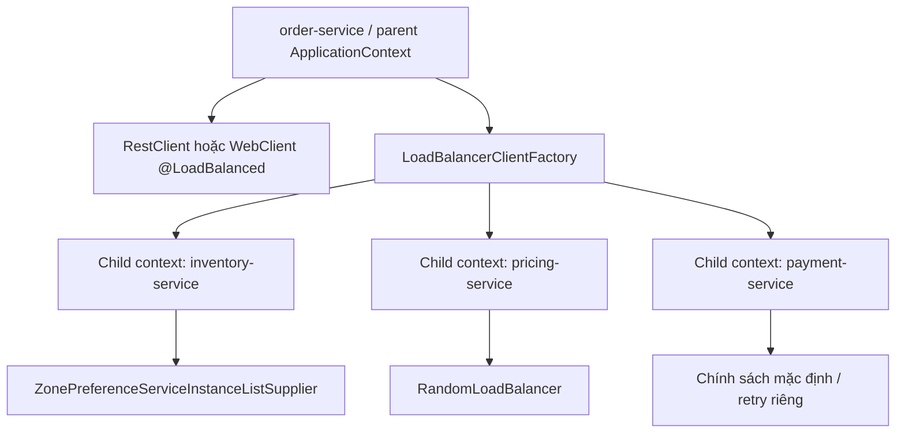

# Cấu hình dùng chung và cấu hình riêng cho từng service ID

## Mục tiêu

Khi một ứng dụng Spring gọi nhiều dịch vụ nội bộ, mỗi dịch vụ có thể cần cách cân bằng tải khác nhau. Ví dụ, `order-service` gọi `inventory-service` thường xuyên và muốn ưu tiên instance cùng vùng triển khai; trong khi `pricing-service` có các instance tương đương và muốn chọn ngẫu nhiên. Các giới hạn retry và chu kỳ health check cũng có thể khác nhau theo từng dịch vụ.

Spring Cloud LoadBalancer hỗ trợ kết hợp **cấu hình dùng chung** với **cấu hình riêng theo service ID**. Hiểu đúng phạm vi này giúp tránh trường hợp thay đổi cấu hình cho một dịch vụ nhưng vô tình tác động đến mọi HTTP client trong ứng dụng.

Sau bài học, bạn có thể:

- Xác định service ID được lấy từ đâu khi dùng `RestClient`, `WebClient` hoặc OpenFeign.
- Phân biệt các thuộc tính mặc định `spring.cloud.loadbalancer.*` và thuộc tính riêng `spring.cloud.loadbalancer.clients.<clientId>.*`.
- Dùng `@LoadBalancerClient` và `@LoadBalancerClients` để khai báo bean lựa chọn instance cho một hoặc nhiều service ID.
- Giải thích cơ chế Spring child context riêng cho từng service ID, hành vi lazy initialization và nguy cơ rò rỉ bean cấu hình.
- Kiểm tra thứ tự ưu tiên, các ngoại lệ cấu hình toàn cục, cùng các tình huống sai service ID hoặc danh sách instance rỗng.

## 1. Vì sao cần cấu hình riêng theo service ID?

Giả sử hệ thống có ba service đích:

| Service ID | Đặc điểm triển khai | Chính sách muốn áp dụng |
|---|---|---|
| `inventory-service` | Có nhiều bản sao ở hai zone | Ưu tiên instance cùng zone với caller |
| `pricing-service` | Các instance có năng lực tương đương | Chọn ngẫu nhiên một instance |
| `payment-service` | Thao tác thanh toán cần kiểm soát việc thực thi lại | Hạn chế hoặc tắt retry của LoadBalancer |

Nếu thiết lập tất cả bằng một chính sách dùng chung, hệ thống có thể không đạt yêu cầu của từng service. Chẳng hạn, việc bật retry cho mọi lời gọi có thể không phù hợp với thao tác thanh toán chưa được bảo vệ bằng idempotency key. Ngược lại, việc tắt retry toàn cục có thể làm giảm khả năng phục hồi của các thao tác đọc dữ liệu an toàn để thử lại.

**Service ID** là tên logic của dịch vụ đích trong discovery, ví dụ `inventory-service`. Nó không phải tên lớp Java, tên bean HTTP client hay địa chỉ IP của một instance. Với HTTP client đã được tích hợp LoadBalancer, URL `http://inventory-service/api/items/42` được diễn giải là lời gọi tới service ID `inventory-service`. Với OpenFeign, tên ở `@FeignClient(name = "inventory-service")` cũng xác định service đích dùng để phân giải instance.

Khi thiết lập cấu hình theo service ID, ứng dụng vẫn có thể dùng một `@LoadBalanced RestClient.Builder` hoặc `@LoadBalanced WebClient.Builder` để gọi nhiều service; lựa chọn chính sách sẽ dựa vào service ID của từng yêu cầu.

## 2. Ba lớp cấu hình cần phân biệt

| Lớp cấu hình | Cách khai báo | Phạm vi |
|---|---|---|
| Mặc định bằng properties | `spring.cloud.loadbalancer.*` | Giá trị mặc định cho những service sử dụng thuộc tính tương ứng |
| Ghi đè thuộc tính theo client | `spring.cloud.loadbalancer.clients.<clientId>.*` | Giá trị riêng của service ID được chỉ định |
| Cấu hình bean theo service | `@LoadBalancerClient`, `@LoadBalancerClients` | `ServiceInstanceListSupplier`, `ReactorLoadBalancer` và bean tùy chỉnh trong context của service ID |

Hai nhóm đầu là cấu hình giá trị. Nhóm thứ ba thay đổi thành phần thực sự quyết định cách lấy danh sách và chọn `ServiceInstance`. Chúng bổ sung cho nhau nhưng không đồng nghĩa: cấu hình một tham số `health-check.interval` chưa chắc kích hoạt health check nếu chưa có supplier health check trong chuỗi bean.

Trong cấu hình mặc định, Spring Cloud LoadBalancer thường dùng `RoundRobinLoadBalancer` để lần lượt chọn instance. Khi một service cần `RandomLoadBalancer`, zone preference, weighted supplier hoặc một thuật toán tự viết, có thể thay đổi các bean trong context riêng của service đó.

## 3. Cơ chế context riêng cho từng dịch vụ

Spring Cloud LoadBalancer dùng `LoadBalancerClientFactory` để quản lý **một Spring child context cho mỗi service ID**. Các context này tách biệt cấu hình LoadBalancer cho từng dịch vụ, đồng thời có thể nhận những bean phù hợp từ parent context theo cơ chế của Spring.



Mặc định, child context được khởi tạo **lazily** khi service ID đó có yêu cầu cân bằng tải đầu tiên. Có thể yêu cầu khởi tạo sớm cho những service quan trọng:

```yaml
spring:
  cloud:
    loadbalancer:
      eager-load:
        clients:
          - inventory-service
          - pricing-service
```

Eager loading giúp phát hiện một số lỗi tạo bean sớm hơn, nhưng làm tăng công việc khi khởi động. Không nên thêm mọi service ID vào danh sách nếu chưa có lý do rõ ràng.

**Điểm cần nhớ:** context riêng là lý do một ứng dụng có thể dùng zone preference cho `inventory-service` và random cho `pricing-service`. Tuy nhiên, nếu vô tình khai báo bean dành riêng cho một service trong phạm vi component scan của ứng dụng chính, nó có thể trở thành bean dùng chung và ảnh hưởng đến những context khác.

## 4. Khai báo thuộc tính mặc định và ghi đè theo service ID

Trong Spring Cloud Commons 5.0.4, phần lớn thuộc tính LoadBalancer có thể đặt theo hai cấp:

- Cấp mặc định: `spring.cloud.loadbalancer.<property>`.
- Cấp một dịch vụ: `spring.cloud.loadbalancer.clients.<clientId>.<property>`.

Ví dụ trong `application.yml` của `order-service`:

```yaml
spring:
  cloud:
    loadbalancer:
      health-check:
        initial-delay: 1s
        interval: 25s
      retry:
        enabled: true
        max-retries-on-next-service-instance: 1
      clients:
        inventory-service:
          health-check:
            interval: 10s
        pricing-service:
          health-check:
            interval: 45s
        payment-service:
          retry:
            enabled: false
```

Các giá trị mặc định được **hợp nhất** với các giá trị riêng; trường của service ID có ưu tiên cao hơn khi cùng một thuộc tính được khai báo ở cả hai cấp.

| Thuộc tính | `inventory-service` | `pricing-service` | `payment-service` |
|---|---|---|---|
| `health-check.initial-delay` | Kế thừa `1s` | Kế thừa `1s` | Kế thừa `1s` |
| `health-check.interval` | Ghi đè thành `10s` | Ghi đè thành `45s` | Kế thừa `25s` |
| `retry.enabled` | Kế thừa `true` | Kế thừa `true` | Ghi đè thành `false` |
| `retry.max-retries-on-next-service-instance` | Kế thừa `1` | Kế thừa `1` | Không áp dụng khi retry bị tắt |

Ví dụ trên minh họa cách **hợp nhất thuộc tính**. Các giá trị `health-check.*` chỉ có tác dụng kiểm tra định kỳ khi `HealthCheckServiceInstanceListSupplier` được sử dụng. Retry còn phụ thuộc loại HTTP client, các thư viện đi kèm và lỗi được phép retry. Vì vậy, đọc được property không đồng nghĩa đã bật đầy đủ chức năng tương ứng.

Bạn có thể biểu diễn một thuộc tính riêng thành đường dẫn đầy đủ, chẳng hạn:

```properties
spring.cloud.loadbalancer.health-check.interval=25s
spring.cloud.loadbalancer.clients.inventory-service.health-check.interval=10s
```

Trong ví dụ này, `inventory-service` dùng khoảng kiểm tra `10s` nếu health-check supplier được kích hoạt; service không có override tiếp tục dùng `25s`.

### 4.1. Những thuộc tính không thể bật độc lập theo service

Không phải mọi thuộc tính đều có thể bật riêng bằng cách khai báo dưới `clients.<clientId>`. Tài liệu Spring Cloud LoadBalancer xác định các ngoại lệ:

| Thuộc tính toàn cục | Quy tắc |
|---|---|
| `spring.cloud.loadbalancer.enabled` | Bật hoặc tắt LoadBalancer cho toàn ứng dụng. |
| `spring.cloud.loadbalancer.retry.enabled` | Cổng bật/tắt retry toàn cục. Khi đã bật toàn cục có thể tắt cho một service; không thể bật lại cho riêng một service nếu toàn cục đã tắt. |
| `spring.cloud.loadbalancer.cache.enabled` | Cổng bật/tắt cache toàn cục. Nếu đã bật toàn cục, có thể bỏ `CachingServiceInstanceListSupplier` khỏi cấu hình riêng để một service không dùng cache; không thể bật riêng cache khi toàn cục đã tắt. |
| `spring.cloud.loadbalancer.stats.micrometer.enabled` | Bật hoặc tắt tích hợp Micrometer LoadBalancer ở cấp toàn cục. |

Ví dụ sau **không** thể kích hoạt retry cho `inventory-service` nếu retry đã bị tắt toàn cục:

```yaml
spring:
  cloud:
    loadbalancer:
      retry:
        enabled: false
      clients:
        inventory-service:
          retry:
            enabled: true
```

Nếu yêu cầu là retry cho `inventory-service` nhưng tắt cho `payment-service`, cách phù hợp là **bật cổng retry toàn cục** rồi khai báo `clients.payment-service.retry.enabled: false`, sau đó xác minh điều kiện retry của HTTP client đang sử dụng.

## 5. Cấu hình bằng `@LoadBalancerClient` và `@LoadBalancerClients`

Properties thích hợp khi điều chỉnh các giá trị mà thư viện hỗ trợ. Khi muốn thay đổi thuật toán hoặc chuỗi supplier, hãy khai báo cấu hình bean gắn với service ID.

Giả sử `order-service` cần:

- `inventory-service`: lấy instance từ discovery, có cache và ưu tiên cùng zone.
- `pricing-service`: dùng `RandomLoadBalancer` thay cho round robin.
- Các service còn lại: giữ hành vi LoadBalancer mặc định.

### 5.1. Đăng ký hai cấu hình riêng

Tạo lớp đăng ký trong package được ứng dụng quét:

```java
import org.springframework.cloud.client.loadbalancer.LoadBalanced;
import org.springframework.cloud.loadbalancer.annotation.LoadBalancerClient;
import org.springframework.cloud.loadbalancer.annotation.LoadBalancerClients;
import org.springframework.context.annotation.Bean;
import org.springframework.context.annotation.Configuration;
import org.springframework.web.client.RestClient;

@Configuration(proxyBeanMethods = false)
@LoadBalancerClients({
    @LoadBalancerClient(
        name = "inventory-service",
        configuration = InventoryLoadBalancerConfiguration.class
    ),
    @LoadBalancerClient(
        name = "pricing-service",
        configuration = PricingLoadBalancerConfiguration.class
    )
})
public class ServiceLoadBalancerRegistration {

    @Bean
    @LoadBalanced
    RestClient.Builder loadBalancedRestClientBuilder() {
        return RestClient.builder();
    }
}
```

`@LoadBalancerClients` chỉ là cách gom nhiều `@LoadBalancerClient` trên một lớp. Thuộc tính `name` hoặc `value` của mỗi annotation phải trùng **service ID đích**. Đây là cấu hình đặt trong ứng dụng **gọi** dịch vụ, không phải bắt buộc đặt trong ứng dụng cung cấp dịch vụ.

### 5.2. Cấu hình riêng cho `inventory-service`

Lớp dưới đây được tham chiếu từ annotation, nhưng **không đánh dấu `@Configuration`** để tránh việc component scan đăng ký nó như cấu hình dùng chung:

```java
import org.springframework.cloud.loadbalancer.core.ServiceInstanceListSupplier;
import org.springframework.context.ConfigurableApplicationContext;
import org.springframework.context.annotation.Bean;

public class InventoryLoadBalancerConfiguration {

    @Bean
    ServiceInstanceListSupplier inventoryInstanceListSupplier(
            ConfigurableApplicationContext context) {
        return ServiceInstanceListSupplier.builder()
                .withDiscoveryClient()
                .withCaching()
                .withZonePreference()
                .build(context);
    }
}
```

Chuỗi supplier trên lấy danh sách instance từ discovery, cache danh sách, rồi ưu tiên instance có metadata `zone` phù hợp với zone của caller. Để chính sách hoạt động, cần có zone của caller (chẳng hạn `spring.cloud.loadbalancer.zone`) và metadata `zone` của các instance đích.

Không kết hợp `withCaching()` với `withHealthChecks()` một cách tùy tiện. Tài liệu khuyến cáo chọn cơ chế cache phù hợp: supplier health check đã có cơ chế lưu và phát lại kết quả riêng. Khi dùng cache trong chuỗi, hãy đặt nó sát supplier lấy instance qua mạng, trước các supplier lọc theo request.

### 5.3. Cấu hình riêng cho `pricing-service`

Thay thuật toán mặc định bằng lựa chọn ngẫu nhiên:

```java
import org.springframework.cloud.client.ServiceInstance;
import org.springframework.cloud.loadbalancer.core.RandomLoadBalancer;
import org.springframework.cloud.loadbalancer.core.ReactorLoadBalancer;
import org.springframework.cloud.loadbalancer.core.ServiceInstanceListSupplier;
import org.springframework.cloud.loadbalancer.support.LoadBalancerClientFactory;
import org.springframework.context.annotation.Bean;
import org.springframework.core.env.Environment;

public class PricingLoadBalancerConfiguration {

    @Bean
    ReactorLoadBalancer<ServiceInstance> pricingLoadBalancer(
            Environment environment,
            LoadBalancerClientFactory factory) {
        String serviceId = environment.getProperty(
                LoadBalancerClientFactory.PROPERTY_NAME);
        return new RandomLoadBalancer(
                factory.getLazyProvider(serviceId, ServiceInstanceListSupplier.class),
                serviceId);
    }
}
```

`LoadBalancerClientFactory.PROPERTY_NAME` cho biết service ID của child context đang được khởi tạo. Không nên ghi cứng `"pricing-service"` bên trong bean này: dùng thuộc tính context giúp cấu hình có thể tái sử dụng đúng cách. `RandomLoadBalancer` vẫn lấy danh sách ứng viên từ `ServiceInstanceListSupplier`, sau đó chọn ngẫu nhiên một instance.

### 5.4. Dùng chung RestClient nhưng giữ chính sách riêng

Với bean `RestClient.Builder` đã được đánh dấu `@LoadBalanced`:

```java
import org.springframework.cloud.client.loadbalancer.LoadBalanced;
import org.springframework.stereotype.Component;
import org.springframework.web.client.RestClient;

@Component
public class DownstreamServiceGateway {

    private final RestClient client;

    public DownstreamServiceGateway(@LoadBalanced RestClient.Builder builder) {
        this.client = builder.build();
    }

    public String checkInventory() {
        return client.get()
                .uri("http://inventory-service/actuator/health")
                .retrieve()
                .body(String.class);
    }

    public String checkPricing() {
        return client.get()
                .uri("http://pricing-service/actuator/health")
                .retrieve()
                .body(String.class);
    }
}
```

Hai lời gọi sử dụng cùng HTTP client, nhưng Spring Cloud LoadBalancer áp dụng chính sách theo service ID trong URL: `inventory-service` dùng zone preference, `pricing-service` dùng random. Các lớp trên chỉ mô tả phía caller; cần có instance được discovery cung cấp và endpoint ở hai dịch vụ đích để ví dụ chạy được.

## 6. Cấu hình bean mặc định cho mọi service ID

Khi cần một nhóm bean LoadBalancer tùy chỉnh áp dụng cho nhiều dịch vụ, `@LoadBalancerClients` còn cung cấp thuộc tính `defaultConfiguration`:

```java
@Configuration(proxyBeanMethods = false)
@LoadBalancerClients(
    defaultConfiguration = SharedLoadBalancerConfiguration.class,
    value = {
        @LoadBalancerClient(
            name = "inventory-service",
            configuration = InventoryLoadBalancerConfiguration.class
        )
    }
)
class LoadBalancerRegistrations {
}
```

Đây là **minh họa cú pháp thay thế**, không phải lớp cần đăng ký đồng thời với `ServiceLoadBalancerRegistration` ở phần trước. `SharedLoadBalancerConfiguration` đại diện cho lớp cấu hình bean mặc định mà bạn tự định nghĩa. Các cấu hình riêng như `InventoryLoadBalancerConfiguration` được gắn với service ID tương ứng.

Nếu một child context có nhiều bean cùng loại (ví dụ nhiều `ServiceInstanceListSupplier` hoặc nhiều `ReactorLoadBalancer`) do cấu hình mặc định và cấu hình riêng cùng đăng ký, phải kiểm tra cách auto-configuration chọn bean. Không mặc nhiên coi mọi bean đều được thay thế chỉ vì có `@LoadBalancerClient`; hãy thiết kế các định nghĩa bean để không mơ hồ và kiểm thử context thực tế.

**Quy tắc tránh rò rỉ cấu hình:** những class truyền vào `defaultConfiguration` hoặc `configuration` của `@LoadBalancerClient` nên **không** có `@Configuration`, hoặc phải đặt ngoài phạm vi component scan chính. Nếu chúng bị quét vào parent context, cấu hình dự kiến dành cho một service có thể ảnh hưởng đến service khác.

## 7. Cấu hình dựng sẵn và chính sách riêng

Nếu tất cả dịch vụ cùng dùng một chiến lược, property `spring.cloud.loadbalancer.configurations` là lựa chọn ngắn gọn. Một số cấu hình dựng sẵn được tài liệu hỗ trợ:

| Giá trị cấu hình | Ý nghĩa |
|---|---|
| `default` | Cơ chế supplier và cân bằng tải mặc định. |
| `weighted` | Dùng weighted supplier để xét metadata `weight`. |
| `zone-preference` | Ưu tiên instance cùng zone, kết hợp caching theo cấu hình dựng sẵn. |
| `health-check` | Dùng supplier kiểm tra sức khỏe instance. |
| `same-instance-preference` | Ưu tiên instance đã được chọn trước đó nếu còn khả dụng. |

Ví dụ bật cấu hình weighted ở cấp mặc định:

```yaml
spring:
  cloud:
    loadbalancer:
      configurations: weighted
```

Đây là cấu hình preset cho LoadBalancer theo phạm vi mặc định của ứng dụng. Nếu chỉ một service ID cần weighted, hoặc cần chuỗi kết hợp zone + hint + weight, cách rõ ràng hơn là khai báo `ServiceInstanceListSupplier` trong `@LoadBalancerClient(configuration = ...)` dành riêng cho service đó.

Property thay đổi preset supplier, còn `ReactorLoadBalancer` quyết định thuật toán chọn một instance từ danh sách đã có. Một ứng dụng có thể dùng `RandomLoadBalancer` cùng một supplier lọc theo zone; hai trách nhiệm này không loại trừ nhau.

## 8. Các map cấu hình theo service có sẵn

Một số property cũ đã hỗ trợ map theo service ID mà **không đi qua nhánh `clients`**. Spring Cloud giữ cơ chế đó để tương thích ngược:

```yaml
spring:
  cloud:
    loadbalancer:
      hint:
        default: stable
        inventory-service: canary
      health-check:
        path:
          default: /actuator/health
          inventory-service: /internal/readiness
```

- `hint.default` là gợi ý mặc định; `hint.inventory-service` áp dụng riêng cho `inventory-service` khi request không cung cấp hint trực tiếp.
- `health-check.path.default` là endpoint health check mặc định; `health-check.path.inventory-service` ghi đè endpoint cho `inventory-service`.
- Hint chỉ có tác dụng lọc khi chuỗi supplier có `HintBasedServiceInstanceListSupplier`. Health-check path chỉ được sử dụng khi health-check supplier được kích hoạt.

Không nên coi hint là cơ chế phân quyền hoặc cô lập tenant: nếu không có instance khớp hint, supplier hint mặc định có thể trả lại danh sách instance từ delegate. Với yêu cầu phân vùng bắt buộc, cần chính sách lọc nghiêm ngặt hơn hoặc tách service ID phù hợp.

## 9. Phân biệt cấu hình LoadBalancer và cấu hình HTTP client

Spring Cloud LoadBalancer giải quyết vấn đề **chọn một `ServiceInstance`**. Timeout kết nối, timeout phản hồi và một số chính sách retry phụ thuộc client gửi HTTP request.

| Vấn đề | Thành phần phù hợp |
|---|---|
| Chọn instance theo service ID | Spring Cloud LoadBalancer |
| Lọc instance cùng zone | `ZonePreferenceServiceInstanceListSupplier` |
| Chọn ngẫu nhiên | `RandomLoadBalancer` |
| Giới hạn số lần retry ở lớp LoadBalancer | `spring.cloud.loadbalancer.retry.*`, khi tích hợp retry phù hợp |
| Timeout HTTP của OpenFeign | `spring.cloud.openfeign.client.config.*` |
| Timeout HTTP của RestClient/WebClient | HTTP request factory hoặc connector tương ứng |
| Endpoint và health check của instance | Discovery provider / Spring Cloud LoadBalancer health-check supplier |

Với OpenFeign, ví dụ một cấu hình default và một cấu hình riêng cho service:

```yaml
spring:
  cloud:
    openfeign:
      client:
        config:
          default:
            connectTimeout: 2000
            readTimeout: 3000
          inventory-service:
            connectTimeout: 1000
            readTimeout: 1500
```

Đây là **cấu hình riêng của OpenFeign**, không phải namespace `spring.cloud.loadbalancer.clients`. Khi dùng `@FeignClient(name = "inventory-service")` và cơ chế discovery/load balancing phù hợp, các tham số Feign này kiểm soát việc gửi HTTP request đến instance đã chọn.

Không đưa các trường `connectTimeout` hay `readTimeout` của OpenFeign vào `spring.cloud.loadbalancer.clients.inventory-service` rồi kỳ vọng chúng tự cấu hình `RestClient` hoặc `WebClient`. Mỗi HTTP client cần cấu hình timeout phù hợp với thư viện đang dùng.

Khi bật retry, đặc biệt với `POST` tạo đơn hàng hoặc thanh toán, phải đánh giá idempotency và tổng số lần thử ở tất cả các tầng. Nếu không, retry kết hợp ở LoadBalancer, Feign và gateway có thể tạo nhiều yêu cầu hơn dự kiến.

## 10. Bài thực hành: hai service, hai chính sách

Mục tiêu là chứng minh một ứng dụng caller có thể dùng hai chính sách LoadBalancer riêng.

### Bước 1. Chuẩn bị dependency

Ứng dụng Spring Boot dùng Spring Cloud Release Train tương thích, có starter:

```xml
<dependency>
    <groupId>org.springframework.cloud</groupId>
    <artifactId>spring-cloud-starter-loadbalancer</artifactId>
</dependency>
```

Nếu dùng `SimpleDiscoveryClient` cho môi trường demo, có thể cấu hình danh sách instance tĩnh. Với môi trường production, dùng discovery provider tương ứng, ví dụ Eureka hoặc Consul.

### Bước 2. Khai báo hai service ID

Ví dụ với bốn instance đang chạy ở các cổng dưới đây:

```yaml
spring:
  cloud:
    discovery:
      client:
        simple:
          instances:
            inventory-service:
              - uri: http://localhost:8081
              - uri: http://localhost:8082
            pricing-service:
              - uri: http://localhost:8091
              - uri: http://localhost:8092
```

Cấu hình tĩnh này phù hợp để kiểm tra thuật toán chọn instance. Để kiểm thử zone preference, cần thêm metadata `zone` vào các `ServiceInstance` bằng cơ chế discovery thích hợp và xác định zone của caller; không thể kết luận zone preference hoạt động chỉ từ hai URI tĩnh trên.

### Bước 3. Đăng ký cấu hình riêng

Áp dụng `ServiceLoadBalancerRegistration`, `InventoryLoadBalancerConfiguration` và `PricingLoadBalancerConfiguration` của phần 5. Bảo đảm các lớp cấu hình riêng không bị component scan vào parent context.

### Bước 4. Phân biệt instance bằng response

Trong môi trường demo, cho mỗi instance trả một định danh đơn giản qua endpoint `GET /whoami`, ví dụ `inventory-1`, `inventory-2`, `pricing-1` hoặc `pricing-2`. Gửi nhiều yêu cầu từ caller đến:

```text
http://inventory-service/whoami
http://pricing-service/whoami
```

Lưu ý: đây là URL **nội bộ được truyền vào HTTP client có `@LoadBalanced`**. Một trình duyệt bên ngoài môi trường discovery thường không phân giải trực tiếp được các tên service ID này.

### Bước 5. Quan sát kết quả

- Với `pricing-service`, kết quả lựa chọn nên phản ánh thuật toán random; không kỳ vọng chính xác 50/50 trong vài request đầu.
- Với `inventory-service`, nếu có metadata zone tương ứng thì ưu tiên instance cùng zone. Khi không có instance khớp, zone supplier có thể fallback về toàn bộ danh sách.
- Thay đổi riêng `clients.inventory-service.health-check.interval` không được làm thay đổi giá trị health-check của `pricing-service`.
- Tắt retry cho `payment-service` không làm mất khả năng retry của các service khác khi retry đã bật ở cấp toàn cục.

Kết quả cần được kiểm tra qua log/trace và response từ instance thật. Không thể khẳng định hai chính sách hoạt động khác nhau chỉ vì ứng dụng đã khởi động thành công.

## 11. Lỗi cấu hình thường gặp

| Triệu chứng | Nguyên nhân có thể | Cách kiểm tra |
|---|---|---|
| Cấu hình riêng không được dùng | `@LoadBalancerClient(name = ...)` hoặc key `clients` sai service ID | Đối chiếu URL/`@FeignClient(name)` với tên trong discovery và annotation. |
| Chính sách của một service áp dụng cho tất cả | Class cấu hình riêng có `@Configuration` và bị component scan vào parent context | Chuyển class ngoài vùng scan hoặc bỏ `@Configuration` ở class được annotation tham chiếu. |
| Đổi `health-check.interval` nhưng không có probe | Chưa kích hoạt health-check supplier | Kiểm tra chuỗi `ServiceInstanceListSupplier` thực tế. |
| Bật retry riêng vẫn không hoạt động | `retry.enabled` toàn cục đang `false`, thiếu hỗ trợ retry hoặc lỗi không thuộc loại retryable | Kiểm tra global gate, client integration và retry policy. |
| Thay đổi cấu hình mà kết quả vẫn cũ | Danh sách instance được cache hoặc discovery chưa refresh | Kiểm tra TTL, chu kỳ refresh và trạng thái registry. |
| `No servers available` | Sai service ID hoặc discovery trả danh sách rỗng | Kiểm tra `DiscoveryClient`, địa chỉ đăng ký, health check và log LoadBalancer. |
| `NoUniqueBeanDefinitionException` | Có nhiều bean `ReactorLoadBalancer` hoặc supplier cùng được tìm thấy trong một context | Kiểm tra các bean trong parent/child context và cấu hình default/override. |
| Timeout OpenFeign không đổi | Cấu hình nhầm trong namespace LoadBalancer | Chuyển sang `spring.cloud.openfeign.client.config.<name>`. |

## 12. Checklist trước khi sử dụng

1. Service ID phải thống nhất giữa discovery, URL được load balance và `@LoadBalancerClient`.
2. Xác định thuộc tính nào nên áp dụng mặc định và thuộc tính nào cần override.
3. Đọc quy tắc global gate của `enabled`, `retry.enabled`, `cache.enabled` và `stats.micrometer.enabled`.
4. Chỉ đăng ký bean LoadBalancer riêng trong child context của service cần dùng.
5. Tránh để class cấu hình riêng bị component scan vào parent context.
6. Kiểm tra supplier chain, đặc biệt vị trí cache hoặc health-check supplier.
7. Cấu hình timeout tại đúng HTTP client; kiểm soát retry và tính idempotent của nghiệp vụ.
8. Thử tình huống service ID không tồn tại, danh sách rỗng, instance lỗi và metadata không khớp.
9. Đo kết quả chọn instance, độ trễ và số lần retry theo từng service ID.
10. Khi nâng cấp Spring Cloud, kiểm tra lại bảng property và hành vi mặc định theo đúng phiên bản đang dùng.

## Kết luận

Spring Cloud LoadBalancer cho phép một ứng dụng dùng các thiết lập mặc định cho nhiều dịch vụ và ghi đè khi một service ID có yêu cầu riêng. Các thuộc tính `spring.cloud.loadbalancer.clients.<clientId>.*` được hợp nhất với thuộc tính chung; `@LoadBalancerClient` và `@LoadBalancerClients` cho phép thay đổi supplier hoặc thuật toán theo từng child context. Cần phân biệt thuộc tính với bean, hiểu ngoại lệ cấu hình toàn cục, bảo vệ phạm vi component scan và cấu hình timeout/retry đúng tầng để việc lựa chọn `ServiceInstance` ổn định và dễ chẩn đoán.

## Tài liệu tham khảo

- [Spring Cloud LoadBalancer — Configuring Individual LoadBalancerClients](https://docs.spring.io/spring-cloud-commons/reference/spring-cloud-commons/loadbalancer.html#configuring-individual-loadbalancerclients)
- [Spring Cloud LoadBalancer — Passing Your Own Spring Cloud LoadBalancer Configuration](https://docs.spring.io/spring-cloud-commons/reference/spring-cloud-commons/loadbalancer.html#passing-your-own-spring-cloud-loadbalancer-configuration)
- [Spring Cloud LoadBalancer — Eager Loading, Algorithms, Cache và Suppliers](https://docs.spring.io/spring-cloud-commons/reference/spring-cloud-commons/loadbalancer.html)
- [Spring Cloud Commons — Common Abstractions và Retry](https://docs.spring.io/spring-cloud-commons/reference/spring-cloud-commons/common-abstractions.html)
- [Spring Cloud OpenFeign — Client Configuration và Timeout](https://docs.spring.io/spring-cloud-openfeign/reference/spring-cloud-openfeign.html)
