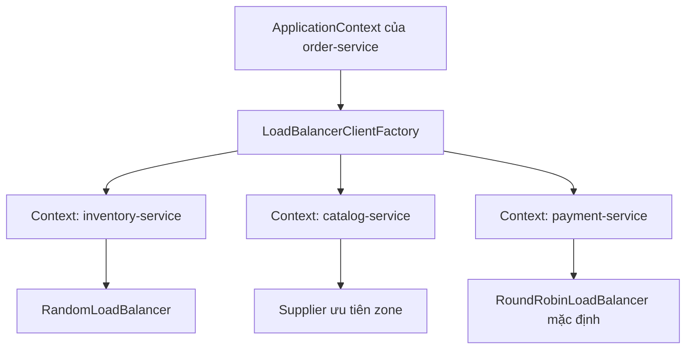
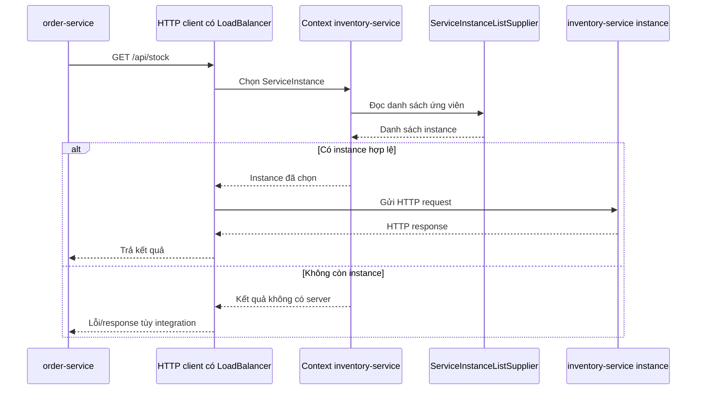

# @LoadBalancerClient và @LoadBalancerClients

Trong hệ thống microservices, một ứng dụng có thể gọi nhiều service khác nhau nhưng không phải service nào cũng cần cùng chính sách phân phối request. Ví dụ, `order-service` muốn chọn ngẫu nhiên instance của `inventory-service`, ưu tiên một zone khi gọi `catalog-service` và dùng round robin mặc định với `payment-service`. Spring Cloud LoadBalancer hỗ trợ **cấu hình theo service ID** thông qua hai annotation `@LoadBalancerClient` và `@LoadBalancerClients`.

Bài học thuộc phần **Cấu hình theo dịch vụ** của module `SPRING_CLOUD_SERVICE_COMMUNICATION_LOAD_BALANCING`. Trọng tâm là cách liên kết cấu hình của một load balancer với đúng service ID, kiểm soát phạm vi bean và kiểm tra chính sách lựa chọn `ServiceInstance`. Cấu hình này có thể dùng cùng các HTTP client được tích hợp Spring Cloud LoadBalancer như `RestClient`, `WebClient` hoặc OpenFeign, trong khi discovery, health check, retry và timeout được phối hợp ở các lớp thích hợp.

## 1. Tại sao cần cấu hình LoadBalancer theo service?

Giả sử `order-service` gọi ba dịch vụ:

| Service ID | Đặc điểm | Nhu cầu minh họa |
|---|---|---|
| `inventory-service` | Các instance đồng đều, xử lý truy vấn tồn kho | Chọn instance ngẫu nhiên. |
| `catalog-service` | Instance phân bố ở nhiều zone | Ưu tiên instance trong zone của client. |
| `payment-service` | Luồng thanh toán cần ổn định và dễ quan sát | Giữ thuật toán round robin mặc định, cấu hình timeout/retry ở tầng client. |

Nếu thay thế một bean load balancer ở phạm vi ứng dụng mà không giới hạn service, có thể vô tình áp dụng cùng thuật toán cho cả ba. Ngược lại, khai báo cấu hình **gắn với service ID** giúp từng nhóm request nhận đúng chính sách.

Cần tách ba câu hỏi:

1. **Instance đến từ đâu?** Discovery provider hoặc nguồn cung cấp danh sách `ServiceInstance`.
2. **Instance nào được đưa vào danh sách ứng viên?** Các `ServiceInstanceListSupplier` có thể kết hợp cache, health check và bộ lọc.
3. **Trong các ứng viên, chọn instance nào?** Implementation `ReactorServiceInstanceLoadBalancer`, chẳng hạn `RoundRobinLoadBalancer` hoặc `RandomLoadBalancer`.

Hai annotation trong bài giúp **gắn cấu hình cho từng service**; chúng không tự đăng ký instance, tự bật health check hay quyết định chính sách retry của mọi HTTP client.

## 2. @LoadBalancerClient là gì?

`@LoadBalancerClient` khai báo một cấu hình dành riêng cho **một client context**, được nhận diện bằng service ID.

Ví dụ:

```java
@SpringBootApplication
@LoadBalancerClient(
        name = "inventory-service",
        configuration = InventoryLoadBalancerConfiguration.class
)
public class OrderServiceApplication {

    public static void main(String[] args) {
        SpringApplication.run(OrderServiceApplication.class, args);
    }
}
```

Các thành phần trong annotation:

| Thành phần | Ý nghĩa |
|---|---|
| `name` | Tên client/service ID cần nhận cấu hình, chẳng hạn `inventory-service`. |
| `value` | Có thể dùng như tên client theo API annotation; nên chọn một cách khai báo nhất quán. |
| `configuration` | Một hoặc nhiều lớp cung cấp cấu hình bean cho load balancer của service được chỉ định. |

Tên `inventory-service` phải nhất quán với service ID được HTTP client sử dụng khi gọi, ví dụ `http://inventory-service/api/items/123`. Chính sách ứng với `inventory-service` không tự áp dụng cho request gửi đến `catalog-service`.

### 2.1. Phạm vi cấu hình trong ApplicationContext

Spring Cloud LoadBalancer sử dụng `LoadBalancerClientFactory` để quản lý các context theo tên client. Có thể hình dung mỗi service ID có một child context chứa bean load balancer và các thành phần cấu hình dành cho service đó.



Sơ đồ mô tả phạm vi logic; các context có thể được khởi tạo khi cần, tùy cấu hình của Spring Cloud. Bean trong child context có khả năng nhìn thấy bean phù hợp từ parent context, nên một bean cùng loại đặt nhầm ở parent có thể làm ảnh hưởng cách phân giải dependency hoặc việc dùng default configuration.

**Hệ quả quan trọng:** lớp cấu hình truyền vào `@LoadBalancerClient` nên được tách khỏi phạm vi component scan của ứng dụng chính nếu nó có bean đặc thù cho một service. Nếu lớp này vô tình bị quét và đăng ký như cấu hình toàn cục, các service khác có thể chịu tác động ngoài ý muốn.

## 3. Ví dụ thay Round Robin bằng Random cho một service

Mặc định, Spring Cloud LoadBalancer thường sử dụng `RoundRobinLoadBalancer` khi không có cấu hình lựa chọn khác. Giả sử chỉ `inventory-service` cần `RandomLoadBalancer`.

### 3.1. Khai báo annotation ở ứng dụng chính

```java
package com.example.order;

import com.example.lbscoped.InventoryLoadBalancerConfiguration;
import org.springframework.boot.SpringApplication;
import org.springframework.boot.autoconfigure.SpringBootApplication;
import org.springframework.cloud.loadbalancer.annotation.LoadBalancerClient;

@SpringBootApplication
@LoadBalancerClient(
        name = "inventory-service",
        configuration = InventoryLoadBalancerConfiguration.class
)
public class OrderServiceApplication {

    public static void main(String[] args) {
        SpringApplication.run(OrderServiceApplication.class, args);
    }
}
```

Ở ví dụ này, class khởi động nằm trong package `com.example.order`, vì vậy component scan mặc định bắt đầu từ package đó và các package con.

### 3.2. Khai báo bean trong lớp cấu hình riêng

Tạo lớp ở package `com.example.lbscoped` — package **nằm ngoài** cây component scan mặc định của `com.example.order`:

```java
package com.example.lbscoped;

import org.springframework.cloud.client.ServiceInstance;
import org.springframework.cloud.loadbalancer.annotation.LoadBalancerClient;
import org.springframework.cloud.loadbalancer.core.RandomLoadBalancer;
import org.springframework.cloud.loadbalancer.core.ReactorServiceInstanceLoadBalancer;
import org.springframework.cloud.loadbalancer.core.ServiceInstanceListSupplier;
import org.springframework.cloud.loadbalancer.support.LoadBalancerClientFactory;
import org.springframework.context.annotation.Bean;
import org.springframework.context.annotation.Configuration;
import org.springframework.core.env.Environment;

@Configuration(proxyBeanMethods = false)
public class InventoryLoadBalancerConfiguration {

    @Bean
    ReactorServiceInstanceLoadBalancer inventoryLoadBalancer(
            Environment environment,
            LoadBalancerClientFactory clientFactory) {

        String serviceId =
                environment.getProperty(LoadBalancerClientFactory.PROPERTY_NAME);

        return new RandomLoadBalancer(
                clientFactory.getLazyProvider(
                        serviceId, ServiceInstanceListSupplier.class),
                serviceId);
    }
}
```

Trong cấu hình:

- `LoadBalancerClientFactory.PROPERTY_NAME` lấy tên client mà child context đang cấu hình. Nhờ đó, ví dụ không phải gắn cứng tên service trong bean.
- `getLazyProvider(serviceId, ServiceInstanceListSupplier.class)` cung cấp supplier tương ứng để thuật toán đọc danh sách ứng viên.
- `RandomLoadBalancer` chọn ngẫu nhiên một phần tử từ danh sách hợp lệ do supplier trả về.
- Trả về `ReactorServiceInstanceLoadBalancer` giúp bean thể hiện đúng vai trò thuật toán lựa chọn.

Lưu ý: đoạn mã minh họa API phổ biến của Spring Cloud LoadBalancer. Cần chọn release train Spring Cloud tương thích với Spring Boot và đối chiếu import/API khi áp dụng vào một phiên bản cụ thể.

Nếu một request được gửi đến service ID `inventory-service` thông qua client đã bật load balancing, context của service này có thể sử dụng `RandomLoadBalancer`. Request đến service khác không được gắn cùng cấu hình vẫn sử dụng các bean và chính sách dành cho service đó.

### 3.3. Vì sao không tự tạo danh sách instance trong thuật toán?

Bộ chọn không nên tự truy vấn Eureka/Consul hay tự ghép host/port. Danh sách ứng viên thuộc trách nhiệm của `ServiceInstanceListSupplier`. Tách hai bước này giúp đổi thuật toán mà không làm thay đổi cơ chế discovery, caching hoặc health check.

Nếu các instance có thể không khỏe, hãy dùng health-aware supplier hoặc cơ chế health của discovery phù hợp. Đổi từ round robin sang random không tự loại instance lỗi.

## 4. @LoadBalancerClients để khai báo nhiều service

Khi ứng dụng gọi nhiều service cần cấu hình riêng, `@LoadBalancerClients` nhóm các khai báo `@LoadBalancerClient` tại một nơi:

```java
package com.example.order;

import com.example.lbscoped.CatalogLoadBalancerConfiguration;
import com.example.lbscoped.InventoryLoadBalancerConfiguration;
import org.springframework.boot.autoconfigure.SpringBootApplication;
import org.springframework.cloud.loadbalancer.annotation.LoadBalancerClient;
import org.springframework.cloud.loadbalancer.annotation.LoadBalancerClients;

@SpringBootApplication
@LoadBalancerClients({
        @LoadBalancerClient(
                name = "inventory-service",
                configuration = InventoryLoadBalancerConfiguration.class
        ),
        @LoadBalancerClient(
                name = "catalog-service",
                configuration = CatalogLoadBalancerConfiguration.class
        )
})
public class OrderServiceApplication {
}
```

Trong ví dụ:

- `inventory-service` dùng bean được định nghĩa trong `InventoryLoadBalancerConfiguration`.
- `catalog-service` dùng bean được định nghĩa trong `CatalogLoadBalancerConfiguration`.
- `payment-service` không được khai báo riêng, nên tiếp tục dùng các mặc định áp dụng cho service đó.

`CatalogLoadBalancerConfiguration` có thể cấu hình một `ServiceInstanceListSupplier` nhằm ưu tiên các instance phù hợp với zone. Ví dụ này tập trung vào **khai báo annotation**; chi tiết của supplier cần được viết đúng với nguồn discovery và phiên bản thư viện thực tế.

### 4.1. Có phải @LoadBalancerClients chỉ là cú pháp viết gọn?

`@LoadBalancerClients` là annotation chứa nhiều khai báo `@LoadBalancerClient`. Ngoài danh sách client riêng lẻ, nó còn hỗ trợ `defaultConfiguration` để cung cấp cấu hình mặc định cho các client context.

Ví dụ:

```java
@SpringBootApplication
@LoadBalancerClients(
        value = {
                @LoadBalancerClient(
                        name = "inventory-service",
                        configuration = InventoryLoadBalancerConfiguration.class
                ),
                @LoadBalancerClient(
                        name = "catalog-service",
                        configuration = CatalogLoadBalancerConfiguration.class
                )
        },
        defaultConfiguration = CommonLoadBalancerConfiguration.class
)
public class OrderServiceApplication {
}
```

`CommonLoadBalancerConfiguration` được dùng để khai báo những bean cấu hình chung muốn áp dụng cho các client context. Các cấu hình riêng của `inventory-service` và `catalog-service` tiếp tục tham gia cấu hình của hai context tương ứng.

**Không nên đặt cùng một bean load balancer hoặc supplier trong cấu hình chung và cấu hình riêng rồi mặc định rằng một bean sẽ luôn thắng.** Kết quả phụ thuộc cách các context đăng ký bean, điều kiện auto-configuration và phiên bản Spring Cloud. Nếu có nhu cầu override, hãy thiết kế rõ loại bean nào cần chung, loại nào cần riêng và kiểm tra bean thực tế được chọn khi khởi động.

## 5. @LoadBalancerClient và @LoadBalancerClients khác nhau thế nào?

| Tiêu chí | `@LoadBalancerClient` | `@LoadBalancerClients` |
|---|---|---|
| Phạm vi khai báo | Một tên client/service ID. | Nhiều tên client/service ID. |
| Cấu hình riêng | Truyền class qua `configuration`. | Chứa nhiều `@LoadBalancerClient`, mỗi cái có thể trỏ đến class riêng. |
| Cấu hình mặc định chung | Không có thuộc tính `defaultConfiguration` trong chính annotation này. | Hỗ trợ `defaultConfiguration` cho client contexts. |
| Tình huống dùng | Một service cần chính sách khác mặc định. | Ứng dụng gọi nhiều service cần cấu hình khác nhau hoặc có defaults dùng chung. |
| Kết quả | Bean cấu hình gắn theo service ID được đặt tên. | Tập các khai báo theo service ID và cấu hình mặc định (nếu có). |

Trong ứng dụng chỉ có một service cần custom load balancing, `@LoadBalancerClient` giúp cấu hình ngắn gọn. Với nhiều service cần các chính sách khác nhau, `@LoadBalancerClients` làm các khai báo dễ quan sát và quản lý hơn.

## 6. Tổ chức package để tránh cấu hình lọt vào parent context

Lỗi thường gặp là đặt lớp như `InventoryLoadBalancerConfiguration` bên dưới package được component scan và thêm `@Configuration`. Khi đó, bean vốn dành riêng cho `inventory-service` có thể được đăng ký ở parent context.

Cấu trúc an toàn trong ví dụ:

```text
src/main/java
└── com/example
    ├── order
    │   ├── OrderServiceApplication.java
    │   ├── api/
    │   └── gateway/
    └── lbscoped
        ├── InventoryLoadBalancerConfiguration.java
        ├── CatalogLoadBalancerConfiguration.java
        └── CommonLoadBalancerConfiguration.java
```

Class chính ở `com.example.order`, các class cấu hình `lbscoped` ở package anh em. `@LoadBalancerClient(configuration = ...)` vẫn tham chiếu trực tiếp các class đó khi dựng context tương ứng.

Nếu dự án đặt `@SpringBootApplication` tại `com.example`, cả hai nhánh có thể bị quét. Khi đó hãy đặt các class cấu hình ra ngoài scan base package, hoặc tổ chức scan filter thật rõ ràng. Không mặc định rằng chỉ cần dùng `@LoadBalancerClient` là Spring sẽ ngăn class `@Configuration` được quét toàn cục.

Một số nguyên tắc nên giữ:

1. Class cấu hình riêng chỉ chứa các bean thật sự dành cho service đó.
2. Tránh đặt annotation stereotype khác khiến class được quét trong parent.
3. Không tạo nhiều bean chọn instance cạnh tranh trong cùng context khi chưa thiết kế rõ.
4. Dùng tên class phản ánh service hoặc nhóm service mà cấu hình phục vụ.
5. Ghi rõ lý do dùng random, zone preference hoặc policy đặc thù để người bảo trì hiểu quyết định.

## 7. Annotation được dùng cùng RestClient, WebClient và OpenFeign thế nào?

`@LoadBalancerClient` chỉ xác định cấu hình load balancing cho service ID. HTTP request cần đi qua **client đã tích hợp với Spring Cloud LoadBalancer** thì chính sách mới được sử dụng.

### 7.1. RestClient

```java
@Configuration(proxyBeanMethods = false)
class HttpClientsConfiguration {

    @Bean
    @LoadBalanced
    RestClient.Builder loadBalancedRestClientBuilder() {
        return RestClient.builder();
    }
}
```

Sau đó, gateway dùng đúng builder:

```java
@Service
class InventoryGateway {

    private final RestClient client;

    InventoryGateway(@Qualifier("loadBalancedRestClientBuilder")
                     RestClient.Builder builder) {
        this.client = builder.build();
    }

    String findStock(String sku) {
        return client.get()
                .uri("http://inventory-service/api/stock/{sku}", sku)
                .retrieve()
                .body(String.class);
    }
}
```

URL dùng `inventory-service` làm host logic. Spring Cloud LoadBalancer chọn instance dựa vào context có cùng service ID. Annotation cấu hình riêng không thay đổi hợp đồng của `RestClient`: kết quả `body(String.class)`, timeout và xử lý HTTP status vẫn thuộc trách nhiệm của client và ứng dụng.

### 7.2. WebClient

```java
@Configuration(proxyBeanMethods = false)
class ReactiveHttpClientsConfiguration {

    @Bean
    @LoadBalanced
    WebClient.Builder loadBalancedWebClientBuilder() {
        return WebClient.builder();
    }
}
```

Khi xây dựng `WebClient` từ builder này và gọi `http://catalog-service/...`, load balancing có thể sử dụng context cấu hình của `catalog-service`. Một `WebClient` tạo trực tiếp bằng `WebClient.create()` sẽ không tự có cùng tích hợp chỉ vì ứng dụng khai báo `@LoadBalancerClients`.

### 7.3. OpenFeign

```java
@FeignClient(name = "inventory-service")
public interface InventoryClient {

    @GetMapping("/api/stock/{sku}")
    StockResponse getStock(@PathVariable("sku") String sku);
}
```

Khi OpenFeign được cấu hình tích hợp Spring Cloud LoadBalancer và có nguồn instance phù hợp, tên `inventory-service` được dùng để chọn context load balancing. Nếu cấu hình Feign dùng URL cố định cho client, đường đi qua discovery/load balancing có thể khác; cần kiểm tra cách Feign được khởi tạo ở phiên bản dự án.

**Không phải cứ khai báo hai annotation là mọi HTTP request được load balance.** Ứng dụng còn cần dependency LoadBalancer, nguồn instance và client integration tương ứng.

## 8. Kết hợp với ServiceInstanceListSupplier

Một service có thể cần lọc danh sách trước khi lựa chọn. Ví dụ, `catalog-service` ưu tiên instance trong cùng zone, còn `inventory-service` chỉ cần danh sách từ discovery.

Có thể khai báo một supplier theo service thông qua lớp cấu hình được tham chiếu bởi `@LoadBalancerClient`. Các supplier thường được kết hợp bằng builder để lấy instance từ discovery, rồi cache hoặc lọc theo chính sách.

Ví dụ cấu hình supplier minh họa ở mức ý tưởng:

```java
@Configuration(proxyBeanMethods = false)
public class CatalogLoadBalancerConfiguration {

    @Bean
    ServiceInstanceListSupplier catalogSupplier(
            ConfigurableApplicationContext context) {

        return ServiceInstanceListSupplier.builder()
                .withDiscoveryClient()
                .withZonePreference()
                .withCaching()
                .build(context);
    }
}
```

Ý nghĩa của chuỗi builder:

- `withDiscoveryClient()`: lấy danh sách instance thông qua discovery client có sẵn trong ứng dụng.
- `withZonePreference()`: áp dụng bước xử lý ưu tiên zone khi có đủ dữ liệu/cấu hình zone tương ứng.
- `withCaching()`: bổ sung cache danh sách instance.

Việc dùng builder và thứ tự decorator cần tuân theo API của phiên bản Spring Cloud đang dùng. Khi kết hợp health check hoặc request-based supplier, hãy kiểm tra thứ tự khởi tạo và thứ tự lọc theo tài liệu phiên bản đó. Không nên thêm cache lặp nếu discovery provider đã cache danh sách ở tầng khác.

Trong trường hợp cần **ràng buộc cứng** vào zone hoặc metadata, zone preference mặc định có thể không đủ. Cần viết supplier lọc theo yêu cầu và xác định cách xử lý khi bộ lọc không còn instance phù hợp. Không nên coi ưu tiên zone đồng nghĩa với cam kết chỉ dùng một zone.

## 9. Phân biệt cấu hình theo service với cấu hình toàn cục

Có ba phạm vi thường bị nhầm lẫn:

| Phạm vi | Ví dụ | Tác động |
|---|---|---|
| Cấu hình global trong parent context | Bean `ServiceInstanceListSupplier` đăng ký do component scan ở ứng dụng chính | Có thể ảnh hưởng việc dựng hoặc phân giải bean của nhiều client context. |
| Cấu hình mặc định cho các client | `@LoadBalancerClients(defaultConfiguration = ...)` | Các client context nhận cấu hình mặc định được khai báo. |
| Cấu hình của một client | `@LoadBalancerClient(name = "inventory-service", configuration = ...)` | Cấu hình gắn với một service ID cụ thể. |

Không nên giải thích `@LoadBalancerClients(defaultConfiguration = ...)` là việc sửa toàn bộ bean tại parent context. Đây là cơ chế cung cấp cấu hình cho các client context; phạm vi thực tế của từng bean vẫn cần được xác minh khi phối hợp với các cấu hình khác.

Cũng cần phân biệt cấu hình theo service với cấu hình theo **từng request**. Một bean load balancer riêng cho `inventory-service` có thể được dùng cho nhiều request đến service đó. Nếu quyết định chọn instance phụ thuộc header hoặc thuộc tính của request, phải dùng cơ chế cung cấp request context và supplier/load balancer có hỗ trợ, thay vì cố đổi bean singleton ở mỗi request.

## 10. Cấu hình mặc định, fallback và danh sách instance rỗng

Annotation không thay thế chính sách xử lý lỗi. Ví dụ, `inventory-service` đã khai báo `RandomLoadBalancer` nhưng supplier trả danh sách rỗng: thuật toán vẫn không thể chọn instance.

Quy trình khái quát:



Nếu không có ứng viên, ứng dụng nên ghi nhận service ID, số lượng instance, trạng thái discovery, các bước lọc và lỗi kết nối liên quan. Tùy client và cách tích hợp, việc không có instance có thể dẫn đến exception hoặc response lỗi (thường là 503 trong nhiều tích hợp). Hãy kiểm tra hành vi cụ thể của phiên bản, không giả định mọi client dùng cùng exception.

Retry và timeout thường được cấu hình tại HTTP client hoặc lớp phối hợp retry. Retry có thể chọn lại instance trong điều kiện phù hợp, nhưng không sửa được lỗi sai service ID hay danh sách discovery luôn rỗng. Với thao tác ghi, cần xét tính idempotent trước khi thử lại.

## 11. Kiểm tra một cấu hình theo service có hoạt động không

Sau khi thêm annotation, kiểm tra theo từng lớp thay vì chỉ nhìn kết quả HTTP cuối cùng.

### 11.1. Kiểm tra tên service

Xác nhận các chuỗi sau nhất quán:

```text
@LoadBalancerClient(name = "inventory-service")
                    │
                    ├─ @FeignClient(name = "inventory-service")
                    ├─ http://inventory-service/api/stock
                    └─ service ID do discovery đăng ký
```

Nếu tên trong annotation không trùng với service ID được gửi đi, cấu hình của context này có thể không được sử dụng.

### 11.2. Kiểm tra classpath và nguồn instance

Cần bảo đảm:

- Dự án có dependency Spring Cloud LoadBalancer phù hợp với Spring Boot/Spring Cloud BOM.
- Discovery client hoặc nguồn instance tĩnh được cấu hình đầy đủ.
- Client gọi dịch vụ thực sự được tích hợp load balancing.
- Supplier trả về instance hợp lệ với host, port và metadata cần thiết.

Đừng kết luận thuật toán sai nếu danh sách đầu vào rỗng hoặc instance không thể kết nối.

### 11.3. Xác minh bean được chọn theo service

Có thể dùng kiểm thử tích hợp kiểm tra `LoadBalancerClientFactory`:

```java
@Autowired
LoadBalancerClientFactory factory;

@Test
void inventoryUsesRandomLoadBalancer() {
    ReactorServiceInstanceLoadBalancer loadBalancer =
            factory.getInstance(
                    "inventory-service",
                    ReactorServiceInstanceLoadBalancer.class);

    assertThat(loadBalancer)
            .isInstanceOf(RandomLoadBalancer.class);
}
```

Đây là đoạn kiểm tra minh họa đặt trong test class đã cấu hình Spring Test và AssertJ; cần thêm các import, dependency test và phần khởi tạo context tương ứng. Một số release train có thể công bố bean theo interface `ReactorLoadBalancer<ServiceInstance>`; khi đó chọn API truy vấn bean phù hợp với phiên bản đang dùng.

Kiểm tra loại bean giúp xác nhận **cấu hình được nạp đúng vào context**. Muốn kiểm tra hành vi, hãy thêm kiểm thử với danh sách `ServiceInstance` giả lập và một số lần chọn, nhưng tránh đòi hỏi chuỗi kết quả cố định khi thuật toán là random.

### 11.4. Quan sát log và metrics

Khi thử nghiệm, nên theo dõi:

| Thông tin | Mục đích |
|---|---|
| Service ID của request | Xác định request đi vào đúng client context. |
| Số lượng `ServiceInstance` từ supplier | Phân biệt thiếu ứng viên với lỗi thuật toán. |
| Loại load balancer đang được dùng | Xác nhận random/round robin hoặc implementation tùy chỉnh. |
| Instance được chọn | Đối chiếu kết quả với policy mong đợi. |
| Tỷ lệ lỗi và timeout | Phát hiện instance không khỏe hoặc cấu hình client chưa hợp lý. |
| Retry count và nguyên nhân | Phân biệt request thử lại với request đầu tiên. |

Tính ngẫu nhiên và kết nối đồng thời khiến phân phối thực tế không nhất thiết có tỷ lệ đều trong mẫu nhỏ. Không đánh giá một thuật toán chỉ dựa trên vài request.

## 12. Các lỗi cấu hình thường gặp

| Triệu chứng | Nguyên nhân khả dĩ | Hướng xử lý |
|---|---|---|
| Mọi service đều dùng một thuật toán custom | Lớp cấu hình riêng bị component scan vào parent context hoặc dùng defaultConfiguration quá rộng | Chuyển lớp cấu hình ra ngoài scan, kiểm tra bean của từng client context. |
| `inventory-service` vẫn dùng round robin | Tên service không khớp, annotation không được nạp hoặc bean load balancer không được chọn | Kiểm tra service ID, annotation trên class cấu hình chính và bean trong client factory. |
| Có nhiều bean cùng loại, ứng dụng lỗi khi khởi tạo | Cấu hình chung và riêng định nghĩa bean cạnh tranh hoặc có nhiều implementation | Rà soát `@Bean`, điều kiện tạo bean và phạm vi context. |
| Client không tìm được instance | Discovery chưa có dữ liệu, sai service ID hoặc supplier lọc hết | Kiểm tra discovery, supplier và metadata/health. |
| RestClient/WebClient không sử dụng thuật toán riêng | Builder không có `@LoadBalanced` hoặc dùng client được tạo trực tiếp | Tạo/inject đúng load-balanced builder. |
| OpenFeign gọi tới URL cố định | Client được khai báo `url` hoặc cấu hình target URL | Kiểm tra chế độ dùng URL hay service discovery trong cấu hình Feign. |
| Lọc zone không có hiệu quả | Thiếu thông tin zone, supplier chưa được nạp hoặc hiểu nhầm preference với lọc cứng | Kiểm tra metadata, cấu hình zone và danh sách trước/sau bộ lọc. |
| Retry tạo thêm tải khi service lỗi | Retry nhiều tầng, số lần thử hoặc timeout chưa được giới hạn | Đặt deadline tổng, retry có backoff và quan sát kết quả. |

Một lỗi cấu hình có thể biểu hiện giống lỗi mạng. Ví dụ, `@LoadBalancerClient` đã được áp dụng nhưng instance trong discovery chứa host không truy cập được: kết quả vẫn là timeout hoặc connection refused. Vì vậy, hãy tách xác minh **bean được nạp** và **đích kết nối hoạt động**.

## 13. Nguyên tắc tổ chức cấu hình cho hệ thống lớn

Khi số service tăng, có thể áp dụng các nguyên tắc sau:

1. Khai báo `@LoadBalancerClient` cho service thực sự cần khác mặc định; không tạo class chỉ để lặp lại cấu hình round robin.
2. Dùng `@LoadBalancerClients` để tập hợp nhiều cấu hình theo service và tránh rải annotation khó kiểm soát.
3. Đặt class cấu hình của từng client ngoài component scan mặc định hoặc kiểm soát scan filter rõ ràng.
4. Đưa chính sách dùng chung vào `defaultConfiguration` chỉ khi tất cả client đều nên kế thừa hành vi đó.
5. Phân tách bean chọn thuật toán với supplier cung cấp/lọc danh sách instance.
6. Định nghĩa hành vi khi không có instance, khi thiếu metadata và khi discovery không hoạt động.
7. Kiểm tra tương thích Spring Boot/Spring Cloud bằng BOM khi dùng API đặc thù phiên bản.
8. Đo số lượng instance, thời gian chọn, tỷ lệ lỗi và retry để đánh giá hiệu quả chính sách.
9. Kiểm thử phạm vi: một cấu hình riêng phải ảnh hưởng đúng service ID đã khai báo.

### Trường hợp không cần annotation

Nếu mọi service đều dùng cấu hình mặc định và không có yêu cầu lọc hoặc chọn riêng, có thể chỉ cần dependency `spring-cloud-starter-loadbalancer`, nguồn `ServiceInstance` và HTTP client tích hợp đúng. `@LoadBalancerClient`/`@LoadBalancerClients` là công cụ tùy biến, không phải annotation bắt buộc cho mọi ứng dụng dùng LoadBalancer.

Nếu yêu cầu chỉ là timeout của `payment-service`, có thể cấu hình ở HTTP client hoặc Feign tương ứng thay vì tạo một load balancer chỉ để đặt timeout. Nếu yêu cầu là circuit breaker, cần tích hợp cơ chế chịu lỗi phù hợp; annotation về client context không tự cung cấp circuit breaker.

## 14. Kết luận

`@LoadBalancerClient` liên kết một lớp cấu hình load balancing với **một service ID**. `@LoadBalancerClients` nhóm nhiều khai báo kiểu đó và hỗ trợ `defaultConfiguration` cho các client context. Đây là cơ chế để ứng dụng áp dụng thuật toán chọn `ServiceInstance` và chuỗi supplier khác nhau theo từng dịch vụ mà vẫn dùng chung các abstraction của Spring Cloud LoadBalancer.

Điểm quyết định khi triển khai là bảo đảm tên service trùng với tên trong request, class cấu hình nằm đúng phạm vi context và HTTP client thực sự đi qua LoadBalancer. Sau khi thiết lập, cần kiểm tra bean được tạo cho từng service, danh sách instance đầu vào, hành vi khi không có ứng viên và khả năng quan sát lỗi. Nhờ vậy, cấu hình theo dịch vụ có thể mở rộng cùng hệ thống mà không làm ảnh hưởng vô tình đến các service khác.

