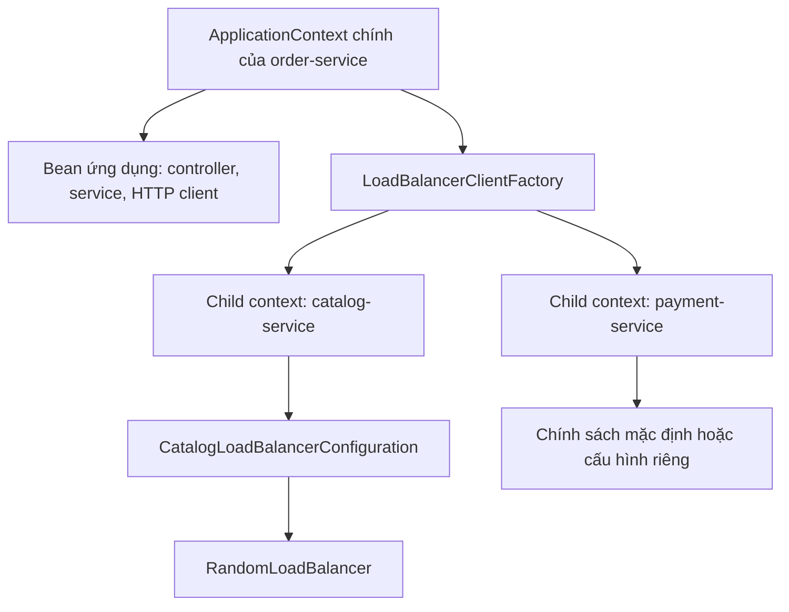

# Tách cấu hình riêng khỏi component scan của ứng dụng chính

Spring Cloud LoadBalancer cho phép cấu hình cách chọn `ServiceInstance` riêng cho từng **service ID**. Chẳng hạn, `catalog-service` có thể sử dụng thuật toán chọn ngẫu nhiên, trong khi `payment-service` tiếp tục dùng chính sách round-robin mặc định. Để cách cấu hình này hoạt động đúng, cần đặt lớp cấu hình riêng cho LoadBalancer **ngoài phạm vi component scan của ứng dụng Spring Boot chính**, hoặc bảo đảm lớp ấy không được đăng ký như một cấu hình toàn cục.

Đây là vấn đề về **phạm vi bean**. Cùng một lớp Java có thể được nạp vào `ApplicationContext` của riêng một service ID hoặc vô tình được quét vào `ApplicationContext` chung của ứng dụng. Nếu cấu hình dành riêng cho một dịch vụ xuất hiện trong context chung, bean của nó có thể được nhìn thấy bởi các LoadBalancer khác, làm sai ý định cấu hình theo dịch vụ.

## 1. Vì sao phải tách khỏi component scan?

Mặc định, `@SpringBootApplication` bao gồm cơ chế component scan tại package chứa lớp ứng dụng và các package con. Những lớp được đánh dấu `@Configuration`, `@Component`, `@Service` hoặc annotation stereotype tương ứng trong phạm vi này có thể được đăng ký thành bean của context chính.

Trong khi đó, Spring Cloud LoadBalancer sử dụng `LoadBalancerClientFactory` để quản lý cấu hình theo tên client, ở đây là service ID. Nhà máy này có thể tạo một **child `ApplicationContext` riêng cho từng service ID** khi cần dùng đến. Cấu hình được khai báo bằng `@LoadBalancerClient(name = ..., configuration = ...)` được áp dụng vào child context tương ứng.



Child context có thể tra cứu bean từ context cha. Do đó, nếu `CatalogLoadBalancerConfiguration` bị component scan của ứng dụng chính phát hiện, bean như `ReactorLoadBalancer<ServiceInstance>` hoặc `ServiceInstanceListSupplier` có thể xuất hiện trong context cha và ảnh hưởng tới nhiều service ID. Việc đặt annotation `@LoadBalancerClient` **không tự vô hiệu hóa component scan** đối với lớp được tham chiếu trong thuộc tính `configuration`.

Quy tắc quan trọng là: **cấu hình đặc thù của một LoadBalancer phải được nạp bởi context của service ID được chỉ định, không được quét như một bean cấu hình ứng dụng toàn cục**.

## 2. Nhận biết package nào đang được quét

Giả sử ứng dụng chính nằm ở package `com.example.orders`:

```java
package com.example.orders;

import org.springframework.boot.SpringApplication;
import org.springframework.boot.autoconfigure.SpringBootApplication;

@SpringBootApplication
public class OrderApplication {
    public static void main(String[] args) {
        SpringApplication.run(OrderApplication.class, args);
    }
}
```

Nếu không tùy chỉnh component scan, các lớp trong `com.example.orders` và package con như `com.example.orders.client` được quét. Package **cùng cấp** `com.example.loadbalancer.config` không nằm trong phạm vi quét mặc định đó.

Một cấu trúc thư mục phù hợp:

```text
src/main/java/
└── com/example/
    ├── orders/
    │   ├── OrderApplication.java
    │   ├── client/
    │   │   └── CatalogHttpClient.java
    │   └── service/
    │       └── OrderService.java
    └── loadbalancer/
        └── config/
            └── CatalogLoadBalancerConfiguration.java
```

Lưu ý rằng **đường dẫn package**, không phải tên thư mục `config`, quyết định lớp có bị scan hay không. Nếu chuyển `OrderApplication` lên `com.example` hoặc cấu hình `@ComponentScan(basePackages = "com.example")`, cả `com.example.loadbalancer.config` cũng có thể được quét. Khi đó, cách bố trí trên không còn tạo ra ranh giới mong muốn.

## 3. Ví dụ cấu hình một dịch vụ với `@LoadBalancerClient`

Giả sử `order-service` gọi `catalog-service` và `payment-service`. Mục tiêu là để **chỉ `catalog-service` dùng `RandomLoadBalancer`**; dịch vụ khác không nhận bean cấu hình này.

### Bước 1: Khai báo cấu hình tại package nằm ngoài vùng scan

Tạo lớp `CatalogLoadBalancerConfiguration` trong package `com.example.loadbalancer.config`:

```java
package com.example.loadbalancer.config;

import org.springframework.cloud.client.ServiceInstance;
import org.springframework.cloud.client.loadbalancer.reactive.ReactorLoadBalancer;
import org.springframework.cloud.loadbalancer.core.RandomLoadBalancer;
import org.springframework.cloud.loadbalancer.core.ServiceInstanceListSupplier;
import org.springframework.cloud.loadbalancer.support.LoadBalancerClientFactory;
import org.springframework.context.annotation.Bean;
import org.springframework.context.annotation.Configuration;
import org.springframework.core.env.Environment;

@Configuration(proxyBeanMethods = false)
public class CatalogLoadBalancerConfiguration {

    @Bean
    ReactorLoadBalancer<ServiceInstance> catalogRandomLoadBalancer(
            Environment environment,
            LoadBalancerClientFactory clientFactory) {

        String serviceId = environment.getProperty(
                LoadBalancerClientFactory.PROPERTY_NAME);

        return new RandomLoadBalancer(
                clientFactory.getLazyProvider(
                        serviceId, ServiceInstanceListSupplier.class),
                serviceId);
    }
}
```

Trong ví dụ này:

- `LoadBalancerClientFactory.PROPERTY_NAME` cung cấp service ID của child context đang được cấu hình.
- `getLazyProvider(serviceId, ServiceInstanceListSupplier.class)` cung cấp danh sách instance theo cơ chế supplier đang có hiệu lực cho service ID đó, thường bắt nguồn từ service discovery.
- `RandomLoadBalancer` chọn một instance ngẫu nhiên trong danh sách ứng viên. Việc chọn ngẫu nhiên không bảo đảm các instance nhận số request bằng nhau trong một khoảng quan sát ngắn.

`@Configuration` ở đây vẫn hợp lệ **vì lớp nằm ngoài vùng component scan của context chính**. Một cách khác là dùng lớp cấu hình không mang `@Configuration`, nhưng vẫn cung cấp các `@Bean` method để cơ chế `@LoadBalancerClient` đăng ký vào child context. Điều cốt lõi là tránh để lớp trở thành cấu hình toàn cục.

### Bước 2: Gắn cấu hình với đúng service ID

Thêm `@LoadBalancerClient` vào lớp khởi động:

```java
package com.example.orders;

import com.example.loadbalancer.config.CatalogLoadBalancerConfiguration;
import org.springframework.boot.SpringApplication;
import org.springframework.boot.autoconfigure.SpringBootApplication;
import org.springframework.cloud.loadbalancer.annotation.LoadBalancerClient;

@SpringBootApplication
@LoadBalancerClient(
        name = "catalog-service",
        configuration = CatalogLoadBalancerConfiguration.class)
public class OrderApplication {
    public static void main(String[] args) {
        SpringApplication.run(OrderApplication.class, args);
    }
}
```

Annotation ở đây đăng ký thông tin **service ID → lớp cấu hình**. Việc tham chiếu `CatalogLoadBalancerConfiguration.class` trong thuộc tính `configuration` không có nghĩa là phải thêm package của lớp ấy vào component scan chung.

### Bước 3: Gọi dịch vụ bằng HTTP client được tích hợp LoadBalancer

Ví dụ với `RestClient`, builder cần được đánh dấu `@LoadBalanced`:

```java
package com.example.orders;

import org.springframework.cloud.client.loadbalancer.LoadBalanced;
import org.springframework.context.annotation.Bean;
import org.springframework.context.annotation.Configuration;
import org.springframework.web.client.RestClient;

@Configuration(proxyBeanMethods = false)
class HttpClientConfiguration {

    @Bean
    @LoadBalanced
    RestClient.Builder restClientBuilder() {
        return RestClient.builder();
    }
}
```

Mã nghiệp vụ có thể gọi URL logic như sau:

```java
RestClient client = restClientBuilder.build();

String body = client.get()
        .uri("http://catalog-service/api/products/42")
        .retrieve()
        .body(String.class);
```

`catalog-service` là **service ID**, không phải địa chỉ host cố định. Khi request đi qua builder đã tích hợp LoadBalancer, child context dành cho `catalog-service` dùng `RandomLoadBalancer` để chọn `ServiceInstance` từ danh sách discovery. Với request đến `http://payment-service/...`, nếu chưa có cấu hình riêng khác, Spring Cloud LoadBalancer sử dụng cấu hình mặc định của service ID đó (thường là round-robin).

Các ví dụ giả định ứng dụng có dependency Spring Cloud LoadBalancer và nguồn danh sách instance, chẳng hạn discovery client phù hợp hoặc cấu hình instance tĩnh. Nếu không có instance cho service ID, việc tách package đúng cũng không khiến request tự hoạt động.

## 4. Cấu hình nhiều dịch vụ mà vẫn tách biệt

Khi có nhiều service ID cần chính sách riêng, dùng `@LoadBalancerClients` và duy trì một lớp cấu hình phù hợp cho từng dịch vụ:

```java
@LoadBalancerClients({
    @LoadBalancerClient(
        name = "catalog-service",
        configuration = CatalogLoadBalancerConfiguration.class),
    @LoadBalancerClient(
        name = "inventory-service",
        configuration = InventoryLoadBalancerConfiguration.class)
})
```

Ví dụ này giả định `InventoryLoadBalancerConfiguration` đã được tạo riêng, có bean/policy thích hợp và cũng được đặt ngoài phạm vi scan chung. Mỗi service ID được kết nối với cấu hình của nó; cùng một application có thể sử dụng nhiều client với chính sách định tuyến khác nhau.

Không nhất thiết mỗi service ID phải có lớp cấu hình riêng nếu chính sách mặc định đã đáp ứng yêu cầu. Chỉ định cấu hình per-service khi cần thay đổi hành vi cụ thể như cách chọn instance, lọc theo metadata, ưu tiên zone hoặc chuỗi `ServiceInstanceListSupplier`.

## 5. Các lỗi cấu hình hay gặp

| Tình huống | Hệ quả có thể xảy ra | Cách xử lý |
|---|---|---|
| Đặt `CatalogLoadBalancerConfiguration` dưới `com.example.orders.config` và thêm `@Configuration` | Lớp được component scan vào context chính; bean dành cho `catalog-service` có thể ảnh hưởng các client khác | Chuyển lớp ra package ngoài vùng scan, hoặc thiết kế để không được scan vào context chính |
| Đặt `@SpringBootApplication` ở `com.example` trong khi cấu hình riêng nằm dưới `com.example.loadbalancer` | Package tưởng là độc lập vẫn thuộc vùng scan mặc định | Kiểm tra package của lớp khởi động và giới hạn lại vùng scan |
| Dùng `@ComponentScan(basePackages = "com.example")` | Vô tình kéo toàn bộ package cấu hình riêng vào context cha | Thu hẹp danh sách package được quét hoặc đặt cấu hình bên ngoài tập package này |
| Thêm `@Import(CatalogLoadBalancerConfiguration.class)` vào cấu hình ứng dụng chính | Đăng ký cấu hình per-service trực tiếp ở context cha | Chỉ tham chiếu lớp qua `@LoadBalancerClient(configuration = ...)` |
| Không khai báo đúng `name = "catalog-service"` | Request đi đến service ID khác không dùng chính sách mong đợi | Đối chiếu service ID trong URL, registry và annotation |
| Dùng `RestClient`/`WebClient` không qua builder `@LoadBalanced` | URL logic có thể bị xử lý như hostname DNS | Cấu hình đúng HTTP client integration; với OpenFeign cần kiểm tra dependency LoadBalancer |
| Dùng `@FeignClient(configuration = ...)` để mong đổi policy của Spring Cloud LoadBalancer | Nhầm phạm vi cấu hình của Feign với cấu hình chọn instance | Dùng `@LoadBalancerClient` cho policy LoadBalancer; cấu hình Feign chỉ cho các đặc tính Feign thích hợp |

Một điểm dễ nhầm: đặt `@Qualifier` hoặc `@Primary` trên bean trong context cha không giải quyết triệt để việc cách ly theo service ID. Các annotation này hỗ trợ quá trình chọn bean khi inject dependency, nhưng không di chuyển bean vào child context của LoadBalancer.

## 6. Kiểm tra cấu hình đã được cách ly đúng chưa

Sau khi chạy ứng dụng, nên kiểm tra cả **vị trí đăng ký bean** và **hành vi chọn instance**, vì chỉ nhìn code annotation chưa đủ để phát hiện mọi thay đổi do component scan.

1. **Kiểm tra phạm vi scan:** xác nhận package chứa `OrderApplication` và các giá trị `scanBasePackages`/`@ComponentScan`. Package `com.example.loadbalancer.config` phải nằm ngoài danh sách quét của context chính.
2. **Kiểm tra đăng ký per-service:** xác nhận `@LoadBalancerClient` trỏ chính xác tới `name = "catalog-service"` và `CatalogLoadBalancerConfiguration.class`.
3. **Kiểm tra bean trong context cha:** bean `catalogRandomLoadBalancer` không nên được đăng ký cục bộ trong application context chính; nó dành cho child context của `catalog-service`.
4. **Kiểm tra LoadBalancer thực tế:** từ `LoadBalancerClientFactory`, lấy bean loại `ReactorLoadBalancer` của `catalog-service` và so sánh với `payment-service`. Loại bean tương ứng cần phản ánh cấu hình mong muốn.
5. **Kiểm tra request:** chạy nhiều instance `catalog-service`, gọi bằng `RestClient`, `WebClient` hoặc OpenFeign qua service ID; theo dõi instance được chọn và lỗi kết nối. Không đánh giá tính đúng đắn của RandomLoadBalancer bằng một hoặc hai request đơn lẻ.

Ví dụ kiểm tra loại bean (có thể đặt tạm trong một điểm chẩn đoán của ứng dụng):

```java
ReactorLoadBalancer<?> catalogLoadBalancer =
        clientFactory.getInstance(
                "catalog-service", ReactorLoadBalancer.class);

ReactorLoadBalancer<?> paymentLoadBalancer =
        clientFactory.getInstance(
                "payment-service", ReactorLoadBalancer.class);

System.out.println(catalogLoadBalancer.getClass().getSimpleName());
System.out.println(paymentLoadBalancer.getClass().getSimpleName());
```

Trong cấu hình ví dụ, kết quả kỳ vọng là `RandomLoadBalancer` cho `catalog-service` và `RoundRobinLoadBalancer` cho `payment-service` nếu dịch vụ thứ hai không có override nào khác. Đây là kiểm tra cấu hình trong ứng dụng; không cần gắn đoạn in ra console vào luồng request production.

Nếu cả hai service ID cùng nhận một loại bean ngoài dự kiến, hãy xem lại component scan và các cấu hình đã được import vào context chính. Nếu LoadBalancer đúng loại nhưng chọn instance không như mong đợi, tiếp tục kiểm tra `ServiceInstanceListSupplier`, kết quả discovery, health check, TTL cache và các chính sách định tuyến đang bật. Nếu request không tới được dịch vụ, kiểm tra riêng timeout, retry và HTTP client integration; đây là các tầng vận hành khác với phạm vi đăng ký bean.

## 7. Khi nào nên dùng cách tổ chức này?

Phân tách cấu hình per-service có ích khi các service ID có yêu cầu chọn instance khác nhau. Ví dụ, dịch vụ tìm kiếm có thể ưu tiên một zone, dịch vụ thanh toán cần lọc instance theo metadata, còn dịch vụ đọc dữ liệu dùng round-robin mặc định. `@LoadBalancerClient` giúp biểu diễn lựa chọn đó ngay tại cấu hình ứng dụng gọi dịch vụ.

Về mặt tổ chức code, có thể xem ranh giới như sau:

| Loại cấu hình | Đặt ở đâu? | Vì sao? |
|---|---|---|
| HTTP client chung, chẳng hạn bean `@LoadBalanced RestClient.Builder` | Trong package ứng dụng được scan | Builder cần được inject bởi các component nghiệp vụ |
| Chính sách riêng cho `catalog-service`, chẳng hạn `RandomLoadBalancer` | Trong cấu hình per-service ngoài vùng scan chính | Bean chỉ thuộc child context của `catalog-service` |
| Cấu hình chung của dịch vụ ứng dụng, controller, repository | Trong package ứng dụng được scan | Đây là bean phục vụ toàn bộ ứng dụng |
| Cấu hình riêng cho service ID khác | Trong lớp per-service riêng, ngoài vùng scan chính | Tránh ảnh hưởng chéo giữa các client |

## 8. Ghi nhớ

`@LoadBalancerClient(name = ..., configuration = ...)` là cơ chế đưa cấu hình vào **context riêng theo service ID** trong Spring Cloud LoadBalancer. Để cấu hình đó không lan sang các service khác, lớp cấu hình phải nằm ngoài phạm vi component scan của ứng dụng chính hoặc được thiết kế để không bị đăng ký vào context chính. Luôn kiểm tra package của `@SpringBootApplication`, mọi cấu hình component scan mở rộng và các `@Import` liên quan. Sau đó xác minh bean LoadBalancer theo service ID và thử request thực tế để chắc rằng mỗi dịch vụ sử dụng đúng chính sách đã khai báo.
