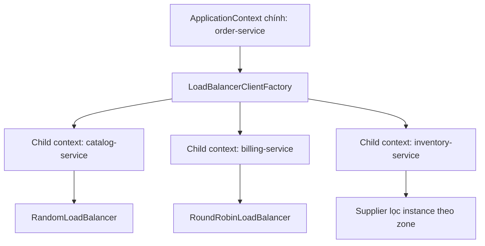
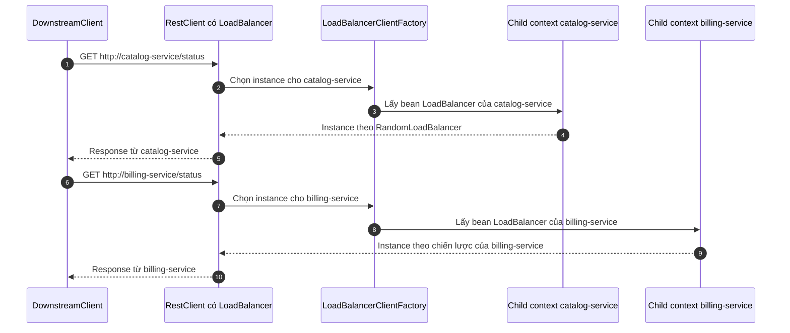

# Ngữ cảnh con, bean theo dịch vụ và nguy cơ cấu hình lan rộng

Khi một ứng dụng gọi nhiều dịch vụ bằng Spring Cloud LoadBalancer, không phải dịch vụ nào cũng cần cùng một chính sách chọn bản sao. `catalog-service` có thể chọn ngẫu nhiên để thử nghiệm, trong khi `billing-service` vẫn dùng round robin và `inventory-service` cần lọc instance theo vùng triển khai. Spring Cloud cho phép cấu hình theo **service ID** bằng các ngữ cảnh ứng dụng con (*child application contexts*) và những bean chỉ có hiệu lực trong ngữ cảnh của dịch vụ tương ứng.

Điều quan trọng là hiểu **bean được tạo ở ngữ cảnh nào**. Nếu một cấu hình dự kiến dành riêng cho `catalog-service` vô tình bị component scan của ứng dụng chính phát hiện, nó có thể trở thành cấu hình dùng chung và ảnh hưởng đến các dịch vụ khác. Bài học này giải thích cách Spring Cloud LoadBalancer tách phạm vi cấu hình, cách viết bean đúng dịch vụ và cách phát hiện nguy cơ cấu hình lan rộng.

## 1. Vì sao cần cấu hình theo từng dịch vụ?

Giả sử `order-service` gọi ba dịch vụ sau:

| Service ID | Nhu cầu | Lựa chọn minh họa |
|---|---|---|
| `catalog-service` | Các bản sao tương đương; muốn thử phân phối ngẫu nhiên | `RandomLoadBalancer` |
| `billing-service` | Các bản sao có năng lực tương đương | `RoundRobinLoadBalancer` mặc định |
| `inventory-service` | Ưu tiên instance cùng zone | Chuỗi `ServiceInstanceListSupplier` có lọc theo zone |

Tất cả đều được gọi qua URL logic như `http://catalog-service/api/products/42`. HTTP client được tích hợp LoadBalancer tiếp nhận **service ID**, yêu cầu LoadBalancer chọn một `ServiceInstance`, rồi gửi HTTP request đến host và port của instance đó. Chính sách chọn instance có thể khác nhau tùy service ID mà không cần thay đổi API gọi HTTP.

Cấu hình toàn cục phù hợp với những quy tắc mọi service cùng chia sẻ. Cấu hình theo service phù hợp khi một dịch vụ cần thuật toán, bộ lọc, supplier hoặc hành vi vận hành riêng. Nếu không xác định rõ phạm vi, một thay đổi nhỏ cho một service có thể làm thay đổi cách định tuyến của cả ứng dụng gọi.

## 2. ApplicationContext chính và ngữ cảnh con theo service ID

Trong ứng dụng Spring Boot, `ApplicationContext` chính (gọi là **parent context** trong bài) quản lý các bean ứng dụng như controller, service, HTTP client builder và cấu hình dùng chung. Spring Cloud LoadBalancer sử dụng `LoadBalancerClientFactory` để quản lý những ngữ cảnh riêng theo tên client/service ID.

Mỗi ngữ cảnh con lưu các bean phục vụ việc chọn instance của service tương ứng, ví dụ:

- `ReactorLoadBalancer<ServiceInstance>`: chiến lược chọn một instance.
- `ServiceInstanceListSupplier`: nguồn và chuỗi xử lý danh sách instance.
- Các bean hỗ trợ cấu hình, bộ lọc hoặc quy tắc định tuyến dành riêng cho service đó.



`LoadBalancerClientFactory` dùng service ID làm tên để tìm hoặc tạo ngữ cảnh con tương ứng. Các ngữ cảnh này có quan hệ cha–con với context chính và có thể nhìn thấy một số bean từ parent. Tuy nhiên, các bean được cấu hình trực tiếp trong từng ngữ cảnh con có thể khác nhau, nhờ vậy hai service ID có thể dùng hai thuật toán chọn instance độc lập.

Một hệ quả quan trọng: **cùng một kiểu bean không đồng nghĩa cùng một đối tượng hay cùng một phạm vi**. `ReactorLoadBalancer<ServiceInstance>` của `catalog-service` có thể là `RandomLoadBalancer`, còn bean cùng kiểu của `billing-service` là `RoundRobinLoadBalancer`. Việc Spring chọn bean nào phụ thuộc vào ngữ cảnh của service ID đang được xử lý.

Ngữ cảnh theo service thường được tạo khi dịch vụ đó được dùng lần đầu, nên lần gọi đầu tiên có thể tốn thêm thời gian khởi tạo. Spring Cloud LoadBalancer có cơ chế eager loading cho các service cần được tạo context sớm; đây là tùy chọn vận hành, không làm thay đổi nguyên tắc tách ngữ cảnh.

## 3. `@LoadBalancerClient` gắn cấu hình với service ID

Annotation `@LoadBalancerClient` là cách phổ biến để chỉ rõ cấu hình LoadBalancer của một service. Ví dụ:

```java
package com.example.orders;

import com.example.lbconfig.CatalogLoadBalancerConfiguration;
import org.springframework.boot.SpringApplication;
import org.springframework.boot.autoconfigure.SpringBootApplication;
import org.springframework.cloud.loadbalancer.annotation.LoadBalancerClient;

@SpringBootApplication
@LoadBalancerClient(
        name = "catalog-service",
        configuration = CatalogLoadBalancerConfiguration.class
)
public class OrderApplication {
    public static void main(String[] args) {
        SpringApplication.run(OrderApplication.class, args);
    }
}
```

Ở đây:

- `name = "catalog-service"` xác định service ID được cấu hình.
- `configuration = CatalogLoadBalancerConfiguration.class` chỉ ra các bean mà child context của service này cần nhận.
- Những service ID khác không tự động dùng cấu hình riêng đó khi lớp cấu hình được đặt đúng phạm vi.

**Lưu ý về package:** class `CatalogLoadBalancerConfiguration` nên đặt **bên ngoài phạm vi component scan của ứng dụng chính**. Trong ví dụ, `OrderApplication` thuộc `com.example.orders`, class cấu hình thuộc `com.example.lbconfig` và được tham chiếu bằng Java import thông thường.

Nếu cần nhiều service, có thể khai báo nhiều `@LoadBalancerClient` bằng `@LoadBalancerClients`:

```java
@SpringBootApplication
@LoadBalancerClients({
        @LoadBalancerClient(
                name = "catalog-service",
                configuration = CatalogLoadBalancerConfiguration.class
        ),
        @LoadBalancerClient(
                name = "inventory-service",
                configuration = InventoryLoadBalancerConfiguration.class
        )
})
class OrderApplication {
}
```

Khi sử dụng cách này, mỗi lớp cấu hình phải được kiểm tra riêng để chắc chắn bean của `catalog-service` không bị ứng dụng chính tải như một bean dùng chung.

## 4. Khai báo bean chọn instance chỉ dành cho một service

Ví dụ sau đổi chiến lược của `catalog-service` sang chọn ngẫu nhiên, nhưng để các service khác dùng cấu hình mặc định của Spring Cloud LoadBalancer.

Đặt class trong package nằm ngoài vùng component scan của `com.example.orders`, chẳng hạn `com.example.lbconfig`:

```java
package com.example.lbconfig;

import org.springframework.cloud.client.ServiceInstance;
import org.springframework.cloud.loadbalancer.core.RandomLoadBalancer;
import org.springframework.cloud.loadbalancer.core.ServiceInstanceListSupplier;
import org.springframework.cloud.loadbalancer.support.LoadBalancerClientFactory;
import org.springframework.cloud.client.loadbalancer.reactive.ReactorLoadBalancer;
import org.springframework.context.annotation.Bean;
import org.springframework.context.annotation.Configuration;
import org.springframework.core.env.Environment;

@Configuration(proxyBeanMethods = false)
public class CatalogLoadBalancerConfiguration {

    @Bean
    ReactorLoadBalancer<ServiceInstance> catalogLoadBalancer(
            Environment environment,
            LoadBalancerClientFactory clientFactory) {

        String serviceId = environment.getProperty(
                LoadBalancerClientFactory.PROPERTY_NAME);

        return new RandomLoadBalancer(
                clientFactory.getLazyProvider(
                        serviceId, ServiceInstanceListSupplier.class),
                serviceId);
    }
}
```

Trong ngữ cảnh con, `LoadBalancerClientFactory.PROPERTY_NAME` cho biết tên service hiện tại. Đọc service ID từ environment giúp cấu hình không gắn cứng logic khởi tạo bean với một chuỗi tên được nhập lặp lại. `getLazyProvider(serviceId, ServiceInstanceListSupplier.class)` cung cấp supplier cho đúng service và trì hoãn việc lấy bean cho đến khi cần thiết. `RandomLoadBalancer` dùng danh sách instance do supplier trả về để chọn một bản sao.

`RandomLoadBalancer` chỉ thay **chiến lược chọn instance**. Nó không tự biến một tên DNS thành registry, không làm health check, không thiết lập retry, và không cấu hình connect/read timeout của HTTP client. Những khả năng đó cần thành phần hoặc cấu hình riêng, dù tất cả cùng xuất hiện trong luồng xử lý request.

Nếu bỏ `@LoadBalancerClient` hoặc cấu hình chưa được đăng ký đúng, ứng dụng có thể tiếp tục dùng thuật toán mặc định, khiến thay đổi tưởng đã được áp dụng nhưng thực tế không có tác dụng.

## 5. Cấu hình supplier theo dịch vụ

Ngoài thuật toán chọn, `ServiceInstanceListSupplier` cũng có thể được cấu hình riêng. Supplier cung cấp danh sách `ServiceInstance` từ discovery và có thể được ghép thành chuỗi để thêm cache, health check, ưu tiên zone hoặc các bộ lọc khác.

Ví dụ khái niệm:

```text
catalog-service:
  DiscoveryClient → danh sách instance → RandomLoadBalancer

inventory-service:
  DiscoveryClient → lọc theo zone → RoundRobinLoadBalancer
```

Điều này tạo hai cấp trách nhiệm khác nhau:

1. **Supplier** quyết định danh sách ứng viên của service hiện tại.
2. **LoadBalancer** chọn một instance từ danh sách ứng viên ấy.

Vì thế, nếu `inventory-service` chỉ nhận những instance thuộc zone mong muốn, round robin sẽ luân phiên trong **danh sách sau lọc**. Trái lại, một `RandomLoadBalancer` không biết về zone cũng có thể chọn đúng zone nếu supplier đã loại các instance không phù hợp.

Có thể khai báo một `ServiceInstanceListSupplier` trong class cấu hình của service tương ứng. Ví dụ dùng discovery và cache:

```java
@Bean
ServiceInstanceListSupplier catalogInstanceSupplier(
        ConfigurableApplicationContext context) {

    return ServiceInstanceListSupplier.builder()
            .withDiscoveryClient()
            .withCaching()
            .build(context);
}
```

Đoạn code này minh họa một cách tạo supplier. Ứng dụng cần các import tương ứng, dependency discovery phù hợp và nguồn instance thực tế. Chỉ nên thay supplier mặc định khi có yêu cầu rõ ràng; tự dựng chuỗi mới có thể làm mất các bộ lọc, cache hoặc hành vi mặc định mà hệ thống trước đó đang dựa vào.

**Thứ tự các supplier có ý nghĩa.** Cache, health check và các bộ lọc có thể quan sát dữ liệu ở những giai đoạn khác nhau của pipeline. Hãy thiết kế theo thứ tự được hỗ trợ bởi phiên bản Spring Cloud đang dùng và kiểm thử bằng danh sách instance biến động; không suy ra rằng mọi thứ tự đều cho kết quả tương đương.

## 6. Nguy cơ cấu hình lan rộng do component scan

Đây là lỗi quan trọng nhất khi làm việc với các ngữ cảnh con. Giả sử `CatalogLoadBalancerConfiguration` được đặt dưới package mà `@SpringBootApplication` đang quét:

```text
com.example.orders
├── OrderApplication.java
├── client
│   └── CatalogClient.java
└── config
    └── CatalogLoadBalancerConfiguration.java   ← bị component scan
```

Nếu class được đánh dấu `@Configuration`, component scan có thể đăng ký các bean của nó vào **ApplicationContext chính**. Khi đó, bean vốn dành riêng cho `catalog-service` có nguy cơ được các child context khác nhìn thấy thông qua quan hệ parent–child hoặc ảnh hưởng đến lựa chọn bean mặc định.

Các biểu hiện có thể gặp:

- `billing-service` cũng dùng thuật toán random dù chỉ `catalog-service` được yêu cầu dùng random.
- Một supplier lọc zone dành cho `inventory-service` khiến service khác không còn đủ ứng viên.
- Bean custom được khởi tạo trong context chính, nơi không có property tên service của child context.
- Ứng dụng gặp lỗi bean trùng/không rõ nguồn khi thêm nhiều cấu hình theo service.
- Thử nghiệm đơn lẻ thành công nhưng tích hợp nhiều service mới bộc lộ sai khác định tuyến.

Nguy cơ không phụ thuộc riêng vào tên class hay annotation `@Bean`. Vấn đề là **class cấu hình bị đăng ký ở sai ApplicationContext**. Có thể có cả bean trong parent context và bean trong child context; điều này khiến việc điều tra bằng tên class đơn thuần không đủ để xác định phạm vi thực tế.

### Cách bố trí package an toàn

Tách những class chỉ dành cho `@LoadBalancerClient` khỏi vùng component scan của ứng dụng:

```text
com.example.orders
├── OrderApplication.java            ← @SpringBootApplication
├── client
│   └── CatalogClient.java
└── config
    └── RestClientConfiguration.java ← bean dùng chung trong parent

com.example.lbconfig                 ← ngoài component scan của orders
├── CatalogLoadBalancerConfiguration.java
└── InventoryLoadBalancerConfiguration.java
```

Ứng dụng vẫn có thể tham chiếu hai class dưới `com.example.lbconfig` qua thuộc tính `configuration` của `@LoadBalancerClient`; Java import và component scan là hai cơ chế khác nhau. **Được tham chiếu bởi annotation không đồng nghĩa phải được component scan.**

Một lựa chọn khác là sử dụng cấu hình không bị tự động quét hoặc điều chỉnh phạm vi scan bằng các cơ chế Spring phù hợp. Dù chọn cách nào, cần chứng minh class cấu hình per-service không vô tình trở thành nguồn bean toàn cục.

Không nên giải quyết lỗi lan rộng bằng cách đổi tên bean tùy tiện. Bean được đặt sai context vẫn có thể gây tác động ngoài phạm vi dù tên không bị trùng. Cần sửa vị trí đăng ký cấu hình trước tiên.

## 7. Phân biệt ba loại cấu hình trong ứng dụng

| Loại | Vị trí/đường áp dụng | Ví dụ | Phạm vi mong muốn |
|---|---|---|---|
| Cấu hình ứng dụng chung | Parent context qua auto-configuration, component scan, `@Bean` thông thường | `@LoadBalanced RestClient.Builder` | Các nơi inject builder tương ứng |
| Cấu hình LoadBalancer mặc định | Cấu hình mặc định của Spring Cloud LoadBalancer | `RoundRobinLoadBalancer` mặc định | Service nào không có cấu hình riêng ghi đè |
| Cấu hình LoadBalancer theo service ID | Child context qua `@LoadBalancerClient` / `@LoadBalancerClients` | `RandomLoadBalancer` cho `catalog-service` | Chỉ service ID được chỉ định |

Đánh dấu `RestClient.Builder` bằng `@LoadBalanced` giúp client biết gọi LoadBalancer khi gặp service ID. Bean builder này thường nằm trong parent context và có thể được nhiều service sử dụng. Ngược lại, một `ReactorLoadBalancer<ServiceInstance>` hoặc supplier tùy biến đặt trong child context quyết định chính sách cho service cụ thể. Không nên nhầm cấu hình **HTTP client dùng LoadBalancer** với cấu hình **thuật toán của một service**.

`@Primary` hoặc `@Qualifier` giúp Spring phân giải nhiều bean trong một context khi tiêm phụ thuộc. Chúng không thay thế việc đặt cấu hình vào đúng named child context. Một bean được đánh dấu `@Primary` ở parent không tự mang ý nghĩa “chỉ dành cho service X”.

## 8. Luồng request khi có nhiều cấu hình

Giả sử ứng dụng có hai nhóm instance tĩnh để kiểm tra:

```yaml
spring:
  cloud:
    discovery:
      client:
        simple:
          instances:
            catalog-service:
              - uri: http://localhost:8081
              - uri: http://localhost:8082
            billing-service:
              - uri: http://localhost:8091
              - uri: http://localhost:8092
```

Ứng dụng tạo `RestClient.Builder` có `@LoadBalanced` ở parent context:

```java
@Configuration(proxyBeanMethods = false)
class HttpClientConfiguration {

    @Bean
    @LoadBalanced
    RestClient.Builder loadBalancedRestClientBuilder() {
        return RestClient.builder();
    }
}
```

Một service ứng dụng dùng cùng builder để gọi hai tên logic:

```java
@Service
class DownstreamClient {

    private final RestClient restClient;

    DownstreamClient(@LoadBalanced RestClient.Builder builder) {
        this.restClient = builder.build();
    }

    String catalogStatus() {
        return restClient.get()
                .uri("http://catalog-service/status")
                .retrieve()
                .body(String.class);
    }

    String billingStatus() {
        return restClient.get()
                .uri("http://billing-service/status")
                .retrieve()
                .body(String.class);
    }
}
```

Trong luồng này, client gọi `catalog-service` sẽ yêu cầu factory chọn `ReactorLoadBalancer` trong child context tên `catalog-service` và sử dụng chiến lược random được cấu hình. Với `billing-service`, factory truy cập child context khác; nếu không có bean chiến lược riêng, cấu hình mặc định có thể sử dụng round robin.



Một HTTP client có thể gọi nhiều service ID, trong khi chính sách chọn instance của từng service vẫn độc lập. Sự phân tách nằm ở named child context, không phải ở việc tạo một HTTP client khác cho mỗi service.

## 9. Kiểm tra cấu hình có áp dụng đúng phạm vi không

Chỉ đọc annotation chưa đủ. Cách xác minh đáng tin cậy là kiểm tra cả **bean thực tế** lẫn **hành vi định tuyến**:

1. Khởi chạy ít nhất hai bản sao của `catalog-service` và hai bản sao của `billing-service`; mỗi bản sao trả về một mã nhận diện khác nhau.
2. Xác nhận discovery trả về danh sách đúng cho mỗi service ID.
3. Đọc class cấu hình và bảo đảm nó không nằm trong package được parent component scan.
4. Với `LoadBalancerClientFactory`, kiểm tra bean `ReactorLoadBalancer` được tạo cho từng service ID và implementation thực tế của bean đó.
5. Gửi nhiều request qua cùng client có `@LoadBalanced`, lần lượt đến `catalog-service` và `billing-service`.
6. Đối chiếu implementation đã chọn với kết quả phân phối. Không dùng thứ tự nhận response làm bằng chứng duy nhất, nhất là khi có concurrency, retry hoặc thay đổi danh sách instance.
7. Thay đổi cấu hình riêng của `catalog-service` rồi xác nhận lựa chọn/bean của `billing-service` không bị đổi ngoài dự kiến.

Có thể viết một kiểm tra có mục đích bằng cách lấy bean từ factory:

```java
@Autowired
LoadBalancerClientFactory clientFactory;

void inspectPerServiceConfiguration() {
    ReactorLoadBalancer<?> catalog = clientFactory.getInstance(
            "catalog-service", ReactorLoadBalancer.class);
    ReactorLoadBalancer<?> billing = clientFactory.getInstance(
            "billing-service", ReactorLoadBalancer.class);

    System.out.println("catalog=" + catalog.getClass().getSimpleName());
    System.out.println("billing=" + billing.getClass().getSimpleName());
}
```

Đây là đoạn kiểm tra minh họa để chạy trong một ứng dụng Spring có factory phù hợp; không nên giữ `System.out.println` trong mã production. Kết quả kỳ vọng của ví dụ là `catalog-service` sử dụng implementation random, còn `billing-service` dùng implementation mặc định khi chưa có cấu hình riêng. Cần đối chiếu với những bean và property thực tế của dự án vì các cấu hình khác cũng có thể thay đổi mặc định.

Nếu tất cả service cùng dùng một implementation bất ngờ, hãy kiểm tra component scan, bean trong parent context và những annotation cấu hình mặc định trước khi nghi ngờ discovery. Nếu implementation đúng nhưng instance được chọn sai vùng, hãy kiểm tra `ServiceInstanceListSupplier` và metadata của instance.

## 10. Tác động đến retry, timeout và quan sát lỗi

Ngữ cảnh con giúp tách **chính sách chọn instance**, nhưng không có nghĩa mọi cấu hình liên quan đến HTTP request đều nằm trong context đó. Ví dụ:

- **Timeout** thường gắn với HTTP client hoặc transport: connect timeout, response/read timeout của `RestClient`, `WebClient`, Feign hay client nền. Việc tạo `RandomLoadBalancer` riêng không tự đổi timeout.
- **Retry** phụ thuộc cơ chế retry và tích hợp client được bật. Một số thuộc tính LoadBalancer có thể đặt theo service, nhưng phải kiểm tra khả năng hỗ trợ và tên property của phiên bản đang sử dụng; đồng thời tránh retry không kiểm soát các thao tác không idempotent.
- **Health check** có thể là một lớp supplier lọc instance, còn readiness của nền tảng hoặc health endpoint của ứng dụng đích là cơ chế khác. Cần biết filter áp dụng cho service ID nào.
- **Observability** cần ghi nhận service ID, instance được chọn, thời gian và kết quả request. Nếu mọi service cùng thất bại sau khi thay đổi một cấu hình per-service, đây là dấu hiệu đáng kiểm tra phạm vi bean.

Khi xảy ra lỗi không có instance, cần xác định supplier của **service đó** trả về danh sách gì. Khi request đến sai instance, kiểm tra chiến lược và các bộ lọc trong **child context tương ứng**. Còn khi đã chọn đúng instance nhưng kết nối thất bại, cần kiểm tra mạng, TLS, timeout và client transport trước khi kết luận lỗi thuộc LoadBalancer.

## 11. Những sai lầm cần tránh

| Sai lầm | Hệ quả | Cách sửa |
|---|---|---|
| Đặt class `@LoadBalancerClient` config dưới package được quét | Bean per-service có thể xuất hiện trong parent và tác động lên service khác | Đưa class ra ngoài component scan hoặc cấu hình exclude rõ ràng |
| Đăng ký `ReactorLoadBalancer` tùy chỉnh ở parent khi chỉ muốn một service | Chính sách có nguy cơ trở thành mặc định chung | Đăng ký bean trong child context của service bằng `@LoadBalancerClient` |
| Dùng tên service ID không khớp tên discovery | Không tìm thấy instance hoặc không áp dụng đúng config | Kiểm tra tên ở annotation, URL gọi và nguồn discovery |
| Chỉ đổi thuật toán nhưng không kiểm tra supplier | Chọn trong danh sách sai, thiếu instance hoặc chưa lọc đúng | Quan sát supplier và danh sách ứng viên sau lọc |
| Dùng `@Primary` để thay việc tách context | Bean vẫn có phạm vi không như mong đợi | Sửa phạm vi đăng ký class cấu hình |
| Cho rằng cấu hình riêng tự đổi timeout và retry | Lỗi kết nối hoặc retry vẫn xử lý như trước | Cấu hình rõ ở HTTP client và lớp retry tương ứng |

## 12. Quy trình cấu hình an toàn theo service

Khi thêm một chính sách cho service mới, nên làm theo thứ tự:

1. Xác định chính xác service ID và mục tiêu riêng của service đó: thuật toán, zone preference, health filter hay supplier.
2. Xác định bean cần thay đổi: `ReactorLoadBalancer<ServiceInstance>` hay `ServiceInstanceListSupplier`.
3. Tạo class cấu hình dành riêng cho service, đặt ngoài component scan của ứng dụng chính.
4. Gắn class bằng `@LoadBalancerClient(name = "...", configuration = ...)` hoặc `@LoadBalancerClients`.
5. Kiểm tra các service không có cấu hình riêng vẫn dùng chính sách mặc định theo thiết kế.
6. Quan sát implementation, danh sách instance và request thực tế trong một bài kiểm tra nhiều service.
7. Sau khi đúng phạm vi, mới điều chỉnh các tùy chọn vận hành như cache, health, retry và timeout cho nhu cầu thật.

Ranh giới quan trọng nhất là giữa **ApplicationContext chính** và **child context theo service ID**. `LoadBalancerClientFactory` cho phép mỗi service có bean chọn instance hoặc supplier riêng; `@LoadBalancerClient` đưa cấu hình vào đúng ngữ cảnh. Khi class cấu hình không bị component scan toàn cục và hành vi của các service khác được kiểm tra, một thay đổi phục vụ `catalog-service` có thể giữ đúng phạm vi mà không ảnh hưởng đến việc định tuyến của toàn ứng dụng.
