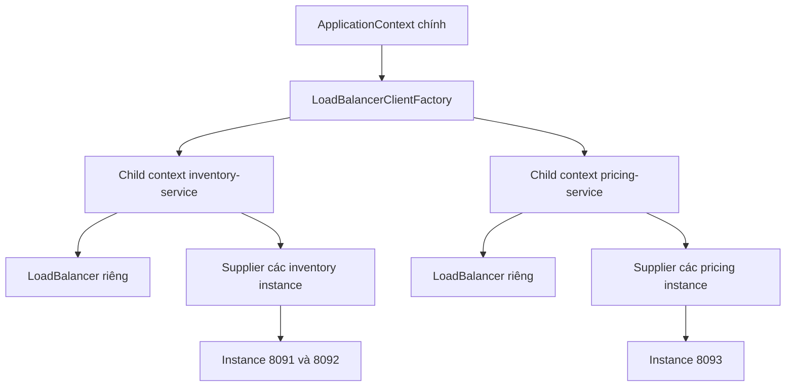
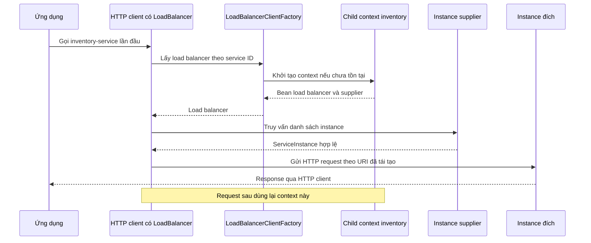
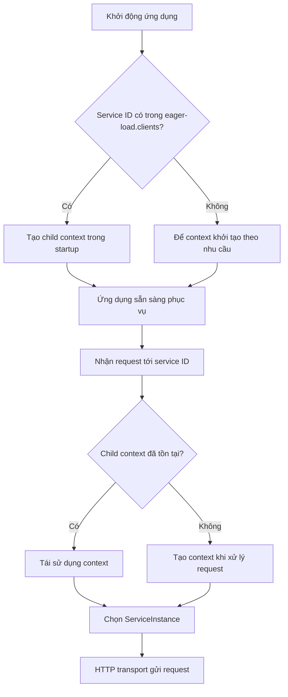

# Khởi tạo khi có lời gọi đầu tiên và cấu hình eager loading

Trong Spring Cloud LoadBalancer, mỗi tên dịch vụ logic (**service ID**) có thể có cấu hình riêng để lấy danh sách và lựa chọn `ServiceInstance`. Thông thường, framework chỉ khởi tạo các thành phần cân bằng tải của một service ID khi lần đầu cần gọi tới dịch vụ đó (**lazy initialization**). Để giảm phần chi phí khởi tạo xuất hiện trong request đầu tiên, ta có thể yêu cầu framework tạo sớm các thành phần này trong quá trình startup (**eager loading**).

Eager loading **chuyển thời điểm khởi tạo LoadBalancer context**, chứ không tự gửi HTTP request, không tạo bản sao dịch vụ, không bảo đảm sẵn có địa chỉ từ discovery, không mở sẵn kết nối TCP/TLS và không thay đổi chiến lược chọn instance. Hiểu ranh giới này là điều kiện để cấu hình đúng và đánh giá tác dụng thực tế.

## 1. Vì sao có ApplicationContext riêng cho từng service ID?

Một ứng dụng có thể cần gọi `inventory-service`, `pricing-service` và `notification-service`. Mỗi dịch vụ có danh sách instance, metadata, health check và chính sách định tuyến khác nhau. Spring Cloud LoadBalancer sử dụng `LoadBalancerClientFactory` để quản lý **child ApplicationContext** theo tên dịch vụ. Trong mỗi context này có các bean dành cho việc lựa chọn instance của đúng service ID.

| Thành phần | Vai trò |
|---|---|
| ApplicationContext chính | Chứa controller, service, HTTP client và các bean chung của ứng dụng |
| `LoadBalancerClientFactory` | Quản lý/tìm các context theo service ID |
| Child context của `inventory-service` | Chứa load balancer và supplier áp dụng cho `inventory-service` |
| `ReactorServiceInstanceLoadBalancer` | Chọn một instance theo chính sách, ví dụ round robin |
| `ServiceInstanceListSupplier` | Cung cấp danh sách instance, có thể kết hợp discovery, cache hoặc health check |
| `DiscoveryClient` | Lấy thông tin instance từ registry hoặc danh sách được cấu hình |
| `ServiceInstance` | Dữ liệu mô tả một bản sao: service ID, host, port, trạng thái secure và metadata |

Mỗi **service ID**, không phải mỗi instance, gắn với một child context. Chẳng hạn `inventory-service` có ba instance chạy trên ba port khác nhau thì cả ba instance vẫn thuộc cùng context cấu hình LoadBalancer của `inventory-service`. Context có thể được tái sử dụng trong rất nhiều request tới service ID đó.



Sơ đồ thể hiện cấu trúc logic. Việc vẽ hai context không có nghĩa cả hai đã được tạo khi application context chính khởi động: thời điểm tạo tùy thuộc cấu hình lazy hoặc eager.

## 2. Lazy initialization: chỉ tạo khi cần lần đầu

Theo hành vi mặc định, Spring Cloud LoadBalancer thường **khởi tạo child context theo nhu cầu**. Trong lời gọi `http://inventory-service/api/v1/items/42` đầu tiên:

1. HTTP client được tích hợp LoadBalancer lấy `inventory-service` từ host trong URI logic.
2. Cơ chế load balancing hỏi `LoadBalancerClientFactory` về thành phần chọn instance của service ID này.
3. Nếu context `inventory-service` chưa tồn tại, factory tạo child context và khởi tạo các bean liên quan.
4. Load balancer lấy danh sách từ `ServiceInstanceListSupplier` rồi chọn một `ServiceInstance`.
5. URI logic được tái tạo với host/port của instance, sau đó HTTP transport thực hiện request.
6. Các request sau dùng lại child context đã tạo. Gọi lần đầu tới `pricing-service` vẫn có thể phải tạo một context khác.



### Vì sao request đầu có thể chậm hơn?

Khởi tạo child context cần thực hiện cấu hình và tạo bean. Đây là một phần công việc có thể nằm trong đường xử lý request đầu tiên. Tuy nhiên, thời gian request đầu còn bị ảnh hưởng bởi nhiều việc **không phụ thuộc trực tiếp** vào khởi tạo child context:

| Nguồn độ trễ | Ví dụ | Eager loading child context có giải quyết trực tiếp? |
|---|---|---|
| Tạo child context | Bind cấu hình, tạo load balancer/supplier | Có, bằng cách chuyển sang startup |
| Discovery lookup | Truy vấn registry hoặc lấy danh sách instance | Không bảo đảm |
| DNS lookup | Phân giải hostname của instance | Không |
| Mở kết nối mạng | TCP/TLS handshake, khởi tạo connection pool | Không |
| Xử lý phía server | Truy vấn dữ liệu, khởi tạo cache ở provider | Không |
| Hoạt động runtime | Class loading, JIT, GC hoặc khởi tạo thư viện khác | Không bảo đảm |

Do đó **request đầu chậm chưa đủ chứng minh** lazy initialization là nguyên nhân. Cần đo hoặc quan sát riêng các giai đoạn.

## 3. Cấu hình eager loading cho những service ID quan trọng

Thuộc tính được Spring Cloud LoadBalancer sử dụng là:

```properties
spring.cloud.loadbalancer.eager-load.clients[0]=inventory-service
spring.cloud.loadbalancer.eager-load.clients[1]=pricing-service
```

Tương đương với cấu hình YAML:

```yaml
spring:
  cloud:
    loadbalancer:
      eager-load:
        clients:
          - inventory-service
          - pricing-service
```

`eager-load.clients` nhận **danh sách service ID**. Đây không phải danh sách URL của instance. Nếu `inventory-service` có hai bản sao ở port 8091 và 8092, trong danh sách eager chỉ cần ghi đúng một tên `inventory-service`.

Khi ứng dụng khởi động, Spring Cloud LoadBalancer sẽ tạo sớm các child context được liệt kê. Request đầu tới các service ID đó có thể tránh được công việc tạo context; các service ID không được liệt kê vẫn thường hoạt động theo cơ chế lazy.



**Quan trọng:** một child context được tạo sớm không có nghĩa instance đích đã được đăng ký hoặc kiểm tra health thành công. Tùy supplier và discovery implementation, truy vấn registry hoặc khởi tạo cache có thể diễn ra ở thời điểm khác. Eager loading cũng không phải cơ chế thực thi các request warm-up tới ứng dụng khác.

## 4. Ví dụ thực hành với SimpleDiscoveryClient và RestClient

Ta sử dụng ba tiến trình dịch vụ để thấy rõ cấu hình theo service ID:

| Tiến trình | Địa chỉ | Chức năng |
|---|---|---|
| `inventory-service` bản sao 1 | `http://localhost:8091` | Cung cấp `GET /api/v1/items/{id}` |
| `inventory-service` bản sao 2 | `http://localhost:8092` | Cùng endpoint, dữ liệu có dấu hiệu nhận biết instance |
| `pricing-service` | `http://localhost:8093` | Dịch vụ thứ hai để minh họa context riêng |

Ứng dụng client chạy ở port 8080. Client phải có dependency `spring-cloud-starter-loadbalancer` và starter web phù hợp, được quản lý bằng Spring Cloud BOM tương thích với Spring Boot. Ví dụ `RestClient` cần Spring Framework 6.1 trở lên (thường từ Spring Boot 3.2).

### 4.1. Khai báo danh sách instance và eager trong cùng profile

Tạo `application-lab.yml` cho **ứng dụng client**:

```yaml
server:
  port: 8080

spring:
  application:
    name: gateway-demo
  cloud:
    discovery:
      client:
        simple:
          instances:
            inventory-service:
              - uri: http://localhost:8091
              - uri: http://localhost:8092
            pricing-service:
              - uri: http://localhost:8093
    loadbalancer:
      eager-load:
        clients:
          - inventory-service
          - pricing-service
```

Hai thuộc tính có mục đích khác nhau:

- `spring.cloud.discovery.client.simple.instances` cung cấp các URI instance cho từng service ID. Với cấu hình này, `SimpleDiscoveryClient` không cần registry riêng.
- `spring.cloud.loadbalancer.eager-load.clients` quyết định service ID nào được khởi tạo LoadBalancer child context sớm.

Không thể chỉ khai báo `eager-load.clients` rồi kỳ vọng framework tự tạo bản sao dịch vụ hoặc tự biết host/port của chúng. Trước khi thử LoadBalancer, cần chắc chắn endpoint ở mỗi URI có thể gọi trực tiếp từ máy chạy client.

Khởi động ứng dụng client bằng profile:

```bash
java -jar gateway-demo.jar --spring.profiles.active=lab
```

### 4.2. Cấu hình RestClient có tích hợp LoadBalancer

Ứng dụng client đăng ký một `RestClient.Builder` được đánh dấu `@LoadBalanced`:

```java
import org.springframework.cloud.client.loadbalancer.LoadBalanced;
import org.springframework.context.annotation.Bean;
import org.springframework.context.annotation.Configuration;
import org.springframework.web.client.RestClient;

@Configuration
class HttpClientConfiguration {

    @Bean
    @LoadBalanced
    RestClient.Builder loadBalancedRestClientBuilder() {
        return RestClient.builder();
    }
}
```

Gateway sử dụng đúng builder đó để gọi service ID:

```java
import org.springframework.beans.factory.annotation.Qualifier;
import org.springframework.stereotype.Service;
import org.springframework.web.client.RestClient;

@Service
class InventoryGateway {

    private final RestClient restClient;

    InventoryGateway(
            @Qualifier("loadBalancedRestClientBuilder")
            RestClient.Builder builder) {
        this.restClient = builder
                .baseUrl("http://inventory-service")
                .build();
    }

    String getItem(String itemId) {
        return restClient.get()
                .uri("/api/v1/items/{id}", itemId)
                .retrieve()
                .body(String.class);
    }
}
```

Để kiểm tra qua cổng của ứng dụng client:

```java
import org.springframework.web.bind.annotation.GetMapping;
import org.springframework.web.bind.annotation.PathVariable;
import org.springframework.web.bind.annotation.RestController;

@RestController
class DemoController {

    private final InventoryGateway gateway;

    DemoController(InventoryGateway gateway) {
        this.gateway = gateway;
    }

    @GetMapping("/items/{id}")
    String item(@PathVariable String id) {
        return gateway.getItem(id);
    }
}
```

Chạy hai bản sao provider tại port 8091 và 8092, mỗi bản sao trả về thêm trường `instanceId` hoặc `port` để phân biệt. Sau đó gọi nhiều lần:

```bash
curl http://localhost:8080/items/42
curl http://localhost:8080/items/42
curl http://localhost:8080/items/42
```

Với chính sách mặc định round robin và hai instance sẵn sàng, có thể quan sát request luân phiên giữa các bản sao. **Bật eager không thay đổi quy tắc round robin**: context được tạo sớm hơn, còn lựa chọn instance vẫn do load balancer đảm nhiệm.

Nếu sử dụng `RestClient` bình thường không đi qua builder `@LoadBalanced`, tên `inventory-service` trong URL sẽ được xử lý như hostname DNS. Khi đó việc eager context không làm client tự động sử dụng danh sách instance của discovery.

## 5. Thử nghiệm so sánh lazy và eager

Để đánh giá đúng, giữ nguyên provider, số instance, timeout và hạ tầng mạng; chỉ thay cấu hình khởi tạo context ở phía client.

1. Chạy hai provider và xác nhận các địa chỉ `http://localhost:8091`, `http://localhost:8092` truy cập được.
2. Chạy client ở chế độ **lazy** bằng cách bỏ nhánh `spring.cloud.loadbalancer.eager-load` khỏi profile. Ghi thời gian từ lúc khởi động đến lúc ứng dụng sẵn sàng, và thời gian request đầu tiên.
3. Đo thêm một số request tiếp theo sau khi context đã được tạo.
4. Khởi động lại client với **eager** cho `inventory-service`. Lặp lại phép đo với điều kiện tương đương.
5. Thực hiện nhiều lượt và so sánh xu hướng. Một lần chạy có thể bị nhiễu bởi JIT, DNS, cache, kết nối TCP hoặc thời gian xử lý của provider.

Ví dụ đo từ Linux/macOS:

```bash
curl -s -o /dev/null -w 'total=%{time_total}s\n' \
  http://localhost:8080/items/42
```

Trên Windows PowerShell:

```powershell
curl.exe -s -o NUL -w "total=%{time_total}s\n" http://localhost:8080/items/42
```

Các lệnh này đo thời gian **tổng thể từ caller**, không đo riêng thời gian tạo context. Để xác minh context được tạo ở startup hay request đầu, có thể thêm instrumentation cho vòng đời bean/context của LoadBalancer và kết hợp trace hoặc log đã được cấu hình phù hợp với phiên bản đang dùng.

| Đại lượng | Ý nghĩa |
|---|---|
| Thời gian startup đến khi sẵn sàng | Eager có thể làm tăng do phải tạo các context trước |
| Thời gian request đầu | Lazy có thể chịu thêm chi phí tạo child context |
| Thời gian request sau | Hai chế độ thường đã có context; khác biệt còn lại cần đo riêng |
| Bộ nhớ và số context đã tạo | Eager khởi tạo trước cả context chưa chắc được dùng |

Không nên diễn giải “request đầu tiên nhanh hơn” thành “mọi request đều nhanh hơn”. Eager là lựa chọn chuyển chi phí từ thời điểm request sang startup.

## 6. Quan hệ với cấu hình theo từng dịch vụ

Các context riêng cho phép `inventory-service` và `pricing-service` có supplier hoặc thuật toán chọn instance khác nhau. Spring Cloud có thể liên kết cấu hình với tên dịch vụ bằng `@LoadBalancerClient(name = "...", configuration = ...)`; eager loading chỉ thay đổi thời điểm context tương ứng được tạo.

Ví dụ, nếu ứng dụng chỉ thường xuyên gọi `inventory-service` nhưng rất hiếm khi gọi `pricing-service`, có thể chỉ khai báo:

```yaml
spring:
  cloud:
    loadbalancer:
      eager-load:
        clients:
          - inventory-service
```

Khi đó context `inventory-service` được tạo trong startup, còn context `pricing-service` vẫn có thể được tạo khi có yêu cầu đầu tiên. Cách này giảm chi phí khởi động và bộ nhớ so với eager tất cả service ID mà ứng dụng có thể gọi.

**Lưu ý cho lớp cấu hình riêng**: nếu dùng class cấu hình dành cho `@LoadBalancerClient`, hãy tránh để class đó vô tình bị component scan của application context chính quét vào. Nếu cấu hình đi vào context cha ngoài ý muốn, bean hoặc chiến lược đặc thù có thể ảnh hưởng đến nhiều service ID.

## 7. Eager không thay thế health check, retry hay timeout

Cấu hình eager loading chỉ giải quyết việc khởi tạo context:

- **Discovery:** tên dịch vụ phải có các instance từ registry, danh sách tĩnh hoặc supplier khác. Eager không tự đăng ký instance.
- **Health check:** nếu một instance không khỏe mạnh, cần discovery hoặc supplier health check loại instance theo chính sách phù hợp. Context đã tạo không chứng minh instance có thể nhận request.
- **Timeout:** connection timeout, read timeout và timeout tổng thể thuộc cấu hình của HTTP transport và tầng gọi. Eager không tự thay đổi các giá trị này.
- **Retry:** retry phụ thuộc tích hợp HTTP client và chính sách đã cấu hình, có thể thử cùng hoặc instance khác; eager không bật retry.
- **Observability:** vẫn cần log/metric/trace cho service ID, instance được chọn, request duration, exception và số lần retry.

Với `RestClient`, `RestTemplate` và OpenFeign, request có thể theo mô hình blocking. `WebClient` thường dùng đường tích hợp reactive riêng để chọn instance. Eager loading child context không quyết định một HTTP client là blocking hay reactive.

## 8. Lỗi thường gặp

| Triệu chứng | Nguyên nhân có thể | Hướng kiểm tra |
|---|---|---|
| Request đầu vẫn chậm sau khi bật eager | DNS, discovery lookup, TLS, pool kết nối hoặc provider chậm | Đo từng giai đoạn; không giả định tất cả độ trễ từ LoadBalancer context |
| Tưởng đã eager nhưng vẫn tạo context lúc gọi | Sai tên trong `clients`, sai profile hoặc property prefix | Đối chiếu service ID và giá trị cấu hình runtime |
| Startup lâu hơn sau khi bật eager cho nhiều dịch vụ | Phải tạo nhiều context/bean trước khi sẵn sàng | Chỉ eager các service ID được dùng thường xuyên và đã đo lợi ích |
| Lỗi tạo bean xuất hiện từ lúc startup | Eager làm lộ lỗi cấu hình theo service sớm hơn | Kiểm tra class cấu hình `@LoadBalancerClient` và dependency |
| Không có instance của một service ID | Registry/danh sách tĩnh chưa có instance, hoặc tên sai | Kiểm tra discovery, registration, metadata và danh sách instance |
| `UnknownHostException` với tên logic | HTTP client có thể chưa qua tích hợp LoadBalancer | Kiểm tra đúng bean `@LoadBalanced` hoặc builder được inject |
| `Connection refused` ở instance được chọn | Instance dừng, port sai hoặc không truy cập được | Gọi trực tiếp host:port, kiểm tra mạng và health check |

Để phân loại lỗi, đi theo chuỗi: **service ID → child context → danh sách instance → instance được chọn → kết nối mạng → HTTP response**. Vị trí thất bại cho biết cần sửa cấu hình load balancing, discovery hay HTTP transport.

## 9. Checklist ghi nhớ

- [ ] Phân biệt child ApplicationContext theo service ID với các `ServiceInstance` của dịch vụ đó.
- [ ] Biết rằng lazy initialization là hành vi mặc định thường gặp và chi phí tạo context có thể xuất hiện ở lời gọi đầu tiên.
- [ ] Cấu hình chính xác `spring.cloud.loadbalancer.eager-load.clients` bằng **tên service ID**, không nhập URI của instance.
- [ ] Kiểm tra danh sách instance riêng qua discovery hoặc cấu hình tĩnh.
- [ ] Bảo đảm HTTP client sử dụng đúng tích hợp `@LoadBalanced`.
- [ ] Đo thời gian startup và request đầu, phân biệt chi phí context với DNS, TCP/TLS, discovery và provider.
- [ ] Chỉ eager những dịch vụ cần thiết; giữ health check, timeout, retry và observability theo chính sách của từng client.

Hiểu lifecycle của child context giúp cân bằng giữa thời gian startup và độ trễ lời gọi đầu tiên trong Spring Cloud LoadBalancer. Với những service ID thường xuyên được gọi ngay sau khi ứng dụng sẵn sàng, eager loading có thể hữu ích; với dịch vụ ít sử dụng, lazy giúp tránh chi phí khởi tạo không cần thiết.
