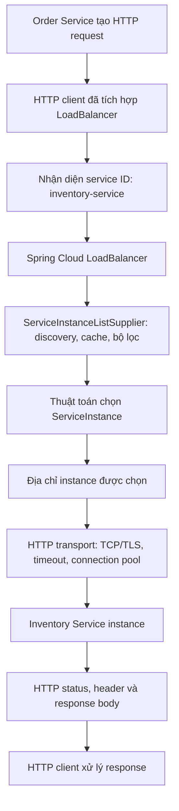
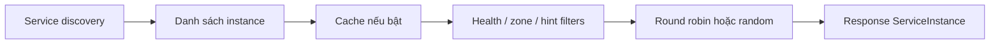

# Phân biệt cấu hình LoadBalancer với cấu hình HTTP client

Trong hệ thống microservice dùng Spring Cloud, một request như `GET http://inventory-service/api/items/42` thường đi qua hai nhóm cấu hình độc lập nhưng phối hợp với nhau:

1. **Cấu hình Spring Cloud LoadBalancer** quyết định lấy những `ServiceInstance` nào cho service ID `inventory-service`, lọc và chọn instance theo chiến lược nào.
2. **Cấu hình HTTP client** quyết định cách thực hiện kết nối đến instance đã chọn: connect timeout, thời gian chờ phản hồi, connection pool, TLS, header, cách giải mã body và xử lý lỗi HTTP.

Nếu hai nhóm cấu hình bị trộn lẫn, người phát triển dễ gặp những kỳ vọng sai: đổi thuật toán round robin nhưng vẫn bị timeout; tăng read timeout nhưng không sửa được lỗi không tìm thấy instance; hoặc bật retry ở nhiều tầng dẫn đến một thao tác `POST` được gửi lặp lại ngoài dự kiến.

Bài này tập trung vào ranh giới và cách phối hợp hai lớp cấu hình khi sử dụng **Spring Cloud LoadBalancer** với `RestClient`, `WebClient` và OpenFeign. Các ví dụ dùng service ID `inventory-service`; tên lớp và địa chỉ chỉ nhằm minh họa, không phải cấu hình bắt buộc cho mọi ứng dụng.

## 1. Một lời gọi đi qua những bước nào?

Giả sử `order-service` gọi `inventory-service`, có ba replica tại `10.0.1.11:8080`, `10.0.1.12:8080` và `10.0.1.13:8080`.



Ví dụ, LoadBalancer chọn `10.0.1.12:8080`. HTTP client sau đó gửi request đến địa chỉ này bằng kết nối được quản lý theo cấu hình của chính client. Nếu bước lấy danh sách ứng viên thất bại thì request chưa đến được instance; nếu bước kết nối thất bại thì việc chọn instance đã hoàn thành nhưng transport không thành công.

Điều cần nhớ: **LoadBalancer chọn nơi gửi; HTTP client quyết định cách gửi và cách nhận.** Một số chính sách như retry, timeout tổng và circuit breaker còn có thể thuộc tầng gọi nghiệp vụ hoặc thư viện resilience. Chúng cần được phối hợp, không nên mặc định coi là trách nhiệm của LoadBalancer.

## 2. Bảng phân biệt trách nhiệm cấu hình

| Câu hỏi cần giải quyết | Spring Cloud LoadBalancer | HTTP client / tầng gọi |
|---|---|---|
| `inventory-service` có những instance nào? | Discovery và `ServiceInstanceListSupplier`. | Không tự quyết định danh sách khi đang dùng cơ chế LoadBalancer. |
| Chọn instance nào cho request này? | `RoundRobinLoadBalancer`, `RandomLoadBalancer` hoặc chiến lược tùy chỉnh. | Dùng instance được chọn để thực hiện request. |
| Có ưu tiên zone hoặc metadata không? | Supplier lọc hoặc ưu tiên theo zone, hint, metadata. | Có thể truyền context/hint khi integration hỗ trợ; không tự thay thuật toán. |
| Có bỏ instance unhealthy không? | Supplier/health check và nguồn discovery theo cấu hình. | Vẫn phải chịu lỗi kết nối trong khoảng thời gian health/discovery chưa cập nhật. |
| Chờ kết nối bao lâu? | Không phải connect timeout TCP thông thường. | Connect timeout của HTTP transport. |
| Chờ response bao lâu? | Không phải read/response timeout của HTTP transport. | Read timeout, response timeout và/hoặc deadline của request. |
| Dùng connection pool, proxy, TLS thế nào? | Không phải thành phần quản lý socket của HTTP transport. | Cấu hình transport như JDK HTTP client, Apache HttpClient, Reactor Netty hoặc client của Feign. |
| Thêm Authorization, Content-Type, interceptor? | Không phải nhiệm vụ chọn instance. | HTTP client filter/interceptor và lớp xác thực. |
| Xử lý `404`, `409`, `429`, `503`? | Một số lỗi không có instance có thể được integration ánh xạ thành exception/status. | Phân tích HTTP response thực tế; tầng ứng dụng quyết định cách xử lý nghiệp vụ. |
| Retry có đổi instance không? | Nếu bật tính năng retry qua LoadBalancer và chính sách cho phép chọn lại. | Retry của HTTP client hoặc tầng nghiệp vụ phải có điều kiện riêng; không mặc nhiên đổi instance. |

Hai điểm dễ nhầm: `ServiceInstanceListSupplier` có thể chủ động gọi health endpoint, nhưng đó là một phần của chính sách *danh sách ứng viên*, không phải read timeout cho request nghiệp vụ. Đồng thời, HTTP client có thể được cấu hình retry, nhưng retry của riêng HTTP transport không nhất thiết gọi lại thuật toán lựa chọn `ServiceInstance`.

## 3. Phạm vi cấu hình: theo service ID hay theo HTTP client?

Spring Cloud LoadBalancer thường tạo cấu hình riêng theo **service ID**. `inventory-service` và `payment-service` có thể dùng thuật toán hoặc supplier khác nhau, dù cùng gọi qua một `@LoadBalanced RestClient.Builder` hoặc `WebClient.Builder`.

HTTP client có phạm vi khác: một `RestClient`, `WebClient` hoặc Feign client là đối tượng dùng để gửi request. Ta có thể tạo một client chuyên gọi `inventory-service` với timeout riêng; cũng có thể dùng một builder chung và đưa nhiều service ID vào URI. Khi đó các request có thể chia sẻ cùng cấu hình transport của builder/client.

| Đối tượng cấu hình | Khóa/phạm vi điển hình | Ví dụ |
|---|---|---|
| LoadBalancer | Service ID | `@LoadBalancerClient(name = "inventory-service", ...)` |
| RestClient | Bean `RestClient` hoặc `RestClient.Builder` | Bean chuyên gọi inventory có connect/read timeout riêng. |
| WebClient | Bean `WebClient` hoặc `WebClient.Builder` | Bean chuyên gọi inventory dùng Reactor Netty và response timeout riêng. |
| OpenFeign | Tên hoặc context ID của Feign client | `spring.cloud.openfeign.client.config.inventory-service` khi client có tên tương ứng. |

Tên bean của HTTP client không quyết định service ID để LoadBalancer chọn. Với URI `http://inventory-service/...`, `inventory-service` mới là service ID được dùng để tra cứu instance. Đối với OpenFeign, thuộc tính `name` trong `@FeignClient` thường là service ID nếu không cấu hình `url` cố định. Tên dùng để áp dụng cấu hình Feign cần khớp với định danh client thực tế, nhất là khi sử dụng `contextId`.

## 4. Cấu hình LoadBalancer theo service ID

### 4.1. Chọn thuật toán riêng cho một dịch vụ

Spring Cloud LoadBalancer cho phép gắn cấu hình riêng cho service ID bằng `@LoadBalancerClient`. Ví dụ: gọi `inventory-service` dùng thuật toán random, trong khi các service không có cấu hình riêng tiếp tục dùng mặc định của ứng dụng.

```java
@Configuration
@LoadBalancerClient(
    name = "inventory-service",
    configuration = InventoryLoadBalancerConfiguration.class
)
class LoadBalancerRegistration {
}

// Để lớp này ngoài phạm vi component scan của ứng dụng chính.
class InventoryLoadBalancerConfiguration {

    @Bean
    ReactorLoadBalancer<ServiceInstance> inventoryLoadBalancer(
            Environment environment,
            LoadBalancerClientFactory factory) {

        String serviceId = environment.getProperty(
            LoadBalancerClientFactory.PROPERTY_NAME);

        return new RandomLoadBalancer(
            factory.getLazyProvider(
                serviceId, ServiceInstanceListSupplier.class),
            serviceId);
    }
}
```

Trong ví dụ, `LoadBalancerClientFactory` quản lý context theo `inventory-service`. `RandomLoadBalancer` lấy danh sách ứng viên từ `ServiceInstanceListSupplier` của đúng service đó. Nó chỉ quyết định instance được chọn, không cấu hình socket timeout, TLS hay connection pool.

**Lưu ý về phạm vi bean:** lớp `InventoryLoadBalancerConfiguration` nên nằm ngoài component scan chính hoặc được tổ chức để chỉ được nạp vào context LoadBalancer của service này. Nếu cấu hình theo service vô tình trở thành bean toàn cục, nó có thể ảnh hưởng đến nhiều service ID. Các import Java được lược bớt để tập trung vào ranh giới cấu hình; khi áp dụng phải dùng API và dependency tương ứng với phiên bản Spring Cloud của dự án.

### 4.2. Cấu hình nguồn và bộ lọc instance

Một chính sách LoadBalancer thường gồm cả chuỗi supplier:



Các thành phần như `CachingServiceInstanceListSupplier`, `HealthCheckServiceInstanceListSupplier`, `ZonePreferenceServiceInstanceListSupplier` và `HintBasedServiceInstanceListSupplier` thuộc trách nhiệm của LoadBalancer. Chúng ảnh hưởng **tập ứng viên có thể chọn**. Thứ tự các supplier/decorator quan trọng, vì cache đặt ở vị trí khác có thể làm thay đổi dữ liệu được cache và thời điểm bộ lọc được áp dụng.

Nếu chỉ muốn giảm response timeout của `inventory-service` từ 5 giây xuống 2 giây, không cần thay supplier. Ngược lại, nếu muốn ưu tiên replica cùng zone, chỉnh HTTP client timeout không giải quyết được; phải xem chính sách định tuyến và metadata instance.

## 5. Cấu hình HTTP client với RestClient

`RestClient` là HTTP client đồng bộ (blocking) của Spring Framework. Khi được tích hợp Spring Cloud LoadBalancer, request dùng URI với service ID có thể được định tuyến đến instance đã chọn.

Một cấu hình minh họa tạo builder hỗ trợ LoadBalancer, sau đó tạo riêng `RestClient` cho inventory:

```java
@Configuration
class RestClientsConfiguration {

    @Bean
    @LoadBalanced
    RestClient.Builder loadBalancedRestClientBuilder() {
        return RestClient.builder();
    }

    @Bean
    RestClient inventoryRestClient(
            @LoadBalanced RestClient.Builder builder) {

        SimpleClientHttpRequestFactory transport =
            new SimpleClientHttpRequestFactory();
        transport.setConnectTimeout(1_000);
        transport.setReadTimeout(3_000);

        return builder.clone()
            .baseUrl("http://inventory-service")
            .requestFactory(transport)
            .build();
    }
}
```

Ví dụ sử dụng:

```java
@Service
class InventoryRestGateway {
    private final RestClient inventoryRestClient;

    InventoryRestGateway(RestClient inventoryRestClient) {
        this.inventoryRestClient = inventoryRestClient;
    }

    Item findItem(String id) {
        return inventoryRestClient.get()
            .uri("/api/items/{id}", id)
            .retrieve()
            .body(Item.class);
    }
}
```

Ở đây có hai quyết định riêng:

- `@LoadBalanced` bật cơ chế phân giải service ID cho builder, từ đó request đến `http://inventory-service` có thể được chọn instance qua LoadBalancer.
- `SimpleClientHttpRequestFactory` thiết lập giới hạn chờ kết nối và đọc phản hồi của transport trong ví dụ; các giá trị `1_000` và `3_000` là mili giây.

`builder.clone()` tạo cấu hình client riêng, tránh việc chỉnh `baseUrl` hoặc transport của một builder dùng chung làm ảnh hưởng các client được tạo sau. Ở môi trường tải cao, có thể thay `SimpleClientHttpRequestFactory` bằng transport có connection pool và các thiết lập phù hợp; việc chọn transport thuộc cấu hình HTTP client.

Không được mặc định mọi builder đều có LoadBalancer. Một `RestClient.Builder` thông thường dùng `http://inventory-service` có thể cố phân giải hostname bằng DNS và thất bại nếu môi trường không có bản ghi tương ứng. Điều kiện là integration và dependency Spring Cloud LoadBalancer phải được thiết lập đúng.

## 6. Cấu hình HTTP client với WebClient

`WebClient` hỗ trợ xử lý reactive. Để phân giải service ID, builder cần được tích hợp filter LoadBalancer; còn connect/response timeout có thể do transport Reactor Netty quản lý.

```java
@Configuration
class WebClientsConfiguration {

    @Bean
    @LoadBalanced
    WebClient.Builder loadBalancedWebClientBuilder() {
        return WebClient.builder();
    }

    @Bean
    WebClient inventoryWebClient(
            @LoadBalanced WebClient.Builder builder) {

        HttpClient httpClient = HttpClient.create()
            .option(ChannelOption.CONNECT_TIMEOUT_MILLIS, 1_000)
            .responseTimeout(Duration.ofSeconds(3));

        return builder.clone()
            .baseUrl("http://inventory-service")
            .clientConnector(new ReactorClientHttpConnector(httpClient))
            .build();
    }
}
```

Sử dụng bean này để gọi inventory:

```java
@Service
class InventoryReactiveGateway {
    private final WebClient inventoryWebClient;

    InventoryReactiveGateway(WebClient inventoryWebClient) {
        this.inventoryWebClient = inventoryWebClient;
    }

    Mono<Item> findItem(String id) {
        return inventoryWebClient.get()
            .uri("/api/items/{id}", id)
            .retrieve()
            .bodyToMono(Item.class);
    }
}
```

`CONNECT_TIMEOUT_MILLIS` là giới hạn chờ thiết lập kết nối; `responseTimeout` giới hạn thời gian chờ phản hồi theo ngữ nghĩa của Reactor Netty. Chúng không phải bộ đếm thời gian cho toàn bộ chuỗi discovery, chọn instance, retry, backoff và xử lý dữ liệu. Nếu nghiệp vụ có deadline tổng, cần thiết kế thêm giới hạn ở tầng gọi phù hợp, chẳng hạn toán tử `timeout(...)` trong chuỗi Reactor và cơ chế truyền deadline qua các lời gọi liên tiếp.

Ví dụ dùng `ReactorClientHttpConnector` cần Reactor Netty có trong classpath. Nếu chọn HTTP transport khác, cách cấu hình timeout, proxy và TLS cũng thay đổi theo transport đó. Phần LoadBalancer vẫn tập trung vào việc chọn `ServiceInstance`.

## 7. Cấu hình HTTP client với OpenFeign

OpenFeign cung cấp cách khai báo HTTP client bằng interface. Khi có integration LoadBalancer phù hợp và không chỉ định URL đích cố định, `name` của `@FeignClient` có thể được dùng làm service ID:

```java
@FeignClient(name = "inventory-service")
interface InventoryFeignClient {

    @GetMapping("/api/items/{id}")
    Item findItem(@PathVariable("id") String id);
}
```

Cấu hình connect/read timeout riêng cho Feign client có tên `inventory-service`:

```yaml
spring:
  cloud:
    openfeign:
      client:
        config:
          inventory-service:
            connectTimeout: 1000
            readTimeout: 3000
```

Các giá trị trên tính bằng mili giây. Chúng là **cấu hình Feign HTTP client** và không thay `RoundRobinLoadBalancer`, `ServiceInstanceListSupplier` hay metadata của instance. Các option và engine thực tế của Feign còn tùy dependency HTTP client, cấu hình riêng và phiên bản Spring Cloud OpenFeign.

Nếu khai báo `@FeignClient(name = "inventory-service", url = "https://inventory.internal.example")`, client có URL đích cố định và thường không cần lựa chọn instance qua Spring Cloud LoadBalancer cho lời gọi đó. Vì vậy, cần kiểm tra cả `name` và `url` khi thấy request không đi qua LoadBalancer như mong đợi. Nếu dùng `contextId`, tên áp dụng cấu hình Feign có thể thay đổi theo cách khai báo; đừng suy ra khóa cấu hình chỉ từ tên interface Java.

## 8. Timeout và retry: hai lớp cấu hình phải dùng chung ngân sách

Timeout và retry là nơi ranh giới hai lớp thường bị nhầm nhất:

| Cơ chế | Lớp chịu trách nhiệm điển hình | Điều gì được giới hạn hoặc lặp lại? |
|---|---|---|
| Connect timeout | HTTP transport | Thời gian thiết lập kết nối đến host:port đã chọn. |
| Read/response timeout | HTTP transport | Thời gian chờ đọc hoặc nhận phản hồi, theo cách HTTP engine định nghĩa. |
| Tổng request deadline | Tầng gọi nghiệp vụ, reactive pipeline hoặc thư viện resilience | Tổng thời gian cho chọn instance, kết nối, thực hiện và có thể cả retry/backoff. |
| Retry LoadBalancer | Spring Cloud LoadBalancer integration, khi được bật và cấu hình | Có thể thử lại với instance đã chọn hoặc chọn lại instance tùy chính sách, loại lỗi và phiên bản. |
| Retry Feign/WebClient/RestClient | HTTP client hoặc tầng ứng dụng | Gửi lại request theo logic retry riêng; việc chọn lại instance phụ thuộc vị trí retry trong pipeline. |
| Circuit breaker | Thư viện resilience/tầng gọi | Chặn tạm lời gọi khi lỗi vượt điều kiện; không đồng nghĩa thuật toán chọn instance. |

Giả sử deadline nghiệp vụ là 3 giây. Một lần thử có connect timeout 0,5 giây và response timeout 1 giây; nếu cho phép hai lần thử cộng backoff 0,2 giây, thời gian xấu nhất theo phép cộng đơn giản là khoảng 3,2 giây, **vượt deadline 3 giây**. Vì vậy chỉ chỉnh từng timeout không đủ: phải cân đối số lần thử, thời gian chờ và deadline tổng. Trong thực tế các timeout có thể không cộng tuyến tính vì kết nối được tái sử dụng, kết thúc sớm hoặc các giai đoạn chồng lấn, nhưng bài toán ngân sách thời gian vẫn còn.

Khi thiết kế retry, hãy kiểm tra:

1. **Lỗi có thể tạm thời không?** `502`, `503`, `504`, lỗi kết nối và một số timeout có thể phù hợp với retry; `400`, `401`, `403`, `404` thường cần xử lý nguyên nhân thay vì lặp lại nguyên request.
2. **Request có an toàn khi gửi lại không?** `GET`, `PUT`, `DELETE` có ngữ nghĩa idempotent theo HTTP. `POST` có thể tạo giao dịch trùng nếu request trước đã được xử lý nhưng response bị mất. Với thao tác không idempotent, cần thỏa thuận idempotency key hoặc cơ chế chống trùng tại server.
3. **Retry diễn ra ở lớp nào?** Nếu Feign, LoadBalancer và tầng ứng dụng cùng retry, tổng số lần gọi có thể tăng theo cấp số nhân. Chỉ nên có chính sách retry được phối hợp rõ.
4. **Có được chọn instance khác không?** Điều này tùy retry có chạy qua bước `choose()` lần nữa hay không, cùng cấu hình retry của LoadBalancer. Retry của HTTP transport riêng lẻ không tự bảo đảm đổi instance.
5. **Còn thời gian không?** Giới hạn tổng thời gian; dùng exponential backoff và jitter khi phù hợp; tôn trọng `Retry-After` nếu response cung cấp và vẫn còn deadline.

Một tình huống đặc biệt nguy hiểm là `POST /api/orders`: server có thể tạo đơn hàng thành công, nhưng client hết thời gian chờ trước khi nhận response. Lúc này lỗi timeout không chứng minh server chưa thực hiện thao tác. Việc retry phải dựa vào hợp đồng nghiệp vụ chứ không thể quyết định chỉ bằng timeout hay thuật toán LoadBalancer.

## 9. Phân biệt lỗi chọn instance, lỗi transport và lỗi HTTP

Khi điều tra sự cố, xác định lỗi xảy ra tại bước nào trước khi thay cấu hình:

| Dấu hiệu | Thành phần nên kiểm tra đầu tiên | Điều chỉnh thường có ý nghĩa |
|---|---|---|
| `No servers available` hoặc kết quả chọn instance rỗng | Service ID, registry/discovery, supplier, health/zone/hint filters. | Sửa nguồn instance, metadata và bộ lọc; tăng read timeout không tạo ra instance mới. |
| Có instance nhưng `Connection refused` | Host, port, readiness, networking, server đang lắng nghe. | Sửa cấu hình địa chỉ và tính sẵn sàng; đổi random sang round robin chưa giải quyết nguyên nhân. |
| `Connect timeout` | DNS/route, firewall, mạng, kết nối TCP, connect timeout. | Kiểm tra đường truyền và giới hạn thiết lập kết nối. |
| `Read/response timeout` | Thời gian xử lý server, network I/O, deadline và HTTP transport. | Kiểm tra latency, response timeout, tối ưu upstream; có thể áp dụng chính sách retry an toàn. |
| HTTP `404` từ upstream | Endpoint/path, ID tài nguyên, method và hợp đồng API. | Sửa URI hoặc nghiệp vụ; không kết luận LoadBalancer chọn sai. |
| HTTP `429` hoặc `503` từ upstream | Rate limit/overload, `Retry-After`, sức khỏe upstream. | Backoff, giới hạn concurrency, điều chỉnh công suất và retry có giới hạn. |
| TLS handshake thất bại | HTTP transport, chứng thư, hostname, truststore và proxy. | Sửa TLS hoặc cơ chế trust của client; không phải cấu hình thuật toán chọn instance. |

Một lỗi không có instance có thể được integration biểu diễn bằng exception hoặc phản hồi lỗi như `503`, tùy client và phiên bản. Hãy phân biệt rõ `503` do **không chọn được instance** với `503` thực sự do **upstream trả về sau khi đã kết nối**. Chỉ nhìn status code ngoài cùng có thể không đủ để kết luận.

## 10. Thiết kế cấu hình cho nhiều dịch vụ

Giả sử `order-service` gọi `inventory-service` và `payment-service`, với nhu cầu khác nhau:

| Dịch vụ đích | Chính sách LoadBalancer | HTTP client và thời gian chờ | Lý do |
|---|---|---|---|
| `inventory-service` | Round robin; lọc instance unhealthy nếu cấu hình. | Read timeout ngắn hơn cho thao tác đọc tồn kho. | Thao tác đọc nên phản hồi nhanh và có thể retry giới hạn nếu an toàn. |
| `payment-service` | Ưu tiên zone hoặc metadata nếu kiến trúc yêu cầu. | Timeout và cơ chế xác thực phù hợp; thao tác tạo giao dịch có idempotency key. | Tránh xử lý thanh toán trùng và bảo vệ đường truyền. |

Có thể dùng chung thành phần chọn instance theo service ID, nhưng tạo các bean HTTP client riêng để có timeout, base URL, header, TLS hoặc connection pool khác nhau. Ngược lại, nếu nhiều service có cùng yêu cầu transport, có thể tái sử dụng cấu hình HTTP client chung và vẫn áp dụng LoadBalancer riêng cho từng service ID.

Một cách tổ chức có thể kiểm soát được là:

```text
LoadBalancer configuration (theo service ID)
  inventory-service -> round robin + supplier phù hợp
  payment-service   -> chính sách lọc / chọn phù hợp

HTTP client configuration (theo client bean / Feign client)
  inventoryClient   -> baseUrl inventory-service, timeout đọc ngắn
  paymentClient     -> baseUrl payment-service, timeout/TLS/auth riêng

Business/resilience policy (theo use case)
  readInventory     -> retry GET giới hạn
  createPayment     -> idempotency key, deadline và xử lý kết quả không xác định
```

Cách tổ chức này cũng làm rõ nơi đặt biến môi trường và bí mật: tên service, zone và timeout có thể là cấu hình ứng dụng; token, secret và khóa riêng phải đi qua cơ chế quản lý bí mật phù hợp, không đưa vào logging hay ví dụ cấu hình công khai.

## 11. Kiểm chứng bằng thí nghiệm nhỏ

Không cần xây cả hệ thống lớn để kiểm tra ranh giới cấu hình. Có thể thử với hai instance `inventory-service` chạy trên hai cổng khác nhau và trả về instance ID trong response.

1. Cấu hình discovery hoặc danh sách instance tĩnh để `inventory-service` trỏ tới hai instance.
2. Gọi cùng endpoint `GET /api/instance` nhiều lần qua client có tích hợp LoadBalancer; quan sát instance ID để thấy chính sách chọn đang hoạt động.
3. Đổi thuật toán round robin sang random cho đúng service ID, giữ nguyên HTTP timeout; quan sát thay đổi trong phân phối lượt gọi.
4. Cho một instance phản hồi chậm và giảm read/response timeout ở HTTP client; quan sát timeout thay đổi mà danh sách ứng viên và thuật toán không tự đổi.
5. Tạm loại hết instance khỏi supplier hoặc registry; xác minh hệ thống xử lý tình huống không chọn được server, khác với timeout sau khi đã chọn thành công.
6. Nếu thử retry, dùng endpoint idempotent và có giới hạn số lần gọi để tránh nhân đôi thao tác nghiệp vụ.

Khi ghi log và metric, nên có service ID, instance được chọn (nếu có), thời gian chọn, lỗi supplier, thời gian kết nối, thời gian phản hồi và HTTP status. Kết hợp trace/correlation ID để xác định lỗi trước hay sau khi chọn instance. Tránh đưa credential, token hoặc thông tin cá nhân vào log; chú ý số lượng giá trị nhãn metric nếu ghi host/instance ID của quá nhiều instance.

## 12. Checklist phân biệt cấu hình trước khi sửa lỗi

- Nếu cần chọn replica theo discovery, health, zone hoặc thuật toán: kiểm tra **Spring Cloud LoadBalancer** và supplier chain của service ID.
- Nếu cần chỉnh connect timeout, response timeout, TLS, proxy hay connection pool: kiểm tra **HTTP client/transport** đang thực sự sử dụng.
- Nếu cần cấu hình cho riêng `inventory-service`: xác định rõ đang muốn thay cấu hình **LoadBalancer theo service ID** hay **HTTP client bean/Feign client** dành cho inventory.
- Nếu service ID không được phân giải: kiểm tra `@LoadBalanced` hoặc integration tương ứng, dependency, `@FeignClient(name=...)` và việc có khai báo URL cố định hay không.
- Nếu retry không đổi instance: kiểm tra vị trí retry trong pipeline và chính sách retry của LoadBalancer; đừng suy đoán từ riêng số lần gửi HTTP.
- Nếu request bị timeout: xem xét toàn bộ ngân sách thời gian, kể cả discovery, chọn instance, kết nối, chờ phản hồi và backoff.
- Nếu gặp `503`: xác định đó là lỗi không chọn được instance hay HTTP response từ upstream.
- Nếu thay đổi chính sách chỉ cho một service: tránh để class cấu hình `@LoadBalancerClient` bị component scan thành cấu hình toàn cục.

Phân biệt đúng hai nhóm cấu hình giúp chọn `ServiceInstance` có chủ đích và giao tiếp HTTP ổn định hơn. Spring Cloud LoadBalancer chịu trách nhiệm **chọn đích**; RestClient, WebClient hoặc OpenFeign chịu trách nhiệm **truyền request và nhận response**; tầng gọi nghiệp vụ kết hợp cả hai với deadline, retry, idempotency và quan sát lỗi phù hợp.
