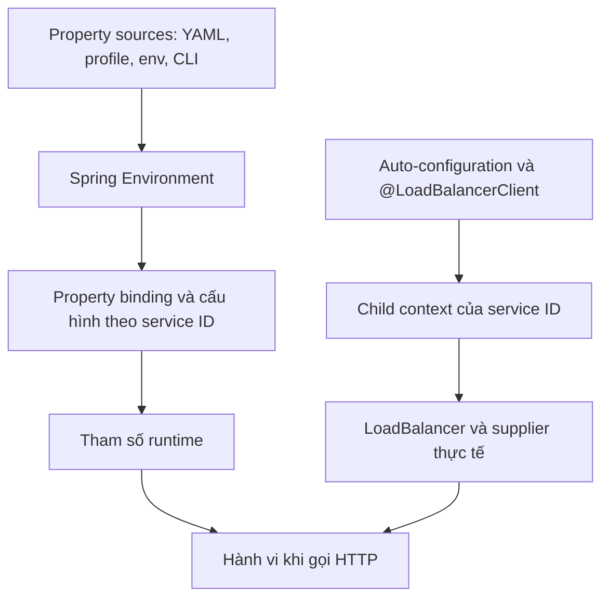

# Thứ tự áp dụng cấu hình và cách kiểm chứng giá trị thực tế

Khi triển khai Spring Cloud LoadBalancer, một thay đổi trong `application.yml` chưa chắc làm request chạy theo cách mong muốn. Giá trị có thể bị ghi đè bởi profile, biến môi trường hoặc command-line argument; một cấu hình riêng cho service ID có thể thay đổi giá trị chung; và một bean do ứng dụng tự đăng ký có thể thay thế bean mặc định. Muốn tìm nguyên nhân chính xác, cần kiểm tra **giá trị property được phân giải**, **bean thực tế trong context của dịch vụ** và **hành vi chọn `ServiceInstance` khi request chạy**.

Ví dụ xuyên suốt bài là một `order-service` gọi `inventory-service` và `payment-service` theo service ID. Spring Cloud LoadBalancer cung cấp danh sách instance từ discovery hoặc cấu hình tĩnh, sau đó dùng chính sách chọn instance như round robin hoặc random. Mục tiêu là hiểu cấu hình nào được áp dụng cho từng dịch vụ và cách chứng minh điều đó thay vì chỉ nhìn vào tệp cấu hình.

## 1. Có ba loại thứ tự cần phân biệt

Từ “độ ưu tiên cấu hình” có thể nói về ba cơ chế khác nhau:

| Cơ chế | Câu hỏi cần trả lời | Nơi kiểm tra |
|---|---|---|
| **Property source precedence** của Spring Boot | Khi **cùng một key** xuất hiện ở nhiều nguồn, nguồn nào quyết định giá trị `Environment`? | `/actuator/env`, `Environment`, origin của property. |
| **Global và per-service settings** của Spring Cloud LoadBalancer | Với một thuộc tính có hỗ trợ cấu hình riêng, giá trị chung hay giá trị cho `inventory-service` được dùng? | Cấu trúc `spring.cloud.loadbalancer...`, binding và hành vi của phiên bản đang chạy. |
| **Bean resolution** trong child context | Factory đang dùng thuật toán và supplier nào cho service ID cụ thể? | `LoadBalancerClientFactory`, `@LoadBalancerClient`, Condition Evaluation Report. |

Ba cơ chế không tạo thành một danh sách ưu tiên duy nhất. Ví dụ, command-line argument có thể ghi đè key trong YAML, nhưng không tự thay bean `RoundRobinLoadBalancer` thành `RandomLoadBalancer` nếu framework không cung cấp property để chọn thuật toán theo cách đó.



## 2. Spring Boot chọn giá trị của cùng một property như thế nào?

Spring Boot xây dựng `Environment` từ các `PropertySource`. Khi có nhiều nguồn cung cấp cùng một property, nguồn có mức ưu tiên cao hơn được dùng. Trong một ứng dụng Boot thông thường, các nguồn sau thường tăng dần về độ ưu tiên theo ví dụ từ thấp đến cao:

1. `application.yml` cơ sở.
2. Tệp cấu hình của profile đang kích hoạt, ví dụ `application-prod.yml`.
3. Biến môi trường của hệ điều hành.
4. Dữ liệu `SPRING_APPLICATION_JSON`.
5. Command-line arguments dạng `--property=value`.

Đây là trật tự minh họa cho các nguồn phổ biến. Spring Boot còn hỗ trợ test properties, system properties, config imports, cấu hình nằm ngoài JAR và các vị trí config data khác; thứ tự đầy đủ phụ thuộc cách khởi chạy và phiên bản Boot. Khi cần kết luận cho một key, hãy xem **origin** của giá trị trong `Environment`, không chỉ dựa vào danh sách khái quát.

Giả sử `application.yml` có:

```yaml
spring:
  cloud:
    loadbalancer:
      cache:
        enabled: true
```

Trong `application-prod.yml`:

```yaml
spring:
  cloud:
    loadbalancer:
      cache:
        enabled: false
```

Khi chạy với profile `prod` mà không có nguồn ưu tiên cao hơn, giá trị được phân giải là `false`. Tuy nhiên, lệnh dưới đây ghi đè key đó bằng command-line argument:

```bash
java -jar order-service.jar \
  --spring.profiles.active=prod \
  --spring.cloud.loadbalancer.cache.enabled=true
```

Ở lần chạy này, giá trị `Environment` cho `spring.cloud.loadbalancer.cache.enabled` là `true`. Nếu một property bị đặt ở cả YAML, profile, biến môi trường và CLI, cần xác định rõ nguồn thắng trước khi phân tích LoadBalancer.

## 3. Cấu hình chung và cấu hình theo service ID

Spring Cloud LoadBalancer có các tham số dùng chung và một số tham số có thể cấu hình theo client/service ID. Với các thuộc tính được phiên bản đang dùng hỗ trợ ghi đè theo client, giá trị gắn với service ID được xét cho service đó; service không khai báo riêng tiếp tục sử dụng giá trị chung hoặc mặc định của thư viện.

Ví dụ minh họa các giới hạn retry:

```yaml
spring:
  cloud:
    loadbalancer:
      retry:
        enabled: true
        max-retries-on-next-service-instance: 1
      clients:
        inventory-service:
          retry:
            max-retries-on-next-service-instance: 2
```

Trong ví dụ này, giá trị chung của `max-retries-on-next-service-instance` là `1`, còn `inventory-service` có giá trị riêng là `2`, nếu tích hợp retry và phiên bản hiện tại hỗ trợ cách ghi đè này. `payment-service` không có nhánh riêng nên dùng cấu hình chung theo cơ chế của bản đang chạy. Số lần request thực sự được retry vẫn phụ thuộc loại HTTP client, điều kiện lỗi, cấu hình retry khác và việc request có thể gửi lại an toàn hay không.

**Cần phân biệt hai trường hợp:**

- Hai giá trị ở các nguồn khác nhau nhưng **cùng một key**, chẳng hạn `spring.cloud.loadbalancer.retry.enabled` trong YAML và CLI: Spring Boot giải quyết bằng property source precedence.
- Hai key khác nhau vì một key có thêm `clients.inventory-service`, chẳng hạn cấu hình retry toàn cục và retry riêng cho `inventory-service`: Spring Cloud LoadBalancer quyết định cách dùng giá trị theo service ID. Spring Boot không tự xem hai key đó là một để ghi đè.

Không phải mọi property dưới `spring.cloud.loadbalancer` đều hỗ trợ nhánh `clients.<serviceId>`. Khi bổ sung cấu hình riêng, kiểm tra reference documentation và configuration metadata đúng release train. Một key do người dùng tự nghĩ ra có thể được `Environment` đọc như một chuỗi nhưng hoàn toàn không được bean nào sử dụng.

## 4. Đừng nhầm property per-service với cấu hình bean per-service

Các tham số như giới hạn retry, cache hoặc health check có thể được bind vào đối tượng cấu hình nếu framework hỗ trợ. Nhưng để thay chiến lược lựa chọn instance, ứng dụng thường cần đăng ký một `ReactorLoadBalancer<ServiceInstance>` riêng cho service ID.

Spring Cloud LoadBalancer dùng `LoadBalancerClientFactory` để quản lý các child `ApplicationContext` theo service ID. `@LoadBalancerClient` đăng ký lớp cấu hình vào context tương ứng; `@LoadBalancerClients(defaultConfiguration = ...)` dùng để khai báo cấu hình mặc định cho các context khi cần.

Ví dụ ứng dụng chỉ muốn `inventory-service` dùng random, còn những service khác tiếp tục nhận cấu hình mặc định của Spring Cloud LoadBalancer:

```java
@SpringBootApplication
@LoadBalancerClient(
        name = "inventory-service",
        configuration = InventoryLoadBalancerConfiguration.class)
public class OrderApplication {
    public static void main(String[] args) {
        SpringApplication.run(OrderApplication.class, args);
    }
}
```

Lớp cấu hình sau phải nằm **ngoài phạm vi component scan** của ứng dụng chính:

```java
@Configuration(proxyBeanMethods = false)
public class InventoryLoadBalancerConfiguration {

    @Bean
    ReactorLoadBalancer<ServiceInstance> inventoryLoadBalancer(
            Environment environment,
            LoadBalancerClientFactory clientFactory) {

        String serviceId = environment.getProperty(
                LoadBalancerClientFactory.PROPERTY_NAME);

        return new RandomLoadBalancer(
                clientFactory.getLazyProvider(
                        serviceId, ServiceInstanceListSupplier.class),
                serviceId);
    }
}
```

Các class liên quan ở ví dụ là `RandomLoadBalancer`, `ReactorLoadBalancer`, `ServiceInstanceListSupplier` và `LoadBalancerClientFactory`. Đoạn code giả định dự án có Spring Cloud LoadBalancer tương thích và các import Spring tương ứng.

Nếu `InventoryLoadBalancerConfiguration` bị component scan vào parent context, bean thuật toán có thể bị đăng ký toàn cục ngoài dự kiến. Khi đó `payment-service` cũng có thể nhìn thấy bean ở parent, khiến việc phân giải bean không phản ánh ranh giới cấu hình mong muốn. Đặt lớp cấu hình riêng trong một package ngoài cây package quét bởi `@SpringBootApplication`, rồi tham chiếu trực tiếp từ `@LoadBalancerClient`.

Một lớp cấu hình mặc định và lớp cấu hình riêng đều có thể cung cấp bean cùng loại. **Không nên giả định có quy tắc “bean khai báo sau luôn thắng”.** Kết quả còn phụ thuộc `@ConditionalOnMissingBean`, tên bean, kiểu bean và cách các child context được tạo trong phiên bản đang dùng. Khi cần ghi đè hành vi mặc định, hãy đăng ký bean rõ ràng và kiểm tra bean mà factory thực sự trả về.

## 5. Vì sao cùng một file YAML vẫn cho kết quả khác nhau?

Xét ba service ID:

| Service ID | Nguồn cấu hình | Giá trị hoặc hành vi mong đợi |
|---|---|---|
| `inventory-service` | Global retry + nhánh `clients.inventory-service` + cấu hình Java riêng | Nhận giới hạn retry riêng nếu được hỗ trợ; dùng `RandomLoadBalancer` từ child context riêng. |
| `payment-service` | Global retry + cấu hình mặc định | Nhận giá trị chung, dùng thuật toán mặc định khi không có bean custom khác. |
| `report-service` | Global retry + cấu hình Java riêng nếu được khai báo | Giá trị chung cho các key chưa ghi đè; thuật toán/supplier theo cấu hình đã đăng ký. |

Trong bảng trên, số lần retry và thuật toán là hai khía cạnh độc lập. Retry quyết định khi nào và bao nhiêu lần thử gửi lại theo điều kiện phù hợp; thuật toán chọn instance được dùng cho mỗi lần cần chọn. Không thể kiểm chứng chiến lược chọn instance chỉ bằng việc thấy `retry.enabled=true`.

Tương tự, cấu hình `ServiceInstanceListSupplier` theo service ID có thể thêm health check, cache hoặc ưu tiên zone. Supplier thay đổi **danh sách ứng viên**, còn `ReactorLoadBalancer` quyết định **instance được chọn từ danh sách đó**. Khi danh sách chỉ còn một instance khỏe mạnh, cả random lẫn round robin đều chọn cùng instance; từ kết quả đó không thể suy ra thuật toán nào đang chạy.

## 6. Xem giá trị property và nguồn gốc bằng Actuator

Spring Boot Actuator có endpoint `/actuator/env` để xem các property source và endpoint `/actuator/configprops` để xem các bean cấu hình được bind bằng `@ConfigurationProperties`.

Trong **môi trường phát triển được bảo vệ**, có thể cấu hình:

```yaml
management:
  endpoints:
    web:
      exposure:
        include: health,info,env,configprops,conditions,beans
  endpoint:
    env:
      show-values: WHEN_AUTHORIZED
    configprops:
      show-values: WHEN_AUTHORIZED
```

Ứng dụng cần có dependency `spring-boot-starter-actuator`. Với `WHEN_AUTHORIZED`, khả năng xem giá trị phụ thuộc quyền truy cập mà ứng dụng cấu hình. Nếu chưa thiết lập bảo mật tương ứng, giá trị có thể được che hoặc endpoint không cho phép truy cập. Không mở các endpoint chẩn đoán này công khai trên production vì chúng có thể tiết lộ cấu trúc cấu hình nội bộ.

Truy vấn property cụ thể:

```bash
curl -s http://localhost:8080/actuator/env/spring.cloud.loadbalancer.cache.enabled
```

Kết quả có thể cho biết giá trị được phân giải, các property source chứa key và origin của chúng tùy phiên bản Boot và chính sách hiển thị. Khi thấy giá trị khác YAML, hãy tìm source đang thắng, ví dụ command-line arguments, môi trường hoặc profile được kích hoạt.

Để xem tất cả nguồn và tìm key cấu hình khi chưa chắc tên:

```bash
curl -s http://localhost:8080/actuator/env
```

Để kiểm tra đối tượng đã bind:

```bash
curl -s http://localhost:8080/actuator/configprops
```

Đọc `configprops` giúp đối chiếu giá trị đã bind vào bean, nếu kiểu cấu hình đó được framework đăng ký. Tuy nhiên, một property xuất hiện trong `/actuator/env` **không chứng minh** bean LoadBalancer đang sử dụng nó. Cần kiểm tra thêm bean và hành vi runtime.

## 7. Kiểm tra bean thực tế cho từng service ID

Với Spring Cloud LoadBalancer, `LoadBalancerClientFactory` là nơi thích hợp để truy vấn bean theo service ID. Đoạn code chẩn đoán sau chỉ dùng cho profile phát triển, không nên để in mọi chi tiết trong hệ thống production:

```java
@Component
@Profile("lb-diagnostics")
class LoadBalancerDiagnostics implements ApplicationRunner {

    private final LoadBalancerClientFactory clientFactory;

    LoadBalancerDiagnostics(LoadBalancerClientFactory clientFactory) {
        this.clientFactory = clientFactory;
    }

    @Override
    public void run(ApplicationArguments args) {
        for (String serviceId : List.of("inventory-service", "payment-service")) {
            ReactorLoadBalancer<?> loadBalancer =
                    clientFactory.getInstance(serviceId, ReactorLoadBalancer.class);
            ServiceInstanceListSupplier supplier =
                    clientFactory.getInstance(
                            serviceId, ServiceInstanceListSupplier.class);

            System.out.printf("serviceId=%s, loadBalancer=%s, supplier=%s%n",
                    serviceId,
                    loadBalancer == null ? "<missing>"
                            : loadBalancer.getClass().getName(),
                    supplier == null ? "<missing>"
                            : supplier.getClass().getName());
        }
    }
}
```

Ví dụ giả định đã import các type của Spring Boot, Spring Cloud và `java.util.List`. Kích hoạt bằng `--spring.profiles.active=lb-diagnostics` hoặc kết hợp profile này với profile môi trường đang dùng.

`getInstance(serviceId, type)` yêu cầu factory phân giải bean trong context của service ID. Vì context có thể được tạo theo nhu cầu, việc kiểm tra này có thể chủ động khởi tạo context chưa từng được dùng. Đây là hành vi cần biết khi chẩn đoán và không nên nhầm với bằng chứng một request HTTP đã thực sự gọi service đó.

Nếu `inventory-service` mong đợi random mà log cho thấy `RoundRobinLoadBalancer`, hãy kiểm tra tên ở `@LoadBalancerClient`, package chứa lớp cấu hình riêng và các bean cùng loại có thể đã được đăng ký ở parent hoặc child context.

Một số tích hợp LoadBalancer có thể bọc supplier qua nhiều lớp cache, health check hoặc filtering. Tên class của bean ngoài cùng cho biết điểm bắt đầu, chưa phản ánh toàn bộ chuỗi delegate bên trong. Để biết danh sách cuối cùng, cần quan sát supplier chain và request thực tế.

## 8. Điều kiện tự cấu hình và child context được tạo trễ

Spring Cloud LoadBalancer thường khởi tạo context theo service ID khi lần đầu cần đến. Vì vậy, ứng dụng khởi động thành công và `/actuator/beans` chưa hiển thị một bean mong muốn không nhất thiết có nghĩa là cấu hình bị bỏ qua; context tương ứng có thể chưa được tạo.

Có thể bật debug report của Spring Boot:

```bash
java -jar order-service.jar --debug
```

Hoặc xem `/actuator/conditions` để tìm lý do auto-configuration match hay không match. Khi đọc báo cáo, hãy phân biệt lớp auto-configuration trong context chính với bean được tạo riêng trong context của `inventory-service`.

Nếu cần chuẩn bị sẵn context của một số dịch vụ, Spring Cloud LoadBalancer hỗ trợ eager loading theo service ID trong những phiên bản có tính năng này:

```yaml
spring:
  cloud:
    loadbalancer:
      eager-load:
        clients:
          - inventory-service
          - payment-service
```

Eager loading có thể giúp phát hiện lỗi khởi tạo bean sớm hơn, nhưng không bảo đảm discovery luôn có instance khỏe hoặc request sẽ thành công. Nó cũng làm tăng chi phí khởi tạo khi ứng dụng bắt đầu. Chỉ dùng khi có lý do vận hành cụ thể.

## 9. Kiểm chứng hành vi bằng request thực tế

Ba mức kiểm chứng nên được thực hiện theo thứ tự:

1. **Giá trị nguồn:** kiểm tra `/actuator/env` để biết key được lấy từ đâu.
2. **Cấu hình được áp dụng:** kiểm tra `/actuator/configprops`, bean do factory trả về và cấu hình `@LoadBalancerClient` của service ID.
3. **Hành vi:** gửi request qua HTTP client đã tích hợp LoadBalancer, quan sát instance được chọn, retry, timeout và status code.

Trong môi trường thử nghiệm, có thể cấu hình hai instance tĩnh cho một service ID:

```yaml
spring:
  cloud:
    discovery:
      client:
        simple:
          instances:
            inventory-service:
              - uri: http://localhost:8081
              - uri: http://localhost:8082
```

Hai server thử nghiệm nên trả về trường phân biệt instance, ví dụ `instanceId: inventory-1` và `instanceId: inventory-2`. Gửi nhiều request liên tiếp qua `RestClient.Builder` hoặc `WebClient.Builder` đã đánh dấu `@LoadBalanced` để quan sát phân phối. Dùng service ID trong URL, chẳng hạn:

```http
GET http://inventory-service/api/debug/instance
```

Với round robin và danh sách instance ổn định, các lần chọn liên tiếp thường luân phiên instance. Với random, kết quả có thể lặp lại và không bảo đảm phân phối đều trong một số request nhỏ. Kiểm chứng cần đủ số mẫu và phải xét request song song, retry và filter của supplier.

Khi kiểm tra timeout, cố ý tạo endpoint chậm trong môi trường thử nghiệm và quan sát timeout ở chính HTTP client đang dùng. **Timeout kết nối và đọc của `RestClient`, `WebClient` hoặc OpenFeign không tự đồng nhất với tham số retry của Spring Cloud LoadBalancer**. Mỗi client có cơ chế cấu hình riêng; cần xác minh timeout hiệu lực ở client, sau đó xác minh retry có thực sự xảy ra theo điều kiện đã đặt.

Với request `POST` tạo dữ liệu, retry có thể tạo tác dụng phụ trùng lặp nếu API không có idempotency. Chỉ thử nghiệm retry của thao tác ghi trên hệ thống cô lập hoặc với cơ chế idempotency thích hợp.

## 10. Xử lý tình huống cấu hình không có tác dụng

| Dấu hiệu | Giả thuyết cần kiểm tra | Bước xác minh |
|---|---|---|
| Sửa `application.yml` nhưng runtime vẫn dùng giá trị cũ | Profile, biến môi trường hoặc CLI ghi đè key; ứng dụng chưa khởi động lại. | `/actuator/env/{key}`, xem origin và active profiles. |
| Đặt `clients.inventory-service...` nhưng `inventory-service` không đổi hành vi | Property không hỗ trợ per-client ở phiên bản đang chạy hoặc không được tích hợp sử dụng. | Tra metadata/reference, kiểm tra binding và request thực tế. |
| Muốn random nhưng factory trả về round robin | Sai service ID, thiếu `@LoadBalancerClient` hoặc cấu hình bean bị quét vào parent. | In class của bean theo service ID; kiểm tra annotation và package. |
| `/actuator/beans` chưa thấy bean riêng | Child context chưa khởi tạo hoặc endpoint không hiển thị context đó. | Gọi factory có chủ đích trong môi trường chẩn đoán rồi kiểm tra lại. |
| Có đủ instance nhưng kết quả luôn về một máy | Supplier lọc còn một instance, health/zone/hint hoặc sticky session đang chi phối. | Quan sát danh sách đầu ra của supplier và instance được chọn. |
| Retry vẫn xảy ra ngoài dự kiến | HTTP client hoặc tầng hạ tầng khác cũng có retry riêng. | Kiểm tra lần gọi ở từng tầng, request ID và trace/log. |
| `NoUniqueBeanDefinitionException` | Có nhiều bean cùng loại trong context đang phân giải. | Kiểm tra bean definitions, qualifier và cấu hình custom. |
| Service ID hiển thị đúng nhưng request không đến instance mong đợi | Client sử dụng URL tĩnh hoặc builder không có `@LoadBalanced`. | Kiểm tra bean client thực tế và địa chỉ request sau phân giải. |

Đặc biệt chú ý rằng tên service ID trong `@LoadBalancerClient(name="inventory-service")`, host logic `http://inventory-service` và nhánh `clients.inventory-service` phải thống nhất. Nếu dùng `inventory` ở một nơi, đó có thể là một context và khóa cấu hình khác với `inventory-service`.

Khi service ID chứa dấu gạch nối hoặc ký tự đặc biệt, nên đặt cấu hình per-client trong YAML/Properties để nhìn rõ tên key. Chuyển key chứa dấu gạch nối sang biến môi trường có thể làm mất ranh giới ký tự do quy tắc relaxed binding; cần kiểm chứng tên map key được bind thực tế thay vì đoán cách đặt tên biến.

## 11. Quy trình xác minh sau mỗi lần thay đổi

Giả sử nhóm muốn `inventory-service` có chính sách retry riêng và dùng random, còn `payment-service` giữ mặc định. Một quy trình kiểm tra có thể lặp lại là:

1. Ghi rõ service ID, key cấu hình mong muốn và bean thuật toán dự kiến trong thay đổi.
2. Kiểm tra dependency/release train để chắc chắn các property và type được phiên bản đó hỗ trợ.
3. Xác định active profiles và các nguồn cấu hình có thể ghi đè bằng `/actuator/env`.
4. Kiểm tra property đã bind hoặc giá trị mà bean thực tế sử dụng; tránh dừng ở bước nhìn thấy key trong YAML.
5. Dùng `LoadBalancerClientFactory` xác minh class của LoadBalancer và supplier trong context `inventory-service`.
6. Lặp lại bước bean inspection với `payment-service` để xác minh phạm vi cấu hình.
7. Gửi request đến các instance thử nghiệm, đối chiếu số liệu chọn instance, retry và timeout với kỳ vọng.
8. Ghi nhận cấu hình cuối cùng cùng log/trace của lần kiểm chứng, sau đó tắt các endpoint hoặc profile chẩn đoán không cần thiết.

**Kết luận quan trọng:** Giá trị của property trong `Environment`, cấu hình bean trong child context và hành vi request là ba bằng chứng khác nhau. Muốn khẳng định một cấu hình Spring Cloud LoadBalancer đã có tác dụng với một service ID, cần nối được cả ba bằng chứng đó trong cùng môi trường chạy và cùng phiên bản thư viện.
