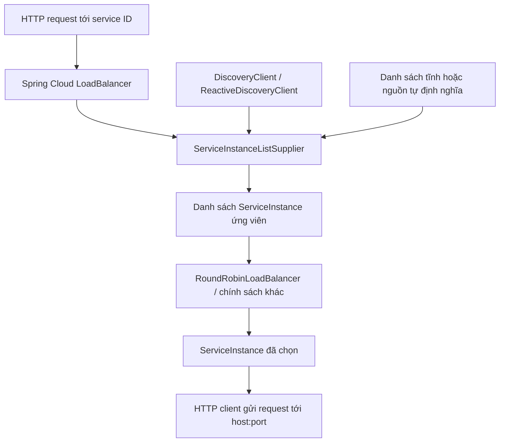
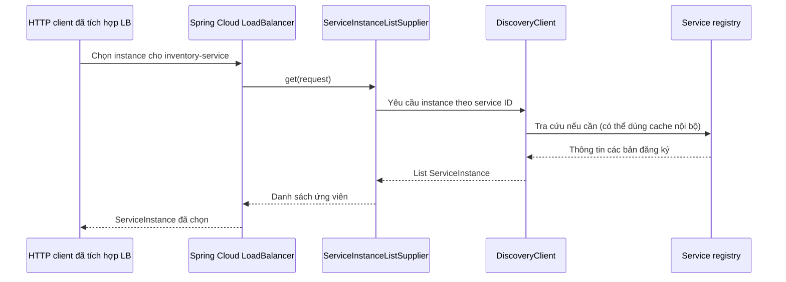
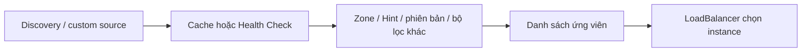

# Nguồn khám phá dịch vụ và nguồn danh sách tự định nghĩa

Trong Spring Cloud LoadBalancer, thuật toán chọn đích chỉ có thể hoạt động khi nó nhận được **danh sách các bản sao dịch vụ** (`ServiceInstance`). Danh sách đó có thể đến từ Eureka, Consul, Kubernetes hoặc một nguồn do ứng dụng tự cung cấp. Thành phần đứng giữa nguồn dữ liệu và thuật toán là `ServiceInstanceListSupplier`.

Bài học thuộc chương **Chuỗi cung cấp bản sao** tập trung vào câu hỏi: *danh sách ứng viên xuất phát từ đâu, được cập nhật như thế nào và khi nào nên dùng một nguồn tự định nghĩa?* Đây là nền tảng để cấu hình Spring Cloud LoadBalancer chọn `ServiceInstance` theo service ID, kết hợp discovery, health check, chính sách định tuyến và xử lý lỗi khi các instance thay đổi.

## 1. Phân biệt nguồn instance với thuật toán chọn instance

Giả sử ứng dụng `order-service` cần gọi `inventory-service` bằng một URL logic:

```text
http://inventory-service/api/items/42
```

Tại thời điểm gọi, danh sách ứng viên có thể gồm:

| Service ID | Instance ID | Endpoint | Metadata minh họa |
|---|---|---|---|
| `inventory-service` | `inventory-a` | `10.0.1.10:8080` | `zone=zone-a` |
| `inventory-service` | `inventory-b` | `10.0.1.11:8080` | `zone=zone-b` |

Có hai quyết định khác nhau:

1. **Nguồn danh sách** trả về những instance nào thuộc `inventory-service` và có thể được xét chọn.
2. **LoadBalancer** chọn một instance trong danh sách đó, ví dụ round-robin lần lượt chọn `inventory-a` và `inventory-b`.



`ServiceInstanceListSupplier` **không tự gửi HTTP request** và cũng không nhất thiết quyết định instance cuối cùng. Nó cung cấp dữ liệu cho quá trình chọn. Một supplier có thể đứng độc lập hoặc nằm trong chuỗi nhiều supplier dùng cơ chế delegate để cache, kiểm tra sức khỏe, lọc theo zone hoặc request context.

## 2. Hợp đồng của ServiceInstanceListSupplier

Interface `org.springframework.cloud.loadbalancer.core.ServiceInstanceListSupplier` biểu diễn nguồn danh sách instance mà Spring Cloud LoadBalancer có thể dùng. Những thao tác cốt lõi gồm:

| API | Vai trò |
|---|---|
| `getServiceId()` | Trả về service ID mà supplier phụ trách |
| `get()` | Trả về `Flux<List<ServiceInstance>>` để lấy danh sách instance |
| `get(Request request)` | Nhận thêm ngữ cảnh request; supplier hỗ trợ định tuyến theo request có thể sử dụng nó |

Một `ServiceInstance` chứa `serviceId`, `instanceId`, `host`, `port`, `secure`, `uri` và metadata. Nguồn phải cung cấp địa chỉ **thực sự truy cập được từ phía client**. Địa chỉ của container hoặc `localhost` trên một máy khác có thể khiến kết nối thất bại dù instance xuất hiện hợp lệ trong danh sách.

### 2.1. Flux không tự bảo đảm nguồn dữ liệu luôn cập nhật

`Flux<List<ServiceInstance>>` là kiểu reactive, nhưng nó không mặc nhiên có nghĩa danh sách được stream liên tục từ registry hoặc tự cập nhật mỗi khi topology thay đổi. Ví dụ `Flux.just(list)` có thể chỉ phát ra một snapshot; supplier dùng discovery hoặc cache có cơ chế refresh khác nhau tùy implementation và cấu hình.

Với supplier tùy chỉnh, cần xác định rõ **khi nào tạo snapshot**, **bao lâu đọc lại nguồn** và **nếu nguồn lỗi thì dùng dữ liệu nào**. Không nên suy ra tần suất cập nhật chỉ từ kiểu trả về `Flux`.

### 2.2. Cần truyền request context khi định tuyến theo request

`get(Request request)` cho phép supplier hoặc decorator đọc thông tin của lời gọi như hint, header hoặc dữ liệu tùy chỉnh. Với một nguồn instance thuần túy không phụ thuộc request, việc trả cùng một danh sách cho các request khác nhau là hợp lý. Nếu muốn chọn phiên bản API, vùng hoặc khả năng xử lý theo request, có thể thêm decorator đọc `Request` rồi lọc danh sách lấy từ nguồn gốc.

Ví dụ về phân chia trách nhiệm:

```text
Discovery source:      [a(v1), b(v2), c(v2)]
Request-based filter:  X-Api-Version = v2
Candidate list:        [b(v2), c(v2)]
Round-robin choice:    b hoặc c
```

Chỉ đăng ký metadata như `version=v2` không bảo đảm mặc định Spring Cloud LoadBalancer lọc theo phiên bản. Cần có supplier hoặc chính sách có khả năng đọc dữ liệu đó.

## 3. Nguồn khám phá dịch vụ (discovery-backed supplier)

Trong môi trường nhiều microservice, địa chỉ instance thường thay đổi khi scale, deploy hoặc xảy ra lỗi. Service discovery giúp caller không phải ghi cứng danh sách host/port.

Spring Cloud có các abstraction như `DiscoveryClient` (blocking) và `ReactiveDiscoveryClient` (reactive). Những adapter LoadBalancer thường gặp là:

| Thành phần | Nguồn dữ liệu | Đặc điểm |
|---|---|---|
| `DiscoveryClientServiceInstanceListSupplier` | `DiscoveryClient` | Lấy danh sách từ discovery client dạng blocking |
| `ReactiveDiscoveryClientServiceInstanceListSupplier` | `ReactiveDiscoveryClient` | Lấy danh sách từ reactive discovery client |
| `CachingServiceInstanceListSupplier` | Một supplier khác | Cache danh sách mà delegate cung cấp; không tự đăng ký service |

Các discovery client cụ thể như Eureka hoặc Consul chuyển dữ liệu registry thành `ServiceInstance`. Với Kubernetes, cách lấy endpoint phụ thuộc tích hợp discovery và hạ tầng cụ thể; không nên mặc định rằng mọi cụm Kubernetes đều cần hoặc sử dụng một registry kiểu Eureka.

### 3.1. Dòng dữ liệu từ registry tới LoadBalancer



Sơ đồ thể hiện trách nhiệm logic, không có nghĩa **mỗi HTTP request đều gọi tới registry qua mạng**. Discovery client hoặc `CachingServiceInstanceListSupplier` có thể giữ danh sách trong bộ nhớ và làm mới theo cơ chế riêng. Việc gộp nhiều lớp cache có thể khiến dữ liệu topology chậm được cập nhật hơn dự kiến.

### 3.2. Cấu hình supplier dựa trên discovery

Spring Cloud LoadBalancer cung cấp builder để tạo chuỗi supplier. Ví dụ cho `DiscoveryClient` dạng blocking:

```java
// Cấu hình chỉ dành cho service ID inventory-service.
public class InventoryLoadBalancerConfiguration {

    @Bean
    ServiceInstanceListSupplier inventorySupplier(
            ConfigurableApplicationContext context) {

        return ServiceInstanceListSupplier.builder()
                .withBlockingDiscoveryClient()
                .withCaching()
                .withZonePreference()
                .build(context);
    }
}
```

Để áp dụng riêng cấu hình đó cho `inventory-service`, khai báo tại cấu hình ứng dụng:

```java
@SpringBootApplication
@LoadBalancerClient(
        name = "inventory-service",
        configuration = InventoryLoadBalancerConfiguration.class)
public class OrderServiceApplication {
}
```

`@LoadBalancerClient` tạo cấu hình dành cho service ID tương ứng thông qua child context của LoadBalancer. Đặt `InventoryLoadBalancerConfiguration` ngoài phạm vi component scan hoặc để class không mang `@Configuration`, như ví dụ, nhằm tránh bean dành riêng cho một service bị đăng ký ngoài ý muốn vào context chung của ứng dụng.

Builder trên có ba bước: đọc danh sách từ blocking discovery client, cache kết quả, rồi ưu tiên zone. `withZonePreference()` chỉ có tác dụng khi thông tin zone được cấu hình và metadata instance tương thích.

Nếu có `ReactiveDiscoveryClient` phù hợp, có thể sử dụng nguồn reactive với `.withDiscoveryClient()` trong builder. Cần chọn kiểu nguồn theo discovery implementation và phiên bản Spring Cloud thực tế, không lựa chọn chỉ vì ứng dụng sử dụng `WebClient` hoặc `RestClient`.

### 3.3. Registry thay đổi thì điều gì xảy ra?

Giả sử registry có `inventory-a` và `inventory-b`. Khi `inventory-a` dừng hoặc bị thu hồi, có một khoảng thời gian trước khi mọi caller nhìn thấy danh sách chỉ còn `inventory-b`. Khoảng trễ có thể đến từ:

- Chu kỳ heartbeat hoặc trạng thái readiness mà registry dùng để xác định instance hợp lệ.
- Thời gian đồng bộ dữ liệu từ registry tới discovery client.
- TTL của cache trong discovery client hoặc LoadBalancer.
- Khoảng làm mới health-check hoặc bộ lọc của chuỗi supplier.

Vì vậy, **instance xuất hiện trong danh sách không chứng minh nó đang xử lý request thành công ở thời điểm hiện tại**. HTTP client vẫn cần connect timeout, response timeout, retry phù hợp và quan sát lỗi để giao tiếp giữa các dịch vụ ổn định.

## 4. Nguồn tĩnh bằng SimpleDiscoveryClient

Không phải môi trường nào cũng cần Eureka hoặc Consul. Với demo, test tích hợp hoặc hệ thống có vài endpoint cố định, Spring Cloud Commons có `SimpleDiscoveryClient` đọc danh sách instance từ cấu hình.

Ví dụ `application.yml`:

```yaml
spring:
  cloud:
    discovery:
      client:
        simple:
          instances:
            inventory-service:
              - uri: http://127.0.0.1:8081
              - uri: http://127.0.0.1:8082
```

Khi không có discovery client dựa trên service registry trên classpath, `SimpleDiscoveryClient` có thể dùng các URI này làm thông tin về instance. `spring-cloud-starter-loadbalancer` giúp các HTTP client được đánh dấu `@LoadBalanced` chọn một endpoint của service ID logic.

Ví dụ `RestClient`:

```java
@Configuration
class ClientConfiguration {

    @Bean
    @LoadBalanced
    RestClient.Builder loadBalancedRestClientBuilder() {
        return RestClient.builder();
    }
}

@Service
class InventoryGateway {
    private final RestClient client;

    InventoryGateway(@LoadBalanced RestClient.Builder builder) {
        this.client = builder.build();
    }

    String getItem(long id) {
        return client.get()
                .uri("http://inventory-service/api/items/{id}", id)
                .retrieve()
                .body(String.class);
    }
}
```

Hai URI `127.0.0.1` chỉ thích hợp khi cả hai instance đều lắng nghe trên máy chạy caller. Trong container hoặc Kubernetes, `127.0.0.1` là loopback của container/pod hiện tại; cần thay bằng host/port truy cập được thực tế.

**Điểm mạnh:** ít thành phần, dễ chạy thử và dễ kiểm soát danh sách. **Giới hạn:** cấu hình không tự phản ánh việc tăng/giảm replica, registry failure hoặc thay địa chỉ sau rollout. Nếu các instance biến động thường xuyên, nên dùng service discovery thực thụ hoặc nguồn động tự triển khai.

## 5. Tự triển khai ServiceInstanceListSupplier với danh sách cố định

Khi danh sách cần được tạo từ quy tắc riêng, hoặc muốn kiểm thử thuật toán LoadBalancer trong môi trường kiểm soát, có thể tự triển khai `ServiceInstanceListSupplier` thay vì đi qua `DiscoveryClient`.

Ví dụ một supplier cung cấp hai instance cố định:

```java
public final class FixedInventorySupplier
        implements ServiceInstanceListSupplier {

    private static final String SERVICE_ID = "inventory-service";

    private final List<ServiceInstance> instances = List.of(
            new DefaultServiceInstance(
                    "inventory-a", SERVICE_ID, "127.0.0.1", 8081, false),
            new DefaultServiceInstance(
                    "inventory-b", SERVICE_ID, "127.0.0.1", 8082, false));

    @Override
    public String getServiceId() {
        return SERVICE_ID;
    }

    @Override
    public Flux<List<ServiceInstance>> get() {
        return Flux.just(instances);
    }
}
```

Đăng ký supplier trong cấu hình của riêng service ID:

```java
public class FixedInventoryLoadBalancerConfiguration {

    @Bean
    ServiceInstanceListSupplier inventorySupplier() {
        return new FixedInventorySupplier();
    }
}
```

Sau đó gắn `FixedInventoryLoadBalancerConfiguration.class` với `@LoadBalancerClient(name = "inventory-service", configuration = ...)` trên ứng dụng gọi, như ví dụ ở phần discovery.

Ở đây `DefaultServiceInstance` chỉ biểu diễn endpoint. `isSecure=false` ứng với HTTP. Nếu dùng HTTPS, khai báo đúng `secure=true` và bảo đảm HTTP client tin cậy chứng chỉ TLS của server. Supplier không tự thực hiện bắt tay TLS hay tự tạo connection pool.

**Kết quả:** mọi lần lấy danh sách đều nhận hai instance nói trên; round-robin vẫn có thể chọn luân phiên, nhưng danh sách không tự thay đổi khi một process dừng. Nếu `inventory-a` dừng, caller vẫn có thể tiếp tục chọn endpoint lỗi. Với môi trường tĩnh, có thể bổ sung health check hoặc cập nhật thủ công nguồn dữ liệu.

### 5.1. Dùng SimpleDiscoveryClient hay viết supplier riêng?

Nếu mục tiêu chỉ là khai báo vài URI từ cấu hình, `SimpleDiscoveryClient` thường dễ bảo trì hơn. Viết supplier riêng hợp lý khi danh sách phải được lấy từ một nguồn nội bộ không có discovery adapter, phải tính toán theo quy tắc riêng hoặc cần hỗ trợ cập nhật snapshot theo cơ chế của ứng dụng.

Khi viết supplier mới, không nên đưa thuật toán round-robin hay logic gửi HTTP vào chính nguồn nếu các thành phần LoadBalancer sẵn có đã đảm nhiệm chúng.

## 6. Nguồn danh sách động do ứng dụng quản lý

Một nguồn tự định nghĩa không nhất thiết phải cố định. Ví dụ, ứng dụng có một control plane nội bộ định kỳ công bố các instance. Nguồn có thể duy trì một snapshot bất biến và cập nhật snapshot khi control plane gửi danh sách mới.

```java
public final class SnapshotInventorySupplier
        implements ServiceInstanceListSupplier {

    private static final String SERVICE_ID = "inventory-service";

    private final AtomicReference<List<ServiceInstance>> current =
            new AtomicReference<>(List.of());

    @Override
    public String getServiceId() {
        return SERVICE_ID;
    }

    @Override
    public Flux<List<ServiceInstance>> get() {
        return Flux.defer(() -> Flux.just(current.get()));
    }

    public void replaceSnapshot(List<ServiceInstance> updated) {
        List<ServiceInstance> copy = List.copyOf(updated);

        boolean wrongServiceId = copy.stream()
                .anyMatch(instance -> !SERVICE_ID.equals(instance.getServiceId()));

        if (wrongServiceId) {
            throw new IllegalArgumentException("Unexpected serviceId");
        }

        current.set(copy);
    }
}
```

Điểm đáng chú ý:

1. `AtomicReference` cho phép một thread cập nhật snapshot trong khi nhiều request đọc snapshot mà không sửa chung một `ArrayList`.
2. `List.copyOf` bảo đảm danh sách gốc không bị thay đổi bên ngoài sau khi cập nhật (nhưng không làm bản thân đối tượng `ServiceInstance` bất biến sâu).
3. `Flux.defer` lấy snapshot khi có subscription, thay vì chốt một danh sách cố định tại thời điểm khởi tạo publisher.
4. `replaceSnapshot` xác minh service ID trước khi công bố snapshot mới.

Đây là **phần đọc danh sách**. Nó chưa bao gồm thành phần theo dõi control plane và chưa giải quyết khả năng nguồn cập nhật thất bại. Muốn sử dụng trong hệ thống thật, cần một cơ chế có vòng đời riêng: định kỳ tải danh sách hoặc lắng nghe sự kiện, kiểm tra dữ liệu, rồi gọi `replaceSnapshot`. Không nên thực hiện truy vấn control plane dạng blocking trong `get()` cho từng request.

### 6.1. Xử lý snapshot lỗi và danh sách rỗng

Khi cập nhật thất bại, có hai lựa chọn phổ biến:

- **Giữ last-known-good:** tiếp tục dùng snapshot hợp lệ gần nhất trong một khoảng giới hạn, ghi nhận tuổi dữ liệu và cảnh báo khi quá hạn. Cách này tăng tính sẵn sàng nhưng có nguy cơ gọi tới instance đã ngừng phục vụ.
- **Fail closed:** trả danh sách rỗng hoặc báo lỗi khi snapshot không còn đáng tin cậy, đặc biệt nếu danh sách chứa ranh giới phiên bản, tenant, vùng dữ liệu hoặc yêu cầu bảo mật.

Không có một chính sách đúng cho mọi hệ thống. Hãy xác định TTL tối đa của snapshot, cách xử lý startup khi chưa có dữ liệu, ngưỡng dữ liệu cũ và điều kiện cho phép fallback. Một danh sách rỗng phải được xử lý như tình huống vận hành có thể xảy ra, không phải lỗi lập trình bất ngờ.

### 6.2. Kiểm tra chất lượng dữ liệu instance

Trước khi công bố snapshot, nên kiểm tra:

| Thuộc tính | Câu hỏi cần kiểm tra |
|---|---|
| `serviceId` | Tất cả instance có thuộc đúng nhóm dịch vụ không? |
| `instanceId` | Có trùng bản đăng ký hoặc giá trị thiếu bất thường không? |
| `host` và `port` | Caller có thể kết nối tới endpoint này không? Port có hợp lệ không? |
| `isSecure` | Scheme HTTP/HTTPS có đúng với TLS server đang phục vụ không? |
| `metadata` | Key như `zone`, `version`, `weight` có nhất quán không? |
| Duplicate endpoint | Có cùng host:port bị đưa vào nhiều lần ngoài ý muốn không? |

Duplicate trong danh sách có thể làm một instance được chọn thường xuyên hơn dưới round-robin, dù hệ thống không hề cấu hình weighted routing. Nếu cần phân phối theo trọng số, hãy dùng `WeightedServiceInstanceListSupplier` hoặc một chính sách trọng số được thiết kế rõ ràng.

## 7. Sắp xếp nguồn và các decorator trong chuỗi supplier

Một nguồn discovery hoặc nguồn tự định nghĩa thường là điểm bắt đầu của chuỗi. Các decorator nhận danh sách từ delegate rồi thay đổi cách xuất danh sách cho LoadBalancer.



Ví dụ chuỗi dùng nguồn discovery, caching và zone preference:

```java
ServiceInstanceListSupplier supplier = ServiceInstanceListSupplier.builder()
        .withBlockingDiscoveryClient()
        .withCaching()
        .withZonePreference()
        .build(context);
```

Đặt cache **sát phía sau nguồn lấy danh sách qua mạng** trước các bộ lọc phụ thuộc request. Nếu cache dữ liệu đã bị lọc theo một request cụ thể mà khóa cache chỉ dựa trên service ID, các request khác có thể nhận nhầm danh sách ứng viên.

Spring Cloud có `HealthCheckServiceInstanceListSupplier` để kiểm tra các endpoint do nguồn cung cấp. Supplier này có cơ chế giữ/cập nhật kết quả riêng; với một chuỗi health check thông thường, không cần mặc định bọc thêm `CachingServiceInstanceListSupplier` vì có thể tạo hai lớp cache không cần thiết. Quyết định dùng cache hoặc health check phụ thuộc tính chất nguồn và nhu cầu độ mới của danh sách.

Khi dùng `ServiceInstanceListSupplier.builder()`, nên cấu hình toàn bộ chuỗi tại một nơi và kiểm tra implementation được tạo ra. Tránh vô tình có hai bean nguồn cạnh tranh cho cùng service ID hoặc để một cấu hình riêng bị component scan thành cấu hình chung.

## 8. So sánh các phương án cung cấp danh sách

| Tiêu chí | Discovery-backed | `SimpleDiscoveryClient` | Supplier tự định nghĩa |
|---|---|---|---|
| Nguồn sự thật | Registry hoặc discovery integration | Cấu hình ứng dụng | File, API, control plane, bộ nhớ, quy tắc riêng |
| Cập nhật topology | Do cơ chế discovery/cache đảm nhiệm | Thường gắn với thay đổi cấu hình | Do ứng dụng tự xây dựng |
| Phù hợp | Microservices có scale/deploy động | Demo, local, ít endpoint cố định | Hạ tầng đặc thù, giả lập hoặc chính sách riêng |
| Chi phí vận hành | Cần registry hoặc tích hợp discovery | Thấp | Tùy độ phức tạp của nguồn |
| Rủi ro điển hình | Registry/cache trễ, stale instance | Host/port lỗi thời | Race khi cập nhật, snapshot cũ, xử lý lỗi thiếu rõ ràng |

**Nguyên tắc chọn:** nếu đã có registry đáng tin cậy, ưu tiên dùng adapter discovery sẵn có. Nếu cần chỉ định vài URI trong local/test, cân nhắc `SimpleDiscoveryClient`. Chỉ viết supplier riêng khi yêu cầu về nguồn danh sách hoặc vòng đời cập nhật thật sự khác những gì framework đã hỗ trợ.

## 9. Lỗi thường gặp và cách điều tra

| Triệu chứng | Nguyên nhân thường gặp | Hướng kiểm tra |
|---|---|---|
| `No instances available` | Sai service ID, nguồn trả danh sách rỗng, registry không thấy instance | So sánh service ID trong URL, `getServiceId()` và danh sách supplier cung cấp |
| Instance đã dừng vẫn được chọn | Cache/discovery chưa làm mới, nguồn tĩnh không đổi, health check chưa phản ánh | Kiểm tra TTL, chu kỳ refresh, trạng thái registry và thời gian cập nhật snapshot |
| Chỉ một instance nhận hầu hết request | Nguồn trả một phần danh sách, duplicate entry, bộ lọc zone/hint, retry | Log danh sách trước/sau lọc và instance cuối cùng được chọn |
| Client kết nối tới sai port hoặc localhost | Dữ liệu nguồn chứa endpoint không truy cập được từ caller | Đối chiếu `getHost()`, `getPort()`, môi trường container và route mạng |
| Ứng dụng có hai nguồn nhưng hành vi không ổn định | Bean từ cấu hình riêng bị scan vào context chung, trùng cấu hình | Kiểm tra `@LoadBalancerClient` và phạm vi bean theo service ID |
| Đã đổi danh sách nhưng request chưa đổi đích | Có cache ở discovery client, LoadBalancer hoặc nguồn tự định nghĩa | Đo thời gian từng lớp cache cập nhật, kiểm tra nguồn thực sự đang được dùng |
| Nhân đôi health check hoặc cache | Chuỗi bọc nhiều lớp cùng nhiệm vụ | Kiểm tra thứ tự builder và bean `ServiceInstanceListSupplier` thực tế |
| Custom supplier thỉnh thoảng lỗi đồng thời | Mutate danh sách chung trong khi request đang đọc | Dùng snapshot bất biến, cập nhật nguyên tử và kiểm thử đồng thời |

Với một lỗi kết nối, cần phân biệt ba bước: **nguồn trả instance nào**, **LoadBalancer chọn instance nào**, và **HTTP client kết nối tới endpoint nào**. Chỉ đọc lỗi timeout không đủ để kết luận discovery hoặc thuật toán cân bằng tải sai.

## 10. Bài thực hành: thay nguồn và quan sát kết quả

Thử nghiệm hai instance đơn giản ở cổng `8081` và `8082` cùng trả về hostname/instance ID của mình:

1. Cấu hình `SimpleDiscoveryClient` với hai URI và gọi `http://inventory-service/whoami` bằng `RestClient` đã tích hợp `@LoadBalanced`.
2. Gửi nhiều request tuần tự và ghi lại instance nhận request; với round-robin, quan sát lượt chọn trong danh sách còn hiệu lực.
3. Dừng instance tại `8081`, nhưng giữ cấu hình tĩnh. Quan sát request vẫn có thể bị định tuyến tới endpoint lỗi.
4. Thay cấu hình tĩnh bằng `FixedInventorySupplier`; xác nhận hai nguồn đem lại cùng tập endpoint trước khi thêm logic mới.
5. Thử `SnapshotInventorySupplier`: cập nhật từ hai instance xuống còn một, sau đó quan sát danh sách trả về và request thực tế.
6. Với môi trường có discovery, dùng nguồn `DiscoveryClient` rồi quan sát thời gian instance cũ biến mất khỏi danh sách và tác động của cache.
7. Thử tình huống danh sách rỗng, metadata sai, host không thể truy cập, nguồn cập nhật thất bại và recovery.

Nên đo các chỉ số: kích thước danh sách trước/sau lọc, thời gian lấy danh sách, tuổi snapshot/cache, số request tới từng instance, lỗi connect/response timeout và số lần retry. Khi ghi log, không cần đưa toàn bộ metadata nhạy cảm hoặc địa chỉ nội bộ vào metric labels có cardinality cao.

## 11. Những nguyên tắc nên ghi nhớ

- `ServiceInstanceListSupplier` cung cấp **danh sách ứng viên**; thuật toán LoadBalancer quyết định instance được chọn.
- Nguồn discovery thích hợp khi bản sao tăng/giảm hoặc thay địa chỉ thường xuyên; `SimpleDiscoveryClient` hữu ích cho cấu hình tĩnh.
- Supplier tự định nghĩa cần nêu rõ hợp đồng cập nhật dữ liệu, xử lý nguồn lỗi và hành vi khi không có instance.
- `Flux` là abstraction truyền dữ liệu, không tự bảo đảm auto-refresh hay health check.
- Giữ danh sách nhất quán và an toàn khi nhiều request đọc song song; tránh mutate list dùng chung.
- Nếu dùng cache, đặt cache gần nguồn discovery trước các bộ lọc theo request; tránh cache hai tầng khi không cần.
- Không giả định một instance hiện diện trong registry nghĩa là có thể kết nối hoặc đáp ứng yêu cầu ngay lập tức.
- Dùng health check, timeout, retry phù hợp và metric theo instance để xử lý các khoảng trễ khi topology thay đổi.
- Kiểm tra phạm vi cấu hình `@LoadBalancerClient` để mỗi service ID sử dụng đúng nguồn và đúng chuỗi supplier.

Khi hiểu cách nguồn discovery và nguồn tự định nghĩa tạo danh sách `ServiceInstance`, ta có thể quyết định nên dùng registry, danh sách cấu hình hay supplier riêng; đồng thời giải thích chính xác vì sao Spring Cloud LoadBalancer chọn được hoặc không chọn được một đích trong quá trình giao tiếp giữa các dịch vụ.

## Tài liệu tham khảo

- [Spring Cloud Commons — Spring Cloud LoadBalancer](https://docs.spring.io/spring-cloud-commons/reference/spring-cloud-commons/loadbalancer.html): cơ chế supplier, cache, health check và cấu hình theo service ID.
- [Spring Cloud Commons — Common Abstractions](https://docs.spring.io/spring-cloud-commons/reference/spring-cloud-commons/common-abstractions.html): `DiscoveryClient`, `ReactiveDiscoveryClient` và `SimpleDiscoveryClient`.
