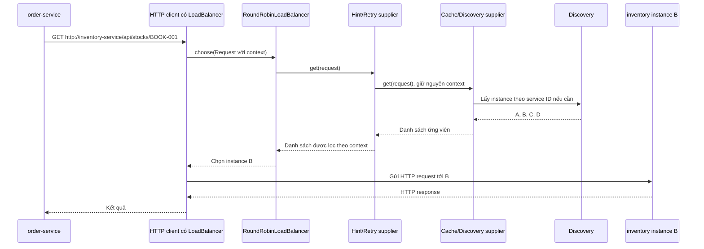

# Truyền ngữ cảnh yêu cầu qua các lớp supplier

Trong Spring Cloud LoadBalancer, **`ServiceInstanceListSupplier`** không chỉ trả về danh sách bản sao của một service ID. Một chuỗi supplier còn có thể dùng thông tin của **request hiện tại** để quyết định bản sao nào là ứng viên phù hợp. Chẳng hạn, cùng gọi `inventory-service`, request từ vùng `zone-a` có thể ưu tiên các instance ở `zone-a`, request có hint `canary` có thể được đưa tới bản triển khai thử nghiệm, còn một lần retry có thể tránh instance vừa thất bại.

Để các chính sách này hoạt động đúng, thông tin yêu cầu phải được chuyển qua từng lớp trong chuỗi. Nếu một lớp vô tình gọi phương thức không nhận request hoặc bỏ mất ngữ cảnh, các lớp nằm bên trong có thể vẫn trả danh sách instance hợp lệ nhưng **không còn dữ liệu để thực hiện định tuyến theo request**.

Bài học thuộc chương **Chuỗi cung cấp bản sao** của module `SPRING_CLOUD_SERVICE_COMMUNICATION_LOAD_BALANCING`. Chúng ta sẽ đi từ mô hình `Request` và `ServiceInstanceListSupplier#get(Request)` tới cách viết một lớp decorator, kiểm tra luồng truyền ngữ cảnh, rồi áp dụng để phân tích hint, sticky session, retry, health check và các tình huống lỗi khi giao tiếp giữa dịch vụ.

## 1. Vì sao một danh sách instance chưa đủ?

Giả sử `order-service` gọi `inventory-service` bằng URL logic:

```text
GET http://inventory-service/api/stocks/BOOK-001
```

Discovery cung cấp bốn instance:

| Instance | Địa chỉ | Metadata minh họa |
| --- | --- | --- |
| A | `10.0.1.11:8080` | `zone=zone-a`, `track=stable` |
| B | `10.0.1.12:8080` | `zone=zone-a`, `track=canary` |
| C | `10.0.2.21:8080` | `zone=zone-b`, `track=stable` |
| D | `10.0.2.22:8080` | `zone=zone-b`, `track=canary` |

Nếu chỉ cần Round Robin, LoadBalancer có thể chọn trên danh sách mà supplier trả về. Nhưng trong nhiều ứng dụng, **danh sách ứng viên phụ thuộc vào request**:

- Request mang hint ưu tiên `zone-a` nên thử A hoặc B trước.
- Request dành cho canary có thể cần instance có `track=canary`.
- Request retry sau khi A gặp lỗi có thể cần loại A khỏi lượt chọn tiếp theo.
- Request chứa cookie phiên làm việc có thể cần ưu tiên instance đã phục vụ phiên trước.

Những ví dụ này là các **chính sách cần được cấu hình cụ thể**. Metadata có tồn tại không có nghĩa mọi supplier mặc định đọc và áp dụng nó. Khả năng định tuyến chỉ xuất hiện khi một supplier hoặc thuật toán lựa chọn thực sự diễn giải ngữ cảnh và dùng thông tin đó.

## 2. Hai cách lấy danh sách từ ServiceInstanceListSupplier

`ServiceInstanceListSupplier` là abstraction cung cấp danh sách `ServiceInstance` cho một service ID. Hai phương thức cốt lõi cần phân biệt:

```java
Flux<List<ServiceInstance>> get();

Flux<List<ServiceInstance>> get(Request request);
```

Phương thức `get()` trả danh sách mà không truyền ngữ cảnh request. Phương thức `get(Request request)` cho phép supplier dùng thông tin liên quan đến một lần lựa chọn instance. Trong những phiên bản Spring Cloud LoadBalancer có overload này, cách triển khai mặc định của `get(Request)` thường chuyển tiếp về `get()`; vì vậy việc **có overload không tự bảo đảm** ngữ cảnh được sử dụng.

| Cách gọi | Supplier nhận được gì? | Khi nào phù hợp? |
| --- | --- | --- |
| `get()` | Không có đối tượng request để đọc | Danh sách tĩnh, lấy từ discovery hoặc các bộ lọc không phụ thuộc request |
| `get(request)` | Có thể đọc dữ liệu request, hint hoặc thông tin retry tùy kiểu context | Hint routing, sticky session, tránh instance đã lỗi, các chính sách tùy request |

Một supplier đơn giản chỉ đọc dữ liệu từ discovery có thể hoạt động đúng ở cả hai đường. Nhưng một supplier cần request context phải định nghĩa rõ cách xử lý `get(Request)` và cách ứng xử khi không có context.

**Điểm then chốt:** `ServiceInstanceListSupplier` trả về *danh sách ứng viên*, không gửi HTTP request. Bộ chọn (`ReactorLoadBalancer`, ví dụ `RoundRobinLoadBalancer`) lấy danh sách đó và chọn một `ServiceInstance`; sau đó HTTP client mới gửi yêu cầu tới host và port thực.

## 3. Ngữ cảnh request được tạo và chuyển đi như thế nào?

Trong Spring Cloud LoadBalancer, `org.springframework.cloud.client.loadbalancer.Request` bao bọc một đối tượng context. Kiểu cụ thể của context **phụ thuộc integration**, không phải mọi HTTP client đều tạo cùng một kiểu dữ liệu ở mọi phiên bản.

Các kiểu thường gặp gồm:

- `RequestData`: biểu diễn những thông tin HTTP cần thiết như URI, method và headers, tùy tích hợp.
- `RequestDataContext`: chứa request data và ngữ cảnh bổ sung, chẳng hạn hint, cho các luồng HTTP hỗ trợ kiểu này.
- Ngữ cảnh liên quan retry: có thể cung cấp thông tin lần thử trước hoặc instance cần tránh trong các tích hợp retry tương ứng.

Phân biệt **request nghiệp vụ** với **LoadBalancer `Request`**: đối tượng truyền vào supplier là ngữ cảnh dùng cho **một lần chọn bản sao**. Nó không nhất thiết là toàn bộ HTTP request của server, không bảo đảm chứa body và cũng không phải DTO nghiệp vụ như `CreateOrderRequest`.

Luồng minh họa:



Sơ đồ cho thấy **một cách mắc nối hợp lệ**: lớp ngoài nhận context, truyền cho delegate và chỉ sau đó lọc danh sách. Tùy cách tổ chức chuỗi, có thể có nhiều lớp cache, health check, zone, hint hoặc retry, và một số lớp không cần đọc request. Điều quan trọng là mọi lớp có trách nhiệm chuyển tiếp phải duy trì context cho lớp nào cần dùng nó.

## 4. Decorator và điểm dễ làm mất context

Các supplier có thể nối với nhau bằng cách bọc một supplier khác. Mẫu này thường được gọi là **decorator** hoặc *delegating supplier*:

```text
RoundRobinLoadBalancer
  └─ Supplier lọc theo hint
       └─ Supplier ưu tiên theo zone
            └─ Supplier cache / discovery
```

Giả sử một lớp ngoài nhận `get(request)` nhưng gọi `delegate.get()` ở bên trong:

```java
// Ví dụ SAI khi delegate cần thông tin của request hiện tại.
@Override
public Flux<List<ServiceInstance>> get(Request request) {
    return delegate.get(); // context bị bỏ qua tại đây
}
```

Khi đó, các supplier nằm sâu hơn không nhận được request tương ứng; nếu chúng cần hint hoặc thông tin retry thì hành vi có thể thay đổi âm thầm. Danh sách instance vẫn có thể không rỗng, khiến lỗi khó phát hiện qua kiểm tra kết nối thông thường.

Khi muốn chuyển nguyên ngữ cảnh vào delegate, dùng đường đi có nhận request:

```java
@Override
public Flux<List<ServiceInstance>> get(Request request) {
    return delegate.get(request);
}
```

Cũng cần cung cấp cách xử lý lời gọi không có context nếu class hỗ trợ `get()`:

```java
@Override
public Flux<List<ServiceInstance>> get() {
    return delegate.get();
}
```

Đây là nguyên tắc áp dụng cho lớp chuyển tiếp. Một supplier đầu nguồn chỉ cung cấp danh sách từ discovery không bắt buộc phải hiểu hoặc lưu ngữ cảnh. Vấn đề phát sinh khi một lớp trung gian được kỳ vọng chuyển context cho lớp khác nhưng lại vô tình chuyển sang nhánh không nhận request.

## 5. Ví dụ một supplier lọc theo hint trong request

Trong ví dụ sau, mục tiêu là ưu tiên các instance có metadata `zone` trùng với một hint. Để giữ code dễ hiểu, supplier trả về **danh sách gốc nếu hint trống hoặc không có instance khớp**. Đây là chính sách fallback của ví dụ, không phải quy tắc bắt buộc cho mọi hệ thống.

```java
import java.util.List;

import org.springframework.cloud.client.ServiceInstance;
import org.springframework.cloud.client.loadbalancer.Request;
import org.springframework.cloud.client.loadbalancer.RequestDataContext;
import org.springframework.cloud.loadbalancer.core.DelegatingServiceInstanceListSupplier;
import org.springframework.cloud.loadbalancer.core.ServiceInstanceListSupplier;
import reactor.core.publisher.Flux;

class ZoneHintServiceInstanceListSupplier
        extends DelegatingServiceInstanceListSupplier {

    ZoneHintServiceInstanceListSupplier(ServiceInstanceListSupplier delegate) {
        super(delegate);
    }

    @Override
    public Flux<List<ServiceInstance>> get() {
        return delegate.get();
    }

    @Override
    public Flux<List<ServiceInstance>> get(Request request) {
        // Duy trì context cho các supplier ở phía trong chuỗi.
        return delegate.get(request).map(instances -> {
            Object rawContext = request == null ? null : request.getContext();

            if (!(rawContext instanceof RequestDataContext context)) {
                return instances;
            }

            String hint = context.getHint();
            if (hint == null || hint.isBlank()) {
                return instances;
            }

            List<ServiceInstance> sameZone = instances.stream()
                    .filter(instance -> hint.equals(
                            instance.getMetadata().get("zone")))
                    .toList();

            // Fallback khi không có bản sao thuộc zone mong muốn.
            return sameZone.isEmpty() ? instances : sameZone;
        });
    }
}
```

Trong code này:

1. `delegate.get(request)` giữ ngữ cảnh khi lấy danh sách ứng viên từ lớp trong.
2. `request.getContext()` được kiểm tra kiểu trước khi đọc dữ liệu HTTP.
3. `context.getHint()` cung cấp hint nếu integration có tạo và truyền nó.
4. Supplier lọc theo metadata `zone`, rồi trả danh sách cho LoadBalancer lựa chọn.
5. Nếu không có hint hoặc hint không khớp, chính sách ví dụ giữ danh sách ban đầu.

Mẫu này sử dụng cú pháp `instanceof` có pattern matching và `Stream.toList()` của Java hiện đại. Khi triển khai thực tế, hãy đối chiếu API `RequestDataContext` và cách client tạo hint với phiên bản Spring Cloud đang dùng; không phải mọi client đều tạo context này. Nếu dùng phiên bản Java cũ hơn, có thể thay phần cú pháp bằng kiểm tra kiểu và cast truyền thống.

### 5.1. Tạo chuỗi supplier cho một dịch vụ

Trong Spring Cloud LoadBalancer, có thể sử dụng builder để khởi tạo nguồn discovery và lớp cache, rồi bọc thêm supplier tùy biến:

```java
import org.springframework.cloud.loadbalancer.core.ServiceInstanceListSupplier;
import org.springframework.context.ConfigurableApplicationContext;
import org.springframework.context.annotation.Bean;

class InventorySupplierConfiguration {

    @Bean
    ServiceInstanceListSupplier inventorySupplier(
            ConfigurableApplicationContext context) {

        ServiceInstanceListSupplier delegate = ServiceInstanceListSupplier
                .builder()
                .withDiscoveryClient()
                .withCaching()
                .build(context);

        return new ZoneHintServiceInstanceListSupplier(delegate);
    }
}
```

Đây là một **đoạn cấu hình minh họa** cho bean supplier. Để áp dụng riêng cho `inventory-service`, cần gắn cấu hình vào service bằng `@LoadBalancerClient(name = "inventory-service", configuration = InventorySupplierConfiguration.class)` ở cấu hình ứng dụng phù hợp. Cấu hình riêng cho LoadBalancer nên được đặt ngoài phạm vi component scan chung nếu không muốn nó vô tình áp dụng rộng hơn dự kiến.

Ví dụ giả định ứng dụng đã có dependency Spring Cloud LoadBalancer, nguồn discovery được cấu hình và HTTP client có tích hợp LoadBalancer. Nếu dự án đang dùng supplier chain khác, hãy ghép thêm lớp lọc theo cách tương thích với chain đó; tránh đăng ký nhiều bean cạnh tranh mà không kiểm soát rõ bean nào được chọn.

### 5.2. Kết quả giả định

Với bốn instance A, B, C, D ở đầu bài:

| Context được truyền vào | Danh sách mà supplier ví dụ trả về |
| --- | --- |
| Hint = `zone-a` | A, B |
| Hint = `zone-b` | C, D |
| Hint = `zone-x` | A, B, C, D (fallback) |
| Không có hint | A, B, C, D |
| Không có `RequestDataContext` phù hợp | A, B, C, D |

Nếu chính sách nghiệp vụ bắt buộc mọi request dành cho một zone phải ở đúng zone đó, fallback toàn bộ danh sách sẽ không phù hợp. Khi ấy cần quy định hành vi rõ ràng, chẳng hạn trả danh sách rỗng hoặc lỗi ở lớp thích hợp. Chỉ nên dùng lựa chọn đó khi hệ thống đã dự liệu hậu quả của việc không còn instance đủ điều kiện.

## 6. Hint truyền từ HTTP client đến supplier

Spring Cloud LoadBalancer có các cơ chế hint-based routing, trong đó `HintBasedServiceInstanceListSupplier` có thể sử dụng hint trong request context hoặc cấu hình để lọc instance theo metadata. Cách lấy hint từ HTTP headers và tên header cần được kiểm tra theo phiên bản và HTTP integration sử dụng; một tên thường gặp trong tài liệu Spring Cloud là `X-SC-LB-Hint`.

Ví dụ minh họa ý định gọi một vùng cụ thể:

```http
GET /api/stocks/BOOK-001 HTTP/1.1
Host: inventory-service
X-SC-LB-Hint: zone-a
```

Để header thực sự ảnh hưởng đến lựa chọn instance, cần có **đủ ba điều kiện**:

1. HTTP client chuyển đúng dữ liệu request hoặc hint thành context mà LoadBalancer sử dụng.
2. Các lớp supplier ở giữa truyền context qua `get(request)` cho lớp cần dùng nó.
3. Một supplier trong chain biết diễn giải hint và metadata, cùng một chính sách fallback rõ ràng.

Chỉ thêm header vào HTTP request mà không có các điều kiện trên có thể không làm thay đổi lựa chọn replica. Một số client hoặc đường gọi dùng loại context khác, vì vậy cần xác minh bằng log hoặc bài kiểm tra tích hợp thực tế.

Hint là **gợi ý định tuyến**, không phải bằng chứng xác thực hoặc quyền truy cập. Không dùng hint từ request người dùng chưa được kiểm soát làm cơ chế phân quyền, tách tenant hay đảm bảo cô lập dữ liệu. Với các yêu cầu có ý nghĩa bảo mật hoặc tuân thủ, quyền truy cập phải được kiểm tra tại lớp phù hợp và thông tin định tuyến phải đến từ nguồn đáng tin cậy.

## 7. Context liên quan retry: tránh bản sao đã thất bại

Retry tạo ra một trường hợp đặc biệt: **một lần gọi nghiệp vụ có thể tương ứng với nhiều lần chọn instance**.

Ví dụ:

```text
Request nghiệp vụ: GET /api/stocks/BOOK-001

Attempt 1:
  danh sách: A, B, C
  chọn: A
  kết quả: Connection refused

Attempt 2:
  ngữ cảnh retry: lần trước đã thử A
  danh sách ứng viên mong muốn: B, C
  chọn: C
  kết quả: HTTP 200
```

Một supplier hỗ trợ retry có thể sử dụng ngữ cảnh của attempt để tránh instance đã thất bại, nếu policy yêu cầu và có instance khác đủ điều kiện. Trong hệ sinh thái Spring Cloud LoadBalancer có supplier như `RetryAwareServiceInstanceListSupplier` phục vụ trường hợp này. Hành vi thực tế còn phụ thuộc integration retry, cấu hình `retryOnSameServiceInstance`/`retryOnAllOperations` hoặc cơ chế tương ứng theo phiên bản.

Trách nhiệm cần tách rõ:

- **Retry policy** quyết định có gửi lại request không, khi nào, bao nhiêu lần và dựa trên lỗi nào.
- **Request context** mang thông tin cần thiết cho lần lựa chọn tiếp theo, ví dụ instance trước đó.
- **Retry-aware supplier** chuẩn bị danh sách ứng viên cho lần lựa chọn tiếp theo.
- **LoadBalancer** chọn một instance từ danh sách đó.

Supplier không tự tạo một request nghiệp vụ mới chỉ vì có thể lọc instance. Ngược lại, nếu integration retry không chuyển ngữ cảnh liên quan instance trước đó, supplier ở sâu trong chain có thể không biết cần tránh bản sao nào.

Với yêu cầu ghi dữ liệu, dù retry sang instance khác, vẫn phải xem xét idempotency. Một read timeout không chứng minh server chưa xử lý thao tác trước đó. Cần giới hạn số lần retry, backoff và tổng deadline để không khuếch đại sự cố ở các replica còn lại.

## 8. Sticky session và ngữ cảnh của lời gọi

Một số ứng dụng cần ưu tiên cùng instance giữa các request liên quan, chẳng hạn khi có session hoặc trạng thái tạm thời nằm tại một replica. Spring Cloud LoadBalancer cung cấp các thành phần hỗ trợ preference hoặc request-based sticky session, nhưng chúng cần được cấu hình phù hợp và có thông tin định danh instance từ request.

Ví dụ:

```text
Request 1: client gửi cookie định tuyến -> supplier ưu tiên instance B
Request 2: client giữ cookie           -> supplier tiếp tục ưu tiên B
```

Trường hợp này khác với Round Robin thuần túy. Nếu một lớp supplier làm mất cookie hoặc request context, lớp sticky-session phía trong có thể không còn căn cứ để ưu tiên B, dù kết nối HTTP vẫn hoạt động bình thường.

Sticky session cũng không bảo đảm phiên luôn được phục vụ bởi cùng bản sao: instance B có thể chết, hết hạn đăng ký hoặc bị health check loại. Thiết kế ứng dụng nên xác định cách chuyển phiên sang replica khác, hoặc ưu tiên trạng thái phiên được lưu ở hệ thống chia sẻ nếu phù hợp.

## 9. Zone và health check: không phải mọi lớp đều cần đọc context

Có thể gặp một chuỗi chứa nhiều loại supplier với mức phụ thuộc request khác nhau:

| Lớp | Nguồn thông tin chính | Có cần request context không? |
| --- | --- | --- |
| Discovery supplier | Registry hoặc DiscoveryClient | Thường không cần |
| Cache supplier | Danh sách instance được cache | Thường không cần context để đọc danh sách theo service ID; phải thận trọng nếu cache kết quả lọc theo request |
| Health check supplier | Trạng thái thăm dò sức khỏe instance | Thường lọc theo trạng thái sức khỏe, không nhất thiết theo từng request |
| Zone preference supplier | Zone của client và metadata instance | Tùy cách triển khai/cấu hình; có thể dùng cấu hình vùng của ứng dụng |
| Hint-based supplier | Hint truyền theo request hoặc cấu hình fallback | Có thể cần request context |
| Retry-aware supplier | Instance của attempt trước | Thường cần context do cơ chế retry cung cấp |
| Request-based sticky supplier | Dữ liệu định tuyến ở request, chẳng hạn cookie | Có thể cần request context |

**Có lớp không cần đọc context** không đồng nghĩa nó có thể bỏ context khi gọi delegate. Một decorator nhận `get(request)` phải giữ được đường truyền context nếu những lớp phía trong có thể cần đến nó.

Đặc biệt, cần nghĩ đến **thứ tự cache và lọc theo request**. Nếu cache lưu một danh sách đã được lọc theo hint của request A rồi dùng lại như dữ liệu chung cho request B, request B có thể vô tình chỉ thấy ứng viên dành cho A. Một thiết kế an toàn là cache danh sách gốc theo phạm vi thích hợp, sau đó áp dụng bộ lọc phụ thuộc request cho từng lần lựa chọn. Chi tiết placement phụ thuộc builder và supplier chain thực tế; hãy xác minh thay vì giả định bất kỳ thứ tự nào cũng tương đương.

## 10. Điều gì xảy ra khi context bị mất?

Giả sử `order-service` gửi hint `zone-b`, nhưng một decorator ở giữa gọi `delegate.get()` thay cho `delegate.get(request)`. Hệ thống có thể có những biểu hiện sau:

| Hiện tượng | Nguyên nhân cần kiểm tra |
| --- | --- |
| Request vẫn thành công nhưng chạy sai zone | Hint không đi đến supplier đọc metadata, hoặc fallback hoạt động khác mong đợi |
| Một request canary được gửi tới stable | Header/hint không được integration đưa vào context, hoặc chuỗi làm mất context |
| Retry quay lại instance vừa lỗi | Retry context không tới retry-aware supplier, hoặc policy cho phép thử cùng instance |
| Sticky session không ổn định | Cookie không được truyền/đọc đúng, hoặc instance được ưu tiên đã không còn khả dụng |
| Khác biệt giữa RestClient, WebClient và OpenFeign | Mỗi tích hợp có thể tạo context khác nhau hoặc phát sinh các nhánh xử lý khác nhau |

Không nên kết luận ngay rằng thuật toán Round Robin hoặc discovery bị lỗi. Một request được điều hướng sai dù danh sách discovery đúng thường cần kiểm tra **đường đi của request context qua supplier chain** trước.

## 11. Cách quan sát và kiểm thử truyền context

Một cách hữu ích là ghi nhận tại các ranh giới cụ thể:

```text
traceId=72ab... serviceId=inventory-service
contextType=RequestDataContext hint=zone-b
supplier=discovery candidates=4
supplier=zone-hint candidates=2
selectedInstance=10.0.2.21:8080
```

Các con số trong log này chỉ minh họa. Với request có hint `zone-b`, supplier lọc còn C và D trước khi LoadBalancer chọn một instance. Nếu log chỉ cho biết `selectedInstance`, rất khó biết chọn instance đó do chính sách hay do ngẫu nhiên.

Khi viết log, nên ghi service ID, tên supplier, loại context, hint đã chuẩn hóa, số lượng ứng viên trước/sau lọc, instance được chọn và trace ID. Tránh ghi toàn bộ header, cookie, token hoặc các thông tin nhạy cảm. Không đặt giá trị hint tùy ý của người dùng thành nhãn metric có cardinality không giới hạn.

### 11.1. Ma trận kiểm thử nhỏ

Với bốn instance trong phần đầu, có thể thiết kế các kiểm thử có kết quả dự kiến:

| Đầu vào | Kết quả cần kiểm tra |
| --- | --- |
| Hint `zone-a` | Danh sách sau filter chỉ chứa A, B |
| Hint `zone-b` | Danh sách sau filter chỉ chứa C, D |
| Hint không khớp zone | Áp dụng fallback đã công bố; không chọn âm thầm chính sách khác |
| Request không có context phù hợp | Hành vi fallback nhất quán, không phát sinh lỗi cast |
| Retry sau khi A lỗi, còn B/C/D | Retry-aware policy có tránh A nếu cấu hình yêu cầu hay không |
| Một instance được health check loại | Instance đó không xuất hiện trong danh sách đủ điều kiện theo cấu hình |
| Hai request đồng thời có hint khác nhau | Không để context hoặc kết quả lọc của request này rò sang request khác |

Cần có cả kiểm thử đơn vị cho lớp supplier tùy biến và kiểm thử tích hợp với HTTP client thực tế. Kiểm thử đơn vị xác nhận `get(request)` lọc đúng theo context đã cung cấp. Kiểm thử tích hợp xác nhận header hoặc dữ liệu ở client có thực sự trở thành context mà supplier nhận được hay không.

### 11.2. Một tình huống chẩn đoán cụ thể

Giả sử danh sách discovery có A, B, C, D. Client gửi hint `zone-b` nhưng vẫn liên tục chọn A. Hãy điều tra theo thứ tự:

1. Client có được cấu hình `@LoadBalanced` hoặc tích hợp LoadBalancer theo đúng cách của RestClient, WebClient hay OpenFeign không?
2. Header hoặc thông tin định tuyến có được chuyển thành loại request context mà supplier hỗ trợ không?
3. `get(Request)` có được gọi ở lớp ngoài hay chỉ có `get()`?
4. Mỗi decorator có chuyển tiếp `request` vào delegate khi cần không?
5. Supplier dùng hint có nằm ở đúng vị trí tương đối với cache, health check và các filter khác không?
6. Metadata `zone` của instance có chính xác và nhất quán không?
7. Chính sách fallback có trả toàn bộ instance khi không có match không?
8. LoadBalancer cuối cùng nhận danh sách ứng viên nào và chọn instance gì?

Với cùng một chuỗi supplier, việc ghi riêng **danh sách discovery**, **danh sách sau lọc** và **instance được chọn** giúp phân biệt lỗi cấu hình dữ liệu với lỗi ngữ cảnh và lỗi thuật toán.

## 12. Các nguyên tắc triển khai an toàn

Khi tự viết supplier có phụ thuộc request, nên tuân theo những nguyên tắc sau:

1. **Giữ nguyên request context khi chuyển tiếp:** dùng `delegate.get(request)` ở lớp cần forward; đừng vô tình thay bằng `delegate.get()`.
2. **Kiểm tra kiểu context:** context của client đồng bộ, reactive hoặc retry có thể khác nhau; đừng cast không kiểm tra.
3. **Định nghĩa fallback rõ ràng:** khi hint trống, metadata thiếu hoặc danh sách lọc rỗng, xác định nên trả danh sách gốc hay không có ứng viên.
4. **Tránh trạng thái dùng chung theo request:** supplier thường là bean dùng lại; không lưu hint cuối cùng hoặc instance đã chọn vào field mutable của singleton.
5. **Tránh blocking I/O trong pipeline reactive:** các bước lọc danh sách nên nhẹ và không chặn luồng xử lý.
6. **Giới hạn thông tin trong context:** chỉ chuyển dữ liệu định tuyến cần thiết; không dùng context làm kho chứa token, bí mật hoặc toàn bộ body nghiệp vụ.
7. **Bảo vệ tính toàn vẹn định tuyến:** chỉ dùng hint do nguồn đáng tin cậy kiểm soát cho các chính sách có yêu cầu nghiêm ngặt về cô lập.
8. **Kiểm tra thứ tự decorator:** cache, health check, zone, hint và retry có thể tạo kết quả khác nhau khi hoán đổi thứ tự.
9. **Hiểu phạm vi retry:** có thể chọn instance khác nhưng không mặc định mọi request an toàn để gửi lại, đặc biệt với thao tác ghi.

## 13. Tổng hợp luồng qua từng tầng

Xét một request có hint `zone-b` và một chuỗi supplier được cấu hình để bảo toàn context:

```text
order-service
   |
   | GET http://inventory-service/api/stocks/BOOK-001
   | hint = zone-b
   v
HTTP client tích hợp LoadBalancer
   |
   | Request(context = RequestDataContext(..., hint=zone-b))
   v
RoundRobinLoadBalancer
   |
   | get(request)
   v
ZoneHintServiceInstanceListSupplier
   |
   | delegate.get(request)  <-- giữ context
   v
Cache / Discovery supplier
   |
   | [A, B, C, D]
   v
ZoneHintServiceInstanceListSupplier
   |
   | lọc metadata zone-b -> [C, D]
   v
RoundRobinLoadBalancer
   |
   | chọn C hoặc D
   v
HTTP client gửi request tới host:port của instance được chọn
```

Nếu một lớp trung gian làm mất context, phần lọc có thể không nhìn thấy hint. Nếu tất cả context được truyền đúng nhưng discovery trả danh sách rỗng, vấn đề nằm ở nguồn instance. Nếu danh sách sau lọc đúng nhưng request vẫn không tới được server, cần kiểm tra kết nối, timeout hoặc tình trạng replica. Cách tách ranh giới này giúp phát hiện nguyên nhân nhanh hơn so với chỉ nhìn HTTP status cuối cùng.

## 14. Tự kiểm tra kiến thức

1. `ServiceInstanceListSupplier#get()` và `get(Request)` khác nhau ở dữ liệu đầu vào nào?
2. Vì sao một decorator gọi `delegate.get()` từ bên trong `get(request)` có thể làm sai chính sách định tuyến?
3. Hint trong request có tự động điều khiển Spring Cloud LoadBalancer chỉ nhờ xuất hiện trong HTTP header không? Cần thêm những điều kiện nào?
4. Vì sao phải kiểm tra kiểu của `request.getContext()` trước khi đọc hint hoặc dữ liệu retry?
5. Trong ví dụ zone hint, nếu không có instance nào khớp hint thì chính sách fallback hoạt động ra sao? Khi nào không nên áp dụng fallback đó?
6. Khi retry, supplier làm nhiệm vụ gì và thành phần nào mới quyết định có gửi lại request?
7. Vì sao cache danh sách đã lọc theo request có thể gây ảnh hưởng chéo giữa hai request có hint khác nhau?
8. Nếu discovery trả bốn instance nhưng LoadBalancer chỉ chọn ở zone không mong muốn, cần quan sát những điểm nào trong chain?

Truyền ngữ cảnh đúng giúp mỗi lớp supplier có đủ thông tin để thực hiện chính sách của mình: discovery biết danh sách bản sao, cache giữ dữ liệu trong phạm vi thích hợp, filter quyết định danh sách ứng viên theo request, retry-aware supplier xét lần thử trước và LoadBalancer chọn một `ServiceInstance` cụ thể. Việc bảo toàn `Request` qua các decorator là điều kiện quan trọng để các thành phần đó phối hợp ổn định.
