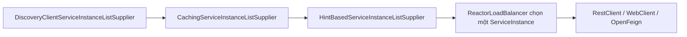
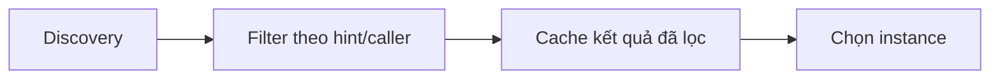
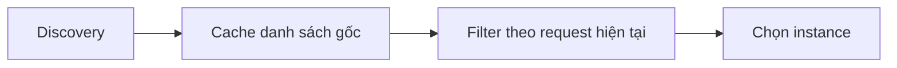
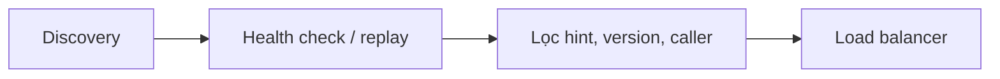

# Tránh lưu đệm nhầm danh sách đã lọc theo người gọi

## Mục tiêu

Spring Cloud LoadBalancer sử dụng `ServiceInstanceListSupplier` để cung cấp danh sách các `ServiceInstance` có thể nhận request. Để giảm số lần truy vấn service discovery, hệ thống thường cache danh sách instance. Đồng thời, các supplier khác có thể lọc danh sách theo **thông tin của từng request**, chẳng hạn header gợi ý định tuyến, phiên bản API hoặc cookie sticky session.

Nếu đặt cache sai vị trí trong chuỗi supplier, danh sách đã được lọc cho một request có thể bị dùng lại không đúng ở request khác, hoặc thông tin request không được chuyển đến bộ lọc. Kết quả là request đi nhầm nhóm instance, chính sách canary không ổn định, sticky session hoạt động sai hoặc một số caller không tìm được backend phù hợp.

Bài học giúp bạn:

- Phân biệt dữ liệu instance **dùng chung cho service ID** và dữ liệu định tuyến **phụ thuộc request**.
- Hiểu vì sao `CachingServiceInstanceListSupplier` phải đứng ngay sau supplier lấy instance từ discovery.
- Phân tích nguy cơ khi cache danh sách đã lọc bởi `HintBasedServiceInstanceListSupplier`, supplier dựa trên API version hoặc bộ lọc tùy chỉnh.
- Xây dựng chuỗi supplier đúng bằng `ServiceInstanceListSupplier.builder()` và `@LoadBalancerClient`.
- Thiết kế kiểm thử để phát hiện việc hai caller hoặc hai request có hint khác nhau ảnh hưởng lẫn nhau.
- Kiểm soát cache TTL, dữ liệu discovery cũ, health check và khả năng quan sát khi sự cố xảy ra.

## 1. Hai loại thông tin cần tách biệt

Giả sử `order-service` gọi `inventory-service`. Dịch vụ đích có ba bản sao được phát hiện:

| Instance | Địa chỉ | Metadata `hint` | Metadata `zone` |
|---|---|---|---|
| `inventory-stable-a` | `10.20.1.11:8080` | `stable` | `zone-a` |
| `inventory-stable-b` | `10.20.1.12:8080` | `stable` | `zone-a` |
| `inventory-canary-a` | `10.20.2.21:8080` | `canary` | `zone-b` |

Danh sách instance lấy từ discovery thường là dữ liệu **dùng chung cho service ID**:

```text
service ID: inventory-service
discovery result:
  [inventory-stable-a, inventory-stable-b, inventory-canary-a]
```

Trong khi đó, tập instance đủ điều kiện cho một request có thể phụ thuộc vào thông tin của **người gọi hoặc request cụ thể**:

```text
Request A: X-SC-LB-Hint: stable
  -> [inventory-stable-a, inventory-stable-b]

Request B: X-SC-LB-Hint: canary
  -> [inventory-canary-a]
```

Hai request cùng gọi `inventory-service`, nhưng danh sách được lọc khác nhau. Nếu một cache chỉ phân biệt bằng service ID mà lại lưu **kết quả sau khi lọc**, cache đó không đủ thông tin để phân biệt request A và request B.

Vì vậy, cần đặt một ranh giới rõ:

- **Trước lọc theo request:** có thể cache danh sách instance từ discovery theo service ID và thời gian sống phù hợp.
- **Sau lọc theo request:** danh sách phải được tính lại cho từng request từ danh sách gốc đang còn hiệu lực.

Không nên hiểu “caller” chỉ là một ứng dụng Java khác. Hai người dùng cùng đi qua một instance `order-service` cũng có thể tạo ra hai request mang hint, phiên bản API hoặc cookie khác nhau; cùng một child context LoadBalancer phải xử lý đúng cả hai.

## 2. Chuỗi `ServiceInstanceListSupplier` hoạt động như thế nào?

Spring Cloud LoadBalancer tổ chức việc cung cấp instance thành chuỗi các supplier. Mỗi supplier có thể lấy danh sách từ một nguồn hoặc xử lý tiếp danh sách do delegate bên trong cung cấp:



Thứ tự trên có ý nghĩa:

1. `DiscoveryClientServiceInstanceListSupplier` lấy danh sách instance của một service ID từ discovery.
2. `CachingServiceInstanceListSupplier` giữ **danh sách chưa lọc theo request**, giảm số lần truy vấn lại discovery.
3. `HintBasedServiceInstanceListSupplier` nhận request hiện tại, lấy hint và lọc danh sách đã được cache theo hint của request đó.
4. `ReactorLoadBalancer` chọn một instance từ tập ứng viên cuối cùng; HTTP client gửi yêu cầu đến instance đã chọn.

Spring Cloud cung cấp hai cách gọi cơ bản trong giao diện supplier:

```java
Flux<List<ServiceInstance>> get();

Flux<List<ServiceInstance>> get(Request request);
```

Phương thức `get()` không nhận ngữ cảnh request. Phương thức `get(Request request)` có thể chuyển dữ liệu như hint, header hoặc cookie vào các supplier hỗ trợ xử lý theo request. Một số `DelegatingServiceInstanceListSupplier` chuyển tiếp lời gọi có request cho delegate; `CachingServiceInstanceListSupplier` và `HealthCheckServiceInstanceListSupplier` được xử lý đặc biệt vì chúng cần đứng trước những phép lọc theo request.

Kể từ Spring Cloud LoadBalancer 4.1.0, thuộc tính `spring.cloud.loadbalancer.call-get-with-request-on-delegates` được bổ sung để điều khiển việc chuyển `get(Request)` qua các delegate không tự triển khai phương thức này. Trong Spring Cloud Commons 5.0.4, giá trị mặc định là `true`; cache supplier và health-check supplier vẫn là các ngoại lệ. Không nên cố thay đổi cờ này để chữa cấu trúc chuỗi sai.

## 3. Đặt cache sau bộ lọc sẽ sai ở đâu?

### 3.1. Ví dụ về lỗi thiết kế cache

Hãy xét một cơ chế cache tự viết chỉ dùng service ID làm khóa:

```java
// Pseudocode minh họa cách làm SAI, không phải mã Spring Cloud thật.
List<ServiceInstance> instancesFor(
        String serviceId, String requestHint) {
    return cache.computeIfAbsent(serviceId, id -> {
        List<ServiceInstance> discovered = discovery.getInstances(id);
        return filterByHint(discovered, requestHint);
    });
}
```

Request đầu tiên mang hint `stable` làm cache lưu:

```text
cache["inventory-service"] = [inventory-stable-a, inventory-stable-b]
```

Request tiếp theo mang hint `canary` vẫn đọc giá trị đã lưu ở cùng khóa và nhận danh sách stable. Nếu request canary đến trước, tình huống có thể đảo ngược: request stable lại nhận danh sách canary. Đây là **cross-request contamination**: kết quả phụ thuộc thứ tự request chứ không chỉ phụ thuộc ngữ cảnh hiện tại.

Ví dụ này mô tả một **lỗi cache tùy chỉnh** với khóa không đủ thông tin. Với `CachingServiceInstanceListSupplier` dựng sẵn, xếp sai thứ tự cũng có thể khiến `get(Request)` không được truyền tới đúng bộ lọc. Không khẳng định mọi phiên bản Spring Cloud đều luôn tái sử dụng danh sách đã lọc theo cách của đoạn pseudocode; điểm chung là việc cache nằm sau lọc theo request không đúng với hợp đồng xử lý mong muốn.

### 3.2. Sai và đúng về thứ tự

<escape>**Sai về thiết kế:**</escape> lọc theo request trước, cache phía ngoài bộ lọc.



Khi cache có khóa chỉ gồm `serviceId`, nó không phân biệt các request đang dùng hint hoặc phiên bản API khác nhau. Một số cách bao bọc supplier còn làm mất dữ liệu request trước khi bộ lọc được thực thi.

**Đúng:** cache dữ liệu discovery trước, lọc sau theo ngữ cảnh của request hiện tại.



Ví dụ pseudocode của thiết kế đúng:

```java
// Pseudocode minh họa: cache dùng chung, filter chạy mỗi request.
List<ServiceInstance> instancesFor(
        String serviceId, String requestHint) {
    List<ServiceInstance> discovered = discoveryCache.get(serviceId);
    return filterByHint(discovered, requestHint);
}
```

Ở mô hình đúng, request A và request B có thể dùng cùng một bản snapshot của danh sách instance từ discovery nhưng luôn nhận kết quả lọc khác nhau theo hint của từng request. Khi discovery thay đổi, cache sẽ cập nhật hoặc hết hạn theo chính sách TTL/refresh.

## 4. Cấu hình chuỗi supplier đúng với Spring Cloud LoadBalancer

Spring Cloud cung cấp `ServiceInstanceListSupplier.builder()` để khai báo chuỗi rõ ràng. Ví dụ dưới đây gắn chính sách riêng cho `inventory-service` ở ứng dụng caller:

```java
import org.springframework.cloud.loadbalancer.annotation.LoadBalancerClient;
import org.springframework.cloud.loadbalancer.core.ServiceInstanceListSupplier;
import org.springframework.context.ConfigurableApplicationContext;
import org.springframework.context.annotation.Bean;
import org.springframework.context.annotation.Configuration;

@Configuration(proxyBeanMethods = false)
@LoadBalancerClient(
        name = "inventory-service",
        configuration = InventorySupplierConfiguration.class
)
class LoadBalancerRegistration {
}

// Lớp này chỉ được dùng trong child context của inventory-service.
// Không gắn @Configuration hoặc đặt ngoài component scan chính.
class InventorySupplierConfiguration {

    @Bean
    ServiceInstanceListSupplier inventoryInstanceSupplier(
            ConfigurableApplicationContext context) {
        return ServiceInstanceListSupplier.builder()
                .withDiscoveryClient()
                .withCaching()
                .withHints()
                .build(context);
    }
}
```

Đọc thứ tự từ dưới lên khi supplier ủy quyền cho delegate: `withDiscoveryClient()` tạo nguồn danh sách, `withCaching()` bao quanh nguồn discovery, sau đó `withHints()` thực hiện bộ lọc ở lớp ngoài cùng. Khi request đến, hint filter vẫn phải được chạy với ngữ cảnh của chính request đó.

Nếu cần ưu tiên cùng zone hoặc dùng trọng số, có thể mở rộng:

```java
return ServiceInstanceListSupplier.builder()
        .withDiscoveryClient()
        .withCaching()
        .withZonePreference()
        .withHints()
        .withWeighted()
        .build(context);
```

Trong ví dụ trên, cache vẫn nằm sát discovery. Các bước zone preference, hint và weight xử lý danh sách ứng viên sau cache. Nếu ứng dụng có yêu cầu kiểm soát thứ tự đặc biệt, ví dụ version filter trước hint filter, cần đọc hợp đồng của từng supplier và kiểm thử thứ tự delegate thực tế.

**Không đặt class `InventorySupplierConfiguration` vào component scan của parent context nếu gắn `@Configuration`.** Cấu hình bean cho một service ID có thể bị đăng ký ngoài phạm vi dự kiến và ảnh hưởng đến các dịch vụ khác. Spring Cloud khuyến nghị class cấu hình được truyền vào `@LoadBalancerClient` không có `@Configuration` hoặc nằm ngoài phạm vi component scan chính.

### 4.1. Header hint và metadata instance

Giả sử hai instance stable đăng ký metadata `hint=stable` và một instance canary đăng ký `hint=canary`. Với Eureka, mỗi instance có thể đăng ký:

```yaml
eureka:
  instance:
    metadata-map:
      hint: stable
```

Instance canary có cấu hình tương tự nhưng đặt `hint: canary`. Trên phía caller, `HintBasedServiceInstanceListSupplier` mặc định đọc header `X-SC-LB-Hint`, hoặc dùng hint cấu hình khi request không có header. Có thể đổi tên header bằng `spring.cloud.loadbalancer.hint-header-name`.

Lưu ý: hint là **gợi ý định tuyến**, không phải cơ chế cô lập bảo mật. Khi không có instance khớp hint, supplier này mặc định trả lại toàn bộ danh sách delegate. Vì vậy request với hint không tồn tại có thể đi đến một instance bất kỳ; không được dùng hint mặc định làm ranh giới cô lập tenant hoặc dữ liệu nhạy cảm.

## 5. Những bộ lọc nào phụ thuộc request?

Không phải supplier nào cũng xử lý cùng loại ngữ cảnh. Điều này quyết định cách thiết kế cache.

| Supplier hoặc chính sách | Thông tin cần xét | Nguy cơ nếu cache sai tầng |
|---|---|---|
| `HintBasedServiceInstanceListSupplier` | Header `X-SC-LB-Hint` hoặc hint trong request context | Request với hint khác nhau nhận sai nhóm instance; hoặc hint bị bỏ qua |
| `RequestBasedStickySessionServiceInstanceListSupplier` | Cookie chứa instance ID đã chọn trước đó | Request của phiên khác có thể bị ảnh hưởng bởi lựa chọn của phiên trước |
| `ReactiveApiVersionServiceInstanceListSupplier` / `BlockingApiVersionServiceInstanceListSupplier` | API version từ header, query parameter, path hoặc media type | Request phiên bản v2 có thể nhận danh sách dành cho v1, hoặc mất thông tin phiên bản |
| Supplier tự viết theo caller | Header, metadata, khu vực, nhóm client hoặc ngữ cảnh nghiệp vụ | Danh sách của caller A có thể được tái sử dụng cho caller B |
| `ZonePreferenceServiceInstanceListSupplier` | Zone được cấu hình hoặc cung cấp theo discovery | Danh sách có thể không còn phù hợp nếu caller zone thay đổi theo yêu cầu thực tế |

Trong cấu hình zone thông thường, zone của một ứng dụng caller thường cố định theo môi trường của nó; tuy nhiên, nếu bạn tự viết bộ lọc theo zone **của từng request** thì vẫn phải áp dụng quy tắc cache-before-filter.

Với API version, hành vi khi không có instance phù hợp có thể khác hint: theo cấu hình API version-based routing của Spring Cloud, supplier mặc định có thể trả danh sách rỗng khi không tìm được instance tương thích; có tùy chọn fallback riêng. Không dùng một quy tắc fallback chung cho mọi supplier.

### 5.1. Vì sao cần phân biệt `get()` và `get(Request)`?

Các bộ lọc theo hint/cookie/version cần request context. Nếu tự viết supplier nhưng chỉ triển khai:

```java
Flux<List<ServiceInstance>> get() {
    return delegate.get();
}
```

thì nhánh này không biết request đang mang header gì. Với supplier tùy chỉnh, nên quyết định rõ:

1. Bộ lọc có phụ thuộc request không? Nếu có, xử lý ngữ cảnh trong `get(Request request)` hoặc theo API mà phiên bản Spring Cloud yêu cầu.
2. Có chuyển đúng request đến delegate cần dữ liệu request không?
3. Bộ lọc có chạy **sau** cache/health check không?
4. Nếu request thiếu thông tin định tuyến, chính sách sẽ fallback toàn bộ instance, trả rỗng hay báo lỗi?

Không nên sửa `spring.cloud.loadbalancer.call-get-with-request-on-delegates` chỉ để làm cho một test có vẻ thành công. Cờ này ảnh hưởng đường đi của request context qua các delegate; việc kiểm tra dữ liệu và vị trí supplier quan trọng hơn.

## 6. Health check và cache: không chồng hai cơ chế tùy tiện

`HealthCheckServiceInstanceListSupplier` kiểm tra định kỳ sức khỏe instance và có cơ chế phát lại kết quả riêng dựa trên Reactor `Flux.replay()`. Tài liệu Spring Cloud khuyến nghị khi dùng health-check supplier, có thể **bỏ `CachingServiceInstanceListSupplier`** để tránh hai tầng cache.

Ví dụ chuỗi sử dụng health check rồi lọc hint:

```java
return ServiceInstanceListSupplier.builder()
        .withDiscoveryClient()
        .withHealthChecks()
        .withHints()
        .build(context);
```

Nếu dùng luồng blocking, có thể cần `withBlockingHealthChecks()` tùy HTTP stack và cách thiết lập health-check client. Health-check supplier phải nằm ngay sau nguồn lấy instance từ discovery, trước các supplier lọc theo request, giống như nguyên tắc của cache supplier.



Kiểm tra sức khỏe chỉ giảm khả năng chọn instance đang lỗi; nó không bảo đảm mọi request thành công. Instance có thể ngừng hoạt động sau lần kiểm tra gần nhất. Cần thêm timeout, giới hạn retry và giám sát ở HTTP client.

## 7. Cấu hình TTL và tránh double caching

Với `CachingServiceInstanceListSupplier`, Spring Cloud LoadBalancer cung cấp các thuộc tính:

```yaml
spring:
  cloud:
    loadbalancer:
      cache:
        enabled: true
        ttl: 20s
        capacity: 256
```

Ở Spring Cloud Commons 5.0.4, TTL mặc định của LoadBalancer cache là `35s` và dung lượng ban đầu mặc định là `256`. Ví dụ trên minh họa giảm TTL xuống `20s` để dữ liệu discovery thay đổi được quan sát nhanh hơn. Giá trị thực tế cần dựa trên tốc độ cập nhật instance, tải discovery và yêu cầu vận hành.

Khi thư viện Caffeine có mặt trên classpath, LoadBalancer có thể dùng Caffeine-backed cache. Nếu tự đặt `spring.cloud.loadbalancer.cache.caffeine.spec`, đặc tả này có thể ghi đè các thiết lập chung như TTL và capacity. Đừng kỳ vọng chỉnh `cache.ttl` sẽ có hiệu lực khi Caffeine spec riêng đang quyết định thời gian hết hạn.

Một số discovery provider, ví dụ Eureka, đã có cơ chế cache riêng. Đặt thêm một tầng LoadBalancer cache có thể làm kéo dài thời gian nhìn thấy instance cũ. Tài liệu Spring Cloud khuyên cân nhắc tắt cache LoadBalancer khi discovery client đã cache:

```yaml
spring:
  cloud:
    loadbalancer:
      cache:
        enabled: false
```

Tắt cache có thể làm tăng số lần đọc qua discovery client; cần đo thực tế. Đây là vấn đề **độ mới của danh sách**, khác với lỗi **cache kết quả đã lọc theo request**. Một TTL ngắn không sửa được lỗi khóa cache sai hoặc đặt supplier sai vị trí: trong thời gian TTL còn hiệu lực, request vẫn có thể bị định tuyến nhầm.

## 8. Thực hành với hai người gọi và hai hint

Mục tiêu: hai caller hoặc hai request cùng gọi `inventory-service` nhưng có lựa chọn instance riêng. Có thể thực hành bằng ba instance trả về ID qua endpoint `/whoami`:

```text
inventory-stable-a -> /whoami returns "inventory-stable-a"
inventory-stable-b -> /whoami returns "inventory-stable-b"
inventory-canary-a -> /whoami returns "inventory-canary-a"
```

Các instance cần được đăng ký vào discovery dưới cùng service ID `inventory-service` và có metadata `hint=stable` hoặc `hint=canary` phù hợp.

### 8.1. Tạo endpoint phía caller

Với ứng dụng có Spring WebFlux và `spring-cloud-starter-loadbalancer`, tạo `@LoadBalanced WebClient.Builder`:

```java
import org.springframework.cloud.client.loadbalancer.LoadBalanced;
import org.springframework.context.annotation.Bean;
import org.springframework.context.annotation.Configuration;
import org.springframework.web.reactive.function.client.WebClient;

@Configuration(proxyBeanMethods = false)
class HttpClientConfiguration {

    @Bean
    @LoadBalanced
    WebClient.Builder loadBalancedWebClientBuilder() {
        return WebClient.builder();
    }
}
```

Tạo endpoint demo nhận hint và gửi request outbound:

```java
import org.springframework.cloud.client.loadbalancer.LoadBalanced;
import org.springframework.web.bind.annotation.GetMapping;
import org.springframework.web.bind.annotation.RequestParam;
import org.springframework.web.bind.annotation.RestController;
import org.springframework.web.reactive.function.client.WebClient;
import reactor.core.publisher.Mono;

@RestController
class InventoryProbeController {

    private final WebClient inventoryClient;

    InventoryProbeController(@LoadBalanced WebClient.Builder builder) {
        this.inventoryClient = builder
                .baseUrl("http://inventory-service")
                .build();
    }

    @GetMapping("/demo/inventory")
    Mono<String> probe(@RequestParam("hint") String hint) {
        // Chỉ dùng trong demo; cần validate/authorize hint ở production.
        return inventoryClient.get()
                .uri("/whoami")
                .header("X-SC-LB-Hint", hint)
                .retrieve()
                .bodyToMono(String.class);
    }
}
```

Đăng ký chuỗi supplier đúng từ phần 4 với `withDiscoveryClient()`, `withCaching()` và `withHints()`. Với endpoint demo, người gọi chỉ truy cập `/demo/inventory` ở ứng dụng caller; chính ứng dụng này gửi outbound request đến service ID `inventory-service`.

### 8.2. Gửi request xen kẽ

Giả sử ứng dụng caller chạy ở `localhost:8080`:

```bash
curl "http://localhost:8080/demo/inventory?hint=stable"
curl "http://localhost:8080/demo/inventory?hint=canary"
curl "http://localhost:8080/demo/inventory?hint=stable"
curl "http://localhost:8080/demo/inventory?hint=canary"
```

Kết quả kỳ vọng:

| Request | Tập instance hợp lệ sau hint filter | Kết quả `/whoami` kỳ vọng |
|---|---|---|
| `hint=stable` lần 1 | `stable-a`, `stable-b` | Một trong hai instance stable |
| `hint=canary` lần 1 | `canary-a` | `inventory-canary-a` |
| `hint=stable` lần 2 | `stable-a`, `stable-b` | Một trong hai instance stable |
| `hint=canary` lần 2 | `canary-a` | `inventory-canary-a` |

Với cấu hình đúng, kết quả **không được phụ thuộc vào hint của request gửi trước đó**. Nếu request canary lần đầu trả về instance stable, hãy kiểm tra supplier đã có `withHints()` chưa, metadata có khớp hay không, header đã được chuyển đến LoadBalancer chưa và cache có đang nằm phía ngoài bộ lọc request hay không.

### 8.3. Kiểm tra trường hợp không khớp hint

Gửi thêm:

```bash
curl "http://localhost:8080/demo/inventory?hint=unknown"
```

Với `HintBasedServiceInstanceListSupplier` mặc định, không tìm thấy instance khớp `unknown` thì supplier trả lại danh sách nhận từ delegate. Vì vậy request này **vẫn có thể thành công** và chọn stable hoặc canary. Đây là hành vi fallback của hint, không phải bằng chứng cache sai.

Nếu nghiệp vụ yêu cầu một request `unknown` phải bị từ chối, cần kiểm tra hint ở biên hoặc xây dựng cơ chế lọc chặt chẽ, thay vì dựa vào mặc định của hint supplier.

## 9. Ma trận kiểm thử để bắt lỗi giao thoa request

| Trường hợp | Thao tác kiểm tra | Điều cần khẳng định |
|---|---|---|
| Caller A trước caller B | Gửi stable rồi canary | Canary chỉ nhận instance có metadata `canary` |
| Caller B trước caller A | Gửi canary rồi stable | Stable chỉ nhận instance có metadata `stable` |
| Hai caller đồng thời | Gửi nhiều request stable/canary song song | Không có cross-request contamination khi cache được làm nóng |
| Cache hit | Lặp lại hai loại request trong khoảng TTL | Vẫn lọc đúng theo request hiện tại |
| Cache hết hạn | Đợi qua TTL, thay đổi danh sách discovery | Snapshot mới được lấy và lọc đúng |
| Request không có hint | Bỏ header hoặc query demo | Áp dụng hint mặc định nếu cấu hình, nếu không thì không lọc |
| Hint không khớp | Gửi `unknown` | Hiểu rõ fallback toàn bộ instance của hint supplier |
| Nhiều service ID | Gọi `inventory-service` và `pricing-service` | Cache/danh sách không lẫn hai service ID |
| Custom filter nghiêm ngặt | Lọc theo quyền hoặc API version bắt buộc | Trường hợp không khớp trả rỗng/lỗi theo chính sách, không rò sang nhóm khác |

Khi viết unit test cho custom supplier, nên dùng một danh sách discovery giả có ít nhất hai nhóm metadata và tạo hai `Request` khác nhau. Gọi theo cả hai thứ tự A→B và B→A, sau đó chạy song song để loại bỏ lỗi chỉ xuất hiện khi cache đã được khởi tạo. Với integration test, dùng discovery provider hoặc danh sách test instance đủ gần cấu hình production để kiểm tra việc đọc metadata.

Không nên chỉ kiểm tra tần suất chọn instance trong một lần gọi; lỗi cache bị nhiễm theo caller thường bộc lộ sau khi một request khác đã làm nóng cache.

## 10. Quan sát và chẩn đoán khi nghi ngờ cache sai

Khi điều tra sự cố, cần phân biệt ba nguyên nhân:

1. **Discovery cũ:** cache giữ danh sách instance từ lần lấy trước, trong khi registry đã đổi.
2. **Filter không được gọi:** chuỗi supplier hoặc đường truyền `get(Request)` không chuyển được hint/cookie/version đến bộ lọc.
3. **Cache kết quả lọc sai:** cache tùy chỉnh lưu tập ứng viên phụ thuộc request nhưng khóa cache không có đầy đủ ngữ cảnh.

Các dữ liệu quan sát hữu ích gồm service ID, số instance sau discovery, số instance sau từng filter, trạng thái cache hit/miss, hint hoặc version đã chuẩn hóa, instance được chọn và thời điểm cập nhật metadata.

Ví dụ log an toàn ở mức debug trong môi trường kiểm thử:

```text
service=inventory-service
requestHint=canary
discovered=3
filtered=1
selected=inventory-canary-a
```

Tránh ghi token truy cập, toàn bộ cookie, thông tin nhận dạng người dùng hoặc giá trị header nhạy cảm. Với lưu lượng production, ưu tiên metrics tổng hợp và trace có chọn lọc; tag có quá nhiều giá trị khác nhau sẽ tạo cardinality lớn.

Spring Cloud LoadBalancer cung cấp `LoadBalancerLifecycle` để quan sát quá trình lựa chọn và kết quả gửi request. Với Spring Boot Actuator/Micrometer phù hợp, có thể theo dõi các metric LoadBalancer. Những tín hiệu này giúp xác định request thất bại do không tìm thấy instance, do chọn instance không đúng nhóm hay do lỗi kết nối sau khi lựa chọn.

## 11. Những lỗi thường gặp và cách xử lý

| Triệu chứng | Nguyên nhân có thể | Cách xử lý |
|---|---|---|
| Canary request đôi lúc chọn stable sau khi stable request chạy trước | Cache hoặc custom supplier lưu kết quả lọc theo service ID | Đặt cache sát discovery, sau đó lọc theo request; kiểm tra lại khóa của custom cache |
| Hint không làm thay đổi danh sách | Không có hint filter hoặc request context bị mất | Thêm `withHints()`, kiểm tra `get(Request)` và header `X-SC-LB-Hint` |
| Thay đổi metadata nhưng request vẫn đi nhóm cũ | Discovery/cache chưa refresh | Kiểm tra TTL, chu kỳ cập nhật registry và số tầng cache |
| Danh sách instance rỗng dù registry có instance | Bộ lọc nghiêm ngặt loại mọi instance, hoặc discovery client sai service ID | Log số instance trước/sau filter, kiểm tra metadata và service ID |
| Trả instance sai dù hint không khớp | Hint supplier fallback về toàn bộ danh sách | Đó có thể là hành vi mặc định; cần policy khác nếu muốn lọc bắt buộc |
| Health check và cache cho kết quả khó đoán | Chồng `CachingServiceInstanceListSupplier` và `HealthCheckServiceInstanceListSupplier` không phù hợp | Ưu tiên một cơ chế cập nhật danh sách phù hợp và đặt sát discovery |
| Test một request thành công nhưng production sai | Chưa thử hai caller xen kẽ và đồng thời | Test A→B, B→A, concurrent requests, trước/sau TTL |

## 12. Checklist khi thiết kế supplier chain

- [ ] Xác định nguồn instance là `DiscoveryClient` hay `ReactiveDiscoveryClient`.
- [ ] Đặt `CachingServiceInstanceListSupplier` ngay sau supplier lấy instance qua mạng.
- [ ] Đặt các supplier phụ thuộc request như hint, sticky session hoặc API version **sau** cache.
- [ ] Không cache kết quả lọc theo caller bằng khóa chỉ có service ID.
- [ ] Nếu tự cache kết quả theo request, chứng minh khóa chứa đủ mọi yếu tố ảnh hưởng kết quả và có chiến lược invalidation phù hợp.
- [ ] Không kết hợp cache và health-check supplier một cách tùy tiện; health-check supplier có cơ chế replay riêng.
- [ ] Xem xét double caching nếu discovery provider đã cache.
- [ ] Kiểm tra `get(Request)` và việc truyền request context qua custom supplier.
- [ ] Thử hai hint khác nhau theo cả hai thứ tự và khi thực thi song song.
- [ ] Phân biệt fallback của hint với chính sách lọc nghiêm ngặt có thể trả rỗng.
- [ ] Theo dõi độ mới của discovery, số instance sau lọc và instance thực sự nhận HTTP request.

## Kết luận

Trong Spring Cloud LoadBalancer, danh sách instance của một service ID có thể được cache để giảm chi phí discovery, còn việc lọc theo hint, API version, sticky session hoặc caller phải được thực hiện theo **ngữ cảnh của mỗi request**. Vì vậy, `CachingServiceInstanceListSupplier` cần nằm ngay sau nguồn discovery, trước các supplier lọc. Nếu dùng health-check supplier, hãy đặt nó cùng vị trí và cân nhắc không dùng thêm cache supplier. Thiết kế đúng ranh giới này, kết hợp kiểm thử hai caller xen kẽ và quan sát dữ liệu trước/sau lọc, sẽ giúp tránh lỗi định tuyến khó phát hiện khi hệ thống có nhiều nhóm instance.

## Tài liệu tham khảo

- [Spring Cloud Commons 5.0.4 — Spring Cloud LoadBalancer: Caching và vị trí của supplier](https://docs.spring.io/spring-cloud-commons/reference/spring-cloud-commons/loadbalancer.html)
- [Spring Cloud Commons — Hint-Based Load-Balancing và Request-Based Sticky Session](https://docs.spring.io/spring-cloud-commons/reference/spring-cloud-commons/loadbalancer.html#hint-based-load-balancing)
- [Spring Cloud Commons — LoadBalancer Configuration Properties](https://docs.spring.io/spring-cloud-commons/reference/configprops.html)
- [Spring Cloud Commons — Passing Your Own LoadBalancer Configuration](https://docs.spring.io/spring-cloud-commons/reference/spring-cloud-commons/loadbalancer.html#passing-your-own-spring-cloud-loadbalancer-configuration)
