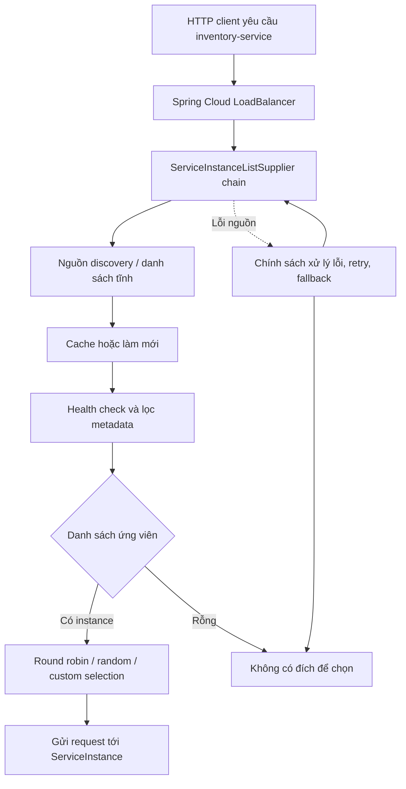

# Xử lý lỗi, danh sách rỗng và khôi phục nguồn cung cấp

Trong Spring Cloud LoadBalancer, quyết định chọn `ServiceInstance` phụ thuộc trực tiếp vào danh sách bản sao được cung cấp bởi `ServiceInstanceListSupplier`. Danh sách này có thể đi qua nhiều lớp: truy vấn discovery, cache, health check, lọc theo zone hoặc metadata và xử lý theo thông tin của request. Khi một lớp trả lỗi, không phát dữ liệu hoặc loại hết bản sao, client có thể không còn đích để gửi HTTP request.

Bài học thuộc chương **Chuỗi cung cấp bản sao** của module `SPRING_CLOUD_SERVICE_COMMUNICATION_LOAD_BALANCING`. Mục tiêu là nhận diện đúng trạng thái lỗi của supplier chain, xây dựng chính sách xử lý an toàn và thiết kế cách phục hồi để các lời gọi qua `RestClient`, `WebClient` hoặc OpenFeign có thể hoạt động ổn định khi discovery hoặc tập instance thay đổi.

Điểm cốt lõi: **không có instance, không có dữ liệu phát ra và lỗi truy vấn nguồn là ba tình huống khác nhau**. Cách xử lý chúng quyết định load balancer sẽ dừng sớm, thử lại có kiểm soát hay sử dụng dữ liệu dự phòng.

## 1. Supplier chain nằm ở đâu trong luồng lựa chọn?

Khi client yêu cầu gọi `http://inventory-service/api/stock/sku-001`, Spring Cloud LoadBalancer cần tìm các bản sao của service ID `inventory-service`. Một `ServiceInstanceListSupplier` có thể lấy danh sách từ discovery provider, trong khi các supplier dạng decorator bổ sung các bước xử lý phù hợp.



Đây là sơ đồ khái niệm, không bắt buộc phản ánh thứ tự decorator của mọi phiên bản. Thứ tự xây dựng chain phải phù hợp với loại supplier, khả năng cache và yêu cầu health check trong release train đang dùng.

Một chain có thể có **danh sách hợp lệ từ discovery nhưng cuối cùng lại rỗng**. Ví dụ, discovery trả ba instance, bộ lọc health loại hai instance và bộ lọc zone loại instance còn lại. Vì vậy, khi xử lý lỗi phải quan sát cả danh sách ở nguồn và danh sách sau từng bước lọc.

### 1.1. Phân chia trách nhiệm

| Thành phần | Trách nhiệm | Loại vấn đề cần theo dõi |
|---|---|---|
| Discovery provider | Đưa ra các instance đã đăng ký | Không truy cập được registry, sai service ID, dữ liệu cũ |
| Supplier nguồn | Chuyển dữ liệu từ discovery hoặc cấu hình thành danh sách instance | Lỗi gọi nguồn, dữ liệu không hợp lệ, không phát danh sách |
| Supplier decorator | Cache, kiểm tra health, lọc zone hoặc điều kiện request | Cache cũ, bộ lọc loại hết instance, lỗi trong predicate |
| Load balancer | Chọn một instance từ danh sách ứng viên | Danh sách rỗng, thuật toán chọn không có đích |
| HTTP client | Kết nối và gửi request đến instance đã chọn | DNS, connection refused, TLS, timeout, HTTP 5xx |

**Lỗi sau khi đã chọn instance** như connection timeout thường thuộc tầng HTTP/network. Không nên nhầm nó với lỗi truy vấn discovery chỉ vì cả hai đều khiến lời gọi service thất bại.

## 2. Phân biệt danh sách rỗng, luồng rỗng và lỗi

`ServiceInstanceListSupplier` trả về `Flux<List<ServiceInstance>>`. Với kiểu reactive này, ít nhất ba trạng thái cần được phân biệt:

| Tín hiệu | Ví dụ Reactor | Ý nghĩa |
|---|---|---|
| Một danh sách rỗng được phát ra | `Flux.just(List.<ServiceInstance>of())` | Supplier đã trả một kết quả, nhưng không có ứng viên |
| Luồng hoàn tất mà không phát danh sách | `Flux.empty()` | Không có snapshot danh sách nào được phát |
| Luồng phát lỗi | `Flux.error(new IllegalStateException("discovery unavailable"))` | Không lấy được kết quả vì lỗi nguồn hoặc xử lý |

Các trạng thái khác như `Flux.never()` không hoàn tất và không phát dữ liệu cũng cần được xét: nếu không giới hạn thời gian, caller có thể chờ vô hạn.

Một số toán tử Reactor có hành vi khác nhau:

- `switchIfEmpty(...)` xử lý **publisher không phát phần tử**, không tự xử lý một `List` đã phát ra nhưng có kích thước bằng 0.
- `filter(list -> !list.isEmpty())` loại danh sách rỗng khỏi luồng, nhưng có thể vô tình biến “đã biết không có instance” thành “không có snapshot nào”.
- `doOnError(...)` quan sát lỗi và giữ nguyên tín hiệu lỗi, không tự sửa hoặc nuốt lỗi.
- `onErrorResume(...)` chuyển sang một publisher dự phòng khi có lỗi; nếu luôn trả `List.of()`, hệ thống sẽ mất phân biệt giữa discovery hỏng và service thật sự không có instance.
- `retryWhen(...)` chỉ retry khi có tín hiệu lỗi phù hợp; danh sách rỗng hợp lệ không tự kích hoạt retry.
- `timeout(...)` tạo lỗi khi việc lấy dữ liệu không đáp ứng giới hạn chờ.

Trong Reactor, publisher không được phát `null`. Một implementation supplier tùy chỉnh phải phát danh sách không null; nếu dữ liệu nguồn không có instance, hãy dùng danh sách rỗng theo hợp đồng thay vì phát `null` hoặc trả `null` thay cho `Flux`.

## 3. Nguyên nhân danh sách ứng viên rỗng

Danh sách rỗng là **trạng thái dữ liệu**, không mặc nhiên là lỗi mạng. Các nguyên nhân phổ biến:

1. Service mới khởi động, chưa hoàn tất đăng ký với discovery.
2. Service ID trong request khác với ID đã đăng ký.
3. Các instance đã ngừng hoặc bị deregister.
4. Registry đang sử dụng namespace, zone hoặc môi trường khác với client.
5. Health check xác định không có instance đủ điều kiện.
6. Supplier lọc metadata, zone, version hoặc sticky routing đã loại toàn bộ ứng viên.
7. Cache chưa được nạp hoặc đang giữ một kết quả rỗng từ lần truy vấn trước.
8. Danh sách instance tĩnh chưa được cấu hình đúng trong môi trường không có registry.

Ví dụ một chuỗi lọc:

```text
serviceId=inventory-service
discoveryCount=4
afterHealthCheck=3
afterZoneFilter=1
afterVersionFilter=0
selectionCandidates=0
```

Trường hợp này không nên được giải quyết bằng retry kết nối trực tiếp đến một IP đoán trước. Cần tìm lý do bộ lọc cuối loại instance còn lại và quyết định xem điều kiện lọc có thực sự bắt buộc hay không.

### 3.1. Ưu tiên mềm và ràng buộc cứng

Cần phân biệt hai loại điều kiện:

- **Ưu tiên mềm:** muốn dùng instance cùng zone nếu có; khi không có, có thể xét các instance hợp lệ ở zone khác theo chính sách.
- **Ràng buộc cứng:** chỉ được gọi instance thuộc một khu vực dữ liệu, một nhóm bảo mật hoặc một phiên bản tương thích; nếu không có ứng viên, phải trả lỗi.

Không nên áp dụng fallback xuyên zone hoặc bỏ qua metadata bắt buộc chỉ để tránh danh sách rỗng. Chính sách dự phòng phải tôn trọng ràng buộc dữ liệu và nghiệp vụ của service.

## 4. Lỗi nguồn phát sinh ở lớp nào?

Lỗi có thể xuất hiện trước hoặc sau khi đã nhận danh sách:

| Vị trí | Ví dụ | Hành động phù hợp |
|---|---|---|
| Discovery request | Timeout tới registry | Theo dõi lỗi và retry có giới hạn nếu tạm thời |
| Authentication | Sai credential kết nối registry | Dừng, báo lỗi cấu hình; retry liên tục không giúp |
| Mapping dữ liệu | Host hoặc port thiếu, parse metadata lỗi | Ghi rõ bản ghi lỗi và loại ứng viên không hợp lệ |
| Cache | Đọc dữ liệu cũ, không refresh được | Xác định tuổi snapshot và chính sách dùng lại |
| Health check | Endpoint health chậm hoặc trả lỗi | Theo dõi trạng thái instance và điều chỉnh probe hợp lý |
| Filter | Predicate phát exception hoặc không khớp metadata | Sửa logic lọc; không tự bỏ điều kiện bắt buộc |
| Client request | TCP timeout sau khi đã chọn instance | Xử lý ở HTTP client/retry policy, không coi là discovery error |

Một lỗi do lập trình như `NullPointerException` trong predicate không nên được phân loại chung với lỗi timeout thoáng qua rồi retry tự động nhiều lần. Với lỗi cấu hình hoặc lập trình, retry chỉ làm tăng tải và che khó khăn trong việc tìm nguyên nhân.

## 5. Thiết kế hợp đồng cho supplier tùy chỉnh

Một supplier tùy chỉnh nên tuân thủ các nguyên tắc:

- Luôn trả một publisher hợp lệ, không bao giờ trả `null`.
- Mỗi danh sách phát ra phải không null; từng instance cần có host, port và các metadata bắt buộc cho chính sách định tuyến.
- Khi không có instance, phát danh sách rỗng để tầng chọn instance nhận biết rõ trạng thái.
- Giữ nguyên lỗi nguồn nếu chưa có chính sách recovery được chấp thuận.
- Không thay thế một lỗi bằng danh sách rỗng một cách âm thầm.
- Nếu supplier hỗ trợ routing dựa trên request, chuyển đúng `Request` cho delegate.
- Không gọi `block()` trong nhánh xử lý reactive của supplier.
- Không thực hiện truy vấn discovery đồng bộ tốn thời gian trên event-loop nếu nguồn đang dùng API blocking.

Khi cần kiểm tra danh sách, hãy thực hiện tại một vị trí rõ ràng trong chain. Kiểm tra host/port và metadata nên tách khỏi lựa chọn round robin/random. Dữ liệu hợp lệ chưa đồng nghĩa instance chắc chắn đang phục vụ: kết nối mạng và trạng thái ứng dụng vẫn có thể thay đổi ngay sau khi chọn.

## 6. Ví dụ decorator quan sát lỗi mà không che nguyên nhân

Sau đây là ví dụ một decorator giữ nguyên nguồn dữ liệu nhưng ghi nhận danh sách rỗng, publisher không phát kết quả và exception. Đoạn mã minh họa API phổ biến của Spring Cloud LoadBalancer và Reactor; cần đối chiếu phiên bản thực tế khi tích hợp.

```java
import java.util.List;
import java.util.Objects;

import org.slf4j.Logger;
import org.slf4j.LoggerFactory;
import org.springframework.cloud.client.ServiceInstance;
import org.springframework.cloud.client.loadbalancer.Request;
import org.springframework.cloud.loadbalancer.core.ServiceInstanceListSupplier;

import reactor.core.publisher.Flux;

public final class ObservedInstanceSupplier
        implements ServiceInstanceListSupplier {

    private static final Logger log =
            LoggerFactory.getLogger(ObservedInstanceSupplier.class);

    private final ServiceInstanceListSupplier delegate;

    public ObservedInstanceSupplier(ServiceInstanceListSupplier delegate) {
        this.delegate = Objects.requireNonNull(delegate);
    }

    @Override
    public String getServiceId() {
        return delegate.getServiceId();
    }

    @Override
    public Flux<List<ServiceInstance>> get() {
        return observe(Flux.defer(delegate::get));
    }

    @Override
    public Flux<List<ServiceInstance>> get(Request request) {
        return observe(Flux.defer(() -> delegate.get(request)));
    }

    private Flux<List<ServiceInstance>> observe(
            Flux<List<ServiceInstance>> source) {

        return source
                .switchIfEmpty(Flux.defer(() -> {
                    log.warn(
                            "Supplier emitted no list: serviceId={}",
                            getServiceId());
                    return Flux.just(List.<ServiceInstance>of());
                }))
                .doOnNext(instances -> {
                    if (instances.isEmpty()) {
                        log.warn(
                                "No eligible instances: serviceId={}",
                                getServiceId());
                    }
                })
                .doOnError(error ->
                        log.error(
                                "Instance supplier failed: serviceId={}",
                                getServiceId(),
                                error));
    }
}
```

Ở đây:

1. `Flux.defer` giúp lời gọi `delegate.get()` hoặc `delegate.get(request)` xảy ra tại thời điểm subscribe và chuyển exception đồng bộ thành tín hiệu reactive.
2. `switchIfEmpty` chuyển **trường hợp không phát snapshot** thành một danh sách rỗng có log riêng. Ứng dụng có thể chọn không chuyển đổi này nếu muốn coi việc không phát dữ liệu là vi phạm hợp đồng.
3. `doOnNext` nhận biết danh sách đã phát nhưng không có ứng viên.
4. `doOnError` ghi nhận lỗi và **cho lỗi truyền tiếp** để lớp gọi áp dụng chính sách đã cấu hình.
5. `get(Request request)` giữ thông tin request cho các supplier định tuyến theo request; nếu chỉ gọi `delegate.get()` trong nhánh này, có thể làm mất header, hint hoặc ngữ cảnh chọn instance.

Ví dụ này không tự động thêm retry hay cache. Nó phù hợp để quan sát hành vi, đặc biệt trước khi quyết định có nên phục hồi bằng fallback. Trong hệ thống thật, log cần giới hạn tần suất để tránh spam khi nhiều request cùng nhận danh sách rỗng.

## 7. Đặt xử lý lỗi vào đúng vị trí của supplier chain

Một chain có thể được xây từ source supplier và nhiều decorator. Trước khi thêm wrapper khôi phục, cần xác định cụ thể nó được đặt ở đâu.

```text
Nguồn discovery
    ↓
Kiểm tra dữ liệu và chuẩn hóa bản ghi
    ↓
Lọc theo yêu cầu bắt buộc
    ↓
Health check / các decorator phù hợp
    ↓
Quan sát số lượng và lỗi cuối cùng
    ↓
LoadBalancer chọn instance
```

Sơ đồ là các bước thiết kế, không phải lời khẳng định thứ tự bắt buộc giữa các decorator mặc định. Caching và health-check supplier có yêu cầu về vị trí trong builder chain; hãy sử dụng thứ tự được tài liệu của release train khuyến nghị khi tạo bean thực tế.

Điểm cần phân biệt là **lỗi trước bộ lọc** và **danh sách rỗng sau bộ lọc**:

- Nguồn discovery trả lỗi: việc đọc dữ liệu chưa hoàn tất, có thể cân nhắc retry hoặc snapshot cũ đủ điều kiện.
- Discovery trả danh sách rỗng: đó có thể là trạng thái hợp lệ do service chưa đăng ký.
- Discovery trả danh sách có phần tử nhưng filter loại hết: đây là kết quả của chính sách lọc, không nên tự biến thành lỗi kết nối discovery.
- Health check cho kết quả không có instance: cần kiểm tra hành vi fallback của health-check supplier ở phiên bản hiện dùng trước khi áp đặt kỳ vọng “luôn loại tất cả”.

Đặt một `onErrorResume(error -> Flux.just(List.of()))` quá sớm trong chain có thể khiến lớp sau chỉ thấy danh sách rỗng và che mất nguyên nhân registry timeout. Ngược lại, tự trả lại toàn bộ danh sách discovery khi filter cứng không có ứng viên có thể vi phạm ràng buộc định tuyến.

## 8. Chính sách xử lý theo loại thất bại

Không có một recovery policy thích hợp cho mọi trường hợp:

| Tình huống | Hành vi ưu tiên | Điều cần tránh |
|---|---|---|
| Danh sách rỗng sau lọc bắt buộc | Trả kết quả không có instance; log lý do loại | Bỏ qua ràng buộc để gọi một bản sao bất kỳ |
| Service mới đăng ký chậm | Có thể retry với backoff và deadline ngắn nếu nghiệp vụ cho phép | Retry vô hạn |
| Registry timeout tạm thời | Retry có giới hạn; cân nhắc snapshot hợp lệ còn mới | Gắn nhãn “service không tồn tại” |
| Sai service ID / cấu hình registry | Dừng và sửa cấu hình | Retry đều đặn trên mọi request |
| Supplier có lỗi lập trình | Ghi exception đầy đủ, để lỗi nổi lên | Nuốt lỗi rồi coi như danh sách rỗng |
| Cache trả instance đã ngừng | Refresh/evict theo chính sách và kiểm tra sức khỏe | Giữ stale data vô hạn |
| Không có instance sau health check | Quan sát health và chính sách failover được phép | Ép chọn instance đã biết không khỏe |
| HTTP timeout sau chọn instance | Xử lý timeout/retry ở HTTP client với idempotency | Cho rằng refresh discovery luôn sửa được lỗi |

Mức ưu tiên được chọn tùy yêu cầu về tính sẵn sàng, ràng buộc zone, phiên bản API, bảo mật và độ an toàn của thao tác ghi.

## 9. Retry và timeout có ngân sách thời gian rõ ràng

Retry chỉ hữu ích khi nguyên nhân có khả năng biến mất sau một khoảng ngắn, chẳng hạn registry mất kết nối thoáng qua. Chỉ retry lỗi đã phân loại là tạm thời.

Ví dụ đọc **một snapshot** danh sách từ supplier với timeout mỗi lần và tối đa hai lần thử lại khi timeout:

```java
import java.time.Duration;
import java.util.List;
import java.util.concurrent.TimeoutException;

import org.springframework.cloud.client.ServiceInstance;
import org.springframework.cloud.loadbalancer.core.ServiceInstanceListSupplier;

import reactor.core.publisher.Mono;
import reactor.util.retry.Retry;

static Mono<List<ServiceInstance>> loadOneSnapshot(
        ServiceInstanceListSupplier supplier) {

    return Mono.defer(() -> supplier.get()
                    .next()
                    .switchIfEmpty(
                            Mono.just(List.<ServiceInstance>of()))
                    .timeout(Duration.ofMillis(600)))
            .retryWhen(
                    Retry.backoff(2, Duration.ofMillis(100))
                            .maxBackoff(Duration.ofMillis(400))
                            .filter(error ->
                                    error instanceof TimeoutException))
            .timeout(Duration.ofSeconds(2));
}
```

Giải thích:

- `next()` lấy **snapshot đầu tiên** của `Flux<List<ServiceInstance>>`; đây là lựa chọn khi cần một snapshot cho một lần chọn instance. Nếu supplier phát nhiều danh sách theo thời gian, đoạn mã không được dùng để theo dõi toàn bộ luồng.
- `switchIfEmpty` chỉ xử lý trường hợp publisher hoàn tất mà chưa phát snapshot.
- `timeout(Duration.ofMillis(600))` giới hạn thời gian chờ mỗi lần truy vấn.
- `Retry.backoff(2, ...)` cho phép tối đa **hai retry**, tức tối đa ba lượt subscribe nếu tiếp tục gặp lỗi timeout.
- Bộ lọc `TimeoutException` tránh retry tràn lan mọi lỗi. Trong hệ thống thực tế có thể bổ sung những exception kết nối discovery được xác nhận là tạm thời.
- `timeout(Duration.ofSeconds(2))` ở ngoài tạo một giới hạn tổng cho quá trình này.

Một danh sách rỗng hợp lệ đi qua hàm mà không kích hoạt retry. Nếu muốn thử lại khi danh sách rỗng do service đang khởi động, cần thiết kế chính sách riêng: giới hạn thời gian, điều kiện nghiệp vụ và cơ chế báo trạng thái rõ ràng. Không nên biến mọi kết quả rỗng thành exception chỉ để kích hoạt `retryWhen`.

**Lưu ý:** ví dụ tập trung vào snapshot supplier. Timeout của kết nối HTTP sau khi đã chọn instance và deadline nghiệp vụ tổng phải được tính riêng để tránh cộng dồn nhiều lớp retry/timeout.

## 10. Fallback bằng snapshot đã biết: chỉ khi có điều kiện

Trong một số hệ thống, lỗi kết nối ngắn hạn đến registry không có nghĩa các instance đã đăng ký trước đó đều ngừng hoạt động. Một cách phục hồi có thể là **last-known-good snapshot**: giữ bản sao của danh sách hợp lệ cuối cùng và dùng tạm khi nguồn discovery gặp lỗi.

Tuy nhiên, snapshot cũ cũng có thể chứa instance đã dừng, đã chuyển zone hoặc không còn đủ quyền nhận request. Vì vậy, phải quy định rõ:

1. Chỉ lưu snapshot đã qua bước xác thực dữ liệu và các điều kiện định tuyến bắt buộc.
2. Gắn thời điểm thu thập; giới hạn tuổi snapshot bằng TTL cụ thể.
3. Chỉ dùng fallback đối với nhóm lỗi đã cho phép, ví dụ timeout discovery tạm thời.
4. Không fallback khi danh sách rỗng là kết quả hợp lệ của chính sách ràng buộc cứng.
5. Không dùng snapshot vượt qua ràng buộc tenant, khu vực dữ liệu, version hay bảo mật.
6. Quan sát số lần dùng fallback và tuổi dữ liệu để phát hiện nguồn discovery chưa phục hồi.
7. Khi nguồn hồi phục, cập nhật snapshot và ngừng dùng fallback.

Ví dụ về logic chính sách (pseudocode):

```text
readSnapshot(serviceId, request)
    ├─ thành công, danh sách hợp lệ không rỗng
    │     └─ ghi lại snapshot + timestamp → trả danh sách mới
    ├─ thành công, danh sách rỗng
    │     └─ trả danh sách rỗng, không tự hồi sinh bản sao đã bị loại
    └─ lỗi discovery tạm thời
          ├─ có last-known-good chưa hết TTL và còn thỏa điều kiện → dùng tạm
          └─ không có snapshot đủ điều kiện → giữ lỗi để caller xử lý
```

Đây là **cơ chế tùy chỉnh có chủ đích**, không phải hành vi mặc định của mọi `ServiceInstanceListSupplier`. Nếu dự án đã dùng cache built-in, cần kiểm tra liệu một lớp fallback tự viết có tạo ra cache chồng cache hay không. Đặc biệt, cache danh sách discovery không đồng nghĩa cache đã được kiểm tra sức khỏe theo thời điểm hiện tại.

### 10.1. Khi nào nên fail closed?

Nếu hệ thống chỉ cho phép request đến instance của một tenant, region hoặc phiên bản đáp ứng quy định, dùng snapshot cũ có thể vượt qua điều kiện đó. Trong trường hợp này, **không có ứng viên hợp lệ phải dẫn tới từ chối lời gọi**, dù về mặt availability điều đó làm request thất bại.

Fail closed cũng phù hợp khi snapshot không chứng minh được freshness, không có health signal đáng tin cậy hoặc quyền định tuyến đã thay đổi.

## 11. Phục hồi nguồn discovery và health check

Khi nguồn cung cấp gặp lỗi, cần xử lý **nguyên nhân gốc** đồng thời với chính sách trên request.

Các tình huống thường gặp:

- **Registry tạm thời gián đoạn:** kiểm tra endpoint, DNS, TLS, credential và timeout của discovery client; cho phép cơ chế reconnect/refresh theo provider.
- **Registry trở lại nhưng danh sách vẫn rỗng:** xem service đích đã đăng ký lại hay chưa, có dùng đúng namespace và service ID hay không.
- **Health check tiếp tục loại instance sau khi ứng dụng hồi phục:** kiểm tra endpoint readiness, chu kỳ health check và cách supplier nhận dữ liệu cập nhật.
- **Cache giữ dữ liệu cũ:** xem TTL, refresh interval, eviction và khả năng cache một danh sách rỗng.
- **Bộ lọc metadata hết ứng viên:** kiểm tra dữ liệu metadata mới, điều kiện routing và fallback có được phép hay không.

Khi chuyển từ trạng thái lỗi sang phục hồi, nên ghi nhận thời điểm nguồn trả snapshot hợp lệ đầu tiên và thời điểm ứng dụng bắt đầu chọn instance mới thành công. Hai mốc này có thể khác nhau vì cache, health-check interval hoặc các lớp lọc vẫn cần thời gian cập nhật.

### 11.1. Không đánh đồng health check với khả năng kết nối HTTP

Một instance có thể vượt qua health check nhưng vẫn lỗi khi xử lý một endpoint nghiệp vụ, hoặc ngược lại endpoint health có thể bị cấu hình sai dù ứng dụng vẫn phục vụ. Health signal là một đầu vào cho supplier; lỗi HTTP thật cần được quan sát và xử lý riêng.

Nếu request đã chọn được instance nhưng connection refused, đó không phải là “danh sách rỗng”. Tùy phiên bản và tích hợp, retry ở tầng LoadBalancer/HTTP client có thể yêu cầu chọn lại instance; điều này cần ngân sách retry và điều kiện idempotency phù hợp.

## 12. Hành vi của RestClient, WebClient và OpenFeign

Các HTTP client chỉ có thể thực hiện cân bằng tải khi đã được tích hợp với Spring Cloud LoadBalancer. Cách biểu diễn lỗi khi không chọn được instance phụ thuộc vào loại client và cấu hình.

| Client | Điểm tích hợp thường gặp | Cần xác nhận khi không có instance |
|---|---|---|
| `RestClient` | Builder được đánh dấu `@LoadBalanced` | Exception/HTTP status, mapping lỗi và timeout |
| `WebClient` | `@LoadBalanced WebClient.Builder` | Error signal reactive, trạng thái HTTP và retry operator |
| OpenFeign | `@FeignClient(name = "inventory-service")` với LoadBalancer integration | Exception của Feign/client, retryer và cấu hình target URL |

Trong nhiều đường đi của Spring Cloud LoadBalancer, khi danh sách ứng viên rỗng, thuật toán có thể trả `EmptyResponse` thay cho một `ServiceInstance`. Lớp tích hợp phía trên quyết định cách chuyển kết quả đó thành lỗi hoặc response, thường tương ứng ý nghĩa “không có instance khả dụng”. Không nên gắn cứng giả định rằng mọi client đều luôn ném cùng một exception hay trả cùng status code.

Khi ứng dụng cung cấp HTTP API và phụ thuộc vào service khác, tầng biên có thể ánh xạ lỗi “dependency unavailable” thành `503 Service Unavailable` theo hợp đồng API. Việc ánh xạ này cần phân biệt với lỗi nghiệp vụ của service đích và lỗi xác thực.

Retry HTTP có nguy cơ phát lại thao tác ghi sau khi server đã xử lý nhưng client chưa nhận response. Với POST hoặc thao tác không idempotent, cần cơ chế idempotency key hay bảo vệ trùng lặp trước khi bật retry rộng rãi.

## 13. Logging, metrics và tracing để quan sát chain

Việc ghi nhận chỉ một thông báo “No servers available” thường chưa đủ để chẩn đoán. Nên thu thập tín hiệu theo các lớp:

| Tín hiệu | Ý nghĩa | Cách sử dụng |
|---|---|---|
| `serviceId` | Service đang được tra cứu | Nhóm log, metric theo đích |
| `discoveryCandidateCount` | Số instance từ nguồn | Xác định nguồn có dữ liệu không |
| `postFilterCandidateCount` | Số instance sau lọc | Tìm bước làm danh sách rỗng |
| `supplierErrorType` | Timeout/auth/config/parse error | Quyết định retry hay sửa cấu hình |
| `snapshotAge` | Tuổi dữ liệu cache/fallback | Đánh giá mức độ stale |
| `fallbackUsed` | Có sử dụng last-known-good không | Theo dõi rủi ro phụ thuộc cache |
| `supplierLatency` | Thời gian lấy danh sách | Phát hiện registry chậm |
| `noInstanceCount` | Số lần không có ứng viên | Cảnh báo suy giảm khả dụng |
| `retryAttemptCount` | Số lần retry nguồn | Phát hiện retry storm |
| `selectedInstance` | Đích sau khi chọn | Đối chiếu lỗi kết nối, nên ghi ở log có kiểm soát |

Ví dụ log cấu trúc:

```text
event=loadbalancer.supplier.result
serviceId=inventory-service
discoveryCandidateCount=3
postFilterCandidateCount=0
emptyReason=ZONE_FILTER
fallbackUsed=false
supplierLatencyMs=18
```

Một lỗi nguồn khác với danh sách rỗng:

```text
event=loadbalancer.supplier.error
serviceId=inventory-service
errorType=DISCOVERY_TIMEOUT
retryAttempt=2
fallbackUsed=true
snapshotAgeMs=4200
```

Các tên trường là quy ước minh họa, không phải metric mặc định bắt buộc của Spring Cloud. Tránh đưa raw URI, instance ID, trace ID riêng lẻ hoặc thông tin nhạy cảm vào nhãn metric có cardinality cao. Có thể ghi chi tiết đích được chọn trong log hoặc trace nếu chính sách dữ liệu cho phép.

## 14. Kiểm thử tình huống biên bằng Reactor Test

Với supplier reactive, kiểm thử cần xác nhận cả **kết quả** lẫn **tín hiệu kết thúc/lỗi**. Những ca cơ bản:

| Đầu vào delegate | Kết quả mong đợi của decorator quan sát ở mục 6 |
|---|---|
| `Flux.just(List.of(instanceA, instanceB))` | Giữ nguyên danh sách, không có lỗi |
| `Flux.just(List.of())` | Phát danh sách rỗng, ghi nhận không có ứng viên |
| `Flux.empty()` | Phát danh sách rỗng thông qua `switchIfEmpty`, ghi log riêng |
| `Flux.error(exception)` | Giữ nguyên lỗi để caller xử lý |
| `Flux.never()` | Vẫn không phát kết quả; timeout cần được cấu hình nếu muốn giới hạn |
| Delegate chỉ hỗ trợ `get(Request)` đặc thù | Decorator phải truyền đúng `Request` |
| Instance thiếu metadata bắt buộc | Bị bộ lọc xác thực loại theo chính sách |
| Cache stale quá TTL | Không fallback nếu không còn snapshot đủ điều kiện |

Đoạn kiểm thử dưới đây minh họa trạng thái rỗng và lỗi. `FixedSupplier` là stub đơn giản để điều khiển dữ liệu phát ra:

```java
import java.util.List;

import org.springframework.cloud.client.ServiceInstance;
import org.springframework.cloud.loadbalancer.core.ServiceInstanceListSupplier;
import reactor.core.publisher.Flux;
import reactor.test.StepVerifier;

final class FixedSupplier implements ServiceInstanceListSupplier {

    private final Flux<List<ServiceInstance>> values;

    FixedSupplier(Flux<List<ServiceInstance>> values) {
        this.values = values;
    }

    @Override
    public String getServiceId() {
        return "inventory-service";
    }

    @Override
    public Flux<List<ServiceInstance>> get() {
        return values;
    }
}

// Ví dụ dùng trong test method:
var noEmission = new ObservedInstanceSupplier(
        new FixedSupplier(Flux.empty()));

StepVerifier.create(noEmission.get())
        .expectNextMatches(List::isEmpty)
        .verifyComplete();

var failure = new ObservedInstanceSupplier(
        new FixedSupplier(
                Flux.error(new IllegalStateException("registry down"))));

StepVerifier.create(failure.get())
        .expectErrorMessage("registry down")
        .verify();
```

Đoạn trên cần dependency `reactor-test` và các import phù hợp với project. Nó minh họa assertion về luồng, không phải một file Java có thể đặt nguyên khối ngoài test class. Khi kiểm thử policy retry, dùng giả lập nguồn phát lỗi một số lần rồi phục hồi và xác nhận **số lần subscribe**; khi cần kiểm thử backoff thời gian, có thể dùng `StepVerifier.withVirtualTime(...)` nếu pipeline dùng scheduler phù hợp.

### 14.1. Kiểm thử phục hồi thực tế

Ngoài unit test, nên có integration test với một service đích và nguồn instance có thể điều khiển:

1. Cung cấp hai instance hợp lệ và xác nhận client gọi được theo service ID.
2. Làm discovery trả lỗi tạm thời; xác minh retry không vượt ngân sách.
3. Cho nguồn phục hồi; xác minh danh sách mới được nhận sau refresh.
4. Cho supplier trả danh sách rỗng; xác nhận client không gọi địa chỉ suy đoán.
5. Đổi metadata để bộ lọc bắt buộc loại mọi instance; xác minh fallback không phá ràng buộc.
6. Khi dùng cache, kiểm tra TTL và hành vi sau thời điểm snapshot hết hạn.

Việc kiểm tra bằng vài request thành công chưa đủ để chứng minh recovery khi registry timeout hoặc cache stale.

## 15. Quy trình chẩn đoán khi production báo không có instance

Có thể làm theo trình tự ngắn sau:

1. **Xác định service ID và client context:** URL, tên OpenFeign client, profile và namespace có khớp nguồn discovery không?
2. **Kiểm tra nguồn:** discovery trả instance, trả empty, timeout hay lỗi xác thực?
3. **Kiểm tra chain:** ghi số lượng instance trước và sau cache, health check, zone/metadata filters.
4. **Xác minh snapshot:** cache đang có dữ liệu gì và dữ liệu đã bao lâu chưa refresh?
5. **Phân loại lỗi:** empty là kết quả hợp lệ, publisher không phát snapshot hay exception?
6. **Kiểm tra chính sách recovery:** retry có giới hạn không, fallback có bị kích hoạt sai không?
7. **Kiểm tra kết nối sau lựa chọn:** một instance hợp lệ có DNS/TLS/HTTP hoạt động không?
8. **Xác nhận phục hồi:** khi service đích đăng ký lại, danh sách ứng viên và tỷ lệ request thành công có cải thiện không?

Ba ví dụ dễ nhầm:

- **Registry có ba instance, supplier cuối rỗng:** kiểm tra health/filter; tăng retry discovery có thể không giải quyết được.
- **Registry timeout, cache còn snapshot mới:** có thể dùng fallback đã định nghĩa với TTL nếu chính sách cho phép, nhưng phải log việc sử dụng.
- **Supplier có instance nhưng request timeout:** xem HTTP client, network và tình trạng service đích, không kết luận load balancer không tìm được server.

## 16. Các sai lầm thường gặp

- Dùng `onErrorResume(error -> Flux.just(List.of()))` cho mọi exception làm mất thông tin lỗi nguồn.
- Dùng `switchIfEmpty` với kỳ vọng nó xử lý được `Flux.just(List.of())`.
- Đặt `retryWhen` sau một operator đã nuốt toàn bộ exception rồi thắc mắc vì sao không retry.
- Không có timeout khiến publisher không phát hoặc không hoàn tất có thể treo luồng gọi.
- Áp dụng retry vô hạn cho lỗi xác thực, sai service ID hoặc lỗi lập trình.
- Dùng snapshot stale không giới hạn thời gian hoặc bỏ qua ràng buộc tenant/zone/version.
- Thêm nhiều lớp cache/health check không xét nguồn dữ liệu và thứ tự decorator.
- Bỏ qua `get(Request)` trong supplier tùy chỉnh, khiến mất ngữ cảnh request-aware routing.
- Log duy nhất “no instance” nhưng không ghi số lượng trước/sau lọc và loại lỗi.
- Đặt toàn bộ chính sách retry ở HTTP client mà không tính thời gian retry của discovery.

## 17. Nguyên tắc vận hành

Để một supplier chain có khả năng phục hồi và dễ chẩn đoán:

1. Giữ rõ ba tín hiệu: danh sách rỗng, publisher không phát, và publisher phát lỗi.
2. Xác thực dữ liệu `ServiceInstance` trước khi đưa vào thuật toán lựa chọn.
3. Retry có giới hạn theo loại lỗi, với backoff và deadline tổng.
4. Chỉ dùng fallback khi có snapshot đủ mới và thỏa mọi ràng buộc định tuyến.
5. Quan sát từng bước lọc để biết vì sao danh sách ứng viên trở thành rỗng.
6. Giữ ngữ cảnh `Request` trong các supplier hỗ trợ định tuyến theo request.
7. Tách lỗi discovery khỏi lỗi kết nối HTTP sau khi chọn instance.
8. Kiểm thử trường hợp lỗi, rỗng, timeout, stale cache và quá trình phục hồi.
9. Cấu hình supplier chain theo đúng API và hướng dẫn của release train Spring Cloud được quản lý bằng BOM.

## 18. Kết luận

Việc xử lý lỗi trong `ServiceInstanceListSupplier` cần bám vào **nguyên nhân và tín hiệu thật của chain**. Danh sách rỗng có thể là kết quả hợp lệ của discovery hoặc bộ lọc; không phát dữ liệu là trạng thái publisher riêng; lỗi nguồn cần được ghi nhận và chỉ retry/fallback khi chính sách cho phép.

Một cơ chế phục hồi tốt giới hạn retry và timeout, không che lỗi lập trình, có điều kiện rõ ràng khi dùng snapshot cũ và tôn trọng ràng buộc định tuyến. Kết hợp log, metrics và kiểm thử các trường hợp biên giúp Spring Cloud LoadBalancer chọn được những `ServiceInstance` phù hợp khi nguồn thay đổi, đồng thời để lại đủ bằng chứng chẩn đoán khi không còn instance khả dụng.

