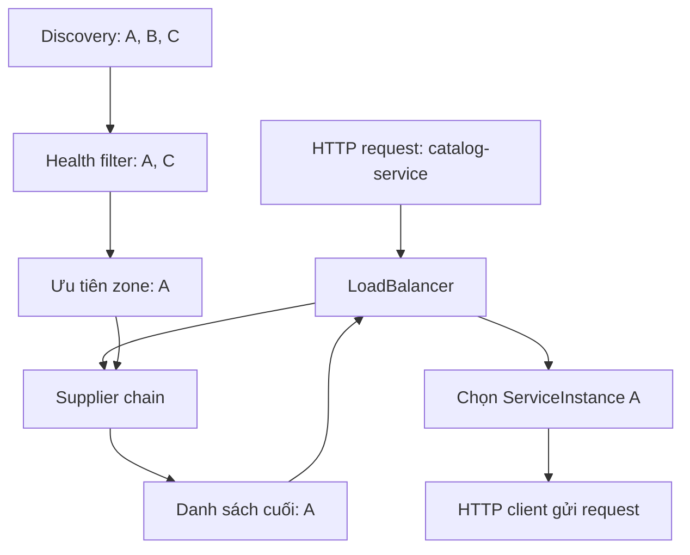

# Theo dõi danh sách ứng viên trước và sau từng bước

Trong Spring Cloud LoadBalancer, bộ cân bằng tải chỉ có thể chọn `ServiceInstance` từ **danh sách ứng viên mà `ServiceInstanceListSupplier` trả về**. Danh sách đó có thể đã đi qua nhiều bước: lấy instance bằng service discovery, sử dụng cache, kiểm tra sức khỏe, ưu tiên zone, lọc theo metadata hoặc xét ngữ cảnh của request. Nếu một request đi sai instance, không tìm thấy instance hoặc tiếp tục gọi một bản sao đã dừng, cần biết **danh sách thay đổi ở bước nào** trước khi điều chỉnh thuật toán chọn instance.

Bài này tập trung vào cách quan sát danh sách ứng viên **trước và sau mỗi bước trong supplier chain**. Mục tiêu là xác định instance nào được thêm, loại bỏ hoặc giữ lại, vì sao điều đó xảy ra và thông tin nào cần ghi nhận để chẩn đoán việc giao tiếp giữa các dịch vụ qua `RestClient`, `WebClient` và OpenFeign.

## 1. Phân biệt chuỗi supplier và bước chọn instance

Khi ứng dụng gọi URL logic như `http://catalog-service/api/products/42`, Spring Cloud LoadBalancer xác định service ID `catalog-service`, hỏi `ServiceInstanceListSupplier` về danh sách có thể sử dụng rồi mới chọn một instance. `DiscoveryClient` cung cấp dữ liệu instance từ hệ thống khám phá dịch vụ; supplier có thể xử lý thêm dữ liệu này trước khi bộ chọn như `RoundRobinLoadBalancer` hoặc `RandomLoadBalancer` hoạt động.

Ví dụ giả định một chuỗi xử lý như sau:



Sơ đồ minh họa nguyên tắc xử lý, **không ấn định thứ tự cấu hình mặc định** cho mọi ứng dụng. Có hệ thống dùng cache trước bước lọc, có hệ thống có bộ lọc phụ thuộc request và có hệ thống không bật health check. Cần xem cấu hình supplier thực tế trước khi gán nguyên nhân cho một tầng.

Hai loại kết quả không được nhầm lẫn:

- **Danh sách ứng viên:** tập `ServiceInstance` còn lại sau mỗi supplier. Một danh sách có thể rỗng hoặc có nhiều instance.
- **Instance được chọn:** một instance cụ thể mà LoadBalancer chọn cho lần gọi này. Việc chỉ thấy `catalog-2` trong log request không chứng minh các instance khác đã bị lọc khỏi danh sách.

## 2. Điều gì cần ghi nhận tại mỗi ranh giới?

Một bản ghi quan sát hữu ích cần trả lời được bốn câu hỏi: request đang gọi service ID nào, đang ở giai đoạn nào, danh sách gồm những instance nào và danh sách khác giai đoạn trước ra sao.

| Trường quan sát | Ví dụ | Mục đích |
|---|---|---|
| Service ID | `catalog-service` | Không trộn dữ liệu từ child context của nhiều dịch vụ |
| Stage | `discovery`, `health`, `zone`, `final` | Biết bước nào tạo ra thay đổi |
| Request/trace ID | `req-7f21` | Ghép các snapshot thuộc cùng lần gọi khi có thể |
| Số instance | `3 → 2` | Phát hiện bước làm mất ứng viên |
| Định danh instance | `catalog-1@10.0.1.11:8080` | So sánh thành viên trước và sau |
| Thuộc tính phục vụ định tuyến | `zone=az-1`, `healthy=true` | Giải thích quy tắc lọc hoặc ưu tiên |
| Thời điểm, thời lượng | `10:12:35.420`, `4 ms` | Kiểm tra độ trễ, cache cũ và khoảng refresh |

Nên dùng định danh ổn định gồm `instanceId` và khi cần thêm `host:port`; đừng chỉ so số lượng. Hai danh sách đều có hai phần tử nhưng có thể đại diện cho hai tập instance hoàn toàn khác nhau. Khi cần so danh sách như các tập hợp, chuẩn hóa định danh và chú ý các instance có thể không khai báo `instanceId`.

Trong log production, tránh ghi toàn bộ metadata chưa kiểm soát: chúng có thể chứa nhãn nội bộ hoặc thông tin nhạy cảm. Chỉ ghi trường cần thiết, giới hạn độ dài, lấy mẫu nếu lưu lượng lớn và gắn trace ID theo cách hệ thống tracing đang sử dụng.

## 3. Minh họa snapshot qua từng bước

Giả sử discovery trả về ba instance:

| Instance | Địa chỉ | Zone | Health giả định |
|---|---|---|---|
| `catalog-1` | `10.0.1.11:8080` | `az-1` | Healthy |
| `catalog-2` | `10.0.1.12:8080` | `az-1` | Unhealthy |
| `catalog-3` | `10.0.2.13:8080` | `az-2` | Healthy |

Trong một pipeline **minh họa**, bộ lọc health loại `catalog-2`, sau đó chính sách ưu tiên zone `az-1` giữ `catalog-1` vì có instance phù hợp:

| Ranh giới | Trước bước | Sau bước | Chênh lệch |
|---|---|---|---|
| Discovery | Chưa có danh sách | `1, 2, 3` | Khởi tạo 3 ứng viên |
| Health filter | `1, 2, 3` | `1, 3` | Loại `2` vì không đạt health check |
| Zone preference | `1, 3` | `1` | Giữ `1` thuộc `az-1` |
| Chọn instance | `1` | Chọn `1` | Kết quả chọn từ danh sách cuối |

Các số `1`, `2`, `3` trong bảng viết tắt cho `catalog-1`, `catalog-2`, `catalog-3`. Một số supplier ưu tiên zone có thể **fallback về toàn bộ danh sách** nếu không tìm thấy instance trong zone mong muốn; chúng không nhất thiết luôn lọc thành danh sách rỗng. Cần phân biệt **lọc loại trừ** và **ưu tiên có dự phòng** khi đọc kết quả.

Để so hai snapshot, có thể định nghĩa:

```text
removed = before - after
added   = after  - before
kept    = before ∩ after
```

Phép so sánh này cho biết *thay đổi gì*, còn nguyên nhân cần dựa trên chính sách của stage và dữ liệu đầu vào tại thời điểm đó. Ví dụ `catalog-2` biến mất sau health filter có thể do health probe thất bại, kết quả health cũ hoặc cấu hình probe sai; snapshot đơn thuần chưa thể phân biệt ba nguyên nhân.

## 4. Quan sát trong reactive supplier mà không làm thay đổi hành vi

`ServiceInstanceListSupplier` thường cung cấp `Flux<List<ServiceInstance>>` thông qua `get()` và có thể xử lý `get(Request)` khi danh sách phụ thuộc vào request. Để quan sát kết quả, có thể tạo một **decorator** bao ngoài supplier và sử dụng toán tử Reactor `doOnNext`. Toán tử này cho phép ghi log khi danh sách thực sự được phát ra, không chủ động đăng ký một subscription mới.

Ví dụ Java sau giữ nguyên dữ liệu và chuyển tiếp đầy đủ cả hai cách lấy danh sách:

```java
import java.util.List;
import java.util.stream.Collectors;

import org.slf4j.Logger;
import org.slf4j.LoggerFactory;
import org.springframework.cloud.client.ServiceInstance;
import org.springframework.cloud.client.loadbalancer.Request;
import org.springframework.cloud.loadbalancer.core.ServiceInstanceListSupplier;
import reactor.core.publisher.Flux;

public final class ObservedServiceInstanceListSupplier
        implements ServiceInstanceListSupplier {

    private static final Logger log = LoggerFactory.getLogger(
            ObservedServiceInstanceListSupplier.class);

    private final String stage;
    private final ServiceInstanceListSupplier delegate;

    public ObservedServiceInstanceListSupplier(
            String stage, ServiceInstanceListSupplier delegate) {
        this.stage = stage;
        this.delegate = delegate;
    }

    @Override
    public String getServiceId() {
        return delegate.getServiceId();
    }

    @Override
    public Flux<List<ServiceInstance>> get() {
        return delegate.get().doOnNext(this::observe);
    }

    @Override
    public Flux<List<ServiceInstance>> get(Request request) {
        return delegate.get(request).doOnNext(this::observe);
    }

    private void observe(List<ServiceInstance> instances) {
        if (!log.isDebugEnabled()) {
            return;
        }

        String ids = instances.stream()
                .map(instance -> {
                    String id = instance.getInstanceId();
                    return (id == null ? "unknown" : id)
                            + "@" + instance.getHost()
                            + ":" + instance.getPort();
                })
                .collect(Collectors.joining(", "));

        log.debug("serviceId={} stage={} count={} instances=[{}]",
                getServiceId(), stage, instances.size(), ids);
    }
}
```

Ở đoạn code này, `observe()` **chỉ đọc** danh sách. Nó không xóa, sắp xếp, thay đổi phần tử hay gọi trực tiếp `subscribe()`/`block()`. Điều này quan trọng vì mọi thao tác tạo subscription độc lập có thể khiến supplier làm việc nhiều lần, nhận các snapshot khác thời điểm hoặc tác động đến cache.

Việc override **cả `get()` và `get(Request)`** cũng rất cần thiết. Nếu decorator chỉ gọi `delegate.get()`, những supplier dùng thông tin request để chọn ứng viên (ví dụ request hint hoặc retry-related filtering) có thể không nhận được ngữ cảnh cần thiết.

Đoạn code dùng `DEBUG` để hạn chế chi phí tạo chuỗi log khi không cần. Dù vậy, trong hệ thống tải lớn nên cân nhắc thêm sampling, giới hạn số phần tử được log và không ghi danh sách host nội bộ vào kênh log công khai.

## 5. Đặt điểm quan sát ở đâu trong supplier chain?

Decorator ở trên chỉ quan sát **kết quả của supplier mà nó bao ngoài**. Nếu chỉ bọc supplier cuối chuỗi, ta chỉ thấy danh sách cuối, không thể tự suy ra bước nào đã loại instance. Để thấy *trước và sau từng bước*, cần đặt một điểm quan sát tại các **ranh giới giữa những decorator**.

Ý tưởng lắp ghép như sau (pseudocode biểu diễn thứ tự, tên hàm dùng để mô tả):

```text
discovery = createDiscoverySupplier()
discovery = observe("after-discovery", discovery)

healthy = createHealthCheckSupplier(discovery)
healthy = observe("after-health", healthy)

zoned = createZonePreferenceSupplier(healthy)
zoned = observe("after-zone", zoned)

return zoned  // supplier cuối được dùng bởi LoadBalancer
```

Tại ranh giới `after-discovery` và `after-health`, ta có thể so hai danh sách để biết health filter đã loại ai. Tương tự, so `after-health` với `after-zone` để hiểu chính sách zone. Đoạn trên là **pseudocode**, không phải API builder hoàn chỉnh của Spring Cloud; constructor và thứ tự wrapper thực tế cần theo phiên bản thư viện, loại discovery client và cách ứng dụng đăng ký bean.

Nếu ứng dụng tạo supplier bằng `ServiceInstanceListSupplier.builder()`, một cách bắt đầu đơn giản là bọc **sản phẩm cuối của builder** để quan sát snapshot cuối:

```java
@Bean
ServiceInstanceListSupplier observedSupplier(
        ConfigurableApplicationContext context) {
    ServiceInstanceListSupplier finalSupplier =
            ServiceInstanceListSupplier.builder()
                    .withDiscoveryClient()
                    .withCaching()
                    .build(context);

    return new ObservedServiceInstanceListSupplier(
            "after-final-supplier", finalSupplier);
}
```

Đoạn bean giả định đã import `@Bean`, `ConfigurableApplicationContext` và `ServiceInstanceListSupplier`, đồng thời đã có dependency Spring Cloud LoadBalancer và nguồn discovery phù hợp. Ví dụ này chỉ cho thấy **điểm cuối chuỗi**, không tự ghi được từng lớp do builder đã dựng bên trong. Muốn nhìn các ranh giới nội bộ phải lắp các decorator khi xây dựng chain hoặc thay đổi cơ chế cấu hình để đặt hook tại những điểm đó.

Khi đăng ký supplier tùy biến theo **một service ID**, nên khai báo trong cấu hình của `@LoadBalancerClient(name = "catalog-service", configuration = ...)` và đặt lớp cấu hình ngoài vùng component scan của ứng dụng chính. Như vậy, instrumentation dành cho `catalog-service` không vô tình áp dụng cho toàn bộ service ID của ứng dụng.

## 6. Thứ tự supplier và cache ảnh hưởng đến snapshot

Một ứng dụng có thể kết hợp `DiscoveryClientServiceInstanceListSupplier`, `CachingServiceInstanceListSupplier`, `HealthCheckServiceInstanceListSupplier` và những supplier theo zone, hint hoặc request. Không phải tất cả chúng đều được bật mặc định, và thứ tự tùy chính sách cấu hình.

**Cache** làm việc quan sát trở nên dễ nhầm:

- Khi cache còn hiệu lực, một lần lấy danh sách từ supplier phía ngoài có thể trả về kết quả đã lưu mà **không yêu cầu bước discovery phía trong phát danh sách mới**.
- Khi cache hết hạn hoặc được cập nhật, kết quả ở các ranh giới có thể thay đổi dù cùng service ID.
- Một số cache hoặc supplier có thể chỉ làm việc ở lần subscribe/refresh nhất định. Vì vậy, thiếu log ở một stage không đủ để kết luận stage đó không tồn tại.

Ví dụ:

```text
12:00:00 registry       : [catalog-1, catalog-2, catalog-3]
12:00:00 after-cache    : [catalog-1, catalog-2]
12:00:06 after-cache    : [catalog-1, catalog-2, catalog-3]
```

Nếu registry đã thay đổi nhưng LoadBalancer vẫn thấy hai instance, có thể cache hoặc discovery client chưa làm mới. Muốn biết tầng nào chậm, cần so thời điểm registry cập nhật, snapshot do discovery client cung cấp và snapshot sau cache. Giảm TTL cache **không** rút ngắn được chu kỳ refresh của registry/discovery client; cũng không bảo đảm một instance vừa lỗi sẽ bị loại ngay nếu chưa cấu hình health check hoặc cơ chế deregistration phù hợp.

Cần chú ý thứ tự của những supplier phụ thuộc **request**. Nếu cache kết quả cuối sau một bộ lọc theo hint hoặc thuộc tính riêng của request mà không phân biệt đúng ngữ cảnh, ứng viên của request này có nguy cơ bị dùng lại cho request khác. Khi thiết kế chain, hãy tuân theo hướng dẫn thứ tự của phiên bản Spring Cloud đang dùng, đặc biệt với các bước caching, health check và lọc theo request.

## 7. Theo dõi đúng một request giữa nhiều request đồng thời

Trong môi trường thực, các request đến `catalog-service` chạy đồng thời. Một dòng log `after-health` và dòng log `after-zone` gần nhau về thời gian **không chắc thuộc cùng một request**. Muốn ghép trước/sau một cách tin cậy, cần có correlation ID hoặc tracing span được truyền xuyên suốt luồng gọi.

Với luồng đồng bộ như `RestClient`, có thể dùng request ID từ hệ thống tracing/log hiện tại. Với `WebClient` và Reactor, MDC dựa trên `ThreadLocal` không tự động theo luồng reactive; hãy dùng khả năng context propagation hoặc instrumentation tương thích của ứng dụng, thay vì đọc MDC ở một callback bất kỳ và cho rằng nó luôn đúng. OpenFeign cũng cần liên kết log HTTP với log supplier bằng trace context tương ứng.

Nên có ba nhóm quan sát độc lập:

1. **Supplier snapshot:** `serviceId`, `stage`, số lượng và định danh các instance ứng viên.
2. **Quyết định chọn:** `serviceId`, instance được chọn, chính sách chọn, kết quả không có ứng viên nếu xảy ra.
3. **HTTP result:** đích đã gọi, thời gian thực hiện, timeout hoặc HTTP status và số lần retry nếu được bật.

Chỉ khi nối được ba nhóm này mới phân biệt được các tình huống: supplier lọc hết ứng viên, LoadBalancer chọn đúng nhưng instance không truy cập được, hay HTTP client timeout dù danh sách instance vẫn hợp lệ.

## 8. Cách phân tích các tình huống lỗi phổ biến

| Hiện tượng | Cần so những snapshot nào? | Giả thuyết nên kiểm tra |
|---|---|---|
| `catalog-3` có trong registry nhưng request không bao giờ chọn | Registry → discovery → sau cache → final | Refresh discovery chậm, cache cũ, bị lọc theo zone/hint/health |
| Danh sách rỗng ngay sau discovery | Service ID → registry → discovery | Sai service ID, không có đăng ký hoặc lỗi discovery |
| Discovery có 3 instance nhưng sau health còn 0 | Trước và sau health supplier | Endpoint health, trạng thái readiness, chu kỳ probe, timeout probe |
| Sau zone không còn instance phù hợp | Trước/sau zone và metadata zone | Zone khai báo không khớp hoặc chính sách lọc/fallback |
| Supplier cuối có 2 instance nhưng request chỉ thường đến một instance | Final candidates → instance được chọn | Thuật toán, sticky-session, phân phối request, retry hoặc kích thước mẫu |
| Vẫn gọi instance đã dừng | Registry → discovery → cache → HTTP result | Deregistration, lease/heartbeat, cache stale, request đang chạy |
| Retry chọn lại instance vừa lỗi | Snapshot theo từng attempt → lựa chọn mỗi attempt | Có/không có lọc instance đã thử và cấu hình retry/avoid-previous-instance |

Đặc biệt, **danh sách ứng viên không cho biết trực tiếp tình trạng kết nối TCP hay kết quả HTTP**. `ServiceInstance` có mặt trong discovery chỉ chứng minh nó đang được công bố; chưa chắc server ở host/port đó sẵn sàng trả lời. Sau khi supplier cuối có ít nhất một ứng viên, nếu request vẫn thất bại, cần kiểm tra lựa chọn của LoadBalancer, thời gian timeout, chính sách retry và log phía dịch vụ đích.

## 9. Thực hành quan sát từng bước

Một bài thực hành hữu ích là chạy `catalog-service` với ba instance như bảng ở phần 3, sau đó dùng ứng dụng `order-service` gọi qua `http://catalog-service/...` bằng HTTP client đã tích hợp LoadBalancer.

1. **Ghi baseline:** xác nhận registry và discovery nhìn thấy cả ba instance. Bật log DEBUG cho decorator trong môi trường thử nghiệm và ghi snapshot trước/sau các stage có cấu hình.
2. **Thay đổi health:** làm một instance trả health không đạt rồi theo dõi khi nào nó biến mất khỏi snapshot sau health; so với snapshot discovery để biết filtering có hiệu lực hay không.
3. **Thay đổi zone:** đổi metadata hoặc zone mong muốn theo cơ chế đang dùng; quan sát kết quả ưu tiên và tình huống fallback khi không có instance trùng zone.
4. **Thêm và bỏ instance:** scale-out một bản sao, sau đó deregister một bản sao; so thời điểm registry/discovery/cache và kết quả lựa chọn.
5. **Kiểm tra request-aware supplier:** nếu ứng dụng có hint hoặc retry filtering, gửi hai request có ngữ cảnh khác nhau và xác minh `get(Request)` giữ được sự khác biệt đó.
6. **Đối chiếu với HTTP:** thu thập instance được chọn, status/timeout và số lần retry, sau đó liên hệ với danh sách ứng viên cuối của lần gọi tương ứng.

Có thể dùng bảng ghi chép sau trong một lần chạy:

| Thời điểm / trace | Discovery | Sau health | Sau zone | Instance được chọn | Kết quả HTTP |
|---|---|---|---|---|---|
| `t1 / req-101` | `1,2,3` | `1,3` | `1` | `1` | `200` |
| `t2 / req-102` | `1,2,3` | `1,3` | `1` | `1` | `200` |
| `t3 / req-103` | `1,2,3` | `1,3` | `1` | `1` | Timeout (kiểm tra mạng/đích) |

Bảng chỉ là dữ liệu giả định. Ở `req-103`, ứng viên vẫn giữ nguyên, nên timeout không thể được giải thích đơn giản là "health filter đã loại hết instance". Việc ghi đủ **trước/sau từng bước, instance được chọn và kết quả HTTP** giúp khoanh vùng đúng tầng.

## 10. Những lưu ý khi bật observability trong production

Logging chi tiết mọi danh sách instance ở mọi request có thể tạo lượng log lớn, nhất là khi số lượng instance và tần suất gọi cao. Các supplier có thể phát lại danh sách theo chu kỳ hoặc khi có nhiều subscription; số dòng log không tương đương chính xác với số request HTTP. Do đó, chỉ nên bật quan sát chi tiết có kiểm soát khi chẩn đoán hoặc áp dụng sampling với số lượng instance tối đa được ghi.

Đối với số liệu dài hạn, ưu tiên metric có nhãn **service ID và stage** với số lượng candidate, thời gian supplier cung cấp danh sách và số lần danh sách rỗng. Tránh dùng `instanceId` hoặc `traceId` làm nhãn metric thường trực vì cardinality tăng nhanh; lưu chi tiết định danh ở log/trace được lấy mẫu.

Nếu bổ sung decorator tùy biến, phải bảo toàn dữ liệu phát ra và ngữ cảnh `Request`, không dùng `.block()` hoặc tự `.subscribe()` chỉ để đo đạc. Không sửa trực tiếp danh sách do delegate trả về. Cấu hình supplier cũng nên đặt trong phạm vi child context theo service ID khi chỉ áp dụng cho một dịch vụ; nhờ vậy log và chính sách của `catalog-service` không ảnh hưởng những service khác.

## 11. Ghi nhớ

Muốn hiểu vì sao Spring Cloud LoadBalancer chọn hoặc bỏ qua một instance, hãy quan sát **danh sách ứng viên ở từng ranh giới của `ServiceInstanceListSupplier`**, sau đó đối chiếu với instance được LoadBalancer chọn và kết quả HTTP. Bọc supplier bằng `doOnNext` giúp ghi lại snapshot mà không cần kích hoạt subscription riêng; để thấy sự thay đổi từng bước phải đặt decorator giữa các stage, không chỉ ở supplier cuối. Cần đặc biệt kiểm tra cache, health check, zone, ngữ cảnh request và độ trễ của discovery trước khi kết luận nguyên nhân. Kết quả quan sát đáng tin cậy phải gắn đúng service ID, thời điểm và trace của request tương ứng.
