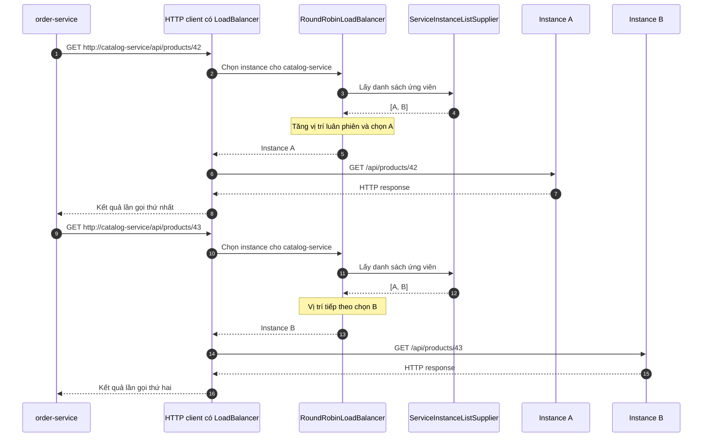

# Round-robin: phân phối luân phiên và trạng thái tại bên gọi

Trong hệ thống microservices, một service ID có thể đại diện cho nhiều bản sao (*replica*) của cùng một dịch vụ. Ví dụ, `catalog-service` có ba instance A, B, C. Khi `order-service` gọi `http://catalog-service/api/products/42` qua HTTP client đã tích hợp Spring Cloud LoadBalancer, ứng dụng cần quyết định **instance nào nhận yêu cầu hiện tại**. Round-robin giải quyết việc này bằng cách lần lượt chọn các instance theo một vòng lặp.

Trong Spring Cloud LoadBalancer, `RoundRobinLoadBalancer` là triển khai lựa chọn luân phiên thường được dùng mặc định khi ứng dụng không thay thế thuật toán bằng một bean LoadBalancer khác. Điểm quan trọng của **client-side load balancing** là trạng thái lựa chọn nằm tại **ứng dụng gọi dịch vụ**, gắn với LoadBalancer của service ID, thay vì có một bộ đếm chung ở phía các instance đích. Vì vậy, round-robin giúp phân phối đều *các lượt chọn tại một bên gọi*, nhưng không tự đảm bảo mọi máy chủ đích nhận đúng tỷ lệ request trên toàn hệ thống.

## 1. Round-robin hoạt động như thế nào?

Giả sử nguồn discovery trả về danh sách theo thứ tự cố định:

```text
serviceId = catalog-service
instances = [A, B, C]
A = 10.0.0.11:8080
B = 10.0.0.12:8080
C = 10.0.0.13:8080
```

Round-robin duy trì vị trí hiện tại và chuyển sang vị trí kế tiếp sau mỗi lượt chọn hợp lệ. Khi đến phần tử cuối, vị trí quay về đầu danh sách. Giả sử lượt đầu chọn A, chuỗi lựa chọn minh họa là:

| Lượt chọn | Vị trí trong vòng | Instance được chọn | Địa chỉ cuối |
|---:|---:|---|---|
| 1 | 0 | A | `10.0.0.11:8080` |
| 2 | 1 | B | `10.0.0.12:8080` |
| 3 | 2 | C | `10.0.0.13:8080` |
| 4 | 0 | A | `10.0.0.11:8080` |
| 5 | 1 | B | `10.0.0.12:8080` |
| 6 | 2 | C | `10.0.0.13:8080` |
| 7 | 0 | A | `10.0.0.11:8080` |

Ý tưởng tính vị trí có thể biểu diễn đơn giản như sau:

```text
index = nextPosition % numberOfCandidates
chosenInstance = candidates[index]
```

Trong đó `nextPosition` là vị trí luân phiên tiếp theo và `numberOfCandidates` là số instance trong danh sách hiện tại. Triển khai thực tế của Spring Cloud LoadBalancer sử dụng một bộ đếm nguyên tử (`AtomicInteger`) và xử lý giá trị chỉ số để tránh index âm. Công thức trên minh họa nguyên lý vòng tròn, không phải mã nguồn đầy đủ của implementation.

**Không giả định lượt đầu tiên luôn chọn A.** `RoundRobinLoadBalancer` có thể bắt đầu từ một vị trí được khởi tạo khác nhau giữa các instance ứng dụng gọi. Điều được kỳ vọng khi danh sách ổn định là các lựa chọn tiếp theo đi lần lượt quanh cùng một vòng, chứ không phải một điểm bắt đầu cố định.

## 2. Từ service ID đến instance: round-robin nằm ở bước nào?

Round-robin không trực tiếp tìm máy chủ trong mạng. Nó chỉ chọn một phần tử trong **danh sách instance đã được cung cấp**. Luồng cơ bản:

1. Ứng dụng gửi request qua `RestClient`, `WebClient` hoặc OpenFeign đã được tích hợp LoadBalancer, sử dụng service ID như `catalog-service`.
2. Tích hợp LoadBalancer yêu cầu chọn một `ServiceInstance` cho service ID đó.
3. `ServiceInstanceListSupplier` trả về danh sách instance từ discovery hoặc cấu hình tĩnh. Danh sách này có thể đã trải qua cache, bộ lọc zone và health check.
4. `RoundRobinLoadBalancer` lấy vị trí tiếp theo trong vòng lựa chọn của nó và chọn một instance trong danh sách ứng viên hiện tại.
5. HTTP client thay host/port logic bằng địa chỉ của instance được chọn, rồi thực hiện kết nối và gửi request.



Sơ đồ giả định hai lần chọn diễn ra tuần tự, danh sách không đổi và vị trí đầu của ví dụ là A. Trong thực tế, supplier có thể dùng cache nên không nhất thiết truy vấn registry mỗi lần; các request đồng thời có thể hoàn thành khác thứ tự được chọn.

## 3. Trạng thái lựa chọn nằm ở bên gọi

Trong Spring Cloud LoadBalancer, `LoadBalancerClientFactory` quản lý ngữ cảnh con theo service ID. Ngữ cảnh của `catalog-service` có thể có một `RoundRobinLoadBalancer` với bộ đếm vị trí riêng. `billing-service` có ngữ cảnh con khác và một LoadBalancer khác. Bởi vậy, các lượt chọn tới `billing-service` không dùng chung vòng đếm của `catalog-service`.

Giả sử một tiến trình `order-service` lần lượt gọi:

```text
GET http://catalog-service/products/1
GET http://catalog-service/products/2
GET http://billing-service/invoices/1
GET http://catalog-service/products/3
```

Nếu danh sách `catalog-service` là `[A, B]` và `billing-service` là `[X, Y]`, một kết quả minh họa có thể là `A`, `B`, `X`, `A`. Request đến `billing-service` không làm thay đổi bộ đếm của `catalog-service`.

Trạng thái này là **trạng thái trong bộ nhớ của mỗi tiến trình ứng dụng gọi**. Nó không phải số liệu được ghi trong service registry, cũng không được đồng bộ tự động giữa các JVM hoặc các Pod của caller. Khi caller được khởi động lại, trạng thái lựa chọn của LoadBalancer trong tiến trình đó được khởi tạo lại. Nếu caller được scale thành nhiều bản sao, mỗi bản sao có vòng chọn độc lập.

```text
order-service replica 1
  ├── catalog-service: bộ đếm riêng
  └── billing-service: bộ đếm riêng

order-service replica 2
  ├── catalog-service: bộ đếm riêng khác
  └── billing-service: bộ đếm riêng khác
```

Đây là khác biệt cốt lõi với load balancer tập trung: không có một vị trí luân phiên toàn hệ thống do Spring Cloud LoadBalancer tự chia sẻ giữa mọi caller. Discovery có thể cung cấp cùng một tập instance cho nhiều caller, nhưng **bộ đếm chọn instance** vẫn do từng LoadBalancer ở phía caller quản lý.

### Vì sao `AtomicInteger` được dùng?

Một ứng dụng thường xử lý nhiều request đồng thời. Nếu nhiều thread cùng đọc, tăng rồi ghi bộ đếm thông thường mà không đồng bộ, các cập nhật có thể bị mất và nhiều request vô tình dùng cùng một vị trí. `AtomicInteger` cho phép cập nhật vị trí an toàn trước cạnh tranh giữa các thread trong cùng một LoadBalancer.

Điều này giúp phân bổ vị trí lựa chọn nhất quán khi có concurrent requests, nhưng **không buộc các request đến đích hoặc hoàn thành theo đúng thứ tự A → B → C**. Request chọn A trước có thể chạy lâu hơn và trả response sau request chọn B. Vì vậy, khi debug cần phân biệt *thứ tự chọn instance* với *thứ tự nhận response*.

## 4. Một caller và nhiều caller cho kết quả khác nhau

Nếu một LoadBalancer liên tiếp thực hiện 10 lượt chọn hợp lệ với danh sách cố định `[A, B, C]`, tổng số lần chọn các instance sẽ gần bằng nhau: mỗi instance được chọn 3 hoặc 4 lần. Với danh sách ổn định gồm `n` ứng viên, chênh lệch về **số lượt chọn** giữa hai instance không quá một sau một chuỗi vòng đầy đủ và phần dư.

Tuy nhiên, đặt hai bản sao của ứng dụng gọi cạnh nhau sẽ có hai vòng lựa chọn:

| Bên gọi | Số lượt chọn `catalog-service` | Chuỗi ví dụ với A, B, C | Số lượt trên từng instance |
|---|---:|---|---|
| `order-service-1` | 7 | A, B, C, A, B, C, A | A=3, B=2, C=2 |
| `order-service-2` | 3 | C, A, B | A=1, B=1, C=1 |
| **Tổng minh họa** | **10** | Hai vòng độc lập | **A=4, B=3, C=3** |

Đây là ví dụ có giả định về điểm bắt đầu và thứ tự danh sách. Nếu hai caller khởi tạo cùng vị trí và chỉ có một vài request, cả hai có thể chọn cùng một instance trong những lượt đầu. Nếu danh sách discovery hoặc thứ tự trả về khác nhau giữa hai caller, phân phối gộp cũng có thể lệch hơn.

Round-robin không biết thời gian xử lý, CPU, số kết nối đang mở hoặc mức tải nghiệp vụ của từng instance. Với các instance có năng lực rất khác nhau, phân phối số lượt chọn gần đều vẫn có thể khiến máy yếu quá tải. Khi cần tỷ lệ theo dung lượng, điều kiện zone hoặc đặc thù nghiệp vụ, phải đánh giá chiến lược và chuỗi supplier phù hợp thay vì coi round-robin như cơ chế cân bằng tải thích ứng.

## 5. Danh sách instance có thể thay đổi giữa các lượt chọn

Round-robin chọn theo chỉ số trong **danh sách ứng viên ở thời điểm lựa chọn**. Khi discovery thay đổi hoặc supplier lọc lại danh sách, hai yếu tố quan trọng là **số phần tử** và **thứ tự phần tử**. Bộ đếm có thể tiếp tục tăng trong khi phép lấy modulo sử dụng kích thước danh sách mới.

| Tình huống | Danh sách ứng viên | Hệ quả đối với round-robin |
|---|---|---|
| Ổn định | `[A, B, C]` cho mọi lượt | Phân phối lần lượt qua ba instance |
| B bị loại vì lỗi | `[A, C]` | Lượt chọn tiếp theo dựa trên hai ứng viên còn lại |
| Scale thêm D | `[A, B, C, D]` | Vòng tính theo bốn ứng viên kể từ lúc danh sách mới được nhìn thấy |
| Đổi thứ tự | `[C, A, B]` | Cùng vị trí có thể trỏ sang instance khác; nhìn từ log có thể lặp hoặc bỏ qua một tên |
| Lọc theo zone | `[A, C]` | Chỉ luân phiên trong tập đã lọc, không chọn B |
| Không có ứng viên | `[]` | Không có instance để chọn; yêu cầu sẽ đi vào nhánh xử lý lỗi tương ứng |

Điều này giải thích vì sao **không thể đòi hỏi một chuỗi A → B → C tuyệt đối** khi các instance được tạo, hủy hoặc cập nhật trạng thái liên tục. Việc giữ một bộ đếm không đồng nghĩa giữ một bản sao cố định của danh sách.

### Tác động của cache và health check

`ServiceInstanceListSupplier` có thể lấy instance qua `DiscoveryClient`, thêm cache, lọc metadata và kiểm tra sức khỏe. Nếu dùng cache, danh sách có thể phản ánh trạng thái registry trễ hơn một khoảng thời gian. Nếu dùng health check, một instance không đạt điều kiện có thể bị loại khỏi tập ứng viên trước khi round-robin chọn.

Không nên hiểu rằng round-robin tự kiểm tra health hoặc tự loại bỏ instance vừa trả lỗi 5xx. Thuật toán chỉ biết danh sách đã nhận. Muốn kiểm soát chất lượng ứng viên, cần thiết kế discovery, health check, cache và bộ lọc phù hợp với hệ thống.

## 6. Thử nghiệm với `SimpleDiscoveryClient` và `RestClient`

Để quan sát round-robin rõ ràng, có thể tạo một bài lab gồm **hai tiến trình `catalog-service`** (cổng 8081 và 8082) cùng **một tiến trình `order-service`** làm consumer. Ví dụ dùng Spring Boot tương thích với Spring Cloud release train đã chọn và API `RestClient` (Spring Framework 6.1 trở lên).

### Bước 1: khai báo dependency của consumer

Trong Maven, có thể khai báo HTTP client và starter LoadBalancer:

```xml
<dependencies>
    <dependency>
        <groupId>org.springframework.boot</groupId>
        <artifactId>spring-boot-starter-web</artifactId>
    </dependency>
    <dependency>
        <groupId>org.springframework.cloud</groupId>
        <artifactId>spring-cloud-starter-loadbalancer</artifactId>
    </dependency>
</dependencies>
```

Các phiên bản Spring Cloud cần được quản lý bằng BOM phù hợp với Spring Boot đang dùng. Ví dụ này giả định dự án đã thiết lập dependency management; chỉ chép hai dependency vào một POM bất kỳ chưa đảm bảo build thành công nếu thiếu BOM hoặc phiên bản.

### Bước 2: khai báo hai instance tĩnh

Trong `application.yml` của **consumer**:

```yaml
spring:
  application:
    name: order-service
  cloud:
    discovery:
      client:
        simple:
          instances:
            catalog-service:
              - uri: http://localhost:8081
              - uri: http://localhost:8082
```

Danh sách này phù hợp khi tất cả tiến trình đều chạy trên cùng máy. Nếu consumer chạy trong container, `localhost` là container của consumer; cần thay bằng địa chỉ mà container consumer thực sự truy cập được.

### Bước 3: khởi chạy hai bản sao của provider

Cùng một ứng dụng provider có endpoint trả về dấu hiệu nhận diện riêng:

```java
@RestController
class InstanceController {

    private final Environment environment;

    InstanceController(Environment environment) {
        this.environment = environment;
    }

    @GetMapping("/whoami")
    String whoami() {
        return "catalog@" + environment.getProperty("server.port", "unknown");
    }
}
```

Khởi chạy bản sao thứ nhất với `server.port=8081`, bản sao thứ hai với `server.port=8082`. Có thể ghi đè `server.port` bằng tham số dòng lệnh `--server.port=8081` và `--server.port=8082` khi chạy hai tiến trình riêng. Trước khi thử LoadBalancer, xác minh các URL trực tiếp trả về hai giá trị khác nhau:

```bash
curl http://localhost:8081/whoami
curl http://localhost:8082/whoami
```

Kết quả kỳ vọng là `catalog@8081` và `catalog@8082`.

### Bước 4: tạo HTTP client đã tích hợp LoadBalancer

Trong consumer, định nghĩa builder có `@LoadBalanced`:

```java
@Configuration(proxyBeanMethods = false)
class OutboundHttpConfiguration {

    @Bean
    @LoadBalanced
    RestClient.Builder loadBalancedRestClientBuilder() {
        return RestClient.builder();
    }
}
```

Sau đó, inject builder đúng qualifier để gọi URL theo service ID:

```java
@Service
class CatalogApiClient {

    private final RestClient restClient;

    CatalogApiClient(@LoadBalanced RestClient.Builder builder) {
        this.restClient = builder.build();
    }

    String whoami() {
        return restClient.get()
                .uri("http://catalog-service/whoami")
                .retrieve()
                .body(String.class);
    }
}
```

Cần các import Spring tương ứng như `@Bean`, `@Configuration`, `@Service`, `@LoadBalanced`, `RestClient` và `Environment`; đoạn code tập trung vào cách tích hợp. Không cần tự khai báo `RoundRobinLoadBalancer` khi dùng chính sách round-robin mặc định và chưa ghi đè nó bằng cấu hình riêng.

### Bước 5: quan sát nhiều lượt gọi

Trong một test hoặc thành phần thực hành, gọi `CatalogApiClient.whoami()` nhiều lần theo thứ tự:

```java
for (int i = 1; i <= 8; i++) {
    System.out.println(i + ": " + catalogApiClient.whoami());
}
```

Một kết quả hợp lệ có thể là:

```text
1: catalog@8081
2: catalog@8082
3: catalog@8081
4: catalog@8082
5: catalog@8081
6: catalog@8082
7: catalog@8081
8: catalog@8082
```

Kết quả cũng có thể bắt đầu từ cổng 8082. Kiểm tra điều cần chứng minh: **khi danh sách hai instance giữ nguyên và các lượt gọi tuần tự, hai địa chỉ được chọn luân phiên**. Đừng ràng buộc bài test vào việc cổng 8081 luôn phải được chọn đầu tiên.

### Bước 6: thử thay đổi danh sách

Dừng tiến trình ở cổng 8082 nhưng vẫn giữ cấu hình `SimpleDiscoveryClient` tĩnh. Khi đó, địa chỉ 8082 vẫn có thể nằm trong danh sách ứng viên và một số lượt gọi sẽ thất bại kết nối. Đây là hành vi có thể dự đoán: **round-robin không tự phát hiện rằng một địa chỉ tĩnh đã chết**.

Tiếp theo, bỏ entry 8082 khỏi cấu hình rồi khởi động lại consumer theo cách triển khai của bài lab. Lúc này, mọi lượt chọn có ứng viên đều trỏ đến 8081. Đối với discovery động, cần quan sát thời gian registry và cache cập nhật; việc dừng một instance không nhất thiết làm mọi caller biết ngay lập tức.

## 7. Sự khác nhau giữa lượt chọn, HTTP request và response

Một lượt chọn instance không đồng nghĩa một HTTP request thành công. Ví dụ, round-robin chọn A, nhưng kết nối đến A timeout. Bộ chọn đã thực hiện quyết định của mình dù ứng dụng chưa nhận được kết quả nghiệp vụ.

Điều này dẫn đến ba loại chỉ số khác nhau:

| Chỉ số | Ý nghĩa | Có nhất thiết bằng nhau không? |
|---|---|---|
| Số lượt chọn A | Bao nhiêu lần LoadBalancer chọn A làm đích | Không nhất thiết bằng số response thành công từ A |
| Số HTTP request gửi đến A | Bao nhiêu lần client/transport thực sự thử gửi request đến A | Có thể thấp hoặc cao hơn số lời gọi nghiệp vụ tùy lỗi và retry |
| Số response 2xx từ A | Bao nhiêu request được A xử lý và trả thành công | Có thể khác số lượt chọn vì timeout, lỗi mạng, 4xx/5xx |

Nếu một yêu cầu gặp lỗi và cơ chế retry được bật, cùng **một lời gọi nghiệp vụ** có thể dẫn tới nhiều lần thử hoặc nhiều lần chọn instance. Retry có thể chọn lại cùng instance hoặc instance khác tùy tích hợp và cấu hình retry đang dùng. Khi đó, chuỗi instance ghi nhận theo từng HTTP attempt không còn tương ứng 1:1 với số lần người dùng gọi API.

Do đó, khi đánh giá round-robin, hãy đo **số lần chọn** hoặc các attempt ở client cùng với **response và latency** ở phía server. Chỉ nhìn số response thành công có thể khiến thuật toán cân bằng tải bị kết luận sai là phân phối không đều trong khi nguyên nhân thực tế là một instance chậm hoặc lỗi nhiều hơn.

## 8. Round-robin có giữ session affinity hay không?

Không. Round-robin phân phối theo lượt chọn, không dựa trên người dùng, session ID, cookie hay thông tin nghiệp vụ trong request. Hai request liên tiếp của cùng một người dùng có thể được gửi đến hai instance khác nhau.

Nếu hệ thống lưu session cục bộ trong bộ nhớ của từng instance, việc chuyển request liên tiếp giữa A và B có thể dẫn tới mất trạng thái hoặc hành vi không nhất quán. Những cách xử lý phổ biến là:

- Thiết kế dịch vụ stateless hoặc lưu session vào kho dùng chung.
- Dùng cơ chế affinity/định tuyến theo ngữ cảnh nếu yêu cầu nghiệp vụ thực sự cần cùng một đích.
- Tránh nhầm connection pooling hoặc keep-alive của HTTP client với bảo đảm session stickiness ở mức LoadBalancer.

Round-robin cũng không có khái niệm **weighted round-robin** theo mặc định: nếu một instance có CPU gấp đôi instance khác, vòng luân phiên thông thường vẫn cho chúng số lượt chọn gần như nhau. Cần chính sách lựa chọn hoặc phân phối phù hợp hơn nếu năng lực các instance khác biệt rõ rệt.

## 9. Round-robin trong thực tế chịu tác động của các tầng khác

| Yếu tố | Ảnh hưởng có thể quan sát | Điều cần kiểm tra |
|---|---|---|
| Nhiều caller replica | Mỗi tiến trình giữ vòng chọn riêng, không có bộ đếm chung | So sánh log theo `callerInstanceId` và `serviceId` |
| LoadBalancer theo service ID | Mỗi service có chính sách/bộ đếm riêng | Kiểm tra `LoadBalancerClientFactory` và cấu hình per-service |
| Danh sách instance thay đổi | Modulo và ánh xạ vị trí thay đổi, có thể thấy lặp/bỏ qua tên | Log danh sách ứng viên tại thời điểm chọn |
| Cache discovery | Danh sách cũ có thể tồn tại thêm một khoảng thời gian | TTL, cơ chế refresh và registry |
| Health check / zone filter | Chỉ các instance sau lọc tham gia vòng chọn | Supplier chain, metadata, trạng thái health |
| Concurrency | Thứ tự hoàn thành khác thứ tự lựa chọn | Ghi dấu thời điểm chọn và thời điểm response |
| Retry | Một lời gọi có thể phát sinh nhiều lượt chọn | Số lần retry, retry cùng/khác instance, idempotency |
| Instance không đồng đều | Phân phối lượt chọn gần đều nhưng thời gian xử lý có thể lệch | CPU, latency, connection saturation, error rate |

Trong môi trường Kubernetes, nếu client gọi vào một Kubernetes `Service` qua DNS/ClusterIP mà không tích hợp Spring Cloud LoadBalancer, việc chọn Pod được thực hiện bởi hạ tầng Kubernetes. Đó là một đường cân bằng tải khác. Chỉ khi discovery cung cấp các instance thích hợp và HTTP client gọi qua LoadBalancer thì thuật toán `RoundRobinLoadBalancer` của Spring Cloud mới tham gia chọn đích.

## 10. Quan sát và kiểm tra đúng thuật toán

Khi muốn xác minh round-robin đang hoạt động, nên trả lời các câu hỏi theo thứ tự:

1. **Client có thực sự đi qua LoadBalancer không?** Với `RestClient` hoặc `WebClient`, xác nhận dùng đúng bean `@LoadBalanced`; với OpenFeign, xác nhận tích hợp Spring Cloud LoadBalancer có mặt và được bật.
2. **Service ID có đúng không?** Tên trong URL hoặc `@FeignClient(name = "...")` phải khớp tên discovery công bố.
3. **Supplier đang trả về danh sách nào?** Kiểm tra số lượng, thứ tự, metadata, cache và các bộ lọc.
4. **Implementation nào đang chọn?** Xác nhận bean theo service thực sự là `RoundRobinLoadBalancer`, vì cấu hình `@LoadBalancerClient` có thể đã thay thuật toán.
5. **Thống kê ở phạm vi nào?** Phân biệt một LoadBalancer trong một caller, nhiều caller replica và số liệu tổng hợp toàn hệ thống.
6. **Có retry hoặc concurrency không?** Phân biệt lượt chọn, HTTP attempt và response đến trước/sau.
7. **Các instance có sẵn sàng và đủ năng lực không?** Một phân phối lựa chọn đúng vẫn có thể gặp tỷ lệ lỗi và độ trễ không đồng đều.

Một bài test có ý nghĩa nên kiểm tra **thuật toán độc lập với mạng** bằng danh sách cố định và LoadBalancer được cấu hình rõ ràng; sau đó kiểm tra tích hợp với HTTP client và provider thật. Trong thử nghiệm thuật toán, không nên xác nhận “instance A luôn được chọn đầu tiên”; nên kiểm tra sự luân phiên, số lượt chọn từng instance và hành vi khi danh sách thay đổi.

Khi log lỗi production, nên ghi `serviceId`, `callerInstanceId`, `selectedInstanceId` (hoặc host/port), `requestId`, số lần thử và kết quả HTTP nếu hệ thống cho phép. Các trường này giúp nhận ra trường hợp một caller chọn sai instance, discovery có dữ liệu cũ hoặc một instance được chọn bình thường nhưng xử lý request kém hơn các instance khác.

## 11. Những hiểu nhầm thường gặp

**“Round-robin đảm bảo tất cả server luôn nhận đúng số request bằng nhau.”** Thuật toán chỉ luân phiên lựa chọn trên danh sách ứng viên nó nhìn thấy; nhiều caller độc lập, danh sách thay đổi, lỗi kết nối và retry khiến số request thực tế ở server có thể khác nhau.

**“Cứ chọn theo A → B → C thì response cũng phải về theo A → B → C.”** Request được chọn trước có thể xử lý lâu hơn; concurrency làm thứ tự nhận response thay đổi.

**“Một instance chết thì thuật toán sẽ tự bỏ qua nó.”** Việc loại instance cần dữ liệu discovery/health hoặc supplier filter cập nhật. Round-robin không phải health checker.

**“Tất cả service ID trong ứng dụng dùng chung một bộ đếm.”** Mỗi LoadBalancer theo service ID có trạng thái lựa chọn riêng trong ngữ cảnh tương ứng.

**“Tất cả replica của ứng dụng gọi dùng chung bộ đếm.”** Mỗi tiến trình caller giữ trạng thái trong bộ nhớ của chính mình. Không có bộ đếm round-robin tập trung được đồng bộ tự động giữa các caller.

**“Round-robin là sticky session hoặc thuật toán thích ứng theo độ trễ.”** Round-robin không xét session hay tải thời gian thực của instance. Khi cần các đặc tính đó, hãy thiết kế một chính sách định tuyến phù hợp.

## 12. Kết luận thực hành

Khi `ServiceInstanceListSupplier` cung cấp một danh sách ổn định, `RoundRobinLoadBalancer` phân phối các lượt chọn lần lượt qua các instance và giữ vị trí lựa chọn bằng trạng thái tại **bên gọi**. Mỗi service ID có LoadBalancer riêng; mỗi tiến trình ứng dụng gọi cũng có trạng thái riêng, nên kết quả không tạo thành một vòng duy nhất trên toàn hệ thống.

Để đánh giá round-robin đúng, hãy quan sát danh sách ứng viên, implementation thực sự được chọn và số **lượt chọn instance** trong cùng một phạm vi caller/service ID. Sau đó mới đối chiếu HTTP attempt, tỷ lệ lỗi, latency, retry và health check. Cách phân biệt này giúp nhận biết liệu hệ thống đang gặp vấn đề ở thuật toán, dữ liệu discovery, kết nối hay năng lực xử lý của bản sao đích.
