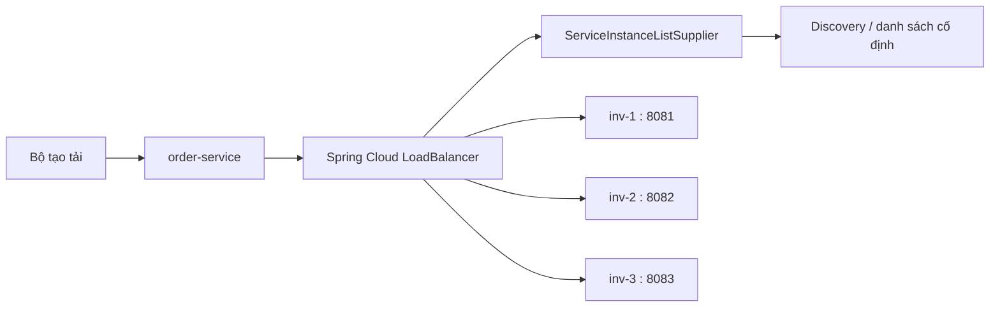

# So sánh round-robin và random bằng phép đo phù hợp

## 1. Bối cảnh và mục tiêu

Trong chương **Thuật toán chọn đích** của module `SPRING_CLOUD_SERVICE_COMMUNICATION_LOAD_BALANCING`, Spring Cloud LoadBalancer lựa chọn một `ServiceInstance` cho service ID mà ứng dụng gọi. Hai cách chọn cơ bản là **Round Robin** (luân phiên) và **Random** (ngẫu nhiên). Cả hai có thể tích hợp với `RestClient`, `WebClient` hoặc OpenFeign, và đều dựa vào danh sách instance do `ServiceInstanceListSupplier` cung cấp.

Câu hỏi học tập không chỉ là “thuật toán nào phân phối đều hơn?” mà còn là **phép đo nào cho phép trả lời đúng câu hỏi**. Một bài đo thiếu kiểm soát dễ cho kết luận sai: Random có thể tạo phân phối lệch trong một mẫu nhỏ dù thuật toán đúng; Round Robin có thể chia đều số lần *chọn* mà vẫn tạo ra số request *đang xử lý* khác nhau; lỗi, retry và health check có thể làm phân phối quan sát khác hẳn phân phối ban đầu.

Sau bài này, bạn sẽ:

1. Mô tả chính xác Round Robin và Random trên cùng tập instance đủ điều kiện.
2. Thiết kế thí nghiệm lặp lại được, giữ cố định topology, tải, discovery, cache và retry.
3. Đo **số lần chọn instance**, độ lệch phân phối, tỷ lệ thành công, độ trễ và throughput bằng đúng đơn vị.
4. Giải thích dao động thống kê của Random và dấu hiệu bất thường thực sự.
5. So sánh kết quả ở tải thấp, tải cao và khi số instance thay đổi.
6. Chọn thuật toán dựa vào mục tiêu vận hành thay vì chỉ dựa vào một biểu đồ số request.

## 2. Thuật toán thực hiện điều gì?

Giả sử `order-service` gọi `http://inventory-service/api/inventory/ABC-1`. Discovery hoặc danh sách cấu hình sẵn trả về ba instance:

| Instance | Địa chỉ ví dụ | Năng lực giả định |
|---|---|---|
| `inv-1` | `localhost:8081` | Ngang nhau |
| `inv-2` | `localhost:8082` | Ngang nhau |
| `inv-3` | `localhost:8083` | Ngang nhau |

Mục tiêu đo đầu tiên là cách LoadBalancer chọn một trong ba instance, **trước khi** HTTP client bắt đầu kết nối. Ví dụ giữ danh sách ổn định và không bật retry.



### 2.1. Round Robin

`RoundRobinLoadBalancer` là lựa chọn mặc định của Spring Cloud LoadBalancer trong cấu hình thông thường. Với danh sách cố định `[A, B, C]`, các lần chọn liên tiếp có dạng:

```text
Yêu cầu:  1  2  3  4  5  6  7  8  9
Instance: A  B  C  A  B  C  A  B  C
```

Mô hình hóa đơn giản:

```text
instance = instances[position % instances.size()]
position = position + 1
```

Đây là cách hiểu về hành vi luân phiên, không phải mã nguồn của thư viện. Nếu có `N` lượt chọn và `m` instance ổn định, mỗi instance nhận khoảng `N/m` lượt; độ chênh số lần chọn giữa các instance tối đa là 1 trong mô hình tuần tự lý tưởng.

**Phạm vi của bộ đếm quan trọng:** Spring Cloud LoadBalancer tạo context theo service ID ở từng ứng dụng gọi. Nhiều replica của `order-service` không nhất thiết chia sẻ một bộ đếm Round Robin toàn cụm. Mỗi tiến trình chọn theo trạng thái cục bộ và danh sách nó biết được. Thay đổi thứ tự instance, restart, lọc theo zone/health hoặc retry có thể khiến chuỗi quan sát khác ví dụ lý tưởng.

### 2.2. Random

`RandomLoadBalancer` chọn ngẫu nhiên một chỉ số từ danh sách instance hiện có. Khi có ba instance tương đương, mỗi lần chọn lý tưởng có xác suất:

\[
P(A)=P(B)=P(C)=\frac{1}{3}.
\]

Một chuỗi hoàn toàn hợp lệ có thể như sau:

```text
Yêu cầu:  1  2  3  4  5  6  7  8  9
Instance: B  B  A  C  B  A  B  C  C
```

Có những đoạn một instance xuất hiện liên tục; điều đó **không tự chứng minh** thuật toán sai. Nếu các lần chọn độc lập, mỗi instance có xác suất như nhau và danh sách ổn định, số lượt của instance `i` trong `N` lần chọn tuân theo phân phối nhị thức theo biên:

\[
X_i\sim\mathrm{Binomial}\left(N,\frac1m\right),\qquad
E[X_i]=\frac Nm,\qquad
SD(X_i)=\sqrt{N\frac1m\left(1-\frac1m\right)}.
\]

Các `X_i` không độc lập với nhau vì tổng luôn bằng `N`. Đây là mô hình toán học cho Random **đồng xác suất với tập ứng viên cố định**; nếu dùng supplier có lọc, trọng số hoặc thay đổi danh sách theo request thì phải xây dựng mô hình khác.

### 2.3. Hai thuật toán không giải quyết mọi vấn đề

| Vấn đề | Round Robin | Random |
|---|---|---|
| Quy tắc chọn | Luân phiên theo vị trí | Chọn ngẫu nhiên trên danh sách |
| Khi danh sách không đổi | Số lượt chọn rất đều | Đều **theo kỳ vọng**, có biến thiên |
| Khi mới có ít request | Thường cân bằng ngay | Có thể lệch đáng kể |
| Có tự đo CPU, queue, thời gian xử lý không? | Không | Không |
| Có tự loại instance lỗi không? | Không; phụ thuộc discovery/supplier/health check | Tương tự |
| Có tự retry khi kết nối lỗi không? | Không; retry là cơ chế khác | Tương tự |
| Có tự chọn theo zone, metadata, weight không? | Không; cần cơ chế supplier/chính sách tương ứng | Tương tự |
| Có thể dùng với RestClient/WebClient/OpenFeign? | Có | Có |

**Phân phối đều số lần chọn không đồng nghĩa phân phối đều công việc.** Nếu một instance xử lý chậm hoặc có năng lực thấp hơn, số request đồng thời đang chờ tại nó có thể cao dù Round Robin và Random đều phân phối số lượt gọi gần bằng nhau.

## 3. Chọn phép đo theo câu hỏi cần trả lời

Trước khi mở công cụ benchmark, xác định đại lượng cần đo và cách diễn giải:

| Câu hỏi | Phép đo phù hợp | Nguồn đo | Cảnh báo |
|---|---|---|---|
| Thuật toán có chọn đều không? | `selection_count` theo instance; tỷ lệ `n_i/N` | Sự kiện chọn của LoadBalancer ở caller | Response thành công có thể thiếu các lần chọn bị lỗi |
| Mức chênh lớn đến đâu? | `max_relative_deviation`, hệ số biến thiên `CV` | Các `n_i` sau giai đoạn warm-up | Đặc biệt bất ổn khi `N` nhỏ |
| Người dùng có nhận response tốt không? | Tỷ lệ thành công/lỗi và latency p50, p95, p99 | Bộ tạo tải và server | Phải tính riêng request lỗi/timeout, tránh chỉ nhìn successful responses |
| Có chịu được tải không? | Throughput thực nhận, RPS theo instance, request đang xử lý | Bộ tạo tải, HTTP server và metric | Throughput phụ thuộc server, mạng, tải và cấu hình client |
| Có quá tải cục bộ không? | In-flight requests, queue length, CPU, memory, kết nối | Metric từng instance | Hai thuật toán đều không tự dùng các metric này |
| Hệ thống phản ứng khi lỗi ra sao? | Failure rate, thời gian phát hiện lỗi, lần thử lại, instance còn trong danh sách | Log, trace, discovery, health check | Đo riêng vì điều kiện thử nghiệm đã thay đổi |

### 3.1. Độ lệch phân phối

Đặt `n_i` là **số lượt chọn** instance `i`, `N=\sum_i n_i` và `m` là số instance đủ điều kiện; với phân phối đều, kỳ vọng mỗi instance nhận `\mu=N/m`.

Tỷ lệ của từng instance:

\[
s_i=\frac{n_i}{N}.
\]

Độ lệch tương đối lớn nhất so với số lượt kỳ vọng:

\[
D_{\max}=\max_i\left(\frac{|n_i-\mu|}{\mu}\right).
\]

Hệ số biến thiên (dùng độ lệch chuẩn **population**, vì đang so sánh toàn bộ `m` instance trong tập xét):

\[
CV=\frac{\sqrt{\frac{1}{m}\sum_{i=1}^{m}(n_i-\mu)^2}}{\mu}.
\]

**Diễn giải:** `CV=0` nghĩa là các số lượt bằng nhau. `CV` càng cao nghĩa là phân phối số lượt chọn càng lệch. Dùng cùng `N`, `m` và điều kiện thí nghiệm để so sánh; `CV` của mẫu vài chục request không nên so trực tiếp với `CV` của vài chục nghìn request.

Nếu số instance thay đổi giữa các request, kỳ vọng `N/m` **không còn áp dụng nguyên vẹn**: phải chia kết quả thành các khoảng có cùng tập ứng viên hoặc tính số lần một instance đủ điều kiện được chọn trong từng khoảng.

### 3.2. Ví dụ thống kê trước khi đo

Với ba instance và 3.000 lần chọn, tất cả đều khỏe và danh sách không đổi:

- **Round Robin lý tưởng:** `(1000,1000,1000)`; `CV=0`.
- **Random:** kỳ vọng của từng instance vẫn là `1000`, nhưng độ lệch chuẩn theo mô hình nhị thức là `\sqrt{3000(1/3)(2/3)}\approx25{,}82` lượt.
- Khoảng tham khảo `1000\pm1{,}96\times25{,}82`, tức khoảng `949–1051`, là **xấp xỉ 95% cho số lần chọn của một instance cụ thể** dưới các giả định của mô hình; đây không phải khoảng bảo đảm cho cả ba instance cùng lúc.
- Một kết quả Random **giả lập để minh họa**, `(968,1009,1023)`, có tổng 3.000, `D_{\max}=3{,}2\%` và `CV\approx2{,}33\%`. Nó phù hợp với tính ngẫu nhiên thông thường; không phải bằng chứng thuật toán lỗi.

Biến thiên tỷ lệ tương đối của Random giảm xấp xỉ theo `1/\sqrt{N}` khi số lượt chọn tăng, với `m` giữ nguyên. Vì vậy, dùng 10 hoặc 20 request để kết luận thuật toán nào “công bằng hơn” là không đủ.

## 4. Chuẩn bị môi trường so sánh công bằng

Dùng ba instance `inventory-service` đồng cấu hình và một `order-service` làm caller. Có thể thay bằng Eureka, Consul hoặc Kubernetes, nhưng để thí nghiệm cơ sở dễ lặp, dùng `SimpleDiscoveryClient` với danh sách cố định. Cần thêm Spring Cloud BOM tương thích với Spring Boot đang dùng và dependency `spring-cloud-starter-loadbalancer`. Các ví dụ bên dưới giả định phiên bản Spring Framework hỗ trợ `RestClient`.

Bảng yếu tố cần giữ cố định:

| Yếu tố | Thiết lập cho cả hai lượt đo |
|---|---|
| Số instance | 3 instance giống nhau, cùng service ID |
| Danh sách/khả năng khám phá | Cố định trong một lượt đo, không restart hay scale |
| Client | Cùng mã `RestClient`, cùng cấu hình HTTP transport |
| Retry | Tắt ở baseline để mỗi request ứng với một lượt chọn |
| Health check và lọc | Không thay danh sách; kiểm chứng cả ba instance đủ điều kiện |
| Caching/discovery | Dùng cùng cơ chế và thời điểm cập nhật; với SimpleDiscoveryClient có thể tắt cache LB |
| Độ trễ nghiệp vụ | Endpoint trả dữ liệu nhỏ, không truy vấn DB hoặc gọi dịch vụ ngoài |
| Warm-up | Có giai đoạn làm nóng, bỏ dữ liệu warm-up khi tổng hợp |
| Tải | Cùng RPS, thời lượng, mức đồng thời, client và máy chạy |
| Công cụ tạo tải | Chạy trên môi trường khác nếu có thể, kiểm tra không bị nghẽn ở generator |

### 4.1. Danh sách instance ổn định tại caller

Ví dụ `application.yml` của `order-service`:

```yaml
spring:
  application:
    name: order-service
  cloud:
    discovery:
      client:
        simple:
          instances:
            inventory-service:
              - uri: http://localhost:8081
                instance-id: inv-1
              - uri: http://localhost:8082
                instance-id: inv-2
              - uri: http://localhost:8083
                instance-id: inv-3
    loadbalancer:
      cache:
        enabled: false
      retry:
        enabled: false

server:
  port: 8080
```

Ba địa chỉ `localhost` chỉ phù hợp khi ba instance và caller chạy trong **cùng môi trường mạng/máy**. Trong Docker, Kubernetes hoặc khi caller ở host khác, thay bằng địa chỉ mà caller thực sự truy cập được.

Cấu hình này nhằm cô lập thí nghiệm lựa chọn instance. Khi dùng registry thật, cần xác nhận danh sách do discovery trả về ổn định giữa hai lượt; chỉ nhìn YAML chưa đủ để biết danh sách supplier cuối cùng nhận được.

### 4.2. Endpoint trả về danh tính instance

Ở `inventory-service`, gắn ID riêng cho mỗi tiến trình, ví dụ cấu hình `app.instance-id=inv-1` cho cổng 8081, `inv-2` cho 8082 và `inv-3` cho 8083:

```java
@RestController
class InventoryController {
    private final String instanceId;

    InventoryController(Environment environment) {
        this.instanceId = environment.getRequiredProperty("app.instance-id");
    }

    @GetMapping("/api/inventory/{sku}")
    InventoryReply get(@PathVariable String sku) {
        return new InventoryReply(sku, instanceId);
    }
}

record InventoryReply(String sku, String instanceId) {}
```

Chạy mỗi tiến trình với `server.port` và `app.instance-id` khác nhau, giữ chung `spring.application.name=inventory-service`. Ví dụ lệnh JVM options:

```text
Instance 1: -Dserver.port=8081 -Dapp.instance-id=inv-1
Instance 2: -Dserver.port=8082 -Dapp.instance-id=inv-2
Instance 3: -Dserver.port=8083 -Dapp.instance-id=inv-3
```

Trong `order-service`, khai báo builder có LoadBalancer và một endpoint benchmark chuyển tiếp nội dung phản hồi:

```java
@Configuration(proxyBeanMethods = false)
class InventoryClientConfiguration {
    @Bean
    @LoadBalanced
    RestClient.Builder loadBalancedRestClientBuilder() {
        return RestClient.builder();
    }
}

@RestController
class InventoryProbeController {
    private final RestClient client;

    InventoryProbeController(@LoadBalanced RestClient.Builder builder) {
        this.client = builder.build();
    }

    @GetMapping("/bench/inventory/{sku}")
    InventoryReply check(@PathVariable String sku) {
        return client.get()
                .uri("http://inventory-service/api/inventory/{sku}", sku)
                .retrieve()
                .body(InventoryReply.class);
    }
}

record InventoryReply(String sku, String instanceId) {}
```

`InventoryReply` ở hai ứng dụng chỉ là DTO minh họa, thường nằm trong các package/project khác nhau hoặc một module contract dùng chung. Bổ sung import Spring phù hợp và Java version hỗ trợ `record`. Khi truy cập `http://localhost:8080/bench/inventory/ABC-1`, response có trường `instanceId` để biết instance nào **đã trả lời thành công**.

### 4.3. Chạy Round Robin và Random theo cùng một phương pháp

**Lượt A — Round Robin:** giữ cấu hình mặc định của Spring Cloud LoadBalancer, không đăng ký bean `ReactorLoadBalancer<ServiceInstance>` ghi đè cho `inventory-service`.

**Lượt B — Random:** thêm cấu hình riêng cho `inventory-service` theo cách Spring Cloud Commons hướng dẫn:

```java
@Configuration(proxyBeanMethods = false)
@LoadBalancerClient(
        name = "inventory-service",
        configuration = InventoryRandomLoadBalancerConfiguration.class)
class InventoryRandomSelection {
}

class InventoryRandomLoadBalancerConfiguration {
    @Bean
    ReactorLoadBalancer<ServiceInstance> randomLoadBalancer(
            Environment environment,
            LoadBalancerClientFactory factory) {
        String serviceId =
                environment.getProperty(LoadBalancerClientFactory.PROPERTY_NAME);

        return new RandomLoadBalancer(
                factory.getLazyProvider(
                        serviceId, ServiceInstanceListSupplier.class),
                serviceId);
    }
}
```

Các import cần có gồm `org.springframework.cloud.loadbalancer.annotation.LoadBalancerClient`, `org.springframework.cloud.loadbalancer.core.RandomLoadBalancer`, `org.springframework.cloud.loadbalancer.core.ServiceInstanceListSupplier`, `org.springframework.cloud.loadbalancer.support.LoadBalancerClientFactory`, `org.springframework.cloud.client.ServiceInstance` và `org.springframework.cloud.client.loadbalancer.reactive.ReactorLoadBalancer`. Kiểm tra import/API cụ thể theo Spring Cloud Release Train đã chọn.

Để tránh cấu hình riêng bị áp dụng cho các service ID khác, lớp `InventoryRandomLoadBalancerConfiguration` **không đánh dấu `@Configuration`** và không để nó bị component scan như một cấu hình global. `@LoadBalancerClient` sẽ nạp nó trong context tương ứng với `inventory-service`.

Có thể đặt hai biến thể cấu hình vào hai profile riêng hoặc chạy hai bản caller tương ứng. Nếu dùng hai profile, cần xác minh profile Round Robin không đăng ký bean Random, còn profile Random thực sự đã thay `ReactorLoadBalancer`. **Không tự suy ra** YAML `spring.cloud.loadbalancer.algorithm=random` là thuộc tính chính thức nếu Release Train hiện tại không công bố khóa đó.

Đối với `WebClient` và OpenFeign, bản chất lựa chọn instance vẫn là qua LoadBalancer khi được tích hợp đúng, nhưng phép đo nên giữ **một loại client cố định** trong mỗi cặp thí nghiệm. So sánh `RestClient`/Round Robin với `WebClient`/Random sẽ trộn khác biệt HTTP stack vào khác biệt thuật toán.

## 5. Đo nhanh phân phối bằng request tuần tự

Đây là bước kiểm tra cấu hình, **không phải phép benchmark hiệu năng**. Với PowerShell, gọi endpoint 300 lần rồi nhóm theo ID:

```powershell
$instanceIds = 1..300 | ForEach-Object {
    (Invoke-RestMethod "http://localhost:8080/bench/inventory/ABC-1").instanceId
}

$instanceIds | Group-Object | Sort-Object Name |
    Select-Object Name, Count
```

Với Round Robin và danh sách ba instance ổn định, không retry, có thể kỳ vọng khoảng `100` response thành công từ mỗi instance. Với Random, các con số sẽ dao động quanh 100. Phải kiểm tra tất cả 300 lần gọi đã hoàn tất thành công; nếu một số lần lỗi, số response thống kê **không còn** bằng tổng số lượt chọn.

Có thể chạy tiếp nhiều đợt riêng biệt để thấy Random không lặp chính xác cùng một phân phối. Tính `CV` và `D_{\max}` theo công thức ở trên. Đừng kết luận độ trễ hoặc khả năng chịu tải từ script gửi request tuần tự này.

## 6. Đo tải ổn định bằng k6

Để đánh giá tải, dùng công cụ như k6, Gatling, JMeter hoặc công cụ benchmark có khả năng phát sinh lượng request được kiểm soát. Ví dụ dưới đây dùng k6 với **constant-arrival-rate** để giữ tốc độ gửi yêu cầu đã định; bài học về thuật toán không phụ thuộc riêng vào k6.

Đoạn script minh họa dưới đây gửi 50 yêu cầu mỗi giây trong 5 phút sau khi ứng dụng đã được warm-up và phân biệt lỗi HTTP với response thành công theo instance ID.

```javascript
import http from "k6/http";
import { check } from "k6";
import { Counter } from "k6/metrics";

export const successfulResponsesByInstance =
    new Counter("successful_responses_by_instance");

export const options = {
    scenarios: {
        steady: {
            executor: "constant-arrival-rate",
            rate: 50,
            timeUnit: "1s",
            duration: "5m",
            preAllocatedVUs: 100,
            maxVUs: 250
        }
    },
    thresholds: {
        http_req_failed: ["rate<0.01"],
        "successful_responses_by_instance{instance:inv-1}": ["count>=0"],
        "successful_responses_by_instance{instance:inv-2}": ["count>=0"],
        "successful_responses_by_instance{instance:inv-3}": ["count>=0"]
    }
};

export default function () {
    const response = http.get(
        "http://localhost:8080/bench/inventory/ABC-1"
    );

    const ok = check(response, {
        "HTTP 200": (r) => r.status === 200
    });

    if (ok) {
        try {
            const instanceId = response.json("instanceId");
            if (instanceId) {
                successfulResponsesByInstance.add(1, {
                    instance: String(instanceId)
                });
            }
        } catch (e) {
            // Response thiếu JSON hợp lệ: giữ lỗi phân tích tách khỏi lỗi HTTP.
        }
    }
}
```

Lệnh chạy ví dụ:

```bash
k6 run --summary-export=rr-summary.json bench.js
k6 run --summary-export=random-summary.json bench.js
```

Chạy mỗi lệnh khi `order-service` đã được khởi động với cấu hình thuật toán tương ứng, và nên thực hiện **nhiều vòng độc lập**. File `bench.js` ở đây là tên giả định của script bạn lưu khi thực hành, không phải một file được tạo sẵn bởi bài học.

**Cách đọc output:** dùng các metric có sẵn như `http_req_duration` (p50/p95/p99), `http_reqs`, `http_req_failed`, `iterations`, `dropped_iterations`; xem thêm counter theo instance bằng sub-metric/tag ở phần thresholds hoặc xuất dữ liệu ra hệ thống phân tích. `successful_responses_by_instance` đếm **response thành công được trả về**, không phải mọi lượt chọn instance. Với baseline là các request đều thành công, không retry, không timeout và 1 request đến 1 instance, nó là phép thay thế đủ gần để phân tích phân phối. Khi xuất hiện lỗi hoặc retry, phải dùng thêm sự kiện lựa chọn ở caller.

Một lượt thử có `dropped_iterations>0` tức generator không duy trì được tải đề ra. Khi đó, phép so sánh phải ghi lại **offered RPS** và **achieved RPS**, điều chỉnh công suất của generator hoặc đánh giá giới hạn hệ thống trước khi diễn giải.

### 6.1. Thu thập *lượt chọn* thực, kể cả request lỗi

Khi muốn biết thuật toán chọn instance nào ngay cả trong trường hợp kết nối thất bại, instrument ở phía `order-service`. Spring Cloud LoadBalancer có các callback `LoadBalancerLifecycle` như `onStart`, `onStartRequest` và `onComplete`. Có thể ghi service ID, instance ID, thời điểm chọn và kết quả, sau đó nối bằng trace/correlation ID.

Số lượt chọn theo instance phải được ghi tại thời điểm LoadBalancer đã có `ServiceInstance` được chọn nhưng chưa phụ thuộc vào HTTP response. Dùng cùng metric/log trong cả hai lượt thử; không chỉ lấy log nhận request từ instance khỏe. Nếu có retry, ghi nhận **attempt** theo instance và **logical request** riêng biệt vì một request nghiệp vụ có thể tạo nhiều lần chọn.

### 6.2. Những phép đo hiệu năng cần xuất cùng báo cáo

- **Latency end-to-end:** p50, p95, p99, trung bình; đo từ phía caller tải qua `order-service` đến response cuối cùng. Kèm đơn vị ms và số lượng mẫu.
- **Throughput:** số request thành công mỗi giây và tổng số request được gửi; ghi thêm error rate.
- **Per-instance throughput và in-flight:** cho biết instance nào thực sự bận hơn dù số lần chọn có thể đều.
- **Thời gian ở HTTP client:** connect timeout, read/response timeout, pool connection, keep-alive, số lần retry; những yếu tố này dễ che khuất khác biệt thuật toán.
- **Tài nguyên:** CPU, GC, heap, số thread và hàng đợi xử lý ở từng instance.
- **Danh sách ứng viên:** snapshot/nhật ký supplier ở từng giai đoạn, đặc biệt nếu discovery, cache hoặc health check được bật.

Nếu dữ liệu latency chỉ lấy từ request thành công, bạn có thể vô tình loại bỏ các request chậm nhất đã timeout. Vì vậy luôn công bố timeout/error rate cạnh các percentiles latency, và tính riêng phần request thất bại.

## 7. Thiết kế thí nghiệm và kiểm soát sai số

Để kết quả có thể tái hiện, dùng cùng một chuỗi bước cho cả hai biến thể:

1. **Kiểm tra hạ tầng:** cả ba instance đã sẵn sàng; cùng binary và cấu hình (ngoại trừ cổng/instance ID); không có tải từ hệ thống khác.
2. **Xác nhận thuật toán đang chạy:** quan sát chuỗi ít request đầu ở từng cấu hình; Round Robin có tính luân phiên, Random không có chu kỳ cố định. Khi cần, kiểm tra bean `ReactorLoadBalancer` cho service ID tương ứng.
3. **Warm-up:** gọi endpoint trước giai đoạn lấy số liệu để ổn định class loading/JIT, connection pool và caches đang dùng. Không gộp dữ liệu warm-up vào báo cáo.
4. **Baseline phân phối:** chạy ít nhất vài nghìn request ở tải thấp, không lỗi và không retry; tính `CV` cùng `D_{\max}`.
5. **Tải mục tiêu:** chạy cùng RPS và thời lượng cho hai thuật toán. Tăng từng mức tải (ví dụ 20, 50, 100 RPS) nếu cả server và generator còn đủ năng lực.
6. **Lặp lại:** tối thiểu ba lần mỗi biến thể; đảo thứ tự thử giữa các vòng, chẳng hạn RR → Random → Random → RR, để giảm sai lệch do môi trường nóng dần hoặc thay đổi tải nền.
7. **Kiểm soát vòng đo:** reset hoặc phân vùng counter, đồng bộ khoảng lấy metric, ghi phiên bản JDK/Spring, số replica, cấu hình retry/timeout và khoảng thời gian.
8. **Báo cáo:** xuất số lượt chọn (nếu có), response thành công, error rate, p50/p95/p99, achieved RPS, dropped iterations và chỉ số tài nguyên từng instance.

### 7.1. Tải mở và tải đóng

Một generator dùng mô hình *closed loop* thường chỉ gửi request tiếp theo khi request trước hoàn tất. Khi hệ thống chậm, tốc độ gửi tự giảm, có thể che tình trạng quá tải. `constant-arrival-rate` của k6 là mô hình phát sinh request theo lịch đặt trước, hữu ích khi cần kiểm tra cùng **offered load**; vẫn phải đảm bảo generator đủ VU và theo dõi dropped iterations.

Nếu mục tiêu là kiểm tra số lần chọn thuần túy, vòng gọi tuần tự là đủ. Nếu mục tiêu là so sánh tail latency và throughput, dùng cả tải mở (theo RPS) và có thể thêm một thí nghiệm giới hạn mức đồng thời, nhưng **không trộn** dữ liệu của hai mô hình rồi rút cùng một kết luận.

### 7.2. Random và ý nghĩa thống kê

Không nên chạy mỗi thuật toán đúng một lượt rồi tuyên bố biến thể có p95 thấp hơn 2 ms là “tốt hơn”. Latency chịu ảnh hưởng của GC, CPU scheduler, connection reuse, mạng và dao động thời gian. Với nhiều vòng, so sánh trung vị hoặc phân phối của metric theo từng vòng; khi cần, ước lượng khoảng tin cậy bằng bootstrap phù hợp với cấu trúc dữ liệu, thay vì coi mọi request trong một lần chạy là quan sát độc lập tuyệt đối.

Đối với số lượt chọn của Random, dùng kỳ vọng và sai số nhị thức làm chuẩn ban đầu. Ví dụ có ba instance và 3.000 lượt chọn, chênh lệch vài chục lượt là điều bình thường. Chỉ đánh giá thuật toán bị thiên lệch sau khi loại trừ thay đổi danh sách, số lượt chọn không đủ, retry, weights, lỗi quan sát và dao động ngẫu nhiên.

## 8. Ví dụ bảng kết quả và cách diễn giải

Bảng sau là **dữ liệu giả định để tập đọc kết quả**, không phải benchmark đã chạy:

| Thuật toán | Tổng lượt chọn | `inv-1` | `inv-2` | `inv-3` | `CV` số lượt chọn | Error rate | p95 (ms) | Achieved RPS |
|---|---:|---:|---:|---:|---:|---:|---:|---:|
| Round Robin | 3.000 | 1.000 | 1.000 | 1.000 | 0% | 0% | 29 | 50 |
| Random | 3.000 | 968 | 1.009 | 1.023 | 2,33% | 0% | 28 | 50 |

**Có thể kết luận:** trong điều kiện không lỗi và danh sách cố định của bảng giả định, Round Robin chia đều lượt chọn; Random lệch nhẹ như mô hình xác suất cho phép. **Chưa thể kết luận:** Random có hiệu năng p95 tốt hơn hoặc hai thuật toán có khả năng chịu tải khác nhau, vì bảng chỉ mô tả một lượt, chênh lệch 1 ms nhỏ và chưa có lặp lại/khoảng tin cậy.

Nếu sau năm lần thử, Round Robin luôn có `CV` thấp hơn Random với tập ba instance ổn định, đây là kết quả phù hợp về **tính đều của số lượt chọn**. Muốn nói thuật toán nào tốt hơn cho ứng dụng, phải xem p95/p99, throughput, tỷ lệ lỗi và tải thực tế từng instance.

### 8.1. Khi instance có thời gian xử lý không đồng đều

Giả sử `inv-1` thường phản hồi 10 ms, `inv-2` 50 ms, `inv-3` 100 ms. Cả hai thuật toán vẫn có thể chọn ba instance với tỷ lệ gần 1:1:1. Trong cùng một thời điểm, số request đang xử lý ở `inv-3` có thể cao hơn và tail latency bị chi phối bởi instance chậm. Round Robin **không tự tránh** instance chậm, Random cũng không.

Ở bài nâng cao, thử một supplier có trọng số theo năng lực hoặc cơ chế định tuyến phù hợp. Khi thay đổi trọng số, không tiếp tục dùng kỳ vọng `N/m`: tỷ lệ mong đợi phải được xác định từ trọng số/chính sách mới. Cũng cần phân biệt weighted selection với round-robin/random thuần túy đang được so sánh trong bài này.

### 8.2. Khi một instance lỗi

Ở thời điểm `inv-2` bị dừng hoặc báo unhealthy, thử hai tình huống tách biệt:

1. **Danh sách chưa cập nhật:** LoadBalancer còn chọn `inv-2` và HTTP client có thể nhận connection error hoặc timeout. Với retry tắt, lỗi được nhìn thấy trực tiếp; thống kê response thành công không phản ánh đầy đủ các lượt chọn.
2. **Danh sách đã cập nhật:** supplier chỉ còn `inv-1` và `inv-3`. Round Robin sẽ luân phiên trên tập mới; Random chọn ngẫu nhiên trên tập mới. So sánh với kỳ vọng hai instance theo **giai đoạn sau cập nhật**, không gộp cả quãng thời gian có ba instance.

Bài này không đoán trước bao lâu instance được loại khỏi danh sách: thời gian đó thuộc discovery, cache và health check. Khi bật retry cho bài học sau, mỗi logical request có thể chọn lại cùng instance hoặc một instance khác, nên phải tách metric lần thử khỏi metric request.

## 9. Những lỗi đo lường dễ dẫn đến kết luận sai

| Sai lầm | Vì sao sai | Cách sửa |
|---|---|---|
| Dùng 10 request để kết luận Random lệch | Dao động ngẫu nhiên trên mẫu nhỏ là bình thường | Tăng `N`, xem kỳ vọng/sai số và nhiều lượt chạy |
| Đếm mỗi response thành công làm số lần chọn | Lỗi, timeout và retry khiến mất hoặc nhân số lần chọn | Instrument lựa chọn ở caller; đếm response riêng |
| So sánh 3 instance ở RR với 2 ở Random | Tập ứng viên khác làm sai kỳ vọng | Giữ cố định hoặc chia giai đoạn theo danh sách |
| So sánh client, mức tải hoặc máy khác nhau | Không cô lập biến thuật toán | Giữ cấu hình, binary, tải và môi trường như nhau |
| Bật retry ở một lượt | Thay đổi số attempt và instance được chọn | Tắt retry ở baseline, đo retry ở bài riêng |
| Không warm-up | JIT/class loading/pool gây chênh lệch đầu kỳ | Bỏ warm-up khỏi kết quả |
| Chỉ so sánh average latency | Trung bình che mất request chậm và timeout | Xem p50, p95, p99, lỗi và tài nguyên |
| Nhìn p99 với quá ít request | Mẫu tail nhỏ, biến động lớn | Tăng số mẫu, lặp lại và báo bất định |
| Bỏ qua dropped iterations | Tải thực cấp vào thấp hơn mục tiêu | Ghi offered và achieved RPS, nâng năng lực generator |
| Quên rằng caller có nhiều replica | Bộ đếm Round Robin theo tiến trình/context, không global | Xem per-caller và tổng hợp đa replica |
| Bỏ qua zone/health/hint/weights | Supplier có thể lọc hoặc ưu tiên instance | Quan sát danh sách đủ điều kiện và chính sách thực thi |

## 10. Bài thực hành xuyên suốt

### Bài 1 — Đo “công bằng” ở 30, 300 và 3.000 request

Giữ ba instance khỏe, retry tắt, cùng danh sách discovery. Gửi lần lượt 30, 300 và 3.000 request cho Round Robin rồi Random. Với mỗi mức, ghi số request thành công, `n_i`, `CV` và `D_{\max}`. Dự đoán trước: Round Robin sẽ có `CV` rất thấp khi danh sách cố định; Random có khả năng lệch tương đối cao hơn ở mức 30 và ổn định hơn khi tăng số lượt.

Câu hỏi: nếu Random gửi 15/30 request tới một instance, đó là lỗi hay kết quả có thể xảy ra? Hãy dùng mô hình xác suất để giải thích trước khi kiểm tra số liệu.

### Bài 2 — So sánh độ trễ ở ba mức tải

Đặt 20, 50, 100 RPS và đo cả hai biến thể theo cùng thời lượng, cùng mã ứng dụng. Ghi throughput thực tế, error rate, p50/p95/p99 và CPU từng instance. Nếu hệ thống không đạt 100 RPS, phân biệt nguyên nhân nằm ở generator, caller hay inventory service. Không đánh giá “thắng/thua” chỉ từ một giá trị p95.

### Bài 3 — Tách phân phối *lựa chọn* và *kết quả*

Làm `inv-2` trả lỗi HTTP 503 trong một phần request, **không thay đổi danh sách** trong giai đoạn đầu. Bổ sung log lựa chọn instance tại caller. So sánh ba dãy số: lần chọn instance, response thành công theo instance và response lỗi. Giải thích vì sao chỉ nhìn số request thành công khiến phân phối có vẻ không đều dù thuật toán vẫn chia lượt chọn như thiết kế.

### Bài 4 — Thay đổi topology có kiểm soát

Dừng `inv-3`, chờ discovery/health check phản ánh đúng thay đổi rồi chạy lượt đo mới với hai instance. So sánh Round Robin và Random trong giai đoạn có hai instance, sau đó khôi phục `inv-3` và đo lại. Ghi thời điểm list thay đổi và nêu vì sao không được gộp số lượt chọn từ hai giai đoạn khác số instance vào cùng một phép tính `N/3`.

## 11. Tiêu chí hoàn thành và quyết định sử dụng

Một báo cáo đạt yêu cầu cần có:

- Tên service ID, số instance, Spring Boot/Cloud version, HTTP client đang sử dụng và cách bật từng thuật toán.
- Bằng chứng rằng hai lượt đo có **cùng danh sách instance đủ điều kiện**, hoặc phân tích riêng từng khoảng khi danh sách đổi.
- Số lượt chọn từng instance, tổng `N`, `CV`, `D_{\max}` và giải thích sai số ngẫu nhiên của Random.
- Số response thành công/lỗi, throughput, p50/p95/p99 và dropped iterations.
- Ít nhất ba lần chạy cho mỗi biến thể, kèm điều kiện tải và môi trường.
- Một kết luận giới hạn trong điều đã đo: độ đều của lựa chọn, chất lượng response và những yếu tố gây nhiễu còn tồn tại.

**Gợi ý lựa chọn trong thực tế:** Round Robin thường là điểm khởi đầu dễ hiểu cho các instance có năng lực tương đương, yêu cầu phân phối lượt chọn đều và danh sách đủ ổn định. Random có hành vi đơn giản, phân phối đều **theo kỳ vọng**, và đôi lúc phù hợp khi không cần chuỗi luân phiên có trật tự. Nếu instance có năng lực khác nhau, cần tối ưu theo zone, tránh node nóng hoặc phản ứng với latency, hãy đánh giá chính sách/`ServiceInstanceListSupplier` phù hợp hơn; không kỳ vọng chỉ đổi Round Robin sang Random sẽ tự giải quyết các vấn đề đó.

## Nguồn tham khảo

- [Spring Cloud Commons — Spring Cloud LoadBalancer](https://docs.spring.io/spring-cloud-commons/reference/spring-cloud-commons/loadbalancer.html): `RoundRobinLoadBalancer` mặc định, `RandomLoadBalancer`, `@LoadBalancerClient`, tích hợp HTTP client và cách tùy biến supplier.
- [Spring Cloud — Project và Release Train](https://spring.io/projects/spring-cloud/): lựa chọn bản Spring Cloud phù hợp Spring Boot.
- [k6 — Constant arrival rate](https://grafana.com/docs/k6/latest/using-k6/scenarios/executors/constant-arrival-rate/): cách tạo tải theo tốc độ gửi đã xác định.
- [k6 — Metrics](https://grafana.com/docs/k6/latest/using-k6/metrics/reference/): ý nghĩa metric request, lỗi và độ trễ.

Khi đối chiếu tài liệu Spring Cloud, nên dùng trang **đúng nhánh phiên bản** mà ứng dụng đã resolve, vì API hoặc cách cấu hình có thể thay đổi giữa các Release Train. Bản học này giới thiệu phương pháp đo có thể chuyển từ `RestClient` sang `WebClient` và OpenFeign, với điều kiện giữ loại HTTP client cố định trong từng phép so sánh.
