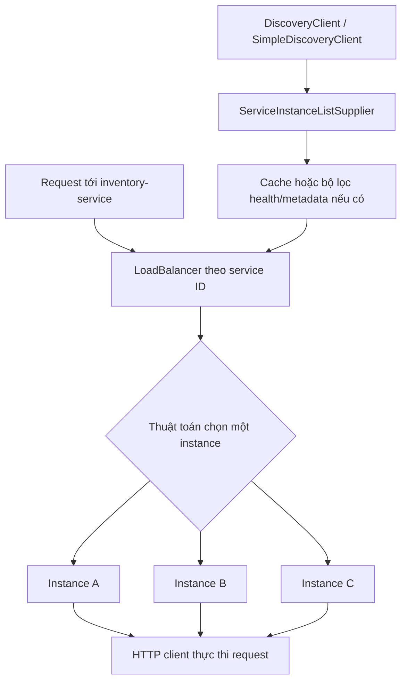
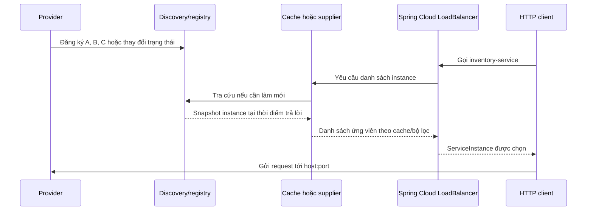

# Ảnh hưởng của số bản sao và danh sách thay đổi liên tục

Trong hệ thống microservices, số bản sao (**instance**) của cùng một dịch vụ không cố định. Nền tảng triển khai có thể thêm instance khi tải tăng, loại instance khi thu hẹp tài nguyên, thay thế instance lỗi hoặc thay đổi endpoint trong lúc rolling update. Spring Cloud LoadBalancer chọn một `ServiceInstance` tại phía client cho mỗi lần lựa chọn, dựa trên **danh sách instance mà client nhìn thấy ở thời điểm đó**. Vì vậy, khi số lượng, thứ tự hoặc trạng thái của danh sách thay đổi, kết quả chọn đích cũng có thể thay đổi ngay cả khi mã gọi HTTP không đổi.

Bài học này tập trung vào mối liên hệ giữa danh sách instance, thuật toán như Round Robin hoặc Random, cơ chế discovery/cache/health check và kết quả phân phối request thực tế. Mục tiêu là biết dự đoán hiện tượng khi scale out, scale in và xử lý lỗi khi danh sách chưa kịp cập nhật, đồng thời hiểu những giới hạn của thuật toán chọn đích trong Spring Cloud LoadBalancer.

## 1. Danh sách instance được nhìn thấy từ phía client

Giả sử ứng dụng `order-service` gọi `inventory-service` qua URL logic:

```text
http://inventory-service/api/v1/items/42
```

Ở phía client, một `ServiceInstanceListSupplier` cung cấp danh sách instance cho service ID `inventory-service`:

| Service ID | Instance | Host:port | Trạng thái ví dụ |
|---|---|---|---|
| `inventory-service` | A | `10.0.1.11:8080` | Đang nhận request |
| `inventory-service` | B | `10.0.1.12:8080` | Đang nhận request |
| `inventory-service` | C | `10.0.1.13:8080` | Có thể được thêm khi scale out |

Đây là các đối tượng đại diện cho **một dịch vụ logic**. LoadBalancer không gửi request đồng thời tới toàn bộ danh sách; thông thường nó chọn **một** instance cho một lần thử request, rồi HTTP transport kết nối tới host và port tương ứng.



Thứ tự xử lý trong chuỗi supplier phụ thuộc cấu hình; sơ đồ chỉ thể hiện trách nhiệm. Trong Spring Cloud LoadBalancer, `RoundRobinLoadBalancer` và `RandomLoadBalancer` là những lựa chọn phổ biến. Chúng thường nhận **danh sách đang có** từ supplier rồi lựa chọn vị trí trong danh sách. Danh sách có thể khác nhau giữa các thời điểm và giữa các bản sao client.

### Số bản sao thực tế và số bản sao client nhìn thấy

Đặt:

- `N_actual(t)`: số instance thực sự đang chạy và đủ khả năng nhận request tại thời điểm `t`.
- `N_visible(t)`: số instance trong danh sách mà một client nhận được sau discovery, cache và các bộ lọc tại thời điểm `t`.

Hai giá trị **không nhất thiết bằng nhau**. Khi provider vừa được thêm hoặc bị dừng, thông tin mới cần thời gian lan truyền qua registry, watcher, cache hoặc health check. Một client có thể vẫn thấy danh sách cũ trong khi client khác đã có danh sách mới.

| Thời điểm | Instance thực tế hoạt động | Client 1 nhìn thấy | Client 2 nhìn thấy |
|---|---|---|---|
| `t0` | A, B | A, B | A, B |
| `t1`: vừa thêm C | A, B, C | A, B | A, B, C |
| `t2`: thông tin đã cập nhật | A, B, C | A, B, C | A, B, C |
| `t3`: vừa dừng B | A, C | A, B, C | A, C |

Ví dụ chỉ minh họa độ trễ lan truyền, không quy định thời gian cụ thể. Khả năng nhanh/chậm phụ thuộc discovery provider, cache, health probe, kết nối mạng và cấu hình triển khai.

## 2. Round Robin khi số instance cố định

**Round Robin** (lần lượt theo vòng) chọn vị trí tiếp theo trong danh sách rồi quay về đầu danh sách sau phần tử cuối. Với danh sách có `n > 0` instance, có thể hình dung vị trí được chọn là:

\[
i = p \bmod n
\]

Trong đó `p` là bộ đếm lựa chọn đang tăng và `i` là chỉ số trong danh sách, tính từ 0. Đây là **mô hình minh họa hành vi**. Triển khai thực tế có thể dùng bộ đếm nguyên tử và khởi tạo vị trí ban đầu khác nhau để tránh nhiều client đồng pha; không nên dựa vào request đầu tiên luôn chọn phần tử đầu danh sách.

Ví dụ trong một khoảng thời gian danh sách giữ nguyên thứ tự `[A, B, C]`:

| Giá trị `p` minh họa | `p % 3` | Instance được chọn |
|---:|---:|---|
| 0 | 0 | A |
| 1 | 1 | B |
| 2 | 2 | C |
| 3 | 0 | A |
| 4 | 1 | B |
| 5 | 2 | C |

Nếu không có bộ lọc, retry, thay đổi danh sách hoặc cấu hình khác, nhiều lần **chọn liên tiếp trên cùng một đối tượng load balancer** sẽ có xu hướng trải đều các instance trong danh sách. Điều đó chưa đồng nghĩa số request thành công, số kết nối, CPU hay thời gian xử lý của các instance hoàn toàn bằng nhau.

Vì sao?

- Các request có chi phí khác nhau; một request tra cứu đơn giản không tương đương một request cần truy vấn cơ sở dữ liệu nặng.
- Request có thể lỗi hoặc bị retry, khiến số lần chọn khác số request nghiệp vụ hoàn thành.
- Một ứng dụng có nhiều bản sao client; mỗi bản sao có bộ đếm và danh sách riêng. Không có bộ đếm Round Robin toàn cục giữa các client.
- Các bộ lọc health, zone, sticky session hoặc metadata có thể làm danh sách ứng viên khác nhau giữa các lần chọn.
- Một số client tái sử dụng kết nối mạng, nên phân bố **kết nối TCP** không phải là phân bố **lượt chọn instance**.

## 3. Scale out: từ hai lên ba instance

Ban đầu client có danh sách:

```text
[A, B]
```

Sau khi nền tảng triển khai thêm instance C và discovery/supplier cập nhật thành công:

```text
[A, B, C]
```

Nếu giả sử request được chọn theo thứ tự của một bộ đếm liên tục và giữ nguyên thứ tự các instance hiện có:

| Lần chọn | Danh sách mà client nhìn thấy | `p` | Chỉ số tính theo danh sách | Instance |
|---|---|---:|---:|---|
| Trước scale out | [A, B] | 0 | 0 | A |
| Trước scale out | [A, B] | 1 | 1 | B |
| Sau scale out | [A, B, C] | 2 | 2 | C |
| Sau scale out | [A, B, C] | 3 | 0 | A |
| Sau scale out | [A, B, C] | 4 | 1 | B |
| Sau scale out | [A, B, C] | 5 | 2 | C |

Thuật toán có thể đưa C vào vòng chọn ngay khi supplier bắt đầu trả về danh sách chứa C. Thông thường **không cần khởi động lại client** nếu discovery và supplier đang được cấu hình để nhận thông tin cập nhật; với danh sách tĩnh đọc từ cấu hình thông thường, thêm C cần cập nhật cấu hình và cơ chế nạp lại tương ứng.

### Tải có giảm theo số instance?

Nếu tổng tốc độ request đến dịch vụ là `λ` request/giây, các instance có năng lực tương đương và việc chọn gần đồng đều, tải trung bình theo số request trên mỗi instance xấp xỉ:

\[
\text{request/giây/instance} \approx \frac{\lambda}{n}
\]

Ví dụ với `λ = 120` request/giây: hai instance có thể nhận khoảng 60 request/giây mỗi instance, còn ba instance có thể nhận khoảng 40 request/giây. Đây là **ước lượng theo số lượt chọn trong điều kiện lý tưởng**, không phải bảo đảm hiệu năng. Khi scale out, client còn cần biết C; C cũng cần hoàn tất startup, nhận kết nối, làm nóng cache hoặc connection pool trước khi chịu tải bình thường.

Ngoài ra, nếu tỷ lệ client nhìn thấy C tăng dần theo thời gian, C ban đầu có thể nhận ít request hơn hai instance cũ. Không nên kỳ vọng phân phối chuyển từ 50/50 sang 33/33/33 ngay tại thời điểm cấp phát tài nguyên.

## 4. Scale in: từ ba xuống hai instance

Giả sử B bị loại khỏi tập ứng viên, danh sách chuyển từ `[A, B, C]` sang `[A, C]`. Với Round Robin, bộ đếm có thể tiếp tục tăng, nhưng phép chia lấy dư bây giờ dùng `n = 2`. Chỉ số từng lần chọn sẽ được tính theo **danh sách mới**.

| Lần chọn | Danh sách đang có | `p` | Chỉ số | Instance |
|---|---|---:|---:|---|
| Trước scale in | [A, B, C] | 2 | 2 | C |
| Trước scale in | [A, B, C] | 3 | 0 | A |
| Sau scale in | [A, C] | 4 | 0 | A |
| Sau scale in | [A, C] | 5 | 1 | C |
| Sau scale in | [A, C] | 6 | 0 | A |

Như vậy, vòng chọn không nhất thiết “tiếp tục” theo một thứ tự tên instance cố định. Khi số phần tử đổi, cùng một giá trị bộ đếm sẽ được ánh xạ qua phép modulo khác; hai lần chọn liên tiếp hoàn toàn có thể rơi vào cùng instance. Điều đó **không phải bằng chứng Round Robin bị hỏng**.

### Thứ tự danh sách thay đổi cũng ảnh hưởng

Không chỉ số lượng, **thứ tự** phần tử cũng quan trọng với cách chọn theo chỉ số. Hai danh sách sau chứa cùng tập instance nhưng khác thứ tự:

```text
[A, B, C]
[C, A, B]
```

Nếu vị trí chọn là chỉ số 0 thì danh sách đầu chọn A, danh sách sau chọn C. Discovery provider hoặc chuỗi supplier có thể tạo lại danh sách với thứ tự khác khi instance được đăng ký, hủy đăng ký hoặc lọc. Không nên giả định thứ tự cố định nếu hệ thống không cung cấp cam kết đó.

Trong hệ thống thực, một số request có thể **đã chọn B trước khi B bị loại**. Sau đó B mới dừng hoặc ngừng nhận request. Những request đang kết nối vẫn có thể thành công, bị từ chối hoặc timeout tùy cách hạ tầng thực hiện graceful shutdown. Loại B khỏi danh sách mới chỉ ngăn các lượt chọn sau, không tự hủy mọi request đang chạy.

## 5. RandomLoadBalancer khi danh sách thay đổi

**Random** chọn ngẫu nhiên một vị trí trong danh sách hiện tại. Với `n` instance được xét như nhau, một lượt chọn có xác suất lý thuyết gần `1/n` cho từng instance (giả sử thuật toán chọn đều và không có trọng số).

| Danh sách ứng viên | Xác suất chọn một instance trong một lượt |
|---|---|
| [A] | 100% chọn A |
| [A, B] | Khoảng 50% cho mỗi instance |
| [A, B, C] | Khoảng 33,3% cho mỗi instance |
| [A, C] sau khi loại B | Khoảng 50% cho A và C |

Khi danh sách thay đổi, xác suất theo từng lượt cũng thay đổi. Không cần bảo toàn bộ đếm như Round Robin, nhưng Random có thể chọn liên tiếp cùng instance nhiều lần. Ví dụ, với hai instance và lựa chọn ngẫu nhiên độc lập, chuỗi `A, A, A, B` hoàn toàn có thể xuất hiện.

| Tiêu chí | Round Robin | Random |
|---|---|---|
| Cách chọn | Dựa trên vị trí bộ đếm modulo độ dài danh sách | Chọn một chỉ số ngẫu nhiên trong danh sách |
| Danh sách cố định | Các lựa chọn tuần tự thường luân phiên | Phân phối gần đều khi có đủ nhiều lượt |
| Khi `n` thay đổi | Ánh xạ bộ đếm sang chỉ số mới; có thể lặp hoặc bỏ qua tên instance theo kỳ vọng | Xác suất của mỗi instance thay đổi ngay khi nhìn thấy danh sách mới |
| Phụ thuộc thứ tự danh sách | Có, vì chọn theo chỉ số | Với xác suất đồng đều, ít nhạy hơn về thứ tự |
| Bảo đảm số request thực tế bằng nhau | Không | Không |

Cả hai thuật toán đều chọn từ **tập ứng viên hiện tại**. Nếu supplier trả về danh sách rỗng, không thuật toán nào có instance để chọn. Tùy HTTP client và tích hợp LoadBalancer, tình huống này có thể thành lỗi lựa chọn, exception hoặc HTTP 503; không nên phụ thuộc vào một thông điệp lỗi duy nhất.

## 6. Discovery, cache và health check quyết định danh sách nào được chọn

Luồng thường gặp trong Spring Cloud LoadBalancer là:



Tùy cách cấu hình, discovery được cập nhật bằng polling, watch hoặc cơ chế riêng của nền tảng. Supplier có thể cache danh sách, và nhiều cấp cache có thể tồn tại (discovery client, Spring Cloud LoadBalancer hoặc hạ tầng). Vì vậy không có một “thời điểm cập nhật toàn hệ thống” duy nhất.

### Cache giữ danh sách cũ trong một khoảng thời gian

Nếu supplier cache `[A, B]` thì dù C đã được đăng ký ở discovery, LoadBalancer vẫn có thể chọn chỉ từ A và B cho tới khi cache được làm mới. Tương tự, nếu B đã dừng nhưng danh sách cache vẫn là `[A, B, C]`, một số lượt chọn có thể tiếp tục hướng tới B.

Các thuộc tính như `spring.cloud.loadbalancer.cache.enabled` giúp kiểm soát bộ cache của LoadBalancer tùy phiên bản/configuration. Không nên vô hiệu hóa cache một cách máy móc để “cập nhật tức thì”: discovery provider cũng có thể cache, và truy vấn quá dày có thể tăng tải registry. Cần hiểu cơ chế cập nhật thực tế, tần suất thay đổi và nhu cầu ổn định của hệ thống.

### Bộ lọc health làm thay đổi tập ứng viên

`HealthCheckServiceInstanceListSupplier` hoặc bộ lọc trạng thái của discovery có thể loại các instance không vượt qua kiểm tra health. Khi B vẫn còn đăng ký nhưng không khỏe mạnh, danh sách đưa vào thuật toán chọn có thể là `[A, C]` thay vì `[A, B, C]`.

Điều đó có nghĩa số lượng **instance được chọn** có thể giảm ngay cả khi hệ thống chưa scale in. Health check cũng cần khoảng thời gian phát hiện và cập nhật; không nên cho rằng mọi request sau khi instance lỗi đều lập tức tránh được nó.

Một số chuỗi supplier có cache, zone filtering, metadata filtering, sticky-session hoặc request-based filtering. Thứ tự và cách kết hợp các supplier phải được thiết kế phù hợp, vì danh sách cuối cùng mới là dữ liệu thuật toán thực sự sử dụng.

## 7. Hệ quả với retry, timeout và kết nối đang mở

Trong giao tiếp giữa dịch vụ, lựa chọn một instance thành công **không đồng nghĩa** HTTP request sẽ thành công. Có ba thời điểm cần phân biệt:

1. **Trước chọn đích:** discovery hoặc supplier trả về danh sách rỗng, cũ hay thiếu instance.
2. **Sau khi đã chọn, trước khi nhận response:** instance bị dừng, cổng ngừng lắng nghe hoặc mạng mất kết nối.
3. **Sau khi server đã xử lý request:** response có thể bị mất, dẫn đến timeout phía client dù server đã xử lý nghiệp vụ.

Khi instance thay đổi liên tục, lỗi có thể tăng tạm thời. Cần phối hợp:

- **Readiness và graceful shutdown:** instance chỉ được quảng bá khi sẵn sàng, bị rút khỏi tuyến trước khi ngừng nhận request và có thời gian xử lý các request đang chạy.
- **Health check:** giảm xác suất chọn instance thực sự không khỏe mạnh; health chỉ là tín hiệu ở một thời điểm.
- **Connect/read timeout:** tránh giữ thread hoặc tài nguyên chờ quá lâu khi instance đã ngừng phục vụ.
- **Retry có giới hạn:** với thao tác an toàn hoặc có cơ chế idempotency, retry có thể thử lại sau lỗi kết nối/timeout; cần kiểm tra client có chọn lại instance hay không.
- **Quan sát theo service ID và instance:** log/trace instance được chọn, loại lỗi, thời gian, retry count để xác định nơi có vấn đề.

Đối với request tạo đơn hàng, thanh toán hoặc ghi dữ liệu, không nên retry vô điều kiện. Nếu server đã ghi dữ liệu nhưng response mất, lần thử lại có thể ghi trùng. Dùng idempotency key hoặc cơ chế kiểm soát lặp phù hợp trước khi áp dụng retry.

HTTP keep-alive và connection pool cũng có thể khiến các kết nối tới instance cũ tồn tại sau khi danh sách thay đổi. Load balancing thường quyết định endpoint cho **lượt thử request**; pool chỉ tái sử dụng kết nối phù hợp nếu còn dùng được. Khi phân tích, phải tách số lần chọn instance, số request hoàn thành và số socket đang mở.

## 8. Ví dụ thực hành: thay đổi danh sách instance khi ứng dụng đang chạy

Mục tiêu của bài lab là quan sát số lượng và thứ tự danh sách tác động thế nào đến Round Robin/Random, với **service ID** cố định `inventory-service`.

### 8.1. Tạo nguồn instance cho môi trường học

Ứng dụng client dùng `spring-cloud-starter-loadbalancer` cùng Spring Cloud BOM tương thích với Spring Boot; dùng `spring-boot-starter-web` nếu xây ví dụ `RestClient`. Có thể khai báo instance tĩnh bằng `SimpleDiscoveryClient` để bắt đầu:

```yaml
spring:
  cloud:
    discovery:
      client:
        simple:
          instances:
            inventory-service:
              - uri: http://localhost:8091
              - uri: http://localhost:8092
```

Chạy hai bản sao provider ở port `8091`, `8092`. Mỗi provider trả về thêm `instanceId` hoặc `serverPort` trong response để dễ xác định request tới đâu. Trước khi đo qua LoadBalancer, dùng `curl` gọi trực tiếp từng URI để chắc chắn provider đã chạy.

`SimpleDiscoveryClient` hữu ích cho thí nghiệm danh sách cố định; thay đổi file YAML thường **không đồng nghĩa** danh sách sẽ cập nhật động ngay trong tiến trình đang chạy. Với lab cần quan sát scale out/scale in **không khởi động lại client**, hãy sử dụng discovery provider hoặc supplier có cơ chế làm mới danh sách rõ ràng, hoặc thử nghiệm bằng một `ServiceInstanceListSupplier` kiểm soát được dữ liệu đầu vào.

### 8.2. Tích hợp RestClient với LoadBalancer

Ví dụ ở phiên bản Spring Cloud hỗ trợ `RestClient`:

```java
import org.springframework.cloud.client.loadbalancer.LoadBalanced;
import org.springframework.context.annotation.Bean;
import org.springframework.context.annotation.Configuration;
import org.springframework.web.client.RestClient;

@Configuration
class ClientConfig {
    @Bean
    @LoadBalanced
    RestClient.Builder loadBalancedRestClientBuilder() {
        return RestClient.builder();
    }
}
```

Gateway gọi URL chứa service ID:

```java
import org.springframework.stereotype.Service;
import org.springframework.web.client.RestClient;

@Service
class InventoryGateway {
    private final RestClient client;

    InventoryGateway(RestClient.Builder loadBalancedRestClientBuilder) {
        this.client = loadBalancedRestClientBuilder
                .baseUrl("http://inventory-service")
                .build();
    }

    String getItem(String id) {
        return client.get()
                .uri("/api/v1/items/{id}", id)
                .retrieve()
                .body(String.class);
    }
}
```

Nếu ứng dụng có nhiều bean `RestClient.Builder`, nên dùng `@Qualifier("loadBalancedRestClientBuilder")` tại constructor để chọn đúng builder. Không dùng `new RestClient` hoặc một builder thường rồi giả định URL `http://inventory-service` tự đi qua Spring Cloud LoadBalancer.

### 8.3. Kịch bản quan sát

Thực hiện lần lượt:

1. **Hai instance:** để danh sách là `[A, B]`, gửi 20–50 request tuần tự. Ghi lại `instanceId` của response và số lần chọn.
2. **Thêm C:** khởi động provider C, đưa C vào discovery/supplier động. Xác nhận danh sách trả về `[A, B, C]` trước khi đánh giá phân bố.
3. **Bỏ B:** đánh dấu B không ready hoặc loại B khỏi discovery. Đợi client nhìn thấy `[A, C]` rồi gửi request mới; ghi lại các request in-flight nếu có.
4. **Đổi thứ tự:** trong môi trường supplier kiểm soát được, trả `[C, A]` thay cho `[A, C]` mà không đổi tập instance, xem sự thay đổi chuỗi Round Robin.
5. **Danh sách rỗng:** đưa supplier về `[]` và ghi nhận lỗi “không có instance” từ HTTP client.
6. **So sánh Random:** nếu đã cấu hình thuật toán Random, lặp lại với số request lớn hơn và xem phân bố gần đều về thống kê, không ép từng request phải luân phiên.

Ví dụ ghi lại log kết quả:

```text
service=inventory-service selected=inventory-8091 status=200
service=inventory-service selected=inventory-8092 status=200
service=inventory-service selected=inventory-8093 status=200
service=inventory-service selected=inventory-8091 status=200
```

Log trên chỉ là **kết quả minh họa**, không phải output cố định. Vị trí ban đầu, request từ các caller khác và thứ tự supplier có thể khiến chuỗi khác nhau.

### 8.4. Kiểm chứng bằng snapshot thay vì suy luận từ một vài request

Nên ghi lại đồng thời:

| Chỉ số | Vì sao cần |
|---|---|
| Service ID và thời gian request | Liên hệ đúng dịch vụ và thời điểm scale |
| Danh sách instance mà supplier trả về | Biết thuật toán chọn trên tập nào |
| Instance được chọn, host và port | Xác định quyết định load balancing |
| Số request bắt đầu và hoàn thành | Phân biệt lượt chọn với request thành công |
| HTTP status, exception, timeout | Phát hiện instance cũ/không khỏe |
| Retry count và instance ở từng lần thử | Tránh đếm retry thành request nghiệp vụ mới |
| Trạng thái readiness/health | Liên hệ lỗi với giai đoạn vận hành instance |

Nếu công cụ chỉ đo response thành công, instance bị lỗi có thể “biến mất” khỏi bảng phân bố dù vẫn được chọn và đang làm request thất bại. Cần đếm cả **lượt chọn** và **lỗi** để tránh đánh giá sai thuật toán.

## 9. Những sai lầm thường gặp khi đánh giá phân phối tải

| Nhận định dễ mắc | Vì sao chưa chính xác |
|---|---|
| “Có ba instance thì request nào cũng luân phiên A, B, C” | Chỉ gần đúng với Round Robin, một client, danh sách ổn định và các lượt chọn tuần tự |
| “Scale out xong là các client thấy C ngay” | Discovery/cache có thời gian lan truyền; nhiều client có thể dùng các snapshot khác nhau |
| “Scale in B thì không request nào còn tới B” | Request đã chọn trước đó hoặc cache cũ vẫn có thể dẫn đến B |
| “Thứ tự danh sách không quan trọng” | Round Robin chọn theo chỉ số nên thay thứ tự có thể đổi chuỗi chọn |
| “Random chọn lặp A ba lần là lỗi” | Random có thể chọn cùng instance liên tiếp; cần mẫu đủ lớn để đánh giá |
| “Số request bằng nhau nghĩa là tải bằng nhau” | CPU, latency và chi phí xử lý của từng request có thể khác nhau |
| “Đã bật health check thì không bao giờ chọn instance lỗi” | Health có độ trễ; instance có thể hỏng sau khi được chọn |
| “Retry sẽ luôn chọn instance khác” | Còn tùy chính sách retry của HTTP client và LoadBalancer được cấu hình |

## 10. Nguyên tắc thiết kế khi số bản sao thay đổi liên tục

1. **Xác định nguồn instance và độ trễ cập nhật:** biết discovery/supplier/cache nào tạo ra danh sách mà thuật toán nhìn thấy.
2. **Dùng service ID ổn định:** client gọi tên logic; để discovery và LoadBalancer quản lý các địa chỉ động.
3. **Hiểu khác biệt giữa số lượng và thứ tự:** Round Robin tính chỉ số theo độ dài và thứ tự danh sách tại lượt chọn hiện tại.
4. **Đo phân phối sau khi hệ thống ổn định:** đo cả giai đoạn chuyển tiếp để nhận ra stale cache, health delay và lỗi kết nối.
5. **Phối hợp readiness, drain và graceful shutdown:** giúp instance được loại khỏi tuyến trước khi dừng hẳn.
6. **Giới hạn retry và timeout:** kiểm soát chi phí lặp request, đặc biệt với thao tác không idempotent.
7. **Ghi nhận quyết định load balancing:** theo dõi service ID, danh sách ứng viên, instance được chọn, status và exception để tìm nguyên nhân.
8. **Đừng coi Round Robin/Random là tối ưu tải tự động:** nếu năng lực instance không đồng đều hoặc request chênh lệch lớn, cần cân nhắc bộ lọc, trọng số hoặc thuật toán chuyên biệt.

Số instance thay đổi là tình huống bình thường của hệ thống nhiều dịch vụ. Spring Cloud LoadBalancer có thể tiếp tục lựa chọn `ServiceInstance` trên danh sách mới mà ứng dụng không cần đổi URL logic. Điều quyết định chất lượng vận hành là **danh sách client nhìn thấy có đúng và kịp thời hay không**, cách thuật toán xử lý độ dài/thứ tự danh sách thay đổi, và việc phối hợp discovery, health check, timeout, retry cùng quan sát request trong suốt giai đoạn scale.
