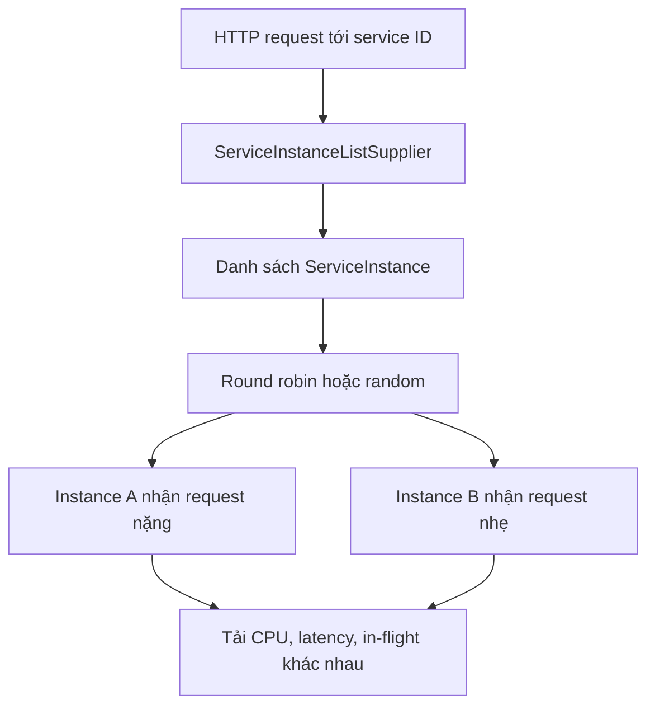
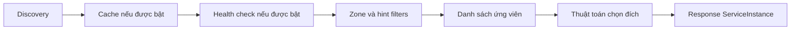

# Vì sao chia đều số yêu cầu chưa chắc chia đều tải

Khi cân bằng tải cho một microservice, ta thường mong hai instance nhận số HTTP request gần bằng nhau. Nhưng **chia đều số request chỉ cân bằng số lượt phân phối**, chưa chắc cân bằng lượng CPU, bộ nhớ, I/O, số request đang xử lý hoặc thời gian chờ. Một request tra cứu đã cache có thể hoàn tất trong vài mili giây; một request xuất báo cáo có thể chạy truy vấn phức tạp và giữ kết nối rất lâu. Cả hai vẫn được đếm là **một request**.

Trong Spring Cloud LoadBalancer, `RoundRobinLoadBalancer` chọn luân phiên các `ServiceInstance` từ danh sách mà `ServiceInstanceListSupplier` cung cấp. Thuật toán này không mặc nhiên đo CPU, số request đang chạy hoặc latency của từng instance trước mỗi lượt chọn. Do đó, **cùng số lượt chọn không đồng nghĩa cùng khối lượng công việc**.

Bài học thuộc phần **Thuật toán chọn đích** của Spring Cloud LoadBalancer. Mục tiêu là hiểu giới hạn của việc phân phối đồng đều theo số lượng, biết đọc tín hiệu tải thực tế và lựa chọn cách kết hợp discovery, health check, chính sách định tuyến, retry/timeout và quan sát vận hành.

## 1. Cân bằng lượt chọn khác với cân bằng tải

Ba đại lượng thường bị nhầm lẫn:

| Đại lượng | Ý nghĩa | Vì sao có thể khác nhau? |
|---|---|---|
| **Số lượt chọn/request** | Số lần LoadBalancer chọn một instance làm đích hoặc số HTTP attempt đến instance. | Thuật toán chủ yếu kiểm soát số lượt, không biết chi phí của request. |
| **Số request in-flight** | Số request đã bắt đầu nhưng chưa hoàn tất tại một thời điểm. | Request chậm làm số đang chờ hoặc xử lý tăng lên. |
| **Tải tài nguyên** | CPU, memory, GC, DB pool, connection pool, network I/O, hàng đợi. | Loại request, dữ liệu và năng lực của từng instance khác nhau. |

Cần phân biệt tiếp **logical request** (một ý định nghiệp vụ) với **HTTP attempt** (một lần gửi request trên mạng). Khi retry được bật, một logical request có thể tạo nhiều attempt. Số lượt chọn của LoadBalancer còn tùy vị trí retry trong pipeline; không nên tự động xem ba số đếm này là như nhau.

## 2. Ví dụ định lượng: 100 request ở mỗi instance, CPU vẫn rất lệch

Giả sử `order-service` gọi `inventory-service` thông qua Spring Cloud LoadBalancer. Hai instance A và B đều có một CPU core tương đương, cùng được chọn 100 lần trong khoảng 10 giây.

Ta chia request thành hai loại theo chi phí CPU:

- **Nhẹ:** tra cứu dữ liệu đã cache, trung bình `10 ms` CPU/request.
- **Nặng:** cần tính toán hoặc truy vấn bổ sung, trung bình `200 ms` CPU/request.

Giả sử phân phối thực tế như sau:

| Trong 10 giây | Instance A | Instance B |
|---|---:|---:|
| Tổng request | 100 | 100 |
| Request nhẹ | 70 | 95 |
| Request nặng | 30 | 5 |
| CPU cho request nhẹ | 70 × 10 ms = 0,70 s | 95 × 10 ms = 0,95 s |
| CPU cho request nặng | 30 × 200 ms = 6,00 s | 5 × 200 ms = 1,00 s |
| **Tổng CPU cần dùng** | **6,70 CPU-giây** | **1,95 CPU-giây** |
| **Sử dụng một CPU core, xấp xỉ** | **67%** | **19,5%** |

Phép tính minh họa:

```text
CPU A = 70 × 0,010 + 30 × 0,200 = 6,70 CPU-giây
CPU B = 95 × 0,010 +  5 × 0,200 = 1,95 CPU-giây

CPU A ≈ 6,70 / (10 giây × 1 core) = 67%
CPU B ≈ 1,95 / (10 giây × 1 core) = 19,5%
```

Đây là ví dụ có giả định, bỏ qua overhead và tranh chấp tài nguyên khác. Nó chỉ ra rằng **A tiêu thụ hơn ba lần CPU của B dù số request bằng nhau**. Round robin không thể tự phát hiện sự chênh lệch nếu không có tín hiệu về chi phí xử lý.

Vì sao cùng số lượt chọn vẫn tạo hỗn hợp request khác nhau? Thuật toán không phân loại trước request nhẹ và nặng. Nếu request đến theo chu kỳ và loại nặng thường trùng với lượt chọn A, A có thể nhận phần lớn request nặng trong khi B chủ yếu nhận request nhẹ. Trong hệ thống thực tế, chênh lệch còn do tenant, kích thước dữ liệu, cache hit/miss, nhánh nghiệp vụ và trạng thái downstream.

## 3. Thời gian phản hồi khác nhau dẫn đến concurrency khác nhau

Ngay khi hai instance xử lý cùng số request mỗi giây, số request **chưa hoàn tất** có thể khác nhau rất lớn. Một cách ước lượng là định luật Little ở trạng thái ổn định:

```text
L ≈ λ × W

L = số request trung bình đang ở trong hệ thống
λ = throughput trung bình, đơn vị request/giây
W = thời gian request ở trong hệ thống, đơn vị giây
```

Giả sử hai instance đều hoàn tất trung bình 20 request/giây:

| Chỉ số | Instance A | Instance B |
|---|---:|---:|
| Throughput | 20 request/s | 20 request/s |
| Thời gian phản hồi trung bình | 50 ms | 400 ms |
| In-flight trung bình | 20 × 0,05 = **1** | 20 × 0,4 = **8** |

Vậy B phải giữ khoảng tám request đang xử lý hoặc chờ, trong khi A chỉ giữ một request. In-flight cao có thể do CPU, nhưng cũng có thể do đợi cơ sở dữ liệu, mạng hoặc connection pool. **Concurrency khác CPU utilization**: phải đọc cả hai để hiểu nút thắt.

Khi một replica chậm, hàng đợi tăng làm thời gian phản hồi kéo dài. Nếu vẫn chia đều request, replica chậm có thể tích lũy thêm công việc và tăng tỷ lệ timeout. Round robin không tự giảm tỷ lệ chọn replica này chỉ vì nó đang bận.

## 4. Những nguyên nhân làm tải lệch khi request đếm vẫn đều

### 4.1. Request khác độ nặng

Một request `GET /api/items/42` đọc một bản ghi và một request `POST /api/reports` tổng hợp dữ liệu dài đều được đếm một lần. Ngay cả hai request cùng endpoint cũng có thể khác chi phí do số lượng bản ghi, độ phức tạp của query, kích thước payload hoặc tenant.

### 4.2. Instance khác năng lực

Các replica có thể khác CPU quota, bộ nhớ, số worker, cấu hình JVM hoặc giới hạn connection pool. Giả sử mỗi instance cần 7 CPU-giây trong 10 giây:

| Năng lực | Công việc nhận | Sử dụng CPU lý thuyết |
|---|---:|---:|
| A có 1 CPU core | 7 CPU-giây | 70% |
| B có 2 CPU cores | 7 CPU-giây | 35% |

Với năng lực khác nhau, **cùng lượng công việc vẫn tạo tỷ lệ bão hòa khác nhau**. Nếu một instance gần giới hạn hơn, tỷ lệ chọn 50/50 có thể để dư năng lực ở instance còn lại.

### 4.3. Cache, JIT và trạng thái khởi động

Instance đã warm up có cache nóng và JIT tối ưu thường phản hồi tốt hơn replica mới khởi động. Cache miss, garbage collection hoặc cơ chế cấp phát bộ nhớ khác nhau cũng làm latency và mức dùng CPU lệch.

### 4.4. DB, network và downstream

Một request có thể dùng rất ít CPU nhưng chờ database, Redis, file system hoặc dịch vụ khác. Trong lúc chờ, nó vẫn chiếm slot, bộ nhớ hoặc kết nối tùy mô hình thực thi. Một instance có đường mạng hoặc downstream chậm sẽ tích lũy in-flight lớn hơn dù số request bằng nhau.

### 4.5. Tài nguyên chia sẻ và contention

Hai replica có thể chạy trên node khác nhau, cạnh tranh CPU với workload khác, hoặc cùng dùng một database có giới hạn kết nối. Tải nên được đánh giá theo **bottleneck hiện tại** chứ không riêng CPU.

### 4.6. Retry và timeout

Nếu A lỗi hoặc chậm, một logical request có thể tạo thêm attempt. Retry có thể gửi lại A hoặc chọn B tùy cấu hình retry và tích hợp client. Các attempt bổ sung tăng tải, có thể làm một sự cố trở nên nặng hơn. Với `POST`, timeout không chứng minh thao tác trước chưa thành công; retry thiếu idempotency có thể gây xử lý trùng.

## 5. Round robin và random thực sự đảm bảo điều gì?

Với danh sách `[A, B, C]` ổn định, round robin chọn luân phiên:

```text
Lượt chọn:  1  2  3  4  5  6  7  8  9
Instance:  A  B  C  A  B  C  A  B  C
```

`RoundRobinLoadBalancer` chủ yếu hướng đến phân phối lượt chọn gần đều, còn `RandomLoadBalancer` chọn ngẫu nhiên một phần tử trong danh sách ứng viên. Với random, số lượt trong mẫu nhỏ có thể lệch, dù trong mẫu lớn có xu hướng phân bố gần đều nếu xác suất chọn bằng nhau.

| Tiêu chí | Round robin | Random |
|---|---|---|
| Quyết định chọn | Luân phiên vị trí. | Chọn vị trí ngẫu nhiên. |
| Số lượt trên danh sách cố định | Gần đều trong những lượt liên tiếp. | Dao động ngẫu nhiên, nhất là mẫu ngắn. |
| Biết request nặng/nhẹ? | Không. | Không. |
| Tự đo CPU, latency, in-flight? | Không. | Không. |
| Tự loại instance unhealthy? | Phụ thuộc nguồn danh sách và bộ lọc. | Tương tự. |

Đổi round robin sang random **không tự động giải quyết mất cân bằng CPU hoặc latency**. Cả hai chỉ biết những instance mà supplier cung cấp.



Danh sách còn có thể đổi khi discovery cập nhật, cache hết hạn hoặc một bộ lọc health/zone/hint hoạt động. Trong khoảng thời gian ngắn, số lượt chọn không nhất thiết bằng nhau dù thuật toán đúng. Nhiều caller cũng có thể có trạng thái chọn riêng; không nên suy ra phân phối toàn hệ thống chỉ từ log của một caller.

## 6. Vai trò của discovery, supplier và health check

`ReactorLoadBalancer<ServiceInstance>` chọn từ danh sách do `ServiceInstanceListSupplier` cung cấp. Supplier có thể lấy dữ liệu từ discovery và được bọc bởi cache hoặc bộ lọc sức khỏe, zone, hint theo cấu hình.



Một health check trả `UP` chỉ phản ánh các điều kiện mà health endpoint kiểm tra. Nó **không mặc nhiên chứng minh**:

- CPU còn đủ headroom.
- Hàng đợi và connection pool chưa cạn.
- p95/p99 latency đang tốt.
- Downstream sẽ phản hồi nhanh.

Một số hệ thống chủ động phản ánh overload trong readiness/health, nhưng đó phải là thiết kế cụ thể. Bật `HealthCheckServiceInstanceListSupplier` không tự biến round robin thành thuật toán biết CPU. Cache và discovery còn có độ trễ cập nhật nên một instance đang chuyển trạng thái vẫn có thể được chọn trong một khoảng ngắn.

## 7. Giải pháp khi yêu cầu cần được phân bố theo tải thực tế

### 7.1. Đo đủ trước khi thay thuật toán

Nên xem số liệu **theo từng instance** đồng thời với metric phía caller:

| Metric | Câu hỏi giúp trả lời |
|---|---|
| Requests/attempts mỗi giây | Instance nhận bao nhiêu lần gọi? Retry có làm số attempt tăng không? |
| CPU utilization, CPU throttling | Instance nào đang đến ngưỡng CPU/quota? |
| Heap, GC pause và memory | Có pressure hoặc pause do bộ nhớ không? |
| In-flight requests, queue length | Có bao nhiêu việc đang chờ hoàn tất? |
| Latency p50, p95, p99 | Có long-tail request hay dấu hiệu bão hòa? |
| Thread/DB/HTTP connection pools | Có bị chặn vì thiếu connection hoặc worker không? |
| Errors, timeouts, retry count | Lỗi có tạo tải bổ sung và giảm throughput hữu ích không? |
| LoadBalancer selection result | Có chọn được instance hay lỗi trước transport? |

Không chỉ nhìn throughput: instance đã quá tải có thể **hoàn tất ít request hơn** vì nhiều request bị xếp hàng hoặc timeout. Nếu gắn instance ID/host vào nhãn metric, cần kiểm soát số lượng giá trị nhãn khi replica thay đổi thường xuyên.

### 7.2. Làm đồng nhất và tối ưu các replica

Kiểm tra resource limit, số worker, JVM, warm-up cache, network và kết nối downstream giữa các replica. Nếu request nặng vì truy vấn DB, hãy tối ưu query, thêm cache, phân trang hoặc tách tác vụ dài sang xử lý bất đồng bộ. Thay thuật toán không làm chi phí xử lý của request tự giảm.

### 7.3. Phân phối theo trọng số

Nếu instance khác năng lực **một cách tương đối ổn định**, có thể dùng chính sách weighted selection. Spring Cloud LoadBalancer có thành phần `WeightedServiceInstanceListSupplier` trong các phiên bản hỗ trợ; cần bật và cấu hình đúng cơ chế trọng số của phiên bản đang dùng.

Ví dụ về chính sách: A có sức chứa 100 request nhẹ/giây, B có sức chứa 200 request nhẹ/giây, có thể thử tỷ lệ chọn mục tiêu A:B khoảng 1:2 và **đo lại** latency, errors và saturation. Tỷ lệ này chỉ là ước tính theo một loại workload; không đảm bảo tối ưu khi request khác chi phí.

Không nên mặc định chỉ thêm metadata `weight` vào instance là thuật toán round robin sẽ tự sử dụng nó. Cần đúng supplier hoặc chiến lược có hiểu trọng số.

### 7.4. Định tuyến theo loại công việc

Nếu biết request nặng trước khi gửi, có thể tách nhóm instance hoặc service cho báo cáo, batch, tìm kiếm nặng, trong khi truy vấn nhanh dùng nhóm riêng. Zone, hint và metadata có thể giúp giới hạn tập ứng viên; sau đó round robin hoặc random mới chọn trong tập còn lại.

Khác biệt cốt lõi: **supplier lọc ai có thể nhận**, còn **thuật toán quyết định chọn ai trong số đó**. Đừng dùng sticky routing hoặc ghim tenant vào một replica nếu chưa có kế hoạch xử lý mất cân bằng và replica lỗi.

### 7.5. Điều khiển theo tải và bảo vệ concurrency

Nếu muốn tránh instance đang bận, cần dữ liệu về in-flight, latency hoặc saturation cùng chính sách quyết định phù hợp. Không được giả định Spring Cloud LoadBalancer tự cung cấp least-connections hoặc chọn theo CPU chỉ vì đã bật round robin. Một giải pháp load-aware cần cân nhắc độ trễ metric, nhiều caller cùng chọn, dao động chọn đích và độ tin cậy của tín hiệu tải.

Các biện pháp bổ sung gồm giới hạn concurrency, rate limiting, bulkhead, bounded queue và autoscaling theo metric hợp lý. Đây là các biện pháp bảo vệ và tăng năng lực; chúng không thay thế việc hiểu chi phí thực sự của request.

## 8. Liên hệ với RestClient, WebClient và OpenFeign

Cùng một chiến lược LoadBalancer có thể được sử dụng khi tích hợp `RestClient`, `WebClient` hoặc OpenFeign với service ID. HTTP transport thực hiện kết nối và nhận response; các chính sách như connect/read timeout, TLS, connection pool nằm ở HTTP client hoặc transport tương ứng.

Ví dụ gọi bằng service ID với `WebClient`:

```java
@Configuration
class HttpClientConfig {
    @Bean
    @LoadBalanced
    WebClient.Builder loadBalancedWebClientBuilder() {
        return WebClient.builder();
    }
}

@Service
class InventoryGateway {
    private final WebClient client;

    InventoryGateway(@LoadBalanced WebClient.Builder builder) {
        this.client = builder.baseUrl("http://inventory-service").build();
    }

    Mono<Inventory> findInventory(String itemId) {
        return client.get()
            .uri("/api/items/{id}", itemId)
            .retrieve()
            .bodyToMono(Inventory.class);
    }
}
```

Ví dụ này chỉ thể hiện cách gọi service ID khi đã có integration và dependency Spring Cloud LoadBalancer/WebClient phù hợp; `Inventory` là DTO của ứng dụng, import được lược bỏ. **Gọi qua `@LoadBalanced` không tự phân phối theo CPU.**

Cần tách ba lớp cấu hình:

1. **LoadBalancer:** discovery, cache, health, zone/hint, lựa chọn instance và trọng số khi được hỗ trợ.
2. **HTTP client/transport:** connect timeout, read/response timeout, pooling, proxy, TLS.
3. **Resilience/nghiệp vụ:** tổng deadline, retry, backoff, circuit breaker, concurrency và idempotency.

Nếu một instance đã chậm nhưng vẫn health `UP`, giảm connect timeout hoặc chuyển sang random không chắc giải quyết được. Nếu `POST` timeout, server có thể đã thực hiện thao tác; retry thiếu idempotency có thể làm tăng tải và nhân đôi kết quả nghiệp vụ. Với retry ở nhiều tầng, tổng số attempt có thể tăng mạnh, vì vậy phải điều phối rõ số lần và thời gian thử lại.

## 9. Thí nghiệm quan sát độ lệch tải

Chuẩn bị hai instance `inventory-service` trong môi trường thử nghiệm, cùng một service ID nhưng trả instance ID riêng. Tạo hai endpoint giả lập có giới hạn tài nguyên:

- `GET /api/work?type=light`: thao tác nhẹ.
- `GET /api/work?type=heavy`: thao tác nặng hơn một cách có kiểm soát.

Thực hiện theo thứ tự:

1. **Baseline:** giữ hai replica cùng cấu hình, gửi nhiều request `light` qua client có LoadBalancer. Theo dõi instance ID, số request, CPU, in-flight và latency để xác nhận phân phối cơ bản.
2. **Khác chi phí:** giữ thuật toán round robin và tổng số request, tạo hỗn hợp `light`/`heavy` khiến phân bố chi phí khác nhau giữa các lượt chọn. Đếm request theo instance và so sánh CPU-giây, p95/p99 latency.
3. **Khác sức chứa:** giảm tài nguyên của một replica hoặc tăng năng lực của replica còn lại; quan sát replica ít tài nguyên tiến gần bão hòa hơn dù số request bằng nhau.
4. **Đổi chính sách:** nếu môi trường hỗ trợ weighted selection, thử trọng số dựa trên năng lực đã đo và so sánh chất lượng dịch vụ với baseline.
5. **Lỗi có kiểm soát:** mô phỏng một instance chậm hoặc không thể kết nối; phân biệt lỗi chọn instance, lỗi transport và HTTP `5xx`; kiểm tra số logical requests và HTTP attempts khi retry.

Dùng endpoint idempotent khi mô phỏng retry; giới hạn tốc độ và thời gian thử nghiệm để không làm nghẽn hệ thống dùng chung. Khi đánh giá, không dừng ở biểu đồ 50/50 request. Hãy xem instance nào đạt ngưỡng saturation trước, deadline có được đáp ứng không, và lỗi/timeout có được cải thiện không.

## 10. Checklist trước khi quyết định thuật toán

- Request có tương đối đồng nhất về chi phí? Nếu có và các instance tương đương, round robin thường dễ hiểu và đủ hiệu quả.
- Replica có cùng CPU quota, bộ nhớ, JVM, connection pool, dữ liệu và điều kiện mạng?
- Đã đo số HTTP attempts, CPU, p95/p99 latency, in-flight, I/O, queue và error rate cho từng instance?
- `ServiceInstanceListSupplier` đang đọc discovery và lọc ứng viên theo health, zone, hint hay cache thế nào?
- Trọng số có phản ánh năng lực thực tế và được cấu hình trong supplier/thuật toán hỗ trợ?
- Có nhóm request nặng cần tách thành workload hoặc instance pool riêng?
- Retry nằm ở HTTP client, LoadBalancer hay tầng ứng dụng; số attempt và deadline đã được giới hạn chưa?
- Khi thấy `503`, đã phân biệt không có instance phù hợp với phản hồi `503` từ upstream?
- Chính sách mới đã được kiểm tra với cùng workload và tải đủ dài để quan sát saturation hay chưa?

## 11. Ghi nhớ

**Phân phối đều số request không bảo đảm phân phối đều tải** vì các request khác nhau về CPU, bộ nhớ, I/O, thời gian xử lý, dữ liệu và dependency; các `ServiceInstance` cũng có thể khác về năng lực. `RoundRobinLoadBalancer` chỉ cân bằng lượt chọn trong danh sách ứng viên, còn `RandomLoadBalancer` phân phối ngẫu nhiên; cả hai không tự nhận biết CPU hoặc concurrency. Health check có thể lọc instance không đạt điều kiện nhưng không mặc nhiên phát hiện overload.

Khi dùng Spring Cloud LoadBalancer, hãy theo dõi **số lượt chọn để kiểm tra thuật toán**, rồi theo dõi **latency, in-flight, tài nguyên và lỗi để đánh giá tải thực tế**. Từ số liệu đó mới quyết định tối ưu ứng dụng, điều chỉnh năng lực, dùng trọng số, định tuyến theo workload hay kết hợp các cơ chế giới hạn và phục hồi thích hợp.
