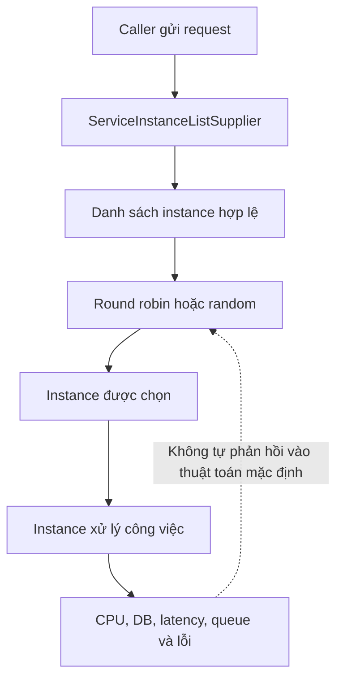
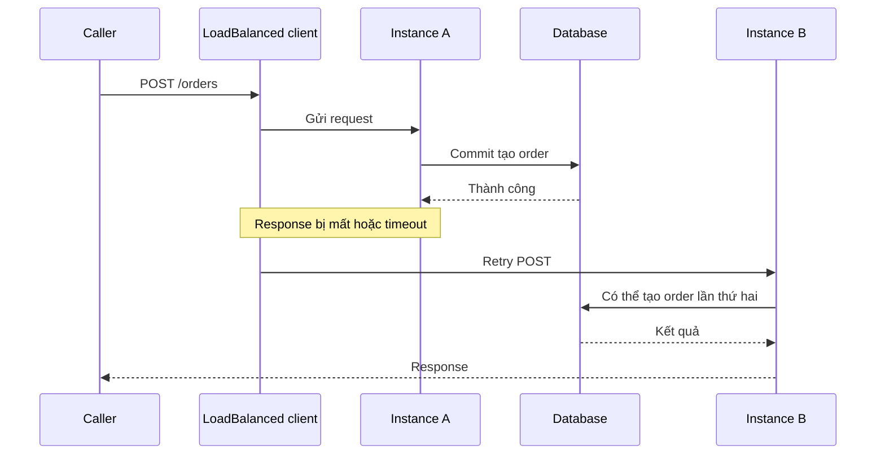
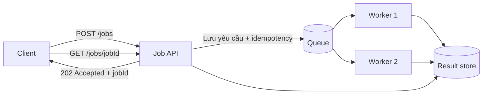
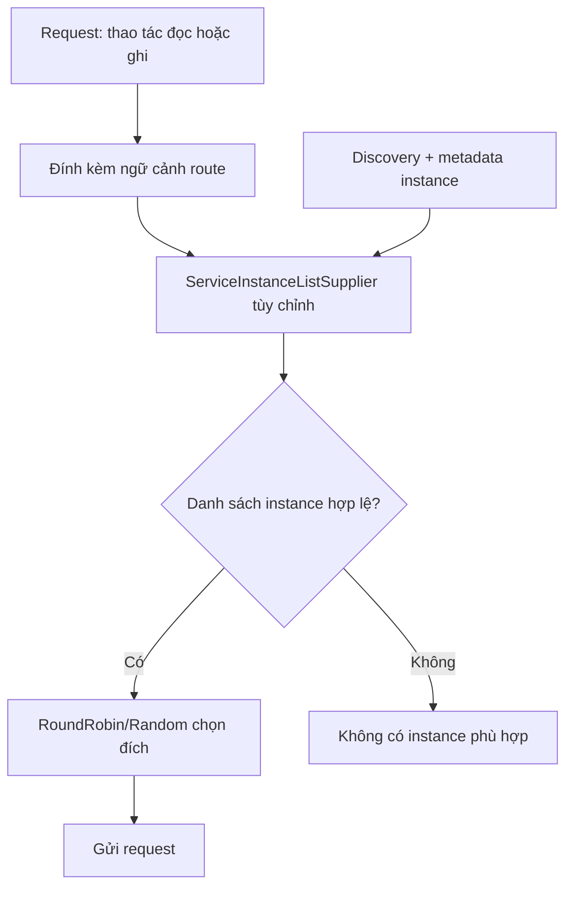

# Tải khác nhau giữa yêu cầu đọc, ghi và tác vụ xử lý lâu

Một request `GET /products/P-1001` có thể chỉ đọc dữ liệu từ cache trong vài mili giây. Một request `PUT /products/P-1001` có thể phải mở transaction, khóa bản ghi và chờ database commit. Một request tạo báo cáo có thể dùng nhiều CPU và bộ nhớ trong hàng chục giây hoặc lâu hơn. Nếu chỉ đếm số request rồi chia đều cho các instance, hệ thống chưa chắc đã chia đều **lượng công việc thực tế**.

Trong Spring Cloud LoadBalancer, `RoundRobinLoadBalancer` và `RandomLoadBalancer` lựa chọn một `ServiceInstance` từ danh sách do `ServiceInstanceListSupplier` cung cấp. Chúng không tự đọc HTTP method, ước lượng thời gian chạy, nhận biết truy vấn nào dùng cache hay phân biệt tác vụ nền. Việc hiểu khác biệt giữa tải đọc, ghi và tác vụ dài là nền tảng để thiết kế nhóm instance, chính sách chọn đích, timeout, retry và đo lường phù hợp.

## 1. Số request không đồng nghĩa với lượng tải

Giả sử cùng một dịch vụ nhận ba nhóm request:

| Nhóm công việc | Ví dụ | Tài nguyên thường bị ảnh hưởng | Rủi ro nổi bật |
|---|---|---|---|
| **Đọc (read)** | `GET /products/{id}`, tìm kiếm, đọc danh sách | CPU, cache, kết nối DB, băng thông, độ trễ truy vấn | Cache miss, truy vấn nặng, dữ liệu đọc từ replica bị trễ |
| **Ghi (write)** | `POST /orders`, `PUT /inventory/{id}` | Transaction DB, lock, I/O lưu trữ, hàng đợi replication | Ghi lặp do retry, xung đột cập nhật, yêu cầu nhất quán |
| **Xử lý lâu (long-running)** | Xuất báo cáo, xử lý ảnh, tổng hợp dữ liệu | CPU/thời gian thực thi, bộ nhớ, thread/connection hoặc worker slot | Chiếm tài nguyên kéo dài, timeout, backlog và quá tải |

Đây là các đặc tính phổ biến, không phải quy luật tuyệt đối: một request đọc phức tạp có thể đắt hơn một request ghi nhỏ; một lệnh ghi bất đồng bộ có thể phản hồi rất nhanh nhưng tạo tải lớn ở worker phía sau. Phải đo workload thật trước khi quyết định phân phối.

Ví dụ, 1.000 request đọc mất trung bình 10 ms/request tương đương khoảng 10 giây tổng thời gian xử lý tuần tự, tức bằng chỉ một request kéo dài 10 giây. Nếu một instance được giao 50 request đọc nhanh và một request dài, còn instance khác nhận 50 request đọc nhanh, số lượng request gần như bằng nhau nhưng mức sử dụng tài nguyên có thể rất khác.

Một cách mô tả trực giác tải trung bình tại instance `i` là:

\[
\rho_i \approx \frac{\lambda_i\,\mathbb{E}[S_i]}{c_i}
\]

Trong đó `λᵢ` là tốc độ request đến instance, `E[Sᵢ]` là thời gian phục vụ trung bình (tính theo cùng loại tài nguyên/đơn vị đo) và `cᵢ` là năng lực xử lý song song hiệu dụng. Đây là mô hình đơn giản nhằm thấy rằng **thời gian và độ phức tạp công việc** cũng quan trọng, không phải công thức trực tiếp để Spring Cloud LoadBalancer tính instance.

## 2. Round robin và random thực sự cân bằng điều gì?

`RoundRobinLoadBalancer` thường luân phiên lựa chọn giữa các instance đang được supplier trả về. `RandomLoadBalancer` chọn ngẫu nhiên từ danh sách đó. Khi mọi instance tương đương và mỗi request có chi phí gần giống nhau, các chiến lược này đơn giản, dễ vận hành và thường là điểm khởi đầu hợp lý.



Các hạn chế cần nhận biết:

- Round robin phân phối **lượt chọn**, không cân bằng trực tiếp CPU, số transaction đang mở, dung lượng bộ nhớ hay thời gian còn lại của tác vụ.
- Random giảm tính dự đoán của chuỗi lựa chọn nhưng không bảo đảm mỗi instance nhận đúng tỷ lệ request trong một khoảng thời gian ngắn.
- Một instance có thể khỏe theo health check nhưng đang chạm giới hạn CPU, connection pool hoặc số worker slot.
- Một số supplier có thể lọc danh sách theo zone, health, hint, metadata hoặc sticky session; khi đó thuật toán chỉ chọn từ **danh sách sau lọc**, không phải toàn bộ registry.
- Retry có thể tạo thêm lượt chọn instance và tăng tải; nó không phải cơ chế tự động giảm tải hệ thống.

Do vậy, khi thấy hai instance có số request gần bằng nhau nhưng `p99 latency` lệch xa, cần kiểm tra loại request, tỷ lệ cache miss, query DB, số tác vụ đang chạy và năng lực instance trước khi kết luận thuật toán chọn đích bị lỗi.

## 3. Đặc điểm tải đọc: nhanh nhưng không phải luôn rẻ

Các API đọc thường có lợi thế là ít tạo side effect, có thể cache và trong một số hệ thống có thể đọc qua replica. Tuy nhiên, đọc dữ liệu lớn hoặc truy vấn có join phức tạp có thể gây tải đáng kể.

Một số yếu tố làm thay đổi tải đọc:

1. **Cache hit/miss:** hai request cùng endpoint có thể khác nhau nhiều lần về thời gian phản hồi.
2. **Kích thước kết quả:** phân trang, trả danh sách rất lớn hoặc streaming có thể giữ kết nối lâu.
3. **Read replica lag:** replica có thể trả dữ liệu cũ ngay sau một thao tác ghi.
4. **Hot key/hot partition:** nhiều request đến cùng dữ liệu nóng có thể tạo bottleneck ở cache hoặc DB.
5. **Yêu cầu nhất quán:** có loại đọc bắt buộc lấy từ nguồn vừa ghi hoặc từ primary.

### Read-your-writes và quyết định chọn đích

Giả sử người dùng vừa cập nhật số lượng hàng hóa rồi lập tức đọc lại thông tin tồn kho. Nếu read request được gửi đến replica chưa áp dụng xong thay đổi, kết quả có thể cũ. **LoadBalancer không tự bảo đảm read-your-writes consistency**. Đây là vấn đề về cách phân phối dữ liệu và chính sách đọc, cần xử lý ở service/database hoặc trong kiến trúc routing có bảo đảm nhất quán.

Một số phương án, tùy yêu cầu nghiệp vụ, gồm đọc lại từ primary sau khi ghi, dùng phiên bản dữ liệu/cơ chế consistency token hoặc chấp nhận eventual consistency cho các màn hình không đòi hỏi dữ liệu mới tức thì.

> Không gắn nhãn mọi request `GET` là “có thể gửi đến replica”. HTTP method mô tả ngữ nghĩa API, còn tính nhất quán phụ thuộc nghiệp vụ và cách lưu trữ dữ liệu.

## 4. Đặc điểm tải ghi: giới hạn bởi transaction và tính đúng đắn

Các API ghi có thể bao gồm kiểm tra điều kiện nghiệp vụ, lock, transaction, cập nhật nhiều bảng hoặc phát sự kiện. Tăng số instance ứng dụng có thể tăng năng lực nhận request, nhưng không tự loại bỏ bottleneck tại primary database hay hàng đợi message broker.

Các câu hỏi cần trả lời trước khi chọn chiến lược phân phối ghi:

- Tất cả instance đều có quyền ghi và tuân thủ cùng quy tắc đồng bộ dữ liệu không?
- Có leader/primary bắt buộc xử lý một nhóm thao tác không?
- Một transaction có thể được gửi lại an toàn sau timeout không?
- Có khóa idempotency, request ID hoặc cơ chế khử trùng lặp nghiệp vụ không?
- Khi nhiều thao tác ghi đến cùng aggregate/key, thứ tự xử lý có quan trọng không?

Nếu dịch vụ chỉ có **một writer hợp lệ**, không được để round robin tự chia thao tác ghi sang các replica chỉ đọc. Cần giới hạn danh sách đích của luồng ghi ở writer hợp lệ, hoặc để dịch vụ phía sau tự điều phối/forward đến leader với bảo đảm nghiệp vụ rõ ràng.

### Retry và nguy cơ ghi lặp

Một request ghi có thể đã được database commit nhưng response bị mất trên đường về. Nếu client retry mà không có idempotency, thao tác có thể thực hiện lần nữa. Đây là lý do không nên bật retry chung cho mọi loại HTTP request một cách tùy tiện.

Ví dụ luồng nguy hiểm:



Cách giảm rủi ro là dùng khóa idempotency do caller tạo, kiểm tra trùng tại backend và lưu kết quả xử lý cùng khóa. Sau đó một lần retry với cùng khóa trả về cùng kết quả logic hoặc kết quả đã ghi nhận, thay vì tạo side effect mới. Cần triển khai idempotency ở phía lưu trữ/nghiệp vụ; riêng Spring Cloud LoadBalancer không cung cấp tính chất này cho API.

## 5. Tác vụ chạy lâu: thời gian giữ tài nguyên mới là vấn đề

Một endpoint thực hiện tổng hợp báo cáo 60 giây khác đáng kể với endpoint trả dữ liệu trong 20 ms. Request dài có thể giữ một servlet thread, connection hoặc slot xử lý trong suốt thời gian thực thi. Với lập trình reactive, I/O không blocking giúp sử dụng thread hiệu quả hơn, nhưng không làm CPU, bộ nhớ, bandwidth và giới hạn concurrency trở nên vô hạn.

Khi hàng trăm request dài đến đồng thời, những vấn đề sau có thể xuất hiện:

- Request nhanh phải xếp hàng phía sau công việc nặng.
- Thread pool, worker pool hoặc connection pool cạn kiệt.
- Memory pressure và garbage collection làm độ trễ tăng đột biến.
- Client/proxy timeout trước khi server xử lý xong.
- Retry làm phát sinh thêm công việc, khiến backlog tăng nhanh hơn.

Với tác vụ có thể tách khỏi vòng đời HTTP, kiến trúc thường phù hợp hơn là **nhận job nhanh, xử lý bất đồng bộ và cung cấp API theo dõi trạng thái**:



Trong cách làm này, LoadBalancer cân bằng request tới **API nhận job**; chính queue, scheduler và số worker slot quyết định cách chia công việc nặng. Không nên coi việc phân phối lượt gọi `POST /jobs` bằng round robin là bằng chứng các worker đã cân bằng công việc.

Nếu nghiệp vụ bắt buộc giữ kết nối lâu như streaming hoặc long polling, cần giới hạn số kết nối đang hoạt động, cấu hình timeout ở HTTP client/proxy/server và quan sát concurrent connections theo instance. Đó là bài toán capacity riêng với việc chọn instance mỗi lần kết nối được thiết lập.

## 6. Phân biệt phân phối request với phân phối công việc

Có ba tầng quyết định khác nhau:

| Tầng | Quyết định | Thành phần có thể tham gia |
|---|---|---|
| **HTTP request routing** | Request của caller đến instance nào? | Spring Cloud LoadBalancer, discovery, `ServiceInstanceListSupplier`. |
| **Nghiệp vụ và lưu trữ** | Request có được đọc replica, ghi primary, lock hoặc commit không? | Service logic, database, transaction manager. |
| **Job scheduling** | Công việc chạy lâu được worker nào nhận, được chạy bao nhiêu job cùng lúc? | Queue, worker scheduler, semaphore, consumer concurrency. |

Một chiến lược đúng ở tầng đầu không thay thế chính sách nhất quán ở tầng thứ hai hoặc điều phối công việc ở tầng thứ ba. Ví dụ, việc chọn đều hai instance API không sửa được tình trạng một queue worker luôn bận trong khi worker khác nhàn rỗi.

## 7. Hai cách tổ chức route cho read và write

### Phương án A: cùng service ID, toàn bộ instance đều xử lý mọi loại request

Nếu mỗi instance của `inventory-service` đều xử lý được cả đọc và ghi, caller có thể dùng một service ID và chính sách chọn instance đơn giản. Phương án này thuận tiện khi workload tương đối đồng nhất hoặc các giới hạn tài nguyên được xử lý bên trong service.

```text
order-service
   |
   +-- GET  http://inventory-service/api/products/P-1001
   |
   +-- PUT  http://inventory-service/api/products/P-1001
                |
                +--> inventory-1
                +--> inventory-2
```

**Giới hạn:** `RoundRobinLoadBalancer` không tự gửi tất cả `GET` sang instance đọc và tất cả `PUT` sang instance ghi. Nếu yêu cầu loại request quyết định đích, cần thêm chiến lược phù hợp.

### Phương án B: tách logical service ID theo nhóm khả năng

Khi kiến trúc thực sự có các pool khác nhau, có thể công bố hai service ID:

- `inventory-query`: các instance được phép xử lý truy vấn đọc và đáp ứng yêu cầu consistency tương ứng.
- `inventory-command`: các instance có khả năng xử lý thao tác ghi.

```text
order-service
   |
   +-- GET --> inventory-query --> query-1, query-2
   |
   +-- PUT --> inventory-command --> command-1
```

Đây là cách phân tách **nhóm đích qua discovery**; không bắt buộc phải tách thành hai codebase hay hai deployment độc lập. Quan trọng là các instance đăng ký dưới mỗi service ID phải có khả năng xử lý request tương ứng. Nếu `command-1` hỏng mà không có writer hợp lệ khác, LoadBalancer không thể tự biến một read replica thành writer.

Trong hệ thống cần các ràng buộc dữ liệu phức tạp, có thể giữ một service ID và thực hiện route ở application logic hoặc custom `ServiceInstanceListSupplier`, nhưng cần thiết kế rõ cách truyền request context và cách kiểm thử tính đúng đắn. Đừng suy diễn rằng chỉ cần đặt `@LoadBalanced` thì Spring Cloud LoadBalancer sẽ đọc HTTP method để tự làm việc này.

## 8. Thực hành tách read/write bằng hai service ID

Ví dụ này giả sử API read và write đã tồn tại trên các instance tương ứng. Mục tiêu là minh họa cách caller chọn **service ID** theo tính chất request, không phải xây toàn bộ hệ thống CQRS.

### 8.1. Cung cấp danh sách instance tĩnh khi phát triển

Trong `application.yml`, có thể dùng `SimpleDiscoveryClient`:

```yaml
spring:
  cloud:
    discovery:
      client:
        simple:
          instances:
            inventory-query:
              - uri: http://localhost:8081
              - uri: http://localhost:8082
            inventory-command:
              - uri: http://localhost:8083
```

Ví dụ cần `spring-cloud-starter-loadbalancer` và dependency web/client thích hợp. Khi dùng registry thật, các service ID và instance được cung cấp bởi discovery provider thay vì cấu hình tĩnh này. Các cổng chỉ là minh họa; server phải thực sự chạy và expose API tương ứng.

### 8.2. Dùng RestClient đã tích hợp LoadBalancer

```java
@Configuration(proxyBeanMethods = false)
class HttpClientConfiguration {

    @Bean
    @LoadBalanced
    RestClient.Builder loadBalancedRestClientBuilder() {
        return RestClient.builder();
    }
}
```

```java
@Service
class InventoryGateway {

    private final RestClient restClient;

    InventoryGateway(@LoadBalanced RestClient.Builder builder) {
        this.restClient = builder.build();
    }

    ProductView readProduct(String productId) {
        return restClient.get()
                .uri("http://inventory-query/api/products/{id}", productId)
                .retrieve()
                .body(ProductView.class);
    }

    ProductView updateProduct(String productId, UpdateProduct command) {
        return restClient.put()
                .uri("http://inventory-command/api/products/{id}", productId)
                .body(command)
                .retrieve()
                .body(ProductView.class);
    }
}
```

`ProductView` và `UpdateProduct` là các DTO minh họa. Ví dụ giả định Spring Boot/Spring Framework và Spring Cloud của dự án hỗ trợ tích hợp `RestClient`; các bản cũ hơn có thể dùng `RestTemplate`, `WebClient` hoặc OpenFeign theo khả năng phiên bản. `@LoadBalanced` chỉ bảo đảm builder được tích hợp cơ chế chọn instance khi auto-configuration và dependency phù hợp; nó **không** tự phát hiện `GET` là read và `PUT` là write. Việc chọn URL logic chính là quyết định tách read/write trong ví dụ.

Nếu dùng `WebClient`, cần bean `@LoadBalanced WebClient.Builder`; với OpenFeign có thể khai báo hai `@FeignClient(name = "inventory-query")` và `@FeignClient(name = "inventory-command")`, sau đó gắn mỗi client với đúng nghiệp vụ. Mỗi kiểu HTTP client còn có cấu hình timeout, retry và connection riêng cần kiểm chứng.

## 9. Nếu không thể tách service ID thì sao?

Một số hệ thống chỉ có một service ID vì lý do kiến trúc hoặc registry. Khi ấy có thể cân nhắc thiết kế bộ lọc instance dựa trên metadata và ngữ cảnh request.

Ví dụ, service discovery cung cấp metadata `workload=read`, `workload=write` hoặc `zone=...`. Một `ServiceInstanceListSupplier` tùy chỉnh có thể lấy thông tin từ `Request`/context được HTTP client truyền vào, rồi chỉ trả các instance hợp lệ. Sau khi lọc, `RoundRobinLoadBalancer` hoặc `RandomLoadBalancer` tiếp tục chọn trong danh sách còn lại.



Cần thận trọng ở bốn điểm:

1. **Ngữ cảnh request:** không phải mọi tích hợp RestClient, WebClient hay OpenFeign đều chuyển cùng các trường vào LoadBalancer theo cùng cách. Việc chọn lọc theo method/header phải được kiểm chứng cho đúng client và release train.
2. **Nguồn metadata:** metadata phải được gắn và cập nhật đúng với năng lực thực tế của instance. Metadata cũ có thể gây route sai.
3. **Danh sách rỗng:** phải xử lý rõ trường hợp không còn writer hoặc không còn instance phù hợp; không tự fallback sang instance không đủ khả năng chỉ để request có đích.
4. **Bảo mật và tính đúng đắn:** header do caller bên ngoài cung cấp không mặc nhiên đáng tin để quyết định quyền ghi. Tầng dịch vụ vẫn phải xác thực, phân quyền và bảo vệ tính nhất quán.

`HintBasedServiceInstanceListSupplier` là một khả năng lọc theo hint/metadata của Spring Cloud LoadBalancer ở các phiên bản hỗ trợ. Tuy nhiên, không được coi nó là bộ định tuyến HTTP method tự động: hint phải được truyền qua cơ chế mà client và supplier thực sự hỗ trợ. Khi bài toán phức tạp, tách service ID theo năng lực thường dễ quan sát và kiểm thử hơn.

## 10. Khi nào nên chọn chiến lược dựa trên tải thực tế?

Nếu các instance có năng lực khác nhau hoặc chi phí request biến động mạnh, có thể cần chính sách tùy chỉnh. Một số ý tưởng thường được nhắc đến:

| Ý tưởng | Dữ liệu cần có | Điểm cần lưu ý |
|---|---|---|
| **Weighted distribution** | Trọng số năng lực từng instance | Trọng số tĩnh không biết instance đang bận bất thường; cân nhắc khi năng lực máy khác nhau. |
| **Least active requests** | Số request đang xử lý tại mỗi instance | Cần thống kê đáng tin và cập nhật nhanh; request dài vẫn có chi phí không đồng đều. |
| **Latency-aware routing** | EWMA latency, lỗi, tỷ lệ timeout | Dễ phản ứng sai với nhiễu, cache warm-up hoặc outlier; cần giới hạn dao động. |
| **Capacity-aware routing** | CPU, memory, queue depth, worker slot | Metric có độ trễ và có thể tăng cardinality; cần cơ chế fallback khi thiếu dữ liệu. |
| **Locality / zone preference** | Metadata zone, chính sách locality | Ưu tiên gần không bảo đảm instance đủ capacity hoặc có dữ liệu phù hợp. |

**Quan trọng:** `RoundRobinLoadBalancer` và `RandomLoadBalancer` là các chiến lược có sẵn thông dụng. Các chiến lược như least-connections/least-active hoặc dynamic latency-weighted không tự được bật chỉ vì ứng dụng thêm starter. Nếu cần, phải triển khai/tích hợp một thuật toán hoặc supplier phù hợp và kiểm thử riêng. Không tự nhận rằng Spring Cloud LoadBalancer mặc định đo CPU rồi chọn máy rảnh nhất.

Một mô hình chấm điểm minh họa để thảo luận, **không phải API hay thuật toán có sẵn của framework**:

```text
normalizedUtilization = activeRequests / effectiveConcurrencyLimit
normalizedLatency     = observedP95 / latencyBudget
score                 = normalizedUtilization + k * normalizedLatency

Chọn trong các instance hợp lệ có score thấp,
đồng thời áp dụng ngưỡng tải và cơ chế fallback đã xác định.
```

Thiết kế thực tế phải cân nhắc tính ổn định khi metric trễ, giới hạn thời gian giữ trạng thái, tránh dồn toàn bộ lưu lượng sang một instance và xử lý dữ liệu thiếu/không nhất quán. Không nên để một metric tức thời duy nhất quyết định mọi request.

## 11. Backpressure và giới hạn đồng thời trước khi chọn đích

Khi tất cả instance đều gần quá tải, chọn máy “ít bận nhất” không tạo thêm capacity. Khi ấy cần giới hạn số request được chấp nhận và số tác vụ đang thực hiện:

- **Concurrency limit:** giới hạn số tác vụ nặng thực thi đồng thời theo instance hoặc theo nhóm worker.
- **Rate limiting:** kiểm soát tốc độ nhận request theo client, tenant hoặc API.
- **Queue có giới hạn:** cho phép hấp thụ đỉnh tải ngắn nhưng tránh backlog tăng vô hạn.
- **Load shedding:** từ chối sớm hoặc trả trạng thái phù hợp khi không còn khả năng phục vụ.
- **Deadline budget:** phân bổ thời gian chờ giữa discovery, chọn instance, kết nối, đọc response và các lần retry.

Thông thường `429 Too Many Requests` phù hợp khi client vượt giới hạn áp dụng cho nó; `503 Service Unavailable` phù hợp khi hệ thống tạm thời không đủ khả năng xử lý. Quyết định status và `Retry-After` thuộc hợp đồng API; không có một quy tắc tự động cho mọi service.

Đối với job dài, nên giới hạn số consumer/worker đang chạy và quan sát độ sâu hàng đợi. Khi queue quá đầy, API nhận job có thể từ chối sớm thay vì tiếp tục cấp phát tài nguyên. Với request đồng bộ, cần timeout có kiểm soát và tránh retry vô hạn.

## 12. Timeout, retry và phép nhân tải

Giả sử mỗi request thất bại có thể được gửi lại tối đa hai lần. Trong trường hợp xấu nhất, một logical request có thể biến thành ba attempt. Nếu service đã quá tải, retry làm số attempt tăng thêm đúng lúc hệ thống ít có khả năng xử lý nhất.

```text
1 logical request
   |
   +-- attempt 1 -> timeout
   +-- attempt 2 -> timeout
   +-- attempt 3 -> response/failure

=> Tối đa 3 attempt cho 1 logical request trong ví dụ.
```

Với `GET` có tính idempotent, retry có thể phù hợp hơn, nhưng vẫn phải giới hạn số attempt, thời gian tổng, backoff và chọn điều kiện lỗi cụ thể. Với `POST` có side effect, cần idempotency key hoặc bảo đảm tương đương trước khi cho phép retry. Không dựa vào việc HTTP method là `PUT`/`DELETE` để kết luận backend thực tế đã triển khai idempotency đúng trong mọi trạng thái lỗi.

Về timeout, cần phân biệt:

- **Connect timeout:** giới hạn thời gian thiết lập kết nối đến instance.
- **Read/response timeout:** giới hạn thời gian chờ dữ liệu hoặc response theo HTTP client.
- **Overall deadline:** thời gian tối đa cho toàn bộ logical operation, gồm nhiều attempt hoặc nhiều downstream call.
- **Job execution timeout:** thời gian tối đa một worker được phép chạy tác vụ nền.

Spring Cloud LoadBalancer chọn instance, nhưng timeout cụ thể phụ thuộc RestClient, WebClient, OpenFeign và transport phía dưới. Cấu hình retry của LoadBalancer không mặc nhiên thay thế timeout của HTTP client hay job worker.

## 13. Đo lường để biết cấu hình có hiệu quả

Chỉ nhìn số lượt chọn instance không đủ. Nên quan sát metric theo **service ID**, **instance** và **nhóm công việc** với cardinality được kiểm soát:

| Nhóm metric | Ví dụ cần quan sát | Ý nghĩa |
|---|---|---|
| Request volume | RPS/QPS theo read, write, async job submission | Biết lưu lượng từng loại và biến động theo thời gian. |
| Latency | p50/p95/p99 và thời gian chờ queue | Phát hiện tail latency và công việc có chi phí cao. |
| Resource utilization | CPU, memory, DB connection, active worker/thread | Xem instance nào thực sự chịu tải nặng. |
| Health & errors | Tỷ lệ 5xx, timeout, trạng thái health check | Phân biệt lỗi ứng dụng, nghẽn tải và instance không khả dụng. |
| Retry | Attempt trên logical request, retry success/failure | Phát hiện khuếch đại tải và retry không hiệu quả. |
| Long-running jobs | Queue depth, job age, active jobs, throughput | Đo năng lực scheduler/worker ngoài tầng HTTP. |

Spring Boot Actuator/Micrometer, tracing và `LoadBalancerLifecycle` có thể hỗ trợ quan sát lựa chọn instance và thời gian request tùy starter, cấu hình và phiên bản. Cần bảo đảm metric HTTP client thực sự gắn với luồng gọi load balanced. Khi phân tích, đừng gộp 100 request đọc nhanh và một request export báo cáo thành cùng một trung bình latency rồi kết luận tải đã cân bằng.

Nên ghi log/tracing những trường đủ để đối chiếu như `serviceId`, route pattern, request category, instance ID, attempt number, duration và result. Tránh ghi request body, token và các giá trị định danh có cardinality không kiểm soát vào metric label.

## 14. Kịch bản thực hành so sánh ba kiểu tải

Thiết lập ba endpoint thử nghiệm độc lập, có thể chạy trên hai hoặc nhiều instance của cùng service:

1. **Read nhanh:** `GET /lab/read` trả JSON nhỏ; có thể giả lập cache hit và cache miss.
2. **Write có kiểm soát:** `POST /lab/write` ghi một bản ghi thử nghiệm, hỗ trợ idempotency key và trả kết quả.
3. **Job dài:** `POST /lab/jobs` nhận tác vụ và trả `202 Accepted` cùng `jobId`; worker xử lý riêng và `GET /lab/jobs/{id}` trả trạng thái.

Thực hiện lần lượt:

- Gửi cùng số request đọc và ghi qua `@LoadBalanced` client, ghi nhận phân phối lượt chọn, p95 latency, DB contention và số lần retry.
- Tăng số lượng read với cache miss để thấy RPS không phản ánh trực tiếp mức sử dụng DB.
- Gửi nhiều job dài đồng thời; theo dõi queue depth và số worker active thay vì chỉ xem lượt gọi `POST /lab/jobs`.
- Thử một instance chỉ dành cho read và một writer duy nhất; xác minh request không bao giờ đến instance thiếu khả năng tương ứng.
- Khi tắt một instance, quan sát danh sách được supplier trả về, HTTP error và sự thay đổi p95/p99 latency; không tự động retry những thao tác không an toàn.

Khi so sánh, giữ số instance và thông số tài nguyên cố định giữa các lần chạy, đồng thời theo dõi trạng thái cache, dữ liệu database và thời gian khởi động. Không dùng kết quả tải từ môi trường production để thử các lỗi ghi lặp có nguy cơ ảnh hưởng dữ liệu thật.

## 15. Sự cố thường gặp và hướng chẩn đoán

| Hiện tượng | Nguyên nhân có thể | Cách xử lý/kiểm chứng |
|---|---|---|
| Round robin chia đều request nhưng một instance luôn chậm | Tỷ lệ request nặng hoặc năng lực instance không đồng đều | So sánh CPU, active requests và latency theo loại request, không chỉ tổng RPS. |
| Ghi dữ liệu thất bại khi request được route sang replica | Pool instance có node chỉ đọc | Phân biệt writer/reader pool hoặc để service điều phối đến writer hợp lệ. |
| Người dùng đọc thấy dữ liệu cũ ngay sau khi ghi | Read replica lag hoặc consistency policy không phù hợp | Thiết kế read-your-writes khi cần, không coi đây là lỗi thuật toán round robin. |
| Job dài gây timeout hàng loạt | Worker/concurrency/queue bị nghẽn hoặc request giữ kết nối quá lâu | Tách xử lý bất đồng bộ, áp dụng backpressure, đặt deadline phù hợp. |
| Retry làm số order tăng gấp đôi | Side effect ghi không có idempotency | Khóa idempotency và xử lý trùng ở backend, giới hạn retry. |
| Chỉ một instance luôn được chọn | Supplier đã lọc còn một instance hoặc sticky policy đang hoạt động | Quan sát danh sách instance sau lọc, metadata và context request. |
| Health check báo UP nhưng p99 latency cao | Health check không phản ánh capacity hoặc downstream bottleneck | Thêm metric tải, saturation, queue; điều chỉnh readiness/backpressure. |
| Tách hai service ID nhưng route vẫn sai | Đăng ký discovery hoặc URL logic không nhất quán | Kiểm tra registry, host trong URL và capability của từng instance. |

## 16. Checklist lựa chọn chính sách theo workload

- [ ] Đã phân loại read/write/long-running theo **chi phí thực tế**, không chỉ dựa trên HTTP method.
- [ ] Đã xác định yêu cầu consistency và writer hợp lệ cho các thao tác ghi.
- [ ] Đã đo p95/p99 latency, RPS, saturation và queue theo nhóm request.
- [ ] Biết rõ `ServiceInstanceListSupplier` trả tập instance nào trước bước chọn đích.
- [ ] Hiểu round robin/random chỉ chia lượt chọn, không tự cân bằng chi phí công việc.
- [ ] Có phương án tách pool hoặc custom routing khi năng lực instance khác nhau.
- [ ] Có idempotency và điều kiện retry rõ ràng cho request tạo side effect.
- [ ] Có timeout, concurrency limit và backpressure cho tác vụ dài.
- [ ] Đã kiểm tra behavior của RestClient/WebClient/OpenFeign và retry trên đúng phiên bản Spring Cloud.
- [ ] Có trace/metric để chứng minh cải thiện thay vì chỉ dựa vào cấu hình trên giấy.

**Kết luận:** Thuật toán chọn `ServiceInstance` chỉ là một phần của bài toán phân phối tải. Khi read, write và tác vụ dài có chi phí hoặc yêu cầu tính đúng đắn khác nhau, giải pháp bền vững thường kết hợp phân tách nhóm đích phù hợp, giới hạn concurrency, xử lý bất đồng bộ, retry an toàn và quan sát theo workload. Spring Cloud LoadBalancer giúp chọn instance theo service ID; kiến trúc ứng dụng phải quyết định instance nào **được phép** và **có đủ năng lực** để nhận loại công việc đó.
