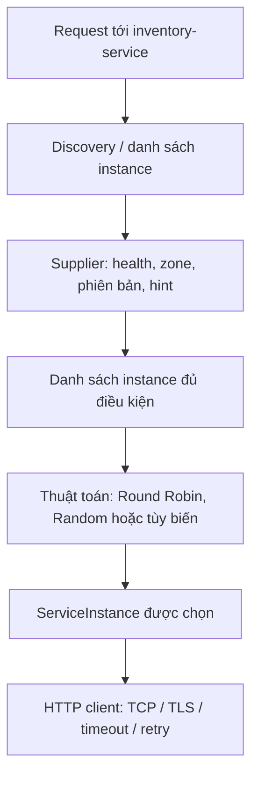
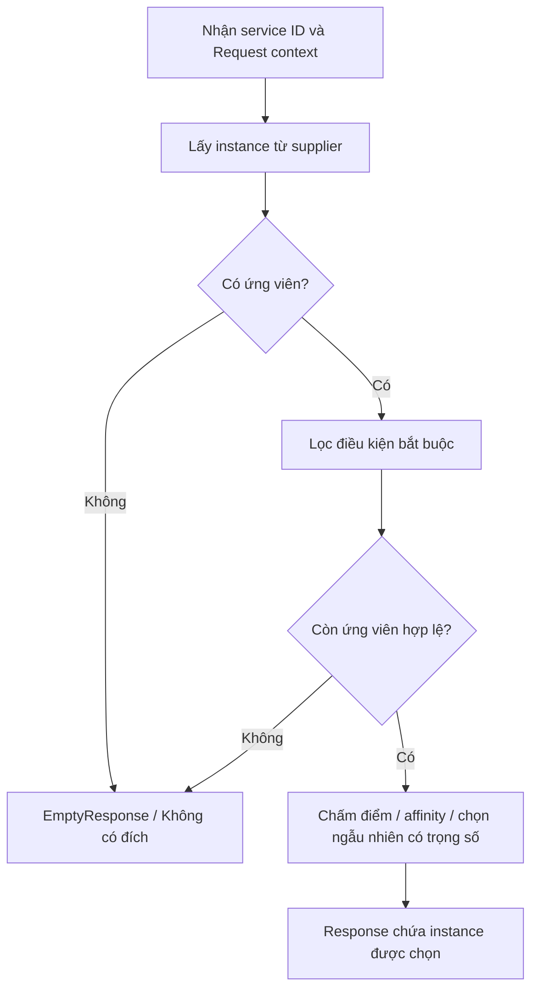

# Khi nào cần thuật toán tùy biến theo đặc điểm hệ thống

Trong Spring Cloud LoadBalancer, cách chọn một `ServiceInstance` ảnh hưởng trực tiếp đến độ trễ, tỷ lệ lỗi, mức sử dụng tài nguyên và khả năng chịu tải của giao tiếp giữa các dịch vụ. Với nhiều ứng dụng, thuật toán mặc định như `RoundRobinLoadBalancer` đã đáp ứng tốt: request lần lượt được phân phối tới các instance đang có trong danh sách ứng viên. Tuy nhiên, khi các instance khác nhau về năng lực xử lý, vùng triển khai, trạng thái tải hoặc yêu cầu lưu giữ dữ liệu, phân phối đồng đều số lượt chọn có thể chưa phù hợp.

Bài học thuộc chương **Thuật toán chọn đích** giải thích **khi nào cần tùy biến**, phần nào nên tùy biến trong `ServiceInstanceListSupplier`, phần nào thực sự đòi hỏi một LoadBalancer mới, cách thực hiện và kiểm chứng một ví dụ chọn đích theo affinity. Mục tiêu là ra quyết định dựa trên dữ liệu vận hành và ràng buộc nghiệp vụ, thay vì thay thuật toán chỉ vì lưu lượng tăng.

## 1. Phân biệt danh sách ứng viên và thuật toán chọn đích

Xét lời gọi từ `order-service` tới `inventory-service`:

```java
Item item = restClient.get()
        .uri("http://inventory-service/api/items/{id}", 42)
        .retrieve()
        .body(Item.class);
```

Một lời gọi đi qua các bước:

1. Client tích hợp `@LoadBalanced` xác định service ID là `inventory-service`.
2. `ServiceInstanceListSupplier` lấy và có thể lọc danh sách bản sao qua discovery, cache, health check, zone hoặc thông tin request.
3. `ReactorServiceInstanceLoadBalancer` chọn một instance trong danh sách còn lại.
4. HTTP client thực hiện kết nối tới host/port của instance được chọn, xử lý timeout, response và retry tùy cấu hình.



**Bộ lọc ứng viên** trả lời câu hỏi *những instance nào được phép nhận request này?* **Thuật toán chọn đích** trả lời câu hỏi *trong các instance được phép, nên chọn instance nào?* Đây là khác biệt quan trọng khi thiết kế chính sách định tuyến.

Ví dụ, nếu `inventory-a` và `inventory-b` đều khỏe nhưng chỉ `inventory-b` hỗ trợ API v2, chính sách có thể lọc theo metadata `api-version=v2` trong supplier rồi giữ round-robin trên các ứng viên phù hợp. Không nhất thiết phải viết thuật toán LoadBalancer mới.

## 2. Khi nào thuật toán có sẵn đã đủ?

Trước khi tùy biến, cần phân biệt nhu cầu thường gặp với trường hợp thật sự đòi hỏi quyết định lựa chọn phức tạp.

| Đặc điểm hệ thống | Lựa chọn nên xem xét trước | Lý do |
|---|---|---|
| Các instance gần tương đương về tài nguyên, tải và độ trễ | `RoundRobinLoadBalancer` | Đơn giản, dễ dự đoán và quan sát |
| Cần tránh chu kỳ lượt chọn cố định, không có ràng buộc khác | `RandomLoadBalancer` | Chọn ngẫu nhiên giữa các ứng viên |
| Instance có năng lực khác nhau nhưng có trọng số cấu hình tương đối ổn định | `WeightedServiceInstanceListSupplier` | Có sẵn cơ chế sử dụng trọng số để điều chỉnh xác suất chọn |
| Muốn ưu tiên bản sao cùng zone với caller | `ZonePreferenceServiceInstanceListSupplier` | Lọc hoặc ưu tiên ứng viên theo zone trước khi chọn |
| Muốn tránh instance không khỏe | `HealthCheckServiceInstanceListSupplier` hoặc discovery có health/readiness phù hợp | Loại ứng viên không khỏe khỏi danh sách |
| Định tuyến dựa trên hint hoặc metadata | Supplier hoặc decorator xử lý request/hint | Thay đổi tập ứng viên theo điều kiện request |
| Muốn retry tránh instance vừa lỗi | Cơ chế retry-aware supplier và retry của HTTP client | Tránh lặp lại đích lỗi khi thử lại, tùy chính sách |

Một số thành phần kể trên là **supplier**, không phải thuật toán chọn instance mới. Ví dụ, danh sách từ `ZonePreferenceServiceInstanceListSupplier` có thể tiếp tục được chọn bằng round-robin. Ngoài ra, metadata `weight` không tự làm round-robin áp dụng trọng số; phải cấu hình supplier hoặc cơ chế đọc trọng số thực sự.

Nếu yêu cầu được giải quyết hoàn toàn bằng một supplier có sẵn, hãy giữ LoadBalancer mặc định. Điều đó giảm mã cần kiểm thử và dễ đối chiếu với hành vi của Spring Cloud.

## 3. Dấu hiệu cần một chính sách chọn đích tùy biến

Cần cân nhắc thuật toán tùy biến khi **quyết định lựa chọn phụ thuộc vào trạng thái, thứ tự ưu tiên hoặc quan hệ giữa request với instance** mà chính sách sẵn có chưa biểu diễn được.

| Tình huống | Dữ liệu cần cho quyết định | Hướng giải pháp |
|---|---|---|
| Session hoặc tenant cần giữ tương đối ổn định trên cùng một instance | Khóa affinity và ID instance ổn định | Rendezvous/consistent hashing sau khi lọc ứng viên |
| Một số instance chịu tải tốt hơn rõ rệt và trọng số thay đổi theo thời gian | Năng lực, hàng đợi, số request đang xử lý | Weighted/adaptive routing có telemetry và giới hạn tải |
| Độ trễ giữa các instance biến động đáng kể | EWMA latency, tỷ lệ lỗi, inflight requests | Latency-aware hoặc least-outstanding, có cơ chế bảo vệ chống dao động |
| Vùng dữ liệu hoặc tenant bị giới hạn chặt nơi được xử lý | Vùng được phép, quyền truy cập, metadata đáng tin cậy | Lọc bắt buộc trước khi chọn; không fallback sang vùng cấm |
| Canary yêu cầu chia traffic ổn định theo người dùng | Cohort key và chính sách rollout | Phân nhóm deterministic, sau đó chọn trong nhóm |
| Có nhiều mức ưu tiên: cùng zone, sau đó cùng region, rồi region khác | Topology và ngân sách độ trễ/chi phí | Chính sách chọn nhiều tầng có fallback rõ ràng |
| Một instance đặc biệt xử lý tác vụ GPU hoặc dữ liệu cục bộ | Capability, locality hoặc shard ID | Lọc theo năng lực, sau đó chọn có xét tải nếu cần |

Không phải mọi tình huống trong bảng đều cần tự viết `ReactorServiceInstanceLoadBalancer`. Nếu yêu cầu chỉ là **giữ lại hoặc loại bỏ** instance theo thuộc tính, một supplier tùy chỉnh thường là điểm mở rộng phù hợp hơn. Thuật toán mới có giá trị khi cần tính điểm, so sánh, ghi nhớ trạng thái hoặc bảo đảm tính nhất quán của lựa chọn giữa nhiều ứng viên.

## 4. Đo được vấn đề trước khi quyết định tùy biến

Một thuật toán phức tạp có thể làm hệ thống khó vận hành hơn mà không cải thiện SLO. Hãy lập đường cơ sở bằng round-robin hoặc chính sách có sẵn trong điều kiện tải thực tế.

Các chỉ số hữu ích:

- **p50/p95/p99 latency:** độ trễ trung vị và đuôi theo từng instance, không chỉ độ trễ trung bình toàn service.
- **Error rate:** tỷ lệ lỗi theo instance, loại lỗi và thời điểm rollout.
- **In-flight / active requests:** số lời gọi đang xử lý trên từng instance.
- **CPU, memory, queue depth, thread pool saturation:** chỉ báo nghẽn thực sự của server.
- **Requests per instance:** độ lệch phân phối sau khi tính cả retry và bộ lọc ứng viên.
- **Cross-zone/cross-region traffic:** tác động tới độ trễ, chi phí và ràng buộc dữ liệu.
- **Connection pool:** thời gian chờ connection, số kết nối active/idle, lỗi connect hoặc reset.

Ví dụ ba instance nhận lượt chọn round-robin tương đương nhưng `inventory-c` có hàng đợi dài và p99 latency cao. Trước khi viết thuật toán latency-aware, cần xem `inventory-c` có thiếu CPU, thread pool bị bão hòa, dữ liệu lưu trữ chậm hay request nặng tập trung ngẫu nhiên không. Nếu nguyên nhân là cấu hình server, tăng connection pool hoặc sửa bottleneck có thể mang lại kết quả tốt hơn.

Nên đặt tiêu chí đánh giá cụ thể: giảm p99 ở cùng mức RPS mà không tăng lỗi, duy trì tỷ lệ traffic mong muốn khi rollout, hạn chế lưu lượng xuyên vùng hoặc giảm mức dịch chuyển session khi thay replica.

## 5. Các kịch bản ra quyết định thường gặp

### 5.1. Năng lực instance không đồng đều

Giả sử một service chạy trên hai loại máy:

| Instance | Sức xử lý kỳ vọng | Trọng số minh họa |
|---|---:|---:|
| `inventory-small` | 1 đơn vị | 1 |
| `inventory-large` | 3 đơn vị | 3 |

Round-robin thường cho số lượt chọn tương đương. Nếu request có chi phí tương đối giống nhau, máy nhỏ có thể bão hòa sớm. Khi dùng weighted selection, tỷ lệ chọn kỳ vọng có thể gần:

\[
P(i) = \frac{w_i}{\sum_j w_j}
\]

Với trọng số 1 và 3, tỷ lệ kỳ vọng lần lượt xấp xỉ 25% và 75% trong nhiều lượt chọn. Đây là **tỷ lệ kỳ vọng**, không bảo đảm đúng tuyệt đối trên từng cửa sổ nhỏ hoặc với request có thời gian xử lý khác nhau.

Trước hết nên dùng `WeightedServiceInstanceListSupplier` nếu cách tính trọng số có thể diễn đạt bằng thông tin instance. Thuật toán tùy biến đáng cân nhắc khi trọng số phải thay đổi liên tục theo năng lực còn lại, độ dài hàng đợi hoặc loại request. Khi đó cần xác định tần suất cập nhật, dữ liệu lỗi thời và cách tránh làm toàn bộ traffic đổ sang một instance vừa đo được latency thấp.

### 5.2. Locality, zone và ràng buộc dữ liệu

Giả sử caller ở `zone-a` và các instance nằm trong `zone-a`, `zone-b`. Nếu chỉ muốn **ưu tiên** gần caller, supplier ưu tiên zone thường đã đủ; khi không có instance gần, có thể cho phép fallback sang zone khác.

Nhưng nếu một tenant chỉ được xử lý trong `region-a` vì yêu cầu dữ liệu, đó là **ràng buộc cứng**. Thuật toán phải lọc loại toàn bộ instance ngoài `region-a` trước khi cân bằng tải. Nếu region không có instance khỏe, cần báo không có đích hợp lệ hoặc áp dụng quy trình khôi phục đã được phê duyệt; không được âm thầm chuyển request sang vùng cấm chỉ để tăng khả dụng.

Phân biệt rõ:

- **Hard constraints:** điều kiện bắt buộc, ví dụ quyền truy cập, khả năng xử lý, region được phép hoặc phiên bản API tương thích.
- **Soft preferences:** sở thích có thể nhượng bộ, ví dụ cùng zone, latency thấp, ít tải hoặc chi phí mạng thấp.

Thường nên thực hiện hard constraints trong supplier rồi đưa các ứng viên hợp lệ cho thuật toán xếp hạng theo soft preferences.

### 5.3. Session affinity và nhất quán khi scale

Một ứng dụng có cache tại chỗ trên từng instance hoặc một số trạng thái session cục bộ có thể muốn các request cùng một khóa đến cùng một bản sao. Định tuyến hoàn toàn round-robin không đáp ứng mong muốn đó.

Một lựa chọn là **Rendezvous hashing** (highest-random-weight hashing): với mỗi request key, tính một điểm hash cho từng instance rồi chọn instance có điểm cao nhất. Nếu danh sách instance không đổi, cùng key sẽ chọn cùng đích; khi thêm hoặc loại một instance, phần lớn key vẫn giữ đích cũ.

```text
Key tenant-17
  ├── score(tenant-17, inventory-a) = 0.21
  ├── score(tenant-17, inventory-b) = 0.86  <-- được chọn
  └── score(tenant-17, inventory-c) = 0.42

Loại inventory-a: tenant-17 vẫn chọn inventory-b
Loại inventory-b: tenant-17 chuyển sang inventory-c
```

Ví dụ điểm số chỉ để minh họa. Cần dùng ID instance ổn định, hàm hash xác định và cùng quy tắc trên các caller. Nếu instance ID thay đổi sau mỗi lần deploy, affinity sẽ bị xáo trộn. Affinity không thay thế cơ chế lưu trữ session bền vững: khi instance lỗi, request phải có khả năng xử lý ở đích dự phòng hoặc hệ thống cần chấp nhận mất cache cục bộ.

### 5.4. Adaptive routing theo latency hoặc tải

Least-outstanding chọn instance có ít request đang xử lý nhất; latency-aware chọn theo thống kê độ trễ. Hai kỹ thuật hữu ích khi thời gian xử lý biến động mạnh, nhưng cả hai đều cần dữ liệu đáng tin cậy.

Một chính sách có thể cân nhắc kết hợp:

\[
score(i) = \alpha \cdot EWMA\_latency(i) + \beta \cdot inflight(i) + \gamma \cdot penalty\_errors(i)
\]

Trong đó các đại lượng cần chuẩn hóa cùng thang đo; hệ số và công thức là **ví dụ thiết kế**, không phải công thức mặc định của Spring Cloud. Điểm thấp được ưu tiên sau khi hard constraints đã được áp dụng.

Rủi ro của cách chọn này gồm:

- Telemetry chậm cập nhật khiến nhiều client dồn traffic vào cùng một instance được đánh giá là nhanh.
- Instance ít request có mẫu đo nhỏ, dẫn tới ước lượng latency không ổn định.
- Một vài request nặng có thể làm tăng độ trễ và khiến thuật toán dao động đích liên tục.
- Client chỉ nhìn thấy phần traffic của chính nó, không thấy tổng tải từ các caller khác.

Nếu triển khai, nên dùng cửa sổ đo hoặc EWMA, giới hạn số request tối đa, điểm tối thiểu cho instance mới, chọn ngẫu nhiên có trọng số trong nhóm tốt và cơ chế quên dữ liệu cũ. Cần đo tỷ lệ cải thiện dưới tải, không chỉ so sánh latency trong vài request thử nghiệm.

### 5.5. Canary theo người dùng hoặc nhóm traffic

Canary 10% có thể được hiểu là 10% request hoặc 10% người dùng. Hai cách này không giống nhau: random 10% theo request có thể khiến cùng một người dùng lúc vào bản ổn định, lúc vào canary.

Nếu cần tính nhất quán theo người dùng, có thể tính bucket bằng hash của một khóa đã xác thực, phân người dùng vào nhóm `canary` hoặc `stable`, sau đó supplier lọc instance theo metadata `release-track`. Thuật toán round-robin vẫn đủ cho các instance trong từng nhóm. Cần bảo đảm tỷ lệ bucket, khả năng rollback và cách xử lý khi không có instance trong nhóm tương ứng.

## 6. Mô hình thiết kế một thuật toán tùy biến

Một thuật toán chọn đích nên có hợp đồng rõ ràng:



Các đặc điểm cần xác định trước khi viết mã:

| Câu hỏi | Ví dụ quyết định |
|---|---|
| Danh sách từ đâu? | Discovery + cache + health check thông qua `ServiceInstanceListSupplier` |
| Dữ liệu request đến từ đâu? | `RequestDataContext`, hint hoặc context được ứng dụng bổ sung |
| Dữ liệu nào đáng tin cậy? | Region từ cấu hình xác thực, không tin header do người dùng tự gắn |
| Không có ứng viên hợp lệ thì sao? | Trả `EmptyResponse`, không chuyển sang nhóm bị cấm |
| Khóa affinity thiếu thì sao? | Dùng random/round-robin cho các ứng viên hợp lệ |
| Trạng thái tải lỗi thời thì sao? | Fallback về thuật toán đơn giản hoặc bỏ qua điểm thiếu tin cậy |
| Khi retry thì sao? | Có thể tránh instance vừa lỗi, nhưng phải cân nhắc idempotency |
| Cần quan sát gì? | Số ứng viên, nguyên nhân lọc, instance đã chọn, lỗi, độ trễ |

**Nguyên tắc:** thuật toán chọn đích nên nhanh, không blocking và không truy vấn database hoặc service khác mỗi lần chọn. Thông tin động như tải và sức khỏe nên được thu thập/cập nhật riêng, sau đó cung cấp snapshot cho quá trình lựa chọn.

## 7. Ví dụ: tùy biến lựa chọn theo affinity bằng Rendezvous hashing

Ví dụ dưới đây triển khai `ReactorServiceInstanceLoadBalancer`: nhận danh sách qua `ServiceInstanceListSupplier`, lấy affinity key từ HTTP request context, rồi dùng Rendezvous hashing để chọn instance. Nếu không có key, thuật toán chọn ngẫu nhiên trong danh sách ứng viên. Đoạn mã dùng những abstraction phổ biến của Spring Cloud Commons và Reactor; cần điều chỉnh import hoặc bean theo phiên bản Spring Cloud của dự án.

```java
import java.nio.charset.StandardCharsets;
import java.util.List;
import java.util.concurrent.ThreadLocalRandom;

import org.springframework.beans.factory.ObjectProvider;
import org.springframework.cloud.client.ServiceInstance;
import org.springframework.cloud.client.loadbalancer.DefaultResponse;
import org.springframework.cloud.client.loadbalancer.EmptyResponse;
import org.springframework.cloud.client.loadbalancer.Request;
import org.springframework.cloud.client.loadbalancer.RequestDataContext;
import org.springframework.cloud.client.loadbalancer.Response;
import org.springframework.cloud.loadbalancer.core.ReactorServiceInstanceLoadBalancer;
import org.springframework.cloud.loadbalancer.core.ServiceInstanceListSupplier;
import reactor.core.publisher.Mono;

public final class AffinityLoadBalancer
        implements ReactorServiceInstanceLoadBalancer {

    private final ObjectProvider<ServiceInstanceListSupplier> supplierProvider;

    public AffinityLoadBalancer(
            ObjectProvider<ServiceInstanceListSupplier> supplierProvider) {
        this.supplierProvider = supplierProvider;
    }

    @Override
    public Mono<Response<ServiceInstance>> choose(Request request) {
        ServiceInstanceListSupplier supplier = supplierProvider.getIfAvailable();
        if (supplier == null) {
            return Mono.just(new EmptyResponse());
        }

        String affinityKey = readAffinityKey(request);
        return supplier.get(request)
                .next()
                .map(instances -> chooseFrom(instances, affinityKey))
                .defaultIfEmpty(new EmptyResponse());
    }

    private Response<ServiceInstance> chooseFrom(
            List<ServiceInstance> instances, String affinityKey) {

        if (instances.isEmpty()) {
            return new EmptyResponse();
        }

        if (affinityKey == null || affinityKey.isBlank()) {
            int index = ThreadLocalRandom.current().nextInt(instances.size());
            return new DefaultResponse(instances.get(index));
        }

        ServiceInstance best = null;
        long highest = 0;
        for (ServiceInstance instance : instances) {
            long score = score(affinityKey, instance);
            int comparison = Long.compareUnsigned(score, highest);
            if (best == null || comparison > 0
                    || (comparison == 0 && identity(instance)
                            .compareTo(identity(best)) > 0)) {
                best = instance;
                highest = score;
            }
        }
        return new DefaultResponse(best);
    }

    private static String readAffinityKey(Request request) {
        if (request == null || !(request.getContext()
                instanceof RequestDataContext context)) {
            return null;
        }
        if (context.getClientRequest() == null) {
            return null;
        }
        return context.getClientRequest()
                .getHeaders().getFirst("X-Verified-Affinity-Key");
    }

    private static long score(String key, ServiceInstance instance) {
        byte[] bytes = (key + ":" + identity(instance))
                .getBytes(StandardCharsets.UTF_8);

        // FNV-1a 64-bit: hàm hash minh họa, không dùng cho bảo mật.
        long hash = 0xcbf29ce484222325L;
        for (byte b : bytes) {
            hash ^= (b & 0xffL);
            hash *= 0x100000001b3L;
        }
        return hash;
    }

    private static String identity(ServiceInstance instance) {
        String identity = instance.getInstanceId();
        if (identity == null || identity.isBlank()) {
            identity = instance.getUri().toString();
        }
        return identity;
    }
}
```

**Ý nghĩa của ví dụ:**

1. `supplier.get(request)` giữ request context khi lấy ứng viên, cho phép supplier trước đó lọc theo health/zone/metadata.
2. Danh sách rỗng tạo `EmptyResponse`; thuật toán không tự mở rộng sang instance đã bị loại vì ràng buộc bắt buộc.
3. Nếu có key ổn định, cùng key và cùng danh sách ID instance sẽ chọn cùng đích, không phụ thuộc thứ tự danh sách.
4. Nếu thiếu key, chọn random để tránh dồn tất cả request vào phần tử đầu tiên.
5. FNV-1a 64-bit chỉ để minh họa thuật toán. Trong production nên dùng hash ổn định, phân phối tốt đã được kiểm thử, cùng cách chuẩn hóa key/instance ID trên mọi caller; đừng dùng giá trị hash này để xác thực.

Header `X-Verified-Affinity-Key` ở đây chỉ là một quy ước ví dụ. Gateway hoặc tầng ứng dụng phải xác thực caller, bỏ giá trị không đáng tin và cấp một khóa affinity hợp lệ. Tự nhận header từ Internet rồi tin đó là tenant hoặc quyền truy cập sẽ tạo lỗ hổng định tuyến. Nếu integration không tạo `RequestDataContext` chứa header trên đường gọi đang dùng, cần bổ sung cơ chế truyền context tương thích; ví dụ sẽ fallback random cho trường hợp thiếu key.

### 7.1. Đăng ký thuật toán cho một service ID

Để sử dụng thuật toán tùy biến, tạo một bean LoadBalancer trong cấu hình riêng cho service ID:

```java
public class InventoryAffinityConfiguration {

    @Bean
    ReactorLoadBalancer<ServiceInstance> inventoryLoadBalancer(
            Environment environment,
            LoadBalancerClientFactory factory) {

        String serviceId = environment.getProperty(
                LoadBalancerClientFactory.PROPERTY_NAME);

        return new AffinityLoadBalancer(
                factory.getLazyProvider(
                        serviceId, ServiceInstanceListSupplier.class));
    }
}

@SpringBootApplication
@LoadBalancerClient(
        name = "inventory-service",
        configuration = InventoryAffinityConfiguration.class)
public class OrderServiceApplication {
}
```

Đoạn mã dựa trên cách cấu hình per-service của Spring Cloud LoadBalancer. Hai lớp `InventoryAffinityConfiguration` và `OrderServiceApplication` cần đặt trong các file Java riêng; ví dụ rút gọn phần `import` của cấu hình. Cần có `spring-cloud-starter-loadbalancer`, một nguồn `ServiceInstanceListSupplier` hợp lệ và các import phù hợp. Đặt `InventoryAffinityConfiguration` ngoài phạm vi component scan thông thường hoặc bảo đảm bean không bị đăng ký vào context chung, vì cấu hình trong `@LoadBalancerClient` được dùng cho child context của service ID cụ thể.

HTTP client tiếp tục gọi `http://inventory-service/...` như trước. Thuật toán tác động vào **lựa chọn instance**, không thay đổi cách `RestClient`, `WebClient` hoặc OpenFeign thiết lập TCP/TLS hay quản lý connection pool.

### 7.2. Giới hạn và hướng nâng cấp

Ví dụ cố ý tập trung vào việc chọn đích. Một phiên bản production có thể cần:

- Ràng buộc số lượng key, chiều dài key, chuẩn hóa encoding và chọn hàm hash ổn định đã kiểm thử.
- Chiến lược định danh instance không đổi ngoài ý muốn khi scale/redeploy.
- Tách hard constraints khỏi thuật toán affinity: instance không khỏe hoặc không có quyền phục vụ tenant không được đưa vào danh sách chấm điểm.
- Fallback có kiểm soát khi request không mang khóa hoặc khóa chưa xác thực.
- Cơ chế quan sát tỷ lệ dịch chuyển key khi một instance được thêm hoặc loại.
- Cân nhắc HTTP/2 connection pooling, retry và tình trạng server, vì affinity không bảo đảm kết nối luôn thành công.

Nếu hệ thống cần chia trọng số khác nhau theo năng lực instance, Rendezvous đơn giản này chưa hỗ trợ weighted hashing; không nên nhân đôi một instance trong danh sách để giả lập trọng số vì sẽ làm thay đổi tính chất của phép chọn.

## 8. Quan hệ giữa thuật toán tùy biến và các thành phần còn lại

### 8.1. Discovery và health check

Thuật toán tốt vẫn cần danh sách đầu vào đúng. Một instance có thể nằm trong registry nhưng đã mất kết nối hoặc chưa sẵn sàng. Hãy sử dụng discovery và health/readiness phù hợp để lọc ứng viên; sau đó thuật toán chỉ chọn trong danh sách được chấp nhận. Trong thời gian cập nhật cache, danh sách có thể cũ, vì vậy HTTP client vẫn cần timeout và xử lý lỗi.

### 8.2. Retry và idempotency

Retry sau một lỗi timeout có thể khiến request đi tới một instance khác, tùy client và retry configuration. Với thuật toán affinity, nếu retry dùng cùng key và danh sách không đổi thì có thể chọn lại chính instance vừa lỗi. Nếu mong muốn tránh đích cũ, cần kết hợp retry-aware supplier hoặc đưa thông tin instance đã thử vào request context. Không nên vô tình retry vô hạn.

Một timeout không chứng minh server chưa xử lý nghiệp vụ. Với lệnh tạo đơn hàng hoặc thanh toán, dùng idempotency key và chính sách retry phù hợp để tránh thực thi trùng.

### 8.3. RestClient, WebClient và OpenFeign

Các client có integration với Spring Cloud LoadBalancer đều có thể hưởng lợi từ chính sách chọn đích theo service ID. Tuy nhiên, cách request context và header đi vào LoadBalancer khác nhau theo client và phiên bản. Khi thiết kế thuật toán dựa trên header, hint hoặc context tùy chỉnh, phải kiểm chứng dữ liệu thực sự có mặt trong `choose(Request)` và `ServiceInstanceListSupplier.get(Request)` trên đường gọi đang dùng.

### 8.4. Quan sát vòng đời lựa chọn

Có thể dùng log và cơ chế lifecycle/metrics của Spring Cloud LoadBalancer để theo dõi service ID, số ứng viên trước/sau lọc, nhóm chính sách, instance được chọn và kết quả gọi. Với adaptive routing, nên quan sát thêm điểm số đã chuẩn hóa và độ tuổi telemetry.

Tránh dùng tenant ID, session ID, URL động hoặc toàn bộ header làm metric label: cardinality rất cao và có thể lộ dữ liệu. Chỉ ghi giá trị nhóm đã chuẩn hóa, ví dụ `policy=affinity`, `zone=zone-a` hoặc `fallback=no-key`.

## 9. Kiểm thử thuật toán trên các tình huống quan trọng

Không nên đánh giá thuật toán chỉ bằng vài request liên tiếp. Cần kiểm thử cả tính đúng đắn lẫn hành vi dưới tải.

| Trường hợp | Kỳ vọng |
|---|---|
| Danh sách ứng viên rỗng | Trả `EmptyResponse`, không ném lỗi index |
| Chỉ có một instance hợp lệ | Chọn instance duy nhất nếu đủ điều kiện |
| Thiếu hoặc rỗng request context | Sử dụng fallback rõ ràng, không ép kiểu sai |
| Cùng khóa, danh sách và định danh ổn định | Chọn cùng instance trong thuật toán affinity |
| Thứ tự instance trong danh sách thay đổi | Kết quả Rendezvous vẫn giữ nguyên nếu ID và tập instance không đổi |
| Thêm hoặc loại một instance | Đo tỷ lệ key bị chuyển; không chuyển sang instance đã bị loại |
| Metadata thiếu hoặc sai | Loại, fallback hoặc báo lỗi đúng theo chính sách |
| Instance không khỏe | Không được chọn nếu đã bị health filter loại khỏi ứng viên |
| Retry sau lỗi kết nối | Không lặp sai nghiệp vụ, không retry vô hạn, xử lý đích lỗi theo cấu hình |
| Tải lớn với nhiều client | Không blocking, không tạo nghẽn mới, p95/p99 và error rate đạt mục tiêu |

### 9.1. So sánh A/B với baseline

Một quy trình thực hành có thể gồm:

1. Khởi chạy ba instance `inventory-service` và thu thập p95/p99 latency, tỷ lệ lỗi, request/instance và CPU với round-robin.
2. Tạo bộ request có khóa affinity ổn định; kiểm tra thuật toán Rendezvous chọn lặp lại cùng đích.
3. Scale từ ba lên bốn instance, đo mức thay đổi ánh xạ khóa và kết quả phân phối tải.
4. Dừng một instance, quan sát thời gian discovery/health filter cập nhật và lượng lỗi trước khi danh sách đổi.
5. Tăng concurrency, thêm request nặng, so sánh tail latency và tính công bằng của phân phối.
6. Thử rollback về round-robin và xác nhận không thay đổi hợp đồng HTTP của caller.

Khi đưa vào production, nên rollout theo từng nhóm traffic, có điều kiện tự động dừng hoặc quay lại baseline nếu error rate, p99 hoặc số request thất bại vượt ngưỡng. Không sử dụng thành công của test ít tải làm bằng chứng rằng thuật toán sẽ cải thiện hệ thống khi bị nghẽn thực sự.

## 10. Các lỗi thiết kế thường gặp

| Sai lầm | Hệ quả | Cách điều chỉnh |
|---|---|---|
| Viết thuật toán mới chỉ để lọc `zone` hoặc `version` | Lặp lại cơ chế supplier có sẵn | Dùng supplier/decorator để lọc trước khi chọn |
| Tin trực tiếp tenant/region từ header chưa xác thực | Caller có thể ép route sang nhóm không được phép | Xác thực, phân quyền và tạo routing context đáng tin cậy |
| Dùng ID instance không ổn định cho affinity | Session chuyển instance hàng loạt sau deploy | Chuẩn hóa ID và kiểm thử scale/restart |
| Gọi API đo tải đồng bộ trong `choose()` | Tăng latency, block event loop và tạo lỗi dây chuyền | Thu thập telemetry riêng, đọc snapshot trong bộ chọn |
| Không phân biệt hard constraint và preference | Failover có thể đi sang region/phiên bản bị cấm | Lọc cứng trước, fallback chỉ trong nhóm hợp lệ |
| Chỉ tối ưu latency trung bình | p99 và lỗi dưới tải vẫn tăng | Đặt SLO và so sánh nhiều percentile |
| Đổi traffic theo số đo vừa thu được từng request | Oscillation, dồn tải và dao động lựa chọn | EWMA, giới hạn thay đổi và kiểm tra độ mới dữ liệu |
| Không tính retry và connection pool | Phân phối request quan sát khác phân phối lượt chọn | Đo ở cả LoadBalancer và HTTP client/server |

## 11. Nguyên tắc ra quyết định

- **Giữ thuật toán mặc định** khi các instance tương đối đồng nhất và không có dữ liệu chứng minh việc chọn đích đang tạo bottleneck.
- **Ưu tiên supplier có sẵn** cho lọc theo health, zone, hint, metadata hoặc điều chỉnh trọng số đơn giản.
- **Tự viết LoadBalancer** khi cần tính điểm hoặc giữ quan hệ ổn định giữa request và instance mà chính sách hiện có không đáp ứng.
- **Định nghĩa hard constraints và fallback** trước khi tối ưu các ưu tiên mềm như latency hay locality.
- **Đọc telemetry từ snapshot**, không gọi dịch vụ ngoài đồng bộ trong đường lựa chọn.
- **Kiểm thử correctness, concurrency và failure**, sau đó chứng minh lợi ích trên p95/p99, tỷ lệ lỗi và chi phí vận hành.
- **Giữ khả năng rollback** về round-robin hoặc chính sách đã ổn định nếu thuật toán mới không đạt mục tiêu.

Thuật toán tùy biến có ý nghĩa khi nó giải quyết được một ràng buộc đặc thù hoặc cải thiện một chỉ số vận hành đã xác định. Trong Spring Cloud LoadBalancer, thiết kế tốt thường bắt đầu bằng **danh sách ứng viên đúng**, tiếp theo là **quy tắc chọn đích đủ đơn giản để kiểm chứng**, và kết thúc bằng **khả năng quan sát, fallback và xử lý lỗi** khi hệ thống thay đổi.
