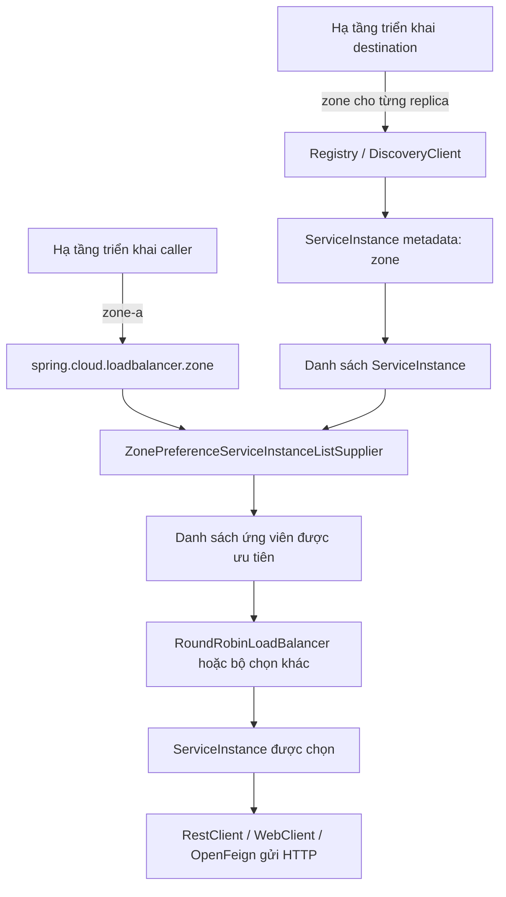

# Nguồn thông tin vùng của bên gọi và dịch vụ đích

Trong hệ thống microservices, một dịch vụ có thể chạy đồng thời ở nhiều **vùng triển khai** (zone), chẳng hạn `zone-a` và `zone-b`. Khi `order-service` gọi `inventory-service`, Spring Cloud LoadBalancer có thể ưu tiên bản sao ở cùng zone để giảm độ trễ và lưu lượng đi qua ranh giới mạng. Muốn làm được điều đó, phía cân bằng tải phải biết **zone của bên gọi** và **zone của từng instance bên đích**.

Hai nguồn thông tin này có xuất xứ và phạm vi khác nhau. Zone của caller thường được lấy từ cấu hình hoặc môi trường triển khai của ứng dụng đang gọi. Zone của destination instance thường được lấy từ metadata của `ServiceInstance` do cơ chế khám phá dịch vụ cung cấp. Bài học giải thích cách dữ liệu đi từ hai nguồn này tới `ZonePreferenceServiceInstanceListSupplier`, các trường hợp thiếu hoặc sai zone và cách kiểm tra định tuyến trong Spring Cloud LoadBalancer.

## 1. Hiểu đúng khái niệm zone

**Zone** ở đây là nhãn thể hiện vị trí triển khai hoặc miền lỗi mà hệ thống sử dụng để ra quyết định định tuyến. Nhãn có thể tương ứng với availability zone của hạ tầng đám mây, cụm máy, trung tâm dữ liệu hoặc một phân vùng mạng do tổ chức quy ước. Spring Cloud LoadBalancer chỉ làm việc với **giá trị zone mà ứng dụng cung cấp**; nó không tự xác minh rằng hai nhãn giống nhau chắc chắn nằm gần nhau về mặt vật lý.

Ví dụ:

| Thành phần | Zone | Địa chỉ |
| --- | --- | --- |
| `order-service` instance O1 | `zone-a` | `10.0.1.5:8080` |
| `inventory-service` instance A | `zone-a` | `10.0.1.11:8080` |
| `inventory-service` instance B | `zone-a` | `10.0.1.12:8080` |
| `inventory-service` instance C | `zone-b` | `10.0.2.21:8080` |
| `inventory-service` instance D | `zone-b` | `10.0.2.22:8080` |

Nếu chính sách zone preference được bật và danh sách ứng viên có A, B, C, D, caller O1 có thể nhận danh sách ưu tiên gồm A, B. Nếu một `order-service` khác được triển khai ở `zone-b`, nó có thể ưu tiên C, D. **Cùng một service ID không có nghĩa mọi caller sẽ nhận cùng một danh sách ưu tiên.**

Không nên đồng nhất `zone` với `region`: một region có thể chứa nhiều availability zone. Nhãn zone phải được chuẩn hóa và dùng nhất quán giữa bên gọi và bên đích; `zone-a`, `Zone-A` và `az-a` là ba chuỗi khác nhau nếu không có bước ánh xạ.

## 2. Nguồn thứ nhất: zone của dịch vụ gọi

Đối với thuật toán ưu tiên cùng vùng, LoadBalancer cần biết **caller hiện đang ở zone nào**. Đây là thông tin thuộc môi trường chạy của tiến trình gọi, không phải zone của service ID đích.

### 2.1. Cấu hình tường minh trên caller

Cách dễ kiểm soát là khai báo thuộc tính `spring.cloud.loadbalancer.zone` trong cấu hình của **dịch vụ gọi**:

```yaml
# application.yml của order-service triển khai tại zone-a
spring:
  application:
    name: order-service
  cloud:
    loadbalancer:
      zone: ${DEPLOYMENT_ZONE:zone-a}
      configurations: zone-preference
```

Giá trị `DEPLOYMENT_ZONE` là biến môi trường do ví dụ này quy ước. Hạ tầng triển khai phải cung cấp giá trị đúng cho mỗi bản sao `order-service`, ví dụ `zone-a` hoặc `zone-b`. Nếu không có biến môi trường, giá trị mặc định minh họa là `zone-a`; trong production, cần cân nhắc tránh dùng mặc định có thể che lỗi gắn nhãn.

Thuộc tính `spring.cloud.loadbalancer.zone` là zone dùng cho phía **client LoadBalancer**. Cấu hình `spring.cloud.loadbalancer.configurations: zone-preference` yêu cầu cấu hình chuỗi supplier ưu tiên zone trong những phiên bản Spring Cloud hỗ trợ lựa chọn này. Nếu ứng dụng đã khai báo chuỗi supplier tùy chỉnh, cần kiểm tra cấu hình thực tế thay vì cho rằng property này tự động thay thế mọi bean hiện có.

Một điểm quan trọng: cấu hình zone của caller không làm thay đổi metadata của các instance `inventory-service`. Nó chỉ cung cấp **giá trị mong muốn để đối chiếu** với metadata bên đích.

### 2.2. Lấy zone từ nền tảng triển khai

Trong hệ thống thực tế, nguồn ban đầu của zone có thể là:

- Biến môi trường hoặc cấu hình của từng nhóm máy, container, pod hay deployment.
- Giá trị do công cụ triển khai truyền theo availability zone hoặc node placement.
- Cấu hình tập trung hoặc cấu hình theo môi trường triển khai.
- Thông tin zone do một tích hợp discovery, ví dụ một số cấu hình Eureka, cung cấp cho client tùy phiên bản và cách tích hợp.

Điều cần quan sát là **giá trị cuối cùng mà Spring Cloud LoadBalancer sử dụng**, không chỉ nhãn hiển thị trong console hạ tầng. Chẳng hạn, Kubernetes node có label `topology.kubernetes.io/zone` không đồng nghĩa thuộc tính `spring.cloud.loadbalancer.zone` của Java process đã được thiết lập. Muốn dùng label này, cần có cơ chế truyền hoặc ánh xạ nó sang cấu hình ứng dụng.

Với Eureka, cơ chế vùng của client có thể được suy ra từ cấu hình Eureka trong một số bản tích hợp. Để tránh phụ thuộc hành vi theo phiên bản, ví dụ của bài chọn cách khai báo zone một cách tường minh và kiểm tra giá trị hiệu lực khi chạy.

## 3. Nguồn thứ hai: zone của dịch vụ đích

Với một service ID như `inventory-service`, discovery trả về danh sách `ServiceInstance`. Mỗi đối tượng có host, port và có thể có một map metadata. Zone của một instance thường được thể hiện bằng khóa metadata `zone`:

```text
ServiceInstance A
  serviceId = inventory-service
  host      = 10.0.1.11
  port      = 8080
  metadata  = { zone: zone-a }

ServiceInstance C
  serviceId = inventory-service
  host      = 10.0.2.21
  port      = 8080
  metadata  = { zone: zone-b }
```

`ZonePreferenceServiceInstanceListSupplier` dựa trên thông tin zone mà nó nhận được từ phía client và từ các `ServiceInstance` để xác định ứng viên cùng vùng. Supplier không tự truy vấn vị trí vật lý của IP hay mở kết nối tới từng instance chỉ để suy đoán zone.

### 3.1. Metadata được công bố qua service discovery

Trong một hệ thống dùng Eureka, dịch vụ đích có thể gắn zone vào metadata khi đăng ký:

```yaml
# application.yml của inventory-service chạy tại zone-b
spring:
  application:
    name: inventory-service

eureka:
  instance:
    metadata-map:
      zone: ${DEPLOYMENT_ZONE:zone-b}
```

Đây là ví dụ minh họa trường metadata cho một registry có hỗ trợ metadata map. Cách đăng ký instance và cấu hình Eureka đầy đủ còn phụ thuộc dependency, địa chỉ registry và phiên bản Spring Cloud của ứng dụng.

Khi `inventory-service` chạy ở hai zone, từng instance phải được gắn nhãn theo **vị trí thực của chính instance đó**. Không thể sao chép `zone-a` vào cấu hình chung cho cả nhóm instance rồi mong LoadBalancer tự suy ra rằng một số bản sao thực ra ở `zone-b`.

Các discovery implementation khác có thể lấy metadata từ cấu hình tĩnh, nhãn của workload hoặc tài nguyên của nền tảng. Tên khóa và cơ chế ánh xạ phụ thuộc implementation; điều kiện cần là phía caller đọc được một giá trị zone đúng và nhất quán trong `ServiceInstance` mà supplier thực sự nhận.

### 3.2. Đừng suy ra zone từ host hoặc service ID

`inventory-service` là tên logic của **toàn bộ dịch vụ**, không phải định danh zone. Hai instance thuộc cùng service ID vẫn có thể nằm ở các vùng khác nhau. Hostname hay IP có thể gợi ý một subnet, nhưng không nên sử dụng chúng làm bằng chứng xác định zone trừ khi hệ thống có quy tắc ánh xạ được quản lý rõ ràng.

Nếu metadata không chứa `zone`, supplier thường không thể đối chiếu instance đó với zone của caller bằng cơ chế so khớp zone thông thường. Tùy chính sách và danh sách còn lại, instance thiếu zone có thể không nằm trong tập ưu tiên cùng vùng nhưng vẫn có thể xuất hiện ở đường fallback.

## 4. Hai nguồn zone gặp nhau ở đâu?

Luồng thông tin của một lời gọi qua Spring Cloud LoadBalancer có thể được hình dung như sau:



Mỗi thành phần có trách nhiệm riêng:

| Thành phần | Nguồn dữ liệu / trách nhiệm |
| --- | --- |
| Caller deployment | Xác định zone của tiến trình gọi, chuyển thành cấu hình client |
| Destination deployment | Gắn zone đúng cho mỗi bản sao đang chạy |
| Discovery client | Trả về danh sách các instance và metadata đã công bố |
| `ServiceInstanceListSupplier` | Cung cấp, cache hoặc lọc danh sách ứng viên theo cấu hình |
| `ZonePreferenceServiceInstanceListSupplier` | Ưu tiên danh sách instance có zone khớp với zone của caller |
| `RoundRobinLoadBalancer` | Chọn một instance từ danh sách ứng viên nhận được |
| HTTP client | Gửi request tới địa chỉ thực của instance đã được chọn |

**Discovery biết những bản sao đang được công bố; zone preference quyết định bản sao nào được ưu tiên; thuật toán LoadBalancer mới chọn một bản sao cho lời gọi hiện tại.** Không nên gộp ba nhiệm vụ này khi chẩn đoán lỗi.

## 5. ZonePreferenceServiceInstanceListSupplier sử dụng hai nguồn ra sao?

Với cơ chế zone preference điển hình, supplier so khớp zone của caller với giá trị `zone` trong metadata của mỗi instance:

1. Nhận danh sách ứng viên từ supplier bên trong, chẳng hạn supplier lấy dữ liệu từ discovery.
2. Lấy zone đã cấu hình của caller.
3. Tìm những instance có metadata zone bằng zone của caller.
4. Nếu có instance khớp, ưu tiên trả tập phù hợp để bộ chọn sử dụng.
5. Nếu không có instance khớp, **fallback về danh sách gốc** trong cách triển khai zone preference thường dùng, để vẫn có thể phục vụ request xuyên zone.

Ví dụ caller ở `zone-a` và discovery trả về A, B, C, D:

| Tình trạng dữ liệu | Danh sách ứng viên sau zone preference |
| --- | --- |
| A, B có `zone-a`; C, D có `zone-b` | A, B |
| Chỉ B có `zone-a`; A, C, D ở zone khác | B |
| Không instance nào có `zone-a` | A, B, C, D (fallback) |
| Tất cả instance thiếu metadata zone | Thường trả lại danh sách gốc vì không có kết quả khớp |
| Danh sách discovery đã rỗng | Danh sách tiếp tục rỗng |

Nếu danh sách cuối cùng có A và B, Round Robin có thể lần lượt chọn A, B cho các request. Nếu danh sách cuối cùng chỉ có B, mọi lần lựa chọn hợp lệ đều hướng về B. Nếu không có instance cùng vùng, thuật toán lựa chọn có thể nhận toàn bộ các instance khác vùng nhờ fallback.

**Zone preference là ưu tiên mềm (soft preference), không phải cam kết chỉ chọn instance cùng vùng.** Với yêu cầu phải giữ dữ liệu trong một vùng vì chính sách pháp lý, phân tách tenant hoặc giới hạn bảo mật, cần cơ chế ràng buộc mạnh hơn và kiểm soát quyền truy cập độc lập; không nên dựa vào fallback mặc định.

## 6. Ví dụ cấu hình đồng bộ giữa caller và destination

Một ví dụ triển khai hai vùng sử dụng Eureka và Spring Cloud LoadBalancer:

**`order-service` ở zone-a** khai báo zone của caller và bật cấu hình zone preference:

```yaml
spring:
  application:
    name: order-service
  cloud:
    loadbalancer:
      zone: zone-a
      configurations: zone-preference
```

**`inventory-service` instance A ở zone-a** công bố metadata của chính nó:

```yaml
spring:
  application:
    name: inventory-service
eureka:
  instance:
    metadata-map:
      zone: zone-a
```

**`inventory-service` instance C ở zone-b** sử dụng cùng service ID nhưng metadata khác:

```yaml
spring:
  application:
    name: inventory-service
eureka:
  instance:
    metadata-map:
      zone: zone-b
```

Đây là các đoạn cấu hình riêng cho từng vai trò; ứng dụng vẫn cần dependency, cấu hình kết nối registry và các thành phần HTTP client tương ứng. Đặc biệt, `spring.cloud.loadbalancer.configurations: zone-preference` là cách bật cấu hình supplier mặc định có zone preference khi được phiên bản sử dụng hỗ trợ. Nếu đã có cấu hình `@LoadBalancerClient` hoặc `ServiceInstanceListSupplier` tùy chỉnh cho `inventory-service`, hãy xác định chain nào được áp dụng thực tế.

Ví dụ phía caller dùng `RestClient` được tích hợp Spring Cloud LoadBalancer:

```java
import org.springframework.cloud.client.loadbalancer.LoadBalanced;
import org.springframework.context.annotation.Bean;
import org.springframework.context.annotation.Configuration;
import org.springframework.web.client.RestClient;

@Configuration
class InventoryHttpClientConfig {

    @Bean
    @LoadBalanced
    RestClient.Builder loadBalancedRestClientBuilder() {
        return RestClient.builder();
    }
}
```

Mã nghiệp vụ vẫn gọi URL logic:

```java
var client = loadBalancedRestClientBuilder.build();
String body = client.get()
        .uri("http://inventory-service/api/stocks/BOOK-001")
        .retrieve()
        .body(String.class);
```

Đoạn cuối giả định biến `loadBalancedRestClientBuilder` đã được inject vào lớp sử dụng. Zone không được nhúng vào URI; LoadBalancer dùng cấu hình và metadata khi chọn bản sao. Nguyên tắc nguồn zone tương tự với `WebClient` dùng builder có `@LoadBalanced` và OpenFeign gọi theo service name, miễn là những tích hợp này sử dụng Spring Cloud LoadBalancer đúng cách.

## 7. Khám phá không bảo đảm metadata luôn mới hoặc chính xác

Registry chỉ trả về những giá trị mà nó biết hoặc được ứng dụng công bố. Có nhiều lý do khiến dữ liệu zone không khớp thực tế:

| Hiện tượng | Nguyên nhân có thể xảy ra | Hệ quả |
| --- | --- | --- |
| Caller thật ở `zone-b` nhưng cấu hình `zone-a` | Biến môi trường sai hoặc file cấu hình bị dùng chung | Ưu tiên sai vùng, tăng traffic xuyên vùng |
| Instance ở `zone-b` lại đăng ký `zone-a` | Metadata sao chép sai khi triển khai | LoadBalancer coi instance ở xa là cùng vùng |
| Một số instance thiếu `metadata.zone` | Discovery adapter không chuyển nhãn hoặc cấu hình registry thiếu | Không được chọn trong tập khớp zone nếu còn instance cùng vùng |
| Zone được viết thành `Zone-A` thay vì `zone-a` | Quy ước đặt tên không nhất quán | Không khớp khi so sánh giá trị zone |
| Instance vừa được di chuyển sang zone khác | Registry hoặc cache chưa làm mới | Có thể chọn dựa trên vị trí cũ |
| Instance cùng zone nhưng không phản hồi | Health check hoặc trạng thái tiến trình không phù hợp | Ưu tiên đúng zone nhưng kết nối vẫn thất bại |

Khi một request bị gửi sai zone, nên kiểm tra cả hai đầu: **giá trị zone hiệu lực của caller** và **metadata từng `ServiceInstance` mà supplier thực sự nhận**. Kiểm tra mỗi `application.yml` hoặc mỗi registry riêng lẻ có thể chưa đủ nếu còn lớp cấu hình phủ, cache, adapter hoặc filter.

## 8. Quan hệ giữa zone preference, cache và health check

Zone là một thuộc tính định tuyến; nó không nói lên instance còn sống hoặc còn đủ khả năng xử lý request. Một instance ở đúng zone nhưng đã dừng hoạt động vẫn có thể được ưu tiên nếu nó còn nằm trong danh sách ứng viên.

Chuỗi `ServiceInstanceListSupplier` có thể bổ sung cache, health check và các bộ lọc khác. Cấu hình và thứ tự các lớp ảnh hưởng tới danh sách cuối cùng:

```text
Discovery: A(zone-a), B(zone-a), C(zone-b)
Health check: A không khỏe -> còn B, C
Zone preference của caller zone-a: còn B
LoadBalancer: chọn B
```

Nếu B cũng không khỏe và bước lọc health check đã loại cả A lẫn B, danh sách còn C. Với zone preference có fallback, C có thể được chọn để duy trì khả năng phục vụ xuyên zone.

Tuy nhiên, ví dụ trên là **một thứ tự lọc minh họa**. Một chuỗi được cấu hình khác có thể tạo kết quả khác; không được giả định health check, cache, zone preference hay retry-aware supplier luôn có thứ tự cố định. Khi thiết kế chuỗi tùy chỉnh, cần xác minh vị trí các decorator và đường truyền dữ liệu `get(Request)` nếu một bộ lọc còn phụ thuộc vào request hiện tại.

Về cache, có thể tồn tại cache tại discovery client và tại LoadBalancer supplier. TTL dài làm chậm việc cập nhật metadata zone sau khi triển khai lại; TTL rất ngắn làm tăng truy vấn nguồn discovery. Số request tới các instance trong mỗi zone vì thế có thể biến đổi theo thời điểm cập nhật topology.

## 9. Zone của caller thường thuộc deployment, khác với hint theo request

`spring.cloud.loadbalancer.zone` mô tả vị trí của **tiến trình caller**. Nhiều request từ cùng một instance `order-service` thường dùng chung zone này. Cơ chế đó khác với việc một request HTTP cụ thể mang header như `X-SC-LB-Hint` để yêu cầu nhóm instance khác nhau.

| Nhu cầu | Cách biểu diễn thích hợp |
| --- | --- |
| Ưu tiên replica gần nơi `order-service` đang chạy | Caller zone từ cấu hình triển khai |
| Ưu tiên replica có metadata zone khớp caller | Zone preference supplier |
| Chọn canary hoặc track theo từng request | Hint hoặc context theo request và supplier được cấu hình tương ứng |
| Tránh instance lỗi ở lần retry | Retry-aware supplier và ngữ cảnh của lần thử |
| Bắt buộc tách biệt dữ liệu theo vùng | Chính sách định tuyến bắt buộc và kiểm soát truy cập ở các lớp thích hợp |

Việc thêm một header tùy ý vào request **không tự động thay đổi** zone cấu hình trên caller. Nếu cần định tuyến theo vùng của người dùng cuối, tenant hoặc tham số từng request, phải thiết kế đường truyền ngữ cảnh đáng tin cậy và bộ lọc phù hợp. Không được coi hint do client bên ngoài gửi là bằng chứng quyền truy cập vùng dữ liệu.

## 10. Quan sát zone trong danh sách ServiceInstance

Để kiểm tra dữ liệu bên đích mà caller thấy, có thể đọc thông tin từ `DiscoveryClient`:

```java
import org.slf4j.Logger;
import org.slf4j.LoggerFactory;
import org.springframework.cloud.client.ServiceInstance;
import org.springframework.cloud.client.discovery.DiscoveryClient;
import org.springframework.stereotype.Component;

@Component
class InventoryZoneInspector {
    private static final Logger log =
            LoggerFactory.getLogger(InventoryZoneInspector.class);

    private final DiscoveryClient discoveryClient;

    InventoryZoneInspector(DiscoveryClient discoveryClient) {
        this.discoveryClient = discoveryClient;
    }

    void logDiscoveredInstances() {
        for (ServiceInstance instance :
                discoveryClient.getInstances("inventory-service")) {
            log.info("serviceId={} instanceId={} host={} port={} zone={}",
                    instance.getServiceId(), instance.getInstanceId(),
                    instance.getHost(), instance.getPort(),
                    instance.getMetadata().get("zone"));
        }
    }
}
```

Log ví dụ:

```text
serviceId=inventory-service instanceId=inventory-a host=10.0.1.11 port=8080 zone=zone-a
serviceId=inventory-service instanceId=inventory-c host=10.0.2.21 port=8080 zone=zone-b
```

Đoạn code này quan sát **danh sách từ discovery**. Kết quả sau cache, health check hay zone preference có thể khác. Để chứng minh policy hoạt động, cần kiểm tra thêm danh sách đầu vào và đầu ra của các supplier liên quan, cùng instance được LoadBalancer thực sự chọn. Khi ghi log, chỉ dùng metadata cần thiết và tránh tiết lộ token, cookie hoặc dữ liệu nhạy cảm.

## 11. Quy trình chẩn đoán khi caller gọi nhầm zone

Giả sử `order-service` ở `zone-a`, nhưng request thường được gửi tới C ở `zone-b`. Có thể kiểm tra theo thứ tự:

1. **Xác nhận zone thực của caller:** instance này đang được scheduler đặt tại vùng nào?
2. **Đọc cấu hình hiệu lực:** `spring.cloud.loadbalancer.zone` có thực sự là `zone-a` không? Có property source hoặc biến môi trường nào ghi đè không?
3. **Xác nhận chain đang chạy:** `ZonePreferenceServiceInstanceListSupplier` đã được kích hoạt cho service ID `inventory-service` chưa?
4. **Đọc danh sách từ discovery:** A, B và C có đúng host, port và `metadata.zone` không?
5. **Kiểm tra tên zone:** các giá trị có cùng quy ước, phân biệt chữ hoa/chữ thường và không chứa khoảng trắng ngoài ý muốn không?
6. **Quan sát cache và filter:** instance cùng zone có bị lọc bởi health check, stale cache hoặc supplier khác không?
7. **Kiểm tra fallback:** nếu không còn instance cùng zone, supplier có trả về danh sách khác vùng như chính sách mong đợi không?
8. **Kiểm tra instance được chọn:** kết quả cuối cùng của LoadBalancer có nằm trong danh sách ứng viên mà supplier cung cấp không?

Không nên kết luận Round Robin “chọn nhầm” khi nó chỉ nhận danh sách sau lọc đã bao gồm C. Thuật toán lựa chọn không tự biết vị trí của caller nếu lớp cung cấp danh sách chưa áp dụng chính sách zone.

Một dạng log hỗ trợ chẩn đoán:

```text
traceId=ab12... serviceId=inventory-service callerZone=zone-a
discoveredInstances=4 sameZoneCandidates=2 eligibleCandidates=2
selectedInstance=10.0.1.12:8080 selectedZone=zone-a
```

Cần xác định các bộ đếm đó được lấy ở tầng nào, vì `discoveredInstances` và `eligibleCandidates` có thể khác nhau theo supplier chain. Chỉ tạo nhãn metric zone từ tập giá trị được quản lý; tránh dùng chuỗi zone do người dùng nhập tùy ý làm label có cardinality quá cao.

## 12. Tình huống failover giữa các zone

Giả sử `order-service` ở `zone-a`, `inventory-service` có A và B tại `zone-a`, C và D tại `zone-b`:

| Giai đoạn | Danh sách còn khỏe theo giả định | Kết quả định tuyến mong đợi |
| --- | --- | --- |
| Bình thường | A, B, C, D | Ưu tiên A hoặc B |
| A ngừng hoạt động | B, C, D | Ưu tiên B |
| Cả A và B không khả dụng | C, D | Fallback tới C hoặc D nếu policy cho phép |
| Tất cả bản sao không khả dụng | Rỗng | Không có instance để chọn; caller phải xử lý lỗi phụ thuộc |

Failover xuyên zone tăng khả năng phục vụ nhưng cũng có chi phí: độ trễ mạng, lưu lượng liên vùng và khả năng vi phạm giả định về dữ liệu cục bộ. Nếu dịch vụ đích ghi dữ liệu, sự sẵn có của replica ở zone khác không tự bảo đảm dữ liệu đã được đồng bộ hay thao tác có tính nhất quán phù hợp.

Vì vậy, chọn zone nên đi cùng sức khỏe replica, timeout, retry có giới hạn và quan sát lỗi theo instance. Retry một request ghi dữ liệu sau timeout còn phải xét idempotency; đổi sang zone khác không làm mất nguy cơ thao tác ở instance trước đã thực thi.

## 13. Ma trận kiểm thử nguồn dữ liệu zone

Các kiểm thử sau giúp phát hiện lỗi cấu hình trước khi triển khai rộng:

| Trường hợp | Điều cần xác minh |
| --- | --- |
| Caller `zone-a`, có instance `zone-a` và `zone-b` | Chỉ instance cùng zone nằm trong danh sách ưu tiên |
| Caller `zone-b`, cùng service ID | Danh sách ưu tiên chuyển sang các instance `zone-b` |
| Caller thiếu cấu hình zone | Không giả định có lọc cùng vùng; hành vi fallback đúng như cấu hình |
| Instance không có `metadata.zone` | Không bị nhầm thành instance cùng vùng; vẫn xử lý nhất quán ở nhánh fallback |
| Caller cấu hình `zone-a`, instance dùng `Zone-A` | Phát hiện giá trị không đồng nhất |
| Các instance cùng zone bị loại bởi health check | Xác minh khả năng fallback xuyên zone theo thứ tự supplier thực tế |
| Registry cập nhật zone của instance | Kiểm tra độ trễ làm mới cache và topology |
| Caller ở hai zone cùng lúc | Mỗi caller dùng zone hiệu lực của riêng nó, không rò cấu hình giữa các tiến trình |

Kiểm thử đơn vị có thể cấp danh sách `ServiceInstance` giả và cấu hình zone đã biết để xác nhận kết quả supplier. Kiểm thử tích hợp cần xác nhận ứng dụng thật lấy được zone từ nguồn triển khai và metadata từ discovery. Khi có nhiều HTTP client, kiểm tra RestClient, WebClient hoặc OpenFeign đang sử dụng đúng LoadBalancer và supplier chain đã cấu hình.

## 14. Tự kiểm tra kiến thức

1. Thông tin zone của `order-service` thường đến từ đâu? Nó khác gì với zone của một `ServiceInstance` thuộc `inventory-service`?
2. Vì sao hai replica cùng service ID vẫn có thể có metadata zone khác nhau?
3. Khi dùng `spring.cloud.loadbalancer.zone`, ứng dụng nên đặt thuộc tính này ở phía caller hay chỉ tại destination?
4. `ZonePreferenceServiceInstanceListSupplier` ưu tiên instance như thế nào khi có và không có bản sao cùng zone?
5. Vì sao node Kubernetes có zone label không bảo đảm Spring Cloud LoadBalancer đã biết zone đó?
6. Nếu caller thấy `metadata.zone=zone-a` nhưng request vẫn chạy xuyên zone, cần kiểm tra thêm những thành phần nào?
7. Tại sao zone preference không thể thay thế kiểm soát truy cập hoặc chính sách bắt buộc giữ dữ liệu trong một vùng?
8. Cache, health check và retry có thể ảnh hưởng thế nào tới kết quả định tuyến theo zone?

Trong Spring Cloud LoadBalancer, zone của bên gọi là **giá trị thể hiện nơi caller đang chạy**, còn zone của dịch vụ đích là **metadata của từng instance** được discovery công bố. Khi hai nguồn được truyền đúng và có cấu hình zone preference, supplier tạo danh sách ứng viên phù hợp để LoadBalancer lựa chọn. Hiểu rõ nguồn dữ liệu, cơ chế fallback và các bước quan sát giúp xây dựng chính sách định tuyến ổn định giữa nhiều vùng.
