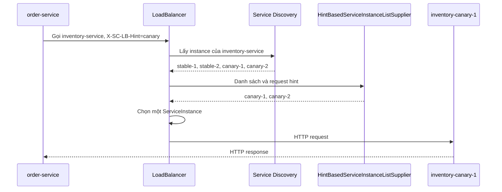

# Định tuyến theo hint và metadata của ServiceInstance

## Mục tiêu

Trong hệ thống microservices, các bản sao của cùng một dịch vụ có thể khác nhau về vùng triển khai, phiên bản phát hành, năng lực xử lý hoặc nhóm lưu lượng được phép tiếp nhận. Spring Cloud LoadBalancer không chỉ chọn `ServiceInstance` theo round robin hay random mà còn có thể **lọc danh sách ứng viên bằng thông tin gắn với instance và ngữ cảnh của request**.

Một cơ chế tiêu biểu là định tuyến theo **hint**: caller gửi một gợi ý như `stable` hoặc `canary`, còn mỗi `ServiceInstance` đăng ký metadata tương ứng. `HintBasedServiceInstanceListSupplier` tìm những instance có metadata khớp với hint để đưa vào danh sách lựa chọn. Có thể kết hợp cơ chế này với thông tin `zone`, `weight` hoặc bộ lọc tùy chỉnh khi cần chính sách phức tạp hơn.

Sau bài học, bạn có thể:

- Phân biệt **hint của request** và **metadata của ServiceInstance**.
- Hiểu cách Spring Cloud LoadBalancer lấy hint từ header, cấu hình mặc định và cấu hình riêng cho service ID.
- Bật `HintBasedServiceInstanceListSupplier` bằng `ServiceInstanceListSupplier.builder()`.
- Thực hành với `RestClient`, `WebClient` và OpenFeign khi gọi dịch vụ qua service ID.
- Giải thích chính xác hành vi khi hint không có, không khớp hoặc danh sách instance rỗng.
- Kết hợp hint với zone/weight mà không vô tình định tuyến sai phiên bản.
- Xây dựng bộ lọc metadata riêng khi chính sách yêu cầu khớp bắt buộc, đồng thời kiểm thử và quan sát hiệu quả định tuyến.

## 1. Vấn đề thực tế: một service ID, nhiều nhóm instance

Giả sử `order-service` cần gọi `inventory-service`. Dịch vụ đích đang có bốn bản sao được đăng ký với cùng service ID:

| Instance ID | Địa chỉ | `hint` | `zone` | `weight` |
|---|---|---|---|---:|
| `inventory-stable-1` | `10.10.1.11:8080` | `stable` | `zone-a` | 3 |
| `inventory-stable-2` | `10.10.1.12:8080` | `stable` | `zone-b` | 1 |
| `inventory-canary-1` | `10.10.2.21:8080` | `canary` | `zone-a` | 1 |
| `inventory-canary-2` | `10.10.2.22:8080` | `canary` | `zone-b` | 1 |

Nhóm stable phục vụ phần lớn lưu lượng. Nhóm canary chạy bản triển khai mới cần được kiểm tra có kiểm soát. Caller có thể biểu thị mong muốn bằng một hint:

```text
GET http://inventory-service/api/items/42
X-SC-LB-Hint: stable

GET http://inventory-service/api/items/42
X-SC-LB-Hint: canary
```

Hai URL giống nhau vì đều sử dụng service ID `inventory-service`. Điểm khác biệt nằm ở hint của request. Nếu supplier hint được bật và metadata đăng ký đúng:

- Hint `stable` → danh sách gồm hai instance stable.
- Hint `canary` → danh sách gồm hai instance canary.
- Sau khi lọc, thuật toán như `RoundRobinLoadBalancer` mới chọn **một** instance trong danh sách còn lại.

Định tuyến theo hint cần cả hai phía: **request cung cấp giá trị cần tìm**, còn **ServiceInstance cung cấp nhãn để so khớp**. Chỉ thêm header vào request hoặc chỉ thêm metadata vào registry sẽ chưa đủ.

## 2. ServiceInstance chứa metadata như thế nào?

Trong Spring Cloud, `org.springframework.cloud.client.ServiceInstance` đại diện cho một endpoint cụ thể của dịch vụ. Các thông tin quan trọng gồm:

| Thuộc tính | Vai trò |
|---|---|
| `getServiceId()` | Tên logic của dịch vụ, ví dụ `inventory-service`. |
| `getInstanceId()` | Định danh bản sao, hữu ích khi log và quan sát. |
| `getHost()`, `getPort()`, `isSecure()` | Địa chỉ và giao thức truy cập instance. |
| `getUri()` | URI được tạo từ thông tin kết nối. |
| `getMetadata()` | `Map<String, String>` chứa các thuộc tính gắn với bản sao. |

Ví dụ metadata của `inventory-canary-1`:

```json
{
  "hint": "canary",
  "zone": "zone-a",
  "weight": "1",
  "release": "2026-11-canary",
  "tier": "internal"
}
```

Metadata là dữ liệu do discovery provider, service registry hoặc nền tảng triển khai cung cấp. Spring Cloud LoadBalancer không tự nhận ra `canary` từ tên pod, IP hoặc hostname; phải có một quy ước đăng ký metadata nhất quán.

Ba key được những supplier có sẵn sử dụng thường xuyên:

- `hint`: `HintBasedServiceInstanceListSupplier` dùng để đối chiếu với hint của request.
- `zone`: `ZonePreferenceServiceInstanceListSupplier` dùng để ưu tiên các instance cùng vùng với caller.
- `weight`: `WeightedServiceInstanceListSupplier` dùng để tính trọng số phân phối, mặc định là `1` nếu không khai báo.

Các key như `release` hoặc `tier` chỉ là dữ liệu tùy chỉnh. Chúng **không tự động ảnh hưởng tới thuật toán** nếu ứng dụng chưa có supplier tương ứng để đọc và lọc. Metadata cũng không thay thế việc kiểm tra sức khỏe và không chứng minh một instance đã sẵn sàng phục vụ.

## 3. Đăng ký metadata trên các bản sao

### 3.1. Ví dụ với Eureka

Khi dùng Spring Cloud Netflix Eureka, mỗi instance có thể khai báo metadata trong `application.yml` hoặc biến môi trường tương ứng. Cấu hình dành cho một bản sao stable:

```yaml
spring:
  application:
    name: inventory-service

eureka:
  instance:
    metadata-map:
      hint: stable
      zone: zone-a
      weight: "3"
      release: "stable"
```

Bản sao canary dùng cùng `spring.application.name` nhưng giá trị metadata khác:

```yaml
spring:
  application:
    name: inventory-service

eureka:
  instance:
    metadata-map:
      hint: canary
      zone: zone-a
      weight: "1"
      release: "2026-11-canary"
```

Đây là **cấu hình trên ứng dụng được gọi**, được đăng ký cùng instance. Trên phía `order-service`, cần cấu hình discovery client để đọc các instance và LoadBalancer supplier để sử dụng metadata đó.

Với Consul, Kubernetes hoặc một nguồn discovery khác, cách đăng ký metadata có thể khác. Điều kiện cần kiểm tra là lời gọi `ServiceInstance.getMetadata()` của discovery client thực sự chứa những key như `hint`, `zone` và `weight`. Không suy ra rằng mọi label hoặc annotation của Kubernetes tự động xuất hiện trong metadata của `ServiceInstance`.

### 3.2. Quy ước dữ liệu metadata

Nên thống nhất một hợp đồng chung giữa bên đăng ký instance và bên gọi:

| Quy ước | Ví dụ nên dùng | Lý do |
|---|---|---|
| Key chữ thường, cố định | `hint`, `zone` | Tránh nhầm `Hint` với `hint`. |
| Giá trị hint chuẩn hóa | `stable`, `canary` | So khớp chuỗi chính xác. |
| Weight là số hợp lệ | `"1"`, `"3"` | Supplier có thể phân tích sang số. |
| Zone thống nhất | `zone-a` | Caller và instance cần cùng quy ước vùng. |
| Có giám sát metadata | `release=2026-11-canary` | Dễ điều tra cấu hình rollout. |

Không đặt token, thông tin khách hàng hoặc dữ liệu bí mật vào metadata service discovery. Registry thường được truy cập bởi nhiều thành phần hạ tầng; metadata nên chứa thông tin định tuyến ít nhạy cảm.

## 4. Spring Cloud LoadBalancer lấy hint từ đâu?

Spring Cloud LoadBalancer hỗ trợ hint dạng chuỗi được truyền trong đối tượng `Request`. `HintBasedServiceInstanceListSupplier` tìm hint theo thứ tự:

1. **Header của outbound request**, mặc định là `X-SC-LB-Hint`.
2. **Hint được cấu hình cho service ID**, khi request không cung cấp hint.
3. **Hint mặc định của ứng dụng**, khi không có hint riêng cho service ID.
4. Nếu vẫn không có hint, không lọc theo hint.

Tên header có thể thay đổi bằng thuộc tính:

```yaml
spring:
  cloud:
    loadbalancer:
      hint-header-name: X-SC-LB-Hint
```

Giữ tên mặc định thường dễ bảo trì hơn; chỉ đổi nếu tổ chức đã có quy ước header khác và mọi thành phần liên quan đều hỗ trợ.

### 4.1. Hint mặc định và hint riêng từng service ID

Ví dụ cấu hình trong ứng dụng caller:

```yaml
spring:
  cloud:
    loadbalancer:
      hint:
        default: stable
        inventory-service: canary
        pricing-service: stable
```

Khi không có header hint:

- Request đến `inventory-service` dùng hint cấu hình `canary`.
- Request đến `pricing-service` dùng hint cấu hình `stable`.
- Service ID chưa có cấu hình riêng dùng hint `stable` theo `default`.

Nếu request đến `inventory-service` **có** `X-SC-LB-Hint: stable`, giá trị header được ưu tiên hơn hint `canary` đã cấu hình. Cấu hình mặc định là cách đặt lựa chọn dự phòng cho những request không mang hint, không phải một chính sách buộc mọi request phải đi tới nhóm mặc định.

### 4.2. So khớp với metadata

Khi nhận được hint, `HintBasedServiceInstanceListSupplier` so sánh giá trị đó với `serviceInstance.getMetadata().get("hint")`.

Ví dụ:

```text
requestHint = "canary"

instances from discovery:
  inventory-stable-1 { hint: stable }
  inventory-stable-2 { hint: stable }
  inventory-canary-1 { hint: canary }
  inventory-canary-2 { hint: canary }

after hint filter:
  inventory-canary-1
  inventory-canary-2
```

Đối chiếu theo giá trị chuỗi, không dựa trên kiểu khớp mờ hoặc biểu thức chính quy. Vì vậy `canary` và `Canary` là hai giá trị khác nhau. Key metadata cũng phải đúng là `hint` nếu dùng supplier mặc định.

## 5. Phân biệt hint, supplier và thuật toán chọn instance

Trong Spring Cloud LoadBalancer, định tuyến diễn ra qua các bước:



`HintBasedServiceInstanceListSupplier` **lọc danh sách ứng viên**, còn `RoundRobinLoadBalancer` hoặc `RandomLoadBalancer` **chọn một instance** trong danh sách đó. Đây là hai trách nhiệm khác nhau:

- Discovery trả về tập instance của service ID.
- Supplier có thể cache, lọc theo hint, ưu tiên zone hoặc áp dụng chính sách metadata khác.
- `ReactorLoadBalancer` quyết định instance được chọn trong tập ứng viên cuối.
- HTTP client gọi host/port của instance được chọn và xử lý timeout, lỗi mạng hoặc retry.

Nếu chỉ tạo metadata `hint` mà không thêm hint-based supplier, lựa chọn instance sẽ không tự thay đổi theo header `X-SC-LB-Hint`. Nếu chỉ bật supplier mà discovery không cung cấp metadata tương ứng, không có instance khớp và supplier sẽ thực hiện fallback.

## 6. Bật hint-based routing trong ứng dụng caller

### 6.1. Dependency nền tảng

Trong Maven, dùng Spring Cloud BOM tương thích với Spring Boot đang chạy, sau đó khai báo starter:

```xml
<dependency>
    <groupId>org.springframework.cloud</groupId>
    <artifactId>spring-cloud-starter-loadbalancer</artifactId>
</dependency>
```

Để lấy instance động, cần thêm discovery provider phù hợp như Eureka hoặc Consul. Nếu chưa có registry, có thể sử dụng danh sách instance tĩnh trong môi trường demo, nhưng vẫn phải đảm bảo dữ liệu metadata được cung cấp cho supplier khi kiểm thử hint.

### 6.2. Tạo supplier theo service ID

Khai báo `@LoadBalancerClient` trên một lớp cấu hình được Spring quét:

```java
import org.springframework.cloud.loadbalancer.annotation.LoadBalancerClient;
import org.springframework.context.annotation.Configuration;

@Configuration(proxyBeanMethods = false)
@LoadBalancerClient(
        name = "inventory-service",
        configuration = InventoryHintLoadBalancerConfiguration.class
)
class InventoryClientLoadBalancerRegistration {
}
```

Cấu hình supplier dành riêng cho `inventory-service`:

```java
import org.springframework.cloud.loadbalancer.core.ServiceInstanceListSupplier;
import org.springframework.context.ConfigurableApplicationContext;
import org.springframework.context.annotation.Bean;

class InventoryHintLoadBalancerConfiguration {

    @Bean
    ServiceInstanceListSupplier inventoryInstanceListSupplier(
            ConfigurableApplicationContext context) {
        return ServiceInstanceListSupplier.builder()
                .withDiscoveryClient()
                .withCaching()
                .withHints()
                .build(context);
    }
}
```

Đọc thứ tự các bước:

1. `withDiscoveryClient()` lấy danh sách của `inventory-service`.
2. `withCaching()` cache danh sách trả về từ discovery theo cơ chế của LoadBalancer.
3. `withHints()` thêm `HintBasedServiceInstanceListSupplier` để lọc **theo mỗi request**.

Vì hint thay đổi theo request, **cache phải đứng ngay sau nguồn discovery và trước bộ lọc hint**. Không cache danh sách đã lọc bằng khóa chỉ có service ID, vì request `stable` có thể khiến request `canary` sau đó nhận lại tập instance stable.

Lớp `InventoryHintLoadBalancerConfiguration` cố ý không có `@Configuration`. Các lớp được truyền vào `@LoadBalancerClient(configuration = ...)` nên nằm ngoài phạm vi component scan hoặc không gắn `@Configuration` để tránh bean riêng bị đăng ký thành bean dùng chung cho các service ID khác.

### 6.3. Khi đã có cache từ discovery

Một số discovery client, ví dụ Eureka, có cache riêng. Spring Cloud khuyến nghị cân nhắc tắt LoadBalancer cache để tránh hai tầng cache và danh sách instance cũ:

```yaml
spring:
  cloud:
    loadbalancer:
      cache:
        enabled: false
```

Khi đó vẫn giữ thứ tự: nguồn discovery trước, hint filter sau. Nếu dùng health-check supplier để kiểm tra readiness, nên bố trí supplier kiểm tra sức khỏe ngay sau nguồn discovery và trước bộ lọc phụ thuộc request; tài liệu cũng khuyến cáo không kết hợp tùy tiện health-check supplier với caching supplier.

## 7. Gửi hint từ RestClient, WebClient và OpenFeign

Các ví dụ dưới đây giả định `inventory-service` đã đăng ký trong discovery và có supplier `withHints()` như trên. URL dùng **service ID**, vì thế HTTP client phải tích hợp Spring Cloud LoadBalancer.

### 7.1. RestClient: gọi đồng bộ

Khai báo builder được load balance:

```java
import org.springframework.cloud.client.loadbalancer.LoadBalanced;
import org.springframework.context.annotation.Bean;
import org.springframework.context.annotation.Configuration;
import org.springframework.web.client.RestClient;

@Configuration(proxyBeanMethods = false)
class RestClientConfiguration {

    @Bean
    @LoadBalanced
    RestClient.Builder loadBalancedRestClientBuilder() {
        return RestClient.builder();
    }
}
```

Sử dụng:

```java
import org.springframework.cloud.client.loadbalancer.LoadBalanced;
import org.springframework.stereotype.Component;
import org.springframework.web.client.RestClient;

@Component
class InventoryRestGateway {

    private final RestClient client;

    InventoryRestGateway(@LoadBalanced RestClient.Builder builder) {
        this.client = builder.build();
    }

    String whoAmI(String hint) {
        return client.get()
                .uri("http://inventory-service/whoami")
                .header("X-SC-LB-Hint", hint)
                .retrieve()
                .body(String.class);
    }
}
```

Gọi `whoAmI("stable")` sẽ đề nghị nhóm stable. Gọi `whoAmI("canary")` sẽ đề nghị nhóm canary. Các instance đích cần triển khai `GET /whoami` để ví dụ hoạt động.

### 7.2. WebClient: gọi reactive

Khai báo builder:

```java
import org.springframework.cloud.client.loadbalancer.LoadBalanced;
import org.springframework.context.annotation.Bean;
import org.springframework.context.annotation.Configuration;
import org.springframework.web.reactive.function.client.WebClient;

@Configuration(proxyBeanMethods = false)
class WebClientConfiguration {

    @Bean
    @LoadBalanced
    WebClient.Builder loadBalancedWebClientBuilder() {
        return WebClient.builder();
    }
}
```

Gọi dịch vụ:

```java
import org.springframework.cloud.client.loadbalancer.LoadBalanced;
import org.springframework.stereotype.Component;
import org.springframework.web.reactive.function.client.WebClient;
import reactor.core.publisher.Mono;

@Component
class InventoryReactiveGateway {

    private final WebClient client;

    InventoryReactiveGateway(@LoadBalanced WebClient.Builder builder) {
        this.client = builder
                .baseUrl("http://inventory-service")
                .build();
    }

    Mono<String> whoAmI(String hint) {
        return client.get()
                .uri("/whoami")
                .header("X-SC-LB-Hint", hint)
                .retrieve()
                .bodyToMono(String.class);
    }
}
```

`WebClient` trả về `Mono` và không tự thực thi cho đến khi publisher được subscribe bởi luồng ứng dụng. Không nên gọi `block()` trong reactive event loop.

### 7.3. OpenFeign: gửi hint qua header

Với Spring Cloud OpenFeign đã bật `@EnableFeignClients` và cấu hình load balancing phù hợp:

```java
import org.springframework.cloud.openfeign.FeignClient;
import org.springframework.web.bind.annotation.GetMapping;
import org.springframework.web.bind.annotation.RequestHeader;

@FeignClient(name = "inventory-service")
interface InventoryFeignClient {

    @GetMapping("/whoami")
    String whoAmI(@RequestHeader("X-SC-LB-Hint") String hint);
}
```

`@FeignClient(name = "inventory-service")` xác định service ID. Hint là một header của request được gửi qua Feign; khả năng bộ lọc LoadBalancer đọc được header còn phụ thuộc vào phần tích hợp Feign/LoadBalancer đang sử dụng. Hãy xác nhận bằng integration test trên đúng phiên bản Spring Cloud của dự án, đặc biệt khi có custom Feign interceptor hoặc client factory.

Ba ví dụ trên dùng cùng một ý tưởng định tuyến. Chúng không tự đặt timeout, retry hay health check: những cơ chế đó phải được cấu hình riêng theo HTTP client và yêu cầu nghiệp vụ.

## 8. Các trường hợp không khớp và hành vi fallback

`HintBasedServiceInstanceListSupplier` có một hành vi rất quan trọng: **hint chỉ là gợi ý ưu tiên**, không bảo đảm lọc cứng.

| Trường hợp | Kết quả mặc định của hint supplier |
|---|---|
| Request có hint, có instance metadata khớp | Trả các instance khớp. |
| Không có header nhưng có hint cấu hình cho service ID | Sử dụng hint cấu hình và lọc theo giá trị đó. |
| Không có header, không có hint riêng nhưng có `hint.default` | Dùng hint mặc định. |
| Không có hint từ mọi nguồn | Trả toàn bộ danh sách từ delegate. |
| Có hint nhưng không instance nào khớp | **Trả toàn bộ danh sách từ delegate**. |
| Discovery trả danh sách rỗng | Vẫn rỗng; không có instance để chọn. |

Giả sử chỉ có instance `stable` đang khỏe mạnh nhưng caller gửi `X-SC-LB-Hint: canary`. Vì không có instance khớp, supplier hint có thể trả lại toàn bộ instance stable và request vẫn được gửi đi. Đây là hành vi được thiết kế để ưu tiên tính khả dụng, không phải dấu hiệu hint bị bỏ qua.

Hệ quả:

- **Không dùng hint mặc định làm ranh giới bảo mật** cho tenant, khu vực dữ liệu hoặc quyền truy cập.
- **Không dùng hint để cam kết canary tuyệt đối** nếu ứng dụng không chấp nhận fallback sang nhóm khác.
- Nếu cần một yêu cầu phải đi đúng phiên bản hoặc từ chối khi không có backend khớp, cần một bộ lọc nghiêm ngặt có quy tắc trả danh sách rỗng/lỗi được định nghĩa rõ.

Khác với hint, một số supplier lọc theo API version có thể mặc định trả danh sách rỗng khi không có instance khớp phiên bản. Vì thế, cần đọc hợp đồng của từng supplier thay vì giả định mọi bộ lọc đều fallback như nhau.

## 9. Kết hợp hint với zone, weight và các metadata khác

### 9.1. Zone preference và hint

Zone preference ưu tiên instance cùng vùng với caller dựa trên metadata key `zone`. Hint filter đối chiếu metadata key `hint`. Có thể kết hợp các supplier:

```java
return ServiceInstanceListSupplier.builder()
        .withDiscoveryClient()
        .withCaching()
        .withZonePreference()
        .withHints()
        .build(context);
```

Tuy nhiên, **thứ tự lọc có thể thay đổi kết quả**. Ví dụ:

| Instance | Zone | Hint |
|---|---|---|
| `stable-zone-a` | `zone-a` | `stable` |
| `canary-zone-b` | `zone-b` | `canary` |

Caller ở `zone-a` gửi hint `canary`:

1. Zone preference giữ `stable-zone-a` vì có instance cùng vùng.
2. Hint filter không tìm được `canary` trong danh sách còn lại.
3. Hint filter fallback về danh sách từ zone preference.
4. Request có thể đi tới `stable-zone-a` dù caller đã gửi hint `canary`.

Đây là hệ quả của việc kết hợp hai chính sách ưu tiên có fallback. Nếu yêu cầu triển khai là “chỉ gửi canary request đến canary, dù phải đi liên vùng”, bạn cần điều chỉnh thứ tự/chính sách lọc hoặc dùng bộ lọc bắt buộc theo release. Không giải quyết vấn đề này chỉ bằng cách tăng số lượng retry.

### 9.2. Weight và hint

`WeightedServiceInstanceListSupplier` đọc metadata `weight`, mặc định là `1` nếu thiếu. Ví dụ, sau khi hint filter chọn hai instance stable có weight `3` và `1`, supplier weighted có thể giúp phân phối nhiều request hơn cho instance weight `3`.

```java
return ServiceInstanceListSupplier.builder()
        .withDiscoveryClient()
        .withCaching()
        .withHints()
        .withWeighted()
        .build(context);
```

Trọng số là tỷ lệ tương đối, không phải số request được đảm bảo chính xác. Weight cũng không tự phản ánh CPU, latency hoặc số request đang xử lý nếu hệ thống không cập nhật metadata hay cung cấp `WeightFunction` riêng.

### 9.3. Metadata tùy chỉnh

Bạn có thể đăng ký thêm các thuộc tính:

```yaml
eureka:
  instance:
    metadata-map:
      hint: canary
      release: "2026-11"
      tier: internal
      data-region: hcm
```

Spring Cloud LoadBalancer **không tự lọc** theo `release`, `tier` hoặc `data-region` chỉ vì chúng xuất hiện trong metadata. Nếu muốn chọn backend theo những key này, cần sử dụng supplier có hỗ trợ hoặc tự xây dựng một `ServiceInstanceListSupplier`.

Đối với chính sách quan trọng như phân vùng dữ liệu, hãy kết hợp định tuyến với kiểm soát truy cập tại backend/gateway. Metadata chỉ mô tả instance; nó không thay thế xác thực và phân quyền.

## 10. Bộ lọc metadata tùy chỉnh với chính sách khớp bắt buộc

Nếu yêu cầu là: “Khi request có header `X-Route-Tier: internal`, **chỉ** gọi instance metadata `tier=internal`, và trả lỗi nếu không có instance nào phù hợp”, hint supplier mặc định không đáp ứng vì nó có fallback toàn bộ danh sách.

Ta có thể tạo một supplier lọc nghiêm ngặt. Ví dụ minh họa cho các ứng dụng dùng Spring Cloud LoadBalancer và Spring Framework tương thích:

```java
import java.util.List;
import org.springframework.cloud.client.ServiceInstance;
import org.springframework.cloud.client.loadbalancer.Request;
import org.springframework.cloud.client.loadbalancer.RequestDataContext;
import org.springframework.cloud.loadbalancer.core.DelegatingServiceInstanceListSupplier;
import org.springframework.cloud.loadbalancer.core.ServiceInstanceListSupplier;
import reactor.core.publisher.Flux;

final class StrictTierSupplier extends DelegatingServiceInstanceListSupplier {

    StrictTierSupplier(ServiceInstanceListSupplier delegate) {
        super(delegate);
    }

    @Override
    public Flux<List<ServiceInstance>> get() {
        return delegate.get();
    }

    @Override
    public Flux<List<ServiceInstance>> get(Request request) {
        return delegate.get(request).map(instances -> {
            Object context = request.getContext();
            if (!(context instanceof RequestDataContext data)
                    || data.getClientRequest() == null) {
                return instances;
            }

            String tier = data.getClientRequest()
                    .getHeaders()
                    .getFirst("X-Route-Tier");

            if (tier == null || tier.isBlank()) {
                return instances;
            }

            return instances.stream()
                    .filter(instance ->
                            tier.equals(instance.getMetadata().get("tier")))
                    .toList();
        });
    }
}
```

Với đoạn này, khi **có** header tier và không có instance khớp, kết quả là danh sách rỗng. Khi **không có** header tier, bộ lọc hiện cho phép toàn bộ instance; nếu nghiệp vụ yêu cầu header bắt buộc, cần sửa nhánh đó để trả rỗng hoặc từ chối sớm ở tầng xác thực/validation.

Đăng ký supplier ở child context dành riêng cho `inventory-service`:

```java
import org.springframework.cloud.loadbalancer.core.ServiceInstanceListSupplier;
import org.springframework.context.ConfigurableApplicationContext;
import org.springframework.context.annotation.Bean;

class InventoryStrictTierConfiguration {

    @Bean
    ServiceInstanceListSupplier inventoryInstanceListSupplier(
            ConfigurableApplicationContext context) {
        ServiceInstanceListSupplier base =
                ServiceInstanceListSupplier.builder()
                        .withDiscoveryClient()
                        .withCaching()
                        .build(context);
        return new StrictTierSupplier(base);
    }
}
```

Để dùng cấu hình này, thay `configuration` của `@LoadBalancerClient(name = "inventory-service")` thành `InventoryStrictTierConfiguration.class`. Hai cấu hình ví dụ ở phần 6 và phần này là **phương án thay thế nhau**; không nên đăng ký đồng thời hai bean `ServiceInstanceListSupplier` cùng nhiệm vụ trong một child context.

Các điểm cần kiểm tra trước khi dùng supplier tự viết:

- Request context có chứa `RequestDataContext` với header mà bạn mong đợi không, nhất là khi kết hợp OpenFeign hoặc client tự viết?
- Khi thiếu header, nên dùng tất cả instance, một tập mặc định hay trả lỗi?
- Khi có header nhưng không khớp, có đúng là phải trả danh sách rỗng?
- Dữ liệu header đã được kiểm tra và ủy quyền ở tầng tin cậy chưa?
- Cache có đứng **trước** bộ lọc để request khác nhau không ảnh hưởng lẫn nhau?
- Có cần xét đồng thời trạng thái sức khỏe, zone hoặc phiên bản API?

Đoạn code thể hiện cách lọc metadata. Nó không biến header thành cơ chế phân quyền: backend vẫn phải tự xác thực và kiểm soát quyền truy cập dữ liệu. Kiểm thử hành vi với đúng Spring Cloud release train của dự án trước khi sử dụng ở production.

## 11. Thực hành: định tuyến stable/canary theo request

### Bước 1. Chuẩn bị ba instance

Chạy ba bản sao của `inventory-service`, mỗi bản sao có endpoint `GET /whoami` trả về instance ID. Đăng ký metadata:

| Instance | Metadata `hint` | Kết quả `/whoami` |
|---|---|---|
| Instance 1 | `stable` | `inventory-stable-1` |
| Instance 2 | `stable` | `inventory-stable-2` |
| Instance 3 | `canary` | `inventory-canary-1` |

Kiểm tra trong service registry hoặc qua discovery client rằng cả ba cùng thuộc service ID `inventory-service` và metadata `hint` đã được đọc đúng.

### Bước 2. Bật hint supplier

Trong ứng dụng caller, khai báo `@LoadBalancerClient` và supplier `.withDiscoveryClient().withCaching().withHints()` như phần 6. Có thể dùng `RestClient` hoặc `WebClient` đã đánh dấu `@LoadBalanced`.

### Bước 3. Gửi request xen kẽ

Giả sử caller có endpoint thử nghiệm `/demo/inventory?hint=...`, chuyển tham số query thành outbound header `X-SC-LB-Hint`. Gửi các request:

```bash
curl "http://localhost:8080/demo/inventory?hint=stable"
curl "http://localhost:8080/demo/inventory?hint=canary"
curl "http://localhost:8080/demo/inventory?hint=stable"
curl "http://localhost:8080/demo/inventory?hint=canary"
```

Endpoint `/demo/inventory` là endpoint minh họa do bạn tự triển khai ở caller; nó không tự xuất hiện khi thêm starter LoadBalancer. Trong môi trường production, kiểm tra/giới hạn hint ở một tầng tin cậy thay vì chuyển trực tiếp bất kỳ chuỗi nào người dùng gửi vào.

Kết quả mong đợi:

| Request | Nhóm được ưu tiên | Instance được chọn |
|---|---|---|
| `stable` lần 1 | Stable | `inventory-stable-1` hoặc `inventory-stable-2` |
| `canary` lần 1 | Canary | `inventory-canary-1` |
| `stable` lần 2 | Stable | `inventory-stable-1` hoặc `inventory-stable-2` |
| `canary` lần 2 | Canary | `inventory-canary-1` |

Việc chọn instance stable cụ thể có thể thay đổi theo thuật toán của LoadBalancer. Quan trọng nhất là các request canary không bị ảnh hưởng bởi kết quả cache/định tuyến của request stable trước đó.

### Bước 4. Thử hint không tồn tại

Gửi request `hint=unknown`. Theo hành vi mặc định của `HintBasedServiceInstanceListSupplier`, vì không có instance có metadata `hint=unknown`, supplier trả lại toàn bộ instance từ delegate. Đây là trường hợp cần được giải thích trong bài kiểm tra và giám sát rollout.

### Bước 5. Thử thay đổi metadata

Chuyển một instance từ `stable` sang `canary` trong registry, rồi quan sát bao lâu ứng dụng caller nhận danh sách mới. Kết quả phụ thuộc vào cache, TTL và chu kỳ cập nhật của discovery provider. Không nên coi metadata vừa thay đổi ở registry là được áp dụng tức thời trên mọi caller.

## 12. Quan sát, lỗi thường gặp và cách khắc phục

Các tín hiệu hữu ích để xác minh định tuyến gồm service ID, hint sau khi chuẩn hóa, số instance từ discovery, số instance sau lọc, instance ID đã chọn, số lần retry và tỷ lệ lỗi theo nhóm release.

| Triệu chứng | Nguyên nhân có thể | Hướng xử lý |
|---|---|---|
| Header `canary` nhưng request vẫn sang stable | Chưa bật hint supplier, metadata không khớp hoặc fallback vì không tìm được canary | Kiểm tra `withHints()`, header trong request context và metadata `hint` của từng instance. |
| Hint có hiệu lực với WebClient nhưng không với client khác | Ngữ cảnh request/header không được truyền tới supplier theo cách mong đợi | Kiểm tra integration với HTTP client cụ thể và `ServiceInstanceListSupplier.get(Request)`. |
| Request stable được gửi đến canary | Không có instance stable khớp nên hint fallback về tất cả, hoặc thứ tự filter gây loại nhầm | Kiểm tra danh sách trước/sau từng filter, metadata, health check và cache. |
| Thay đổi hint trong registry nhưng chưa có hiệu lực | Discovery cache hoặc LoadBalancer cache còn snapshot cũ | Kiểm tra TTL, thời điểm refresh và chu kỳ đăng ký/hủy đăng ký. |
| Không tìm thấy instance | Discovery trả danh sách rỗng, sai service ID hoặc policy lọc nghiêm ngặt trả rỗng | Kiểm tra registry, service ID và kết quả lọc từng bước. |
| Có header nhưng chọn instance không đúng zone | Hint, zone preference và fallback đang tương tác theo thứ tự không mong muốn | Kiểm thử thứ tự supplier, xác định chính sách nào bắt buộc, chính sách nào chỉ ưu tiên. |
| Tỷ lệ canary bất thường | Caller gửi hint sai, cấu hình hint mặc định chưa đúng hoặc weight không phản ánh mong muốn | Theo dõi tỷ lệ request theo release, cấu hình header, metadata và weight. |

**Lưu ý bảo mật:** không ghi token, cookie đầy đủ hay thông tin định danh người dùng vào log khi chẩn đoán. Hint là thông tin định tuyến, không phải bằng chứng caller đã được phân quyền vào một nhóm dữ liệu. Cần xác thực, phân quyền và validate giá trị hint trước khi biến nó thành chính sách kinh doanh.

## 13. Checklist triển khai

- [ ] Service ID trong discovery khớp URL `http://inventory-service` hoặc `@FeignClient(name = ...)`.
- [ ] Các instance đăng ký đúng metadata key `hint` và giá trị thống nhất.
- [ ] Caller có nguồn hint rõ ràng: header, cấu hình riêng theo service ID hoặc default.
- [ ] Supplier `HintBasedServiceInstanceListSupplier` được bật bằng `withHints()`.
- [ ] `CachingServiceInstanceListSupplier` đứng ngay sau discovery và trước các filter theo request.
- [ ] Đã kiểm tra hành vi khi hint rỗng hoặc không khớp; hiểu rằng mặc định supplier fallback về danh sách delegate.
- [ ] Nếu cần định tuyến bắt buộc, có cơ chế lọc nghiêm ngặt và xử lý danh sách rỗng.
- [ ] Khi kết hợp zone và hint, đã kiểm thử trường hợp không có instance khớp cả hai điều kiện.
- [ ] HTTP client gửi được request context và header đúng cho phiên bản Spring Cloud đang dùng.
- [ ] Cache/health check/refresh không làm dữ liệu metadata cũ tồn tại quá lâu.
- [ ] Có log, metrics và trace để xác định instance nào thực sự xử lý request.
- [ ] Các request stable/canary được kiểm tra xen kẽ, song song và khi rollback.

## Kết luận

Định tuyến theo hint trong Spring Cloud LoadBalancer là sự kết hợp giữa **hint của request** và **metadata `hint` của `ServiceInstance`**. `HintBasedServiceInstanceListSupplier` lọc danh sách instance trước khi LoadBalancer chọn đích; caller có thể truyền hint qua `X-SC-LB-Hint` hoặc dùng cấu hình mặc định theo service ID. Cần lưu ý hành vi fallback về toàn bộ danh sách khi không có instance khớp. Khi kết hợp hint với zone, weight hoặc các metadata tùy chỉnh, hãy quyết định rõ chính sách nào chỉ mang tính ưu tiên và chính sách nào phải thực thi bắt buộc, đồng thời kiểm thử thứ tự supplier và quan sát kết quả định tuyến thực tế.

## Tài liệu tham khảo

- [Spring Cloud Commons — Spring Cloud LoadBalancer, Hints và Hint-Based Load-Balancing](https://docs.spring.io/spring-cloud-commons/reference/spring-cloud-commons/loadbalancer.html)
- [Spring Cloud Commons — ServiceInstanceListSupplier và LoadBalancerClient Configuration](https://docs.spring.io/spring-cloud-commons/reference/spring-cloud-commons/loadbalancer.html#passing-your-own-spring-cloud-loadbalancer-configuration)
- [Spring Cloud Commons — Configuration Properties](https://docs.spring.io/spring-cloud-commons/reference/configprops.html)
- [Spring Cloud OpenFeign — Client Configuration](https://docs.spring.io/spring-cloud-openfeign/reference/spring-cloud-openfeign.html)
- [Spring Cloud Commons — HintBasedServiceInstanceListSupplier source](https://github.com/spring-cloud/spring-cloud-commons/blob/main/spring-cloud-loadbalancer/src/main/java/org/springframework/cloud/loadbalancer/core/HintBasedServiceInstanceListSupplier.java)
