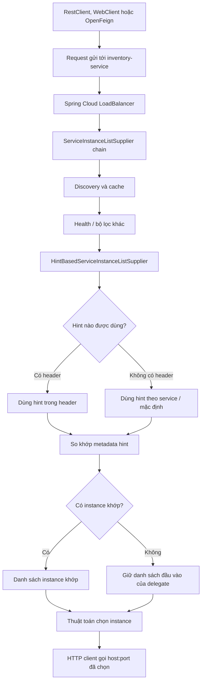

# Gợi ý mặc định theo dịch vụ và gợi ý từ header yêu cầu

Trong microservices, một service có thể có nhiều bản sao (`ServiceInstance`) thuộc các nhóm phục vụ khác nhau: `stable`, `canary`, `preview` hoặc một nhóm được phân loại theo năng lực. Khi gọi theo service ID, ứng dụng đôi khi muốn **ưu tiên một nhóm instance** mà vẫn giữ khả năng quay về danh sách ban đầu nếu nhóm đó không có ứng viên. Spring Cloud LoadBalancer hỗ trợ mô hình này bằng **hint-based load balancing**.

Bài học thuộc chương **Vùng và định tuyến** của module `SPRING_CLOUD_SERVICE_COMMUNICATION_LOAD_BALANCING`. Bài tập trung vào cách khai báo **hint mặc định cho mọi service hoặc riêng từng service**, cách truyền **hint qua header của request**, cách dùng `HintBasedServiceInstanceListSupplier` để lọc ứng viên và cách vận hành cùng discovery, health check, HTTP client, retry và timeout.

> **Kết quả cần hiểu:** Hint là giá trị gợi ý dạng chuỗi để *ưu tiên lọc* danh sách instance. Trong cách triển khai mặc định của `HintBasedServiceInstanceListSupplier`, nếu không tìm được instance khớp hint, supplier trả lại **toàn bộ danh sách do delegate cung cấp**. Vì vậy, hint không tự tạo ra điều kiện định tuyến bắt buộc.

## 1. Hint được áp dụng ở bước nào?

Giả sử `order-service` gọi `inventory-service` với ba instance:

| Instance | Địa chỉ minh họa | Metadata `hint` |
|---|---|---|
| `inventory-1` | `10.0.1.11:8080` | `stable` |
| `inventory-2` | `10.0.1.12:8080` | `stable` |
| `inventory-3` | `10.0.1.13:8080` | `canary` |

Request bình thường được ưu tiên nhóm `stable`; một request thử nghiệm có thể truyền header `X-SC-LB-Hint: canary` để ưu tiên `inventory-3`.

Chuỗi xử lý khái quát:



Hai nhiệm vụ cần được phân biệt:

- `HintBasedServiceInstanceListSupplier` **lọc danh sách ứng viên** dựa trên metadata.
- `RoundRobinLoadBalancer`, `RandomLoadBalancer` hoặc một implementation khác **chọn một instance** trong danh sách còn lại.

Hint không quyết định trực tiếp host hoặc port. Nó tác động tới tập ứng viên trước khi thuật toán chọn được gọi.

## 2. Thứ tự ưu tiên: header, service ID, mặc định

Spring Cloud LoadBalancer cung cấp cấu hình hint theo service ID và hint mặc định dùng chung. Khi `HintBasedServiceInstanceListSupplier` được bật, nguồn hint được xác định theo thứ tự:

1. **Header của request** nếu có hint header tương ứng.
2. **Cấu hình cho service ID hiện tại** nếu request không có hint header.
3. **Cấu hình mặc định** nếu không có hint riêng cho service và không có hint header.
4. **Không có hint** nếu không tìm được giá trị nào ở các nguồn trên.

Các thuộc tính quan trọng:

| Thuộc tính | Vai trò |
|---|---|
| `spring.cloud.loadbalancer.hint.default` | Hint mặc định khi service không khai báo hint riêng và request không có hint header. |
| `spring.cloud.loadbalancer.hint.[SERVICE_ID]` | Hint riêng cho service ID tương ứng. |
| `spring.cloud.loadbalancer.hint-header-name` | Tên header mang hint; mặc định `X-SC-LB-Hint`. |

Có thể hình dung:

```text
Có header X-SC-LB-Hint?
    Có  → sử dụng giá trị header
    Không
      └─ Có hint theo service ID?
             Có  → sử dụng hint của service
             Không
               └─ Có hint default?
                      Có  → dùng default
                      Không → không lọc theo hint
```

Nếu có header nhưng **không có instance mang metadata khớp**, supplier trở lại toàn bộ danh sách đầu vào. Nó không tự thử lại hint của service hay hint mặc định sau khi giá trị header đã được chọn.

Điều này rất quan trọng khi thử nghiệm canary: một hint sai chính tả có thể khiến request được phân phối tới cả nhóm `stable` và `canary`, thay vì bị từ chối.

## 3. Cấu hình hint mặc định và hint theo service bằng YAML

Ví dụ `order-service` gọi hai service:

- `inventory-service` muốn mặc định chọn nhóm `stable`.
- `catalog-service` muốn mặc định chọn nhóm `standard`.
- Những service chưa có cấu hình riêng dùng hint `general` nếu phù hợp.

Khai báo trong `application.yml`:

```yaml
spring:
  cloud:
    loadbalancer:
      hint:
        default: general
        inventory-service: stable
        catalog-service: standard
      hint-header-name: X-SC-LB-Hint
```

Các khóa `inventory-service` và `catalog-service` phải khớp **service ID** mà HTTP client yêu cầu. Không dùng tên bean tùy ý thay cho service ID.

Một cách viết tương đương bằng properties:

```properties
spring.cloud.loadbalancer.hint.default=general
spring.cloud.loadbalancer.hint.inventory-service=stable
spring.cloud.loadbalancer.hint.catalog-service=standard
spring.cloud.loadbalancer.hint-header-name=X-SC-LB-Hint
```

Các giá trị là minh họa; có thể chọn các chuỗi như `blue`, `green` hoặc `v2` để phù hợp cách tổ chức instance.

**Lưu ý:** Chỉ khai báo các property trên không tự đảm bảo hint được áp dụng. Danh sách instance phải có metadata tương ứng và chuỗi supplier cần chứa `HintBasedServiceInstanceListSupplier`, chẳng hạn cấu hình `withHints()` trong ví dụ ở phần sau.

### 3.1. Khi chỉ có hint mặc định

Nếu ứng dụng chỉ cấu hình:

```yaml
spring:
  cloud:
    loadbalancer:
      hint:
        default: stable
```

thì những service chưa có hint riêng sẽ sử dụng `stable` nếu request không mang header. Service được cấu hình riêng sẽ dùng giá trị của mình, nên không nhất thiết phải tạo một cấu hình mặc định giống nhau trong từng service.

### 3.2. Khi không cấu hình hint nào

Nếu không có header, không có hint cho service và không có `default`, `HintBasedServiceInstanceListSupplier` giữ nguyên danh sách được delegate cung cấp. Thuật toán như round robin có thể chọn trên tập đó như thường lệ.

## 4. Cách gắn metadata hint cho ServiceInstance

Cơ chế hint hoạt động nhờ **metadata của instance**, với khóa là `hint`. Đây là metadata của server được cung cấp bởi discovery provider hoặc một nguồn `ServiceInstanceListSupplier`, không phải nhãn được Spring Cloud LoadBalancer tự gán.

Ví dụ:

| Service ID | Instance ID | Metadata |
|---|---|---|
| `inventory-service` | `inventory-1` | `hint=stable` |
| `inventory-service` | `inventory-2` | `hint=stable` |
| `inventory-service` | `inventory-3` | `hint=canary` |
| `catalog-service` | `catalog-1` | `hint=standard` |
| `catalog-service` | `catalog-2` | `hint=preview` |

Với Eureka client, mỗi instance có thể khai báo metadata của mình. Ví dụ cấu hình cho **instance stable**:

```yaml
spring:
  application:
    name: inventory-service

eureka:
  instance:
    metadata-map:
      hint: stable
```

Trong cấu hình chạy **instance canary**, đặt:

```yaml
spring:
  application:
    name: inventory-service

eureka:
  instance:
    metadata-map:
      hint: canary
```

Hai instance vẫn mang cùng service ID `inventory-service`, nhưng discovery trả metadata `hint` khác nhau. Cần bảo đảm những thuộc tính đăng ký khác như Eureka endpoint, instance ID, host/port và profile môi trường được thiết lập phù hợp.

Nếu dùng Consul, Kubernetes hoặc nguồn instance tự tạo, cách khai báo metadata phụ thuộc integration cụ thể. Điều cần kiểm tra cuối cùng là `ServiceInstance.getMetadata().get("hint")` trên phía client có đúng giá trị mong muốn hay không.

### 4.1. Không nhầm hint với zone

`hint=stable` hoặc `hint=canary` chỉ là nhãn được dùng để lọc theo cơ chế hint. Nó không đồng nghĩa zone, region, readiness hay khả năng xử lý nghiệp vụ. Nếu hệ thống cần ưu tiên cùng zone, có thể sử dụng khả năng lọc/ưu tiên zone của LoadBalancer và metadata zone phù hợp.

Đối với yêu cầu residency, tenant isolation hoặc bảo mật, không nên dựa vào một hint mềm làm rào chắn duy nhất.

## 5. Bật HintBasedServiceInstanceListSupplier

Cần cấu hình supplier để nó lọc danh sách theo metadata hint. Với API builder của Spring Cloud LoadBalancer, ví dụ:

```java
import org.springframework.cloud.loadbalancer.core.ServiceInstanceListSupplier;
import org.springframework.context.ConfigurableApplicationContext;
import org.springframework.context.annotation.Bean;
import org.springframework.context.annotation.Configuration;

@Configuration(proxyBeanMethods = false)
public class HintRoutingConfiguration {

    @Bean
    ServiceInstanceListSupplier serviceInstanceListSupplier(
            ConfigurableApplicationContext context) {

        return ServiceInstanceListSupplier.builder()
                .withDiscoveryClient()
                .withCaching()
                .withHints()
                .build(context);
    }
}
```

Ý nghĩa:

- `withDiscoveryClient()` lấy danh sách instance từ discovery client được tích hợp.
- `withCaching()` bổ sung cache cho nguồn instance.
- `withHints()` thêm lớp lọc theo hint, lấy giá trị từ header hoặc cấu hình.
- `build(context)` tạo supplier theo application context hiện tại.

Thứ tự này giúp cache danh sách nguồn, sau đó áp dụng hint **theo từng request**. Nếu tự tạo một chain khác, phải chú ý để cache không giữ nhầm kết quả lọc của một request và áp dụng cho các request có hint khác.

Đoạn mã mô tả cơ chế trong các release train Spring Cloud hỗ trợ API builder này. Khi triển khai, hãy dùng Spring Boot/Spring Cloud BOM tương thích và kiểm tra chữ ký API ở phiên bản dự án.

### 5.1. Áp dụng cấu hình supplier cho nhiều service

Có thể dùng `@LoadBalancerClients` để cung cấp cấu hình mặc định cho các child context của LoadBalancer:

```java
import org.springframework.boot.autoconfigure.SpringBootApplication;
import org.springframework.cloud.loadbalancer.annotation.LoadBalancerClients;

@SpringBootApplication
@LoadBalancerClients(
        defaultConfiguration = HintRoutingConfiguration.class
)
public class OrderServiceApplication {
}
```

Sau đó, `application.yml` ở phần 3 quyết định hint mặc định, hint riêng cho từng service và tên header. Các context có thể dùng cùng cấu trúc supplier nhưng lấy **hint khác nhau theo service ID**.

Đặt `HintRoutingConfiguration` **ngoài component scan mặc định** của ứng dụng nếu nó chỉ dành cho các load balancer child context. Nếu vô tình bị quét như `@Configuration` toàn cục trong parent context, bean supplier có thể ảnh hưởng tới nhiều client ngoài dự kiến.

### 5.2. Chỉ bật cho một service

Nếu chỉ `inventory-service` cần lọc bằng hint:

```java
@SpringBootApplication
@LoadBalancerClient(
        name = "inventory-service",
        configuration = HintRoutingConfiguration.class
)
public class OrderServiceApplication {
}
```

Khi đó chỉ context của `inventory-service` được liên kết với supplier tùy chỉnh qua annotation này. Những service khác dùng cấu hình supplier tương ứng của chúng.

Đừng tạo nhiều bean `ServiceInstanceListSupplier` trong cùng client context mà không định nghĩa rõ bean nào là kết quả cuối cùng; việc trùng bean có thể khiến autoconfiguration và thứ tự chọn bean khó đoán.

## 6. Truyền gợi ý qua request header

Tên header mặc định là `X-SC-LB-Hint`. Khi client gửi request tới service ID và có header này, `HintBasedServiceInstanceListSupplier` có thể lấy giá trị từ request để lọc instance.

Ví dụ:

```http
GET /api/stock/sku-001 HTTP/1.1
Host: inventory-service
X-SC-LB-Hint: canary
```

Nếu danh sách có instance `hint=canary`, ứng viên sẽ được thu hẹp còn nhóm đó. Nếu header vắng mặt, bộ lọc sử dụng hint theo service ID hoặc hint mặc định. Nếu header mang giá trị không khớp instance nào, bộ lọc mặc định trả lại toàn bộ danh sách nguồn.

### 6.1. RestClient

Khai báo builder đã tích hợp LoadBalancer:

```java
@Configuration(proxyBeanMethods = false)
class HttpClientConfiguration {

    @Bean
    @LoadBalanced
    RestClient.Builder loadBalancedRestClientBuilder() {
        return RestClient.builder();
    }
}
```

Gateway gọi với hint theo request:

```java
@Service
class InventoryGateway {

    private final RestClient client;

    InventoryGateway(
            @Qualifier("loadBalancedRestClientBuilder")
            RestClient.Builder builder) {
        this.client = builder.build();
    }

    String stock(String sku, String hint) {
        return client.get()
                .uri("http://inventory-service/api/stock/{sku}", sku)
                .header("X-SC-LB-Hint", hint)
                .retrieve()
                .body(String.class);
    }

    String stockWithDefaultHint(String sku) {
        return client.get()
                .uri("http://inventory-service/api/stock/{sku}", sku)
                .retrieve()
                .body(String.class);
    }
}
```

- `stock(sku, "canary")` yêu cầu ưu tiên instance có `hint=canary`.
- `stockWithDefaultHint(sku)` không truyền header, nên dùng cấu hình `hint.inventory-service` nếu có.
- Cả hai method cần dùng đúng `@LoadBalanced RestClient.Builder`.

Không tự động giả định rằng header từ request bên ngoài đã được chuyển tiếp sang request mà `RestClient` tạo. Nếu muốn dùng hint từ inbound request, gateway phải chủ động đọc, xác thực và gắn header outbound.

### 6.2. WebClient

Tương tự, sử dụng builder có `@LoadBalanced`:

```java
@Configuration(proxyBeanMethods = false)
class WebClientConfiguration {

    @Bean
    @LoadBalanced
    WebClient.Builder loadBalancedWebClientBuilder() {
        return WebClient.builder();
    }
}
```

Ví dụ gọi:

```java
@Service
class InventoryReactiveGateway {

    private final WebClient client;

    InventoryReactiveGateway(
            @Qualifier("loadBalancedWebClientBuilder")
            WebClient.Builder builder) {
        this.client = builder.build();
    }

    Mono<String> stock(String sku, String hint) {
        return client.get()
                .uri("http://inventory-service/api/stock/{sku}", sku)
                .header("X-SC-LB-Hint", hint)
                .retrieve()
                .bodyToMono(String.class);
    }
}
```

Để request header đi tới supplier, `WebClient` phải đi qua filter LoadBalancer của Spring Cloud. Một `WebClient` tạo riêng bằng `WebClient.create()` không tự nhận cấu hình này.

### 6.3. OpenFeign

Với OpenFeign, có thể đưa header vào method của interface:

```java
@FeignClient(name = "inventory-service")
interface InventoryClient {

    @GetMapping("/api/stock/{sku}")
    StockResponse stock(
            @PathVariable("sku") String sku,
            @RequestHeader("X-SC-LB-Hint") String hint);
}
```

Khi được tích hợp Spring Cloud LoadBalancer, lời gọi `inventoryClient.stock("sku-001", "canary")` mang header để supplier đọc. Ứng dụng phải có các dependency OpenFeign/LoadBalancer phù hợp và nguồn instance được cấu hình. Nếu Feign client khai báo target URL cố định, request có thể bỏ qua quá trình chọn instance theo service ID; cần kiểm tra cấu hình thực tế.

Các đoạn mã trên là ví dụ về cách truyền header. Trong mã hoàn chỉnh cần bổ sung import và cấu hình dependency theo phiên bản Spring đang dùng.

## 7. Bảng quyết định: hint nào được dùng?

Giả sử cấu hình:

```yaml
spring:
  cloud:
    loadbalancer:
      hint:
        default: general
        inventory-service: stable
        catalog-service: standard
```

Và `inventory-service` có ba instance: `stable-1`, `stable-2` và `canary-1`, với metadata `hint` tương ứng.

| Service ID | Header `X-SC-LB-Hint` | Hint được chọn | Ứng viên sau lọc |
|---|---|---|---|
| `inventory-service` | Không có | `stable` (theo service) | `stable-1`, `stable-2` |
| `inventory-service` | `canary` | `canary` (header ưu tiên) | `canary-1` |
| `inventory-service` | `unknown` | `unknown` | Không khớp → cả ba instance đầu vào |
| `catalog-service` | Không có | `standard` (theo service) | Các instance catalog có `hint=standard` |
| `catalog-service` | `preview` | `preview` | Các instance catalog có `hint=preview`, nếu có |
| Một service chưa khai báo hint riêng | Không có | `general` (mặc định) | Các instance có `hint=general`, nếu có; không khớp → danh sách đầu vào |
| Bất kỳ service | Không có và không có cấu hình hint | Không có hint | Giữ toàn bộ danh sách đầu vào |

Lưu ý ở hàng `unknown`: supplier mặc định **không trả danh sách rỗng** chỉ vì không có metadata khớp. Đây là hành vi fallback để tiếp tục định tuyến, có thể phù hợp cho traffic ưu tiên mềm nhưng không phù hợp cho routing bắt buộc.

### 7.1. Header có giá trị khác chuẩn

Giá trị metadata `hint` cần được đặt nhất quán giữa nơi đăng ký instance và nơi gửi request. Ví dụ `canary` và `Canary` không nên được xem là tương đương nếu không có quy tắc chuẩn hóa được thiết kế rõ ràng.

Khi client có thể gửi giá trị bất kỳ, nên chuẩn hóa theo allowlist trước khi đưa vào HTTP client để tránh kết quả không khớp gây fallback khó quan sát.

## 8. Hint là ưu tiên mềm, không phải bộ lọc bắt buộc

Mặc định, thuật toán hint-based thực hiện:

```text
candidates = instancesFromDelegate
hint = headerHint ?: serviceHint ?: defaultHint

nếu hint không được cung cấp:
    return candidates

matched = candidates có metadata["hint"] == hint

nếu matched không rỗng:
    return matched
ngược lại:
    return candidates
```

Đây là pseudocode diễn tả ý tưởng, không phải bản chép mã nguồn. Khi không khớp, supplier quay về danh sách delegate.

### 8.1. Điều kiện dùng được

Hint mềm hợp lý khi:

- Ưu tiên dùng nhóm `stable` nhưng cho phép failover sang nhóm khác.
- Thử nghiệm canary với một số request mà vẫn muốn có ứng viên dự phòng.
- Chọn nhóm có khả năng xử lý tối ưu nhưng nhóm còn lại vẫn xử lý hợp lệ.
- Muốn chia traffic thử nghiệm khi đã chấp nhận hành vi fallback.

### 8.2. Điều kiện không nên dùng làm bảo đảm duy nhất

Không dùng hint mềm như biện pháp duy nhất khi:

- Dữ liệu buộc phải nằm trong một region cụ thể.
- Request của một tenant không được đi vào instance của tenant khác.
- Một API version không tương thích tuyệt đối với version khác.
- Instance mang metadata không đáp ứng tiêu chuẩn bảo mật hoặc xử lý bắt buộc.

Trong các tình huống đó cần supplier tùy chỉnh có **ràng buộc cứng**, hoặc chính sách định tuyến ở hạ tầng/ứng dụng phù hợp. Nếu không có instance hợp lệ, phải trả lỗi rõ ràng và xử lý theo hợp đồng API; không cho phép fallback sang instance vi phạm ràng buộc.

## 9. Kết hợp hint với zone, health check, cache và retry

Hint chỉ nên tác động lên những instance **đã được chấp nhận bởi các điều kiện trước đó**. Đối với chuỗi supplier phức tạp, cần xác định rõ tính chất mỗi bước:

| Bước | Vai trò | Câu hỏi cần trả lời |
|---|---|---|
| Discovery | Lấy bản sao được đăng ký | Có những instance nào? |
| Cache | Giảm số lần truy vấn nguồn | Snapshot có còn mới không? |
| Health check | Đánh giá tính sẵn sàng | Instance nào đang khỏe? |
| Lọc zone/metadata khác | Áp điều kiện định tuyến | Những instance nào phù hợp vị trí/chính sách? |
| Hint | Ưu tiên nhóm có metadata `hint` khớp | Trong danh sách delegate, nhóm nào được ưu tiên? |
| Load balancer | Chọn một instance | Trong các ứng viên cuối, chọn đích nào? |

**Thứ tự decorator ảnh hưởng hành vi.** Ví dụ, nếu hint chạy sau health check, fallback khi hint không khớp chỉ trở lại danh sách mà health check đã cung cấp; nó không tự khôi phục các instance đã bị loại ở bước trước. Nếu hint chạy trước bộ lọc khác, kết quả có thể khác. Với builder hãy giữ thứ tự theo tài liệu của release train và kiểm thử thứ tự thực tế.

Khi cache dữ liệu dùng chung, không nên cache danh sách đã lọc theo hint của request thứ nhất để rồi dùng cho request có hint khác. Ví dụ `withDiscoveryClient().withCaching().withHints()` giúp tách cache danh sách nguồn và lọc theo request.

Retry có thể chọn lại instance khi lần gọi trước thất bại tùy HTTP client và cấu hình LoadBalancer. Tuy nhiên retry **không biến một hint không khớp thành routing bắt buộc**, và cũng không bảo đảm canary nhận mọi request có hint. Với thao tác ghi, cần cân nhắc idempotency key, giới hạn số lần retry và deadline tổng.

## 10. Header từ bên ngoài và chính sách tin cậy

Một header như `X-SC-LB-Hint` có thể được gửi bởi ứng dụng nội bộ, API gateway hoặc client bên ngoài. Nếu endpoint công khai chấp nhận và chuyển tiếp header này không kiểm soát, người gọi có thể chủ động hướng traffic về nhóm `canary` hoặc nhóm thử nghiệm.

Nên xác định nguồn nào được phép tạo hint:

1. Nếu chỉ ứng dụng nội bộ được quyết định routing, hãy **không chuyển tiếp nguyên xi** hint header từ user bên ngoài.
2. Chuyển giá trị inbound thành một nhóm hint trong allowlist, chẳng hạn `stable` hoặc `canary`.
3. Chỉ cho phép canary với user/tenant/feature flag được cấp quyền thử nghiệm.
4. Không dùng hint để bỏ qua kiểm soát xác thực, phân quyền hay ràng buộc dữ liệu.
5. Ghi nhận hint đã yêu cầu và kết quả chọn nhóm để phát hiện fallback ngoài mong đợi.

Ví dụ: API nhận `X-Experiment-Cohort: beta` từ một hệ thống được tin cậy, kiểm tra điều kiện feature flag, sau đó **tự tạo** outbound header `X-SC-LB-Hint: canary`. Không nhất thiết phải giữ nguyên header của request bên ngoài.

### 10.1. Thay tên header

Nếu cần đổi tên header để phù hợp quy ước nội bộ:

```yaml
spring:
  cloud:
    loadbalancer:
      hint-header-name: X-Internal-Routing-Hint
```

Sau đó, outbound client phải gửi `X-Internal-Routing-Hint`. Đổi tên thuộc tính không tự thêm header và cũng không bảo đảm tính bí mật hoặc bảo mật; kiểm soát quyền gửi giá trị vẫn thuộc về tầng ứng dụng/gateway.

## 11. Kiểm thử hành vi hint theo service và request

Kiểm thử cần xác nhận **danh sách ứng viên sau lọc**, không chỉ số lần HTTP request thành công.

### 11.1. Các tình huống cần bao phủ

| Đầu vào | Kỳ vọng |
|---|---|
| Không có header, service có hint riêng | Dùng hint riêng của service |
| Không có header, service chưa có hint riêng | Dùng `hint.default` |
| Có header khớp metadata | Chỉ giữ các instance khớp trong danh sách delegate |
| Có header khác hint cấu hình của service | Ưu tiên header |
| Có header nhưng không có instance khớp | Trả toàn bộ danh sách delegate |
| Không có header và không có hint cấu hình | Trả toàn bộ danh sách delegate |
| Một số instance thiếu metadata `hint` | Chỉ instance có giá trị khớp được ưu tiên; nếu không có match thì fallback về delegate |
| Danh sách delegate rỗng | Kết quả vẫn rỗng; hint không tạo ra instance |
| Delegate phát lỗi | Lỗi nguồn cần được quan sát; hint không tự sửa discovery |
| Header qua RestClient/WebClient/Feign | Chỉ hoạt động khi HTTP client thực sự có tích hợp LoadBalancer |
| Cache danh sách nguồn | Thay đổi hint giữa hai request phải tạo kết quả lọc riêng |
| Routing bắt buộc | Nếu cần fail closed, phải có cơ chế ngoài hint supplier mặc định |

### 11.2. Ví dụ kiểm thử bằng dữ liệu giả lập

Một cách tạo dữ liệu thử với `DefaultServiceInstance`:

```java
import java.util.List;

import org.springframework.cloud.client.ServiceInstance;
import org.springframework.cloud.client.DefaultServiceInstance;

static ServiceInstance instance(
        String id, int port, String hint) {

    DefaultServiceInstance result =
            new DefaultServiceInstance(
                    id,
                    "inventory-service",
                    "127.0.0.1",
                    port,
                    false);

    result.getMetadata().put("hint", hint);
    return result;
}

List<ServiceInstance> candidates = List.of(
        instance("inventory-1", 8081, "stable"),
        instance("inventory-2", 8082, "stable"),
        instance("inventory-3", 8083, "canary"));
```

Khi dựng supplier chain trong kiểm thử, có thể thay discovery bằng nguồn giả lập và phát các request với hint khác nhau. Những assertion có ý nghĩa là:

- Không có header, mặc định `stable`: danh sách có hai instance.
- Header `canary`: chỉ có `inventory-3`.
- Header `unknown`: danh sách lại có đủ ba instance vì fallback mềm.
- Danh sách delegate rỗng: không có instance để chọn dù hint có giá trị.

Nếu chỉ kiểm thử thuật toán `RandomLoadBalancer` bằng số lượng request tới từng instance, kết quả có thể dao động và không chứng minh chính xác quy tắc lọc. Nên test supplier riêng, rồi test tích hợp để xác nhận HTTP client chuyển tiếp header vào request context.

### 11.3. Thử qua môi trường chạy

Có thể tạo hai instance `inventory-service` với metadata `stable` và một instance `canary`. Tạo một endpoint trong `order-service` sử dụng RestClient/WebClient/Feign load-balanced và truyền hint outbound theo tham số test.

Gửi hai loại request từ endpoint đó:

```text
Request A: không truyền hint outbound
  -> mong đợi ưu tiên stable

Request B: truyền X-SC-LB-Hint: canary outbound
  -> mong đợi ưu tiên canary

Request C: truyền X-SC-LB-Hint: unknown outbound
  -> mong đợi fallback về tất cả instance do delegate cung cấp
```

Cần ghi instance ID của đích nhận request để quan sát, nhưng không giả định random/round robin luôn tạo một chuỗi cụ thể trong hệ thống nhiều client hoặc nhiều luồng đồng thời.

## 12. Quan sát hint và fallback trong production

Một số tín hiệu hữu ích:

| Trường log/metric minh họa | Mục đích |
|---|---|
| `serviceId` | Nhận diện service đang được gọi |
| `hintSource` | `HEADER`, `SERVICE_DEFAULT`, `GLOBAL_DEFAULT` hoặc `NONE` |
| `requestedHint` | Hint đã được chọn từ nguồn ưu tiên |
| `candidateCountBeforeHint` | Tổng ứng viên từ delegate |
| `matchedInstanceCount` | Số instance có metadata khớp |
| `fallbackToAll` | Có quay về danh sách đầu vào vì không có match không |
| `candidateCountAfterHint` | Số ứng viên sau bước hint |
| `selectedInstance` | Instance cuối cùng được load balancer chọn |
| `requestOutcome` | Thành công, timeout, 5xx hoặc lỗi không có instance |

Các tên trường trên là **quy ước quan sát do ứng dụng tự xây dựng**, không phải bộ metric mặc định bắt buộc của Spring Cloud.

Ví dụ log request có hint khớp:

```text
serviceId=inventory-service
hintSource=HEADER
requestedHint=canary
candidateCountBeforeHint=3
matchedInstanceCount=1
candidateCountAfterHint=1
fallbackToAll=false
```

Ví dụ một hint không khớp:

```text
serviceId=inventory-service
hintSource=HEADER
requestedHint=unknown
candidateCountBeforeHint=3
matchedInstanceCount=0
candidateCountAfterHint=3
fallbackToAll=true
```

Chỉ ghi những thông tin cần thiết. Tránh đưa raw hint do user cung cấp, URI hoặc instance ID có số lượng giá trị không giới hạn vào metric labels vì nguy cơ cardinality cao. Nếu hint đến từ user, nên chuẩn hóa/allowlist trước khi đưa vào log hoặc metric.

Một chỉ số quan trọng cho canary rollout là **tỷ lệ fallback của các request có hint canary**: nếu tăng đột ngột, metadata hoặc số lượng canary instance có thể đã thay đổi. Cần đối chiếu health check và cache trước khi kết luận routing bị sai.

## 13. Các lỗi thường gặp

| Hiện tượng | Nguyên nhân có thể | Hướng xử lý |
|---|---|---|
| Khai báo hint trong YAML nhưng request vẫn đi mọi instance | Chưa bật `withHints()` hoặc supplier không được nạp trong client context | Kiểm tra `@LoadBalancerClient(s)` và bean supplier |
| Header `canary` không ưu tiên canary | Header không được chuyển vào request context, sai tên header hoặc metadata không khớp | Kiểm tra outbound client, header và `getMetadata().get("hint")` |
| Service mặc định sai nhóm | Service ID trong property không khớp ID request, hoặc `default` đang được dùng | So sánh `hint.[SERVICE_ID]` với tên trong URL hoặc Feign |
| Request có header nhưng vẫn dùng nhiều nhóm | Không instance nào khớp; supplier fallback về toàn bộ delegate | Quan sát `matchedInstanceCount` và giá trị metadata |
| Canary request bị chọn sang stable | Canary không khỏe hoặc bị lọc trước khi hint; hoặc không có match | Kiểm tra thứ tự chain, danh sách sau health/filter và fallback |
| Kết quả khác giữa các request cùng hint | Danh sách instance thay đổi, cache refresh hoặc policy chọn ngẫu nhiên | Ghi nhận timestamp, candidate count và thuật toán chọn |
| Header từ request ngoài không có tác dụng | Ứng dụng chưa gắn nó vào HTTP request outbound | Chuyển hint có kiểm soát vào RestClient/WebClient/Feign |
| Một nhóm được chọn dù không có quyền phục vụ | Hint mềm đang dùng cho ràng buộc nghiệp vụ cứng | Thiết kế supplier/policy bắt buộc và fail closed |
| Các service khác bị tác động sau khi thêm supplier | Lớp cấu hình riêng bị component scan vào parent context | Đặt cấu hình ngoài scan base và xác minh từng client context |
| Retry làm traffic canary tăng bất thường | Retry nhiều tầng hoặc request được chọn lại instance | Giới hạn retry, đặt deadline và theo dõi idempotency |

## 14. Quy trình triển khai và xác minh

Khi đưa hint routing vào một dự án Spring Cloud LoadBalancer, thực hiện theo thứ tự:

1. Xác định chính sách: hint là **ưu tiên mềm** hay nghiệp vụ thực sự cần định tuyến cứng.
2. Định nghĩa danh sách giá trị hint hợp lệ và metadata `hint` của từng instance.
3. Cấu hình `spring.cloud.loadbalancer.hint.default` và các `hint.[SERVICE_ID]` cần thiết.
4. Chọn tên header, mặc định `X-SC-LB-Hint`; xác định ứng dụng nào được phép tạo hoặc chuyển tiếp header.
5. Bật `HintBasedServiceInstanceListSupplier` trong chain với `withHints()` tại đúng client context.
6. Đảm bảo HTTP client sử dụng `@LoadBalanced` hoặc integration OpenFeign tương ứng.
7. Xác nhận danh sách trước/sau hint bằng test và log, kể cả trường hợp không có match.
8. Kết hợp health/cache/zone theo thứ tự hợp lý và kiểm thử khi instance thay đổi.
9. Cấu hình timeout và retry của HTTP client với ngân sách thời gian rõ ràng.
10. Quan sát `fallbackToAll`, số candidate, instance được chọn và lỗi kết nối.

**Không nên phụ thuộc vào hint để giải quyết mọi nhu cầu routing.** Hint phù hợp với ưu tiên nhóm instance đơn giản. Với điều kiện ràng buộc dữ liệu, tuyến theo tenant, version không tương thích hoặc ưu tiên phức tạp, cần supplier hoặc chính sách định tuyến riêng được kiểm thử kỹ.

## 15. Tổng kết

Spring Cloud LoadBalancer cho phép đặt hint mặc định bằng `spring.cloud.loadbalancer.hint.default` và hint riêng theo service ID bằng `spring.cloud.loadbalancer.hint.[SERVICE_ID]`. Với `HintBasedServiceInstanceListSupplier`, header `X-SC-LB-Hint` của một request được ưu tiên hơn cấu hình, giúp cùng một client có thể chọn nhóm instance khác nhau theo từng lời gọi.

Hint so khớp giá trị metadata `hint` trên `ServiceInstance`. Nếu có instance khớp, supplier chỉ cung cấp nhóm đó cho thuật toán chọn. Nếu không có match, supplier mặc định trả về danh sách delegate, nên đây là cơ chế ưu tiên mềm. Hiểu rõ độ ưu tiên header, tính chất fallback và cách truyền request context giúp ứng dụng tích hợp RestClient, WebClient và OpenFeign ổn định, đồng thời tránh dùng hint sai mục đích trong các ràng buộc định tuyến bắt buộc.

**Tài liệu tham khảo:** [Spring Cloud Commons — Spring Cloud LoadBalancer](https://docs.spring.io/spring-cloud-commons/reference/spring-cloud-commons/loadbalancer.html), các mục *Spring Cloud LoadBalancer Hints* và *Hint-Based Load-Balancing*.

