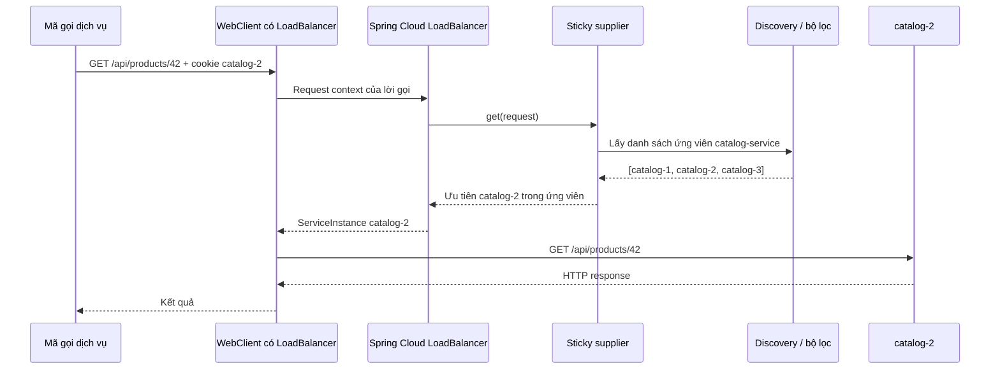
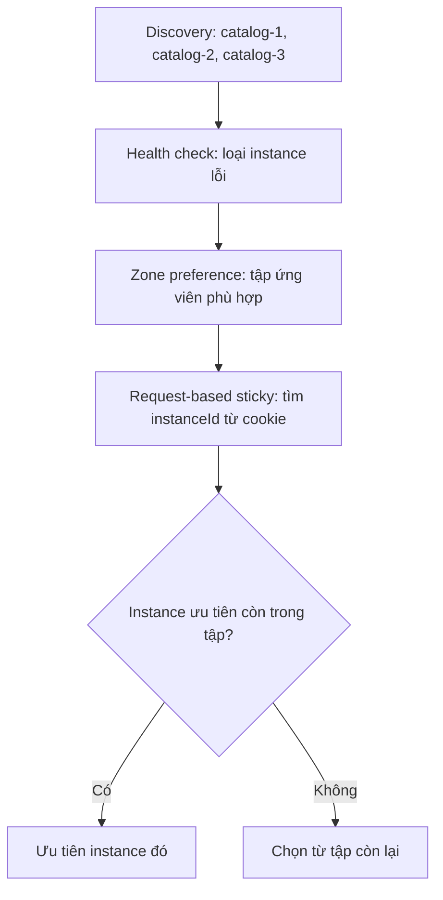

# Giữ ưu tiên bản sao bằng request-based sticky session

Trong ứng dụng có nhiều bản sao (instance), Spring Cloud LoadBalancer thường chọn một `ServiceInstance` cho mỗi lần gọi HTTP dựa trên danh sách do `ServiceInstanceListSupplier` cung cấp. Với round-robin, hai request liên tiếp của cùng một người dùng có thể đến hai instance khác nhau. Điều này phù hợp với dịch vụ stateless nhưng có thể bất tiện nếu một luồng tương tác muốn **ưu tiên quay lại instance đã dùng trước đó**.

**Request-based sticky session** cho phép request chỉ rõ instance được ưu tiên. Spring Cloud LoadBalancer có `RequestBasedStickySessionServiceInstanceListSupplier`: nó xem `instanceId` trong cookie của request, ưu tiên instance tương ứng nếu vẫn có trong danh sách ứng viên, và cho phép cân bằng tải chọn instance khác khi instance ưu tiên không còn khả dụng. Đây là **ưu tiên mềm (affinity)**, không phải cam kết luôn định tuyến đến một instance hay cơ chế lưu session của ứng dụng.

Bài này thuộc phần **Vùng và định tuyến** của module Spring Cloud LoadBalancer. Trọng tâm là cấu hình và quan sát mối liên hệ giữa service ID, request context, cookie instance ID, discovery, health check, zone và việc chọn instance khi giao tiếp qua HTTP client.

## 1. Request-based sticky session giải quyết điều gì?

Giả sử `order-service` gọi `catalog-service` có ba instance:

| Service ID | Instance ID | Zone | Địa chỉ minh họa |
|---|---|---|---|
| `catalog-service` | `catalog-1` | `az-a` | `10.0.1.11:8080` |
| `catalog-service` | `catalog-2` | `az-a` | `10.0.1.12:8080` |
| `catalog-service` | `catalog-3` | `az-b` | `10.0.2.13:8080` |

Lần đầu gọi `catalog-service`, request chưa có cookie gợi ý instance. LoadBalancer có thể chọn `catalog-2`. Ở lần gọi tiếp theo, nếu HTTP client truyền cookie `sc-lb-instance-id=catalog-2` và supplier nhận đúng request context, `catalog-2` sẽ được **ưu tiên** trong danh sách instance phù hợp.

Nếu `catalog-2` bị xóa khỏi discovery hoặc bị bộ lọc health check loại bỏ, sticky session không thể khiến một instance đã biến mất trở lại. Supplier sử dụng những instance còn hợp lệ, ví dụ `catalog-1` và `catalog-3`, để request tiếp tục được xử lý.

**Ý nghĩa của cookie** ở đây là định danh instance thuộc một service ID. Nó không phải session ID của người dùng, JWT hay bằng chứng xác thực. Cùng một giá trị như `catalog-2` chỉ có ý nghĩa khi có instance đó trong danh sách của `catalog-service`; không thể dùng cookie để bỏ qua service discovery hoặc các kiểm soát truy cập.

## 2. Luồng chọn instance theo thông tin request



Các bước cần phân biệt:

1. **HTTP client** tạo request đến URL logic `http://catalog-service/...`, kèm cookie instance ID nếu đã có thông tin ưu tiên.
2. **LoadBalancer integration** đưa dữ liệu request cần thiết vào `Request` context. Supplier chỉ có thể đọc cookie nếu integration thực sự truyền ngữ cảnh đó.
3. **Nguồn discovery** cung cấp các `ServiceInstance` cho `catalog-service`. Các bước bổ sung như health check hoặc ưu tiên zone có thể thay đổi danh sách.
4. **RequestBasedStickySessionServiceInstanceListSupplier** tra cookie, đối chiếu với instance ID của các ứng viên và ưu tiên instance trùng khớp khi có thể.
5. **LoadBalancer** thực hiện lựa chọn; HTTP client gửi request đến host và port của instance được chọn.

Nếu không có cookie, cookie sai, instance đã bị loại bỏ hoặc không có request context phù hợp, LoadBalancer phải dựa vào tập instance còn lại và chính sách lựa chọn hiện hành. Sticky session không tạo ra một địa chỉ mới và không đảm bảo server lưu trạng thái người dùng.

## 3. Phân biệt các cơ chế ưu tiên trong Spring Cloud LoadBalancer

| Cơ chế | Thông tin dùng để ưu tiên | Phạm vi áp dụng | Điểm cần nhớ |
|---|---|---|---|
| Round-robin | Thứ tự danh sách và trạng thái vòng chọn | Các request đến cùng service ID | Không tự nhớ người dùng/phiên |
| `SameInstancePreferenceServiceInstanceListSupplier` | Instance được chọn trước đó cho client | Xu hướng ưu tiên instance trước, không gắn một cookie riêng với từng request | Có thể ảnh hưởng nhiều request không cùng phiên |
| `RequestBasedStickySessionServiceInstanceListSupplier` | `instanceId` lấy từ cookie trong request context | Theo request có gửi dữ liệu ưu tiên | Nhiều người dùng có thể ưu tiên các instance khác nhau |
| `ZonePreferenceServiceInstanceListSupplier` | Zone của client và metadata zone của instance | Theo zone được cấu hình | Ưu tiên locality; không biết session người dùng |
| Hint-based filtering | Hint trong request/header hoặc cấu hình | Theo hint và logic lọc | Cần metadata hoặc logic khớp hint |

`SameInstancePreferenceServiceInstanceListSupplier` **không phải tên gọi khác** của request-based sticky session. Trường hợp thứ nhất dựa trên lựa chọn trước của client; trường hợp thứ hai dựa trên thông tin được đưa vào từng request. Khi hệ thống cần affinity riêng cho từng luồng tương tác, cần xác định chính xác request context và cách truyền cookie.

## 4. Cấu hình nhanh bằng property

Spring Cloud LoadBalancer hỗ trợ một cấu hình dựng sẵn qua `spring.cloud.loadbalancer.configurations`:

```yaml
spring:
  cloud:
    loadbalancer:
      configurations: request-based-sticky-session
      sticky-session:
        add-service-instance-cookie: true
        instance-id-cookie-name: sc-lb-instance-id
```

Trong ví dụ:

- `configurations: request-based-sticky-session` kích hoạt cấu hình supplier hỗ trợ request-based affinity.
- `sticky-session.instance-id-cookie-name` nêu tên cookie được dùng để đọc instance ID; `sc-lb-instance-id` là tên mặc định thông dụng.
- `sticky-session.add-service-instance-cookie: true` yêu cầu thành phần hỗ trợ cập nhật thông tin cookie theo instance vừa được chọn, kể cả khi instance cũ trong request không còn phù hợp. Mặc định tùy chọn này là `false`.

**Không suy ra rằng tùy chọn cập nhật cookie sẽ tự phát `Set-Cookie` về trình duyệt ở mọi kiến trúc.** Hành vi này được thực hiện trong integration LoadBalancer hỗ trợ; ứng dụng gateway/BFF hoặc HTTP client vẫn phải xác định cookie nào được truyền giữa các hop và làm cách nào duy trì thông tin ưu tiên qua các request tiếp theo.

Property trên dùng để bật cấu hình theo cơ chế dựng sẵn, phù hợp khi các service ID liên quan cùng dùng chính sách này. Nếu chỉ `catalog-service` cần sticky session còn dịch vụ khác giữ policy riêng, nên dùng `@LoadBalancerClient` như phần kế tiếp. Khi kết hợp nhiều cấu hình đặc thù trong cùng một ứng dụng, cần rà soát cách các property và bean tùy biến của phiên bản Spring Cloud đang dùng được ưu tiên.

## 5. Cấu hình riêng cho một service ID

Giả sử `OrderApplication` ở package `com.example.orders`, còn cấu hình đặc thù cho `catalog-service` ở `com.example.lb.catalog`, nằm ngoài component scan mặc định của ứng dụng chính. Cách tổ chức này giúp bean supplier của `catalog-service` không bị đăng ký nhầm làm bean chung cho mọi service.

**Lớp cấu hình dành riêng cho LoadBalancer:**

```java
package com.example.lb.catalog;

import org.springframework.cloud.loadbalancer.core.ServiceInstanceListSupplier;
import org.springframework.context.annotation.Bean;
import org.springframework.context.annotation.Configuration;
import org.springframework.context.ConfigurableApplicationContext;

@Configuration(proxyBeanMethods = false)
public class CatalogStickyLoadBalancerConfiguration {

    @Bean
    ServiceInstanceListSupplier catalogServiceInstanceListSupplier(
            ConfigurableApplicationContext context) {
        return ServiceInstanceListSupplier.builder()
                .withDiscoveryClient()
                .withCaching()
                .withRequestBasedStickySession()
                .build(context);
    }
}
```

`withDiscoveryClient()` cung cấp dữ liệu instance; `withCaching()` có thể giảm việc truy vấn nguồn dữ liệu lặp lại; `withRequestBasedStickySession()` bổ sung lựa chọn ưu tiên theo request cookie. Cần **giữ thông tin của từng request ngoài cache danh sách chung**: đặt caching trước các bước lọc phụ thuộc request để tránh tái sử dụng kết quả gắn với phiên này cho phiên khác. Trình tự và khả năng ghép thêm health check, zone hoặc retry phải được kiểm tra theo API của phiên bản đang dùng.

**Lớp khởi động và builder của WebClient:**

```java
package com.example.orders;

import com.example.lb.catalog.CatalogStickyLoadBalancerConfiguration;
import org.springframework.boot.SpringApplication;
import org.springframework.boot.autoconfigure.SpringBootApplication;
import org.springframework.cloud.client.loadbalancer.LoadBalanced;
import org.springframework.cloud.loadbalancer.annotation.LoadBalancerClient;
import org.springframework.context.annotation.Bean;
import org.springframework.web.reactive.function.client.WebClient;

@SpringBootApplication
@LoadBalancerClient(
        name = "catalog-service",
        configuration = CatalogStickyLoadBalancerConfiguration.class)
public class OrderApplication {

    public static void main(String[] args) {
        SpringApplication.run(OrderApplication.class, args);
    }

    @Bean
    @LoadBalanced
    WebClient.Builder loadBalancedWebClientBuilder() {
        return WebClient.builder();
    }
}
```

Với mô hình này, child context của `catalog-service` được gắn supplier riêng. Cấu hình `CatalogStickyLoadBalancerConfiguration` nằm ngoài `com.example.orders`, nên Spring Boot không quét nó vào context chính chỉ vì có annotation `@Configuration`.

Để ví dụ chạy được, ứng dụng cần các dependency tương ứng với WebClient, Spring Cloud LoadBalancer và một nguồn `ServiceInstance` hợp lệ, chẳng hạn Eureka/Consul hoặc cấu hình discovery tĩnh. `@LoadBalanced` trên builder chỉ bật cơ chế phân giải service ID, không tự tạo danh sách instance.

## 6. Truyền cookie ưu tiên bằng WebClient

Tài liệu Spring Cloud LoadBalancer mô tả request-based sticky session qua các request context như `ClientRequestContext` và `ServerHttpRequestContext` do các exchange filter và filter tương ứng tạo ra. **Hỗ trợ được tài liệu hóa cho đường gọi dựa trên WebClient**. Không nên mặc định rằng `RestClient` hoặc OpenFeign sẽ truyền request cookie vào cùng loại context hoặc thực hiện toàn bộ hành vi sticky tương đương; cần xác minh integration thực tế trước khi áp dụng.

Ví dụ client gọi `catalog-service` bằng một builder đã được đánh dấu `@LoadBalanced`:

```java
package com.example.orders.client;

import org.springframework.beans.factory.annotation.Qualifier;
import org.springframework.stereotype.Component;
import org.springframework.web.reactive.function.client.WebClient;
import reactor.core.publisher.Mono;

@Component
public class CatalogClient {

    private final WebClient webClient;

    public CatalogClient(
            @Qualifier("loadBalancedWebClientBuilder") WebClient.Builder builder) {
        this.webClient = builder.baseUrl("http://catalog-service").build();
    }

    public Mono<String> getProductFirstTime(String productId) {
        return webClient.get()
                .uri("/api/products/{id}", productId)
                .retrieve()
                .bodyToMono(String.class);
    }

    public Mono<String> getProductWithPreference(
            String productId, String preferredInstanceId) {
        return webClient.get()
                .uri("/api/products/{id}", productId)
                .cookie("sc-lb-instance-id", preferredInstanceId)
                .retrieve()
                .bodyToMono(String.class);
    }
}
```

Phương thức đầu gọi không có cookie sticky; phương thức thứ hai gửi giá trị ưu tiên mà ứng dụng đã lưu từ một lần lựa chọn trước. `preferredInstanceId` phải đến từ nguồn thông tin đáng tin cậy và được kiểm tra, không nên lấy trực tiếp từ tham số tùy ý của người dùng để ra quyết định bảo mật. Đây là **gợi ý định tuyến**, không phải cơ chế xác thực hay phân quyền.

Lưu ý hai vấn đề về vòng đời cookie:

1. **Cookie ở hop gọi nào?** Request từ trình duyệt vào `order-service` khác với request WebClient từ `order-service` sang `catalog-service`. WebClient không mặc định sao chép cookie từ request đầu vào; ứng dụng phải chủ động truyền thông tin ưu tiên sang hop thích hợp.
2. **Cookie được lưu ở đâu cho lần sau?** Cần cơ chế duy trì instance ID theo đúng client hoặc phiên, chẳng hạn dữ liệu phiên của ứng dụng/gateway. Việc LoadBalancer cập nhật cookie cho một request gửi xuống backend không đồng nghĩa trình duyệt tự nhận được cookie phản hồi để gửi lại lần sau.

Nếu một application gọi nhiều service ID khác nhau, một cookie cùng tên có thể tạo ra va chạm ý nghĩa. Nên quản lý affinity theo từng service hoặc từng luồng tương tác và chỉ truyền định danh instance của đúng dịch vụ đích.

## 7. Khi instance ưu tiên không còn khả dụng

Giả sử request gửi `sc-lb-instance-id=catalog-2`, nhưng `catalog-2` đã bị deregister hoặc bị health filter loại bỏ:

| Trường hợp | Danh sách ứng viên sau discovery/filter | Hành vi mong đợi |
|---|---|---|
| Cookie `catalog-2`; `catalog-2` còn phù hợp | `[catalog-1, catalog-2, catalog-3]` | Ưu tiên `catalog-2` |
| Không có cookie | `[catalog-1, catalog-2, catalog-3]` | Chọn theo chính sách hiện hành |
| Cookie `catalog-2`; instance đã bị loại | `[catalog-1, catalog-3]` | Fallback sang instance khác có sẵn |
| Cookie chứa ID không tồn tại | `[catalog-1, catalog-3]` | Không bám vào giá trị cookie không hợp lệ |
| Discovery không trả instance nào | `[]` | Không có địa chỉ đích; request có thể thất bại ở tầng LoadBalancer |

Đối với trường hợp fallback, cấu hình `add-service-instance-cookie: true` có thể giúp cập nhật cookie ở đường gọi có hỗ trợ. Tuy nhiên, **retry không phải cơ chế duy trì affinity**: nếu request thất bại do timeout hoặc instance lỗi, retry có thể chọn lại instance theo chính sách retry đang bật, có thể khác với gợi ý cookie. Nếu thao tác thay đổi dữ liệu, việc retry còn phải xét tính idempotent để tránh tác dụng phụ lặp.

Sticky session cũng không giải quyết việc **mất trạng thái ứng dụng** khi instance bị thay thế. Nếu dữ liệu phiên chỉ nằm trong RAM của `catalog-2`, chuyển sang `catalog-1` vẫn có thể khiến thao tác thất bại về nghiệp vụ. Trong trường hợp đó, hãy cân nhắc session store chung hoặc thiết kế stateless. Affinity chỉ giảm việc đổi instance trong điều kiện bình thường.

## 8. Kết hợp với zone routing và health check

Request-based sticky session thường được thảo luận cùng cơ chế định tuyến theo zone, nhưng chúng giải quyết hai câu hỏi khác nhau:

- **Zone preference:** instance nào gần client hoặc thuộc zone được ưu tiên?
- **Request-based sticky session:** instance ID nào được request muốn ưu tiên?

Giả sử client ở `az-a` nhưng cookie trỏ `catalog-3` tại `az-b`. Cần xác định chính sách: ưu tiên giữ cùng instance xuyên zone hay ưu tiên locality của `az-a`? Kết quả phụ thuộc **thứ tự supplier** và cách các supplier chuyển tiếp `Request` đến delegate. Nếu zone filter giới hạn danh sách còn `catalog-1` và `catalog-2` trước bước sticky, `catalog-3` sẽ không còn là ứng viên để ưu tiên. Ngược lại, nếu cấu hình cho phép sticky ưu tiên xuyên zone, chi phí độ trễ và lưu lượng cross-zone cần được cân nhắc.



Sơ đồ mô tả **một chính sách thiết kế minh họa**, không mặc định là thứ tự được Spring Cloud cấu hình sẵn. Nên thiết kế chuỗi supplier từ nguồn discovery qua cache, health check rồi đến các bước sử dụng ngữ cảnh request, và kiểm thử cụ thể khi ghép zone preference với sticky.

Đối với các supplier cần thông tin từng request, việc chuyển tiếp `get(Request)` qua các lớp decorator là rất quan trọng. Một wrapper chỉ gọi `get()` có thể khiến cookie/hint không đến được supplier phía trong. Với các phiên bản Spring Cloud khác nhau, hãy kiểm tra thứ tự builder, khả năng chuyển tiếp request của từng supplier và cấu hình riêng theo service ID.

## 9. Kiểm thử chức năng và tình huống lỗi

Một bài thực hành có thể được thực hiện với `catalog-service` chạy ba instance có endpoint trả về `instanceId`, và `order-service` gọi bằng WebClient đã tích hợp LoadBalancer.

1. **Baseline không có cookie:** gọi nhiều lần, ghi lại `instanceId` được chọn, xác nhận LoadBalancer vẫn chọn được instance hợp lệ.
2. **Cookie trùng instance đang chạy:** gửi `sc-lb-instance-id=catalog-2` nhiều lần, theo dõi tỷ lệ request đến `catalog-2` và đối chiếu danh sách ứng viên hiện tại.
3. **Cookie sai hoặc thiếu:** gửi ID không tồn tại hoặc bỏ cookie, xác nhận hệ thống vẫn chọn từ danh sách còn hợp lệ.
4. **Scale-in:** deregister/dừng `catalog-2`, chờ discovery/cache cập nhật; tiếp tục gửi cookie cũ, quan sát fallback và cập nhật cookie theo integration đã bật.
5. **Health check:** đánh dấu một instance không khỏe và kiểm tra liệu supplier lọc nó trước khi áp dụng sticky hay không.
6. **Zone routing:** đặt client ở `az-a`, cookie ưu tiên `catalog-3` ở `az-b`, quan sát chính sách ưu tiên thực tế và chi phí cross-zone.
7. **Retry và timeout:** gây lỗi mạng hoặc timeout có kiểm soát, ghi nhận instance ở mỗi attempt; không giả định retry sẽ giữ nguyên instance.
8. **Kiểm tra request context:** gọi cùng API qua WebClient rồi qua RestClient/OpenFeign của hệ thống; đối chiếu thực tế thay vì mặc định mọi client hỗ trợ cookie affinity như nhau.

Có thể ghi lại kết quả như sau:

| Trace | Cookie gửi đi | Ứng viên cuối | Instance được chọn | HTTP | Nhận xét |
|---|---|---|---|---|---|
| `r-01` | Không có | `1,2,3` | `2` | `200` | Request đầu |
| `r-02` | `2` | `1,2,3` | `2` | `200` | Ưu tiên còn hợp lệ |
| `r-03` | `2` | `1,3` | `1` | `200` | Fallback sau khi bỏ `2` |
| `r-04` | `unknown` | `1,3` | `3` | `200` | Không có instance khớp |

Các số `1`, `2`, `3` trong bảng rút gọn từ `catalog-1`, `catalog-2`, `catalog-3`; dữ liệu chỉ minh họa. Cần thu thập **cookie ưu tiên, danh sách ứng viên và instance thực sự được chọn** trên cùng trace để biết sticky session đang hoạt động hay một chính sách khác đã can thiệp.

## 10. Quan sát và giới hạn vận hành

Khi triển khai, ghi log hoặc trace có `serviceId`, instance ID được request ưu tiên, số lượng ứng viên, instance ID được chọn, zone, trạng thái HTTP và số lần retry. Có thể xây metric như tỷ lệ chọn đúng instance ưu tiên, số lần fallback và số request không có ứng viên. Tránh dùng giá trị cookie/trace ID làm metric label có cardinality cao; log những trường cần thiết với giới hạn lưu trữ và kiểm soát truy cập.

Cookie instance ID không mang đặc tính bí mật. Người dùng có thể thay đổi cookie, vì vậy server **không được dựa trên sticky routing để phân quyền**. Ngoài ra, việc giữ cùng instance có thể làm phân bố tải kém cân bằng nếu số phiên lệch nhau; cần theo dõi độ lệch request giữa các instance và mức tăng độ trễ cross-zone.

Khi registry cập nhật chậm hoặc cache đang giữ danh sách cũ, một instance đã chết có thể vẫn được xem là ứng viên. Sticky session không thay thế timeout, health check, retry hay graceful shutdown. Việc kết hợp cơ chế drain, cập nhật discovery và cache hợp lý giúp giảm lỗi khi triển khai hoặc scale-in.

## 11. Ghi nhớ

`RequestBasedStickySessionServiceInstanceListSupplier` cho phép **ưu tiên instance theo dữ liệu của từng request**, thường là cookie `sc-lb-instance-id` chứa `instanceId`. Cấu hình bằng `request-based-sticky-session` hoặc builder `.withRequestBasedStickySession()`; khi cần áp dụng cho một dịch vụ, dùng cấu hình `@LoadBalancerClient` riêng. Affinity chỉ hoạt động khi client integration truyền request context hỗ trợ, danh sách ứng viên còn chứa instance tương ứng và các bước health/zone cho phép lựa chọn đó. Luôn kiểm thử fallback, cookie qua từng hop HTTP, retry/timeout, và không xem sticky routing như cơ chế lưu session hay bảo mật.

**Tài liệu tham khảo:** [Spring Cloud Commons – Spring Cloud LoadBalancer](https://docs.spring.io/spring-cloud-commons/reference/spring-cloud-commons/loadbalancer.html) và [Spring Cloud Commons – Configuration Properties](https://docs.spring.io/spring-cloud-commons/reference/configprops.html). Cần đối chiếu các tên property và API với phiên bản Spring Cloud đang dùng trước khi áp dụng vào production.
