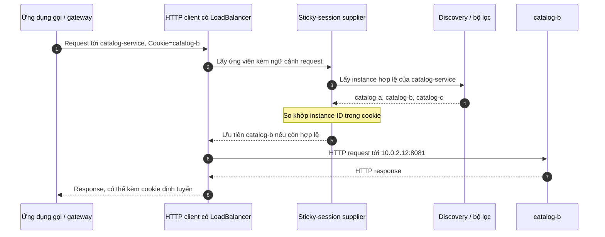

# Cookie định danh bản sao và điều kiện hoạt động của sticky session

Trong Spring Cloud LoadBalancer, một request thường có thể được gửi đến bất kỳ `ServiceInstance` phù hợp nào của cùng một **service ID**. Với ứng dụng cần duy trì tính liên tục giữa những request liên tiếp, có thể dùng cơ chế **sticky session** (session affinity) để ưu tiên quay lại bản sao đã phục vụ request trước. Một cách triển khai là lưu **instance ID** vào cookie, rồi đọc cookie đó khi chọn bản sao cho request tiếp theo.

Cookie này là **gợi ý định tuyến** cho LoadBalancer, không phải bằng chứng người dùng đã đăng nhập hay một bản sao chắc chắn còn hoạt động. Muốn sticky session vận hành đúng, client phải gửi lại cookie, tích hợp LoadBalancer phải nhìn thấy cookie và instance mang ID đó vẫn phải thuộc danh sách ứng viên hợp lệ. Các điều kiện này quan trọng hơn bản thân việc bật một property.

## 1. Service ID, instance ID và cookie có vai trò khác nhau

Giả sử `order-service` gọi `catalog-service`, trong khi dịch vụ danh mục có ba bản sao:

| Thuộc tính | Giá trị ví dụ | Ý nghĩa |
|---|---|---|
| Service ID | `catalog-service` | Tên logic của nhóm bản sao |
| Instance A | `catalog-a` tại `10.0.2.11:8081` | Một bản sao cụ thể |
| Instance B | `catalog-b` tại `10.0.2.12:8081` | Bản sao thứ hai |
| Instance C | `catalog-c` tại `10.0.2.13:8081` | Bản sao thứ ba |
| Cookie định tuyến | `sc-lb-instance-id=catalog-b` | Gợi ý tiếp tục chọn instance B |

`catalog-service` được dùng để **tìm tập ứng viên**. Giá trị `catalog-b` dùng để **nhận diện một phần tử** trong tập ứng viên. Tên cookie `sc-lb-instance-id` là tên thường được dùng trong cơ chế sticky session theo request của Spring Cloud LoadBalancer; tên cụ thể có thể thay đổi theo cấu hình và phiên bản sử dụng.

Ví dụ, hai request đến cùng tên logic:

```http
GET /api/products/42 HTTP/1.1
Host: catalog-service
```

```http
GET /api/products/43 HTTP/1.1
Host: catalog-service
Cookie: sc-lb-instance-id=catalog-b
```

Ở request thứ nhất, chưa có cookie định danh bản sao; LoadBalancer chọn một instance theo chính sách thông thường. Nếu request được gửi đến `catalog-b` và client nhận được cookie tương ứng, lần gọi sau có thể ưu tiên `catalog-b`, miễn instance này vẫn hợp lệ.

**Sticky session không đồng nghĩa HTTP session.** HTTP session hoặc cookie đăng nhập mô tả trạng thái người dùng/phiên ứng dụng. Cookie định danh bản sao chỉ cho biết **nên định tuyến tới instance nào**; nó không tự lưu, đồng bộ hoặc khôi phục dữ liệu session của người dùng.

## 2. Luồng một request có cookie sticky

Một vòng đời đơn giản gồm các bước:

1. Client gửi request đến `catalog-service` qua HTTP client đã tích hợp Spring Cloud LoadBalancer.
2. `ServiceInstanceListSupplier` lấy các instance khả dụng qua discovery và các lớp lọc liên quan.
3. Nếu request có cookie định danh bản sao, supplier có khả năng sticky sẽ đối chiếu giá trị cookie với **instance ID** của các ứng viên.
4. Nếu instance khớp và vẫn hợp lệ, danh sách có thể được thu hẹp để LoadBalancer ưu tiên instance đó.
5. Nếu cookie thiếu, không khớp hoặc instance không còn trong danh sách hợp lệ, việc lựa chọn quay về các ứng viên còn lại theo chính sách đang dùng.
6. Client gửi HTTP request đến host/port của instance đã chọn. Một cơ chế ghi cookie vào response, nếu được bật và hỗ trợ bởi tích hợp client, có thể giúp client lưu instance ID cho lần gọi sau.



Sơ đồ mô tả cách **ưu tiên** dựa trên cookie. Nếu `catalog-b` bị dừng, bị health check loại bỏ hoặc không được discovery trả về, LoadBalancer không nên tiếp tục gửi request đến địa chỉ cũ chỉ vì client giữ cookie. Khi đó, cơ chế fallback phải chọn một instance khả dụng khác hoặc trả lỗi nếu danh sách hoàn toàn rỗng.

## 3. Spring Cloud LoadBalancer đọc cookie ở đâu?

Spring Cloud LoadBalancer có `RequestBasedStickySessionServiceInstanceListSupplier` để ưu tiên bản sao được yêu cầu chỉ định bằng cookie. Supplier này hoạt động trên **dữ liệu request** mà tích hợp LoadBalancer cung cấp. Nó không tự truy cập cookie trong trình duyệt, cũng không tự đọc HTTP request của mọi controller trong toàn ứng dụng.

Luồng phụ thuộc vào lớp tích hợp:

- HTTP client được cấu hình `@LoadBalanced` hoặc cơ chế tương đương phải chuyển request qua LoadBalancer.
- Thông tin cookie cần xuất hiện trong **request ra dịch vụ đích** và được đưa vào ngữ cảnh chọn instance.
- Supplier sticky phải được đăng ký trong ngữ cảnh của service ID cần dùng nó.
- Danh sách `ServiceInstance` cần có `instanceId` ổn định, có ý nghĩa để đối chiếu.

Ví dụ: trình duyệt gọi `order-service` và gửi cookie trên request vào `order-service`. Nếu `order-service` tiếp tục gọi `catalog-service` bằng `RestClient`, cookie đầu vào **không nhất thiết được tự động chuyển tiếp** sang request ra `catalog-service`. Ứng dụng hoặc gateway phải quyết định rõ cookie nào cần truyền đi. Với một client gọi trực tiếp dịch vụ khác, cần kiểm tra cookie jar hoặc logic tự lưu và gửi cookie của client đó.

Trong ứng dụng có nhiều tuyến gọi, cần theo dõi đầy đủ **cả hai chiều**: request ra có mang cookie hay không, và response về có thực sự cung cấp cookie để client lưu cho lượt tiếp theo hay không.

## 4. Cấu hình supplier sticky riêng cho service

Một cách phổ biến là cung cấp `ServiceInstanceListSupplier` có bước xử lý sticky session trong child `ApplicationContext` của đúng service ID.

Ví dụ cấu hình `catalog-service`:

```java
package com.example.lbconfig;

import org.springframework.cloud.loadbalancer.core.ServiceInstanceListSupplier;
import org.springframework.context.ConfigurableApplicationContext;
import org.springframework.context.annotation.Bean;
import org.springframework.context.annotation.Configuration;

@Configuration(proxyBeanMethods = false)
public class CatalogStickyLoadBalancerConfiguration {

    @Bean
    ServiceInstanceListSupplier catalogInstanceSupplier(
            ConfigurableApplicationContext context) {
        return ServiceInstanceListSupplier.builder()
                .withDiscoveryClient()
                .withCaching()
                .withRequestBasedStickySession()
                .build(context);
    }
}
```

Sau đó gắn class cấu hình vào service ID:

```java
package com.example.orders;

import com.example.lbconfig.CatalogStickyLoadBalancerConfiguration;
import org.springframework.boot.autoconfigure.SpringBootApplication;
import org.springframework.cloud.loadbalancer.annotation.LoadBalancerClient;

@SpringBootApplication
@LoadBalancerClient(
        name = "catalog-service",
        configuration = CatalogStickyLoadBalancerConfiguration.class
)
public class OrderApplication {
}
```

`@LoadBalancerClient(name = "catalog-service", ...)` chỉ định child context nào nhận supplier vừa định nghĩa. Đặt `CatalogStickyLoadBalancerConfiguration` ở package `com.example.lbconfig`, **ngoài vùng component scan** của ứng dụng chính `com.example.orders`. Nếu class này vô tình được đăng ký trong context chính, supplier vốn chỉ dành cho `catalog-service` có thể ảnh hưởng đến những service ID khác.

Trong đoạn code, discovery là nguồn instance, cache đứng sau nguồn lấy dữ liệu, còn sticky là bước phụ thuộc request. Đây là trật tự có chủ đích: **không cache danh sách đã bị cá nhân hóa theo cookie như thể nó là danh sách chung của mọi request**. Khi cần thêm health check, zone preference hoặc lọc metadata, phải thiết kế thứ tự supplier sao cho sticky chỉ có thể ưu tiên một instance trong tập **đã qua các điều kiện hợp lệ**.

Ví dụ thể hiện một cách dựng supplier thường gặp; tên API, các điều kiện auto-configuration và cách tích hợp HTTP request cần đối chiếu với phiên bản Spring Cloud của dự án. Chỉ cần `@LoadBalancerClient` và một bean supplier chưa có nghĩa client đã tự gửi cookie đúng chiều.

## 5. Cookie được tạo và gửi lại bằng cách nào?

Có hai việc riêng biệt cần cấu hình và kiểm tra: **đọc cookie đầu vào để chọn instance** và **đặt cookie đầu ra để client nhớ instance đã chọn**.

Trong những phiên bản Spring Cloud LoadBalancer hỗ trợ, có thể bật cơ chế thêm cookie định danh instance vào response bằng cấu hình tương ứng, ví dụ:

```yaml
spring:
  cloud:
    loadbalancer:
      sticky-session:
        add-service-instance-cookie: true
```

Property trên liên quan đến **phát cookie**, trong khi `RequestBasedStickySessionServiceInstanceListSupplier` liên quan đến **đọc cookie để chọn instance**. Hai phía cần phối hợp với tích hợp HTTP client. Hãy xác nhận phiên bản Spring Cloud và response thực tế trước khi kết luận rằng browser hay client sẽ nhận và lưu cookie.

Một chu kỳ HTTP minh họa:

```http
HTTP/1.1 200 OK
Set-Cookie: sc-lb-instance-id=catalog-b; Path=/; HttpOnly; Secure; SameSite=Lax
```

```http
GET /api/products/43 HTTP/1.1
Host: catalog-service
Cookie: sc-lb-instance-id=catalog-b
```

Đây là ví dụ **về giao thức**; các thuộc tính `Path`, `HttpOnly`, `Secure`, `SameSite` trong ví dụ không phải lời khẳng định Spring Cloud LoadBalancer tự đặt đầy đủ chúng. Cookie có thể do gateway, reverse proxy hoặc tầng HTTP của ứng dụng phát và điều chỉnh. Cần xem header `Set-Cookie` thật để biết tên, giá trị và thuộc tính nào đã được gửi.

Nếu client chỉ gửi request và bỏ qua cookie nhận được, sticky session sẽ không kéo dài qua các request sau. Một số HTTP client không tự duy trì cookie jar, vì vậy code hoặc tầng middleware có thể cần lưu giá trị rồi gửi lại một cách có chủ đích.

## 6. Những điều kiện bắt buộc để sticky session có tác dụng

| Điều kiện | Khi thỏa mãn | Khi không thỏa mãn |
|---|---|---|
| Request đi qua LoadBalancer | Supplier có cơ hội dùng thông tin cookie | Gọi trực tiếp IP/host có thể bỏ qua cơ chế chọn instance |
| Cookie được giữ và gửi lại | Lần gọi sau có instance ID để đối chiếu | Request được xử lý như không có gợi ý affinity |
| Giá trị cookie khớp `instanceId` | Có thể tìm instance mong muốn | Fallback sang danh sách ứng viên hợp lệ |
| Instance vẫn trong tập ứng viên | Có thể ưu tiên instance cũ | Cần chọn lại hoặc báo không có instance |
| Supplier sticky nhận request context | Cookie tham gia việc lọc/chọn | Dù HTTP có cookie, kết quả chọn vẫn có thể như mặc định |
| Danh sách instance cập nhật đúng | Không cố định vào replica đã chết | Registry/cache lỗi thời có thể làm chọn địa chỉ không còn phục vụ |
| Cookie có phạm vi phù hợp | Browser/client gửi cookie cho tuyến gọi cần thiết | `Domain`, `Path`, `Secure`, `SameSite` hoặc chính sách client cản cookie |

Cần phân biệt ba nguyên nhân khác nhau khi thấy request đi đến nhiều instance: cookie chưa được lưu, cookie chưa được đưa vào request outbound, hoặc cookie có mặt nhưng instance mong muốn không còn nằm trong danh sách hợp lệ. Debug theo thứ tự này nhanh hơn việc thay thuật toán cân bằng tải một cách ngẫu nhiên.

### Instance ID phải nhất quán

Sticky session đối chiếu bằng **instance ID**, không phải chỉ bằng địa chỉ IP hoặc thứ tự instance trong danh sách. Vì vậy:

- Mỗi bản sao cần có instance ID duy nhất trong phạm vi service của nó.
- ID phải nhất quán trong thời gian bản sao còn tồn tại; thay ID không cần thiết sẽ làm cookie cũ mất tác dụng.
- Không tái sử dụng một ID cũ để đại diện tùy tiện cho một bản sao khác đang có trạng thái phiên khác.
- Khi deploy lại, thay pod/container hoặc scale down, instance ID cũ có thể biến mất; cần chấp nhận fallback.

Một cookie giữ `catalog-b` không bảo đảm có một bản sao mang ID này mãi mãi. Khả năng chọn lại instance sau thay đổi là hành vi quan trọng của hệ thống, không phải bằng chứng sticky session bị cấu hình sai.

### Cookie thuộc đúng request và đúng service

Khi một trình duyệt đi qua gateway để gọi nhiều dịch vụ, dùng cùng một cookie name cho các route khác nhau có thể gây ghi đè. Ví dụ, response của `catalog-service` ghi `catalog-b`, rồi response của `billing-service` ghi `billing-a` vào cookie cùng tên, cùng phạm vi; request tiếp theo đến `catalog-service` sẽ mang giá trị không thuộc nhóm instance của nó.

Hãy thiết kế **tên/phạm vi cookie theo tuyến hoặc service** khi cần duy trì affinity riêng cho nhiều dịch vụ, hoặc chọn cách truyền affinity ở một tầng duy nhất. Cookie chỉ là giá trị do client cung cấp; không được dùng nó như tên host đích để tạo URI tùy ý. Supplier phải so khớp với danh sách instance được discovery và bộ lọc tin cậy cung cấp.

## 7. Quan hệ giữa sticky session, zone và health check

Sticky session và định tuyến theo zone phục vụ hai mục tiêu khác nhau:

- **Zone preference:** cố gắng giữ request gần vị trí ứng dụng gọi, giảm độ trễ hoặc lưu lượng xuyên vùng.
- **Sticky session:** cố gắng giữ các request liên tiếp của một phiên ở cùng bản sao.
- **Health filtering:** loại những bản sao không đạt điều kiện phục vụ.

Khi dùng chung, cần định nghĩa thứ tự ưu tiên rõ ràng. Một pipeline hợp lý ở mức khái niệm là:

```text
Service ID
  → Discovery: mọi instance đã đăng ký
  → Cache / cập nhật danh sách
  → Lọc theo readiness, health hoặc zone phù hợp
  → So khớp cookie sticky trong các instance còn lại
  → Chọn instance cho request
  → Gửi HTTP request
```

Giả sử cookie yêu cầu `catalog-b` ở `zone-b`, trong khi ứng dụng gọi muốn ưu tiên `zone-a`:

| Danh sách sau lọc | Quyết định hợp lý |
|---|---|
| `catalog-b` còn hợp lệ và chính sách cho phép xuyên zone | Có thể giữ affinity với `catalog-b` |
| Chính sách bắt buộc cùng zone, `catalog-b` đã bị lọc | Chọn một instance trong zone được phép |
| `catalog-b` không còn khỏe mạnh | Bỏ qua cookie cũ và chọn instance khác |
| Không còn instance nào | Trả lỗi không có bản sao khả dụng |

Thứ tự cụ thể do chuỗi `ServiceInstanceListSupplier` và chính sách của ứng dụng quyết định. Không nên coi sticky cookie là quyền được vượt qua các điều kiện sức khỏe, bảo mật mạng hoặc ràng buộc zone bắt buộc.

## 8. Sticky session không bảo đảm giữ được trạng thái phía server

Một use case thường gặp là ứng dụng lưu session trong bộ nhớ của từng instance. Khi request đầu tiên đến `catalog-b`, dữ liệu phiên chỉ tồn tại trong bộ nhớ instance này; những request sau cần quay lại `catalog-b` để đọc được dữ liệu.

Affinity giúp giảm khả năng chuyển instance bất ngờ, nhưng không giải quyết ba tình huống:

1. **Instance bị lỗi:** cookie còn nhưng dữ liệu phiên trong RAM đã mất cùng tiến trình.
2. **Instance bị scale down hoặc rollout:** các request tiếp theo được chuyển đến bản sao mới, nơi không có phiên cũ.
3. **Cookie không được chuyển tiếp:** một gateway hay HTTP client trung gian làm mất thông tin affinity.

Nếu trạng thái nghiệp vụ cần tồn tại qua các sự cố này, hãy dùng session store dùng chung, session replication phù hợp, hoặc thiết kế dịch vụ stateless. Nếu nghiệp vụ chỉ cần gợi ý “nên quay lại instance cũ” để tăng cache locality hay giảm chi phí khởi tạo, sticky session có thể hữu ích ngay cả khi không có HTTP session lưu trong RAM.

Sử dụng cookie sticky quá lâu có thể khiến tải lệch: một số bản sao giữ lượng lớn phiên, trong khi bản sao mới nhận ít request. Sticky session cũng có thể làm giảm hiệu quả round robin hoặc random vì các request có cookie tiếp tục ưu tiên một instance. Hãy đo tải và cân nhắc thời gian sống cookie theo mục tiêu thực tế.

## 9. Browser, gateway và service-to-service: ba đường đi khác nhau

### Browser gọi trực tiếp một endpoint

Browser có thể nhận `Set-Cookie` và tự gửi lại cookie nếu thỏa điều kiện `Domain`, `Path`, `Secure`, `SameSite` và chính sách bảo mật của trình duyệt. Với request cross-origin, việc truyền cookie còn phụ thuộc `credentials` của client và cấu hình CORS của server. Nếu dùng `SameSite=None` trong browser hiện đại, cookie thường cần `Secure` và HTTPS.

### Browser gọi qua gateway

Sơ đồ:

```text
Browser → API Gateway → Spring Cloud LoadBalancer → catalog-service
```

Gateway phải nhận được cookie trên request vào, tích hợp LoadBalancer phải truy cập được cookie trong request được chuyển tiếp, và response phải chứa `Set-Cookie` ở phạm vi browser có thể lưu. Nếu affinity dùng riêng cho tuyến `catalog-service`, phải tránh cookie bị các tuyến khác ghi đè.

### Một backend gọi backend khác

Sơ đồ:

```text
Browser → order-service → RestClient/WebClient/OpenFeign → catalog-service
```

Cookie từ browser đến `order-service` không mặc nhiên là cookie trong request từ `order-service` đến `catalog-service`. Việc chuyển tiếp cookie nên được thiết kế có chọn lọc, chỉ truyền thông tin định tuyến cần thiết, không sao chép toàn bộ cookie người dùng sang mọi downstream service. Nếu một client dùng connection pool hoặc được nhiều người dùng chia sẻ, không để cookie của một phiên rò sang request của phiên khác.

## 10. Tương tác với retry và timeout

Timeout thuộc cấu hình HTTP client hoặc transport; sticky session chỉ tác động đến **lựa chọn instance**. Nếu instance được cookie chỉ định liên tục trả lỗi hoặc hết thời gian chờ, tiếp tục gửi mọi retry đến cùng instance có thể làm tăng độ trễ và giảm khả năng phục hồi.

Khi bật retry, cần kiểm tra hành vi chọn lại instance trong bản tích hợp đang dùng. Chính sách retry có thể lựa chọn lại bản sao hoặc giữ lựa chọn cũ tùy cấu hình. Nếu muốn chuyển sang instance khác sau lỗi, phải bảo đảm chiến lược retry và sticky không ép mọi lần thử quay về bản sao vừa thất bại.

Với POST hoặc thao tác ghi, cần đánh giá tính idempotent trước khi retry. Một request có thể đã được instance xử lý thành công nhưng response bị mất; gửi lại sang instance khác có thể tạo tác dụng phụ trùng. Sticky session không tự bảo đảm xử lý đúng một lần.

## 11. Cách kiểm thử sticky session có ý nghĩa

Để quan sát rõ, tạo hai bản sao của `catalog-service` có instance ID khác nhau và endpoint `/whoami` trả về instance ID thực tế. Client gọi thông qua service ID và ghi nhận cả request/response header.

| Tình huống | Cách thử | Kết quả cần kiểm tra |
|---|---|---|
| Request đầu không có cookie | Gọi `/whoami` không kèm cookie | Có instance được chọn theo chính sách bình thường |
| Nhận cookie định tuyến | Kiểm tra response header `Set-Cookie` | Giá trị trùng instance ID đã được chọn khi tính năng phát cookie hoạt động |
| Cookie hợp lệ | Gửi nhiều request với `sc-lb-instance-id` của instance còn khỏe | Các request ưu tiên cùng instance theo cấu hình |
| Cookie sai | Gửi ID không tồn tại | Fallback vào tập ứng viên hợp lệ; không tạo kết nối tới host tùy ý |
| Instance bị loại | Dừng instance được cookie chỉ định, đợi discovery/health cập nhật | Không tiếp tục định tuyến theo ID đã bị loại |
| Client không giữ cookie | Bỏ cookie khỏi request kế tiếp | Sticky không còn thông tin để duy trì affinity |
| Nhiều service | Gọi xen kẽ hai service ID dùng cookie | Không xảy ra ghi đè cookie ngoài ý muốn |
| Cookie không đi qua gateway | Dùng browser và so request inbound/outbound | Xác định vị trí cookie bị mất hoặc không được phát |

Không thể kết luận sticky hoạt động chỉ vì hai request liên tiếp cùng trúng một instance: round robin, random hoặc danh sách chỉ còn một instance đều có thể cho kết quả tương tự. Cần đối chiếu **cookie trong request**, **danh sách instance hiện tại** và **instance ID thực sự được chọn** qua nhiều lượt gọi.

Khi debug, nên ghi log service ID, instance ID đã chọn, lý do fallback nếu có, trạng thái HTTP và thời gian xử lý. Tránh ghi toàn bộ cookie hoặc token xác thực vào log. Cookie định danh bản sao cũng có thể làm lộ thông tin topology nội bộ; hãy kiểm soát phạm vi sử dụng và không coi nội dung cookie là dữ liệu tin cậy cho phân quyền.

## 12. Checklist trước khi sử dụng trong hệ thống thật

1. Có nhu cầu thực sự về affinity, hay dịch vụ stateless cùng session store dùng chung đã đủ?
2. Mỗi `ServiceInstance` có ID duy nhất, và ID có ổn định trong vòng đời instance không?
3. HTTP client/gateway có thực sự chuyển request qua Spring Cloud LoadBalancer và đưa cookie vào request context không?
4. Supplier sticky có được cấu hình đúng service ID và đúng vị trí trong chuỗi lọc không?
5. Có cơ chế phát cookie, gửi lại cookie và xác minh `Set-Cookie` thực tế không?
6. Có cách fallback khi ID trong cookie không còn nằm trong danh sách hợp lệ không?
7. Health check, zone policy và cache có được áp dụng theo thứ tự phù hợp không?
8. Cookie của các service hoặc route khác nhau có tránh xung đột tên và phạm vi không?
9. Browser, gateway hoặc backend client có tuân thủ điều kiện `Domain`, `Path`, `SameSite`, `Secure`, CORS và quản lý cookie theo từng người dùng không?
10. Retry, timeout và sự cố instance có được kiểm thử với request ghi và phiên thực tế không?

Cookie định danh bản sao giúp Spring Cloud LoadBalancer **ưu tiên giữ request trên cùng một `ServiceInstance`**, với điều kiện cookie đến được bước chọn instance và bản sao được chỉ định vẫn đủ điều kiện phục vụ. Khi hiểu rõ phạm vi cookie, thứ tự supplier và hành vi fallback, ứng dụng có thể sử dụng sticky session như một chính sách định tuyến có kiểm soát mà vẫn xử lý được scale, rollout và instance lỗi.
