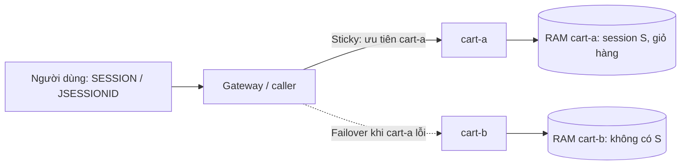
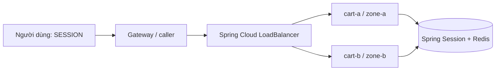
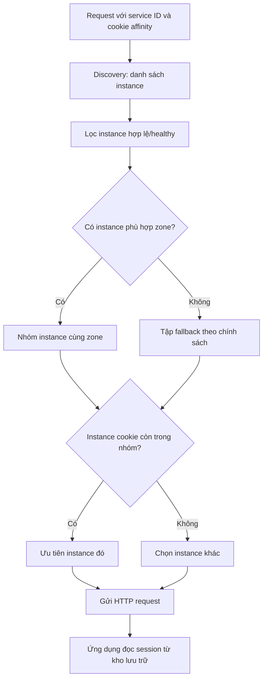

# Phân biệt tính bám dính với bảo đảm lưu trữ phiên

## 1. Vấn đề: quay lại đúng instance chưa chắc giữ được phiên

Trong chương **Vùng và định tuyến** của module `SPRING_CLOUD_SERVICE_COMMUNICATION_LOAD_BALANCING`, Spring Cloud LoadBalancer chọn một `ServiceInstance` dựa trên service ID, danh sách discovery, health check và chính sách chọn đích. Ở một số hệ thống, người dùng muốn các request liên tiếp quay về cùng một instance; đó là **tính bám dính** (*session affinity* hay *sticky routing*). Nhưng hệ thống cũng muốn dữ liệu của một phiên tiếp tục tồn tại khi instance dừng, restart hoặc khi request bị chuyển sang zone khác; đó là **khả năng lưu giữ và khôi phục trạng thái phiên** (*session persistence/durability*).

Hai yêu cầu nghe gần nhau nhưng tác động lên **hai lớp hoàn toàn khác**:

- **Bám dính:** quyết định request tiếp theo **được gửi tới instance nào**.
- **Lưu trữ phiên:** quyết định dữ liệu phiên **được ghi ở đâu, đọc lại thế nào và sống sót qua những sự cố nào**.

**Ví dụ:** ứng dụng `cart-service` có hai instance `cart-a` và `cart-b`. Giỏ hàng của một người dùng đang được lưu trong bộ nhớ của `cart-a`. Cookie affinity khiến các request sau tiếp tục đến `cart-a`, nên người dùng tưởng giỏ hàng đã được lưu bền vững. Khi `cart-a` restart hoặc bị loại khỏi danh sách khỏe mạnh, LoadBalancer chọn `cart-b`; bộ nhớ của `cart-b` không có giỏ hàng đó. Việc chọn đích đúng theo chính sách **không tự tạo ra bản sao của trạng thái phiên**.

Bài này phân tích sự khác biệt, cách sử dụng các cơ chế của Spring Cloud LoadBalancer, cách kết hợp zone routing với sticky routing, cách lưu phiên ngoài tiến trình bằng Spring Session và cách kiểm chứng bằng thí nghiệm lỗi. Các ví dụ dùng `order-service` hoặc gateway làm caller, `cart-service` làm dịch vụ đích; cùng nguyên tắc cũng áp dụng cho `RestClient`, `WebClient` và OpenFeign, nhưng mức hỗ trợ sticky-session dựa trên request cần kiểm tra theo từng HTTP client và Spring Cloud Release Train.

### Mục tiêu cần đạt

Sau bài học, bạn có thể:

1. Phân biệt **session ID**, **cookie định tuyến** và **trạng thái phiên**.
2. Giải thích được tại sao cùng một instance không bảo đảm dữ liệu còn sau restart, và vì sao đổi instance không nhất thiết làm mất phiên nếu có shared session store.
3. Phân biệt `SameInstancePreferenceServiceInstanceListSupplier` với `RequestBasedStickySessionServiceInstanceListSupplier`.
4. Thiết kế chuỗi ưu tiên zone, kiểm tra health và sticky preference mà vẫn có hành vi fallback rõ ràng.
5. Thiết lập thử nghiệm với local `HttpSession`, sau đó chuyển sang Spring Session + Redis để chứng minh tính liên tục của phiên.
6. Đo riêng tỷ lệ chọn đúng instance mong muốn với tỷ lệ khôi phục dữ liệu phiên sau chuyển đích/sự cố.

## 2. Ba khái niệm cần tách riêng

| Thành phần | Nó chứa gì? | Ai sử dụng? | Nó bảo đảm điều gì? |
|---|---|---|---|
| **Session ID** | Mã định danh một phiên logic, thường nằm trong cookie `JSESSIONID` hoặc `SESSION` tùy cơ chế | Ứng dụng và session repository | Cho phép tìm **bản ghi phiên**; bản thân mã không chứa toàn bộ dữ liệu phiên |
| **Affinity cookie / routing hint** | Gợi ý instance đích, ví dụ `sc-lb-instance-id=cart-a` | Gateway/caller/LoadBalancer hỗ trợ request-based sticky | Có thể **ưu tiên chọn** `cart-a` khi nó còn trong tập instance đủ điều kiện |
| **Session data** | Trạng thái đăng nhập, mục giỏ hàng tạm, tùy chọn và thuộc tính `HttpSession` | Ứng dụng và cơ chế session storage | Có thể đọc lại khi dùng cùng session ID, **nếu** storage còn dữ liệu và ứng dụng có quyền truy cập |

**Không đánh đồng hai cookie.** Cookie `sc-lb-instance-id` biểu thị **instance được ưu tiên**; cookie `SESSION` hoặc `JSESSIONID` nhận diện **phiên của người dùng**. Chúng có thể xuất hiện đồng thời trên một request nhưng không thay thế cho nhau. Không nên sử dụng affinity cookie làm token xác thực hoặc lấy session ID làm khóa chọn đích.

**Không đánh đồng “persistence” với bảo đảm tuyệt đối.** Dữ liệu đặt trong Redis hoặc cơ sở dữ liệu chia sẻ có thể truy cập từ nhiều replica, nhưng mức độ bền vững thực tế còn phụ thuộc cấu hình lưu xuống đĩa, replication, backup, TTL, cách xử lý sự cố vùng và tính nhất quán khi cập nhật đồng thời.

### 2.1. Khi chỉ có local session



Người dùng tiếp tục thấy dữ liệu nếu request đến đúng `cart-a` và tiến trình còn giữ bộ nhớ. Khi request chuyển sang `cart-b` hoặc `cart-a` mất bộ nhớ, dữ liệu cũ có thể không được tìm thấy.

### 2.2. Khi dùng shared session store



Cả `cart-a` và `cart-b` đều đọc cùng session repository thông qua cùng session ID. Nếu một instance chết, instance còn lại **có thể khôi phục dữ liệu phiên** mà không cần sticky routing, miễn là dữ liệu đã được lưu, store có sẵn, client tiếp tục chuyển đúng session ID và không có vấn đề về tương thích dữ liệu.

**Khác biệt cốt lõi:** sơ đồ đầu giúp request có cơ hội quay lại đúng nơi dữ liệu đang nằm; sơ đồ sau làm dữ liệu độc lập hơn với nơi xử lý request.

## 3. Hai cơ chế “bám dính” của Spring Cloud LoadBalancer

Spring Cloud LoadBalancer cung cấp các `ServiceInstanceListSupplier` tùy chỉnh danh sách ứng viên trước bước chọn instance. Tùy loại sticky preference, thông tin đầu vào và phạm vi bám dính rất khác nhau.

### 3.1. Same instance preference: ưu tiên instance được chọn trước đó

`SameInstancePreferenceServiceInstanceListSupplier` ưu tiên instance đã được LoadBalancer chọn ở lần trước **nếu instance đó vẫn còn khả dụng**.

Có thể cấu hình theo hướng dẫn của Spring Cloud Commons:

```yaml
spring:
  cloud:
    loadbalancer:
      configurations: same-instance-preference
```

Hoặc dùng builder:

```java
@Bean
ServiceInstanceListSupplier sameInstanceSupplier(
        ConfigurableApplicationContext context) {
    return ServiceInstanceListSupplier.builder()
            .withDiscoveryClient()
            .withSameInstancePreference()
            .build(context);
}
```

Đoạn Java là cấu hình supplier minh họa; khi đưa vào ứng dụng thực, cần giới hạn scope theo service ID bằng `@LoadBalancerClient` hoặc cấu hình context phù hợp.

**Điểm dễ nhầm:** “same instance preference” chỉ nhớ lần chọn **trong phạm vi LoadBalancer/supplier liên quan**, không hề tạo một bảng `userId → instanceId` cho từng người dùng. Hai người dùng gọi qua cùng một caller context có thể cùng chịu ảnh hưởng của instance vừa được chọn. Nhiều replica của caller có trạng thái chọn riêng; đây **không phải cơ chế session affinity theo người dùng** có bảo đảm nhất quán trên toàn cụm.

Khi instance cũ biến mất, supplier có thể chọn instance khác. Cơ chế đó không chép `HttpSession` từ instance cũ sang instance mới.

### 3.2. Request-based sticky session: ưu tiên instance theo cookie của request

`RequestBasedStickySessionServiceInstanceListSupplier` ưu tiên instance có `instanceId` được đặt trong cookie của request. Đây là cơ chế gần với khái niệm affinity theo từng chuỗi request hơn:

```text
Request 1: Cookie không có instanceId
  -> chọn cart-a
  -> request sau có hint sc-lb-instance-id=cart-a

Request 2: Cookie sc-lb-instance-id=cart-a
  -> ưu tiên cart-a, nếu cart-a còn trong tập instance được phép chọn

Request 3: Cookie sc-lb-instance-id=cart-a
  -> cart-a đã bị loại khỏi danh sách
  -> chọn cart-b theo chính sách fallback
  -> hint cần được cập nhật cho những lần sau
```

Tài liệu Spring Cloud Commons mô tả hai cách đăng ký:

- Đặt `spring.cloud.loadbalancer.configurations=request-based-sticky-session` nếu muốn dùng cấu hình có sẵn ở phạm vi phù hợp.
- Hoặc tạo `ServiceInstanceListSupplier` riêng với `.withRequestBasedStickySession()` cho service ID cụ thể.

Ví dụ cấu hình **chỉ cho `cart-service`**:

```java
@Configuration(proxyBeanMethods = false)
@LoadBalancerClient(
        name = "cart-service",
        configuration = CartStickyLoadBalancerConfiguration.class)
class CartClientRegistration {

    @Bean
    @LoadBalanced
    WebClient.Builder cartWebClientBuilder() {
        return WebClient.builder();
    }
}

// Không gắn @Configuration lên lớp này nếu nó nằm trong component scan;
// @LoadBalancerClient nạp bean vào child context của cart-service.
class CartStickyLoadBalancerConfiguration {

    @Bean
    ServiceInstanceListSupplier stickySupplier(
            ConfigurableApplicationContext context) {
        return ServiceInstanceListSupplier.builder()
                .withDiscoveryClient()
                .withRequestBasedStickySession()
                .build(context);
    }
}
```

Các import cần thiết thuộc Spring Cloud Commons/LoadBalancer, Spring Context và Spring WebFlux. Cần có `spring-cloud-starter-loadbalancer`, một `DiscoveryClient` có danh sách `cart-service` và HTTP client tương thích. Nếu cần kết hợp thêm health check/zone filtering, xây dựng supplier chain có thứ tự rõ ràng và kiểm tra kết quả thực tế theo Release Train.

Tài liệu Spring Cloud Commons 4.3 và 5.0 ghi **request-based sticky-session hiện được hỗ trợ cho WebClient-backed load balancing** khi request được chuyển qua các context phù hợp, như `ClientRequestContext` hoặc `ServerHttpRequestContext`. Không giả định rằng chỉ thêm supplier là mọi lời gọi từ `RestClient` hoặc OpenFeign đều tự đọc và xử lý cookie giống `WebClient`. Với các client khác, cần xác minh khả năng truyền request context hoặc chọn một cơ chế affinity thực sự được hỗ trợ.

### 3.3. Cookie định tuyến và giới hạn của nó

Theo tài liệu, cookie có tên mặc định `sc-lb-instance-id`. Có thể yêu cầu LoadBalancer thêm cookie chứa instance vừa chọn vào request bằng:

```yaml
spring:
  cloud:
    loadbalancer:
      sticky-session:
        add-service-instance-cookie: true
        instance-id-cookie-name: sc-lb-instance-id
```

**Lưu ý về version:** tài liệu mô tả có nơi dùng đường dẫn rút gọn `spring.cloud.loadbalancer.instance-id-cookie-name`, trong khi trang *Configuration Properties* của Spring Cloud Commons 4.3/5.0 liệt kê `spring.cloud.loadbalancer.sticky-session.instance-id-cookie-name`. Khi chỉnh tên cookie, đối chiếu **metadata của phiên bản thật đang chạy** và xác minh binding/hành vi; không chỉ suy đoán từ một ví dụ trên mạng.

Thuộc tính `add-service-instance-cookie` liên quan đến việc gắn thông tin instance được chọn vào **request chuyển tiếp**. Nó **không đồng nghĩa** một trình duyệt sẽ tự nhận `Set-Cookie` từ gateway và giữ affinity trên mọi request kế tiếp. Nếu luồng bắt đầu từ browser, gateway/caller phải truyền cookie qua ranh giới request và, khi thiết kế yêu cầu, quản lý cookie phản hồi tương ứng. Không nên copy toàn bộ `Cookie` header giữa các dịch vụ; chỉ truyền thông tin cần thiết theo chính sách bảo mật.

Vì cookie có thể do client gửi, phải coi instance ID trong cookie là **gợi ý không đáng tin cậy để phân quyền**. Instance đích phải được xác nhận trong danh sách discovery/health/zone được phép. Xác thực người dùng và kiểm tra quyền truy cập vẫn do ứng dụng đảm nhiệm, độc lập với cookie định tuyến.

## 4. Bám dính là ưu tiên chọn, không phải lời hứa tuyệt đối

Trong các trường hợp dưới đây, cùng một session ID vẫn có thể được gửi đến instance khác:

1. **Instance ưu tiên không còn khỏe:** discovery hoặc health check đã loại instance đó khỏi danh sách.
2. **Instance đang scale down/rolling deployment:** ID cũ không còn hoặc tiến trình mới có ID khác.
3. **Caller restart hoặc đổi replica:** trạng thái “lần chọn trước” ở `SameInstancePreference` không đi cùng caller.
4. **Zone preference thay đổi:** caller được chuyển sang zone khác hoặc zone cũ không có instance phù hợp.
5. **Retry/fallback:** HTTP client có thể thử lại sang instance mới khi yêu cầu còn điều kiện retry.
6. **Cookie không đi qua hop:** proxy hoặc API gateway bỏ/ghi đè cookie; tên hoặc domain/path của cookie không khớp.
7. **Danh sách cập nhật chậm:** cache và discovery còn giữ instance đã chết; sticky hint vẫn có thể dẫn đến lỗi kết nối trước khi được loại.

Cần phân biệt **đã chọn instance** và **request thực sự được phục vụ**. LoadBalancer có thể chọn `cart-a` nhưng HTTP client không kết nối được; khi đó response không cho biết dữ liệu trong RAM `cart-a` còn hay mất. Retry không tự chuyển trạng thái phiên hoặc thực hiện giao dịch chính xác một lần.

## 5. Kết hợp zone preference và sticky routing

Zone preference ưu tiên instance cùng vùng với caller. Trong Spring Cloud LoadBalancer, `ZonePreferenceServiceInstanceListSupplier` sử dụng metadata `zone` của `ServiceInstance` và vùng phía caller; nếu không có instance phù hợp trong zone, triển khai mặc định có thể trả lại danh sách instance ban đầu. Điều này giúp định tuyến gần hơn, nhưng không tạo ra session store.

Giả sử hệ thống gồm bốn instance:

| Instance | Zone | Trạng thái | Session storage |
|---|---|---|---|
| `cart-a1` | `zone-a` | Healthy | Local RAM hoặc Redis |
| `cart-a2` | `zone-a` | Healthy | Local RAM hoặc Redis |
| `cart-b1` | `zone-b` | Healthy | Local RAM hoặc Redis |
| `cart-b2` | `zone-b` | Healthy | Local RAM hoặc Redis |

Một người dùng từng được định tuyến vào `cart-a1`. Nếu caller ở `zone-a`, cả zone preference và cookie affinity có thể cùng trỏ đến `cart-a1`. Nhưng nếu `cart-a1` hỏng và request phải đi sang `cart-a2`, với **local session** dữ liệu phiên vẫn có thể mất. Nếu toàn bộ `zone-a` không khả dụng và request phải đi `zone-b`, tình huống mất dữ liệu càng rõ.

### 5.1. Ưu tiên các điều kiện theo thứ tự

Một thiết kế dễ giải thích thường tuân thủ nguyên tắc:

1. **Chỉ xét instance hợp lệ** từ discovery và kiểm tra sức khỏe cần thiết.
2. **Áp chính sách zone hoặc ràng buộc định tuyến** theo mục tiêu của dịch vụ.
3. **Tôn trọng affinity** trong tập ứng viên còn lại, khi instance mong muốn vẫn có mặt.
4. **Fallback** khi cookie trỏ tới instance không hợp lệ; chọn instance khác bằng chính sách được công bố.
5. **Lưu dữ liệu phiên độc lập** để fallback không đồng nghĩa mất trạng thái.

Đây là **thứ tự logic đề xuất**, không phải cam kết thứ tự bean mặc định của mọi Release Train. Nếu muốn ưu tiên affinity xuyên zone hơn local zone, phải quyết định có chấp nhận độ trễ và chi phí truyền dữ liệu liên zone tăng không. Nếu ưu tiên zone trước, cookie trỏ tới zone khác có thể không được đáp ứng. Không thể bảo đảm “luôn cùng instance”, “luôn cùng zone” và “tự động failover” cùng một lúc.

Sơ đồ quyết định ở mức khái niệm:



Cần đo riêng **zone hit rate**, **affinity hit rate** và **khả năng giữ phiên qua fallback**. Chúng là ba chỉ số khác nhau.

### 5.2. Sticky routing có thể làm lệch tải

Affinity kéo nhiều request của cùng một người dùng về một instance. Với người dùng có tải rất lớn hoặc phiên tồn tại lâu, một số instance có thể trở nên “nóng”, dù Round Robin ban đầu phân phối đều. Zone preference thu hẹp tập ứng viên, có thể làm tình huống nóng cục bộ rõ hơn. Theo dõi request đang xử lý, queue depth, CPU, p95/p99 latency và số kết nối theo instance thay vì chỉ đếm tổng request.

## 6. Ba kiểu quản lý trạng thái và mức bảo đảm

| Thiết kế | Khi request đổi instance | Khi một instance restart | Khi session store gặp sự cố | Đánh đổi |
|---|---|---|---|---|
| **Local `HttpSession` + sticky** | Có thể mất phiên hoặc tạo phiên mới | Có thể mất dữ liệu trong RAM | Không có store ngoài, nhưng dữ liệu phụ thuộc tiến trình | Đơn giản ban đầu; phụ thuộc affinity, khó scale/failover |
| **Spring Session + shared Redis, không sticky** | Có thể tiếp tục cùng session khi cookie đúng và dữ liệu còn | Phiên có thể tiếp tục ở instance khác | Có thể lỗi đọc/ghi phiên; dữ liệu mất nếu không có cơ chế bền vững phù hợp | Thêm chi phí mạng, TTL, vận hành Redis, cơ chế HA |
| **Spring Session + shared Redis, có sticky** | Có thể tiếp tục khi đổi instance | Có thể tiếp tục khi restart instance | Vẫn phụ thuộc Redis | Giảm một số thay đổi đích nếu cần, nhưng có thể gây lệch tải và tăng độ phức tạp |
| **Dịch vụ stateless + dữ liệu nghiệp vụ trong DB** | Không phụ thuộc instance cho business state | Có thể tiếp tục sau xác thực lại nếu thiết kế phù hợp | Phụ thuộc DB/identity system và chính sách của chúng | Thích hợp cho state quan trọng; cần mô hình dữ liệu/giao dịch rõ ràng |

**Lưu trữ phiên ngoài tiến trình** giải quyết việc chia sẻ/khôi phục session giữa replica, nhưng không tự bảo đảm mọi thuộc tính về *durability*. Nếu Redis không cấu hình persistence, mất toàn bộ cluster hoặc bị evict dữ liệu, session vẫn có thể mất. Khi cần khôi phục sau lỗi hạ tầng, phải thiết kế SLA/RPO/RTO cho store, triển khai replication/failover, persistence và backup phù hợp, đồng thời thử restore định kỳ.

Đừng dùng phiên làm nơi lưu trữ **giao dịch đã xác nhận** hoặc dữ liệu nghiệp vụ cần bảo đảm lâu dài (đơn hàng, thanh toán, số dư). Những dữ liệu đó cần hệ lưu trữ nghiệp vụ bền vững với ràng buộc giao dịch/idempotency thích hợp. Phiên thường chứa trạng thái truy cập và thông tin tạm có TTL.

### 6.1. Session ID tồn tại không có nghĩa session record còn tồn tại

Khi browser còn cookie `SESSION` nhưng bản ghi đã hết TTL, đã bị logout/invalidate, bị eviction hoặc bị xóa sau sự cố storage, ứng dụng phải xử lý như phiên không hợp lệ. Không nên cố “khôi phục” bằng cách điều hướng request về instance cũ. Affinity cookie cũng có thể còn sau khi instance bị thay thế; phải có fallback và thời hạn cookie phù hợp.

### 6.2. Đừng nhầm phiên HTTP với kết nối sống

WebSocket, upload dài, streaming hoặc giao dịch đang giữ trong bộ nhớ cần xem xét riêng. Shared HTTP session store giúp instance mới đọc lại dữ liệu phiên, nhưng **không tự chuyển một kết nối TCP/WebSocket đang mở**, stack của luồng đang chạy hay transaction chưa commit từ tiến trình đã chết. Những nghiệp vụ đó cần cơ chế reconnect, resume, checkpoint hoặc idempotent processing riêng.

## 7. Thực hành A — Thấy giới hạn của sticky với local HttpSession

### 7.1. Dựng hai instance cart-service

Chạy hai instance `cart-service` ở hai cổng khác nhau, cùng service ID, mỗi instance mang mã riêng:

```yaml
spring:
  application:
    name: cart-service
server:
  port: 8081
app:
  instance-id: cart-a
```

Tiến trình thứ hai dùng `server.port=8082` và `app.instance-id=cart-b`. Hai tiến trình dùng **local session mặc định** khi chưa có Spring Session hoặc session repository chung.

Tạo endpoint minh họa có ghi bộ đếm vào `HttpSession`:

```java
@RestController
class CartSessionDemoController {
    private final Environment environment;

    CartSessionDemoController(Environment environment) {
        this.environment = environment;
    }

    @GetMapping("/demo/session")
    Map<String, Object> visit(HttpSession session) {
        Integer previous = (Integer) session.getAttribute("visitCount");
        int next = previous == null ? 1 : previous + 1;
        session.setAttribute("visitCount", next);

        return Map.of(
                "instance", environment.getProperty("app.instance-id", "unknown"),
                "visitCount", next);
    }
}
```

Ví dụ dùng Spring MVC `HttpSession` (Servlet API tương ứng phiên bản Jakarta của Spring Boot). Bộ đếm không được thiết kế cho update đồng thời; để kiểm chứng đơn giản, gửi request tuần tự. Không trả **session ID thật** ra response và không ghi raw session cookie vào log vận hành.

### 7.2. Thử ba tình huống

Dùng gateway hoặc caller đã cấu hình LoadBalancer và bảo đảm **session cookie được chuyển đúng tới cart-service**. Với request-based sticky WebClient, caller cũng phải nhận và chuyển affinity cookie khi có; kiểm chứng browser/caller có thực sự giữ cookie đó qua các lần gọi.

1. **Bám dính đang hoạt động:** gửi nhiều request liên tiếp với cùng session và affinity hint `cart-a`. Quan sát `instance=cart-a`, bộ đếm tăng từ 1 lên 2, 3...
2. **Tắt instance ưu tiên:** dừng `cart-a` và đợi danh sách discovery/health phản ánh sự cố. Giữ session cookie và gửi tiếp đến `cart-b`. Với local `HttpSession`, instance mới **không có bản ghi của `cart-a`**; thường có session mới, bộ đếm bắt đầu lại.
3. **Restart instance cũ:** chạy lại `cart-a`. Nếu dữ liệu chỉ nằm trong RAM, việc quay lại đúng instance ID không làm dữ liệu bộ nhớ đã mất xuất hiện trở lại.

Để tránh nhầm lẫn, lưu đồng thời `instanceId`, `visitCount`, HTTP status và thời điểm request. Nếu proxy tự chuyển sang instance khác hoặc tạo session ID mới, ghi nhận sự kiện đó. Trong thử nghiệm này, **mất state sau restart** là kết quả kỳ vọng của local in-memory session khi không cấu hình cơ chế replication/persistence ngoài.

## 8. Thực hành B — Tách dữ liệu phiên khỏi instance bằng Spring Session

### 8.1. Thêm session repository dùng chung

Đối với ứng dụng Spring MVC dùng Spring Boot có Spring Session tương thích, có thể tích hợp Redis để cả hai instance đọc cùng `HttpSession`. Ví dụ dependency Maven cho tổ hợp dùng các artifact này:

```xml
<dependency>
    <groupId>org.springframework.session</groupId>
    <artifactId>spring-session-data-redis</artifactId>
</dependency>
<dependency>
    <groupId>org.springframework.boot</groupId>
    <artifactId>spring-boot-starter-data-redis</artifactId>
</dependency>
```

Để Spring Boot BOM quản lý version tương thích. Ở những phiên bản Spring Boot có starter chuyên dụng `spring-boot-starter-session-data-redis`, có thể dùng starter đó theo tài liệu của phiên bản đang chạy. Không mix tùy tiện BOM Spring Boot/Spring Cloud hoặc artifact vượt major version. Kiểm tra auto-configuration đã tạo Spring Session repository và filter tương ứng.

Cấu hình minh họa, với Redis truy cập được qua hostname `redis` trong môi trường lab:

```yaml
spring:
  data:
    redis:
      host: redis
      port: 6379
  session:
    redis:
      namespace: demo:cart:session

server:
  servlet:
    session:
      timeout: 30m
```

Cả hai instance `cart-service` phải trỏ tới cùng session repository/namespace và có cấu hình serialization tương thích. Dữ liệu gán vào `HttpSession` phải phù hợp với cơ chế serializer được sử dụng; tránh lưu trực tiếp đối tượng sống không thể serialize. Để tài liệu này độc lập với một patch version cụ thể, xem hướng dẫn Spring Session + Redis của chính Spring Boot/Spring Session đang sử dụng trước khi copy cấu hình triển khai.

### 8.2. Kiểm chứng tính liên tục của phiên

1. Bật Redis, chạy `cart-a` và `cart-b` có Spring Session. Giữ nguyên endpoint `/demo/session`.
2. Gửi request với **cùng session cookie**; khi thử thủ công, lưu cookie từ response và gửi lại ở request sau. Với gateway nhiều hop, bảo đảm cookie session được truyền tới đúng nơi đọc session.
3. Thử xen kẽ giữa `cart-a` và `cart-b` bằng cách đổi định tuyến có kiểm soát. Bộ đếm `visitCount` phải tiếp tục tăng thay vì quay về 1, sau khi mỗi request đã hoàn tất và ghi session.
4. Dừng `cart-a`, giữ session cookie và gửi tới `cart-b`. Khi Redis còn truy cập được và dữ liệu chưa hết hạn, bộ đếm tiếp tục tăng.
5. Restart `cart-a`, gửi lại cùng session cookie tới instance mới. Kiểm chứng state vẫn được đọc từ Redis.
6. Dừng hoặc mô phỏng lỗi Redis trong môi trường lab để xem ứng dụng báo lỗi/giảm chức năng thế nào. **Không** kết luận Spring Session bảo đảm tính khả dụng khi chính storage không khả dụng.

Không dùng `curl -b`/`-c` để chứng minh sticky nếu gateway chưa cấp hoặc chưa truyền affinity cookie; các tùy chọn đó chỉ giúp lưu/gửi cookie thật sự xuất hiện trong HTTP response. Với kịch bản local, bạn có thể dùng:

```bash
curl -i -c cart-cookies.txt -b cart-cookies.txt http://localhost:8080/demo/session
curl -i -c cart-cookies.txt -b cart-cookies.txt http://localhost:8080/demo/session
```

Đường dẫn `localhost:8080` ở ví dụ là một proxy/gateway đã được cấu hình chuyển tiếp đến `cart-service`. Nếu gọi trực tiếp `cart-service`, dùng cổng instance tương ứng. Khi không qua gateway, bạn có thể thay đổi cổng đích giữa hai lần gửi nhưng vẫn giữ cookie jar để kiểm tra việc chia sẻ session; điều kiện là cookie scope/domain hợp lệ và cả hai instance cùng session repository.

### 8.3. Kiểm tra độ bền vững ngoài việc chia sẻ

Bằng chứng `cart-a` chết mà `cart-b` đọc được session mới chỉ kiểm tra **khả năng truy cập phiên qua instance**. Muốn tuyên bố phiên có thể sống sót sau lỗi Redis hoặc mất một zone, cần thử thêm cấu hình replica/failover của Redis, persistence policy, backup/restore, expiration, khả năng tương thích serialization khi deploy và giới hạn mất dữ liệu chấp nhận được. Các tình huống này là kiểm thử storage, không thuộc khả năng của LoadBalancer.

## 9. Bảng thí nghiệm phân biệt hai loại bảo đảm

| Kịch bản | Sticky | Session store | Khi đổi từ cart-a sang cart-b, điều cần quan sát |
|---|---|---|---|
| A. Local RAM, cùng instance | Có | Local | Bộ đếm thường giữ khi `cart-a` còn sống; chưa chứng minh durability |
| B. Local RAM, ép failover | Có, nhưng fallback | Local | Bộ đếm có thể reset hoặc phiên mới được tạo |
| C. Redis, không sticky | Không | Shared Redis | Bộ đếm tiếp tục nếu session cookie và dữ liệu còn |
| D. Redis + sticky | Có | Shared Redis | Bộ đếm giữ khi cùng instance và khi failover hợp lệ |
| E. Redis còn cookie nhưng session hết TTL | Có hoặc không | Shared Redis | Phiên không còn hợp lệ; không thể khôi phục chỉ nhờ sticky |
| F. Redis outage | Có hoặc không | Shared Redis lỗi | Có thể lỗi đọc/ghi; affinity không khắc phục outage |
| G. Zone-a mất hoàn toàn | Không giữ được instance zone-a | Shared store cross-zone còn truy cập | Có thể tiếp tục phiên tại zone-b; kiểm tra độ trễ/consistency |
| H. Rolling deployment đổi instance ID | Cookie cũ trở nên stale | Shared store còn dữ liệu | Route fallback và đọc session tiếp; cập nhật hint theo chính sách |

Đối với mỗi hàng, log tối thiểu: `traceId`, service ID, instance ID được chọn, zone, trạng thái health, loại thử nghiệm, kết quả HTTP, bộ đếm, số lần retry và lỗi của session repository. Không log giá trị raw của session ID, cookie xác thực hoặc dữ liệu nhạy cảm.

## 10. Đo đúng: độ bám dính khác độ liên tục phiên

### 10.1. Hai metric không thể thay thế cho nhau

Với các request có affinity hint hợp lệ và instance được ưu tiên còn trong tập ứng viên:

\[
\text{Affinity hit rate}
=\frac{\text{số lượt chọn đúng instance được ưu tiên}}
{\text{số lượt chọn có preference hợp lệ và instance còn eligible}}.
\]

Với các phiên đã ghi state và được ép chuyển instance:

\[
\text{Session continuity rate}
=\frac{\text{số phiên vẫn đọc lại được state sau chuyển đích}}
{\text{tổng số phiên được kiểm thử chuyển đích}}.
\]

Mẫu số cần được ghi rõ để không đánh lừa kết quả: loại cookie hết hạn/không hợp lệ khỏi phép đo hit rate có điều kiện, nhưng vẫn phải báo số lượng cookie stale và tỷ lệ fallback. `Affinity hit rate=100%` chỉ nói LoadBalancer đang ưu tiên đúng instance khi điều kiện cho phép; nó **không chứng minh** dữ liệu vẫn còn sau restart.

### 10.2. Đo thêm khi chuyển zone và hỏng instance

| Chỉ số | Nó giúp trả lời |
|---|---|
| `zone_hit_rate` | Bao nhiêu request tới instance ở zone ưu tiên? |
| `affinity_hit_rate` | Bao nhiêu lượt chọn vẫn tới instance đã được gợi ý khi hợp lệ? |
| `fallback_count` theo nguyên nhân | Tại sao phải rời instance gốc: health, scale down, cookie stale hay zone? |
| `session_continuity_rate` | Bao nhiêu phiên giữ được dữ liệu khi chuyển sang instance khác? |
| `session_store_error_rate` | Redis/session repository có đang gây lỗi đọc/ghi không? |
| `p95/p99 latency` và `cross-zone latency` | Chi phí hiệu năng của sticky hoặc failover là bao nhiêu? |
| `retry_attempts`, HTTP timeout, 5xx | Retry và lỗi có che khuất hành vi thực tế không? |

Ghi nhận mỗi **logical request** và từng **HTTP attempt** riêng biệt: một request nghiệp vụ có retry có thể đi nhiều instance. Log của LoadBalancer phản ánh lựa chọn instance; log HTTP/trace xác nhận request có được server xử lý không; metric session repository xác nhận trạng thái có đọc/ghi được không.

### 10.3. Điều kiện kiểm thử cần kiểm soát

- Dùng cùng service ID và cùng tập instance đã đăng ký trước khi thay chính sách.
- Xác nhận health check và discovery đã cập nhật trước khi kết luận failover.
- Bắt đầu với retry tắt để thấy rõ request đi đâu; sau đó bật retry với giới hạn hợp lý và test riêng.
- Bảo đảm browser/gateway/caller thực sự chuyển session cookie và affinity cookie qua các hop cần thiết.
- Giữ TTL phiên dài hơn thời gian thí nghiệm; kiểm tra đồng bộ giờ giữa các instance nếu logic phụ thuộc timestamp.
- Không dùng local session counter concurrent làm bằng chứng về chính xác dữ liệu: demo trên dùng update không nguyên tử.
- Khi chuyển zone, xác nhận kho session truy cập được từ zone đích và định tuyến network/TLS chính xác.

## 11. Chọn kiến trúc theo yêu cầu vận hành

| Nhu cầu | Đề xuất thiết kế | Lý do |
|---|---|---|
| Ứng dụng web legacy đang giữ state trong RAM | Có thể dùng sticky như **giải pháp tạm thời**, đồng thời chuẩn bị shared store | Giảm đổi instance khi ổn định, nhưng còn rủi ro khi restart/failover |
| Nhiều replica, autoscaling, rolling upgrade | Spring Session + shared store hoặc mô hình stateless | Session ít phụ thuộc instance; dễ scale và thay replica |
| Multi-zone, cần failover phiên | Shared store có kế hoạch HA/cross-zone; routing fallback rõ ràng | Sticky chỉ ảnh hưởng chọn đích, không cứu state khi zone mất |
| API chỉ cần xác thực, business data lưu DB | Token hoặc opaque session ID theo cơ chế bảo mật phù hợp; instance stateless | Không cần gắn người dùng vào một replica cụ thể |
| Đơn hàng/thanh toán cần khôi phục chính xác | Lưu dữ liệu nghiệp vụ trong DB với giao dịch, idempotency và cơ chế phục hồi | Session store không thay thế độ bền dữ liệu nghiệp vụ |
| WebSocket hoặc xử lý dài đang gắn vào tiến trình | Thiết kế reconnect/resume/checkpoint và state recovery | Sticky và Redis HttpSession không chuyển kết nối sống |

Nếu dùng cookie phiên, cần cấu hình HTTPS, `Secure`, `HttpOnly` và `SameSite` phù hợp, giới hạn thời gian sống, rotate/invalidate session khi đăng nhập/đăng xuất và bảo vệ session fixation. Không gửi session token qua log hoặc metric label. Cookie định tuyến có thể được đặt trong request bởi client nên không được coi là bằng chứng xác thực hay quyền truy cập zone.

## 12. Những kết luận sai cần tránh

1. **“Đã bật sticky thì session không mất.”** Sai: instance restart vẫn làm mất in-memory state; sticky không sao chép hay lưu dữ liệu.
2. **“Hai request cùng tới cart-a tức là người dùng được gắn riêng cart-a.”** Chưa chắc: `SameInstancePreference` nhớ instance chọn trước trong supplier, không phân biệt người dùng.
3. **“Cookie sc-lb-instance-id chính là JSESSIONID.”** Sai: cái trước là routing preference, cái sau nhận diện phiên.
4. **“Bật add-service-instance-cookie là browser tự nhận Set-Cookie.”** Không được giả định; phải kiểm chứng hop nhận/trả cookie và hỗ trợ WebClient của phiên bản đang dùng.
5. **“Zone preference bảo đảm tuyệt đối cùng zone.”** Sai: khi không có instance phù hợp, chính sách có thể fallback sang tập khác.
6. **“Đưa HttpSession vào Redis nghĩa là không bao giờ mất dữ liệu.”** Sai: Redis có thể outage, expire, evict hoặc mất dữ liệu tùy cấu hình và tình huống sự cố.
7. **“Chỉ cần kiểm tra HTTP 200 là đủ.”** Sai: một request 200 có thể đã tạo session mới và mất trạng thái cũ; phải kiểm tra state continuity.
8. **“Dùng retry sẽ đảm bảo chính xác một lần.”** Sai: retry có thể làm một thao tác ghi diễn ra nhiều lần, cần idempotency và kiểm soát giao dịch.
9. **“RestClient và OpenFeign mặc định hỗ trợ cookie sticky giống WebClient.”** Không có cơ sở kết luận như vậy từ tài liệu RequestBasedStickySession; phải xác minh cách client truyền request context theo Release Train.

## 13. Bài thực hành tổng hợp và tiêu chí đạt

Hãy triển khai `cart-service` ở `zone-a` và `zone-b`, với hai cách quản lý phiên (local `HttpSession` và Spring Session Redis). Dùng `order-service`/gateway để gọi bằng service ID, bật lần lượt Round Robin, Same Instance Preference và Request-Based Sticky Session (ở HTTP client được hỗ trợ). Quan sát qua log/trace và API demo.

**Trình tự bài thực hành:**

1. Tạo phiên, tăng bộ đếm ba lần và ghi lại instance cùng giá trị.
2. Thử cùng cookie nhưng ép chuyển instance khác; kiểm tra state với local RAM.
3. Lặp lại thử nghiệm với shared Redis mà không bật sticky; xác minh state có thể tiếp tục qua hai instance.
4. Bật request-based sticky trên WebClient và xác minh cookie hint được đọc, instance được ưu tiên khi eligible.
5. Dừng instance đang được ưu tiên; chờ discovery/health cập nhật; xác minh fallback sang instance khác và chỉ ra vì sao phiên còn/mất trong từng storage mode.
6. Mô phỏng mất toàn zone và kiểm tra khả năng đọc session ở zone còn lại.
7. Mô phỏng hết TTL hoặc Redis outage; chứng minh lỗi storage khác với lỗi chọn instance.
8. Thu thập `affinity_hit_rate`, `session_continuity_rate`, số lần fallback, HTTP errors, retry count và p95 latency; giải thích những gì mỗi metric **không** chứng minh.

**Bài đạt yêu cầu** khi bạn có thể giải thích kết quả của từng thử nghiệm bằng đúng một trong ba lớp: (1) danh sách instance và chính sách định tuyến, (2) cookie/session identification và truyền context, (3) session repository và mức bền vững của state. Ngoài ra, cần chỉ ra giới hạn khi failover, các điểm phụ thuộc vào Release Train và vì sao hệ thống nhiều replica thường cần shared session store hoặc kiến trúc stateless cho dữ liệu người dùng.

## Tài liệu tham khảo

- [Spring Cloud Commons 4.3 — LoadBalancer](https://docs.spring.io/spring-cloud-commons/reference/4.3/spring-cloud-commons/loadbalancer.html): zone preference, `SameInstancePreferenceServiceInstanceListSupplier`, `RequestBasedStickySessionServiceInstanceListSupplier`, cookie và giới hạn HTTP client.
- [Spring Cloud Commons 4.3 — Configuration Properties](https://docs.spring.io/spring-cloud-commons/reference/4.3/configprops.html): khóa `spring.cloud.loadbalancer.sticky-session.*` và metadata cấu hình.
- [Spring Cloud Commons — LoadBalancer (stable)](https://docs.spring.io/spring-cloud-commons/reference/spring-cloud-commons/loadbalancer.html): so sánh với bản ổn định mới; luôn kiểm tra version ở đầu trang.
- [Spring Session — HttpSession Integration](https://docs.spring.io/spring-session/reference/http-session.html): lưu phiên dùng chung thay cho session chỉ nằm trong servlet container.
- [Spring Session — Spring Boot + Redis](https://docs.spring.io/spring-session/reference/guides/boot-redis.html): dependency, auto-configuration, cookie `SESSION` và Redis.
- [Redis — Session Store](https://redis.io/docs/latest/develop/use-cases/session-store/): vai trò của Redis trong lưu phiên chia sẻ, TTL và cân nhắc vận hành.

Khi áp dụng thực tế, cố định Spring Boot/Spring Cloud Release Train, xác minh cookie property và giới hạn client bằng tài liệu đúng phiên bản, rồi dùng failure test để chứng minh từng bảo đảm. **Sticky routing quyết định nơi request được thử gửi tới; session storage quyết định liệu trạng thái có thể được đọc lại ở nơi đó hay không.**
