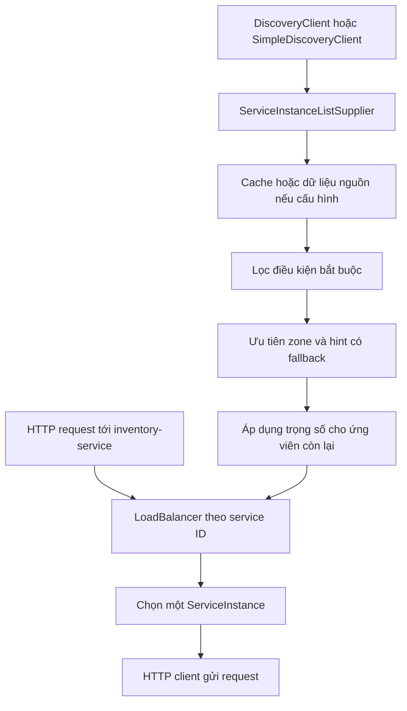
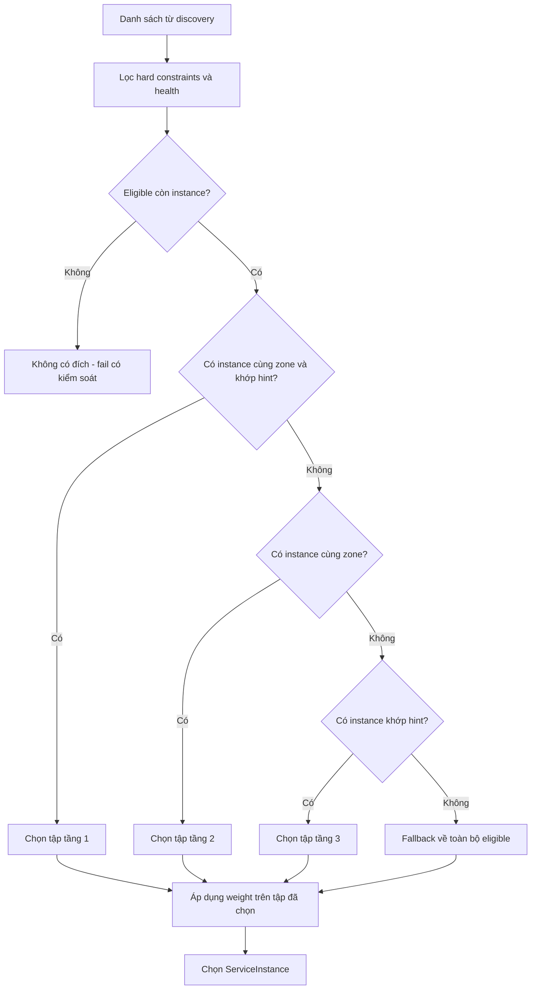

# Kết hợp vùng, trọng số và gợi ý định tuyến mà không làm rỗng danh sách

Trong Spring Cloud LoadBalancer, chọn một `ServiceInstance` không chỉ là lấy phần tử tiếp theo trong danh sách. Hệ thống có thể muốn **ưu tiên instance cùng vùng (zone)** để giảm độ trễ và chi phí liên vùng, **phân phối theo trọng số (weight)** để phản ánh năng lực phục vụ, đồng thời nhận **gợi ý định tuyến (hint)** nhằm ưu tiên nhóm instance có metadata phù hợp với request.

Khó khăn xuất hiện khi ba yếu tố được kết hợp: một instance có thể phù hợp với zone nhưng không phù hợp với hint; instance có trọng số lớn lại nằm ở zone khác; hoặc không có instance nào thỏa mãn tất cả ưu tiên. Nếu lọc cứng từng điều kiện bằng phép giao tập hợp, ta dễ tạo ra **danh sách ứng viên rỗng**, dù vẫn còn instance hợp lệ để xử lý request. Bài này trình bày cách thiết kế thứ tự ưu tiên, fallback có kiểm soát và áp dụng weight **sau khi** đã xác định tập ứng viên.

> Nguyên tắc cốt lõi: **Không biến một sở thích định tuyến thành điều kiện bắt buộc một cách vô ý.** Chỉ nới lỏng các *ưu tiên mềm* khi không có instance phù hợp; **không bao giờ** nới lỏng ràng buộc an toàn, dữ liệu, phân quyền hay điều kiện đủ sức khỏe để tạo ra kết quả giả.

## 1. Ba tín hiệu định tuyến phục vụ ba mục tiêu khác nhau

| Tín hiệu | Mục đích | Dữ liệu thường dùng | Cách tác động |
|---|---|---|---|
| **Zone** | Ưu tiên instance gần client hoặc trong cùng vùng triển khai | Metadata `zone`, cấu hình vùng của client | Lọc hoặc xếp ưu tiên theo vùng |
| **Weight** | Tăng/giảm tỷ lệ chọn instance theo khả năng xử lý | Metadata `weight` hoặc hàm trọng số | Thay đổi xác suất/tần suất chọn trong nhóm ứng viên |
| **Hint** | Gợi ý nhóm nhận request, ví dụ `beta`, `stable` hoặc một nhãn định tuyến | Header `X-SC-LB-Hint` hoặc thông tin request, metadata `hint` | Ưu tiên những instance có nhãn tương ứng |

Ví dụ, `order-service` đặt tại `zone-a` muốn gọi `inventory-service`. Các instance của `inventory-service` đang được discovery cung cấp:

| Instance | Host:port | Zone | Hint | Weight |
|---|---|---|---|---:|
| A | `localhost:8091` | `zone-a` | `beta` | 5 |
| B | `localhost:8092` | `zone-a` | `beta` | 1 |
| C | `localhost:8093` | `zone-b` | `beta` | 8 |
| D | `localhost:8094` | `zone-a` | `stable` | 2 |

Trong bảng này, A và B có cùng zone và cùng hint `beta`, nhưng A có weight cao hơn. C có weight lớn nhất nhưng ở zone khác. D cùng zone với client nhưng không khớp hint `beta`.

Với request có ưu tiên `zone-a` và hint `beta`, tập phù hợp đồng thời là **[A, B]**; nếu áp dụng chọn có trọng số bên trong tập đó, tần suất kỳ vọng của A và B có thể tỷ lệ khoảng **5 : 1**. Trọng số 8 của C không làm C vượt qua ưu tiên zone nếu chính sách quyết định loại C khỏi tập ứng viên trong lượt chọn đó.

**Service ID** vẫn là `inventory-service` cho mọi trường hợp. Zone, weight và hint không phải ba service ID khác nhau; chúng là dữ liệu và quy tắc chọn đích cho cùng dịch vụ logic.

## 2. Luồng xử lý: lấy danh sách, lọc ứng viên, rồi chọn đích

Một kiến trúc thường dùng đặt các trách nhiệm vào các lớp riêng:



Sơ đồ thể hiện **thứ tự logic đề xuất** để dễ phân tích. Các lớp cụ thể trong chuỗi `ServiceInstanceListSupplier` và thời điểm cache phụ thuộc cấu hình và phiên bản Spring Cloud. Cần phân biệt:

- **Discovery** trả về danh sách instance mà client đang nhìn thấy. Danh sách này có thể cũ do độ trễ đồng bộ hoặc cache.
- **Điều kiện bắt buộc (hard constraints)** quyết định instance nào *được phép* nhận request, chẳng hạn instance không ở trạng thái phục vụ, sai giao thức, sai tenant hoặc vi phạm chính sách lưu trú dữ liệu.
- **Ưu tiên mềm (soft preferences)** quyết định instance nào *nên* được chọn trước trong tập đã hợp lệ, ví dụ gần zone hoặc khớp hint.
- **Weight** dùng để phân phối request *giữa các instance còn lại*; weight không tự thay thế bộ lọc zone/hint hoặc chứng minh instance khỏe mạnh.

Không nên cache kết quả lọc phụ thuộc request của người gọi như thể đó là danh sách chung của service ID: hai request mang hai hint khác nhau cần có thể nhìn thấy hai tập ứng viên khác nhau. Thông thường nên cache dữ liệu nguồn không phụ thuộc request rồi áp dụng chính sách có xét request ở các lớp phía sau, theo các extension point mà phiên bản Spring Cloud hỗ trợ.

## 3. ZonePreferenceServiceInstanceListSupplier và nguyên tắc fallback

Spring Cloud LoadBalancer cung cấp `ZonePreferenceServiceInstanceListSupplier` để ưu tiên instance thuộc vùng mà client mong muốn. Cấu hình zone phía client thường dùng:

```yaml
spring:
  cloud:
    loadbalancer:
      zone: zone-a
```

Để ưu tiên hoạt động, các instance cần có thông tin zone tương ứng, thường nằm trong metadata `zone` mà discovery cung cấp. Chi tiết ánh xạ zone phụ thuộc hệ thống discovery và cách đăng ký instance.

**Điểm quan trọng của zone preference:** nếu có instance ở vùng ưu tiên, supplier có thể cung cấp tập instance vùng đó; **nếu không có instance khớp zone, nó có cơ chế trả lại danh sách từ delegate thay vì cố ý trả về tập rỗng**. Vì vậy zone preference phù hợp với một lựa chọn mềm, nơi cross-zone fallback được chấp nhận.

Với bảng ví dụ:

| Zone client yêu cầu | Instance được ưu tiên | Điều xảy ra khi không có zone khớp |
|---|---|---|
| `zone-a` | A, B, D | Không cần fallback vì có A, B, D |
| `zone-b` | C | Không cần fallback vì có C |
| `zone-c` | Không có | Có thể dùng lại A, B, C, D từ delegate |

Điều này **không phải** lời hứa rằng luôn có đích: nếu danh sách nguồn ban đầu rỗng hoặc tất cả instance đều bị loại bởi điều kiện bắt buộc, không có instance nào để fallback. Một zone bị cấm vì ràng buộc dữ liệu cũng không thể được mở lại chỉ vì danh sách ở zone mong muốn trống.

### Ưu tiên cùng zone khác với ghim cứng vào zone

Nếu yêu cầu là “ưu tiên zone-a vì latency”, fallback sang zone-b có thể hợp lý. Nếu yêu cầu là “dữ liệu phải nằm trong một vùng pháp lý nhất định”, việc gửi sang zone-b có thể bị cấm; lúc đó đây là **hard constraint**, không phải zone preference. Hệ thống nên trả lỗi có kiểm soát khi không còn instance hợp lệ, thay vì âm thầm chuyển request sang nơi vi phạm chính sách.

## 4. HintBasedServiceInstanceListSupplier: gợi ý chứ không mặc nhiên bắt buộc

`HintBasedServiceInstanceListSupplier` hỗ trợ lọc danh sách theo một hint của request. Trong tích hợp phù hợp, hint có thể được cung cấp qua header mặc định `X-SC-LB-Hint`; tên header hoặc cách đưa hint vào request context có thể được cấu hình theo phiên bản và loại HTTP client. Instance được so khớp bằng metadata `hint`.

Ví dụ request:

```http
GET /api/v1/items/42 HTTP/1.1
Host: inventory-service
X-SC-LB-Hint: beta
```

Giả sử danh sách nguồn là [A, B, C, D], các instance khớp hint `beta` là **[A, B, C]**. Trong cơ chế hint preference, khi không tìm thấy instance khớp hint, supplier có thể trả về danh sách delegate chưa lọc. Cách dùng này giúp một hint không được nhận diện **không tự biến** request thành tình huống “không còn instance”.

| Hint yêu cầu | Tập khớp hint trên toàn bộ danh sách | Khi không có instance khớp |
|---|---|---|
| `beta` | A, B, C | Không cần fallback |
| `stable` | D | Không cần fallback |
| `canary` | Không có | Fallback về tập delegate nếu hint là ưu tiên mềm |
| Không có hint | Không cần ưu tiên theo hint | Dùng tập ứng viên được cung cấp |

Không nên tin hoàn toàn một header từ người dùng ngoài như một mệnh lệnh an ninh: hint cần được kiểm soát, chuẩn hóa hoặc gán bởi tầng tin cậy. Nếu request phải đến đúng phiên bản để bảo đảm tính tương thích dữ liệu, yêu cầu đó phải được thể hiện là **điều kiện bắt buộc**, không dùng fallback của hint preference để lặng lẽ đưa sang phiên bản không tương thích.

## 5. Weight chỉ nên áp dụng sau khi xác định tập ứng viên

Spring Cloud LoadBalancer có `WeightedServiceInstanceListSupplier` để áp dụng trọng số cho các instance từ metadata hoặc hàm tính weight riêng. Với cấu hình phổ biến, metadata `weight` biểu diễn trọng số tương đối; cách xử lý giá trị thiếu hoặc sai và cơ chế chọn cụ thể cần đối chiếu phiên bản đang sử dụng.

Giả sử tập ứng viên đã được lọc là **[A, B]**, có weight lần lượt 5 và 1:

\[
P(A) \approx \frac{5}{5+1} = 83{,}3\%, \qquad
P(B) \approx \frac{1}{5+1} = 16{,}7\%
\]

Đây là **tỷ lệ kỳ vọng theo trọng số trong nhiều lần lựa chọn**, không phải bảo đảm chính xác cho sáu request liên tiếp. Thuật toán và implementation có thể tạo ra một chuỗi request khác nhau, đặc biệt khi concurrent, retry hoặc danh sách thay đổi.

Nếu chỉ còn A sau quá trình lọc, `P(A) = 100\%` trong tập đó dù weight của A là 5. Nếu không có instance nào ở tập hợp hợp lệ, weight không thể sinh một instance mới.

### Ví dụ dễ sai: dùng trọng số thay điều kiện định tuyến

Với A=5, B=1, C=8 và request ưu tiên `zone-a` + `beta`, tính tỷ lệ dựa trên **A+B+C** sẽ khiến C (ở zone-b) nhận request thường xuyên hơn A, trái với mục tiêu ưu tiên zone-a. Cách đúng với chính sách zone-first là:

1. Lấy tập instance hợp lệ từ discovery và các điều kiện bắt buộc.
2. Chọn tầng ưu tiên phù hợp theo zone/hint.
3. Chỉ sau đó áp dụng weight trên tập ứng viên cuối cùng.

Với custom weight function, cần xử lý giá trị thiếu, bằng 0, âm, quá lớn hoặc không parse được. Đừng để tất cả giá trị weight không hợp lệ khiến mã tùy biến tạo danh sách rỗng hoặc ném lỗi khó hiểu. Có thể dùng giá trị mặc định hợp lệ, báo metric cấu hình sai, và chỉ dùng fallback phân phối đồng đều **trong tập instance đã được xác nhận hợp lệ**.

## 6. Vì sao nối nhiều supplier tùy tiện có thể tạo chính sách khác mong đợi?

Một chuỗi supplier được tạo bằng cách bọc delegate:

```text
Discovery -> Zone preference -> Hint preference -> Weight -> LoadBalancer
```

Ở đây dấu mũi tên chỉ dữ liệu lần lượt đi qua các bước logic. Dù mỗi bộ lọc ưu tiên có fallback riêng, **fallback chỉ nhìn thấy danh sách đầu vào của chính nó**. Nó không tự động “nhớ” mọi instance đã bị bộ lọc trước đó loại khỏi danh sách.

Xét trường hợp đơn giản:

| Instance | Zone | Hint |
|---|---|---|
| A | `zone-a` | `stable` |
| B | `zone-a` | `stable` |
| C | `zone-b` | `beta` |

Client ưu tiên `zone-a`, request mang hint `beta`:

- **Zone trước, hint sau:** zone giảm tập thành [A, B]. Hint `beta` không khớp phần tử nào trong [A, B], nên fallback của hint trả về [A, B]. C bị loại trước đó, vì vậy không được xét lại.
- **Hint trước, zone sau:** hint giảm tập thành [C]. Zone `zone-a` không khớp phần tử nào trong [C], nên fallback của zone trả [C]. Kết quả là đi sang zone-b để giữ hint `beta`.
- **Lọc cứng cả hai điều kiện:** yêu cầu `zone-a AND beta` trả danh sách rỗng, dù A, B hoặc C có thể phục vụ nếu cho phép nới lỏng một ưu tiên.

Không có một thứ tự mặc định duy nhất phù hợp cho mọi ứng dụng. **Bạn phải quyết định “ưu tiên vùng” quan trọng hơn hay “ưu tiên hint” quan trọng hơn**, và kiểm tra lại thứ tự supplier thực sự được cấu hình.

| Mục tiêu nghiệp vụ | Thứ tự fallback nên cân nhắc |
|---|---|
| Giảm network latency và chi phí liên vùng là ưu tiên cao nhất | Zone + hint → zone bất kỳ hint → hint ở zone khác → mọi instance hợp lệ |
| Hint xác định phiên bản/canary được ưu tiên hơn khoảng cách | Zone + hint → hint ở mọi zone → zone bất kỳ hint → mọi instance hợp lệ |
| Luôn phải đúng zone hoặc đúng version vì yêu cầu bắt buộc | Lọc điều kiện bắt buộc trước; nếu không có ứng viên thì báo không có đích, không chuyển sang vùng/phiên bản cấm |

Trong hai hàng đầu, từng tầng chỉ được dùng nếu **không rỗng**. Tầng cuối cùng là tập instance còn hợp lệ sau các ràng buộc cứng, không phải toàn bộ instance vừa tìm thấy bất kể health/trust.

## 7. Thiết kế fallback theo từng tầng, không làm rỗng tập ứng viên hợp lệ

Giả sử sản phẩm chọn chính sách **zone-first**, cho phép fallback cross-zone để giữ dịch vụ hoạt động. Với tập `eligible` đã vượt qua mọi điều kiện bắt buộc, thứ tự như sau:

1. **Tầng 1:** instance vừa cùng zone vừa khớp hint.
2. **Tầng 2:** nếu tầng 1 rỗng, instance cùng zone, bỏ qua hint.
3. **Tầng 3:** nếu tầng 2 rỗng, instance khớp hint ở bất kỳ zone.
4. **Tầng 4:** nếu tầng 3 rỗng, dùng lại toàn bộ tập `eligible`.
5. **Không có eligible:** trả tình trạng không có instance, không tự tạo đích hoặc vi phạm điều kiện bắt buộc.



**Lưu ý khi thiếu hint hoặc zone:** đừng cố kiểm tra chuỗi rỗng như một nhãn metadata hợp lệ. Nếu request không có hint, bỏ bước khớp hint và dùng ưu tiên zone (nếu có). Nếu không có zone được xác định, dùng ưu tiên hint (nếu có). Nếu cả hai không có, dùng toàn bộ `eligible`. Như vậy, thiếu thông tin tùy chọn không làm mất khả năng chọn instance.

### Ví dụ Java minh họa logic fallback

Đoạn code dưới đây trình bày **quy tắc chọn tập ứng viên**. Nó chưa phải một bean `ServiceInstanceListSupplier` đầy đủ và **không** thực hiện network call hay chọn ngẫu nhiên theo weight. Tập `eligible` cần được cung cấp bởi một tầng đã áp dụng điều kiện bắt buộc:

```java
import java.util.List;
import org.springframework.cloud.client.ServiceInstance;

final class RouteCandidates {

    static List<ServiceInstance> zoneFirst(
            List<ServiceInstance> eligible,
            String preferredZone,
            String hint) {
        if (eligible == null || eligible.isEmpty()) {
            return List.of();
        }

        boolean hasZone = preferredZone != null
                && !preferredZone.isBlank();
        boolean hasHint = hint != null
                && !hint.isBlank();

        if (hasZone && hasHint) {
            List<ServiceInstance> both = eligible.stream()
                    .filter(i -> matches(i, "zone", preferredZone)
                            && matches(i, "hint", hint))
                    .toList();
            if (!both.isEmpty()) {
                return both;
            }
        }

        if (hasZone) {
            List<ServiceInstance> local = eligible.stream()
                    .filter(i -> matches(i, "zone", preferredZone))
                    .toList();
            if (!local.isEmpty()) {
                return local;
            }
        }

        if (hasHint) {
            List<ServiceInstance> hinted = eligible.stream()
                    .filter(i -> matches(i, "hint", hint))
                    .toList();
            if (!hinted.isEmpty()) {
                return hinted;
            }
        }

        return eligible;
    }

    private static boolean matches(
            ServiceInstance instance, String key, String expected) {
        return expected.equalsIgnoreCase(
                instance.getMetadata().getOrDefault(key, ""));
    }
}
```

Với list không rỗng và được xác thực hợp lệ, hàm `zoneFirst` luôn trả về một danh sách không rỗng: ở mỗi tầng chỉ trả kết quả đã kiểm tra, và tầng cuối trả lại chính `eligible`. Đây là một **bất biến** hữu ích để viết unit test.

Nếu muốn ưu tiên hint trước zone, hãy đảo **thứ tự hai khối fallback đơn lẻ** sau khối “khớp cả zone và hint”: thử `hinted` trước `local`. Không được đảo một cách tùy tiện nếu chính sách đã ghi nhận cam kết với tenant, dữ liệu hoặc tính tương thích phiên bản.

### Tách fallback và lựa chọn có trọng số

Hàm trên chỉ trả ra `List<ServiceInstance>`. Bước tiếp theo mới đọc `weight` của mỗi phần tử và chọn một instance theo chính sách trọng số. Có thể sử dụng `WeightedServiceInstanceListSupplier` được cấu hình phù hợp, hoặc một chiến lược chọn có trọng số dành cho ứng dụng. Đừng áp dụng weight trên toàn bộ danh sách trước khi quyết định tập ưu tiên rồi vô tình đưa instance ở tầng ưu tiên thấp vào quyết định cuối.

Khi kết hợp với Spring Cloud LoadBalancer thật, hãy triển khai chính sách phù hợp qua extension point của `ServiceInstanceListSupplier` / custom load balancer cho **service ID cụ thể**, và kiểm tra chữ ký API của release train đang dùng. Không nên sao chép đoạn code minh họa rồi đặt nó thành một bộ lọc độc lập mà bỏ qua request context, concurrency hoặc vòng đời của supplier.

## 8. Thực hành cấu hình metadata cho các instance

Trong bài lab đơn giản, có thể dùng `SimpleDiscoveryClient` làm nguồn instance tĩnh để quan sát zone, hint và weight. Ví dụ cấu hình trong ứng dụng **gọi** `inventory-service`:

```yaml
spring:
  application:
    name: order-service
  cloud:
    discovery:
      client:
        simple:
          instances:
            inventory-service:
              - uri: http://localhost:8091
                metadata:
                  zone: zone-a
                  hint: beta
                  weight: "5"
              - uri: http://localhost:8092
                metadata:
                  zone: zone-a
                  hint: beta
                  weight: "1"
              - uri: http://localhost:8093
                metadata:
                  zone: zone-b
                  hint: beta
                  weight: "8"
              - uri: http://localhost:8094
                metadata:
                  zone: zone-a
                  hint: stable
                  weight: "2"
    loadbalancer:
      zone: zone-a
```

Các URI trên chỉ là ví dụ cho lab khi ứng dụng client và bốn provider chạy trên cùng máy. Nếu client chạy trong container, `localhost` có nghĩa là chính container client, không phải máy host hoặc container provider. Hãy thay bằng hostname truy cập được trong mạng triển khai.

### 8.1. Kết nối HTTP client với service ID

Ứng dụng dùng `spring-cloud-starter-loadbalancer` và Spring Cloud BOM tương thích với Spring Boot. Với `RestClient` trên Spring Framework 6.1+ và Spring Cloud hỗ trợ tích hợp này, bean được đánh dấu `@LoadBalanced`:

```java
import org.springframework.cloud.client.loadbalancer.LoadBalanced;
import org.springframework.context.annotation.Bean;
import org.springframework.context.annotation.Configuration;
import org.springframework.web.client.RestClient;

@Configuration
class ClientConfiguration {

    @Bean
    @LoadBalanced
    RestClient.Builder loadBalancedRestClientBuilder() {
        return RestClient.builder();
    }
}
```

Khi gọi bằng service ID:

```java
import org.springframework.beans.factory.annotation.Qualifier;
import org.springframework.stereotype.Service;
import org.springframework.web.client.RestClient;

@Service
class InventoryGateway {

    private final RestClient client;

    InventoryGateway(
            @Qualifier("loadBalancedRestClientBuilder")
            RestClient.Builder builder) {
        this.client = builder
                .baseUrl("http://inventory-service")
                .build();
    }

    String getItem(String id, String routingHint) {
        return client.get()
                .uri("/api/v1/items/{id}", id)
                .header("X-SC-LB-Hint", routingHint)
                .retrieve()
                .body(String.class);
    }
}
```

Provider ở bốn port cần expose cùng endpoint `GET /api/v1/items/{id}` và nên trả về `instanceId`, `zone`, `hint` để dễ đối chiếu. Để chạy code với hint thực tế, ngoài builder `@LoadBalanced`, phải bật hoặc tự đăng ký **supplier hỗ trợ hint** trong chuỗi LoadBalancer cho `inventory-service` và xác minh đường truyền request context/header đúng với phiên bản Spring Cloud đang dùng. **Chỉ thêm header vào `RestClient` không đủ để tự kích hoạt HintBasedServiceInstanceListSupplier**. Tương tự, chỉ có metadata `weight` không tự khẳng định cơ chế chọn theo weight đã được bật.

### 8.2. Cấu hình supplier theo service ID

Các thành phần cần được xem xét cho `inventory-service`:

- Supplier nguồn: lấy instance từ discovery.
- Lớp cache (nếu cần): lưu dữ liệu nguồn với chính sách làm mới hợp lý.
- Lớp health hoặc lọc điều kiện bắt buộc: xác định các instance đủ điều kiện.
- Lớp ưu tiên zone và hint: có fallback theo thứ tự được lựa chọn.
- Lớp trọng số: áp dụng cho tập ứng viên đã được quyết định.

Spring Cloud cung cấp những supplier như `ZonePreferenceServiceInstanceListSupplier`, `HintBasedServiceInstanceListSupplier` và `WeightedServiceInstanceListSupplier`, có thể cấu hình bằng những API/builder tương ứng theo phiên bản. Tuy nhiên **chỉ ghép các supplier có sẵn không tự bảo đảm một chuỗi fallback tùy biến nhiều tầng** như mục 7. Nếu cần thứ tự fallback cụ thể, hãy triển khai một supplier tùy biến hoặc policy tương đương, bảo đảm lớp ngoài luôn có thể truy cập danh sách `eligible` để dùng ở tầng cuối.

Nên đặt cấu hình đặc thù trong child context của `inventory-service` bằng `@LoadBalancerClient(name = "inventory-service", configuration = ...)`. Lớp configuration đặc thù cần nằm ngoài vùng component scan thông thường của application context chính để tránh rò rỉ chính sách sang các service ID khác.

## 9. Bài kiểm thử với các tình huống ưu tiên và fallback

Hãy viết test ở cấp **policy chọn ứng viên** trước khi kiểm thử kết nối mạng. Dùng bảng A/B/C/D ở mục 1:

| Zone ưu tiên | Hint yêu cầu | Tập kết quả mong đợi với zone-first |
|---|---|---|
| `zone-a` | `beta` | [A, B] — khớp cả hai |
| `zone-a` | `stable` | [D] — khớp cả hai |
| `zone-a` | `unknown` | [A, B, D] — không có hint khớp, giữ local |
| `zone-b` | `stable` | [C] — không có cả hai, ưu tiên zone-b |
| `zone-c` | `beta` | [A, B, C] — không có zone-c, ưu tiên hint |
| `zone-c` | `unknown` | [A, B, C, D] — fallback toàn bộ eligible |
| Không cung cấp | `stable` | [D] — chỉ dùng hint |
| `zone-a` | Không cung cấp | [A, B, D] — chỉ dùng zone |
| Không cung cấp | Không cung cấp | [A, B, C, D] — dùng eligible |
| Bất kỳ | Bất kỳ | [] nếu **eligible đầu vào rỗng** |

Khi test trọng số, chỉ đo trên tập đã chọn; ví dụ zone-a + beta tạo tập [A, B] với tỷ lệ kỳ vọng 5:1. Hãy gửi nhiều lượt chọn để quan sát xu hướng phân phối, không đòi cứ sáu request phải có đúng năm lần A và một lần B.

Các kiểm thử quan trọng khác:

1. **Metadata thiếu:** một instance không có `zone` hoặc `hint` không làm code lỗi `NullPointerException`. Nếu hết ứng viên khớp soft preference, vẫn có đường fallback.
2. **Weight bất thường:** `weight` trống, không phải số, bằng 0 hoặc âm được xử lý theo quy tắc có tài liệu; không làm mất toàn bộ tập hợp lệ.
3. **Instance unhealthy:** một instance bị đánh dấu không đủ điều kiện không được hồi sinh bởi fallback.
4. **Tập eligible rỗng:** trả trạng thái không có đích có kiểm soát, không bỏ qua hard constraint.
5. **Nhiều client:** từng client có thể nhìn thấy snapshot discovery khác nhau; kết quả test không phụ thuộc vào thứ tự tuyệt đối của toàn hệ thống.
6. **Request hint lạ:** thử `unknown`, chuỗi trống hoặc nhãn ngoài allowlist để kiểm tra cách fallback và chuẩn hóa.

## 10. Quan sát và xử lý sự cố trong hệ thống thực tế

Khi theo dõi định tuyến theo nhiều tiêu chí, chỉ log instance được chọn là chưa đủ. Nên ghi nhận các thông tin sau ở mức an toàn:

| Trường quan sát | Câu hỏi cần trả lời |
|---|---|
| `serviceId` | Đang cân bằng tải cho dịch vụ nào? |
| `preferredZone`, `routingHint` | Request đang yêu cầu ưu tiên mềm nào? |
| `eligibleCount` | Có bao nhiêu instance vượt qua các điều kiện bắt buộc? |
| `preferredCount` | Có bao nhiêu instance đáp ứng tầng ưu tiên đang xét? |
| `fallbackTier` | Đã dùng tầng “zone+hint”, “zone”, “hint” hay “all eligible”? |
| `selectedInstance`, `selectedZone` | Đích thực tế có ở zone mong đợi không? |
| `weight` hoặc bucket trọng số | Lựa chọn có phản ánh tỷ lệ dự kiến không? |
| `status`, `exception`, `duration` | Lỗi xảy ra trước hay sau khi chọn instance? |

Không ghi token, dữ liệu nhạy cảm hoặc các metadata có thể tiết lộ thông tin cá nhân vào log. Nên dùng nhãn hint/zone được giới hạn số lượng giá trị để không làm metric có cardinality quá cao.

### Dấu hiệu và hướng xử lý

| Triệu chứng | Nguyên nhân có thể | Việc cần kiểm tra |
|---|---|---|
| Không có đích dù discovery thấy instance | Các bộ lọc bị kết hợp bằng phép giao cứng, hoặc điều kiện bắt buộc loại tất cả | Ghi kích thước danh sách sau mỗi tầng; phân biệt hard và soft |
| Hint không làm thay đổi đích | Supplier hint chưa đăng ký, request context không truyền hint hoặc metadata không khớp | Xác nhận chuỗi supplier và cách nhận `X-SC-LB-Hint` |
| Luôn chọn zone gần dù hint chỉ có ở zone xa | Chính sách zone-first hoặc thứ tự supplier làm mất ứng viên remote | Xác nhận ưu tiên nghiệp vụ và thứ tự fallback |
| Chọn instance ở zone xa dù zone gần có instance | Hint-first, sai metadata zone, hoặc danh sách local đã bị lọc | Kiểm tra danh sách tại từng tầng |
| Tỷ lệ weight không như dự kiến | Weight chưa được bật, mẫu quá nhỏ, bị lọc trước, nhiều client hoặc retry | Đếm *lượt chọn*, xét tập ứng viên cuối và đo nhiều request |
| Sau scale-out vẫn không thấy instance mới | Discovery/cache chưa làm mới | Kiểm tra refresh, TTL, health và thông tin đăng ký |
| Sau scale-in còn request đến instance cũ | Cache/discovery cũ hoặc request đã chọn trước khi rút instance | Quan sát snapshot, graceful shutdown và các request in-flight |
| Cross-zone fallback vi phạm chính sách | Đã xem hard constraint như soft preference | Chuyển ràng buộc đó sang tầng eligibility; fail closed |

### Thứ tự chẩn đoán đề xuất

1. Xác định service ID và snapshot instance thực sự được supplier cung cấp.
2. Kiểm tra hard constraints và số lượng eligible.
3. Ghi lại hint, zone, metadata liên quan và thứ tự các tầng lọc.
4. Xác nhận tầng fallback đã chọn và tập instance cuối cùng.
5. Kiểm tra có áp dụng trọng số sau bước chọn tập ứng viên hay không.
6. Nếu đã chọn được instance nhưng request lỗi, xử lý DNS, kết nối, timeout, TLS và log provider như một lớp vấn đề riêng.

## 11. Những nguyên tắc cần nhớ

- **Zone** là ưu tiên về vị trí, **hint** là gợi ý nhóm xử lý và **weight** là tỷ lệ lựa chọn; chúng giải quyết ba bài toán khác nhau.
- Các supplier ưu tiên có thể fallback về delegate khi không có phần tử khớp, nhưng **fallback của từng supplier không tự xây một chính sách đa tầng**.
- Tập instance hợp lệ theo điều kiện bắt buộc phải được xác định trước. Fallback chỉ nới lỏng ưu tiên mềm, không nới lỏng điều kiện an toàn hoặc tuân thủ.
- Cần quyết định rõ **zone-first hay hint-first**; hai chính sách cho kết quả khác nhau khi zone và hint không có giao nhau.
- Kiểm tra tập ứng viên không rỗng ở từng tầng, và dùng **all eligible** làm tầng cuối khi tập đầu vào còn hợp lệ.
- Áp dụng weight **sau khi** xác định tập ứng viên cuối; đo tỷ lệ kỳ vọng trên nhiều lượt chọn, không đồng nhất weight với health.
- Quan sát `eligibleCount`, `fallbackTier`, `selectedInstance`, lỗi HTTP và retry để xác định sai khác giữa chính sách mong muốn và thực tế.

Kết hợp zone, hint và weight đúng cách giúp ứng dụng ưu tiên hiệu năng và độ gần, hỗ trợ rollout theo nhóm, đồng thời phân phối request theo năng lực từng instance. Điểm thiết kế quan trọng nhất là bảo toàn **tập ứng viên hợp lệ** và fallback có chủ đích: tránh làm rỗng danh sách chỉ vì một ưu tiên mềm không khớp, nhưng vẫn thất bại rõ ràng khi không có instance nào thỏa các điều kiện bắt buộc.
