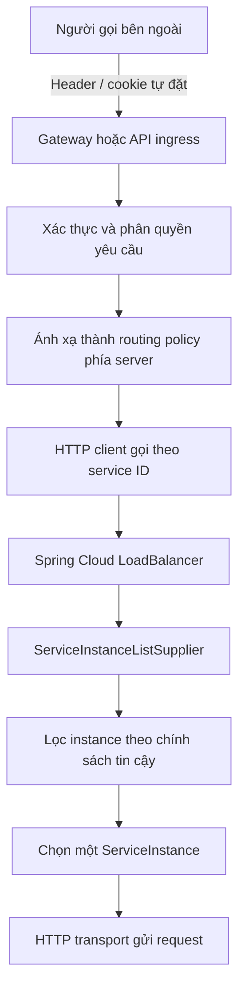
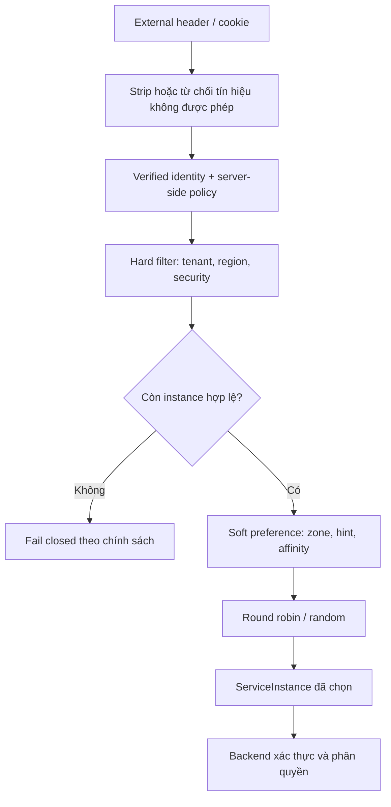

# Rủi ro khi dùng header hoặc cookie do người gọi tự cung cấp

Trong hệ thống dùng Spring Cloud LoadBalancer, một request đến `http://inventory-service` có thể được chọn đích theo zone, hint, metadata hoặc cơ chế sticky session. Việc tận dụng header và cookie để điều khiển lựa chọn `ServiceInstance` đem lại tính linh hoạt: ưu tiên máy chủ gần người dùng, gửi thử canary hoặc cố gắng quay lại instance trước đó. Tuy nhiên, **header và cookie do người gọi gửi là dữ liệu không đáng tin theo mặc định**. Chúng có thể được sửa bằng trình duyệt, script, proxy hoặc một dịch vụ upstream bị lỗi.

Nếu ứng dụng biến trực tiếp một giá trị như `X-Route-Zone: zone-internal` thành quyết định chọn instance, người gọi có thể thao túng nơi request được xử lý. Hậu quả có thể gồm định tuyến sai vùng, làm mất cân bằng tải, buộc truy cập nhóm canary, vượt ranh giới tenant hoặc làm lộ dữ liệu nếu downstream thiếu kiểm soát truy cập. Đây là vấn đề **ranh giới tin cậy** (trust boundary) giữa thông tin do client đề xuất và chính sách phải do hệ thống quyết định.

Bài học thuộc chương **Vùng và định tuyến** của module Spring Cloud LoadBalancer. Mục tiêu là hiểu cách bảo vệ chính sách zone/hint/stickiness trong client-side load balancing, đồng thời phối hợp với discovery, health check, `RestClient`, `WebClient`, OpenFeign, retry/timeout và quan sát lỗi.

## 1. Header và cookie là tín hiệu, không phải quyền được chọn đích

Giả sử `order-service` gọi `inventory-service` có các replica:

| Instance | Zone | Metadata minh họa | Vai trò |
|---|---|---|---|
| `inventory-a1` | `zone-a` | `release=stable` | Phục vụ request thông thường |
| `inventory-a2` | `zone-a` | `release=canary` | Phục vụ thử nghiệm có kiểm soát |
| `inventory-b1` | `zone-b` | `release=stable` | Phục vụ vùng dự phòng |

Một người gọi có thể chủ động gửi:

```http
GET /api/items/42 HTTP/1.1
Host: api.example.test
X-Route-Zone: zone-b
X-Release: canary
Cookie: route-affinity=inventory-a2
```

`X-Route-Zone`, `X-Release` và `route-affinity` trong ví dụ chỉ là tên minh họa do ứng dụng tự quy ước, **không phải mặc định bắt buộc của Spring Cloud LoadBalancer**. Nếu hệ thống lấy nguyên các giá trị này để chọn instance, caller có thể tự xin đến vùng khác hoặc đúng replica thử nghiệm.

Cần tách ba khái niệm:

| Khái niệm | Ai quyết định? | Có đủ để cấp quyền không? |
|---|---|---|
| **Routing preference** | Có thể là gợi ý từ request, nếu hệ thống cho phép. | Không; chỉ thể hiện mong muốn. |
| **Routing policy** | Gateway, dịch vụ hoặc tầng điều phối dựa trên cấu hình và danh tính đã xác thực. | Có thể hạn chế tập đích nhưng chưa thay thế kiểm tra quyền truy cập. |
| **Authorization** | Thành phần bảo mật và dịch vụ sở hữu tài nguyên. | Phải quyết định riêng ai được thao tác với dữ liệu nào. |

Ngay cả khi hint tình cờ trùng một instance hợp lệ, việc chọn được instance không chứng minh caller có quyền truy cập tài nguyên trên instance đó.

## 2. Ranh giới tin cậy trong đường đi của request

Header HTTP không có tính xác thực chỉ nhờ tên. Một header có tên bắt đầu bằng `X-Internal-`, `X-Tenant-` hay `X-Forwarded-` không tự trở thành đáng tin. Khi gateway chuyển tiếp header gốc vào request nội bộ, dữ liệu do client kiểm soát có thể tiếp tục đi qua nhiều dịch vụ.



Ở bước ingress, cần **loại hoặc ghi đè header/cookie định tuyến không được phép từ bên ngoài**, rồi xây dựng thông tin định tuyến nội bộ từ nguồn được xác thực. Nếu giá trị routing chỉ được truyền qua header sau gateway, phải bảo đảm người ngoài không thể trực tiếp gọi dịch vụ phía sau hoặc tự giả mạo header đó. Tên header nội bộ chỉ là quy ước; biện pháp bảo vệ nằm ở kiến trúc, kiểm soát nguồn gửi và khả năng xác thực.

Trong nội bộ, một dịch vụ khác cũng có thể chuyển tiếp header user-supplied mà không kiểm tra. Vì vậy, không được mặc nhiên coi toàn bộ request nội bộ là đáng tin; mỗi thành phần cần biết tín hiệu routing được sinh ở đâu và có thể bị thay đổi ở bước nào.

## 3. Những rủi ro cụ thể

### 3.1. Giả mạo zone hoặc khu vực dữ liệu

Giả sử một tenant bắt buộc xử lý dữ liệu trong `region-eu`. Nếu chọn vùng chỉ dựa vào `X-Region` do caller tự truyền, caller có thể đổi thành `region-us` và khiến request được gửi đến instance ngoài vùng dự kiến. Trường hợp này có thể vi phạm chính sách lưu trú dữ liệu hoặc làm dữ liệu đến backend không phù hợp.

Lưu ý: `ZonePreferenceServiceInstanceListSupplier` và các chính sách ưu tiên vùng thường được dùng cho **ưu tiên**, không được tự động xem là cơ chế cách ly bắt buộc. Tùy supplier, thứ tự decorator và phiên bản, khi không có instance cùng zone, cơ chế ưu tiên có thể dùng các ứng viên khác. Một yêu cầu *bắt buộc chỉ xử lý trong vùng được phép* phải được thiết kế như ràng buộc cứng: không có ứng viên hợp lệ thì **không gửi request sang vùng bị cấm**.

### 3.2. Đi sai tenant, nhóm bảo mật hoặc phiên bản canary

Nếu metadata như `tenant=premium`, `release=canary` hoặc `scope=internal` được sử dụng làm bộ lọc mà không có kiểm soát, caller có thể yêu cầu đi vào nhóm instance phục vụ dữ liệu khác, nhóm privileged hoặc phiên bản chưa được mở rộng.

**Cần hai lớp bảo vệ:** (1) backend không được trả dữ liệu của tenant khác chỉ vì request đã đến đúng instance; (2) bộ lọc định tuyến chỉ nhận các tiêu chí hợp lệ do phía server quyết định. Chính sách cân bằng tải không thay thế phân quyền ở API và kho dữ liệu.

### 3.3. Ép vào một instance bằng cookie stickiness

Cookie affinity thường lưu một định danh instance hoặc thông tin để gợi ý chọn lại server cũ. Nếu dùng trực tiếp cookie do trình duyệt cung cấp, người dùng có thể sửa, giữ lại hoặc chia sẻ giá trị:

- **Ghim vào replica chậm:** nhiều request cố chọn một instance, gây điểm nóng trong khi các instance khác còn rảnh.
- **Dùng lại cookie cũ:** instance có thể đã bị thay thế, không còn healthy hoặc không còn trong discovery.
- **Theo dõi và rò rỉ thông tin:** cookie hoặc response có instance ID thật có thể bộc lộ topology và kéo dài khả năng liên kết hoạt động của người dùng.
- **Nhầm stickiness với session authorization:** việc quay lại cùng replica không chứng minh danh tính, không bảo vệ session state và không ngăn truy cập chéo tenant.

Spring Cloud LoadBalancer có thành phần hỗ trợ sticky-session theo request ở những phiên bản tích hợp tương ứng; hành vi cụ thể phụ thuộc supplier, cookie và cấu hình. Cần kiểm tra tài liệu của phiên bản đang chạy. Bất kể sử dụng implementation nào, một giá trị cookie đến từ client là **tín hiệu để kiểm tra**, không được xem là lệnh bắt buộc phải chọn replica đó.

Cookie gợi ý bị sai hoặc hết hạn nên được loại bỏ hoặc xử lý theo chính sách, có thể chuyển sang instance hợp lệ khác khi nghiệp vụ cho phép. Không được ưu tiên cookie hơn các điều kiện cứng về region, tenant, quyền truy cập và health.

### 3.4. Tác động đến tính ổn định và khả năng sẵn sàng

Nếu caller có thể tùy ý chọn hint hoặc zone, một số người dùng có thể tập trung request vào một replica, một zone hoặc một nhóm canary nhỏ. Khi đó round robin chỉ phân phối trong nhóm bị lọc, không cứu được tải mất cân bằng giữa các nhóm.

Một chính sách fallback tự động sang mọi instance khi nhóm được yêu cầu rỗng cũng có thể gây vấn đề. Đối với **ưu tiên hiệu năng**, fallback có thể chấp nhận được. Đối với **ràng buộc bảo mật hoặc lưu trú dữ liệu**, fallback vượt ranh giới là sai. Đừng gộp hai loại điều kiện vào cùng một nhánh xử lý mặc định.

### 3.5. Header bị trùng, mơ hồ hoặc được diễn giải khác nhau

Header HTTP có thể bị gửi lặp lại, khác chữ hoa/chữ thường, hoặc có giá trị không hợp lệ. Nhiều lớp như proxy, gateway, framework và ứng dụng có thể chuẩn hóa hay ghép giá trị khác nhau. Ví dụ:

```http
GET /api/items/42 HTTP/1.1
Host: api.example.test
X-Route-Zone: zone-a
x-route-zone: zone-b
```

Nếu gateway kiểm tra một giá trị nhưng dịch vụ downstream dùng giá trị khác, chính sách có thể bị bỏ qua. Cần có quy tắc duy nhất: loại bỏ hoặc từ chối tín hiệu mơ hồ, chuẩn hóa theo đúng ngữ nghĩa HTTP và chỉ tạo lại giá trị nội bộ đã được xác minh.

Tương tự, không nên tự tin cậy `X-Forwarded-For`, `X-Forwarded-Host` hoặc các header chỉ nguồn/đường đi do caller cung cấp để suy ra khu vực. Chúng chỉ đáng tin trong một chuỗi proxy được kiểm soát với quy tắc ghi đè rõ ràng.

### 3.6. Tác động tới log, metric và thông tin hệ thống

Đưa nguyên header/cookie tùy ý vào tên metric, tag, log hoặc tracing có thể tạo vô số giá trị nhãn (high cardinality), làm tăng chi phí lưu trữ và khó điều tra. Log không được ghi bừa cookie phiên, token hoặc thông tin nhạy cảm. Nếu cần phân tích định tuyến, ghi nhận các trạng thái chuẩn hóa như `hint_rejected`, `policy_denied`, `no_eligible_instance` cùng service ID và một tập nhãn giới hạn.

## 4. Phân biệt hint, zone preference và ràng buộc bắt buộc

Không phải tín hiệu định tuyến nào cũng có cùng mức độ tin cậy hay mục tiêu:

| Loại quyết định | Ví dụ | Phản ứng khi không có instance khớp |
|---|---|---|
| **Ưu tiên mềm** | Cố gắng chọn replica cùng zone để giảm độ trễ. | Có thể chọn zone khác nếu chính sách cho phép và dữ liệu được phép đi qua vùng đó. |
| **Canary được phê duyệt** | Một nhóm user đã được gán vào 5% thử nghiệm. | Chọn phiên bản stable hoặc trả lỗi theo chính sách rollout; caller không tự nâng quyền vào canary. |
| **Ràng buộc cứng** | Tenant chỉ được xử lý ở `region-eu`. | Không có instance hợp lệ thì báo không khả dụng; không âm thầm chuyển sang `region-us`. |
| **Affinity mềm** | Ưu tiên cùng instance để tăng cache locality. | Có thể chọn instance khác nếu cookie không hợp lệ hoặc đích không khả dụng. |
| **Phân quyền** | User có được xem đơn hàng `42` không? | Kiểm tra tại API/service bằng danh tính được xác thực; không quyết định dựa trên LoadBalancer. |

Với Spring Cloud LoadBalancer, các supplier như `ZonePreferenceServiceInstanceListSupplier` hoặc `HintBasedServiceInstanceListSupplier` có thể phục vụ chính sách ưu tiên/lọc danh sách theo cấu hình. **Tên supplier không chứng minh có cơ chế từ chối truy cập**. Nếu doanh nghiệp yêu cầu hard isolation, cần xác nhận implementation lọc không có fallback trái chính sách và bảo vệ thêm bằng network, quyền dịch vụ và kiểm tra dữ liệu tại backend.

## 5. Quy trình xử lý tín hiệu routing an toàn

Một luồng thực tế nên có các bước rõ ràng:

1. **Nhận request tại điểm ingress tin cậy:** không tin các header/cookie do người gọi tự nhận là nội bộ; kiểm tra proxy chain và ngăn đường truy cập bỏ qua gateway khi cần.
2. **Xác thực danh tính:** kiểm tra token hoặc session bằng cơ chế xác thực đáng tin; không lấy tenant hoặc quyền truy cập chỉ từ `X-Tenant-ID` tự khai.
3. **Xây dựng chính sách phía server:** tra tenant, region được phép, rollout cohort, danh sách zone/instance group được dùng từ claims đã xác minh và cấu hình có thẩm quyền.
4. **Chuẩn hóa request context:** chỉ mang các tín hiệu đã được chấp thuận vào quá trình chọn instance; strip hoặc overwrite các header routing đã có từ bên ngoài.
5. **Lọc danh sách ứng viên:** trước tiên áp dụng ràng buộc cứng, sau đó mới các ưu tiên mềm như zone locality hoặc affinity.
6. **Chọn instance:** áp dụng round robin, random hoặc chiến lược được cấu hình lên tập hợp hợp lệ.
7. **Kiểm tra tại backend:** dịch vụ đích vẫn xác thực, phân quyền và giới hạn quyền truy cập dữ liệu, ngay cả khi request đến đúng region.
8. **Ghi nhận kết quả:** log nguyên nhân không có ứng viên, hint bị từ chối, đích được chọn và lỗi transport ở mức không lộ dữ liệu nhạy cảm.



Không có instance hợp lệ có thể là lỗi availability, không nhất thiết lỗi quyền của caller. Tùy API, có thể trả phản hồi không khả dụng theo hợp đồng hoặc ném exception chuyên biệt. Điều quan trọng là **không chọn đích vi phạm ràng buộc cứng để cố hoàn tất request**.

## 6. Ví dụ phân biệt yêu cầu tự khai với chính sách được xác minh

Giả sử tenant `tenant-17` theo cấu hình chỉ được xử lý ở `zone-a`. Người gọi gửi:

```http
GET /api/inventory/items/42 HTTP/1.1
Host: api.example.test
Authorization: Bearer <access-token>
X-Route-Zone: zone-b
Cookie: route-affinity=inventory-b1
```

Tại gateway, token phải được kiểm tra bằng cơ chế xác thực; tenant và vùng được phép được xác định bằng claims đã xác minh kết hợp chính sách ở server. `X-Route-Zone` và cookie do caller tự gửi không được dùng để vượt điều kiện `zone-a`.

Ví dụ minh họa logic tạo danh sách ứng viên hợp lệ bằng Java, sau khi đã xác thực và xây dựng policy:

```java
record VerifiedRoutingPolicy(
    String tenantId,
    Set<String> allowedZones
) {}

List<ServiceInstance> eligibleInstances(
        List<ServiceInstance> discovered,
        VerifiedRoutingPolicy policy) {

    // policy phải đến từ danh tính đã xác thực và cấu hình phía server.
    return discovered.stream()
        .filter(instance -> policy.allowedZones().contains(
            instance.getMetadata().get("zone")))
        .toList();
}
```

Đây là **minh họa quy tắc lọc**, không phải bản triển khai hoàn chỉnh của `ServiceInstanceListSupplier`. Chương trình thật cần xác định nguồn metadata đáng tin, quy tắc thiếu metadata, cách refresh/caching và hành vi không có ứng viên. Nếu danh sách sau lọc rỗng trong một chính sách cứng, tuyệt đối không tự dùng lại toàn bộ `discovered`.

Đừng biến một header user-supplied thành `VerifiedRoutingPolicy` chỉ vì nó đã được proxy chuyển tiếp. Cũng đừng xem `metadata.zone` là bằng chứng phân quyền; quyền dữ liệu vẫn phải được kiểm tra độc lập. Trong hệ thống có dữ liệu nhạy cảm, mạng, runtime policy và backend authorization cần cùng thực thi ranh giới mong muốn.

## 7. Tích hợp với RestClient, WebClient và OpenFeign

Trong kiến trúc client-side load balancing, `RestClient`, `WebClient` và OpenFeign có thể dùng tên dịch vụ logic. Tầng tích hợp LoadBalancer chọn `ServiceInstance` theo service ID; HTTP client thực hiện kết nối, timeout và nhận response.

Ví dụ `WebClient` sử dụng `@LoadBalanced`:

```java
@Configuration
class HttpClientsConfig {
    @Bean
    @LoadBalanced
    WebClient.Builder loadBalancedWebClientBuilder() {
        return WebClient.builder();
    }
}

@Service
class InventoryGateway {
    private final WebClient inventoryClient;

    InventoryGateway(@LoadBalanced WebClient.Builder builder) {
        this.inventoryClient = builder
            .baseUrl("http://inventory-service")
            .build();
    }

    Mono<Item> findItem(String itemId) {
        return inventoryClient.get()
            .uri("/api/items/{id}", itemId)
            .retrieve()
            .bodyToMono(Item.class);
    }
}
```

Ví dụ lược bớt import và kiểu DTO `Item` do ứng dụng định nghĩa. Nó minh họa **gọi theo service ID**, không tự thiết lập zone routing, cookie stickiness hoặc hard isolation. Nếu muốn dùng hint/zone theo request, phải cấu hình supplier tương thích với phiên bản Spring Cloud và xác định nguồn tạo hint đáng tin. Không được tự động chuyển tiếp header `X-Route-Zone` hay cookie affinity từ request ngoài vào client nội bộ rồi coi đó là chính sách.

Với `RestClient`, yêu cầu tương tự: bean builder có tích hợp LoadBalancer, nhưng nguồn thông tin định tuyến vẫn phải được kiểm soát. Với OpenFeign, tên trong `@FeignClient(name = "inventory-service")` thường được dùng để phân giải service ID khi không đặt URL cố định; interceptor thêm header chỉ nên dùng dữ liệu đã được thẩm định. Một `RequestInterceptor` sao chép toàn bộ header đầu vào sang request Feign có thể vô tình đưa tín hiệu routing và cookie giả mạo vào nội bộ.

Điều kiện cần kiểm tra là **vị trí filter/interceptor**: filter chỉ được đọc tín hiệu đã được xác minh, không nhầm header user-supplied với thông tin do gateway hoặc service tin cậy cấp. Không có cơ chế nào tự làm cho header an toàn chỉ vì được thêm trước khi `choose()` thực thi.

## 8. Retry, timeout và fallback khi routing không hợp lệ

Retry và failover là nơi chính sách định tuyến dễ bị phá vỡ:

| Tình huống | Hành vi cần thiết |
|---|---|
| Header/cookie routing sai định dạng hoặc không được phép | Bỏ qua/từ chối theo hợp đồng, không sử dụng để chọn vùng hoặc nhóm privileged. |
| Cookie trỏ instance cũ nhưng vẫn có instance hợp lệ cùng vùng | Có thể chọn một instance khác trong **tập được phép** nếu nghiệp vụ cho phép. |
| Không có instance trong region bắt buộc | Trả lỗi availability hoặc dừng gọi; không fallback sang region bị cấm. |
| Instance được chọn bị timeout | Xử lý timeout có giới hạn; nếu retry, lựa chọn mới vẫn phải tuân thủ toàn bộ ràng buộc cứng. |
| Bật nhiều tầng retry | Tính tổng số attempt và deadline để tránh khuếch đại tải. |
| Request thay đổi dữ liệu (`POST`/`PATCH`) | Chỉ retry khi có bảo đảm idempotency hoặc cơ chế nghiệp vụ phù hợp. |

Ví dụ, chính sách `tenant-17 chỉ ở zone-a` phải được áp dụng **ở mỗi lần chọn lại instance**, kể cả khi lần chọn đầu tiên đã timeout. Không được coi failover là ngoại lệ tự động của yêu cầu lưu trú dữ liệu.

Kết quả không có server từ LoadBalancer và HTTP `503` thực sự do upstream trả về cũng là hai tình huống khác nhau. Tùy integration, lỗi chọn instance có thể được ánh xạ thành exception hoặc phản hồi lỗi ở tầng caller; cần quan sát đúng vị trí phát sinh. Thay connect timeout của WebClient không sửa được danh sách ứng viên rỗng do chính sách hard filter.

## 9. Cấu hình cookie an toàn khi thực sự cần affinity

Trong nhiều hệ thống stateless, không cần sticky session; tránh thêm affinity nếu không có lợi ích đo được. Nếu cần giữ locality của cache hoặc session trong thời gian ngắn, cân nhắc:

- **Cookie chỉ chứa thông tin cần thiết**, tránh lộ hostname, IP nội bộ hoặc ID replica có thể làm tăng khả năng khám phá topology.
- **Đặt thuộc tính bảo vệ phù hợp** như `Secure`, `HttpOnly`, `SameSite`, `Path`, thời hạn sống; các thuộc tính này giảm một số nguy cơ trình duyệt nhưng không khiến cookie trở thành nguồn routing đáng tin tuyệt đối.
- **Bảo vệ tính toàn vẹn** của token affinity nếu nó được dùng để lưu thông tin điều phối, chẳng hạn ký HMAC và kiểm tra hạn dùng/phiên bản; không để người gọi tự sửa thành instance bất kỳ.
- **Ràng buộc với policy phía server:** một token affinity hợp lệ vẫn phải chịu ràng buộc vùng, tenant, trạng thái instance và chính sách rollout hiện hành.
- **Có cơ chế thay thế:** khi instance biến mất hoặc mất health, chọn lại ứng viên hợp lệ và làm mới affinity nếu cần. Không giả định stickiness luôn được bảo đảm.
- **Không đồng nhất affinity với authentication:** session ID và quyền truy cập phải được kiểm tra riêng; ký cookie affinity không tự cấp quyền đọc dữ liệu.

Cookie do browser gửi có thể được phát lại, mất, bị xóa hoặc không được gửi do domain/path/SameSite. Vì vậy, nghiệp vụ quan trọng không nên phụ thuộc vào việc mọi request luôn đến cùng JVM. Nếu ứng dụng cần session state, cân nhắc cơ chế lưu session dùng chung hoặc kiến trúc phù hợp thay vì chỉ dựa vào LoadBalancer stickiness.

## 10. Kiểm thử an toàn routing theo zone và cookie

Một bài lab nhỏ có thể dùng hai instance trong `zone-a` và một instance trong `zone-b`, mỗi instance trả `instanceId` cùng `zone` ở endpoint kiểm thử.

| Thử nghiệm | Đầu vào | Kết quả cần xác minh |
|---|---|---|
| Header zone giả mạo | Caller tự gửi `X-Route-Zone: zone-b` nhưng tenant bị giới hạn `zone-a`. | Không thể dùng header này để chọn instance ở vùng bị cấm. |
| Cookie affinity giả | Caller gửi ID instance `zone-b`. | Token bị từ chối/bỏ qua; không vượt hard filter. |
| Cookie cũ | Cookie trỏ instance đã gỡ khỏi discovery. | Có lựa chọn lại hợp lệ hoặc lỗi theo hợp đồng, không giữ cứng vào replica đã mất. |
| Không còn server trong vùng bắt buộc | Loại hết instance `zone-a`. | Fail closed, không tự fallback sang `zone-b`. |
| Header trùng | Gửi `X-Route-Zone` hai lần, giá trị khác nhau. | Xử lý thống nhất hoặc từ chối; không có cách diễn giải khác nhau giữa gateway và caller. |
| Request qua đường nội bộ | Gọi trực tiếp service, cố tự tạo header internal. | Chặn đường vòng hoặc kiểm tra danh tính/nguồn của context định tuyến. |
| Retry sau timeout | Cho instance trong vùng cho phép chậm và kích hoạt retry có giới hạn. | Mỗi attempt vẫn ở trong vùng hợp lệ; không nhân đôi thao tác nghiệp vụ. |
| Canary giả mạo | Caller tự gửi yêu cầu `release=canary`. | Chỉ cohort đã được server phê duyệt mới được định tuyến vào canary. |

Trong test, theo dõi **instance thực nhận request**, không chỉ kiểm tra HTTP status. Nếu API của backend trả `403` nhưng request đã bị gửi sai vùng trước đó, hệ thống vẫn có thể đã vi phạm chính sách mạng hoặc vùng xử lý. Phải chứng minh chính sách được thực thi **trước khi kết nối đến instance bị cấm**.

## 11. Quan sát và xử lý sự cố

Để giải thích một request được chọn vào instance nào, nên ghi nhận ở mức phù hợp:

| Trường quan sát | Mục đích |
|---|---|
| `serviceId` | Xác định dịch vụ logic được gọi. |
| `policySource` | Phân biệt policy lấy từ claims/config đã xác minh hay preference tự khai. |
| `allowedZone`/`allowedRegion` đã chuẩn hóa | Xác minh ràng buộc được dùng khi chọn. |
| `routingDecision` | `accepted`, `ignored`, `denied`, `no-eligible-instance` hoặc lý do tương đương. |
| Instance được chọn (khi phù hợp) | Kiểm tra đích sau supplier/thuật toán; tránh lộ topology cho caller. |
| Error phase | Phân biệt xác thực, lọc instance, chọn instance, kết nối và HTTP response. |
| `traceId`/`correlationId` | Liên kết các bước qua gateway, caller và upstream. |

Không dùng nguyên văn giá trị cookie, token hay header không kiểm soát làm metric tag; điều này vừa tăng cardinality vừa có nguy cơ lộ thông tin. Các sự kiện security nên được ghi theo chính sách retention và quyền truy cập log của hệ thống.

Khi điều tra sai vùng, xem cả **cấu hình thực tế của supplier chain** lẫn metadata của discovery. Kiểm tra proxy nào strip/overwrite header và interceptor nào chuyển tiếp thông tin vào RestClient, WebClient hoặc Feign. Việc chỉ nhìn `@LoadBalanced` hoặc tên thuật toán không đủ để kết luận request đã đi qua ràng buộc an toàn.

## 12. Checklist trước khi đưa routing theo header/cookie lên production

- Xác định rõ header/cookie nào xuất phát từ client, proxy, gateway và dịch vụ nội bộ.
- Không tin `X-Internal-*`, `X-Forwarded-*` hoặc `X-Tenant-*` chỉ vì tên; phải xác định nguồn và cơ chế xác thực.
- Strip hoặc ghi đè các header/cookie định tuyến từ ingress trước khi chuyển thành context nội bộ.
- Dựa trên danh tính đã xác minh và chính sách phía server để xác định tenant, vùng được phép và canary cohort.
- Áp dụng **hard filter trước soft preference**; khi hard filter không có instance, không âm thầm fallback sang tập bị cấm.
- Giữ authorization, data access control và network policy độc lập với quyết định chọn `ServiceInstance`.
- Cookie affinity phải có kiểm tra toàn vẹn, thời hạn và chính sách thay thế; không dùng làm chứng cứ xác thực.
- Kiểm tra xử lý header trùng, cookie cũ, giá trị không hợp lệ và đường truy cập bỏ qua gateway.
- Bảo đảm retry, timeout và failover không làm mất các điều kiện về region/tenant và không nhân đôi nghiệp vụ.
- Quan sát service ID, kết quả chọn, lý do từ chối, lỗi transport và HTTP status bằng metric/log đã chuẩn hóa, hạn chế dữ liệu nhạy cảm.

**Nguyên tắc thiết kế:** header hoặc cookie do caller tự gửi có thể là *đề xuất* định tuyến, nhưng hệ thống phải tự xác minh và quyết định tập `ServiceInstance` được phép. Spring Cloud LoadBalancer giúp chọn instance trong tập ứng viên; nó không tự bảo đảm danh tính, phân quyền hay ràng buộc lưu trú dữ liệu. Chỉ khi trust boundary, hard filter, backend authorization và chính sách retry/failover phối hợp đúng, routing theo zone hoặc affinity mới đáng tin cậy trong vận hành.
