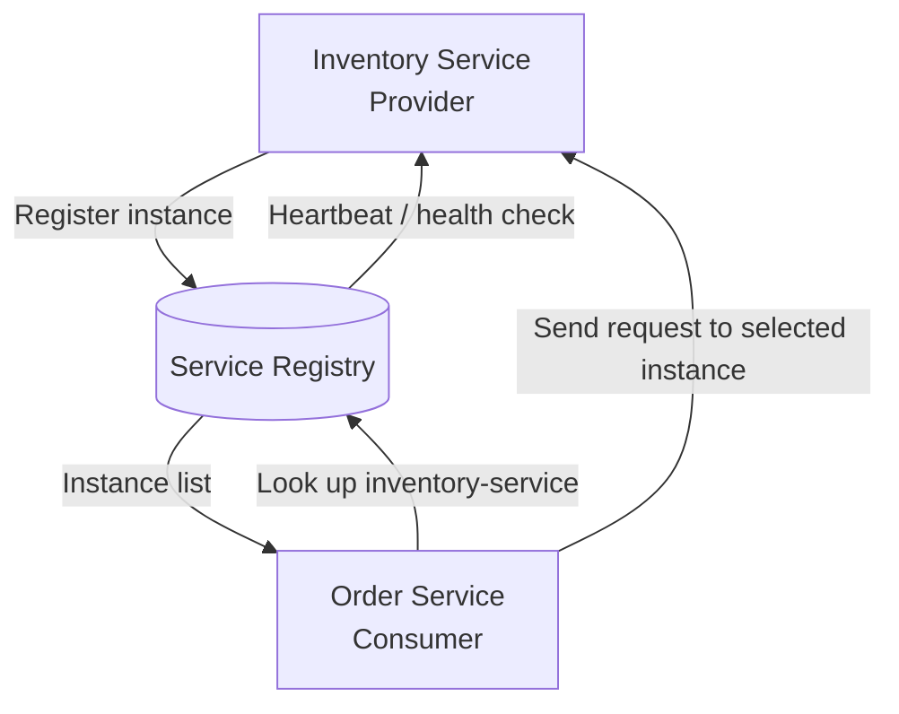

# What Is Service Discovery and What Problem Does It Solve?

In a monolithic application, components typically call each other via fixed addresses or directly within the same process. When a system is split into multiple microservices, each service can run across multiple machines or containers, and can be created, replaced, scaled out, or scaled down at any time. As a result, the IP address and port of an instance are no longer stable. If each service had to store the addresses of all other services in advance, configurations would quickly become outdated and deployment would become difficult to control.

**Service discovery** is a mechanism that enables a component to find the instances providing a service using a logical name. Instead of needing to know in advance which machine `10.0.2.15:8080` is, the calling service only needs to know a name such as `inventory-service`; the service discovery system provides the list of matching instances so the application or a load balancer can choose where to send the request.

In Spring Cloud, service discovery provides the foundation for microservices to find one another when addresses and instance counts change over time. Common components include `DiscoveryClient`, `ServiceRegistry`, Spring Cloud LoadBalancer, and registry systems such as Eureka or Consul.

## The Problem Without Service Discovery

Suppose `order-service` needs to call `inventory-service` to check stock. In a development environment, the team might configure a fixed address:

```yaml
inventory:
  base-url: http://192.168.10.21:8080
```

This approach can work when there is only one instance and the infrastructure rarely changes. However, in a real microservice environment, it creates several problems:

- **Changing addresses:** containers can receive new IPs after restarting or being deployed on a different node. Stale configurations cause calls to go to an address that no longer exists.
- **Scaling to multiple instances:** when `inventory-service` has multiple instances running in parallel, a single fixed address does not represent its full serving capacity.
- **Replacement and continuous deployment:** old instances may shut down while new instances appear while calling services still retain the previous configuration.
- **Environment-dependent configuration:** addresses on a developer machine, a test environment, and a production environment differ. Manual management increases the risk of misconfiguration.
- **Resilience:** a failed instance may still receive calls if address information is not updated in time.

Service discovery solves instance location lookup using a stable service name. It does not by itself guarantee that network calls always succeed, but it eliminates the need to manually maintain a list of addresses for each instance and provides the foundation for load balancing, health checking, and error handling.

## Core Components

A service discovery system typically has three roles:

1. **Service provider:** an application that provides functionality, such as `inventory-service`. On startup, the application registers its service name along with instance information such as address, port, and necessary metadata.
2. **Service registry:** the place that stores information about registered instances. The registry accepts registrations, tracks status via heartbeats or health checks, and removes or marks unavailable instances according to system policy.
3. **Service consumer:** an application that needs to call another service, such as `order-service`. The consumer queries the registry by service name to obtain a list of usable instances.

A service name is a logical identifier, such as `inventory-service`; it is not a network address. Each instance needs its own identifying information so the registry can distinguish between replicas running the same service. Metadata can describe the deployment zone or version, but should only contain data necessary for routing and operations.



The registry acts as a dynamic directory. Providers update their own information; consumers query the directory when they need to find a service. Depending on the architecture, consumers may cache lookup results for a period of time to reduce the number of queries.

## The Service Discovery Lifecycle

A typical flow unfolds as follows:

1. **Startup and registration:** the provider starts up, determines its service ID and reachable address, and registers the instance with the registry. In Spring Cloud, the Eureka or Consul integration typically handles this step automatically when the application is properly configured.
2. **Status maintenance:** the provider or agent sends heartbeats; the registry may also proactively run health checks. These mechanisms help detect instances that have stopped or no longer meet health requirements.
3. **Lookup:** the consumer requests a list of instances by service ID, for example `inventory-service`.
4. **Instance selection:** if multiple results are returned, the consumer or an intermediary component selects one instance. Spring Cloud LoadBalancer can perform client-side selection.
5. **Service invocation:** the consumer sends the request to the address of the selected instance. If the call fails, the application can retry according to an appropriate policy or apply a circuit breaker.
6. **Deregistration or expiration:** when a provider shuts down gracefully, it should deregister so the registry stops returning that instance promptly. If the process terminates unexpectedly, heartbeats or health checks allow the registry to detect and update its status after a period of time.

Information in the registry can lag behind the actual state of the network. For example, an instance may have just crashed without the registry noticing yet; or an instance may have just started up without being marked ready yet. Therefore, discovery results are time-sensitive routing information, not a guarantee that the next request will definitely succeed.

## Service Discovery in Spring Cloud

Spring Cloud provides common abstractions so applications do not have to depend directly on the proprietary API of each registry.

### `DiscoveryClient`: Looking Up Instances

`DiscoveryClient` is the consumer-side interface. An application can call `getInstances(serviceId)` to retrieve instances registered under a service ID. For example:

```java
import java.util.List;

import org.springframework.cloud.client.ServiceInstance;
import org.springframework.cloud.client.discovery.DiscoveryClient;
import org.springframework.stereotype.Service;

@Service
public class InventoryDiscoveryService {
    private final DiscoveryClient discoveryClient;

    public InventoryDiscoveryService(DiscoveryClient discoveryClient) {
        this.discoveryClient = discoveryClient;
    }

    public List<ServiceInstance> findInventoryInstances() {
        return discoveryClient.getInstances("inventory-service");
    }
}
```

`ServiceInstance` provides information such as service ID, host, port, URI, and metadata. The returned list may be empty if no instances are registered yet or if the registry is not ready. Calling code must handle this case rather than assuming there is always at least one instance.

`DiscoveryClient` is appropriate when the application genuinely needs to read the instance list or metadata to perform custom processing. For standard HTTP calls, discovery should be combined with a load-balancing mechanism to avoid duplicating instance selection and URL construction logic across multiple places.

### `ServiceRegistry`: Registration and Deregistration

`ServiceRegistry` is the provider-side abstraction used to register or deregister a `Registration` object with a specific registry. The Eureka and Consul starters integrate the registration lifecycle with Spring Boot, so applications usually configure properties and let auto-configuration handle most of the work.

Two concepts to distinguish:

| Component | Primary Role | Typical Caller |
|---|---|---|
| `DiscoveryClient` | Look up instances by service ID | Consumer |
| `ServiceRegistry` | Register, deregister, and update registration status | Provider / registry integration |
| `ServiceInstance` | Describe a discovered instance address | Consumer and load balancer |
| Spring Cloud LoadBalancer | Select one instance from the matching list | Consumer |

### Combining with Spring Cloud LoadBalancer

When a service has multiple instances, finding the list is only half the job. The application also needs to choose an instance for each request. Spring Cloud LoadBalancer provides client-side load balancing and integrates with service discovery.

For example, with `RestTemplate`, a bean can be annotated with `@LoadBalanced`:

```java
import org.springframework.boot.web.client.RestTemplateBuilder;
import org.springframework.cloud.client.loadbalancer.LoadBalanced;
import org.springframework.context.annotation.Bean;
import org.springframework.context.annotation.Configuration;
import org.springframework.web.client.RestTemplate;

@Configuration
public class HttpClientConfiguration {
    @Bean
    @LoadBalanced
    RestTemplate inventoryRestTemplate(RestTemplateBuilder builder) {
        return builder.build();
    }
}
```

The consumer can then call the service using its service ID:

```java
String url = "http://inventory-service/api/items/42";
InventoryItem item = restTemplate.getForObject(url, InventoryItem.class);
```

In this example, `inventory-service` is the logical name. LoadBalancer coordinates with the discovery client to find instances and select a target for the request. The application needs the appropriate dependencies, such as Spring Cloud LoadBalancer and a registry integration like Eureka or Consul; the Spring Boot and Spring Cloud versions must be managed compatibly using the corresponding Spring Cloud release train.

If you manually fetch a `ServiceInstance` and call its URI directly, the application is taking responsibility for instance selection itself. In that case, you must independently account for load distribution, caching, result TTL, retries, and the case where an instance disappears between lookup and sending the request.

## Popular Registry Options

Spring Cloud supports integration with multiple registry systems. Two common choices are Eureka and Consul.

| Criterion | Netflix Eureka | Consul |
|---|---|---|
| Common role | Service registry and discovery for the Spring Cloud ecosystem | Service registry, discovery, and health checking |
| How status is updated | Clients register and renew leases via heartbeats; the registry evicts expired registrations per configuration | An agent registers services and can execute configured health checks |
| Lookup information | Service ID, instance address, and metadata | Service ID, instance address, metadata, and health check status |
| When suitable | Spring Cloud systems already using or wanting to use Eureka as a registry | Systems needing a registry with Consul's additional coordination and health-check capabilities |

No registry automatically fits every system. You should consider the operational model, registry availability, security mechanisms, agent/server deployment approach, and the team's experience.

Example configuration for an application registering with Eureka:

```yaml
spring:
  application:
    name: inventory-service

eureka:
  client:
    service-url:
      defaultZone: http://localhost:8761/eureka/
```

With this configuration, `inventory-service` is the service ID that consumers use for lookup. The `localhost` address is only appropriate when Eureka Server actually runs on the same network environment as the application; during deployment, it must be replaced with a registry address reachable from both providers and consumers. The configuration above also assumes the project has added the Eureka Client starter and configured compatible dependency management.

## What Service Discovery Solves and What It Does Not

When properly implemented, service discovery provides several benefits:

- **Reduces static address configuration:** consumers call by service name, while instance locations are updated through the registry.
- **Supports flexible scaling:** adding or removing instances does not require manually updating address lists across all consumers.
- **Provides the foundation for load balancing:** consumers can distribute requests across multiple instances instead of sending all traffic to a single fixed address.
- **Supports instance replacement:** the registry updates information when instances register, leave the system, or are marked unhealthy.
- **Decouples application and infrastructure configuration:** the service ID can remain stable while network addresses change across environments.

However, service discovery does not replace other operational mechanisms:

- It does not guarantee that a looked-up instance is still healthy at the moment the request arrives.
- It does not automatically handle retries, timeouts, circuit breakers, rate limiting, or data consistency.
- It does not replace an API gateway, user authentication, or authorization policies between services.
- It does not eliminate the need to monitor and protect the registry as a critical infrastructure component.

A system needs to combine discovery with reasonable timeouts, bounded retries, circuit breakers where appropriate, readiness/liveness probes, graceful shutdown, and error observability on both consumer and provider sides.

## Common Failure Scenarios and How to Handle Them

### Registry Returns an Instance That Has Stopped Running

This is a stale registry scenario: the instance has died, but the registry or consumer-side cache has not updated yet. You need to configure appropriate heartbeat/health check intervals and expiration times; providers should deregister during graceful shutdown. Consumers must still set timeouts and handle connection errors because no health check mechanism completely eliminates the synchronization lag window.

### Instance Is Registered Before It Is Ready to Accept Requests

A process can open its port before finishing database connection initialization or configuration loading. If it registers too early, consumers may call an unready instance. Registration status should be tied to actual readiness, health checks should be configured to reflect serving capability, and instances should only receive traffic after essential dependencies are ready.

### Consumer Cannot Find the Service

Possible causes include the provider not having registered yet, the two sides using different service IDs, the consumer being unable to connect to the registry, or the cache not having refreshed yet. Check the service name, registration status, network connectivity, access permissions, and discovery client logs. You should not handle an empty list by silently falling back to an old IP address.

### Registry Becomes a Critical Point of Dependency

If the registry goes down, applications may be unable to look up new instances. Depending on the implementation, consumers may continue using cached data for a period of time, but this behavior must be understood and tested. The registry should be deployed in an appropriate high-availability topology, with backups/recovery configuration, and monitored as core infrastructure.

### Insecure Registration Information

The registry can expose internal architecture and service addresses. You should restrict network access, enable TLS where appropriate, authenticate clients, authorize registration/lookup operations, and never store secrets in metadata. Services must still authenticate and authorize requests at the application layer; knowing an instance's address does not mean being permitted to call it.

## Adoption Process in a Spring Cloud System

When introducing service discovery into a system, you can roll it out in the following order:

1. Choose a registry suited to your infrastructure and operations; deploy the registry with the required availability level.
2. Assign a stable `spring.application.name` to each service and ensure every instance has address information reachable by consumers.
3. Add the corresponding discovery starter and manage Spring Boot/Spring Cloud versions according to the compatibility matrix.
4. Configure provider registration, heartbeats, or health checks; define readiness and the deregistration process on shutdown.
5. Configure consumers to look up services; use Spring Cloud LoadBalancer for calls requiring load balancing.
6. Test scenarios including adding/removing instances, sudden instance crashes, temporary registry disconnection, incorrect service IDs, and rolling updates.
7. Monitor the number of registered instances, health check status, lookup errors, connection errors, and request latency. Protect the registry with appropriate network policies and authentication.

For example, when deploying two additional instances of `inventory-service`, both register under the service ID `inventory-service` with their own addresses and instance IDs. `order-service` looks up the service name and LoadBalancer selects an instance for each request according to its configuration. When an instance stops, the registry updates its state after receiving a deregistration signal or detecting failed heartbeats/health checks; the consumer continues sending requests to the remaining available instances while still handling errors that occur during the unsynchronized state window.

## Conclusion

Service discovery is the mechanism for locating instances by service name in an environment where network addresses and instance counts frequently change. In Spring Cloud, `DiscoveryClient` helps consumers perform lookups, `ServiceRegistry` provides the registration abstraction, and Spring Cloud LoadBalancer helps select instances for requests. Eureka and Consul are registries that can be integrated to manage the service directory.

The value of service discovery lies in keeping the service directory up to date with the instance lifecycle and reducing reliance on static address configuration. To operate reliably, the system still requires proper health checks, graceful shutdown, load balancing, timeouts, error handling, security, and registry monitoring.
