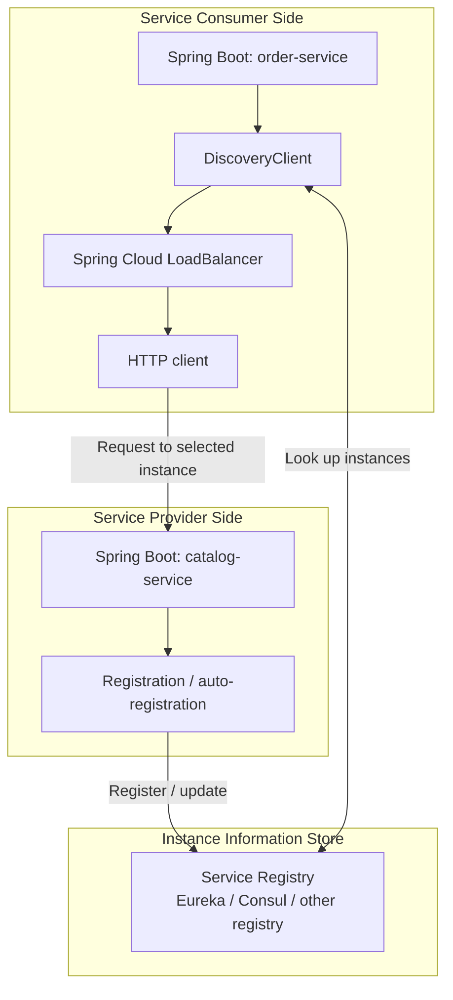
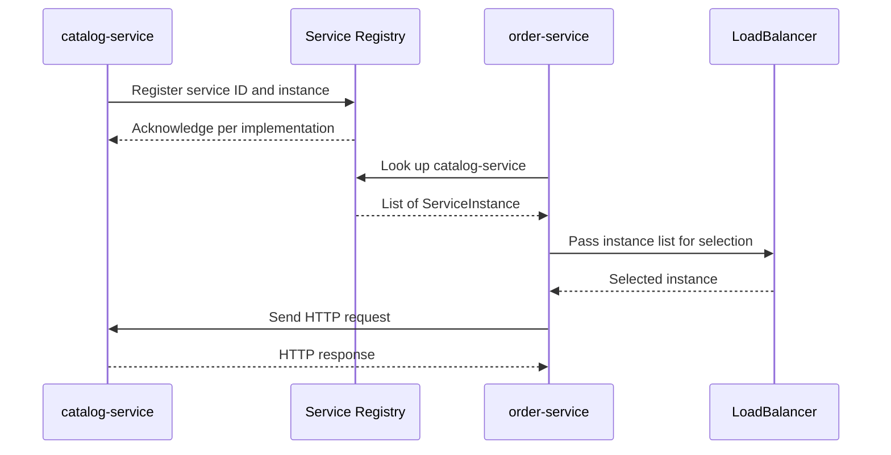

# The Place of Service Discovery in the Spring Cloud Ecosystem

In a monolithic application, components typically run within the same process and can call each other via function calls or a fixed configured address. When a system is split into multiple microservices, each service can be deployed, scaled, and restarted independently. The IP address, hostname, and port of an instance can therefore change with each deployment.

Service Discovery solves the problem of locating active service addresses using a logical name. Instead of hardcoding `http://10.0.1.21:8080`, a consumer requests a service such as `catalog-service`; the discovery system finds the published instances and supplies the information needed for the consumer to connect. In the Spring Cloud ecosystem, Service Discovery connects providers, registries, consumers, gateways, and load balancers into a unified mechanism.

This lesson positions Service Discovery within the Spring Cloud architecture, explains the participating components, the registration and discovery flows, its relationships with other Spring Cloud projects, as well as the operational limits you need to understand before taking microservices to production.

## 1. Why Do Microservices Need Service Discovery?

A service may run multiple instances to increase processing capacity and fault tolerance. For example, `catalog-service` has three instances on different nodes. During operations, an instance may be replaced, a new instance may be spun up during scale-out, or a node may migrate across zones.

If consumers store the addresses of individual instances in advance, every infrastructure change requires updating configuration and redeploying consumers. This creates tight coupling between the consumer and the provider's network addresses.

Service Discovery provides a dynamic mapping layer:

| What the Consumer Knows | What the System Resolves |
|---|---|
| `catalog-service` | `10.0.1.21:8080` |
| Logical service name | One or more currently published instances |
| Role of the service | Address, protocol, and metadata of each instance |

When an instance is added to or removed from the registry, consumers can receive the updated list according to the implementation's synchronization mechanism. Consumers continue using a stable service ID while the underlying infrastructure changes.

Service Discovery is useful when:

- Instance counts vary with load or deployment schedules.
- Containers or virtual machines are frequently created and replaced.
- Multiple environments have different network addresses but share the same logical service names.
- Consumers need to find suitable instances by zone, version, or metadata.
- Gateways or HTTP clients need to route by service ID instead of fixed addresses.

Discovery does not automatically make a service ready. It only provides information about instances published by the registry or implementation. Endpoints must still be reachable, secured, and able to handle requests properly.

## 2. Where Does Service Discovery Sit in the Spring Cloud Ecosystem?

Spring Cloud is a collection of projects that support building distributed systems on top of Spring Boot. Service Discovery is a foundational capability among them. It typically works alongside Spring Cloud Commons, a registry such as Eureka or Consul, Spring Cloud LoadBalancer, and HTTP calling components.



The parts in the diagram have distinct responsibilities:

| Component | Position and Responsibility |
|---|---|
| Spring Cloud Commons | Defines shared abstractions such as `DiscoveryClient`, `ServiceInstance`, `Registration`, and `ServiceRegistry`. |
| Service Registry | Stores service information and registered instances; supplies data for discovery operations. |
| Registry integration | Connects a Spring application to a specific registry, translating data between Spring Cloud abstractions and the provider's API. |
| `DiscoveryClient` | Looks up service IDs and returns instance information to consumers. |
| `ServiceRegistry` | Represents operations to register, deregister, and manage registration status. |
| Spring Cloud LoadBalancer | Selects an instance from discoverable instances according to a load-balancing policy. |
| HTTP client | Sends requests to the selected instance and handles responses or connection errors. |

Spring Cloud Commons acts as the contract layer. Because of this, application code can depend on abstractions instead of calling Eureka's or Consul's proprietary APIs directly. However, details such as configuration, health checks, caching, authentication, and status semantics still depend on the implementation.

## 3. Two Core Flows: Registration and Discovery

Service Discovery has two primary flows. The provider publishes the existence of an instance; the consumer looks up instances by service ID.

### 3.1. Registration Flow from the Provider

When a provider application starts up, the registry integration can build a registration from application configuration and network information. A registration typically describes the service ID, host, port, protocol, and metadata. Auto-registration or integration code then sends this information to the registry.

A simple flow:

1. Spring Boot initializes the application and endpoints.
2. The application determines the service ID and an address reachable by consumers.
3. A Registration is created and passed to `ServiceRegistry` or the integration's registration mechanism.
4. The registry stores the instance record according to the provider's model.
5. During runtime, heartbeats, health checks, leases, or TTLs can maintain and evaluate the record.
6. When the application shuts down gracefully, the instance is taken out of service and deregistered according to its lifecycle.

Not every registry uses the same registration protocol. Eureka and Consul have their own data models, health checks, and update mechanisms. Spring Cloud provides abstractions to integrate them into applications.

### 3.2. Discovery Flow from the Consumer

The consumer knows the service ID it wants to call. Through `DiscoveryClient`, the consumer requests the corresponding list of `ServiceInstance` objects. Each instance contains the information needed to build a connection target, such as URI, host, port, and metadata.

Then, the application or Spring Cloud LoadBalancer selects an instance. The HTTP client sends the request to the chosen address. If the request fails, the consumer needs to handle timeouts, bounded retries, or circuit breakers according to business requirements.



Registration and discovery usually happen independently. The provider does not need to know which consumers will call it; the consumer does not need to know the fixed address of each provider. Both rely on the service ID and the registry.

## 4. Key Abstractions of Spring Cloud Commons

Spring Cloud Commons defines shared interfaces and data types so different registry integrations can participate in the same ecosystem.

### 4.1. ServiceInstance

`ServiceInstance` describes a reachable instance. Commonly used fields include:

- Service ID: logical name of the service.
- Host and port: network address of the instance.
- URI: connection address including the appropriate protocol.
- Secure: information about whether a secure connection is used.
- Metadata: additional data such as zone, version, or deployment group.

A single service ID can map to multiple `ServiceInstance` objects. This list changes with registration status, health checks, and deployment activity.

### 4.2. DiscoveryClient

`DiscoveryClient` is the consumer-side abstraction. It enables looking up instances by service ID and viewing the services that the implementation can discover. Consumers use this result to inspect addresses, apply custom rules, or feed data to a load balancer.

`DiscoveryClient` is neither a registry nor a load balancer. It does not decide on its own which instance the current request should go to. Selecting an instance is the responsibility of LoadBalancer or custom-designed routing logic.

### 4.3. Registration and ServiceRegistry

`Registration` describes an instance used in the registration process; it extends the `ServiceInstance` contract. `ServiceRegistry` provides generic operations to register, deregister, and read or update registration status.

These two abstractions belong to the provider side. In many Spring Cloud setups, the integration starter performs automatic registration aligned with the application lifecycle. When fine-grained control is needed, the application can interact with these abstractions or provider-specific APIs.

### 4.4. Why Are Abstractions Needed?

Suppose `order-service` is using Eureka. If the consumer calls Eureka-specific APIs everywhere, migrating to Consul will affect many parts of the codebase. When the consumer depends on `DiscoveryClient` and `ServiceInstance`, most discovery logic can stay intact; the corresponding integration is responsible for connecting to the new registry.

Abstractions reduce coupling at the application layer, but they do not erase operational differences. Configurations for namespaces, ACLs, health checks, metadata, caching, retries, and consistency must still be reviewed when changing registries.

## 5. Common Registries: Eureka and Consul

Spring Cloud supports integration with multiple service storage and discovery systems. Eureka and Consul are two common choices, though they do not share the same operational model.

| Aspect | Eureka | Consul |
|---|---|---|
| Role | Registry and discovery commonly used in the Spring Cloud Netflix ecosystem. | Service networking platform providing a service catalog and health checking. |
| Registration | Eureka client publishes instances to Eureka Server. | Agent or client registers services with the Consul agent/server per configuration. |
| Health | Client heartbeats and registry status help determine if an instance is active. | Health checks such as HTTP, TCP, or scripts can be configured depending on the environment. |
| Lookup | Consumer fetches instances published by the Eureka client/registry. | Consumer queries the catalog and can filter by health status. |
| Operations | Requires understanding client-side caching, heartbeats, and behavior during network partitions. | Requires understanding agents, datacenters, ACLs, health checks, and consistency modes. |

Choosing a registry should be based on existing infrastructure, operational requirements, security, integration capabilities, and team expertise. Do not choose one merely because its registration or lookup API looks simple.

In a Kubernetes environment, DNS and Kubernetes Services can also provide a mechanism for locating service addresses. A system may use Kubernetes Services instead of a separate Spring Cloud registry, or combine mechanisms depending on architecture. Avoid creating two discovery data sources without clear synchronization rules.

## 6. Relationship with Spring Cloud LoadBalancer

Service discovery answers the question "what instances exist?". Load balancing answers the question "which instance will this request go to?". The two steps are related but have different responsibilities.

For example, `catalog-service` has three instances. The consumer discovers all three addresses, but a specific request only needs to be sent to one instance. Spring Cloud LoadBalancer picks an instance based on its configuration and the supplier in use. Selection policies can vary by application version and configuration.

In a Spring application, an HTTP client can integrate with LoadBalancer to use a service ID as a logical hostname. Illustrative example with `RestTemplate`:

```java
import org.springframework.boot.web.client.RestTemplateBuilder;
import org.springframework.cloud.client.loadbalancer.LoadBalanced;
import org.springframework.context.annotation.Bean;
import org.springframework.context.annotation.Configuration;
import org.springframework.web.client.RestTemplate;

@Configuration
public class HttpClientConfiguration {

    @Bean
    @LoadBalanced
    RestTemplate restTemplate(RestTemplateBuilder builder) {
        return builder.build();
    }
}
```

Consumer calls by service name:

```java
String result = restTemplate.getForObject(
        "http://catalog-service/api/products/42",
        String.class);
```

When LoadBalancer and discovery integration are properly configured, the service ID in the URL is resolved to an instance before the request is sent. Specific dependencies and configuration must match the Spring Boot and Spring Cloud versions in use.

You should not manually pick the first element of the discovery list and treat that as load balancing. Result ordering is not a request distribution guarantee. If you choose instances manually, the application must handle load distribution, failed instances, list updates, and race conditions itself.

## 7. Relationship with Other Spring Cloud Components

Service Discovery is one piece of a microservice architecture. Other Spring Cloud projects use or complement it in their own ways.

| Component | Relationship with Service Discovery |
|---|---|
| Spring Cloud Gateway | Can route to services by service ID and integrate the discovery locator when configured. Gateway still requires its own route rules, filters, and security. |
| Spring Cloud OpenFeign | Can declare clients by service name and use LoadBalancer integration to pick instances. |
| Spring Cloud LoadBalancer | Uses instance information to select a target for requests. |
| Spring Cloud Config | Provides centralized configuration; can store service IDs or registry connection config, but does not replace the registry. |
| Spring Cloud CircuitBreaker | Adds circuit-breaking when dependencies fail; does not locate instance addresses. |
| Micrometer and tracing | Helps observe requests, latency, and errors across services; does not perform registration or discovery. |

For example, Gateway can receive public requests and route them to `catalog-service`. Gateway needs to know the corresponding route, while discovery helps locate the instances of that service. LoadBalancer can select an instance. Authentication, authorization, rate limiting, and circuit breakers remain separate concerns.

Similarly, Config Server can supply the registry address, service names, or LoadBalancer configuration. However, centralized configuration only distributes configuration values; it does not replace dynamic data about running instances.

## 8. Service Discovery and Other Architectural Options

Not every microservice system needs to deploy a dedicated registry. The right mechanism depends on the deployment platform and system requirements.

### 8.1. Client-side discovery

In the client-side discovery model, the consumer queries the registry, receives an instance list, and chooses a call target. Spring Cloud `DiscoveryClient` combined with Spring Cloud LoadBalancer is a common example of this approach.

The advantage is that the consumer can apply flexible selection policies and sees the instances it can call. In return, the consumer must integrate discovery, handle stale data, registry failures, and load-balancing policies.

### 8.2. Server-side discovery

In the server-side discovery model, the consumer sends requests to a stable entry point such as a load balancer or gateway. The intermediary looks up or already knows the instances and forwards requests to an appropriate target.

The consumer is simpler because it does not need to select instances itself. In return, the intermediary infrastructure must have high availability, scalability, and reliable target-updating mechanisms.

### 8.3. DNS and Kubernetes Service

A Kubernetes Service provides a stable DNS name and forwards traffic to matching Pods. In many applications running entirely on Kubernetes, DNS/service routing can meet address-lookup needs without a separate Spring Cloud registry.

If Eureka or Consul is also used, you must decide which source is the primary source of truth, who registers and removes instances, and how health status is synchronized. Two discovery systems managing the same set of instances without a synchronization contract easily produce stale records or divergent results.

### 8.4. Service mesh

A service mesh can provide discovery and routing at the infrastructure layer, typically via sidecar proxies or an equivalent data plane mechanism. When using a mesh, applications may have less need to manage instance lists directly.

A service mesh and Spring Cloud can complement each other, but responsibilities must be clearly delineated. Avoid duplicating retries, timeouts, load balancing, and circuit breaking across multiple layers without understanding total retry counts and resulting latency.

## 9. Instance Lifecycle and Health Checks

A registry is only useful if its data reasonably reflects the serving condition of instances. An instance can be registered when the application starts, maintained via heartbeats or health checks, and removed when stopping.

States that commonly need to be distinguished:

- **Starting:** the process is running, but endpoints may not be ready yet.
- **Ready:** the instance can accept business requests.
- **Unhealthy:** the instance fails health conditions defined by the system.
- **Stopping:** the instance is draining out of service and completing in-flight requests.
- **Removed:** the registration has been removed or expired from the registry.

Readiness and liveness have different meanings. Liveness generally answers whether the process needs to be restarted; readiness answers whether the instance should receive traffic. An instance should not enter discovery just because its process opened a TCP port if mandatory dependencies are not ready yet.

A controlled shutdown procedure typically stops accepting new requests, waits for in-flight requests to finish, deregisters, and closes resources. If a process terminates abruptly, heartbeats, TTLs, or registry health checks can evict the record after a period of time. This detection window directly affects how long consumers continue seeing the failed instance.

There is no single uniform health check API implemented identically by every registry. Read the documentation for the integration in use and verify which states are returned by discovery, which states are filtered out, and synchronization timings.

## 10. Consistency, Caching, and Registry Staleness

Service Discovery is a distributed system. Providers, the registry server, the registry client, the DiscoveryClient adapter, and LoadBalancer can observe data at different points in time.

Several common situations:

| Situation | Possible Causes | Where to Check |
|---|---|---|
| New instance does not appear yet | Registration has not succeeded, slow synchronization, or cache not updated yet. | Provider logs, registry logs, and cache refresh intervals. |
| Stopped instance still appears | Deregistration failed, process was killed, or TTL has not expired yet. | Shutdown lifecycle, heartbeats, and health checks. |
| Consumer receives unreachable host | Wrong address registered, DNS issue, or unsuitable network route. | Instance URI, DNS, port mapping, and network policies. |
| Different consumers see different lists | Caching, different datacenters/namespaces, or synchronization lag. | Registry client configuration and query scope. |
| Service has records but is not selected | Health status, filters, or LoadBalancer policy. | Discovery results, supplier, and selection configuration. |

Do not assume every discovery call queries the registry server directly. Some implementations update locally on a schedule or receive changes through a dedicated mechanism. LoadBalancer may also cache instance lists depending on configuration and version.

When investigating discrepancies, examine data at each layer and its update timestamps. Adding extra custom caching on the consumer without understanding existing caches can extend the lifetime of stale records. Conversely, disabling caches arbitrarily can increase registry load and lookup latency.

## 11. Security in Service Discovery

The registry stores internal infrastructure details such as service names, hosts, ports, metadata, and sometimes operational state. Therefore, the registry is a component that must be protected like other infrastructure services.

Fundamental principles:

1. Protect registry APIs with authentication and authorization; only authorized providers or consumers should be able to register or look up corresponding data.
2. Use TLS for connections between applications and the registry and between services when required by environment security policies.
3. Manage credentials through a secret manager or secure configuration mechanism; never store tokens or passwords in source code or metadata.
4. Restrict service ID registration permissions so an application cannot impersonate another service.
5. Treat metadata as data that may be missing or malformed; validate values before using them for routing decisions.
6. Apply network policies and firewalls to restrict communication paths between services.
7. Do not expose internal host, port, and metadata lists through end-user APIs without a clear need.

Service Discovery only provides location information. It does not replace service-to-service identity authentication, business authorization, or target endpoint protection.

## 12. Observability and Operations

When Service Discovery fails, you must distinguish registration errors, lookup errors, missing instances, unreachable instances, and business processing errors. If every scenario is recorded as a generic "service unavailable" error, root-cause analysis becomes difficult.

You should observe at least:

- Instance counts per service ID and their statuses.
- Registration rate, deregistration rate, and registry communication errors.
- Discovery lookup duration and counts of empty list responses.
- Data age or time from when an instance changes until consumers see the change, if the implementation provides it.
- Request failure rate by service ID, instance, and network cause.
- Retry counts, timeouts, and circuit breaker openings at the service-calling layer.

Logs should include the service ID and appropriate correlation/trace IDs to link events across providers, consumers, and the registry. Avoid writing secrets or full internal metadata into unprotected logs.

## 13. Common Misconceptions

**"Registration succeeding means the service is ready."** Incorrect. The registry may have stored the record while endpoints are not yet ready or health checks have not completed.

**"DiscoveryClient load balances on its own."** Incorrect. DiscoveryClient looks up instances; LoadBalancer or routing logic selects the instance for a request.

**"The registry always has the latest data."** Not guaranteed. Caching, heartbeats, TTLs, and distributed synchronization can introduce lag.

**"Having an instance in the registry means connections will definitely succeed."** Incorrect. DNS, firewalls, port mappings, TLS, readiness, and network errors can still cause requests to fail.

**"Spring Cloud makes every registry behave identically."** Incorrect. Abstractions unify how applications interact at a high level; provider semantics and configurations still differ.

**"Every Kubernetes platform needs Eureka or Consul."** Incorrect. Kubernetes DNS and Services may already fulfill discovery needs in certain architectures. Choose a mechanism based on actual scope and requirements.

## 14. Roadmap for Integrating Service Discovery in a Spring Cloud Project

When designing a new system, you can implement it in the following sequence:

1. **Identify requirements:** clarify the number of services, runtime environments, scaling patterns, zone requirements, and fault tolerance.
2. **Choose a discovery mechanism:** decide whether to use a registry like Eureka/Consul, DNS/Kubernetes Services, or a service mesh.
3. **Lock down service IDs:** assign stable names consistent across providers, consumers, gateways, and configuration.
4. **Integrate providers:** configure starters, instance details, health checks, and registration/deregistration lifecycles.
5. **Integrate consumers:** use DiscoveryClient when direct lookup is needed; integrate LoadBalancer for calls by service ID.
6. **Secure the registry:** configure authentication, authorization, TLS, and secret management.
7. **Design resilience:** set appropriate timeouts, bounded retries, circuit breakers, and graceful shutdown.
8. **Observe and test:** simulate scale up/down, instance crashes, registry disconnection, stale cached data, and network discrepancies.

Spring Cloud projects are released under a release train and must be compatible with the corresponding Spring Boot line. When adding starters for Eureka, Consul, Gateway, OpenFeign, or LoadBalancer, check the compatibility matrix and guidance for the release train in use. Do not mix dependencies from different release trains just to grab a newer version of a single library.

## 15. Architecture Checklist

| Category | Questions to Answer |
|---|---|
| Model | Is discovery client-side, server-side, DNS-based, or provided by a service mesh? |
| Registry | Which instance data source is primary? Does the registry have appropriate HA and backups? |
| Identity | How are service IDs and instance IDs defined? |
| Addressing | Are host, port, and scheme reachable from all relevant consumers? |
| Health | How do readiness, liveness, heartbeats, TTLs, and deregistration coordinate? |
| Load balancing | Who selects the instance and what is the selection policy? |
| Data | Are caching and synchronization lag at each layer clearly understood? |
| Resilience | How do consumers react when no instances exist or the registry loses connectivity? |
| Security | Who can register, who can query, and how are credentials protected? |
| Operations | Are metrics, logs, traces, and procedures for handling stale records in place? |
| Compatibility | Are the Spring Boot, Spring Cloud, and registry starter versions compatible? |

## Conclusion

Service Discovery is the dynamic location layer in a Spring Cloud microservice architecture. Providers register instances with the registry; consumers discover instances by service ID via `DiscoveryClient`; Spring Cloud LoadBalancer or a routing component selects targets for requests. Spring Cloud Commons provides shared abstractions so applications can work with multiple registries such as Eureka and Consul.

Discovery capabilities must be designed alongside health checks, lifecycles, load balancing, security, caching, resilience, and observability. The registry can hold delayed or stale data, so applications must still handle unavailable endpoints and connection errors. When development teams clearly understand the role of each component in the Spring Cloud ecosystem, they can pick the right discovery mechanism for their deployment platform and operate microservices more reliably.
