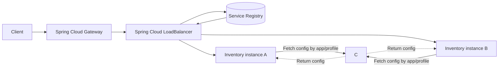
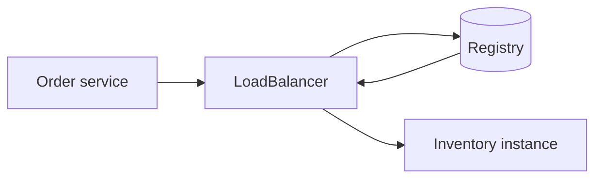

# Distinguishing Service Discovery, Load Balancing, Gateway, and Centralized Configuration

In a microservice architecture, multiple components participate to route a request to the right service and the right instance. Service discovery finds the currently registered instances; load balancing picks one instance among them; the API Gateway receives and routes requests across system boundaries; Config Server provides shared configuration for applications. They can integrate with one another, yet they answer different questions.

Four questions help distinguish them:

- **Service discovery:** Which instances of `inventory-service` currently exist and what are their addresses?
- **Load balancing:** For a specific request, which instance from that list should the request be sent to?
- **API Gateway:** Where are requests from external clients accepted, what shared policies are applied, and which service are they routed to?
- **Centralized configuration:** Where do services retrieve configuration by application, environment, and version?

In Spring Cloud, the commonly encountered abstractions and projects are `DiscoveryClient` and `ServiceRegistry`, Spring Cloud LoadBalancer, Spring Cloud Gateway, and Spring Cloud Config. A system may use all four, or only a subset depending on scale and deployment model.

## Four Components Solving Four Responsibilities

| Component | Primary Question | Data or Input | Result |
|---|---|---|---|
| Service discovery | Where are the instances for a service ID? | Service ID and registry records | List of instances, host, port, metadata |
| Load balancing | Which instance to pick for this request? | Available instance list and selection policy | One target instance |
| API Gateway | Where do requests enter the system and how are they routed? | Request, route, predicate, and filter | Request forwarded upstream or rejected |
| Config Server | Which configuration does an application need in this environment? | Application name, profile, label/version | Configuration set for the client |

The difference lies in the purpose of the data. The registry holds runtime information about active instances. Config Server holds application configuration such as timeouts, feature flags, external URLs, or connection parameters. Gateway holds or receives routes and request-handling policies. LoadBalancer uses the instance list to pick a destination.

## Service Discovery: Finding Instances by Service Name

Providers register their service ID and instance information with the registry. Consumers look up the service ID to obtain a list of callable instances. In Spring Cloud, `DiscoveryClient` provides the generic lookup API, while `ServiceRegistry` is the abstraction for registration and deregistration.

For example, suppose a service exists with two instances:

```text
service ID: inventory-service

instance A: 10.0.1.12:8080
instance B: 10.0.1.13:8080
```

The consumer requests the instance list for `inventory-service`. The registry may be Eureka, Consul, or ZooKeeper; each integration has its own way of storing and updating state. Consumers do not need to hardcode IP addresses in configuration if discovery is integrated.

```java
import java.util.List;

import org.springframework.cloud.client.ServiceInstance;
import org.springframework.cloud.client.discovery.DiscoveryClient;
import org.springframework.stereotype.Service;

@Service
public class InventoryInstances {
    private final DiscoveryClient discoveryClient;

    public InventoryInstances(DiscoveryClient discoveryClient) {
        this.discoveryClient = discoveryClient;
    }

    public List<ServiceInstance> findAll() {
        return discoveryClient.getInstances("inventory-service");
    }
}
```

The result can be empty if the provider has not registered yet, the registry is not ready, or the service ID does not match. Discovery also does not guarantee the instance is still healthy when the request arrives. Consumers still need to handle timeouts and connection errors; health checks, readiness, and registry update mechanisms must be configured properly.

## Load Balancing: Selecting One Instance

Discovery answers "which instances exist"; load balancing answers "which instance will this request go to". When the registry returns three instances, the load balancer selects one target based on a strategy such as round robin, random, or a custom policy.

In Spring Cloud, Spring Cloud LoadBalancer is a client-side load balancer. It obtains the instance list from a `ServiceInstanceListSupplier` (typically integrated with the discovery client), applies a selection policy, and returns a `ServiceInstance` to the caller.

For example, if the list has three instances and uses a round-robin policy, consecutive requests may be distributed to A, B, C in turn and then back to A. This is a conceptual description; actual behavior also depends on supplier configuration, caching, health checks, and the lifecycle scope of the selector.

```java
import org.springframework.beans.factory.annotation.Qualifier;
import org.springframework.boot.web.client.RestTemplateBuilder;
import org.springframework.cloud.client.loadbalancer.LoadBalanced;
import org.springframework.context.annotation.Bean;
import org.springframework.context.annotation.Configuration;
import org.springframework.stereotype.Service;
import org.springframework.web.client.RestTemplate;

@Configuration
public class HttpClientConfiguration {
    @Bean
    @LoadBalanced
    RestTemplate inventoryRestTemplate(RestTemplateBuilder builder) {
        return builder.build();
    }
}
```

The caller can use the service ID in the URL:

```java
@Service
public class InventoryClient {
    private final RestTemplate restTemplate;

    public InventoryClient(
            @Qualifier("inventoryRestTemplate") RestTemplate restTemplate) {
        this.restTemplate = restTemplate;
    }

    public InventoryItem getItem(long id) {
        return restTemplate.getForObject(
            "http://inventory-service/api/items/{id}",
            InventoryItem.class,
            id
        );
    }
}
```

With a bean annotated with `@LoadBalanced`, the logical host `inventory-service` is resolved through discovery and LoadBalancer before sending the request. If you use an HTTP client without load-balancing integration, a service ID URL may not be resolved by standard DNS or transport layers.

Load balancing does not replace discovery: without an instance list, the selector has no targets to choose from. Conversely, having discovery alone does not decide how to distribute requests across multiple instances.

## API Gateway: Entry Point and Policy Enforcement Point

An API Gateway is the entry point that accepts requests from external clients or from other system domains. Depending on the design, the Gateway can route requests to microservices, perform authentication, enforce access control, apply rate limiting, log requests, add headers, transform requests/responses, or apply circuit breakers.

Spring Cloud Gateway provides a route model consisting of:

- **Route:** describes the upstream target and applicable conditions.
- **Predicate:** inspects request attributes such as path, host, method, or headers.
- **Filter:** processes requests or responses before/after forwarding.

Example of a route forwarding `/api/inventory/**` requests to `inventory-service`:

```yaml
spring:
  cloud:
    gateway:
      routes:
        - id: inventory-route
          uri: lb://inventory-service
          predicates:
            - Path=/api/inventory/**
          filters:
            - StripPrefix=2
```

`lb://inventory-service` tells the Gateway to use load balancing to find instances by service ID. The Gateway coordinates with discovery and LoadBalancer to pick an upstream for the request. If a fixed URI like `http://10.0.1.12:8080` is used, the route will not automatically switch to new instances when addresses change.

To use the `lb://` scheme, Gateway needs Spring Cloud LoadBalancer and the corresponding discovery client integration on the classpath. The route specifies the service ID; the instance list and selection algorithm are supplied by the underlying integrated components.

You can enable automatic route generation from the registry so Gateway discovers services and creates routes by rule. However, in systems with explicit API contracts, explicit routes usually help control public paths and avoid accidentally exposing every internal service. Property names and how the discovery locator is enabled depend on the Spring Cloud Gateway version.

The Gateway is not a registry. It can query the registry to find upstreams, but its primary job is managing request traffic passing through the entry point. Nor does the Gateway have to sit in front of every microservice-to-microservice call; internal communication can call services directly via discovery and load balancing if the architecture allows.

## Centralized Configuration: Managing Application Configuration

Spring Cloud Config provides a centralized configuration server. Config Server reads configuration from a supported backend, typically a Git repository, and serves configuration to applications by application name, profile, and label. For example, `inventory-service` under the `production` profile receives configuration values intended for the production environment.

Config Server side example:

```yaml
spring:
  cloud:
    config:
      server:
        git:
          uri: https://git.example.com/platform/app-config.git
```

Config Client side example:

```yaml
spring:
  application:
    name: inventory-service
  config:
    import: optional:configserver:http://config-server:8888
```

Config Server can supply values such as HTTP timeouts, feature flags, logging levels, or integration settings. Secrets should be managed using an appropriate mechanism, repository permissions should be enforced, and sensitive credentials should not be stored in plain configuration files.

Config Server is not a service registry. It returns configuration; it is not where consumers look up runtime instances of `inventory-service`. The registry can change continuously as instances scale up and down, whereas configuration is typically managed by version and environment.

### When Config Server Is Also Discovered via the Registry

Spring Cloud Config Client can be configured in discovery-first mode to locate Config Server itself through the service registry. In that case, discovery only helps locate Config Server's endpoint; Config Server remains responsible for returning configuration. This illustrates how components can cooperate while keeping their data roles separate.

## How the Components Cooperate in a Single Request

Consider the case where a user calls an API to view stock. Gateway receives the public request and routes to the service ID; LoadBalancer picks an instance; discovery provides the instance list; the backend application may fetch configuration from Config Server at startup or refresh configuration via the configured mechanism.



The request flow can be traced in order:

1. The client sends a request to the Gateway's domain, e.g. `https://api.example.com/api/inventory/42`.
2. Gateway matches the route by path and other predicates, then applies filters such as authentication or rate limiting.
3. The route has URI `lb://inventory-service`, so Gateway asks the load-balancing mechanism to resolve an instance.
4. The discovery client fetches the instance list by service ID; LoadBalancer selects an instance according to the configured policy.
5. Gateway forwards the request to the selected instance and returns the response to the client.
6. The instance executes business logic using configuration loaded from Config Server or the corresponding configuration source.

In step 4, discovery and load balancing participate together yet perform two distinct tasks. Config Server does not participate in picking a target for the request. It supplies configuration to applications according to the configuration lifecycle, not a runtime address list of individual instances.

## Do Internal Microservice Calls Need a Gateway?

Not every call needs to pass through an API Gateway. For example, `order-service` checking stock can call `inventory-service` directly using its service ID and a load-balanced HTTP client. The path is shorter and avoids an extra network hop through the Gateway.



A Gateway is typically suited for traffic entering the system from outside or crossing domains that require a shared control point. Internal calls can use a Gateway when a centralized policy or specific security boundary is required, though latency, availability, and funneling traffic through a single component must be weighed.

## Comparison Across Practical Scenarios

| Scenario | Primary Handling Component | Why |
|---|---|---|
| A new instance of `inventory-service` just started | Service registration / discovery | Provider registers the instance so consumers can find it |
| Five instances exist and requests must be distributed | LoadBalancer | Picks one instance from the discovered list |
| External client calls `/api/orders/**` | API Gateway | Accepts the request, applies routes/filters, and forwards it |
| Need to change timeouts for all instances in staging | Config Server or configuration system | Distributes configuration by application/profile |
| Gateway needs to route to dynamically scaling `payment-service` | Gateway + discovery + LoadBalancer | Gateway matches logical route; discovery supplies instances; LoadBalancer picks one target |
| `order-service` calls `inventory-service` directly | Discovery + LoadBalancer | No extra Gateway needed if there are no entry-point policy requirements |
| Config Server runs multiple replicas | Discovery + LoadBalancer (if discovery-first or service-name routing is configured) | Finds and picks a Config Server endpoint; configuration content is still returned by Config Server |

## Common Misconceptions

### Confusing Discovery with Load Balancing

Looking up three instances does not mean requests are being distributed. Discovery returns a list; LoadBalancer selects one item. If a consumer manually picks the first instance, that is consumer-written selection logic, not necessarily proper load balancing.

### Confusing Gateway with Service Registry

Gateway can integrate discovery to route by service ID, but Gateway's routes and filters are not the complete runtime directory. When an instance dies, the registry/health mechanism updates the list; LoadBalancer uses the updated list. Gateway continues accepting requests and applying routes.

### Confusing Config Server with Registry

Config Server returns configuration properties by application/profile/label. The registry stores registered instances by service ID. Changing the address of a running instance is typically a runtime registry change; changing a timeout or feature flag is typically a configuration change. Some config values may contain fixed URLs, but that does not turn Config Server into service discovery.

### Assuming Every Microservice Call Must Go Through Gateway

Gateway is an architectural choice for managing traffic across a boundary. Internal services can call each other directly using discovery and load balancing. The decision depends on security requirements, observability, latency, ownership, and network topology.

### Assuming Discovery Guarantees Healthy Instances

The registry can contain stale data. Health checks, readiness, sessions/leases, timeouts, and consumer-side error handling determine how the system reacts when an instance stops functioning. No discovery result guarantees the next request will definitely succeed.

## Choosing an Architecture Based on Needs

- **Small application, few services:** you can start with discovery and load balancing for calls requiring dynamic location; Gateway or Config Server may not be necessary yet.
- **External clients and many APIs:** add a Gateway to manage routes, authentication, rate limiting, and boundary policies.
- **Multiple environments and many applications:** use centralized configuration to manage settings consistently with versioning and auditing; manage secrets separately per security requirements.
- **Many replicas and frequent scaling:** you need a registry that accurately tracks instance lifecycles along with load balancing; test stale registry scenarios, health checks, and reconnections.
- **Multi-replica Gateway:** deploy Gateway with the required availability level and ensure upstream routes use discovery/load balancing if instance addresses change.

Do not add a component merely because microservice architectures "usually have" it. Every component introduces configuration, operations, monitoring, and a new dependency point. Choose components based on the questions you need to solve, then test failure scenarios between them.

## Deployment Checklist

1. Providers register the right service ID and an address reachable by consumers.
2. Consumers can look up the instance list and handle the empty list case.
3. LoadBalancer is integrated with the HTTP client or Gateway and has a clear selection policy.
4. Gateway exposes only necessary routes; authentication, authorization, and rate-limiting filters are properly configured.
5. Routes use `lb://service-id` when upstreams must be resolved dynamically via the registry.
6. Config Server delivers the right configuration by application, profile, and label; clients handle temporary Config Server unavailability per the chosen policy.
7. Registry, Gateway, Config Server, and applications all have appropriate health/metrics/logging.
8. Test scale up/down, sudden instance crashes, registry disconnection, configuration changes, and Gateway restarts.
9. Protect the registry, Config Server, and Gateway with appropriate network segmentation, authentication, authorization, and secret management.

## Conclusion

Service discovery finds instances by service ID; load balancing picks an instance for each request; API Gateway manages requests entering through the front door; Config Server distributes application configuration by environment and version. In Spring Cloud, these components can work together: Gateway uses discovery and LoadBalancer to forward requests to dynamic instances, while applications receive configuration from Config Server. Understanding each part's responsibility makes request flows and microservice operations much easier to control.
