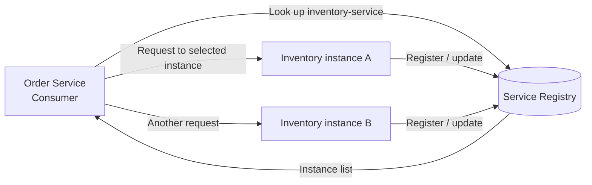
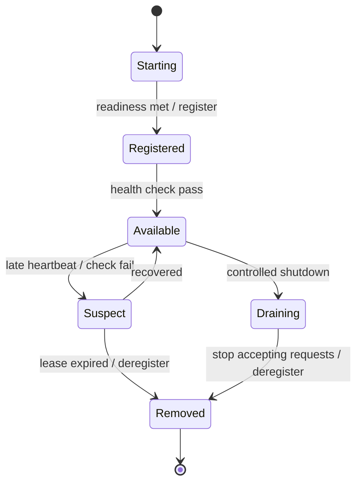

# Prerequisite Knowledge and Learning Sequence in the Module

Service discovery is a part of microservice architecture: a service needs to find instances of another service as network addresses and instance counts change over time. To learn and implement this mechanism properly in Spring Cloud, you need to understand the service/instance model, the role of the registry, the registration lifecycle, how consumers perform lookups, and how an instance is selected for a request.

This article introduces the necessary foundation and proposes a learning order in the `SPRING_CLOUD_SERVICE_DISCOVERY` module. The roadmap moves from the problem statement and terminology, through Spring Cloud abstractions and popular registries, to load balancing, health checks, security, and operations.

## Learning Objectives

Upon completing the module, you should be able to:

- Explain why fixed IP addresses and ports cause difficulties when deploying multi-instance microservices.
- Distinguish service ID from instance ID, provider from consumer, and registry from application configuration.
- Use `DiscoveryClient` to look up instances and understand how `ServiceRegistry` manages registrations.
- Configure at least one registry such as Eureka, Consul, or ZooKeeper in a Spring Cloud application.
- Distinguish service discovery from load balancing, API Gateway, and centralized configuration.
- Design readiness, health checks, timeouts, reconnection handling, and stale registry handling.
- Secure the registry and evaluate failure scenarios when running multiple instances.

## Prerequisite Knowledge

You will have a smoother learning experience if you already understand the following:

| Knowledge Area | What to Know Beforehand | How It Is Used in the Module |
|---|---|---|
| Java and Spring Boot | Dependency injection, beans, configuration properties, application lifecycle | Integrating discovery clients and configuring applications |
| HTTP and REST | URL, host, port, method, status code, timeout | Understanding inter-service requests and connection errors |
| Networking basics | IP, DNS, TCP, port, hostname, subnet | Understanding instance addresses and reachability across containers/hosts |
| Microservices | Provider, consumer, independent deployment, replicas | Identifying which service registers and which service looks up |
| YAML and Maven/Gradle | Declaring dependencies, profiles, configuration | Adding starters and configuring registries with compatible versions |

You do not need to be a distributed systems expert before starting. However, you should understand that networks can be disrupted, an instance can crash at any moment, and registry state can lag behind actual state.

## The Core Problem: Instance Addresses Change

Suppose `order-service` needs to call `inventory-service`. If there is only one instance in a development environment, the team can configure a fixed address:

```yaml
inventory:
  base-url: http://10.0.1.12:8080
```

When multiple replicas are deployed, that address no longer represents the entire service. A container may receive a new IP after restarting; a replica may be replaced; the system may scale the number of instances up or down with load. If each consumer maintains its own list of IPs, configuration quickly goes stale.

Service discovery solves lookup using a logical name. The consumer requests an instance list by service ID, such as `inventory-service`; the registry returns registered instance information. A load balancer can pick an instance from that list for the request.



The registry is a dynamic directory. It tells consumers which instances are registered, yet it does not guarantee that the next request will definitely succeed. An instance can fail immediately after being looked up; therefore, discovery must always be paired with timeouts, health/readiness, and error handling.

## Terminology to Know

| Term | Meaning | Example |
|---|---|---|
| Service | An application providing functionality in the system | `inventory-service` |
| Service ID | Logical name used to look up a service | `inventory-service` |
| Instance | A specific running copy of a service | A container listening on port `8080` |
| Instance ID | Unique identifier of an instance | `inventory-pod-a7f3` |
| Provider | Application providing functionality and registering instances | `inventory-service` |
| Consumer | Application looking up and calling a provider | `order-service` |
| Registry | Store holding registration info for instances | Eureka, Consul, ZooKeeper |
| Discovery | Process of looking up instances by service ID | `getInstances("inventory-service")` |
| Health check | Mechanism to evaluate whether an instance meets serving conditions | HTTP health endpoint or probe |
| Load balancing | Selecting an instance for a request | Round robin or custom policy |

The service ID is typically stable across deployments; the instance ID must distinguish concurrent running copies. Do not use an IP as the service ID because an IP is a mutable attribute of an instance.

## The Service Discovery Lifecycle

An instance typically passes through the following stages:

1. **Startup:** the application reads configuration, initializes the web server and essential dependencies.
2. **Registration:** the provider sends its service ID, address, port, and metadata to the registry.
3. **Maintenance:** the provider renews its lease or heartbeat; the registry may run health checks to update status.
4. **Lookup:** the consumer requests the instance list by service ID and may cache it for an appropriate duration.
5. **Selection and invocation:** the load balancer picks an instance; the HTTP client sends the request and handles timeouts/errors.
6. **Leaving the system:** the provider deregisters on controlled shutdown; if the process crashes unexpectedly, the registry detects it via lease, heartbeat, or health check.



Different registries have different concrete mechanisms. Eureka uses registration and lease renewal; Consul has service registration along with health checks; ZooKeeper can represent instances with ephemeral znodes tied to sessions. Do not conflate heartbeats, leases, sessions, and health checks: each mechanism provides a different kind of signal.

## Key Abstractions in Spring Cloud

Spring Cloud defines shared abstractions so consumers and providers work with registries with minimal coupling to each product's proprietary API.

| Abstraction | Role | Used By |
|---|---|---|
| `DiscoveryClient` | Look up service IDs and retrieve `ServiceInstance` lists | Consumer |
| `ServiceInstance` | Describe host, port, URI, service ID, and metadata of an instance | Consumer / LoadBalancer |
| `ServiceRegistry` | Register, deregister, and update registration status | Provider / integration |
| `Registration` | Carry instance information to be registered | Provider |
| Spring Cloud LoadBalancer | Pick an instance from the matching list | Consumer / Gateway |

Example lookup using `DiscoveryClient`:

```java
import java.util.List;

import org.springframework.cloud.client.ServiceInstance;
import org.springframework.cloud.client.discovery.DiscoveryClient;
import org.springframework.stereotype.Service;

@Service
public class InventoryLookup {
    private final DiscoveryClient discoveryClient;

    public InventoryLookup(DiscoveryClient discoveryClient) {
        this.discoveryClient = discoveryClient;
    }

    public List<ServiceInstance> findInstances() {
        return discoveryClient.getInstances("inventory-service");
    }
}
```

The list may be empty. Consumers must define behavior when a service has not registered yet or when the registry is temporarily unreachable. Never assume there is always at least one instance.

## Registries Covered in the Module

### Eureka

Eureka is commonly used in the Spring Cloud ecosystem. Eureka Server stores the registry; Eureka Client registers and renews its lease. Consumers fetch the service/instance list to perform discovery. When studying Eureka, focus on:

- Role and configuration of Eureka Server.
- Configuring Eureka Client and `spring.application.name`.
- Registration, heartbeats, lease expiration, and eviction.
- Peer replication when deploying multiple servers.
- Self-preservation, registry states, and diagnosing stale instances.

### Consul

Consul provides a service catalog along with health-checking mechanisms. Services can be registered via agent/API; health checks can rely on HTTP, TCP, or TTL depending on deployment. When studying Consul, focus on:

- Agent, server, service registration, and catalog.
- HTTP/TCP/TTL health checks and the meaning of passing/warning/critical states.
- Deregistration and policies for removing unhealthy services.
- ACLs, tokens, TLS, and access restrictions.

### ZooKeeper and Curator

ZooKeeper is a distributed coordination system built on a znode tree, sessions, and watches. Curator is a Java library that helps applications work with ZooKeeper and provides recipes such as Service Discovery. When studying this section, focus on:

- Persistent and ephemeral znodes; path structure and instance IDs.
- Sessions, heartbeats, reconnections, and session expiration.
- Watches, caching, and resynchronization after connection recovery.
- Curator's `ServiceDiscovery`, `ServiceInstance`, `ServiceProvider`, and how Spring Cloud Zookeeper integrates the registry.

You do not need to learn every internal detail of all three registries at once. Master the common abstractions first, then practice each integration to understand differences in lifecycle, health checks, security, and operations.

## Distinguishing Discovery from Related Components

| Component | Responsibility | Question It Answers |
|---|---|---|
| Service discovery | Find instances by service ID | Which instances of a service currently exist? |
| Load balancing | Pick an instance for a request | Which instance should this request go to? |
| API Gateway | Accept and route traffic through an entry point | Where do external requests enter the system? |
| Config Server | Distribute application config by profile/version | Which configuration does an application need in this environment? |

Gateway can use the URI `lb://inventory-service` to combine discovery and load balancing when routing. Internal services can also call each other directly via discovery and load balancing without sending every request through the Gateway. Config Server distributes configuration; it does not replace a runtime registry.

## Recommended Learning Roadmap

| Stage | Topics to Study | Expected Outcome |
|---|---|---|
| 1. Foundations | Service, instance, provider, consumer, registry, and the dynamic addressing problem | Able to diagram the basic registration and lookup flow |
| 2. Spring Cloud abstractions | `DiscoveryClient`, `ServiceInstance`, `ServiceRegistry`, `Registration` | Able to write a consumer that looks up an instance list |
| 3. Practice environment | Create small services, configure application names and network addresses | Able to run provider and consumer locally |
| 4. Registry | Eureka, Consul, or ZooKeeper/Curator | Register, look up, and deregister instances |
| 5. Service invocation | Spring Cloud LoadBalancer and HTTP clients | Call by service ID and observe instance selection |
| 6. Lifecycle and health | Heartbeats, leases/sessions, readiness, health checks, shutdown | Handle unhealthy instances or instances leaving the system |
| 7. Reliability and security | Stale registry, retries, timeouts, ACLs, TLS, tokens, observability | Diagnose errors and secure the registry |
| 8. Integration | Gateway, centralized configuration, and capstone lab | Design a complete end-to-end request flow |

### Stage 1: Understand the Problem Before Picking a Registry

Start with a provider running one instance, then scale up to two or three instances. Try changing ports or restarting containers. Note what the consumer needs to know to call the right provider. From there, see why a stable service ID and dynamic instance addresses are needed.

### Stage 2: Learn Abstractions Before Implementations

Read about and practice with `DiscoveryClient` and `ServiceInstance`. Practice looking up a service ID, printing host/port/metadata, and handling empty lists. Then explore `ServiceRegistry` and `Registration` to see how providers publish instances. Once you grasp the abstractions, comparing Eureka against Consul or ZooKeeper becomes much easier.

### Stage 3: Integrate a Complete Registry

Pick one registry for your first hands-on lab. With Eureka, stand up a server and register a provider/client. With Consul, create a service registration and health check. With ZooKeeper, inspect znodes and sessions or use Spring Cloud Zookeeper. Verify both the state inside the registry and lookup results from the consumer.

### Stage 4: Combine with Load Balancing

Once the consumer discovers multiple instances, add Spring Cloud LoadBalancer. Call the service by service ID using an HTTP client annotated with `@LoadBalanced` or its equivalent integration. Observe how requests are distributed; then shut down one instance and inspect the behavior as the registry updates.

### Stage 5: Test Lifecycles and Failures

Practice controlled shutdowns, abrupt process kills, disrupting registry connectivity, and restarting providers. Observe how long the registry takes to detect missing instances, cache refresh times, and request errors during the transition window. Set timeouts and bounded retries; avoid aggressive retries while a service is recovering.

### Stage 6: Harden Operations

Design readiness so instances only accept traffic when ready. Enable registry-appropriate health checks; configure ACLs/tokens/TLS; monitor instance counts, registration errors, session/lease expirations, lookup latency, and request error rates. Test stale registry handling and recovery procedures when the registry loses quorum or becomes unreachable.

## Capstone Lab

Build a small system consisting of `order-service`, `inventory-service`, and a registry. You may add a Gateway if you want to test external traffic flows.

Lab requirements:

1. `inventory-service` registers under service ID `inventory-service` and runs at least two instances.
2. `order-service` uses `DiscoveryClient` to look up and log the instance list.
3. Configure an HTTP client with Spring Cloud LoadBalancer to call `inventory-service` by service ID.
4. Shut down one instance and confirm the registry updates its state; verify the consumer stops using the failed address after cache refresh.
5. Restart the instance with a different address and verify the consumer can find the new instance.
6. Test the case where the registry is temporarily unavailable; identify cache behavior, timeouts, and returned errors.
7. Configure readiness/health checks, authentication, and authorization for registry access.
8. If adding Gateway, route a public API using `lb://inventory-service` and restrict allowed routes.

The expected outcome is that you can explain using logs or diagrams: which instances registered, where the consumer performed lookups, which target LoadBalancer chose, and what happened when an instance left the system.

## How to Check Your Understanding

You have mastered the fundamentals if you can answer these questions on your own:

- How does a service ID differ from an instance ID?
- Why should a consumer not store a fixed IP list of every provider?
- Which side of the lifecycle uses `DiscoveryClient` and which uses `ServiceRegistry`?
- When the registry returns multiple instances, which component picks one instance for a request?
- How do heartbeats/leases/sessions differ from an HTTP health check?
- Why can an instance that just crashed still appear in discovery results for a while?
- When a ZooKeeper session expires, what happens to ephemeral znodes?
- Why can Gateway use discovery without itself being a registry?
- What kind of data does Config Server provide, and how does it differ from a registry?
- Which permissions should be restricted when securing a registry?

## Common Mistakes While Learning and Deploying

| Symptom | Possible Cause | Where to Check |
|---|---|---|
| Consumer cannot find service | Service ID mismatch, provider not registered yet, or registry unreachable | Check application name, registration status, logs, and registry connectivity |
| Stopped instance still receives calls | Lease/session has not expired or cache has not updated yet | Check health checks, eviction intervals, and cache refresh |
| Consumer calls work locally but fail in containers | Advertised host/IP unreachable from consumer's network | Check DNS, port mappings, network, and registered address |
| Multiple replicas overwrite each other | Sharing the same instance ID or path | Generate a unique instance ID for each replica |
| Retries overload the system | Unbounded retries or missing backoff | Set timeouts, bounded retries, backoff, and circuit breakers where appropriate |
| Unauthorized access to registry | Insufficient ACL/token/TLS or network policies | Check authentication, authorization, and network segmentation |

## Version Management and Reference Documentation

Spring Boot and Spring Cloud must use compatible versions. Manage Spring Cloud dependencies using the appropriate BOM/release train rather than picking arbitrary starter versions or mixing release lines. When configuration examples or APIs differ from your actual project, check the documentation for the exact version in use.

Official documentation resources to use while learning:

- [Spring Cloud](https://spring.io/projects/spring-cloud): overview of projects and release trains.
- [Spring Cloud Commons](https://docs.spring.io/spring-cloud-commons/reference/): `DiscoveryClient`, `ServiceRegistry`, and shared abstractions.
- [Spring Cloud Netflix](https://docs.spring.io/spring-cloud-netflix/reference/): Eureka integration.
- [Spring Cloud Consul](https://docs.spring.io/spring-cloud-consul/reference/): Consul and service discovery integration.
- [Spring Cloud Zookeeper](https://docs.spring.io/spring-cloud-zookeeper/reference/): ZooKeeper integration.
- [Spring Cloud LoadBalancer](https://docs.spring.io/spring-cloud-commons/reference/spring-cloud-loadbalancer.html): client-side instance selection.
- [Spring Cloud Gateway](https://docs.spring.io/spring-cloud-gateway/reference/): routes, predicates, and filters.
- [Spring Cloud Config](https://docs.spring.io/spring-cloud-config/reference/): centralized configuration.

## Conclusion

To learn service discovery effectively, start from the dynamic addressing problem and the provider/consumer/registry model. Next, master the `DiscoveryClient` and `ServiceRegistry` abstractions, integrate a registry, and combine it with LoadBalancer to call by service ID. Finally, expand into health checks, readiness, security, stale registry handling, and operations. This sequence helps you understand both the underlying mechanisms and how Spring Cloud components work together in a real microservice system.
