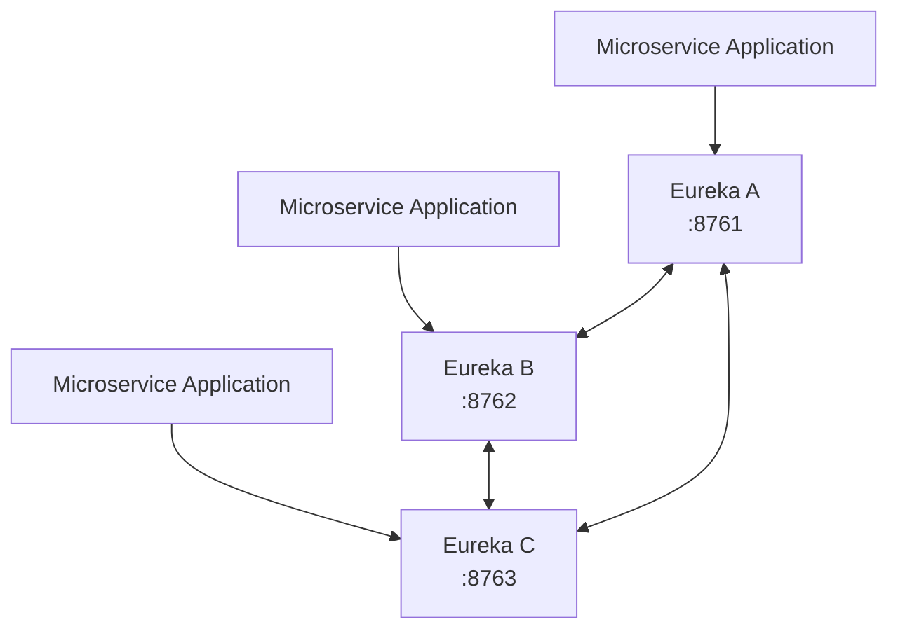
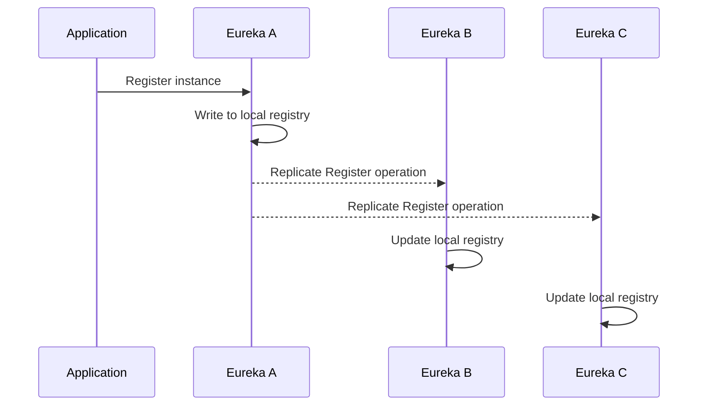
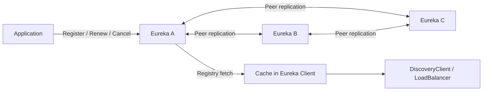

# Peer-to-Peer Replication Model and Relationships Between Servers

## 1. Why Does Eureka Need a Server Cluster?

In a microservice system, Eureka Server stores information about registered instances: application name, network address, port, status, and lease duration. A single Eureka Server can handle registration and lookup, but it becomes a single point of failure. If that server stops working, clients cannot register or fetch new instance lists from it.

You can deploy multiple Eureka Servers as a cluster. Each server maintains a local registry and exchanges data with peer servers. As a result, clients can connect to another available server while registration information is propagated across cluster members.

In this model, each Eureka Server acts as both:

- **A server for applications:** receiving registrations, lease renewals, deregistrations, and lookup requests.
- **A client for peer Eureka Servers:** connecting to configured peers to synchronize and replicate registry changes.

There is no central Eureka Server acting as the master of the entire registry. Nodes have equal peer roles; each node can accept requests from applications and forward changes to other peers.

## 2. Structure of a Eureka Cluster

Suppose we have three nodes: `eureka-a`, `eureka-b`, and `eureka-c`. Each node has its own endpoint and knows the addresses of the other two nodes.



The arrows between Eureka Servers represent peer relationships and registry exchange flows. This is not a fixed forwarding chain. A node can replicate changes to the peers it knows; the peers receive the changes and update their local registries.

### 2.1. Each Node Has Its Own Registry

The registry is not a shared database that every node reads from and writes to. Each Eureka Server holds its own registry copy in memory. Exchanges between peers help these registry copies gradually converge toward the same state.

This has two consequences:

1. A client that successfully registers with node A might not immediately see that instance when looking it up through node B.
2. When a node temporarily loses connectivity with its peers, it can still serve requests it can handle using its local registry. Data between nodes may temporarily differ.

Therefore, a Eureka cluster provides fault tolerance and high availability at the registration service level, paired with an eventual consistency model, rather than guaranteeing that every node sees every change at the exact same time.

### 2.2. No Fixed Leader

In a peer-to-peer cluster, no single leader node is elected to write all changes. Clients can send requests to any of the configured Eureka Servers. The receiving node processes the request in its local registry and replicates the change to its peers.

Because there is no primary master server, one node stopping does not mean the entire cluster must stop. The remaining nodes continue accepting requests if clients can connect to them and the remaining peers still meet operational needs.

## 3. How Peers Replicate the Registry

Eureka replicates instance lifecycle changes across peer servers. Common operations include:

| Operation | Meaning | Impact in the Cluster |
|---|---|---|
| Register | Instance registers for the first time | Peers receive instance information and add it to their local registry |
| Renew | Instance sends a heartbeat to renew its lease | Peers update the corresponding lease state |
| Cancel | Instance deregisters during graceful shutdown | Peers remove the instance information |
| Status update | Instance changes status such as `UP` or `DOWN` | Peers update the replicated status |

High-level processing flow when an application registers with node A:



The sequence above illustrates the concept, not a guarantee of completion time. Replication is processed through peer communication tasks; therefore, there may be a delay before all nodes finish updating.

### 3.1. Why Does Replication Not Create an Infinite Loop?

A change sent from A to B is a replication operation. When B receives that operation, B updates its registry without treating it as a new registration request from a client to broadcast back to all peers. Eureka marks replication requests to distinguish operations coming from peers from original client operations. This mechanism prevents a change from circulating endlessly around the cluster.

For example, when A sends a registration operation to B and C:

- B applies the change to B's registry.
- C applies the change to C's registry.
- B and C do not replicate that same operation back to A or rebroadcast it as an original request.

### 3.2. Replication and Registry Synchronization at Startup

When a Eureka Server starts up, it needs to know reachable peers and fetch registry information from the cluster. Peer configuration therefore matters both during normal operation and when a new node joins or restarts.

Initial synchronization should not be understood as an atomic transaction that immediately gives every node identical data. During startup, disconnections, or concurrent changes, registries across nodes may still differ temporarily. Monitor logs, peer status, and instance counts before considering a new node stably synchronized.

## 4. Configuring a Three-Node Eureka Server Cluster

A Eureka Server is enabled via the Eureka Server starter and the `@EnableEurekaServer` annotation. The configuration below illustrates three nodes running on three different ports. In a distributed deployment environment, hostnames must be resolvable from all nodes; do not use `localhost` to point to another machine.

### 4.1. Node A

```yaml
server:
  port: 8761

spring:
  application:
    name: eureka-server

eureka:
  instance:
    hostname: eureka-a
  client:
    registerWithEureka: true
    fetchRegistry: true
    serviceUrl:
      defaultZone: http://eureka-b:8762/eureka/,http://eureka-c:8763/eureka/
```

### 4.2. Node B

```yaml
server:
  port: 8762

spring:
  application:
    name: eureka-server

eureka:
  instance:
    hostname: eureka-b
  client:
    registerWithEureka: true
    fetchRegistry: true
    serviceUrl:
      defaultZone: http://eureka-a:8761/eureka/,http://eureka-c:8763/eureka/
```

### 4.3. Node C

```yaml
server:
  port: 8763

spring:
  application:
    name: eureka-server

eureka:
  instance:
    hostname: eureka-c
  client:
    registerWithEureka: true
    fetchRegistry: true
    serviceUrl:
      defaultZone: http://eureka-a:8761/eureka/,http://eureka-b:8762/eureka/
```

In this example:

- `registerWithEureka: true` allows the Eureka Server to register itself with the declared peers.
- `fetchRegistry: true` allows the node to fetch the registry from the configured Eureka Servers.
- `serviceUrl.defaultZone` lists the peers that the node connects to. Each node points to the other nodes, not to itself.
- `hostname` must be a unique name resolvable within the deployment network.
- The `/eureka/` path is the Eureka endpoint used by clients and peers.

`defaultZone` is the key name in Eureka's zone configuration map; keep the exact spelling `defaultZone` when declaring this key. If you use Docker Compose or Kubernetes, use the appropriate DNS/service name for your platform's internal network.

### 4.4. Standalone Configuration vs. Cluster Configuration

When running an independent node for development or testing, you can disable self-registration and registry fetching:

```yaml
eureka:
  client:
    registerWithEureka: false
    fetchRegistry: false
```

This is an appropriate configuration for a Eureka Server without peers. If you leave these two properties set to `false` on all nodes in a cluster, the servers will not perform the client role needed to connect and exchange registries with each other. For a multi-node cluster, configure a list of reachable peers and enable the corresponding features.

## 5. How Do Applications Connect to the Cluster?

Business applications also need to know the list of Eureka Servers so they do not depend on a single node. For example, a service can configure:

```yaml
eureka:
  client:
    serviceUrl:
      defaultZone: http://eureka-a:8761/eureka/,http://eureka-b:8762/eureka/,http://eureka-c:8763/eureka/
```

Eureka Client uses the endpoint list to communicate with the registry and has a mechanism to try another endpoint when a server is unavailable. Configuring the peer list on the server and the endpoint list on the application serve two related but distinct purposes:

| Configuration Location | Purpose |
|---|---|
| Eureka Server | Connects peer servers to replicate and synchronize the registry |
| Microservice application | Connects to the registry to register, renew leases, and look up instances |

When an application looks up a service, `DiscoveryClient` or the Eureka integration component reads information from the registry maintained by Eureka Client. The client-side load balancer can use this instance list to choose a target instance. Because the registry is cached and refreshed periodically, lookup results do not necessarily reflect every change that just occurred on another peer immediately.

## 6. Data Consistency and Limitations to Understand

### 6.1. Eventual Consistency

Peer-to-peer replication helps nodes converge toward the same registry, but it does not provide strong consistency guarantees for every operation. An instance that just registered at A may appear later at B and C. The delay depends on network conditions, replication task queues, peer responsiveness, and the client's cache refresh interval.

Therefore, you should not build business logic that requires a registration change to be visible to every node simultaneously. If a processing flow needs to verify instance availability, combine timeouts, bounded retries, and the service's own health check.

### 6.2. Heartbeat and Lease

Instances send periodic heartbeats to renew their lease with Eureka. Common default values for Eureka Client are sending a heartbeat every 30 seconds, with a default lease duration typically of 90 seconds. These values are configurable and should not be treated as exact failure detection times in every environment.

When an instance stops gracefully, it can send a deregistration request. When an instance disconnects abruptly, Eureka relies on lease expiration and eviction to remove stale information. Changes to leases and statuses also need to propagate across peers.

### 6.3. Self-Preservation

Eureka has a self-preservation mechanism to limit mass eviction of instances when the number of received heartbeats is abnormally low. This mechanism is useful when the network is disrupted or many clients are temporarily unable to send heartbeats, because deleting all instances in that situation could cause the registry to lose still-valid data.

In return, when self-preservation is activated, some instances that have actually stopped working may remain in the registry longer than expected. That is why you should monitor heartbeats, renewal rates, peer status, and application health checks rather than relying solely on whether an instance still appears in Eureka.

## 7. What Happens When a Peer Fails?

### 7.1. A Eureka Server Stops Working

Suppose node B stops:

1. Applications configured with an endpoint list containing A, B, and C can try connecting to A or C when B does not respond.
2. A and C continue serving requests if they remain healthy and hold sufficient registry information.
3. Changes occurring while B is down cannot be received directly by B. Applications must send requests through active nodes.
4. When B restarts and connects to its peers, it needs to resynchronize its registry. Verify this process through logs and observable metrics.

Fault tolerance only matters if clients genuinely know multiple endpoints and the network allows them to reach the remaining nodes. If all applications point only to a single failing address, a multi-node cluster still will not help those applications fail over to another node.

### 7.2. Lost Connectivity Between Peers

A node may still be reachable by applications while unable to communicate with a peer due to DNS errors, firewalls, network routes, TLS, or a hung peer process. In that case, the node still has its local registry and can continue serving requests, but data across nodes risks diverging.

Once connectivity is restored, peers can resume exchanging changes. You should not assume network recovery immediately resolves all discrepancies. Check for stale instances, leases, statuses, and replication error logs.

### 7.3. Network Partition

If the cluster is split into two groups that cannot communicate with each other, each group can continue receiving part of the traffic based on the nodes reachable within that group. The groups may record different changes during the network partition. When connectivity recovers, the registry needs time to converge; during this time, clients on the two sides may receive different lookup results.

This is a consequence of a distributed, eventually consistent model. Eureka is not a consensus system that guarantees a single record is committed simultaneously across all nodes. Application design must tolerate delayed discovery information and handle unavailable instances using timeouts, retries, and health checks.

## 8. Observing and Operating the Cluster

When deploying a Eureka cluster, you should check the following signal groups:

| Monitoring Group | Signs to Observe | Meaning |
|---|---|---|
| Peer connectivity | Connection errors, timeouts, HTTP errors when calling peers | Possible misconfigured addresses or network/TLS issues |
| Heartbeat | Dropping renewal rate, abnormal lease expirations | Clients may be disconnected or overloaded |
| Registry | Application/instance count mismatch across nodes | Possible replication lag or replication errors |
| Self-preservation | Self-preservation mode warning activated | Eureka is throttling eviction due to missing heartbeats |
| Client | Registration, lookup, or endpoint failover errors | Applications may only be reaching part of the cluster |

Some useful operational principles:

- Place nodes in appropriate failure domains and avoid having all nodes depend on a single machine or single network path.
- Provision stable hostnames resolvable across nodes; verify Eureka ports and paths from the actual application runtime environment.
- Configure endpoint lists for both peers and client applications. Test failing over to another node when an endpoint stops.
- Protect registry endpoints with TLS, restrict access to internal networks, and apply authentication mechanisms suited to your infrastructure.
- Monitor heartbeat rates, self-preservation warnings, replication logs, and registry discrepancies across nodes.
- Perform controlled tests for single-node shutdown, peer connectivity loss, and recovery after a network partition.

Do not treat a single node's dashboard as the sole proof of health for the entire cluster. The dashboard shows the registry held by that specific node; cross-check multiple nodes and connectivity signals to detect discrepancies.

## 9. Distinguishing Three Commonly Confused Data Flows

In a Eureka-based system, there are three related but distinct flows:

1. **Application to Eureka:** applications register instances, send heartbeats, deregister, and look up services.
2. **Eureka to Eureka:** peers replicate changes and synchronize the registry between servers.
3. **Eureka Client to registry cache:** clients fetch/update a local registry copy for `DiscoveryClient` and the client-side load balancer to use.



The first flow modifies the registry through a server; the second distributes changes among servers; the third gives clients data to look up and select instances. When debugging, identify which flow is failing: registrations not reaching the server, servers failing to replicate to peers, or clients not yet refreshing their cache.

## 10. Summary

A Eureka cluster uses a peer-to-peer model: each Eureka Server maintains a local registry, serves clients, and exchanges changes with configured peers. There is no fixed leader; register, renew, cancel, and status update operations are replicated so nodes converge toward the same state.

This model improves availability when a node fails, at the cost of replication delay and the possibility of registries temporarily differing across nodes. For reliable cluster operation, configure reachable bidirectional peers, provide multiple endpoints to clients, monitor heartbeats and replication, and test node-loss and network-partition scenarios.
