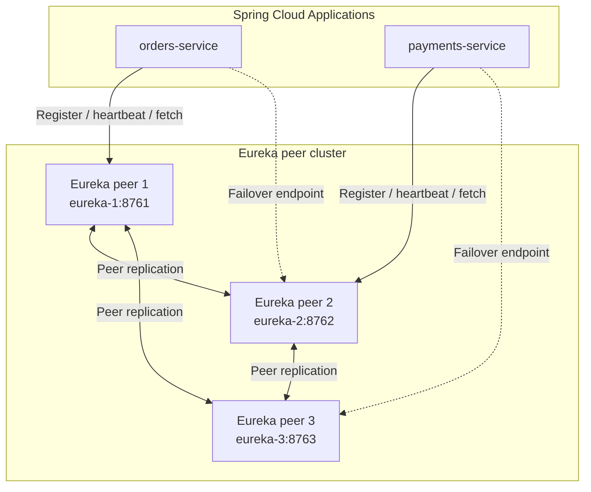

# Configuring Multiple Eureka Peers Using Separate Profiles

A Eureka Server can operate standalone, but in environments that require fault tolerance, you typically deploy multiple Eureka Servers participating in a peer cluster. Each server holds a local registry and exchanges registry changes with the remaining peers. Spring Cloud applications can register with an available peer and continue querying the registry through other peers when failures occur.

When using a single Eureka Server application across multiple machines or processes, each instance needs its own configuration: a hostname reachable from peers, a listening port, and a list of URLs for the remaining peers. Spring profiles provide a clean way to package these values into `peer1`, `peer2`, and `peer3`, and then select the configuration at startup without modifying source code.

## 1. How Does a Eureka Peer Cluster Work?

In a Eureka peer cluster, each Eureka Server simultaneously fulfills two roles:

- **Eureka Server:** receives registrations, heartbeats, deregistrations, and registry fetch requests from Eureka clients.
- **The server's own Eureka Client:** registers with other peers and exchanges registry information with them.

The servers are equal peers. There is no fixed master server coordinating every operation. When an application registers with a peer, that peer records the instance and forwards the change to its configured peers. The peers continue serving queries from the registry they hold.

This provides better fault tolerance than a single server: if one peer stops, applications can still connect to other peers. However, Eureka does not use Raft or a quorum mechanism to produce a strongly consistent registry across the entire cluster. Synchronization between peers is eventually consistent; during network disruptions, peers may temporarily hold different data. Once connectivity is restored, they resume exchanging updates to converge.

### Diagram of a Three-Peer Cluster



The arrows between applications and peers represent the endpoints that clients can use. The arrows between peers represent registry exchanges. In practice, the Eureka client determines available endpoints based on configuration and connection state; applications do not need to write custom logic to call servers one by one.

## 2. Why Use Separate Profiles for Each Peer?

Three Eureka Server processes can share the same artifact, the same `spring.application.name`, the same dependencies, and the same common configuration. They differ only in settings tied to deployment location:

| Property | Peer 1 | Peer 2 | Peer 3 |
| --- | --- | --- | --- |
| Profile | `peer1` | `peer2` | `peer3` |
| Hostname | `eureka-1` | `eureka-2` | `eureka-3` |
| Example port | `8761` | `8762` | `8763` |
| Declared peer URLs | Peer 2, 3 | Peer 1, 3 | Peer 1, 2 |

Splitting configuration by profile provides several benefits:

- One codebase and one JAR file can run on multiple nodes.
- Each node gets the hostname, port, and peer URLs appropriate for its environment.
- You can select a peer at startup using `SPRING_PROFILES_ACTIVE` or `--spring.profiles.active`.
- It is easy to inspect each node's configuration and update addresses when topology changes.

Profiles do not create a cluster by themselves. They only select the property set loaded when the application starts. The cluster works only when hostnames, ports, firewalls, DNS, and peer URLs can actually reach one another.

## 3. Preparing the Project Structure

The example uses a Spring Boot project with the Spring Cloud Netflix Eureka Server dependency. The Spring Boot and Spring Cloud versions must belong to a compatible pair according to the project's release train. This section focuses on runtime configuration; dependency versions are not pinned here to avoid mixing incompatible release trains.

Mark the application as a Eureka Server:

```java
package com.example.discovery;

import org.springframework.boot.SpringApplication;
import org.springframework.boot.autoconfigure.SpringBootApplication;
import org.springframework.cloud.netflix.eureka.server.EnableEurekaServer;

@SpringBootApplication
@EnableEurekaServer
public class EurekaServerApplication {

    public static void main(String[] args) {
        SpringApplication.run(EurekaServerApplication.class, args);
    }
}
```

The required dependency is the `spring-cloud-starter-netflix-eureka-server` starter in the Eureka Server module. You must import a Spring Cloud BOM compatible with your Spring Boot version to manage the starter version.

A common configuration layout:

```text
src/main/resources/
├── application.yml
├── application-peer1.yml
├── application-peer2.yml
└── application-peer3.yml
```

`application.yml` holds shared properties. Each `application-{profile}.yml` file holds only the settings specific to its corresponding peer.

## 4. Declaring Shared Configuration

In `application.yml`, declare the application name and enable Eureka client mode for the Eureka Server itself:

```yaml
spring:
  application:
    name: eureka-server

eureka:
  client:
    register-with-eureka: true
    fetch-registry: true
  server:
    enable-self-preservation: true
```

The two properties `register-with-eureka` and `fetch-registry` are critical in peer configuration:

- `register-with-eureka: true` allows the server to register its own information with the declared peers.
- `fetch-registry: true` allows the server to fetch the registry from the peers.

In some standalone Eureka Server examples, these two properties are set to `false` so the server does not register with itself. That configuration is unsuitable when you want servers to participate in peer-based registry exchange.

`enable-self-preservation` is kept enabled to prevent mass eviction of instances when the server receives fewer heartbeats than expected due to temporary network issues. Do not disable this mechanism just to make dashboard warnings disappear; investigate heartbeats, leases, and network quality first.

## 5. Creating a Separate Profile for Each Peer

In the example of running three processes on a single development machine, each peer uses a different port. When deploying on three separate machines, you can use the same `8761` port on each machine and replace the hostname with DNS or a stable network address.

### `application-peer1.yml`

```yaml
server:
  port: 8761

eureka:
  instance:
    hostname: eureka-1
    prefer-ip-address: false
  client:
    service-url:
      defaultZone: "http://eureka-2:8762/eureka/,http://eureka-3:8763/eureka/"
```

Peer 1 listens on port `8761` and knows about peer 2 and peer 3. It does not need to include its own URL in the target peer list.

### `application-peer2.yml`

```yaml
server:
  port: 8762

eureka:
  instance:
    hostname: eureka-2
    prefer-ip-address: false
  client:
    service-url:
      defaultZone: "http://eureka-1:8761/eureka/,http://eureka-3:8763/eureka/"
```

Peer 2 listens on port `8762` and connects to peer 1 and peer 3.

### `application-peer3.yml`

```yaml
server:
  port: 8763

eureka:
  instance:
    hostname: eureka-3
    prefer-ip-address: false
  client:
    service-url:
      defaultZone: "http://eureka-1:8761/eureka/,http://eureka-2:8762/eureka/"
```

Peer 3 listens on port `8763` and connects to peer 1 and peer 2.

Note on property naming: `defaultZone` is a key in Eureka client's `serviceUrl` map. Keep the camel case spelling `defaultZone`, even when surrounding properties use kebab case. Writing `default-zone` can prevent Eureka from reading the URLs as intended.

## 6. Starting Each Peer by Profile

After building the project into a JAR file, start three processes with their respective profiles. On Linux or macOS, you can open three terminals:

```bash
java -jar eureka-server.jar --spring.profiles.active=peer1
java -jar eureka-server.jar --spring.profiles.active=peer2
java -jar eureka-server.jar --spring.profiles.active=peer3
```

In PowerShell, you can set the profile in an environment variable before running the process:

```powershell
$env:SPRING_PROFILES_ACTIVE = "peer1"
java -jar .\eureka-server.jar
```

Open another terminal and set `peer2`, then do the same for `peer3`. Each process must have its own port when running on the same machine. If all three processes bind to port `8761`, only the first process can claim the port and the subsequent ones will fail to start.

When deploying on separate machines, you can keep the same port `8761` because each machine has its own IP address. For example:

| Profile | Hostname | Port |
| --- | --- | --- |
| `peer1` | `eureka-1.internal.example` | `8761` |
| `peer2` | `eureka-2.internal.example` | `8761` |
| `peer3` | `eureka-3.internal.example` | `8761` |

Update the URLs in each profile according to the actual hostnames and ports. The hostnames must be resolvable from all peers and from applications that need to access Eureka.

## 7. Configuring Applications to Register with All Peers

Eureka clients such as `orders-service` or `payments-service` also need to know multiple endpoints. Client configuration should list all peers so the client can continue registering and fetching the registry when one server is temporarily unreachable.

Example `application.yml` for `orders-service`:

```yaml
spring:
  application:
    name: orders-service

eureka:
  client:
    register-with-eureka: true
    fetch-registry: true
    service-url:
      defaultZone: "http://eureka-1:8761/eureka/,http://eureka-2:8762/eureka/,http://eureka-3:8763/eureka/"
```

With this client:

- `register-with-eureka` enables instance registration and heartbeat sending.
- `fetch-registry` allows downloading the service instance list for discovery.
- `defaultZone` contains the peer endpoints available for use.

In production, if Eureka uses HTTPS or authentication, clients must use URLs and credentials matching the system's security configuration. Do not embed real passwords or tokens in configuration files committed to a repository.

## 8. Verifying Peer Replication

After the peers start, verify both network connectivity and registry data. The dashboard opens at the root URL of each peer, such as `http://localhost:8761/`, `http://localhost:8762/`, and `http://localhost:8763/` in a local single-machine setup.

You can inspect the registry via the Eureka REST API:

```bash
# View registry on peer 1
curl -H "Accept: application/json" http://localhost:8761/eureka/apps

# View registry on peer 2
curl -H "Accept: application/json" http://localhost:8762/eureka/apps

# View registry on peer 3
curl -H "Accept: application/json" http://localhost:8763/eureka/apps
```

Practical verification workflow:

1. Start all three peers and wait for them to finish initializing.
2. Start `orders-service` with a URL list containing all three peers.
3. Open the dashboard or call the REST API on each peer to check for the `ORDERS-SERVICE` instance.
4. Wait for a synchronization interval, then compare instance status across peers.
5. Stop one peer and confirm that the client can still reach the remaining peers.
6. Restart the stopped peer and verify that the registry converges after connections are restored.

Registry comparisons must account for synchronization lag, heartbeats, and health state. Do not conclude that replication is broken just because two dashboards differ during a very brief window right after registration or a node restart.

## 9. How Eureka Handles Disconnected Peers

A peer may become temporarily unreachable because the process stopped, DNS failed, a firewall blocked the port, or the network between nodes was disrupted. When that happens:

- Remaining peers continue serving if applications can still reach them.
- The Eureka client tries configured endpoints according to the client's retry mechanism and connection state.
- Registries on different peers may diverge while communication is lost.
- When the link recovers, peers resume exchanging data so the registry converges.

Eureka has no quorum to elect a single leader. Therefore, do not apply the operational mindset of a consensus system like Raft to Eureka peers. Each server can accept registrations within the scope it serves; what matters is that clients know multiple peers and peers can communicate bidirectionally as configured.

### Self-Preservation and Leases

Eureka clients periodically send heartbeats to renew their leases. If the server does not receive heartbeats within the configured window, the instance may be marked or removed from the registry according to lease and eviction policies. During a widespread network outage, the number of received heartbeats drops sharply even though many applications are still running. Self-preservation helps prevent mass deletion of instances in this situation.

In the default setup, clients send heartbeats roughly every 30 seconds, and leases expire after roughly 90 seconds if not renewed. Actual values can be customized via `eureka.instance.lease-renewal-interval-in-seconds` and `eureka.instance.lease-expiration-duration-in-seconds`. Change these values only when you understand their impact on dead-instance detection and network fault tolerance.

## 10. Common Configuration Mistakes

| Symptom | Possible Cause | How to Check and Fix |
| --- | --- | --- |
| Peer only shows itself or does not see other peers | `register-with-eureka` or `fetch-registry` is `false`; wrong peer URLs | Check shared config, active profile, and Eureka client logs |
| Peer cannot connect to hostname | Missing DNS record, or hostname only exists on one machine or container | Test DNS resolution from the node actually running Eureka |
| Peer mistakenly calls `localhost` | Using `localhost` in a multi-machine or multi-container setup | Use a DNS/service name reachable over the network between nodes |
| Two processes cannot start on the same machine | Duplicate `server.port` | Assign a different port to each profile when running locally |
| No instances in the registry | Application has not registered, wrong `defaultZone`, or client cannot reach Eureka | Check client logs, URLs, REST API, and network status |
| Registries differ across peers | Replication is lagging or inter-peer connectivity is disrupted | Check peer logs, DNS, firewalls, and re-compare after connectivity recovers |
| Instances disappear on flaky networks | Lease expired or self-preservation is misconfigured | Check heartbeats, leases, and self-preservation state before changing thresholds |
| URL configuration is not applied | Invalid YAML structure or `default-zone` was written | Keep the `defaultZone` map key, check the active profile, and inspect effective config |

When debugging, confirm which profile was actually loaded. Inspect startup logs to verify the active profile, server port, and peer URL list. Avoid changing hostname, port, profile, and firewall rules all at once, as that makes it difficult to identify the root cause.

## 11. Security and Production Deployment Notes

Eureka Server typically runs inside an internal network. The dashboard and REST API should not be exposed publicly on the Internet. For real environments, you should:

- Restrict peer-to-peer access with firewalls or security groups; open only the required ports between nodes.
- Use HTTPS/TLS for connections according to security requirements and manage certificates with clear lifecycles.
- Protect the REST API with authentication and authorization if open access to the registry is not permitted.
- Manage secrets using a secret store or platform environment variables; do not commit credentials to profile YAML files.
- Use stable internal DNS or infrastructure service discovery addresses to identify peers.
- Monitor peer status, instance counts, heartbeats, lease expirations, connection errors, and replication lag.
- Test single-peer shutdown, peer recovery, and cross-zone network disconnection before going to production.

Profiles should contain only peer identity and connection settings. Secrets, certificates, and sensitive environment details should be supplied through your platform's secure configuration management mechanism.

## 12. Pre-Production Checklist for a Eureka Cluster

- [ ] All peers run the same Eureka Server application and compatible dependency versions.
- [ ] Each peer has its own profile with the correct hostname and port.
- [ ] `register-with-eureka` and `fetch-registry` are enabled on the peer cluster.
- [ ] Each peer declares the URLs of the remaining peers using `defaultZone`.
- [ ] DNS and firewalls allow bidirectional communication between peers.
- [ ] Downstream applications declare multiple Eureka URLs so they can fail over to another peer.
- [ ] Verified that the registry synchronizes after registering a service.
- [ ] Tested stopping a peer and recovering that peer.
- [ ] Self-preservation, heartbeats, and leases are understood and monitored.
- [ ] The dashboard, REST API, credentials, and network connections are secured.

When using separate profiles, a single Eureka Server artifact can be deployed as multiple peers with clear configuration for each node. For stable cluster operation, each peer must properly identify itself, know the remaining peers, and Eureka clients must also have a fallback endpoint list. Replication checks and failure testing should be completed before considering the cluster production-ready.
