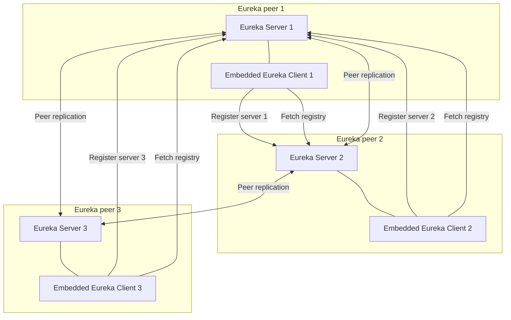
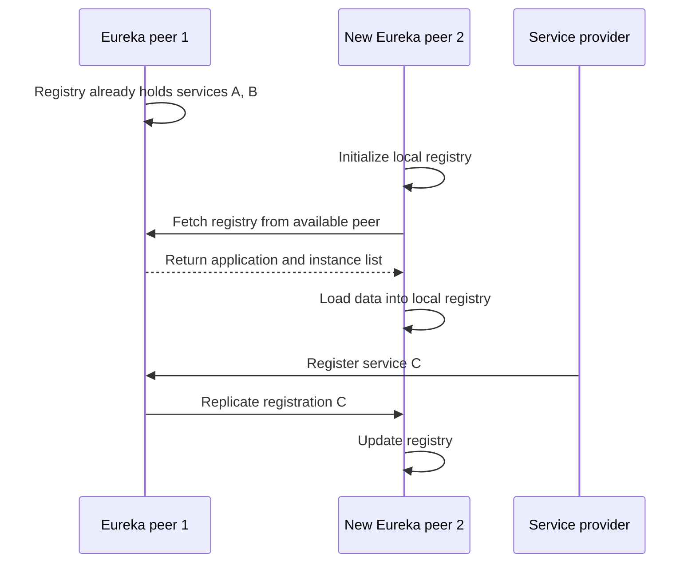

# Cross-Registration Between Peers and Initial Data Synchronization

In a Eureka peer cluster, each Eureka Server both accepts registrations from applications and acts as a Eureka Client to connect with peer servers. Peers need to know each other's addresses to exchange the registry. When a new peer starts up, it needs to retrieve existing data from active peers; afterward, registration, heartbeat, and deregistration changes continue to be replicated across peers.

Two activities are often referred to together as peer synchronization, yet they serve different roles: **cross-registration** helps servers know about and connect to one another; **initial registry synchronization** gives a new server the already existing service data. After the initialization phase, peer replication maintains new changes. Understanding these three flows helps prevent situations where each server displays a different list of services.

## 1. Three Flows to Distinguish

A Eureka Server in a peer cluster simultaneously has three responsibilities:

1. **Serving Eureka Clients:** receiving registrations, heartbeats, deregistrations, and registry read requests from applications.
2. **Registering itself with peers:** the embedded Eureka Client inside the server process registers the server's own instance with configured peers.
3. **Synchronizing the registry with peers:** the server retrieves initial data from peers and replicates registry changes that occur during operation.

The diagram below illustrates the dual role of each node:



The cross-registration path is not the entirety of the replication mechanism. Having a server register its own instance with a peer makes the node appear in the peer's registry. Replication, meanwhile, is the server-to-server mechanism that forwards changes for other service instances in the registry.

## 2. Configuring the Peer List and Embedded Eureka Client

Each Eureka Server needs to know the remaining peers in the same cluster. This list is typically configured via `eureka.client.service-url.defaultZone`. Each node declares the URLs of the other nodes and does not declare its own URL in the peer list.

Key properties:

| Property | Role in a Peer Cluster |
| --- | --- |
| `@EnableEurekaServer` | Enables Eureka Server functionality to accept client registrations and serve the registry API |
| `register-with-eureka: true` | Allows the embedded Eureka Client to register the server's instance with peers |
| `fetch-registry: true` | Allows the Eureka Client to download the registry from peers |
| `service-url.defaultZone` | Declares endpoints of the other peers |
| `spring.application.name` | Application name of the Eureka Servers; usually identical across peers |
| `eureka.instance.hostname` | Hostname that the peer advertises to other nodes |
| `eureka.instance.instance-id` | Unique identifier for each server process |

In a standalone configuration, the embedded Eureka Client typically disables registration and fetching. When moving to a peer cluster, configuring these two flags must reflect the peer role. If `register-with-eureka=false`, the node does not register itself with peers; if `fetch-registry=false`, the embedded Eureka Client does not download the registry into its local cache. Distinguish the Eureka Client's fetch operation from the server-side registry synchronization step when a Eureka Server starts up; these are two related flows, not the same operation.

## 3. Configuring a Two-Peer Cluster

With two peers, each server declares the URL of the other server. For example, both run on port `8761` on two machines with internal DNS:

### Peer 1: `eureka-1`

```yaml
spring:
  application:
    name: eureka-server

server:
  port: 8761

eureka:
  instance:
    hostname: eureka-1.internal
    prefer-ip-address: false
    instance-id: eureka-1.internal:${server.port}
  client:
    register-with-eureka: true
    fetch-registry: true
    service-url:
      defaultZone: http://eureka-2.internal:8761/eureka/
```

### Peer 2: `eureka-2`

```yaml
spring:
  application:
    name: eureka-server

server:
  port: 8761

eureka:
  instance:
    hostname: eureka-2.internal
    prefer-ip-address: false
    instance-id: eureka-2.internal:${server.port}
  client:
    register-with-eureka: true
    fetch-registry: true
    service-url:
      defaultZone: http://eureka-1.internal:8761/eureka/
```

Both processes share the same `spring.application.name` because they are instances of the Eureka Server application, but they have distinct hostnames and instance IDs. Each hostname must be resolvable from the other peer. If using IP addresses instead of hostnames, you can enable `prefer-ip-address` and ensure the advertised address is routable.

In a local environment, if you run two peers on the same machine, use two different ports and update the corresponding URLs, such as `localhost:8761` and `localhost:8762`. Do not use `localhost` across two separate machines because each machine will point to itself.

## 4. Configuring a Three-Peer Cluster

With three peers, each node declares the other two nodes. The peer list configuration must be symmetric: every node must be able to connect to the peers listed.

| Node | Hostname | Declared Peer URLs |
| --- | --- | --- |
| Peer 1 | `eureka-1.internal` | `eureka-2.internal`, `eureka-3.internal` |
| Peer 2 | `eureka-2.internal` | `eureka-1.internal`, `eureka-3.internal` |
| Peer 3 | `eureka-3.internal` | `eureka-1.internal`, `eureka-2.internal` |

Example configuration for peer 1:

```yaml
spring:
  application:
    name: eureka-server

server:
  port: 8761

eureka:
  instance:
    hostname: eureka-1.internal
    instance-id: eureka-1.internal:${server.port}
  client:
    register-with-eureka: true
    fetch-registry: true
    service-url:
      defaultZone: "http://eureka-2.internal:8761/eureka/,http://eureka-3.internal:8761/eureka/"
```

Peer 2 and peer 3 use the same structure, substituting the hostname and URL list per the table. In YAML, `defaultZone` is the map key name per Eureka client convention; preserve camel case spelling. When specifying multiple URLs, you can place them in a comma-separated string.

You should not configure a peer list containing only the current node itself. Such a configuration establishes no connections to other peers and tends to make the server behave like an isolated node.

## 5. How Does Cross-Registration Happen?

Suppose peer 1 and peer 2 have started and know each other's URLs:

1. The embedded Eureka Client in peer 1 reads peer 2's URL from `defaultZone`.
2. Peer 1 sends a registration for its `eureka-server` instance to peer 2 and maintains heartbeats via the Eureka Client mechanism.
3. Peer 2 performs the same operation with peer 1.
4. Each peer can see the other peer's instance in its registry.
5. When a business application registers with one peer, the server receives the request and forwards the registry change to configured peers.

Cross-registration allows servers to recognize one another via the registry and establish peer relationships. However, seeing the `eureka-server` instance in the dashboard does not prove that the entire service registry is synchronized. You must also inspect the list of business services and replication flows.

## 6. Initial Registry Synchronization When a Peer Starts Up

A new peer may start with an empty local registry. If active peers already hold many service instances, the new node needs to retrieve the existing state so it can serve queries immediately after initialization.

Conceptually, the bootstrap process proceeds as follows:

1. Eureka Server initializes its local registry and builds its peer list from configuration.
2. The initial synchronization mechanism contacts available peers to retrieve registered applications and instances.
3. Retrieved records are loaded into the new node's local registry.
4. The embedded Eureka Client periodically fetches the registry to maintain its local client cache; this is a separate flow from the server-side bootstrap step above.
5. Subsequent registration, lease renewal, deregistration, and status update operations continue to be peer-replicated among servers.

Initial synchronization is a bootstrap step so the new node has baseline data. It is not a consensus transaction guaranteeing that every peer has the exact same snapshot at the exact same moment. The outcome depends on which peers are available and what data can be read during startup.

If all peers start together when all registries are empty, the nodes will not yet have business services to synchronize. As providers begin registering, new changes are propagated via peer replication. If a new peer joins after the cluster already holds data, it must be able to reach an active peer holding the registry to fetch initial data.

### Bootstrap Sequence Diagram



The sequence illustrates two stages: pulling existing data when the new peer starts up, and then receiving subsequent changes. In real deployments, operations can run concurrently and retry according to the Eureka version's mechanisms.

## 7. Peer Replication After Bootstrap

Once peers are running, Eureka needs to propagate registry changes to the remaining nodes. Commonly replicated operation types include:

| Operation | Example | Purpose |
| --- | --- | --- |
| Register | A new provider registers `inventory-service` | Adds the instance to peers' registries |
| Renew/heartbeat | A provider sends a heartbeat | Renews the lease and updates liveness state |
| Cancel/deregister | A provider shuts down gracefully | Removes the instance from the registry |
| Status update | An instance transitions state | Synchronizes instance status |
| Metadata/status override update | Instance information changes | Updates information that consumers can look up |

The server receiving a request from a client processes it in its local registry and then sends a copy of the request to peers via the replication mechanism. The request is marked as a replication request to distinguish it from an original request, preventing peers from endlessly forwarding it in a loop.

Replication does not mean a synchronous write waiting for every peer to acknowledge before replying to the client. Consequently, one peer may see a new instance briefly before another peer does. This is typical eventual consistency behavior in a Eureka peer topology.

## 8. Startup Order and Late-Joining Peer Scenarios

Starting peers in a fixed order is not mandatory, but you must ensure the peer list and network are ready. An easy-to-observe sequence in a lab environment is:

1. Start peer 1 and confirm the server endpoint is active.
2. Start peer 2; verify peer 2 connects to peer 1 and receives existing data.
3. Start peer 3; verify peer 3 connects to peer 1 and peer 2.
4. Start business providers and confirm instances appear on the peers.
5. Start consumers and confirm they can look up services from the configured Eureka endpoints.

In production, an orchestrator may start nodes simultaneously. Eureka Client and Server include retry mechanisms, but application readiness should not rely solely on whether the process has opened a port. Deployment health checks should verify the server endpoint and operational readiness aligned with system requirements.

When a peer has been shut down for a long period and restarts, verify it can reach at least one healthy peer to re-bootstrap its registry. Do not assume that reopening the TCP port proves stale data has been synchronized. Compare registries and observe fetch/replication logs after the node rejoins.

## 9. Configuring Business Eureka Clients

Business providers and consumers should also know multiple Eureka URLs so they can stay connected when a peer fails. For example:

```yaml
eureka:
  client:
    register-with-eureka: true
    fetch-registry: true
    service-url:
      defaultZone: "http://eureka-1.internal:8761/eureka/,http://eureka-2.internal:8762/eureka/,http://eureka-3.internal:8763/eureka/"
```

For a consumer-only application, you can set `register-with-eureka: false` while keeping `fetch-registry: true`. For a provider-only application, it can register without fetching if the application does not need outbound discovery. These flags describe the role of the Eureka Client within the application; peer servers in a cluster normally need both roles.

Do not point all clients at a single peer if the goal is to continue discovery when that peer stops. The endpoint list should include reachable peers and match the topology configuration.

## 10. Verifying Cross-Registration and Synchronized Data

Inspect each peer directly to distinguish client errors, peer list errors, and replication errors.

### Inspecting the Eureka Dashboard

Open the dashboard on each node, for example:

- `http://eureka-1.internal:8761/`
- `http://eureka-2.internal:8761/`
- `http://eureka-3.internal:8761/`

Check the following points:

- Whether the peer sees the instances of the other Eureka Servers.
- Whether business services appear on all peers after the synchronization window.
- Whether instance IDs, hostnames/IPs, and ports are consistent.
- Whether instance statuses match current health/lease states.

### Inspecting the Registry via REST API

```bash
# Fetch full registry from peer 1
curl -H "Accept: application/json" \
  http://eureka-1.internal:8761/eureka/apps

# Fetch full registry from peer 2
curl -H "Accept: application/json" \
  http://eureka-2.internal:8761/eureka/apps

# Fetch only INVENTORY-SERVICE application from peer 3
curl -H "Accept: application/json" \
  http://eureka-3.internal:8761/eureka/apps/INVENTORY-SERVICE
```

If the servers enforce authentication or TLS, include the appropriate credentials and certificate configuration for your environment. Do not disable security just to run inspection commands.

Compare data after a new provider registers, sends heartbeats, and deregisters. Allow time for replication and cache updates before concluding that two peers are out of sync.

## 11. Diagnosing Out-of-Sync Peers

| Symptom | Possible Cause | Diagnostic Steps |
| --- | --- | --- |
| Peer 1 sees peer 2, but peer 2 does not see peer 1 | Asymmetric peer URL config, one-way DNS or firewall | Check `defaultZone` on both nodes and call the URLs from each node |
| Server appears in registry, but business services do not sync | Only self-registration works; replication or bootstrap is not functioning | Check the registry API on each peer and server replication logs |
| Newly started peer has an empty registry | Cannot reach source peer during bootstrap, or source peer is also empty | Check DNS, ports, peer availability, and initial sync logs |
| New peer has only a subset of instances | Some peers are unreachable, source data changed during sync, or sync is still in progress | Check each source peer and compare again after convergence time |
| New instance appears slowly | Client refresh, server replication, or cache is updating | Check fetch/replication intervals and endpoint health |
| Stopped instance still appears | Heartbeat/lease, deregistration, or cache has not expired yet | Check cancel logs, eviction, and registry refresh intervals |
| Peer repeatedly logs connection errors | Wrong hostname, port, TLS, authentication, or service URL | Test connectivity from the exact host/container running the peer |
| Duplicate server instances or unclear names | Non-unique `instance-id` or shared hostname | Assign a distinct hostname and instance ID to each server |

When diagnosing, check in order: peer URLs, DNS resolution, TCP/HTTP connectivity, authentication/TLS, self-registration, initial fetch, replication, and finally the business client cache. This approach helps pinpoint whether the fault lies in peer configuration, networking, or registry data.

## 12. Consistency and Cluster Design Notes

Eureka peer replication is eventually consistent. The cluster does not use a Raft quorum to commit a change across all servers before replying to a client. Therefore:

- Do not treat a single dashboard as the real-time source of truth for the entire cluster.
- Do not assume all peers have identical data immediately after a registration.
- Do not treat the peer count as a quorum voting system.
- Check multiple peers when investigating missing instances or differing statuses.
- Consumers must tolerate stale instance lists, timeouts, and connection errors to recently lost instances.

Deploying multiple peers improves service continuity when a node fails, but it does not automatically guarantee every request succeeds or that the registry is strongly consistent. Distribute peers across independent machines/failure domains, secure data and networking, monitor replication, and test node-stop and rejoin scenarios.

## 13. Security and Operations

Peer communication must be protected like any other internal connection:

- Open Eureka ports only between peers and from authorized applications.
- Use TLS and appropriate authentication mechanisms when required by the environment.
- Do not expose the dashboard or registry REST API to the public Internet.
- Use stable internal hostnames; avoid `localhost` addresses in multi-machine configurations.
- Assign a unique `instance-id` to each peer and keep application names consistent.
- Monitor register, renew, fetch, and replication errors; alert when a peer fails to receive the registry.
- Verify data on each peer during deployment workflows and after network incidents.
- Plan backup/configuration recovery and test peer rejoins periodically.

Do not scale out the number of peers arbitrarily. Each additional peer adds connections and replication traffic; choose a node count suited to your availability requirements and operational capacity.

## 14. Peer Synchronization Implementation Checklist

- [ ] Every node has `@EnableEurekaServer` enabled.
- [ ] Every peer enables `register-with-eureka: true` and `fetch-registry: true`.
- [ ] Each peer's `defaultZone` lists the remaining peers and does not point to itself.
- [ ] Each node has its own hostname and `instance-id`, resolvable and reachable from peers.
- [ ] Firewalls, TLS, and authentication allow peer-to-peer communication.
- [ ] Newly started peers can pull the initial registry from active peers.
- [ ] Registration, heartbeats, deregistration, and status updates are verified across multiple peers.
- [ ] Late-starting peers and peers rejoining after offline periods have been tested.
- [ ] Business applications declare multiple Eureka URLs for failover capability.
- [ ] Monitoring detects out-of-sync peers or prolonged replication errors.

Cross-registration enables Eureka Servers to discover and connect to their peers; initial synchronization gives a new node a baseline copy of the registry; peer replication propagates subsequent changes. Together, these three activities form a Eureka cluster capable of serving from multiple nodes, though data may still temporarily diverge due to eventual consistency. Consequently, proper peer list configuration, bootstrap verification, and per-node registry observation are indispensable operational steps.
